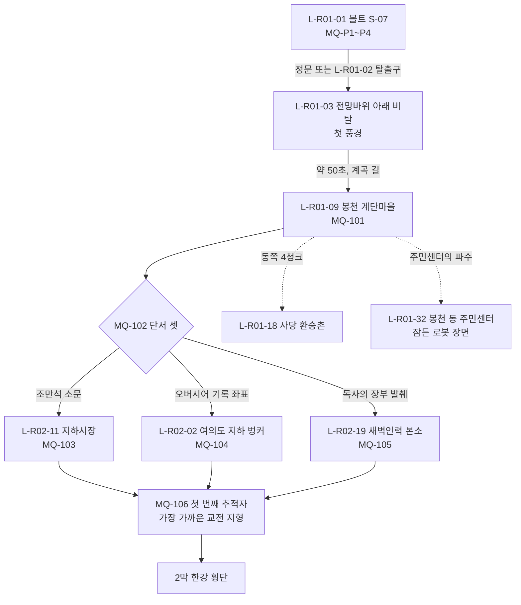

# SD-09a. 장소 카탈로그: R01 관악, R02 여의도·영등포

> **서울 폴아웃 상세 기획서 세트** | 문서 ID: SD-09a | 버전: v1.0 | 작성일: 2026-10-12
> **범위**: SD-08 §11.2(R01 관악 31곳)·§11.3(R02 여의도·영등포 27곳) 장소 시드 전부와 이 문서가 표 끝에 더한 3곳(R01 1, R02 2)의 장소 상세. 권역 개요 표, 장소별 2077→2277 상태·외부 배치·실내 구성·NPC·적·루팅·기록물·연계·판도 반응·환경 스토리텔링, 권역별 이름 있는 NPC 표(R01 58명, R02 52명), 사이드 퀘스트 훅(R01 16, R02 15), 랜덤 인카운터 지점·이동 경로 메모. 프롤로그·1막·4막 무대인 볼트 S-07, 봉천 계단마을, 사당 환승촌, 여의도 지하 벙커, 영등포 지하상가(지하시장), 새벽인력 본소를 S등급으로 가장 자세히 쓴다.
> **다루지 않음**: 사이드 퀘스트 본문(SD-04a), 세력 퀘스트 본문(SD-04d), 랜덤 인카운터 ID와 표(SD-05), 주요 인물 프로필(SD-07a), 지하철역 승강장층·하저 터널(SD-09f의 L-UG), 한강 다리·나루(SD-09f의 L-HR).
> **관련 문서**: [SC-00 컨셉](00_concept.md), [SD-02 세계관](02_world-and-lore.md), [SD-03a 메인 1부](03a_main-story-part1.md), [SD-03b 메인 2부](03b_main-story-part2.md), [SD-04a 남부 사이드](04a_side-quests-south.md), [SD-04d 세력 퀘스트](04d_faction-questlines.md), [SD-05 비표시·인카운터](05_misc-quests-encounters.md), [SD-06 세력](06_factions.md), [SD-07a 주요 인물](07a_characters-major.md), [SD-07b NPC 디렉터리](07b_npc-directory.md), [SD-08 월드·권역](08_world-regions.md), [SD-09f 지하·한강](09f_locations-underground-river.md), [SD-10 캐릭터](10_character-system.md), [SD-12 탐험·UI](12_exploration-ui.md), [SD-13 아이템](13_items.md), [SD-14 크리처·적](14_creatures-enemies.md), [SD-16 아트](16_art-direction.md), [SD-17 사운드](17_sound.md), [SD-18 명명](18_naming-terms.md)

---

## 목차
1. 개요
2. 권역 지도와 동선
3. R01 관악
   - 3.1 권역 개요 표 / 3.2 S등급 장소 / 3.3 A·B·C등급 장소 / 3.4 이름 있는 NPC / 3.5 사이드 퀘스트 훅 / 3.6 인카운터 지점·이동 경로
4. R02 여의도·영등포
   - 4.1 권역 개요 표 / 4.2 S등급 장소 / 4.3 A·B·C등급 장소 / 4.4 이름 있는 NPC / 4.5 사이드 퀘스트 훅 / 4.6 인카운터 지점·이동 경로
5. 두 권역 공통 데이터 (수집품·기록물·보스·판도 슬롯)
6. 원작 대응
7. 쯔꾸르 제작 메모
8. 미결 사항
- 부록 A. 신규 고유명사 / 부록 B. 참고 문서

---

## 1. 개요

### 1.1 목적
- SD-08이 좌표·청크·위협도까지 정한 장소 시드를 **제작자가 바로 맵과 이벤트를 만들 수 있는 장소 명세**로 바꾼다.
- 두 권역은 주인공이 처음 걷는 땅이다. 프롤로그(볼트 S-07), 1막 전체(봉천 → 지하시장·여의도 벙커·새벽인력 본소 → 첫 추적자), 4막 귀향(MQ-401)이 여기서 일어난다. 그래서 '수도 황무지에서 사는 법'을 가르치는 장소, 세력 여섯(정착지 연합·비상정부·각성회·지하시장·새벽인력·약탈자)을 처음 만나는 장소, 관리자 코드가 처음 깜박이는 장소를 촘촘히 둔다.

### 1.2 요약
| 항목 | R01 관악 | R02 여의도·영등포 |
|---|---|---|
| 장소 수 | 32(시드 31 + 추가 1) | 29(시드 27 + 추가 2) |
| 등급 분포 | S 3 / A 6 / B 12 / C 11 | S 3 / A 4 / B 11 / C 11 |
| 이름 있는 NPC | N-ID 54명 + 주요 인물 등장 4명 = 58 | N-ID 48명 + 주요 인물 등장 4명 = 52 |
| 사이드 퀘스트 훅 | 16 | 15 |
| 실내 맵(추정) | 64장 | 58장 |
| 보스·유일 개체 | 외눈(CR-500), 깡철이(CR-512), 윤석진(CR-514), 개통파 우두머리(CR-523) | 배수구 어미(CR-501), 황두칠(CR-513), 구학수(CR-526) |
| 흔들인형 | CL-13 의학(S-07 진료소) | CL-04 카리스마(국회 귀빈 접견실), CL-08 물물교환(지하시장 관리사무소) |
| 스킬북 | 12권(BK-R01-01~12) | 18권(BK-R02-01~18) |
| 한유리 기록(MQ-304 후보) | LR-15(관악 레이더 중계소), LR-18(S-07 오버시어 금고), LR-19(관악 행정 연수원) | LR-17(여의도 지하 벙커), LR-21(지하시장 배전실) |

### 1.3 표기 규칙
- **장소 ID**: SD-08 §11 시드 순서 그대로 `L-R01-01`~. 이 문서가 더한 장소는 표 끝 번호(L-R01-32, L-R02-28·29)다. 시드 이름은 바꾸지 않았다. 지도 마커 통칭을 다르게 쓰자는 제안은 각 권역 개요 표 아래 '통칭 제안'에 적었다.
- **좌표**: `tx·ty`는 SD-08 §3.2 변환식 값이다. 청크 칸의 `:xx,yy`는 청크 안 타일 좌표다(SD-08 §3.5). 이 문서는 보정(E2)을 하지 않았다. 보정이 필요한 곳은 미결에 적었다.
- **유형(아이콘)**: SD-08 §11.1 유형 어휘 + SD-12 §5.4 지도 아이콘 번호(예: `정착지 #3`).
- **위협·레벨**: 장소 위협도(1~5)와 SD-08 §14.4 적 레벨 범위. 실내는 처음 들어간 순간 레벨을 고정한다.
- **마커**: ● 지도 마커(발견 XP 일반 10 / 주요 25, SD-10 §4.4) / ◐ 발견 전까지 숨김 마커 / ○ 마커 없음(소문 원만).
- **장소 등급**: SD-16 §6.6. S(앵커 6+·실내 3~10장) / A(앵커 3~5·실내 2~5장) / B(앵커 1~2·실내 1~3장) / C(앵커 1·실내 0~1장).
- **판도 단위**: SD-08 §15.2 판도 구역 `PD-Rxx-n`과 §15.3 거점 단위 `PD-Hnn`. SD-06 §5.9 판도 거점은 이름으로 적는다.
- **BGM/BGS**: SD-17 §3 ID. 정착지 반경 안에서는 정착지 곡(BGM-S)이 탐험 곡보다 우선한다.
- **NPC 외형 코드**: SD-16 §7.2 형식 `몸-피부-머리-머리색-몸통계열-낡음-팔레트-머리장비-눈장비-소품`. SD-07b 코드표가 나오기 전이라 이 문서는 아래 값을 쓴다(SD-07b가 확정하면 일괄 치환).
  - 몸: M1 남 표준 / M2 남 체형 변형 / F1 여 표준 / F2 여 체형 변형 / E1 노인 남 / E2 노인 여 / K1 아동
  - 피부 S1~S6·SG1(구울)·SG2(야생 구울), 머리 HR00(민머리)~HR12, 머리색 H1~H8, 몸통 T01~T16(SD-16 §5.9), 낡음 0~2, 팔레트 PF01~PF12(SD-16 §4.5, 무소속은 PF00), 머리장비 HD00(없음)~HD18, 눈장비 EY00(없음)~EY08
  - 소품 PR: 이 문서가 제안하는 번호. PR001 장부 / PR002 클립보드 / PR003 확성기 / PR004 공구 벨트 / PR005 앞치마 / PR006 지팡이 / PR007 약봉지 / PR008 주민등록증 목걸이 / PR009 배달 상자 / PR010 낚싯대 / PR011 청진기 / PR012 열쇠 꾸러미 / PR013 사냥총 끈 / PR014 망원경 / PR015 고철 자루 / PR016 등사 유인물 / PR017 천공 카드 묶음 / PR018 녹광 머리띠 / PR019 출석부 / PR020 빨간 펜 / PR021 시험지 묶음 / PR022 배급 카드 / PR023 진공관 상자 / PR024 용접 마스크 / PR025 쇠사슬 / PR026 번호표 목걸이 / PR027 그물총 / PR028 근태 목걸이 / PR029 계산기 / PR030 명찰 / PR031 버섯 바구니 / PR032 물통 지게 / PR033 무전기 / PR034 경광봉 / PR035 서류 가방 / PR036 붕대 감은 팔 / PR037 구급 가방 / PR038 묵주 대신 진공관 목걸이(각성회) / PR039 야구 방망이 / PR040 손수레 / PR041 등유 램프 / PR042 칠판 지우개 / PR043 볼트 출입 카드 / PR044 수첩 / PR045 강아지 줄 / PR046 망치 / PR047 확대경 / PR048 우산 / PR049 담배 / PR050 장화
- **이름 교체 반영**: SD-02·SD-03a 본문의 강태오 → **육지환**, 천웨이 → **멍쉐밍**, 국민방송 → **공보방송**, 원작 용어 '불구' → **부위 손상**. 한결건설 마스코트는 **든든이**다(SD-10 §7.1의 '한결이 입주 기념 흔들인형'은 제품명이라 그대로 두되 마스코트 이름은 든든이로 읽는다. 미결 U-09a-03).

### 1.4 S등급 지정
| 장소 | 등급 근거 |
|---|---|
| L-R01-01 볼트 S-07 | 프롤로그 4장 전부, 4막 MQ-401, 에필로그 볼트 상태 4종. 실내 14장 |
| L-R01-09 봉천 계단마을 | 첫 정착지(MQ-101·102), 1막 숙소, 4막 이주민 수용, 5막 MQ-507 방어 후보. 거점 PD-H01 |
| L-R01-18 사당 환승촌 | 첫 지하철 경험(U01), 캐러밴 정류장, 판도 경합 거점 PD-H18 |
| L-R02-02 여의도 지하 벙커 | MQ-104. 1막 주제를 가장 분명히 말하는 장소, 한유리 기록 LR-17 |
| L-R02-11 지하시장 | MQ-103, 지하시장 세력 본거지 PD-H12, MQ-506 |
| L-R02-19 새벽인력 본소 | MQ-105, 생포 이벤트 도착지, MQ-504. 거점 PD-H15 |

---

## 2. 권역 지도와 동선

### 2.1 R01·R02 청크 격자 (SD-08 §4.2 발췌 + 장소 표시)
- 칸 하나가 청크 하나(40×40타일, 740m 사방)다. 가로가 청크 X(6~28), 세로가 청크 Y(25~40)다.
- `Ann` = L-R01-nn, `Bnn` = L-R02-nn. `+`는 그 청크에 장소가 더 있다는 뜻이다(아래 목록). 숫자는 권역(1 = R01, 2 = R02, 4 = R04, 6 = R06, 7 = R07, A = R10, B = R11), `~`는 한강(HR), `.`는 플레이 영역 밖이다.

```
      6   7   8   9   10  11  12  13  14  15  16  17  18  19  20  21  22  23  24  25  26  27  28
25     A   A   A   A   A   A   A   A   A   4   4   4   4   ~   4   4   6   6   6   6   6   6   6
26     A   A   A   A   A   A   A   A   A   2   2   2  B01  2   2   ~   ~   6   6   6   6   6   6
27     A   A   A   A   A   A   A   A   A   2  B15 B29  2  B03+B02+ 2   ~   ~   6   6   6   6   6
28     A   A   A   A   A   A   A   A   A   2  B14 B12 B11+ 2  B10 B09 B05  ~   ~   6   6   6   6
29     A   A   A   A   A   A   A   A   A   2  B24  2   2  B16 B17 A24 A23+A20  1   ~   ~   ~   7
30     2   2   2   2   2   2   2   2   2   2   2   2   2   2   1   1   1   1  A26  1   1  A21  7
31     2   2   2   2   2  B26  2  B23  2   2   2   2   2   2   1   1   1  A27  1   1  A22  1   7
32     .   2  B27  2   2   2   2   2  B25  2  B18  1   2  A17  1   1   1   1   1   1   1   1   7
33     .   .   2   2   2   2   2   2   2  B19+ 1  B21 A16  1  A15 A11 A32 A13  1   1   1   1   7
34     .   .   .   .   2   2   2   2   2  A28 B22  1   1   1   1   1  A09+ 1   1   1   1  A18  7
35     .   .   .   .   .   .   2   2   1   1   1   1   1   1   1  A14  1   1  A12  1   1   1   B
36     .   .   .   .   .   .   .   1   1   1   1  A29  1   1   1   1   1  A07  1   1   1  A19  B
37     .   .   .   .   .   .   .   .   .   1   1   1   1   1   1   1  A08 A01+A03  1   1   1   .
38     .   .   .   .   .   .   .   .   .   .   1  A30  1   1   1   1  A05 A02  1   1   1   .   .
39     .   .   .   .   .   .   .   .   .   .   1   1   1   1   1  A31  1   1  A04  .   .   .   .
40     .   .   .   .   .   .   .   .   .   .   .   1   1   1   .   .   .   .   .   .   .   .   .
```
- 한 청크에 둘 이상: C-19-27 = B03·B04·B06 / C-20-27 = B02·B07·B08·B28 / C-18-28 = B11·B13 / C-22-29 = A23·A25 / C-15-33 = B19·B20 / C-22-34 = A09·A10 / C-23-37 = A01·A06. 같은 청크 4곳(C-20-27)은 장소 중심끼리 8타일 이상 떨어져 있다(SD-08 §3.2 E3 확인).
- 지하 장소(SD-09f 소관)와의 접점: 사당역 승강장 L-UG-01(A18 아래), 서울대입구역 L-UG-02(A13), 신림역 L-UG-03(A15), 동작역 L-UG-04(A21 옆), 남태령역 L-UG-05(A19 아래), 영등포시장역 L-UG-06(B12 아래, 지하시장 뒷문), 여의도역 L-UG-07(B07 아래), 여의나루역 L-UG-08(하저 터널 남쪽 입구), 구로디지털단지역 L-UG-12(B21), 영등포구청역 L-UG-13(B15 아래).

### 2.2 1막 동선

- 봉천에서 세 경로 장소까지 기본 이동 1분 30초~2분이다(SD-08 §14.2). 길잡이는 북서쪽의 여의도 금탑(A등급 랜드마크)이고, 남부순환로 → 도림천 마른 수로 → 신길로 내려가는 길이 기본 동선이다(SD-08 §12.5).
- MQ-106 교전 지형 4종(SD-03a §8.6) 가운데 셋이 이 문서 범위다: **관악**(L-R01-12 낙성대 고개 캠프 북쪽 공터), **여의도**(L-R02-03 여의도 광장 착륙장), **영등포**(L-R02-12 영등포 역전 시장 앞 로터리). 강북 도로는 SD-09c.

---

