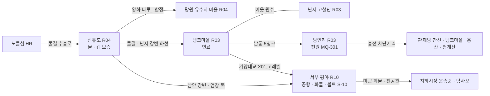
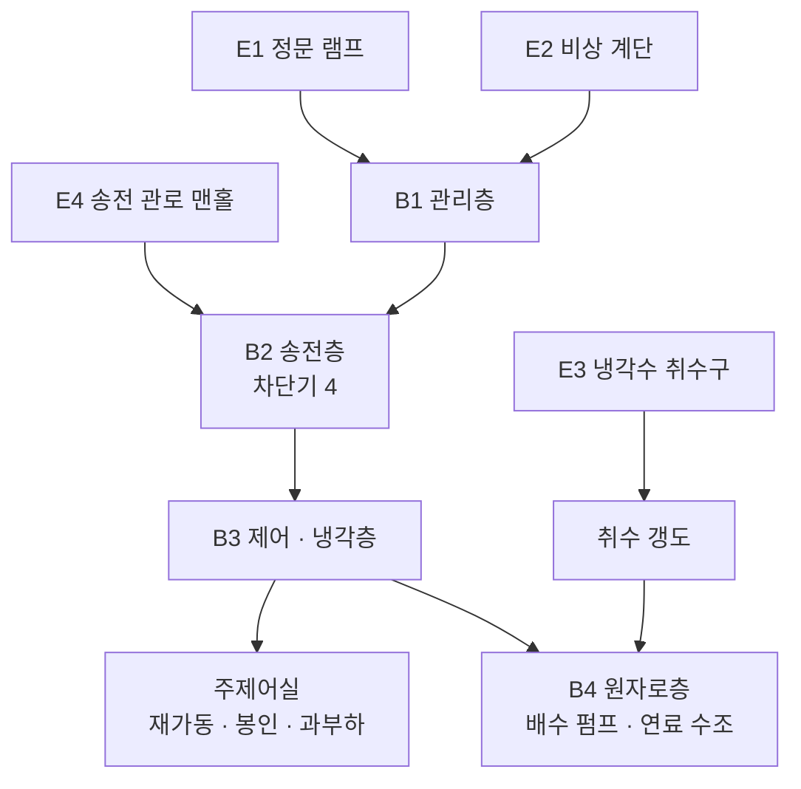
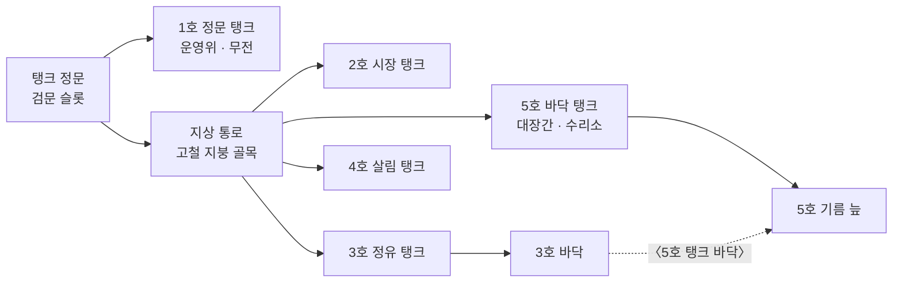

# SD-09b. 장소 카탈로그: R03 마포·상암, R04 서강·선유도, R10 서부 평야

> **서울 폴아웃 상세 기획서 세트** | 문서 ID: SD-09b | 버전: v1.0 | 작성일: 2026-10-12
> **범위**: SD-08 §11.4(R03 27곳)·§11.5(R04 20곳)·§11.11(R10 27곳) 장소 시드 전부와 추가 시드 6곳(L-R03-28, L-R10-28~32)의 장소 상세, 권역별 이름 있는 NPC(R03 55명, R04 40명, R10 37명), 권역별 사이드 퀘스트 훅(R03 15, R04 14, R10 14), 랜덤 인카운터 지점·이동 경로 / 다루지 않는 것: 퀘스트 본문(→ SD-04b), 지하철역·하저 터널·신월 빗물터널 본관·다리·나루 일부의 상세(→ SD-09f), 적·아이템 수치(→ SD-13·SD-14), 가격(→ SD-15)
> **관련 문서**: [SC-00 컨셉](00_concept.md), [SD-02 세계관](02_world-and-lore.md), [SD-03a 메인 스토리 1부](03a_main-story-part1.md), [SD-03b 메인 스토리 2부](03b_main-story-part2.md), [SD-04b 사이드 퀘스트(서부·한강)](04b_side-quests-west-river.md), [SD-04d 세력 퀘스트](04d_faction-questlines.md), [SD-05 비표시·반복·인카운터](05_misc-quests-encounters.md), [SD-06 세력](06_factions.md), [SD-07b NPC 디렉터리](07b_npc-directory.md), [SD-08 월드·권역](08_world-regions.md), [SD-09f 지하·한강](09f_locations-underground-river.md), [SD-10 캐릭터](10_character-system.md), [SD-11 전투](11_combat-system.md), [SD-12 탐험·UI](12_exploration-ui.md), [SD-13 아이템](13_items.md), [SD-14 크리처·적](14_creatures-enemies.md), [SD-15 경제](15_economy.md), [SD-16 아트](16_art-direction.md), [SD-17 사운드](17_sound.md), [SD-18 명명](18_naming-terms.md), 원작 [RD-13 장소](../reverse-design/13_locations.md), [RD-27 이식 메모](../reverse-design/27_adaptation-notes.md), 조사 [SR-02 서울 지리](research/SR-02_seoul-geography.md), [SR-03 인프라](research/SR-03_seoul-infrastructure.md)

---

## 목차
1. 개요
2. R03 마포·상암
3. R04 서강·선유도
4. R10 서부 평야
5. 원작 대응
6. 쯔꾸르 제작 메모
7. 미결 사항
- 부록 A. 신규 고유명사
- 부록 B. 참고 문서

---

## 1. 개요

### 1.1 목적
- SD-08이 정한 장소 시드(좌표·청크·위협)를 **실제로 만들 수 있는 장소 명세**로 바꾼다. 장소마다 2077년 시설, 2277년 상태, 외부 배치와 실내 구성, 사람과 적, 루팅, 연계 퀘스트, 판도 반응을 적는다.
- 세 권역은 서울판의 **서부 생활 경제**를 이룬다. 선유도의 물, 탱크마을의 연료, 당인리의 전기가 한강 서쪽 6km 안에 모여 있고, 그 바깥 서쪽에는 사람이 살 수 없는 공항 평야가 있다. 이 문서는 그 축이 장소 단위에서 보이게 설계한다.

### 1.2 요약
| 항목 | R03 마포·상암 | R04 서강·선유도 | R10 서부 평야 | 합계 |
|---|---|---|---|---|
| 장소(SD-08 시드 + 추가) | 27 + 1 = 28 | 20 | 27 + 5 = 32 | **80** |
| 지도 마커 | 27 | 19 | 30 | 76 |
| 장소 등급 S / A / B / C | 3 / 4 / 13 / 8 | 2 / 3 / 9 / 6 | 2 / 9 / 13 / 8 | 7 / 16 / 35 / 22 |
| 정착지 | 탱크마을 | 선유도, 망원 유수지 마을 | 없음(야영지 1) | 3 |
| 이름 있는 NPC | 55 | 40 | 37 | **132** |
| 사이드 퀘스트 훅 | 15 | 14 | 14 | 43 |
| 메인 퀘스트 무대 | MQ-301 당인리(3막), MQ-207 손길 | MQ-202 양화 나루(2막) | 없음 | — |
| 실내 맵(장) | 41 | 22 | 39 | 102 |
| 위협도 | 3(대부분), 4(당인리 내부·난지도 정상) | 2, 4(밤섬) | 3(목동)~5(공항) | — |
| 루팅 등급(기본/상한, SD-13 §9.2) | T2 / T4 | T1 / T2 | T4 / T5 | — |

- **S등급 7곳**: 당인리 지하 원자력 발전소(L-R03-01), 탱크마을(L-R03-03), 난지도 쓰레기 산(L-R03-04), 선유도(L-R04-01), 망원 유수지 마을(L-R04-05), 김포 피폭 공항 지대(L-R10-01 김포공항 크레이터 + L-R10-02 김포 활주로. L-R10-03·04를 부속 구역으로 묶는다).
- **추가 시드 6곳**: 다른 SD 문서가 'SD-09b에서 ID 부여'로 넘긴 장소다. L-R03-28 마포 소방서 차고(SD-13 W-117), L-R10-28 김포 전진 보급 야적장(SD-14 CR-502·미군 로봇 포드), L-R10-29 개화 방역 매몰지(SD-14 CR-093·CR-ENV-03), L-R10-30 오곡 곰 사육 농장 터(SD-14 CR-625), L-R10-31 개화산 탄약고(SD-06 '철벽경호 본사(옛 개화산 탄약고)', SD-10 흔들인형 폭발물), L-R10-32 개화 갈대밭 목동 야영지(SD-14 '서부 평야 목장' 두머리소).

### 1.3 표기 규칙
| 항목 | 규칙 |
|---|---|
| 장소 ID | SD-08 §11 시드 순서 그대로 `L-R03-01`부터. 추가 시드는 권역 표 끝 번호. 이름은 시드 이름을 바꾸지 않고, 다듬을 필요가 있으면 '통칭 변경 제안'에 적는다 |
| 좌표 | `tx·ty`는 SD-08 변환식 값이다. **이 문서의 장소는 모두 보정 0**이다(SD-08 E2~E4 조건에 걸리는 장소가 없다. 같은 청크 4곳 이상 없음, 다리 끝 장소 없음) |
| 마커 | ○ 지도 마커 있음 / × 마커 없음(구역 진입 알림만, 발견 XP 없음) |
| 등급 | SD-16 §6.6 장소 등급 S/A/B/C. 앵커 수·실내 맵 예산을 따른다 |
| 판도 단위 | SD-08 §15.2 판도 구역 `PD-Rxx-n`, 거점이면 §15.3 `PD-Hnn`을 함께 적는다 |
| BGM / BGS | SD-17 §3 큐 ID. 권역 탐험 곡(`BGM-X..`), 정착지(`BGM-S..`), 던전 유형(`BGM-D..`), 환경음(`BGS-..`) |
| 방사능 | SD-08 구역 등급 `Rad-0~4`와 SD-11 피폭 등급 `Z1~Z5`를 함께 적는다. 대응: Rad-1 = Z1, Rad-2 = Z2(실내 침수 구간은 Z3), Rad-3 = Z3~Z4, Rad-4 = Z4~Z5 |
| 적 | SD-14 `CR-` ID와 레벨대. 레벨은 SD-08 §14.4 위협도 범위 안에서 SD-14 §11.1 산정식으로 정한다 |
| 아이템 | SD-13 `W-·A-·I-·M-` ID. 고유하지 않은 루팅은 '루팅 등급'으로만 적는다 |
| 수집품 | 흔들인형 `CL-nn`(SD-10 §7.1 표 번호), 스킬북 `BK-nn`(SD-10 §7.2 스킬 번호) + 권수. 흔들인형 이름은 한결건설 마스코트 확정명에 따라 **'든든이 흔들인형'**으로 쓴다(SD-10의 '한결이'를 대체) |
| 기록물 | SD-02 §10 `LR-nn` |
| 사이드 퀘스트 훅 | 〈훅 이름〉. ID는 SD-04b가 부여한다. '권장 Lv'는 SD-08 §14.4 기준 |
| NPC ID | `N-R03-001` 형식. 바이블 §11과 다른 SD 문서가 만든 인물도 같은 이름·설정으로 등록하고 '출처'를 적는다. 주요 인물의 `C-` ID는 SD-07a가 병기한다 |
| 외형 코드 | SD-16 §7.2 형식 `몸-피부-머리-머리색-몸통계열-낡음-팔레트-머리장비-눈장비-소품`. 몸 코드는 SD-16의 몸 6벌에 맞춰 **M1 남 표준, M2 남 변형, F1 여 표준, F2 여 변형, E1 노인, K1 아동**으로 쓰고(제안), 구울은 피부 SG1, 야생화 직전 구울은 SG2, 로봇은 `RB-` + SD-14 모델 ID로 쓴다. 소품 `PR` 번호는 SD-16 소품 라이브러리 확정 전의 가번호다 |
| 이름 교체 | 육지환(구 강태오), 멍쉐밍(구 천웨이), 공보방송(구 국민방송), '부위 손상'(구 '불구'), 원칙파 약호 WP를 쓴다 |

### 1.4 세 권역의 관계: 물·연료·전기, 그리고 서쪽 끝
| 축 | 장소 | 무엇을 내는가 | 누가 노리는가 |
|---|---|---|---|
| 물 | 선유도(L-R04-01), 양평 펌프장(L-R04-15), 망원 취수탑(L-R04-08) | 정화수, 수경 식품, **캡 교환 보증** | 모두. 그래서 아무도 공격하지 않는다(SD-08 §7.4) |
| 연료 | 탱크마을(L-R03-03) 3호 정유 탱크 | 등유·윤활유·화염방사기 연료, 탄약 재생 | 난지 고철단(약탈), 비상정부(원자로 협력 요구), 새벽인력(위험 작업 인력 판매) |
| 전기 | 당인리 지하 원자력 발전소(L-R03-01) | 관제망 전원(MQ-301), 재가동 시 송전 | 비상정부·연합단·탱크마을·각성회·잔존병(전원이 돌아오면 임무 재개) |
| 위험한 보물 | 김포 피폭 공항 지대(L-R10-01~04), 전진 보급 야적장(L-R10-28), 볼트 S-10(L-R10-12) | 미군 화물(T5), 진공관·로봇 부품 | 활주로파, 철벽경호, 지하시장 운송꾼, 탐사꾼 |



- **강의 방향**: R03은 북안, R10은 남안이다. 선유도는 남안 소속(SD-08 §4.4), 망원·합정은 북안이다. 그래서 R04는 '강을 건너는 권역'이고, 양화대교(X02)·양화 나룻배(X03)·당산철교(X04)가 모두 이 권역을 지난다. R03에서 R10으로 바로 가는 길은 가양대교(X01)뿐이고 고레벨 균형 이동이다.
- **위협의 계단**: 선유도(1) → 망원·합정(2) → 마포·상암(3) → 당인리 내부·난지도 정상(4) → 목동(3)·마곡(4) → 공항(5). 볼트에서 내려온 주인공이 2막에 선유도에 닿고, 3막에 당인리로, 고레벨이 되어 서쪽 끝으로 간다.

### 1.5 이 문서의 공통 규칙
- **발견 XP**(SD-10 §4.4): 일반 장소 10, 주요 장소(정착지·볼트·S·A등급 던전·전망 지점) 25. 마커 × 장소는 주지 않는다.
- **루팅 레벨 연동**: 권역 기본 등급에서 시작해 플레이어 레벨 7·13·19·25마다 1등급 오르고 권역 상한에서 멈춘다(SD-13 §9.2). 장소별 '루팅'은 그 장소의 고정 상한·고정 배치만 적는다.
- **정착지 안 소유물**: 탱크마을·선유도·망원 유수지 마을 안의 컨테이너는 대부분 주인이 있다. 절도 적발 시 개별 호감도 -5(SD-06 §3.4), 경비 거점의 신고형 목격자(SD-12 M-14)가 적용된다.
- **실제 재난 소재 회피**: 망원동 일대의 실제 수해, 신월 빗물터널 공사 중 실제 사고를 장소 연출·퀘스트 소재로 쓰지 않는다. 침수 연출은 SD-08 §8.1 '수위 이벤트'와 SD-02의 볼트 실험(S-11)만 근거로 한다(SD-08이 성수대교를 뺀 것과 같은 기준).

---
## 2. R03 마포·상암

### 2.1 권역 지도
SD-08 §4.2 격자를 20타일(반 청크) 단위로 확대해 장소 번호를 찍었다. `::` = R03, `..` = 다른 권역(R04·R05·R06·R09), `~~` = 한강 HR. 가로 머리는 청크 X, 세로 머리는 청크 Y다. 한 칸에 둘이 겹치면 작은 번호만 적었다(08 칸에 09가 함께 있다).

```
      13  14  15  16  17  18  19  20  21  22  23  24  25
16                ....................::::::::..........
                  ....................::::::::..........
17                ::::::::::::::::::::::::::::::::......
                  ::::::::::::::::::::::::::::::::......
18            ::::::::::::::::::::::::::::::::::::::::..
              ::::11::::::::::::::::::::::::::::::::::..
19        ::::10::08::::::::::::::::::::::::::::::......
          ::::::::::::12::::::::::21::::::::22::::......
20    ::::::::::::::::::::::::::::::::::::::::::::23::..
      ::::06::::04::0307::::::::::::20::::::::::::::::..
21    ~~~~05::::::::::::13::::14::::::::18::::::::::::..
      ~~~~::::::::::::::::::::::::15::::::19::::::::::..
22    ....~~~~~~~~........::::::::::::::::::::::::::27..
      ....~~~~~~~~........::::::::::::::::::::::24::::..
23    ........~~~~............::::16::::::::::::::25::..
      ........~~~~............::::::::::::17::28::::::..
24    ........................::02::::::::....::::......
      ........................01::::::::::....::26......
```

- **서쪽 고지대**: 난지도 쓰레기 산(04)과 노을 언덕(05)이 한강 북안에 두 개의 인공 산을 이룬다. 그 동쪽 매봉산 기슭에 탱크마을(03)이 반쯤 묻혀 있고, 상암 경기장(07)이 길 건너에 있다.
- **북쪽 상암**: 방송단지(08)와 볼트 S-05(09), 수색 차량기지(11)가 불광천 서쪽 평지에 모인다.
- **동쪽 구릉**: 연희(20)·신촌(18·19)·안산(22)이 내부순환로 고가 아래 홍제천(21)을 따라 이어지고, 독립문(23)·충정로(27)에서 도심 밀폐 구역 성벽과 맞닿는다.
- **남쪽 강변**: 당인리(01·02)와 홍대(16)·서강(17), 공덕(26)·애오개(25)가 한강 북안을 따라 늘어선다. 탱크마을에서 당인리까지 남동쪽 약 5청크(실경로 약 1분 20초).

### 2.2 권역 개요 표
| ID | 이름 | 유형(아이콘) | tx·ty | 청크 | 위협 | 마커 | 등급 | 판도 단위 | BGM / BGS |
|---|---|---|---|---|---|---|---|---|---|
| L-R03-01 | 당인리 지하 원자력 발전소 | 던전(#12) | 778·986 | C-19-24 | 4 | ○ | S | PD-R03-3 / PD-H08 | BGM-D04, 장면 BGM-M301 / BGS-I02 |
| L-R03-02 | 당인리 굴뚝 공원 | 랜드마크(#20) | 792·977 | C-19-24 | 3 | ○ | B | PD-R03-3 | BGM-X03B / BGS-L08 |
| L-R03-03 | 탱크마을 | 정착지(#2) | 661·820 | C-16-20 | 1 | ○ | S | PD-R03-1 / PD-H02 | BGM-S02 / BGS-S02 |
| L-R03-04 | 난지도 쓰레기 산 | 세력 거점(#4) | 620·838 | C-15-20 | 3(정상 4) | ○ | S | PD-R03-2 | BGM-X03A / BGS-L04 |
| L-R03-05 | 노을 언덕 메탄 늪 | 던전(#16) | 577·858 | C-14-21 | 3 | ○ | B | PD-R03-2 | BGM-X03A / BGS-L04 |
| L-R03-06 | 난지 강변 캠프 | 야영지(#4) | 565·839 | C-14-20 | 3 | ○ | C | PD-R03-2 | BGM-X03A / BGS-R01 |
| L-R03-07 | 상암 경기장 | 던전(#22) | 696·838 | C-17-20 | 3 | ○ | A | PD-R03-1 | BGM-D11 / BGS-U01 |
| L-R03-08 | 상암 방송단지 | 던전(#14) | 644·774 | C-16-19 | 3 | ○ | A | PD-R03-1 | BGM-X03C / BGS-U01 |
| L-R03-09 | 볼트 S-05 | 볼트(#1) | 653·768 | C-16-19 | 3 | ○ | A | PD-R03-1 | BGM-D07A / BGS-V01 |
| L-R03-10 | 상암 아파트 단지 | 폐허(#5) | 615·768 | C-15-19 | 2 | ○ | C | PD-R03-1 | BGM-D09 / BGS-U03 |
| L-R03-11 | 수색 차량기지 | 던전(#11) | 658·747 | C-16-18 | 3 | ○ | B | PD-R03-1 | BGM-D09 / BGS-U01 |
| L-R03-12 | 마포 농수산 시장 터 | 교역소(#9) | 689·792 | C-17-19 | 2 | ○ | B | PD-R03-1 | BGM-X03B(장날 BGM-S12) / BGS-L07 |
| L-R03-13 | 마포 관제 중계소 | 관제망 시설(#12) | 701·850 | C-17-21 | 3 | ○ | B | PD-R03-1 | BGM-D05 / BGS-I07(깜박임 때 BGS-K01) |
| L-R03-14 | 성미산 배수지 | 기반 시설(#12) | 763·846 | C-19-21 | 2 | ○ | C | PD-R03-4 | BGM-X03B / BGS-W01 |
| L-R03-15 | 연남 철길 캠프 | 야영지(#22) | 801·876 | C-20-21 | 2 | ○ | C | PD-R03-4 | BGM-S12 / BGS-S07 |
| L-R03-16 | 홍대 앞 공연 골목 | 폐허(#19) | 801·924 | C-20-23 | 2 | ○ | B | PD-R03-3 | BGM-X03C / BGS-U02 |
| L-R03-17 | 서강 언덕 캠퍼스 | 던전(#10) | 887·942 | C-22-23 | 2 | ○ | B | PD-R03-5 | BGM-D12 / BGS-I08 |
| L-R03-18 | 신촌 대학가 | 던전(#10) | 873·858 | C-21-21 | 3 | ○ | B | PD-R03-4 | BGM-D12 / BGS-I08 |
| L-R03-19 | 신촌 대학병원 | 던전(#10) | 890·876 | C-22-21 | 3 | ○ | A | PD-R03-6 | BGM-D13 / BGS-I09 |
| L-R03-20 | 연희 고급 주택가 | 폐허(#19) | 835·828 | C-20-20 | 2 | ○ | C | PD-R03-4 | BGM-D09 / BGS-I07 |
| L-R03-21 | 홍제천 고가 하천길 | 자연(#16) | 811·798 | C-20-19 | 2 | × | C | PD-R03-6 | BGM-X03B / BGS-R05 |
| L-R03-22 | 안산 봉수대 | 전망 지점(#16) | 901·795 | C-22-19 | 2 | ○ | B | PD-R03-6 | BGM-X03C / BGS-W05 |
| L-R03-23 | 독립문 광장 | 랜드마크(#20) | 976·815 | C-24-20 | 3 | ○ | B | PD-R03-6 | BGM-X03C / BGS-C01 |
| L-R03-24 | 아현 언덕 빌라 미로 | 폐허(#19) | 959·912 | C-23-22 | 2 | ○ | C | PD-R03-5 | BGM-D09 / BGS-U01 |
| L-R03-25 | 애오개 바리케이드 | 세력 거점(#4) | 961·926 | C-24-23 | 2 | ○ | B | PD-R03-5 | BGM-X03C / BGS-F02 |
| L-R03-26 | 공덕 오거리 고층가 | 폐허(#10) | 940·984 | C-23-24 | 3 | ○ | B | PD-R03-5 | BGM-X03C / BGS-W03 |
| L-R03-27 | 충정로 관공서 거리 | 폐허(#10) | 995·888 | C-24-22 | 3 | ○ | B | PD-R03-5 | BGM-X03C / BGS-C01 |
| L-R03-28 ＋ | 마포 소방서 차고 | 폐허(#10) | 928·958 | C-23-23 | 3 | ○ | C | PD-R03-5 | BGM-D09 / BGS-I07 |

- **추가 시드**: L-R03-28은 SD-13 W-117 '마지막 출동'의 배치처(마포 소방서 차고)다. 공덕 오거리 서쪽 골목, 하저 터널 북쪽 출구에서 걸어서 15초 거리에 둔다. 실제 소방서 위치와 맞추지 않은 게임 속 위치다.
- **판도 거점**: SD-06 §5.9는 난지도 쓰레기 산을 R03 판도 거점(NJ, 가중치 2)으로 셌지만 SD-08 §15.3 거점 단위(24)에는 없다. 이 문서는 L-R03-04를 **PD-R03-2의 사실상 거점**으로 다루고, 거점 단위 추가 여부는 미결로 둔다(7장).

### 2.3 S등급 장소 상세

#### L-R03-01 당인리 지하 원자력 발전소 [S] — 3막 MQ-301의 무대
| 항목 | 내용 |
|---|---|
| 실제 근거 | 1930년 가동한 서울 최초 화력발전소 부지(옛 당인리발전소, 현 서울복합화력). 발전 설비를 지하로 옮기고 지상을 공원으로 만든 곳이다(SR-03 §3, 지하화 연도는 †) |
| 2077년 | [게임 속 설정] 2064년 착공, 2068년 가동. 태성그룹 도시형 소형 원자로 **TS-60 '불씨' 4기(총 1.2GW)**를 지하 4층에 넣었다. 지상은 두 굴뚝을 남긴 홍보 공원 '불씨 공원'(L-R03-02)이었고 학생 견학 코스가 B1까지 내려왔다. 2074년 관제망 주전원으로 연결. 2077-10-23 23:29 전자기 충격으로 송전망이 무너지자 4기가 설계대로 자동 정지했다(SD-02 §3.3.4) |
| 2277년 | 배수 펌프가 200년 멈춰 **1·2호기 격실과 B4 서쪽이 한강 지하수에 잠겼다.** 3·4호기 쪽은 건조하다. 2256년 비상정부 1차 탐사대가 B4 침수 구역에서 전멸했다. 2막 MQ-207 무렵부터 계엄군 공병반이 외곽을 측량한다(`V_REACTOR = 1`). 주인공이 끝내 손대지 않으면 4막 끝에 공병반이 자체 복구한다(SD-03b) |
| 외부 배치 | 한강 북안 둔치 위 제방 안쪽. 지상은 L-R03-02 굴뚝 공원이고, 발전소 본체는 그 아래 B1~B4다. 북쪽은 합정 교차로(L-R04-11), 동쪽은 홍대 공연 골목(L-R03-16), 남쪽 둔치 건너 밤섬(L-R04-19)과 여의도 금탑이 보인다. 방위 링 길잡이는 당인리 굴뚝(랜드마크 B, 6~8청크) |
| 방사능 | 지상 Rad-0. B1 Z1, B2 Z2, B3 Z2~Z3, B4 침수 구역 Z3, 노심 통로 Z4, 노심 격실 Z5(선택 구간, 메인 필수 아님). SD-08 §6.5 '당인리 원자로' |
| 위협·레벨 | 지상·B1·B2 위협 3(Lv 6~14), B3·B4 위협 4(Lv 10~22). 실내는 처음 들어간 순간 레벨을 고정한다. SD-03a §10.1의 '위협도 3'은 B2까지의 값으로 읽는다 |

**출입구 (밖 → 안, 문 전환 지점)**
| # | 출입구 | 위치 | 조건 | 도착 맵 |
|---|---|---|---|---|
| E1 | 정문 차량 램프 | 굴뚝 공원 남쪽, 강변북로 쪽 경사로 | 없음(계엄군 공병반이 있으면 검문) | B1 하역장 |
| E2 | 비상 계단 | 굴뚝 공원 북쪽 환기탑 옆 철문 | [자물쇠 따기 50] 또는 굴뚝새(N-R03-035)에게 받은 열쇠 | B1 동쪽 계단실 |
| E3 | 냉각수 취수구 | 한강 둔치 제방 아래 취수 격자(수면 아래 1타일) | 얕은 물 진입 + 격자 [수리 25] 또는 [힘 6] | 취수 갱도 → B4 서쪽 |
| E4 | 송전 관로 맨홀 | 합정 교차로 쪽 200m, 길가 맨홀 | 없음. 은신 경로(관로 안 적 없음, 변이 바퀴 CR-002 소수) | B2 송전반실 뒤 |

**실내 구성 (6장)**
| 맵 | 깊이 | 크기(국소) | 방사능 | 구성 | 문 전환 |
|---|---|---|---|---|---|
| B1 관리층 | z-1 | 70×50 | Z1 | 하역장, 경비실(2077년 판독기 문, 대기 상태), 견학 코스 전시실, 직원 식당, 정비 사무실, 사물함실, 무기 보관함(단독 보너스, SD-03a), 2256 탐사대 야영 흔적 | E1·E2, 화물 승강기(정지, 사다리로 B2) |
| B2 송전층 | z-2 | 70×45 | Z2 | **송전반실(차단기 4개: 관제망 간선·탱크마을·용산 요새·청계산)**, 변압 설비, 계엄군 공병반 캠프(`V_REACTOR = 1`일 때), 탱크마을 '송전선 연결 장치' 설치 지점 | E4, 계단(B1·B3) |
| B3 제어·냉각층 | z-3 | 80×50 | Z2~Z3 | 냉각수 배관 회랑(냉각 계통 [수리 75]), 제어봉 구동 단말(제어 계통 [과학 75]), 정비 구역 공구실, 노심 통로(문병철 순회), 야생 구울 구역 | 계단(B2·B4), 주제어실 문 |
| 주제어실 | z-3 | 40×30 | Z1 | 제어반 오브젝트(재가동·봉인·과부하, SD-03a §10.1), LR-31 터미널, 당직 일지 보관함, 23:29에 멈춘 벽시계, 잠든 파수-3 2기 | B3 회랑 문 1 |
| B4 원자로층·침수 구역 | z-4 | 90×55 | Z3(노심 통로 Z4, 격실 Z5) | 1~4호기 격실(1·2호기 침수), **배수 펌프실(배수 계통 [수리 50])**, 2호기 배수 밸브(수중 통로 이벤트), 사용후 연료 수조, 침수 구울 둥지 | 계단(B3), 취수 갱도 |
| 취수 갱도 | z-4 | 60×16 | Z2 | 반쯤 잠긴 원형 갱도. 수중 통로 이벤트 1회, 변이 메기 | E3, B4 서쪽 |



| 항목 | 내용 |
|---|---|
| 현장 무리(MQ-301) | 연합단 기술진: E1 하역장에 집결, 과제는 B3 제어 계통까지 호위 / 탱크마을 민병: E2 비상 계단 앞, 과제는 '송전선 연결 장치'(무게 20)를 B2까지 운반 / 계엄군 공병반(허문경 N-R03-031 + 공병 6 + 기갑 1): B2 캠프, 과제는 B4 2호기 배수 밸브 / 난지 고철단(NJ 우호 이상): 굴뚝 공원 냉각탑 잔해에서 지상 엄호만 |
| 인물 | 허문경 소령(N-R03-031), 공병 하사 기용준(N-R03-033), 공병 상병 추가람(N-R03-034), 당직 기사 문병철(N-R03-032, 적대 구울이지만 비전투 해법으로 대화한다) |
| 적 | B1: 야생 구울 CR-200 4~6 / B2: 야생 구울 + 빛나는 구울 CR-202 2 / B3: 야생 구울 무리(연합단 호위 구간), 노심 통로 **보스 문병철 CR-518**(Lv 14) / B4: 침수 구울 CR-206 6, 빛나는 구울 1 / 취수 갱도: 변이 메기 CR-130 2 / 주제어실: 파수-3 CR-305 2(대기. 재가동 + 관제망 간선 ON이면 G1 '인증대기' 하위 기능으로 깨어나 판독 불능자 제압. 주인공은 3등급 통과, 동행 무리는 경고 1회) / 계엄군 공병반(비상정부 경계 이하면 적대): CR-404 공병 6, CR-405 기갑 1, 허문경은 CR-407 장교 템플릿 |
| 보스 해법 | 문병철: 당직 일지(주제어실 보관함) + [과학 50]으로 제어반에서 '근무 교대' 명령을 내리면 자리를 비키고 휴면한다(SD-14 §10.3). 일지를 들고 노심 통로에서 말을 걸면 교대표의 다음 근무자 이름을 묻는다. 정답은 일지 마지막 줄 |
| 루팅 | 기본 T3, 주제어실·정비 구역 T4. 고정: **W-107 임계 토치**(B3 정비 구역 공구실, SD-13), **A-049 원자로 정비복**(B1 사물함실), **A-114 임계 차폐복**(B3 정비조 사물함, 어느 결과든), 단독 보너스 무기 보관함(B1, 협력 무리 없을 때만 열린다: W-024 플라스마 소총 1, 마이크로퓨전 전지 30), 라드어웨이 4, 라드-X 3 |
| 수집품 | **CL-15 든든이 흔들인형 - 수리**(B1 정비 사무실 책상, SD-10 §7.1) / BK-08 『세진 서비스 기사 교육 교재』 1(B2 변압 설비 관리 데스크) / BK-09 『어린이 원자력 과학 대백과』 1(B1 견학 전시실) |
| 기록물·터미널 | LR-31 당인리 제어실 기록(주제어실): "송전망 이상. 4기 자동 정지. 관제망 송전 차단" / LR-49 「불씨 안전 수칙」(B1 식당 벽, 사본) / 당직 일지(2077-10-23 야간조, 문병철 해법 열쇠, 아이템 ID는 SD-13) / 신규 기록 제안 '당인리 1차 탐사 일지(2256)'(B4 계단참 유해 곁. 비상정부 탐사대장의 마지막 기록: "펌프가 돌지 않으면 아래층은 강이다. 다음 조는 수리공을 데려와라") / 견학 코스 터미널 「불씨는 미래입니다」(어린이용 퀴즈 3문항, 정답 시 BK-09 위치 표시) |
| 메인 퀘스트 | **MQ-301 당인리**(전 단계). 재가동 송전 대상(`V_FEED`)과 기동 키 인도처(`HO_KEY`)가 5막 MQ-501의 판을 정한다. MQ-402 무렵 비상정부 자체 복구(SD-03b). MQ-603 차단벽은 전원이 필요하다. E4 '전원선 절단'은 관제 본부 쪽 인입선에서 일어나며, 당인리 B2의 관제망 간선 차단기를 내려도 인증 전에는 관제망이 대기로 돌아갈 뿐이다(SD-02 §6.5) |
| 세력 퀘스트 | FQ-BJ-04 당인리 측량(지상·B1 외곽), FQ-GS-04 개통파(은솔의 개통파가 E4 관로로 숨어든다), FQ-JG-05 전원이 돌아오면(재가동의 결과로 북한산에서 열린다) |
| 사이드 퀘스트 훅 | 〈피폭 공병〉: 공병 하사 기용준이 B4 펌프실에 갇혀 피폭되고 있다. 구해 내면 비상정부 +5와 2077년 운전 교범을, 두고 가면 하루 뒤 유해에서 교범을 얻는다. / 〈쓰레기 산의 구리〉: 고철단이 E4 관로의 송전 구리선을 뜯어 간다. 재가동 뒤 탱크마을 송전이 끊긴다(2.6절) / 〈겨울 난방〉: 탱크마을 송전 차단기를 올리면 해결 경로 하나가 열린다(2.6절) |

**판도 반응 (기동 키 `HO_KEY`가 누구 손에 있는가)**
| 상태 | 굴뚝 공원 깃발 슬롯 | 출입 | 월드 반응 |
|---|---|---|---|
| 미방문·공사 중(0·1) | 찢긴 천 / 계엄군 측량 깃대 | E1에 공병 검문(1) | 공보방송 "당인리 복구 공사 순조" |
| 탱크마을(82) | 줄무늬 방수포 깃발 + 탱크마을 은색 띠 | 탱크 자경대 2명 상주. 탱크마을 우호면 자유 | 탱크마을 밤에 불이 켜지고 상점 -10%(SD-03a). MQ-501 '송전 협상' 판 |
| 연합단(2) | 13개 별 패치 깃발, 모래주머니 | 기사 2 + 공작관 1 상주, 통행증 검사 | ST-03 용산 기지 방송이 R03까지 중계. MQ-501 '용산 우선 송전' |
| 비상정부(1) | 계엄군 휘장 + 확성기 슬롯 점등 | **당인리 외곽 전진 기지**(SD-08 §15.7)가 굴뚝 공원에 선다. 버티버드 착륙 패드 1 | 공보방송 "정부가 서울의 불을 되살렸다", 남산 방송 "누가 켰는지는 다들 알죠". MQ-501 '전면 계엄' |
| 주인공 보관(0) | 공백 유지 | 세 무리가 번갈아 정찰 | 핍-보이 세력 기록에 "모두가 당신 주머니의 열쇠를 안다" |
| 봉인(V_REACTOR 3)·과부하(4) | 봉인: 굴뚝 공원에 '봉인' 스텐실 / 과부하: 공원 함몰, 마포 일대 Z4 확대 | 과부하면 지상 출입 불가, 굴뚝 1개 붕괴 | 과부하 시 탱크마을 피해(SD-03a), 판도 R03 -정착지 30 |

**환경 스토리텔링**
- 주제어실 벽시계는 23:29, 그 아래 당직 교대표의 '24:00 교대' 칸에 아무도 서명하지 않았다. 문병철은 200년째 그 교대를 기다린다.
- B1 견학 전시실의 어린이 그림 공모전 벽 「내가 그린 불씨」. 그림 속 원자로는 모두 웃고 있다.
- B4 계단참에 2256년 탐사대의 유해 5구와 측량 깃발. 깃발 하나는 물속을 가리킨 채 꽂혀 있다. 1호기 격실 수면 아래로 체렌코프 청백 빛이 번진다(SD-16 R03 보조색 d).

#### L-R03-03 탱크마을 [S] — 석유 비축 탱크 5기 안의 정착지
| 항목 | 내용 |
|---|---|
| 실제 근거 | 1978년 매봉산 기슭에 판 마포 석유비축기지(탱크 5기). 지금은 문화비축기지로 바뀌었다(SR-03 §8) |
| 2077년 | 국가 석유 비축 시설로 계속 쓰였다. 자원 전쟁기(2052~)에 비축량이 바닥나 2070년대에는 탱크 바닥에 '묵은 기름'만 남은 채 경비 인원 몇 명이 지켰다. 대전쟁 때 산자락이 폭풍을 막아 탱크가 거의 온전히 남았다(SD-02 §3.3.3 '잘 버틴 곳') |
| 2277년 | 2140년대에 사람들이 탱크 안으로 들어가 **탱크마을**을 세웠다. 인구 약 380, 자경대 40, 탱크 운영위원회(탱크별 대표 5, 대표 민경자). 바닥 묵은 기름을 정제해 등유·윤활유·화염방사기 연료를 판다. 난지 고철단과 이웃 원수이고, 비상정부가 원자로 재가동 협력을 요구하고 있다 |
| 외부 배치 | 매봉산 남사면을 깎은 절개지 안에 탱크 5기가 반쯤 묻혀 있다. 절개지 입구에 고철 장벽과 **탱크 정문**(앵커), 장벽 위 망루 3, 1호·3호 탱크 지붕에 저격 거점(CR-467 고지대). 정문 앞 30타일에 검문 슬롯, 길 건너 남동쪽에 상암 경기장(L-R03-07), 북동쪽에 농수산 시장 터(L-R03-12), 서쪽 언덕 너머 난지도 쓰레기 산(L-R03-04). 탱크 사이는 지상 통로(고철 지붕을 덮은 골목)와 탱크 측면 문으로 잇는다 |
| 방사능 | Rad-0. 3호 정유 탱크 안은 유증기 구역(화염 사용 시 폭발 판정, SD-11 환경 폭발) |
| 서비스 | 상점 3(연료·잡화·무기), 대장간(탄약 재생대 [TP], A-025 금속 아머·A-026 강화 금속 아머 주문 제작(TK 신뢰), W-025·W-057 판매), 수리소(수리 서비스), 진료소(치료), 식당 '기름솥'(I-047 탱크마을 꼬치구이), 숙박(2호 탱크 상층 침상, 거처 임대는 SD-15), 무전실(정착지 소식) |

**실내 구성 (7장, 원형 탱크 내부 TS-I12)**
| 맵 | 이름 | 크기 | 구성 | 주요 NPC |
|---|---|---|---|---|
| 1호 탱크 | 정문 탱크 | 지름 44 | 운영위원회 회의실(원탁), 대표 집무실, 무전실, 자경대 막사, 탄약고 | 민경자, 민강윤, 석겨레 |
| 2호 탱크 | 시장 탱크 | 지름 44, 2층 | 1층 상점·노점 골목, 식당 '기름솥', 2층 숙박 침상 | 석주원, 표동하, 함라희, 모금동, 탁아윤 |
| 3호 탱크 | 정유 탱크 | 지름 44 | 증류탑 2기, 연료 통 창고, 화염방사기 연료 충전대, 정유공 휴게실 | 탁윤재, 탁보경 |
| 3호 하층 | 정유 탱크 바닥 | 30×30 | 탱크 바닥 배관, 슬러지 구덩이, 유증기 구역. 〈5호 탱크 바닥〉 훅의 연결 통로 | — |
| 4호 탱크 | 살림 탱크 | 지름 44, 2층 | 주거 칸막이 60세대, 학교 교실, 진료소, 공동 빨래터 | 오담희, 인해인, 탁채린 |
| 5호 탱크 | 바닥 탱크 | 지름 44 | 상층 비계 위 대장간·수리소, 바닥은 묵은 기름 늪(기름모기 CR-607) | 석해든, 은민결 |
| 5호 바닥 | 묵은 기름 늪 | 36×36 | 기름 늪, 2077년 관리 통로, 봉인된 계량실 | — |



| 항목 | 내용 |
|---|---|
| 인물 | N-R03-001~019, 021(2.5절). 대표 민경자, 탱크 운영위원 석주원(2호)·탁윤재(3호)·오담희(4호)·석해든(5호), 자경대장 민강윤 |
| 적 | 평시 없음. 5호 바닥: 탱크마을 기름모기 CR-607 떼, 변이 시궁쥐 CR-095. 습격 이벤트: 난지 고철단(CR-429·CR-423 등), 5막 이후 계엄군(MQ-507 방어전, SD-03b) |
| 루팅 | 정착지 소유물 위주(절도). 고정: **W-113 기름띠**(민경자 사이드 보상 또는 TK 신뢰, SD-13), 화염방사기 연료 반복 공급, I-008 태성 화상 연고(진료소), I-067 수리 키트(대장간) |
| 수집품 | **CL-01 든든이 흔들인형 - 힘**(5호 수리소 공구 선반. 은민결이 '행운의 부적'으로 둔다. 말로 받거나[화술 50], 사거나 200캡, 훔치거나) / BK-04 『발파 기능사 실기』 1(3호 정유공 휴게실) / BK-02 『태성 중화기 정비 교범』 1(1호 탄약고, 소유물) |
| 기록물 | '마포 석유비축기지 경비 일지(2077-10)'(5호 바닥 계량실 터미널, 신규 제안): 비축유 장부와 실제 잔량이 맞지 않는다는 경비원의 메모 / 탱크마을 창립 명부(1호 회의실 벽, 2141): 첫 입주 31세대의 성씨 민·석·탁 |
| 메인 퀘스트 | MQ-207 손길(탱크마을 물자 호송, 비상정부의 '원자로 협력 공문' 전달처), MQ-301 현장 무리(TK 우호 이상), MQ-501 송전 협상 판(HO_KEY 82), MQ-502 서울 회의 대표 참석, MQ-507 계엄군 총공세 방어지 후보 |
| 세력 퀘스트 | FQ-JC-02 탱크 간 선거(TK 중립), FQ-NJ-04 탱크마을 휴전(NJ 우호, TK 연동), FQ-BJ-04 당인리 측량(탱크마을이 지켜본다) |
| 사이드 퀘스트 훅 | 〈겨울 난방〉, 〈5호 탱크 바닥〉, 〈기관차의 심장〉, 〈몸값 고철〉(2.6절) |

**판도 반응 (PD-H02 탱크마을, 개별 호감도 TK)**
| 상태 | 정문·망루 | 상점·가격 | 주민 반응 |
|---|---|---|---|
| 우세(시작) | 줄무늬 방수포 깃발 + 은색 띠, 망루 2 유인 | 기본 | 정문 문지기 엄태하: "기름 냄새 배기 전에 볼일 보고 가." |
| 장악(TK 신뢰 + 고철단 정리 또는 휴전) | 망루 3 + 정기 장 경비 상설 | 연료 -15%, 주문 제작 해금 | 아이들이 주인공을 따라다닌다. 남산 방송 "탱크마을 장날이 늘었대요" |
| 경합(고철단 공세 성공, 또는 NJ 동맹 쪽 기울기) | 정문 바리케이드 반파, 고철단 낙서 | 상점 1곳 닫힘 | 석주원: "고철단이랑 웃으며 다니는 사람한테 팔 기름은 없어." |
| 비상정부 점령(MQ-507 실패) | 계엄군 휘장, 분류반 창구 | 등록증 없으면 거래 불가 | 주민 일부 이주(4호 칸막이 절반 빈다) |
| 피해(MQ-301 과부하) | 3호 탱크 화재 흔적, 인구 -30% | 연료 공급 중단 30일 | 민경자(생존 시): "열쇠 하나로 동네 하나를 태웠어." |

**환경 스토리텔링**
- 4호 탱크 내벽의 2077년 비축 수위 눈금 '최고 수위 ▽' 아래에 아이들 키 재기 눈금이 촘촘하다. 가장 높은 눈금은 '민경자 13살'.
- 1호 회의실 원탁은 탱크 해치 뚜껑을 눕혀 만든 것이다. 다섯 자리 앞에 탱크 번호가 용접돼 있다.
- 정문의 2077년 표지판 '관계자 외 출입금지' 아래에 페인트로 '기름 친구 환영'.

#### L-R03-04 난지도 쓰레기 산 [S] — 난지 고철단(NJ) 본거지
| 항목 | 내용 |
|---|---|
| 실제 근거 | 1978~1993년 쓰레기 매립지였던 난지도. 지금은 하늘공원·노을공원이고 매립 가스 포집 시설이 있다(SR-02 §5) |
| 2077년 | 공원 그대로. 매립 가스 포집관이 태성그룹 '도시 가스 재생 시범 단지'로 개량돼 정상에 포집 관리동이 있었다. 2070년대에는 배급 탈락자들이 공원 언덕 아래 판잣집을 지었다는 기록이 남는다 |
| 2277년 | **쓰레기산**(지도 마커는 '난지도 쓰레기 산', 황무지 통칭 '쓰레기산'). 200년 동안 다시 쌓인 고철과 폐기물이 공원 위를 덮었다. 메탄 배출관 몇 개는 꺼지지 않는 불꽃(랜드마크 B, 밤 반경 1.5배)이 됐다. 난지 고철단 약 140명이 중턱 '고철 저울소'에서 고철을 사고팔고, 정상 '왕국'은 늙은 산주 쥐왕과 그 쥐몰이들이 차지한다 |
| 외부 배치 | 남쪽 강변북로에서 지그재그 계단 2줄(동쪽 '저울 계단', 서쪽 '쥐 계단')이 정상(98m, 등고 2단)까지 오른다. 사면은 쓰레기 압축 지층(층층 색, SD-16 R03 보조색 a). 중턱 남사면에 고철 저울소와 고철 갑옷 공방, 정상에 폐타이어·냉장고 왕좌. 서쪽 골짜기 너머 노을 언덕(L-R03-05), 남서쪽 강변에 난지 강변 캠프(L-R03-06). 동쪽 아래 탱크마을까지 약 1청크 |
| 방사능 | Rad-0. 침출수 웅덩이 Z1(SD-11). 메탄 배출관 반경 2타일은 화염 사용 시 폭발 |
| 위협·레벨 | 사면·중턱 3(Lv 6~14), 정상 4(Lv 10~22) |
| 출입·태도 | NJ 적대(시작 -70): 계단 아래부터 저격수(CR-430)가 쏜다. **흰 깃발 교섭**(SD-06 §10.4): 흰 깃발을 들고 계단에 오르면 첫 교전에서 한 번 사격을 멈추고 소년 정찰 들쥐(N-R03-028)가 내려온다. FQ-NJ-01 '흰 깃발'의 시작점 |

**실내 구성 (4장)**
| 맵 | 크기 | 구성 |
|---|---|---|
| 고철 저울소 | 40×30 | 공업용 저울 3대, 시세 칠판(매일 바뀌는 고철 시세), 두목 맹구철의 방, 포로 우리 2 |
| 고철 갑옷 공방 | 30×25 | 용접대, 타이어 고무판 재단대, 완성 갑옷 진열(A-083 고철단 부두목 아머의 원본). FQ-NJ-05 무대 |
| 포집 관리동 | 36×28 | 2077년 매립 가스 포집 제어실, 가스 밸브 6, 터미널. 정상 아래 지하 1층 |
| 쥐굴 | 50×40 | 쓰레기 지층 사이로 판 굴. 난지 메탄쥐 CR-606, 굴쥐 CR-096, 왕쥐 CR-097. 정상 왕좌 뒤로 이어진다(쥐왕의 탈출로) |

| 항목 | 내용 |
|---|---|
| 인물 | 두목 맹구철(별명 쇠갈퀴, N-R03-022), 산주 쥐왕(N-R03-023, 보스 CR-509), 저울(N-R03-024), 용접봉(N-R03-025), 부두목 후보 휘발유(N-R03-026)·드럼통(N-R03-027), 정찰 들쥐(N-R03-028) |
| 적 | 고철단 기본 템플릿 CR-420~427(집단 보정: 고철 갑옷 DR +5), 고유 CR-429 고철 갑옷 약탈자·CR-430 쓰레기 산 저격수, 길든 시궁쥐 떼, 경비견 CR-107. 정상: **쥐왕 CR-509**(Lv 12) + 시궁쥐 떼 6~10 + 왕쥐 1 |
| 보스 해법 | 쥐왕: 쥐 먹이(음식 10개)로 쥐 떼를 쥐굴로 유인 / 탱크마을 경비와 협공(〈몸값 고철〉 후속) / 포집 관리동 밸브로 정상 배출관 불꽃을 키워 왕좌 쓰레기 경사면 굴리기(3페이즈)를 막는다. NJ 신뢰면 싸우지 않고 W-118을 넘겨받는다(SD-13) |
| 루팅 | 기본 T2, 정상 T3. 고정: **W-118 쥐왕의 철근**, **A-113 쥐왕의 왕관**, 왕좌 안 소형 핵탄 1(SD-14 드롭, 아이템 ID SD-13), A-083 고철단 부두목 아머(NJ 신뢰 지급), 고철 대량(M-013 강판 조각 등). 저울소에서 고철 20 공물 → NJ +1~+2(SD-06 §3.4 거래) |
| 수집품 | BK-07 『주간 만화 쇠파이프 반장』 1(들쥐의 잠자리, 들쥐가 '보물'로 아낀다) |
| 기록물 | 포집 관리동 터미널 「도시 가스 재생 시범 단지 운영 보고(2077-09)」: 포집 가스로 마포 배급소 취사를 돌리던 계획 / 정상 왕좌 아래 쥐왕의 '왕국 연대기'(고철판에 새긴 두목 8대의 이름) |
| 메인 퀘스트 | MQ-301 지상 엄호(NJ 우호 이상), 그 아래면 굴뚝 공원 냉각탑 잔해의 적 6이 고철단이다 |
| 세력 퀘스트 | **FQ-NJ-01~05 전부의 무대**: 흰 깃발 / 고철 저울(저울) / 쓰레기 산의 왕(쥐왕의 후계 다툼: 휘발유 대 드럼통) / 탱크마을 휴전 / 고철 공방(용접봉) |
| 사이드 퀘스트 훅 | 〈쓰레기 산의 구리〉, 〈몸값 고철〉, 〈메탄 포집관〉(2.6절) |

**판도 반응 (PD-R03-2, NJ 개별)**
| 상태 | 쓰레기 산 | 탱크마을 쪽 영향 |
|---|---|---|
| 장악(시작) | 정상과 계단 망루에 고철단 깃발(교통콘 주황 + 스프레이 적) | 고철단 약탈 인카운터 +50%(SD-06 §14.1) |
| NJ 우호·신뢰 | 저울소 상설 거래, 계단 저격수가 손을 흔든다. 신뢰면 "부두목" 호칭, 정상 출입 | NJ와 TK는 -0.6 연동. FQ-NJ-04 휴전 전에는 탱크마을 가격 +10% |
| 휴전(FQ-NJ-04) | 저울 계단 아래 '휴전 말뚝' | 탱크마을 정기 장에 고철단 노점 1. 약탈 인카운터 기본값으로 |
| 쇠갈퀴 사망 | 고철단이 일반 약탈자로 돌아간다(SD-06). 정상은 쥐왕파가 장악 | 습격 +50% 유지 |
| 소탕(쥐왕·쇠갈퀴 모두 처치) | 30게임일 뒤 공백 → 탱크마을 경합 진출. 메탄 불꽃만 남는다 | 탱크마을 장악 가능 |

**환경 스토리텔링**
- 쓰레기 지층 단면에 시대별 층이 보인다. 맨 아래 1990년대 비닐, 가운데 2077년 배급 봉투, 맨 위 2200년대 고철. 지층마다 작은 팻말을 꽂은 이는 쥐왕이다.
- 저울소 시세 칠판의 맨 아래 줄 '사람 — 안 삼'. 그 옆에 누군가 '새벽인력은 삼'이라고 덧쓴 것을 맹구철이 지웠다.
- 정상 왕좌 옆에 메탄 불꽃으로 데우는 냄비. 쥐왕은 쥐에게 먼저 밥을 준다.

### 2.4 A·B·C등급 장소 상세

#### L-R03-02 당인리 굴뚝 공원 [B]
- **근거·현재**: 당인리 옛 굴뚝 두 개. 2077년 홍보 공원 '불씨 공원'(냉각탑 모양 조형물, 견학 매표소). 2277년 잔디는 말라 죽었고 냉각탑 조형물이 무너져 잔해 언덕이 됐다. 환기탑 3기가 지하 B1~B4 공기를 뱉는다.
- **배치**: 당인리 출입구 E1(남쪽 램프)·E2(북쪽 비상 계단)가 여기 있다. 굴뚝 1번 아래 판잣집에 은둔자 굴뚝새(N-R03-035). 굴뚝 사다리 꼭대기(층 2)에서 밤섬·여의도 금탑·선유도가 한 화면에 든다(SD-08 §12.3 전망 지점 추가 제안).
- **사람·적**: 굴뚝새. 밤 흡혈모기 CR-013. MQ-301 중 NJ 우호 미만이면 냉각탑 잔해에 고철단 6.
- **연계**: MQ-301 발동 지점, FQ-BJ-04 측량 깃대, 3막 이후 비상정부 '당인리 외곽 전진 기지' 슬롯(PD-R03-3). 깃발 슬롯은 굴뚝 2번 중턱(멀리서 보인다).
- **연출**: 견학 매표소 창에 '오늘의 견학: 불씨는 미래입니다(초등 4학년 단체)' 2077-10-24자 예약표.

#### L-R03-05 노을 언덕 메탄 늪 [B]
- **근거·현재**: 노을공원(난지도 두 번째 매립 산). 2077년 정상 캠핑장. 2277년 가스 포집관이 터져 정상 평지가 **메탄 늪**이 됐다(방사능 대신 가스 폭발 지형).
- **배치·실내**: 언덕 정상 40×40 늪. 기포 타일 위에서 화염·폭발 무기를 쓰거나 총구 화염이 닿으면 폭발(반경 2, 피해 40, 연쇄). 옛 캠핑장 관리동 지하 '포집 펌프실' 1장.
- **사람·적**: 난지 메탄쥐 CR-606(화염에 폭발), 변이 뉴트리아 CR-115 무리, 흡혈모기. 고철단 채집조(낮).
- **루팅**: T2. 캠핑장 매점 통조림, 가스통(화염방사기 연료 재료), 포집 펌프실 밸브 손잡이(〈메탄 포집관〉 열쇠).
- **연계**: 〈메탄 포집관〉. 쥐왕전에서 포집 관리동(L-R03-04)과 짝을 이룬다.

#### L-R03-06 난지 강변 캠프 [C]
- **근거·현재**: 난지 한강공원 둔치. 고철단의 강변 초소. 물길 수송로(노들섬 → 선유도 → 탱크마을)의 배가 짐을 내리는 **난지 하선장**을 내려다본다.
- **사람**: 초소장 배수관(N-R03-030), 포로 탁하진(N-R03-029, 탱크마을 정유공 견습).
- **규칙**: NJ 경계 이하면 하선장 통행자에게 '강변 통행세' 10캡 또는 고철 2. 적대면 교전. 휴전(FQ-NJ-04) 뒤 초소는 '합동 하선 관리소'로 바뀐다.
- **연계**: 〈몸값 고철〉. 물길 수송대 인카운터(SD-06 §10.17)의 습격 지점.

#### L-R03-07 상암 경기장 [A]
- **근거·현재**: 서울월드컵경기장(2001). 2077년 '상암 경기장'은 동원령 시기 **징병 집결소**와 배급소였다. 2277년 지붕 막이 찢겨 관중석이 그늘과 햇빛으로 갈렸고, 변이 들개 무리가 관중석을 둥지로 쓴다(통칭 '그릇', SD-18).
- **배치·실내**: 그라운드는 외부 맵(열린 원형 공간, 관중석은 층 1~2). 실내 2장: 지하 '징병 집결소'(선수 대기실·주차장을 개조한 신검장), 장내 방송실. 동문은 탱크마을 쪽, 서문은 난지도 쪽.
- **사람·적**: 변이 들개 CR-104·105 무리 8~10, 들개 우두머리 CR-106 '그라운드 주인', 징병 집결소 야생 구울 CR-200(2077년 입영 대기자) 6. 밤 흡혈모기.
- **루팅**: T2~T3. 집결소 무기 상자(W-017 높새 돌격소총 2, 5.56mm 60), 배급표 묶음(잡화). BK-10 『예비군 사격 교범』 1(집결소 교관실).
- **기록물**: LR-07 동원 방송 녹음(장내 방송실 재생기. 틀면 그라운드에 2077년 동원 방송이 울리고 들개 무리가 흩어진다 — 비전투 우회).
- **연계**: 〈그릇의 개들〉. 5막 MQ-501 이후 **북안 버티버드 강하 거점**(SD-08 §15.7): 그라운드에 착륙 패드, PD-R03-1에 비상정부 검문 슬롯.
- **판도·연출**: 탱크마을 장악이면 장날 주차장에 두머리소 우리. 관중석 전광판 자리에 2077년 손글씨 현수막 '입영을 축하합니다, ○○구 장정 일동'.

#### L-R03-08 상암 방송단지 [A]
- **근거·현재**: 상암 DMC 방송사 빌딩군(실제 방송사 이름은 쓰지 않는다). 2077년 '상암 방송단지'에는 공보방송 상암 센터와 민간 방송사 3곳이 있었고 관제 방송망 상암 중계 장비가 옥상에 섰다. 2277년 빌딩 지붕마다 안테나가 숲처럼 남았다(통칭 '안테나 숲').
- **배치·실내**: 빌딩 4동이 광장을 둘러싼다. 실내 3장: 공보방송 센터 로비·스튜디오, B동 송출실·옥상 안테나, 지하 3층 주차장(볼트 S-05 전실로 이어지는 방폭 통로).
- **사람·적**: 구울 송출 엔지니어 옥상민(N-R03-039, B동 송출실, 비적대). 야생 구울 CR-200(방송국 직원) 8, 잠든 살핌-1 CR-312 2(중계소 깜박임 때 깨어난다), 들개.
- **루팅**: T2~T3. 진공관·에너지 전지, 녹음 테이프. BK-12 『면접의 정석: 합격하는 말하기』 1(아나운서 대기실).
- **기록물**: 공보방송 상암 센터 '2077-10-24 아침 편성표'(신규 제안. 방송되지 못한 아침 6시 「승전의 아침」).
- **연계**: 〈안테나 숲의 잡음〉, 〈전방 위문품〉. 남산 방송(F-14) 협력이면 송미래가 B동 송출실을 중계소로 써 R03 수신이 깨끗해진다.

#### L-R03-09 볼트 S-05 [A]
- **근거·현재**: 상암 방송단지 지하(SD-02 §7.3). 방송·공보 인력 보존 볼트. 숨은 실험 **'단일 채널'**: 볼트 안 라디오·텔레비전은 승전이 가까운 전쟁을 1년 주기로 되풀이하는 공보방송 '전시 특보' 테이프 한 채널만 튼다. 2277년 **아직 닫혀 있다.** 주민 약 140명이 전방 위문품을 모은다. 2270년대 개방 지령을 '적의 기만 방송'으로 거부했다. 외부 안테나가 가끔 '오늘의 전선'(LR-44)을 내보낸다.
- **배치·실내**: 전실 1장(방송단지 지하 3층 끝, 방폭문과 인터컴). 문이 열리는 결과에서만 내부 3장: 아트리움·주거층, 송출실(테이프 재생기 3대), 보도국(오버시어실). 볼트 직제가 방송국 직제다(오버시어 = 보도국장).
- **사람**: 보도국장 편시영(N-R03-036), 앵커 진예준(N-R03-037), 아이 구하은(N-R03-038). 모두 인터컴으로 먼저 만난다.
- **문이 열리는 방식(행동이 정한다)**: ① 인터컴으로 '전쟁이 끝났다'는 증거를 차례로 들려준다(MQ-303 전쟁 종결 증거 후보 중 녹음·기록 3건, 특히 ④ 공보방송 2277년 연도 낭독 녹음). 주민 투표가 열리고 스스로 연다 ② 외부 제어반 해킹 [과학 75] 또는 관리자 인증 1회(수배도 +3)로 강제 개방: 주민 공황, 경비 3과 교전, 일부가 밖으로 흩어진다(카르마 -100) ③ 아무것도 하지 않거나 '승전 테이프'를 새로 넣어 준다: 현상 유지.
- **루팅**: 내부 T2. 2077년 방송 장비, 핍-보이 부품, 위문품 상자(통조림·담배·편지).
- **기록물**: LR-44 '오늘의 전선' 방송(외부 안테나, 라디오 수신). 보도국 터미널 「단일 채널 운영 지침」.
- **연계**: 〈전방 위문품〉. 설득 개방이면 주민 약 60명이 탱크마을·선유도로 이주한다(두 정착지 개별 +5, 정착지 연합 인구 증가). 남산 방송이 "상암 지하에서 140명이 나왔다"를 보도한다.

#### L-R03-10 상암 아파트 단지 [C]
- **근거·현재**: 상암동 아파트 단지. 탱크마을 외곽의 빈 단지. 고물상 용은호(N-R03-040)가 102동 1층 상가를 쓴다(고물·잡화 거래).
- **실내·루팅**: 세대 방 프리팹 2종, 지하주차장 대피소(LR-47 사본 '수용 5,800명' 표지와 "차를 빼 주세요" 쪽지). T1~T2. 적: 변이 시궁쥐, 밤 굴쥐.
- **판도**: 탱크마을 장악이면 단지 정문에 자경대 초소(검문 슬롯).

#### L-R03-11 수색 차량기지 [B]
- **근거·현재**: 수색 철도기지. 2077년 중국 전선으로 가는 군 수송 열차가 서해 항구로 떠나기 전 모이던 기지였다. 2277년 객차·화물칸·원자력 기관차 3량이 뒤엉킨 미로.
- **배치·실내**: 선로 20줄의 외부 미로. 실내 2장: 하숙 객차(길금순 N-R03-041의 '객차 하숙집'), 원자력 기관차 운전실·노심실(노심 주변 Z2).
- **사람·적**: 길금순. 변이 시궁쥐·굴쥐, 고철단 순찰 분대(경비견 동반).
- **루팅**: T2~T3. 군 화물칸(탄약, 전투식량), 기관차 노심(〈기관차의 심장〉 핵심 물건). BK-05 『열쇠 기능사 실기 대비』 1(기지 사무실).
- **연계**: 〈기관차의 심장〉. 하숙 객차는 침상 대여(1박 10캡).

#### L-R03-12 마포 농수산 시장 터 [B]
- **근거·현재**: 상암 농수산물시장 터. 2277년 **탱크마을 정기 장**이 서는 곳. 장날은 게임 날짜가 5로 나누어떨어지는 날 06~18시.
- **장날**: 행상 3~5(한강 행상 조합), 두머리소 거래, 탱크마을 노점, 휴전 뒤 고철단 노점 1. 평일에는 빈 시장에 관리인 석지율(N-R03-020)만 사무소에 있다.
- **실내**: 시장 사무소 1장(장날 자릿세 장부, 정기 장 게시판).
- **연계**: MQ-207 정착지 손길 '탱크마을 물자 호송'의 출발점. 물길 수송로 종점. 〈그릇의 개들〉의 피해 현장.

#### L-R03-13 마포 관제 중계소 [B]
- **근거·현재**: [게임 속 설정] 자치구 지역 중계소 25곳 중 하나이고, **자체 핵분열 전지를 가진 깜박이는 중계소 6곳 중 하나**(SD-02 §6.10). 몇 년에 한 번 몇 분씩 깨어난다.
- **배치·실내**: 불광천 하구 옆 3층 콘크리트 건물 + 무선 송수신탑. 실내 2장: 중계 연산실(진공관 랙), 로봇 정비고(잠든 파수-3 CR-305 12, 두뇌-4 CR-313 1, 관제 중계 기둥 CR-314 1).
- **깜박임 이벤트**: 평균 게임 시간 20일에 1회, 3분. 정비고 파수-3 4기가 일어나 반경 2청크를 순찰하고 다시 멈춘다. 판독 불능자(정착민·약탈자)를 경고 후 제압하므로 장날이면 시장 터에 피해가 난다.
- **사람**: 각성회 순례 당번 도보라(N-R03-042, 대기 7712)가 정비고 앞에서 '점검'을 한다.
- **루팅**: T3. 진공관, 전지. 관리자 인증 시 정비고 무기 사물함(전자 충전 팩).
- **연계**: 〈도성이 뒤척인다〉, FQ-GS-01 정비 당번(대체 장소). G1(당인리 재가동 + 관제망 간선 ON) 이후 이 중계소가 R03 각성의 원점이 된다. MQ-501 이후 PD-R03-1에 관제망 영향력이 붙는다.

#### L-R03-14 성미산 배수지 [C]
- **근거·현재**: 성미산 꼭대기 배수지(물탱크). 2277년 빈 탱크에 빗물이 고인다. 연남 캠프 사람들이 물을 긷는다(날물, 라드 +3).
- **연출·적**: 탱크 위에서 당인리 굴뚝과 탱크마을이 한눈에 보인다. 변이 들개 2~3.

#### L-R03-15 연남 철길 캠프 [C]
- **근거·현재**: 연남동 옛 철길 숲길. 떠돌이 상인 쉼터. 모닥불, 천막 3, 녹슨 객차 1량.
- **사람·서비스**: 행상 위나연(N-R03-043, 잡화·약품), 땜장이 어상구(N-R03-044, 무기·방어구 수리 상한 60%). 모닥불 대기 가능.
- **연계**: 행상 경로(홍대 → 연남 → 신촌)의 쉼터. 판도 공백일 때 크리처 인카운터 70%라 캠프 주인들이 자주 바뀐다.

#### L-R03-16 홍대 앞 공연 골목 [B]
- **근거·현재**: 홍대 앞 공연 골목. 대전쟁 밤 공연 중이던 밴드 4명이 무대 위 해골로 남았다. 확성기 앞 홀로테이프가 그날 밤 공연을 담고 있다.
- **배치·실내**: 골목 3줄의 외부 맵. 실내 2장: 지하 공연장 '23시 무대'(신규 제안 이름), 음반 가게.
- **사람·적**: 기타 떠돌이 소라율(N-R03-045). 흡혈모기, 굴쥐(밤), 떠돌이 약탈자 소수.
- **루팅**: T2. BK-07 『주간 만화 쇠파이프 반장』 1(만화방).
- **연계**: 〈공연은 계속된다〉. 완료하면 SD-17 라디오 수록곡에 연주곡 1곡이 추가된다(남산 방송).

#### L-R03-17 서강 언덕 캠퍼스 [B]
- **근거·현재**: 서강 언덕의 대학 캠퍼스(실명 학교명은 쓰지 않는다). 2077년 전자공학 연구실이 관제망 하청 연구를 맡았다. 2277년 구울 강사 양정훈(N-R03-046)이 연구동 3층에 산다.
- **실내**: 2장(연구동, 도서관). 적: 야생 구울 4, 변이 시궁쥐.
- **루팅**: T2. BK-03 『광선총의 원리』 1(연구실 서가), 진공관.
- **연계**: 〈진공관 서고〉: 양정훈이 2077년 학회에서 한유리와 나눈 대화 기록을 준다. MQ-304 기록 2건의 위치가 지도에 '표시'된다.

#### L-R03-18 신촌 대학가 [B]
- **근거·현재**: 신촌 사립대 캠퍼스(실명 학교명은 쓰지 않는다). 2077년 **종전 행진**의 학생 거점. 계엄 해산 뒤 등사기실이 봉인됐다. 2277년 도서관과 학생회관이 남았다.
- **실내**: 2장(도서관, 학생회관 등사실). 적: 대피민 구울 CR-204(학생 대피자) 휴면 군집 10, 들개.
- **루팅**: T2. LR-11 「종전」 유인물 묶음과 등사판 원본. BK-12 『면접의 정석』 1(취업 지원실).
- **연계**: 〈종전 행진의 명부〉. 유인물은 MQ-702 '종전' 방송의 메아리 소품이다.

#### L-R03-19 신촌 대학병원 [A]
- **근거·현재**: 신촌의 대형 대학병원. 2077년 **방사능 화상 환자 지정 병원**. 2277년 1층 응급실에 순회 의료반 들것(F-18)의 분소가 있고, 7층 격리 병동에는 구울 간호사 진수연(N-R03-048)이 200년째 회진을 돈다.
- **배치·실내**: 지상 12층을 플레이 층 4개로 압축(SD-16 §6.5). 실내 5장: 1층 응급실(의료반 분소), 3층 수술부, 5층 약제부, 7층 격리 병동, 지하 발전실.
- **사람·적**: 의료반원 채서하(N-R03-047), 진수연(비적대, 해법 대상). 야생 구울 CR-200(환자·의료진) 12, 빛나는 구울 1(7층), 발전실 변이 시궁쥐.
- **루팅**: T3. 스팀팩·라드어웨이·구급함, I-008 태성 화상 연고. 5층 약제부 창고([자물쇠 75] 또는 열쇠). BK-06 『응급 구조사 2급 문제집』 1(5층 교육실).
- **연계**: 〈병동 7층〉. 의료반은 DG 규칙대로 누구든 치료한다(카르마 선함 이상 무료, SD-06 §10.18).
- **연출**: 7층 간호사실 화이트보드 '회진 23:30', 그 아래 200년치 바를 정(正) 자.

#### L-R03-20 연희 고급 주택가 [C]
- **근거·현재**: 연희동 담장 높은 저택가. 은둔 노인 노덕수(N-R03-052)와 집사 로봇 살림-2 '꽃분'(N-R03-053)이 한 저택에 산다.
- **실내·루팅**: 노덕수 저택 1장. 빈 저택 금고 [자물쇠 75](T2~T3). 꽃분은 손님에게 2077년 식으로 차를 낸다(물, 라드 0).

#### L-R03-21 홍제천 고가 하천길 [C, 마커 없음]
- **근거·현재**: 내부순환로 고가 아래 홍제천 마른 수로. 북쪽 R09 은평으로 가는 그늘 회랑이다.
- **적·연출**: 한강 수달 CR-113 가족(중립), 변이 뉴트리아. 랜덤 인카운터 매복 지점(2.7절).

#### L-R03-22 안산 봉수대 [B]
- **근거·현재**: 안산(296m) 봉수대. **전망 지점 픽처**(SD-08 §12.3): 동쪽 인왕산 성곽과 도심, 서쪽 상암·난지도. 2077년 산불 감시 초소가 무인으로 남았다.
- **사람·적**: 없음. 변이 들개. PD-R03-6 공백(경합 변종)이라 변종 정찰조 CR-170 2~3이 북사면에 드나든다(서울역 무리의 바깥 정찰).
- **루팅**: T1~T2. 감시 초소 쌍안경(인지력 일시 보정 소품, SD-13 확인).

#### L-R03-23 독립문 광장 [B]
- **근거·현재**: 독립문(실제 기념물). 기념물은 손대지 않은 랜드마크로만 둔다. 2277년 광장 동쪽으로 도심 밀폐 구역의 관제망 차단벽이 보이고(BGS-C01), 독립문역(L-UG-18, SD-09f)이 도심 서북 진입 G3다.
- **사람·적**: 변종 정찰조, 차단벽 경고 확성기(G0에서는 침묵, G1부터 '접근 금지' 차임).
- **연계**: 6막 진입로 탐색(SD-09c·09f). 광장 벤치에 2077년 '통일로 행진 금지' 공고(분위기).

#### L-R03-24 아현 언덕 빌라 미로 [C]
- **근거·현재**: 아현동 언덕. 2077년 한결건설 '세이프빌 아현' 재개발이 철거 절반에서 멈췄다. 철거된 빌라와 남은 빌라가 미로를 이룬다.
- **적**: 소속 없는 떠돌이 약탈자 분대(CR-420~424) 5~7. 〈애오개 통행증〉의 목표.
- **연출**: 공사 가림막의 분양 광고 '아현의 미래, 세이프빌'과 그 위의 철거 반대 낙서 '여기 사람 산다(2076)'.

#### L-R03-25 애오개 바리케이드 [B]
- **근거·현재**: 애오개 고개. **연합단 서쪽 전초**. 모래주머니 진지, 철조망, 13개 별 패치 깃발.
- **사람·서비스**: 초소장 기사 레베카 오(N-R03-049), 수습기사 케빈 문(N-R03-050), 공작관 서하 포스터(N-R03-051). 탄약 소량 판매(PX 출장), 연합단 의뢰 게시판, 통행증 확인(MQ-206 이후).
- **실내**: 초소 벙커 1장.
- **판도**: PD-R03-5 연합단 우세. YH 적대면 교전 지점. YH 우호 이상이면 '안전 가옥' 침상.
- **연계**: 〈애오개 통행증〉. MQ-301 연합단 기술진의 대기 지점(서하 포스터가 기술진에 합류한다).

#### L-R03-26 공덕 오거리 고층가 [B]
- **근거·현재**: 공덕 오거리 오피스 협곡. 하저 터널 북쪽 출구(마포역 환기구 사다리 → 오거리 아래, SD-08 §8.4)가 여기 있다.
- **실내**: 고층 사무 빌딩 2동(각 1장: 증권 객장 '공덕 금융 센터', 고층 사무층). 고가 위 저격 동선.
- **적**: 떠돌이 약탈자, 변이 시궁쥐. 연합단 순찰이 오거리를 돈다(우호).
- **연계**: MQ-203 하저 터널 도착 지점(강 북쪽에 발을 디딘다, `S_CROSSED`). 마포역·공덕역은 SD-09f(L-UG-10·11).

#### L-R03-27 충정로 관공서 거리 [B]
- **근거·현재**: 충정로 관공서 거리. 2077년 '충정로 민원 센터'(게임 속 이름)의 창구에 구울 주무관 국은영(N-R03-054)이 200년째 앉아 번호표를 뽑는다. 충정로역(L-UG-17)은 도심 서쪽 진입 G2다.
- **실내**: 2장(민원 센터, 지하 비상 지휘소).
- **루팅·기록물**: T2~T3. LR-03 행안부 공고 제2075-412호(사본), LR-14 신고 전화 1953 접수 기록(지하 지휘소 터미널).
- **연계**: 〈등본 한 통〉.

#### L-R03-28 마포 소방서 차고 [C, 추가 시드]
- **근거·현재**: [게임 속 위치] 공덕 서쪽 골목의 소방서. 대전쟁 당일 출동 장비를 갖춘 채 차고를 나서지 못한 소방관 유해가 소방차 운전석 옆에 앉아 있다.
- **사람·루팅**: 소방 로봇 불끄미(N-R03-055, 대기 상태). **W-117 마지막 출동**(유해 곁, SD-13). I-008 태성 화상 연고 2.
- **연계**: 〈불 꺼진 소방서〉.

### 2.5 이름 있는 NPC (R03, 55명)
창립 가문 성씨는 민·석·탁(SD-18 §3.12.2). 탱크마을 이름 있는 NPC 21명 중 민 3, 석 5, 탁 5로 약 62%다. 탱크마을은 2141년 첫 입주 31세대가 세 집안에서 나왔다는 설정이라 SD-18 권장(25~35%)보다 높게 둔다(미결 7장).

| ID | 이름 | 성·나이 | 종 | 소속 | 거주 | 역할 / 서비스 | 일과(낮 / 밤) | 외형 코드 | 성격 | 대표 대사 | 연계·출처 |
|---|---|---|---|---|---|---|---|---|---|---|---|
| N-R03-001 | 민경자 | 여 50대 | 인간 | F-12-B 탱크마을 | L-R03-03 | 대표 / 퀘스트 | 1호 회의실 / 1호 집무실 | F2-S4-HR03-H4-T03-1-PF12-HD05-EY00-PR021 | 실리적, 직설 | "기름은 거짓말 안 해. 사람이 하지." | 바이블 §11, SD-06. MQ-301·502·507, FQ-JC-02 |
| N-R03-002 | 석주원 | 남 40대 | 인간 | 탱크마을 | L-R03-03 | 2호 위원·상인회장 | 2호 상점가 / 2호 | M1-S3-HR06-H2-T03-1-PF12-HD00-EY01-PR034 | 계산 빠름, 고철단 증오 | "고철단이 웃으면 그날 장사는 망한 거야." | FQ-JC-02 선거 부정 의혹의 당사자 |
| N-R03-003 | 탁윤재 | 남 30대 | 인간 | 탱크마을 | L-R03-03 | 3호 위원·정유 반장 / 연료 대량 거래 | 3호 증류탑 / 3호 휴게실 | M2-S2-HR02-H1-T12-2-PF12-HD07-EY04-PR052 | 무뚝뚝, 안전 집착 | "3호에선 불 피우는 놈이 제일 먼저 죽어." | 〈겨울 난방〉 |
| N-R03-004 | 오담희 | 여 60대 | 인간 | 탱크마을 | L-R03-03 | 4호 위원·살림 담당 | 4호 학교 / 4호 | E1-S3-HR08-H5-T03-1-PF12-HD00-EY02-PR061 | 다정, 기억력 | "아이들 키 눈금이 탱크 끝에 닿으면 나도 쉴 거다." | 〈종전 행진의 명부〉 |
| N-R03-005 | 석해든 | 남 50대 | 인간 | 탱크마을 | L-R03-03 | 5호 위원·대장장이 / 탄약 재생대, 주문 제작 | 5호 대장간 / 5호 상층 | M2-S4-HR12-H4-T07-2-PF12-HD00-EY05-PR088 | 과묵 | "쇠는 두드리면 펴지고 사람은 두드리면 굳어." | A-026 제작(TK 신뢰) |
| N-R03-006 | 민강윤 | 남 30대 | 인간 | 탱크마을 | L-R03-03 | 자경대장 / 지원 병력(TK 신뢰) | 정문·망루 / 1호 막사 | M1-S3-HR04-H1-T06-1-PF12-HD03-EY00-PR015 | 엄격, 고모 민경자에 충성 | "정문 30걸음 안에선 총구를 땅으로." | MQ-301 민병, MQ-507 |
| N-R03-007 | 곽솔 | 여 20대 | 인간 | 탱크마을 | L-R03-03 | 자경대 저격수 | 1호 지붕 / 막사 | F1-S2-HR09-H1-T06-1-PF12-HD02-EY03-PR016 | 말수 적음 | "탱크 지붕에선 쓰레기산 쥐 수염도 보여." | 〈그릇의 개들〉 일시 동행 |
| N-R03-008 | 렌치 | 남 10대 후반 | 인간 | 탱크마을 | L-R03-03 | 자경대 막내 / 심부름 | 정문 / 2호 | M1-S3-HR07-H6-T12-2-PF12-HD00-EY00-PR040 | 허세, 겁 | "나도 탱크 지붕 올라가 봤거든요? 한 번." | 〈몸값 고철〉 의뢰인 |
| N-R03-009 | 탁보경 | 여 30대 | 인간 | 탱크마을 | L-R03-03 | 정유공 / 화염방사기 연료 판매 | 3호 / 4호 | F1-S3-HR10-H2-T10-2-PF12-HD12-EY06-PR053 | 꼼꼼 | "반 통은 반만 터져. 통째로 가져가." | 〈5호 탱크 바닥〉 |
| N-R03-010 | 표동하 | 남 40대 | 인간 | 탱크마을 | L-R03-03 | 연료상 / 상점(등유·연료·전지) | 2호 상점 / 2호 | M1-S5-HR05-H2-T03-1-PF12-HD04-EY00-PR070 | 수다, 에누리 | "등유 한 통이면 겨울밤 사흘. 깎아 드리면 이틀 반." | 상점 |
| N-R03-011 | 함라희 | 여 30대 | 인간 | 탱크마을 | L-R03-03 | 잡화상 / 상점(잡화·탄약) | 2호 / 4호 | F1-S1-HR11-H3-T03-0-PF12-HD00-EY01-PR072 | 친절, 셈 빠름 | "물표 있으면 선유도 물도 팔아요. 수수료는 조금." | 상점 |
| N-R03-012 | 모금동 | 남 60대 | 인간 | 탱크마을 | L-R03-03 | 꼬치 노점 '솥뚜껑' / I-047 | 2호 골목 / 2호 | E1-S4-HR12-H5-T03-2-PF12-HD10-EY00-PR075 | 너털웃음 | "쥐 아냐, 뉴트리아야. 맛이 달라." | 상점 |
| N-R03-013 | 은민결 | 남 20대 | 인간 | 탱크마을 | L-R03-03 | 수리공 / 수리 | 5호 수리소 / 5호 | M1-S2-HR04-H7-T12-2-PF12-HD00-EY04-PR090 | 손재주, 미신 | "이 인형 치우면 공구가 다 망가진대요." | CL-01 보관, 〈불 꺼진 소방서〉 |
| N-R03-014 | 인해인 | 여 40대 | 인간 | 탱크마을 | L-R03-03 | 진료소 의사 / 치료 | 4호 진료소 / 4호 | F1-S3-HR08-H1-T13-1-PF12-HD00-EY02-PR101 | 차분 | "기름 화상은 물로 끄면 번져요. 모래부터." | 〈병동 7층〉 |
| N-R03-015 | 탁채린 | 여 20대 | 인간 | 탱크마을 | L-R03-03 | 4호 교사 | 4호 교실 / 4호 | F1-S2-HR10-H3-T03-0-PF12-HD00-EY02-PR110 | 열정 | "오늘 수업은 '캡 세는 법'. 다들 병뚜껑 꺼내." | 아이의 감사 편지 후보(SD-10 §7.3) |
| N-R03-016 | 석겨레 | 남 30대 | 인간 | 탱크마을 | L-R03-03 | 무전기사 / 정착지 소식 | 1호 무전실 / 같음 | M1-S3-HR03-H2-T12-1-PF12-HD15-EY00-PR120 | 소식통 | "남산 방송이 당신 얘기 했어요. 좋은 얘기였는지는 몰라도." | 〈안테나 숲의 잡음〉 |
| N-R03-017 | 민단우 | 남 9세 | 인간 | 탱크마을 | L-R03-03 | 아이 | 4호 교실 / 4호 | K1-S3-HR07-H1-T03-1-PF12-HD00-EY00-PR130 | 호기심 | "볼트엔 하늘이 없어요? 진짜요?" | 민강윤의 아들 |
| N-R03-018 | 병뚜껑 | 여 11세 | 인간 | 탱크마을 | L-R03-03 | 아이·캡 수집 / 캡 교환 놀이 | 2호 골목 / 4호 | K1-S4-HR09-H6-T16-2-PF12-HD00-EY00-PR131 | 영악 | "번개사이다 뚜껑은 하나에 하나. 뉴카 뚜껑은 하나에 둘." | 〈5호 탱크 바닥〉 통로 안내 |
| N-R03-019 | 엄태하 | 남 50대 | 인간 | 탱크마을 | L-R03-03 | 정문 문지기 | 정문 / 정문 초소 | M2-S5-HR12-H4-T06-2-PF12-HD03-EY00-PR017 | 퉁명, 공정 | "기름 냄새 배기 전에 볼일 보고 가." | 판도 반응 대사 |
| N-R03-020 | 석지율 | 여 40대 | 인간 | 탱크마을 | L-R03-12 | 시장 관리인 / 자릿세, 장날 안내 | 시장 사무소 / 2호 | F2-S3-HR05-H2-T12-1-PF12-HD04-EY01-PR035 | 규칙파 | "장날은 닷새마다. 쥐는 매일 오지만." | MQ-207 물자 호송, 〈그릇의 개들〉 |
| N-R03-021 | 탁아윤 | 여 50대 | 인간 | 탱크마을 | L-R03-03 | 식당 '기름솥' 주인 / 식사·소문 | 2호 식당 / 같음 | F2-S4-HR08-H3-T03-1-PF12-HD10-EY00-PR076 | 입담 | "기름솥 국물은 200년 안 끊겼어. 솥만 세 번 바꿨지." | 소문 경로(SD-06 §6.3) |
| N-R03-022 | 맹구철(별명 쇠갈퀴) | 남 40대 | 인간 | F-04-A 난지 고철단 | L-R03-04 | 두목 / 고철 거래(NJ 경계 이상) | 저울소 / 저울소 방 | M2-S5-HR12-H1-T04-2-PF04-HD08-EY00-PR141 | 원칙 있는 악당 | "고철은 고철 값, 사람은 안 삼. 그게 우리 법이야." | SD-03a(맹구철)·SD-06(쇠갈퀴)를 한 사람으로 묶는다. FQ-NJ-01~05 |
| N-R03-023 | 쥐왕 | 남 60대 | 인간 | 난지 고철단 | L-R03-04 | 산주(전대 두목) | 정상 왕좌 / 쥐굴 | E1-S6-HR12-H5-T04-2-PF04-HD09-EY00-PR142 | 기괴, 쥐를 아낌 | "내 백성들한테 먼저 인사해. 찍찍." | 보스 CR-509, W-118·A-113, FQ-NJ-03 |
| N-R03-024 | 저울 | 여 30대 | 인간 | 난지 고철단 | L-R03-04 | 저울잡이 / 고철 시세 | 저울소 / 같음 | F1-S3-HR02-H7-T04-1-PF04-HD00-EY04-PR143 | 숫자만 믿음 | "오늘 구리는 근당 4캡. 내일은 네가 뭘 하느냐에 달렸지." | FQ-NJ-02, 〈메탄 포집관〉 |
| N-R03-025 | 용접봉 | 남 40대 | 인간 | 난지 고철단 | L-R03-04 | 갑옷 공방장 / 고철 갑옷 수리 | 공방 / 같음 | M2-S4-HR12-H1-T07-2-PF04-HD13-EY06-PR089 | 장인 고집 | "타이어는 세 겹. 두 겹이면 관을 짜." | FQ-NJ-05, A-083 |
| N-R03-026 | 휘발유 | 여 20대 | 인간 | 난지 고철단 | L-R03-04 | 부두목 후보(쇠갈퀴파) | 계단 망루 / 저울소 | F1-S2-HR06-H7-T04-1-PF04-HD08-EY03-PR144 | 대담 | "쥐가 아니라 사람이 다스려야지." | FQ-NJ-03 |
| N-R03-027 | 드럼통 | 남 30대 | 인간 | 난지 고철단 | L-R03-04 | 부두목 후보(쥐왕파·쥐몰이) | 정상 / 쥐굴 | M2-S5-HR12-H2-T04-2-PF04-HD08-EY00-PR145 | 우직 | "쥐한테 먼저 먹이 주는 분, 그게 왕이야." | FQ-NJ-03 |
| N-R03-028 | 들쥐 | 남 15세 | 인간 | 난지 고철단 | L-R03-04 | 정찰 소년 / 흰 깃발 교섭 첫 상대 | 계단 / 저울소 | K1-S3-HR07-H1-T04-2-PF04-HD00-EY00-PR146 | 겁 없는 척 | "흰 깃발? 진짜 흰 거 맞지? 회색이면 쏜다?" | FQ-NJ-01 |
| N-R03-029 | 탁하진 | 남 20대 | 인간 | 탱크마을 | L-R03-06 | 포로(정유공 견습) | 캠프 우리 / 같음 | M1-S2-HR04-H1-T12-2-PF12-HD00-EY00-PR054 | 낙천 | "몸값이 고철 50이래. 나 그거보다 무거운데." | 〈몸값 고철〉 |
| N-R03-030 | 배수관 | 남 30대 | 인간 | 난지 고철단 | L-R03-06 | 강변 초소장 / 강변 통행세 | 초소 / 같음 | M1-S4-HR12-H2-T04-1-PF04-HD03-EY03-PR147 | 탐욕, 겁 | "강물 값은 안 받아. 강변 값만 받지." | 〈몸값 고철〉 |
| N-R03-031 | 허문경 | 여 40대 | 인간 | F-01 비상정부 | L-R03-01 | 계엄군 공병반장 소령 | B2 캠프 / 같음(1~3막) | F2-S3-HR01-H1-T08-1-PF01-HD06-EY00-PR151 | 실무형 | "켜라면 켜고 끄라면 끕니다." | SD-03a §10.1(성별 SD-07a 확인). MQ-301, FQ-BJ-04, 육지환 유고 시 대행 |
| N-R03-032 | 문병철 | 남 (2077년 30대) | 구울(빛나는) | 없음 | L-R03-01 | 2077년 당직 기사 | 노심 통로 순회 | M1-SG2-HR12-H1-T10-2-PF00-HD12-EY06-PR152 | 절차의 화신 | "정지 절차 3단계. 확인. 정지 절차 3단계. 확인." | 보스 CR-518(SD-14). 근무 교대 해법 |
| N-R03-033 | 기용준 | 남 20대 | 인간 | 비상정부 | L-R03-01 | 공병 하사 | B2 / 같음 | M1-S3-HR01-H1-T06-1-PF01-HD06-EY00-PR153 | 성실, 겁 | "교범엔 펌프실에서 혼자 일하지 말라고 돼 있는데요." | 〈피폭 공병〉 |
| N-R03-034 | 추가람 | 여 20대 | 인간 | 비상정부 | L-R03-02 | 공병 상병(측량) | 굴뚝 공원 / B2 | F1-S2-HR01-H1-T06-1-PF01-HD06-EY04-PR154 | 깐깐 | "측량 말뚝 건드리지 마세요. 정부 재산입니다." | FQ-BJ-04, 〈쓰레기 산의 구리〉 |
| N-R03-035 | 굴뚝새 | 남 70대 | 인간 | F-16 무소속 | L-R03-02 | 은둔자 / E2 열쇠 | 굴뚝 사다리 / 판잣집 | E1-S4-HR12-H5-T16-2-PF00-HD10-EY00-PR160 | 괴짜 | "굴뚝 위에선 다 보여. 사람 속은 빼고." | MQ-301 E2 단서 |
| N-R03-036 | 편시영 | 여 50대 | 인간 | 볼트 S-05 | L-R03-09 | 보도국장(오버시어) / 인터컴 | 보도국 | F1-S1-HR08-H4-T11-0-PF00-HD00-EY02-PR170 | 원칙, 불안 | "본 채널은 정확합니다. 정확하지 않은 건 바깥입니다." | 〈전방 위문품〉 |
| N-R03-037 | 진예준 | 남 30대 | 인간 | 볼트 S-05 | L-R03-09 | '전시 특보' 앵커 | 송출실 | M1-S2-HR05-H1-T11-0-PF00-HD00-EY00-PR171 | 연기 같은 진심 | "우리 군은 양쯔강을 건넜습니다. 오늘도, 작년에도." | 〈전방 위문품〉 |
| N-R03-038 | 구하은 | 여 12세 | 인간 | 볼트 S-05 | L-R03-09 | 아이 / 몰래 인터컴 | 아트리움 | K1-S1-HR09-H2-T01-0-PF11-HD00-EY00-PR132 | 의심 많음 | "전쟁 진짜 이기고 있어요? 노래가 맨날 똑같아서요." | 〈전방 위문품〉 열쇠 인물 |
| N-R03-039 | 옥상민 | 남 (2077년 40대) | 구울 | 없음 | L-R03-08 | 2077 송출 엔지니어 / 방송 부품 거래 | B동 송출실 | M1-SG1-HR12-H4-T12-2-PF00-HD15-EY04-PR121 | 냉소, 죄책감 | "그 승전 소식, 내가 편집한 목소리야." | 〈안테나 숲의 잡음〉, 〈전방 위문품〉 |
| N-R03-040 | 용은호 | 남 40대 | 인간 | 무소속 | L-R03-10 | 고물상 / 고물 거래 | 102동 상가 / 같음 | M1-S4-HR05-H2-T03-2-PF12-HD04-EY00-PR073 | 흥정꾼 | "탱크마을보다 1캡 싸게. 대신 출처는 묻지 마." | 상점 |
| N-R03-041 | 길금순 | 여 70대 | 인간 | 무소속 | L-R03-11 | 객차 하숙집 주인 / 침상 10캡 | 하숙 객차 | E1-S3-HR08-H5-T03-2-PF00-HD10-EY00-PR161 | 억척, 정 | "이 객차 200년 됐어. 나는 70년밖에 안 됐고." | 〈기관차의 심장〉 |
| N-R03-042 | 도보라(대기 7712) | 여 20대 | 인간 | F-11 각성회 | L-R03-13 | 순례 당번 | 정비고 / 중계소 앞 천막 | F1-S2-HR11-H1-T14-0-PF10-HD16-EY00-PR180 | 경건, 다정 | "대기해 주십시오. 마포의 수호자는 곧 뒤척입니다." | 〈도성이 뒤척인다〉, FQ-GS-01 |
| N-R03-043 | 위나연 | 여 30대 | 인간 | F-17 한강 행상 조합 | L-R03-15 | 행상 / 잡화·약품 | 캠프 / 캠프(사흘마다 이동) | F1-S3-HR06-H2-T03-1-PF12-HD04-EY00-PR074 | 쾌활 | "신촌 길은 낮에, 홍대 길은 해 질 녘에." | 〈공연은 계속된다〉 악보 1장 |
| N-R03-044 | 어상구 | 남 50대 | 인간 | 무소속 | L-R03-15 | 땜장이 / 수리(상한 60%) | 캠프 / 같음 | M2-S4-HR12-H4-T12-2-PF12-HD13-EY05-PR091 | 투덜, 솜씨 | "고칠 수는 있어. 새것처럼은 아무도 못 해." | 수리 |
| N-R03-045 | 소라율 | 여 20대 | 인간 | 무소속 | L-R03-16 | 기타 떠돌이 / 연주(휴식 보정) | 공연 골목 / 지하 공연장 | F1-S2-HR09-H8-T03-1-PF00-HD00-EY00-PR190 | 몽상, 진지 | "그날 밤 마지막 곡을 끝까지 친 밴드가 있었대." | 〈공연은 계속된다〉 |
| N-R03-046 | 양정훈 | 남 (2077년 50대) | 구울 | 없음 | L-R03-17 | 2077 전자공학 강사 / 지식 | 연구동 3층 | M1-SG1-HR12-H4-T13-2-PF00-HD00-EY02-PR102 | 학자, 회한 | "한 박사는 진공관이 우리보다 오래 산다고 했지." | 〈진공관 서고〉, MQ-304 |
| N-R03-047 | 채서하 | 여 30대 | 인간 | F-18 들것 | L-R03-19 | 의료반원 / 치료(카르마 반응) | 응급실 / 같음 | F1-S3-HR10-H1-T13-1-PF00-HD00-EY00-PR103 | 공정, 피로 | "누구든 눕히면 고칩니다. 일어서면 각자 가세요." | 〈병동 7층〉 |
| N-R03-048 | 진수연 | 여 (2077년 20대) | 구울(야생화 직전) | 없음 | L-R03-19 | 격리 병동 간호사 | 7층 회진 | F1-SG2-HR08-H1-T13-2-PF00-HD00-EY00-PR104 | 헌신, 혼미 | "23시 30분 회진입니다. 다들 침대에 계세요." | 〈병동 7층〉 |
| N-R03-049 | 레베카 오 | 여 30대 | 인간 | F-02 연합단 | L-R03-25 | 초소장 기사 / 의뢰, 통행증 | 바리케이드 / 벙커 | F1-S3-HR02-H1-T09-1-PF02-HD03-EY00-PR155 | 직업 군인 | "Copy. 애오개는 기지의 서쪽 문이야." | 〈애오개 통행증〉 |
| N-R03-050 | 케빈 문 | 남 18세 | 인간 | 연합단 | L-R03-25 | 수습기사 | 순찰 / 벙커 | M1-S2-HR04-H2-T09-1-PF02-HD03-EY00-PR156 | 들뜸 | "콜사인 받으면 '서풍'으로 하고 싶어요." | 〈애오개 통행증〉 일시 동행 |
| N-R03-051 | 서하 포스터 | 여 20대 | 인간 | 연합단 | L-R03-25 | 공작관 / 무기 수리 | 벙커 / 같음 | F1-S2-HR10-H3-T09-1-PF02-HD00-EY04-PR092 | 기술 덕후 | "제어봉 단말, 교범대로면 3분이에요. 교범대로면." | MQ-301 연합단 기술진 |
| N-R03-052 | 노덕수 | 남 70대 | 인간 | 무소속 | L-R03-20 | 은둔 노인 | 저택 | E1-S2-HR12-H5-T11-2-PF00-HD00-EY02-PR162 | 고상, 고립 | "이 집 담장은 2077년에도 높았소. 그래서 살았지." | 꽃분의 주인 |
| N-R03-053 | 꽃분 | — | 로봇(살림-2) | 무소속 | L-R03-20 | 집사 로봇 / 차 대접 | 저택 | RB-CR300-PR163 | 공손, 어긋난 유머 | "배급표는 거실 서랍에 있습니다. 2077년에는요." | SD-14 CR-300 개체 |
| N-R03-054 | 국은영 | 여 (2077년 30대) | 구울 | 없음 | L-R03-27 | 민원 주무관 / 등본 발급 | 민원 창구 | F1-SG1-HR08-H2-T11-2-PF00-HD00-EY02-PR172 | 친절, 기계적 | "번호표 뽑으셨어요? 2077번 손님 앞으로 오세요." | 〈등본 한 통〉 |
| N-R03-055 | 불끄미 | — | 로봇(소방) | 없음 | L-R03-28 | 소방 로봇 / 화재 진압 지원 | 차고 | RB-(SD-14 ID 부여)-PR173 | 사명감 | "출동 명령 대기 중. 대기 시간 200년 3일." | 〈불 꺼진 소방서〉 |

### 2.6 사이드 퀘스트 훅 (R03, 18개)
진영을 고르는 선택지 장면은 없다. 결과는 '무엇을 누구 손에 넘겼는지', '누구 곁에서 싸웠는지'로 정해진다. 원작 퀘스트 줄거리를 옮기지 않았다(5장 확인표).

| # | 훅 | 제공 NPC | 장소 | 요지 | 호감도·판도 방향 | 권장 Lv |
|---|---|---|---|---|---|---|
| 1 | 〈겨울 난방〉 | 탁윤재 | L-R03-03·01·11·05 | 3호 증류탑 하나가 터져 겨울 등유가 모자란다. 해법 넷: 당인리 탱크마을 차단기 ON / 수색 기관차 노심 / 노을 언덕 포집 가스(고철단과 거래) / 증류탑 수리 [수리 70] + 부품 3 | TK +10~+15, 해법에 따라 NJ +5 또는 YH·BJ 연동 | 7~12 |
| 2 | 〈5호 탱크 바닥〉 | 탁보경, 병뚜껑 | L-R03-03 | 5호 기름 늪 계량실의 2077년 경비 일지가 비축유 유출을 기록한다. 기름모기 둥지 정리 + 묵은 기름(W-113 재료) 채취. 일지를 탱크마을 게시판에 붙이면 MQ-502 서울 회의에서 쓸 수 있는 '태성그룹 비축유 유출' 증거가 된다 | TK +8, 공개 시 BJ -3 | 6~11 |
| 3 | 〈몸값 고철〉 | 렌치 | L-R03-06·04 | 정유공 견습 탁하진이 강변 초소에 잡혀 있다. 몸값 고철 50 / 흰 깃발 협상 / 구출 전투 / 쥐왕파·쇠갈퀴파 갈등 이용(드럼통에게 초소장 배수관의 횡령을 알린다) | TK +10, NJ -5~+5(방법) | 6~10 |
| 4 | 〈쓰레기 산의 구리〉 | 추가람 또는 석주원 | L-R03-01·04 | 당인리 E4 관로의 송전 구리선을 고철단이 뜯어 간다. 관로 매복 / 저울소에서 다른 구리원(수색 기관차 배선)을 소개 / 묵인 대가를 받는다 | TK +8 또는 NJ +8, BJ ±5 | 8~14 |
| 5 | 〈피폭 공병〉 | (현장) | L-R03-01 | MQ-301 전후. 공병 하사 기용준이 B4 펌프실에 갇혔다. 구조하면 2077년 운전 교범(제어 [과학 75] 대체) | BJ +5, 카르마 +25 | 10~16 |
| 6 | 〈기관차의 심장〉 | 길금순 | L-R03-11 | 원자력 기관차 노심이 새 하숙 객차가 피폭된다. 노심을 뽑아 누구 손에 두는가: 탱크마을(소형 전원) / 연합단 공작창 / 고철단 / 지하시장 운송꾼 | 넘긴 세력 +8~+12 | 9~15 |
| 7 | 〈그릇의 개들〉 | 석지율 | L-R03-07·12 | 경기장 들개 무리가 장날 행상을 문다. 우두머리 처치 / LR-07 동원 방송으로 흩기 / 먹이로 수색 쪽에 몰기 | TK +6, PD-R03-1 정착지 +5 | 6~10 |
| 8 | 〈전방 위문품〉 | 구하은(인터컴) | L-R03-09 | S-05의 문은 증거를 들려주거나, 억지로 열거나, 닫힌 채 둔다(2.4절) | 설득: 카르마 +100, TK·SY +5 / 강제: 카르마 -100 | 6~14 |
| 9 | 〈안테나 숲의 잡음〉 | 석겨레(송미래의 의뢰 전달) | L-R03-08·09 | S-05 '오늘의 전선' 송출이 남산 방송을 덮는다. 안테나를 끊거나, 옥상민을 설득해 S-05 안에 남산 방송을 중계한다(〈전방 위문품〉 설득이 쉬워진다) | 남산 방송 협력 플래그, TK +3 | 7~12 |
| 10 | 〈도성이 뒤척인다〉 | 도보라 | L-R03-13 | 깜박임 때 깨는 파수가 장날을 덮친다. 전지를 뽑는다 / 순찰 경로를 시장 반대로 돌린다 [과학 60] / 각성회 순례를 지킨다 | GS -10~+8, TK ±5 | 8~14 |
| 11 | 〈공연은 계속된다〉 | 소라율 | L-R03-16·15 | 악보 3장과 무대 홀로테이프를 모아 그날 밤의 마지막 곡을 완성한다. 남산 방송이 튼다 | 라디오 신곡 1, 카르마 +25 | 4~8 |
| 12 | 〈진공관 서고〉 | 양정훈 | L-R03-17 | 2077년 학회 녹음을 찾아 준다. MQ-304 기록 2건 위치 표시. 양정훈은 '한 박사가 옳았다'는 말을 남산 방송에 내 달라 한다 | 남산 방송 플래그 | 5~9 |
| 13 | 〈병동 7층〉 | 채서하 | L-R03-19 | 약제부 창고를 의료반에 넘기거나 판다. 7층 진수연에게 원무과의 '격리 해제 지시서'를 건네 회진을 끝내 준다 | 의료반 넘기면 전역 치료 할인, 카르마 +50 | 8~13 |
| 14 | 〈애오개 통행증〉 | 레베카 오 | L-R03-25·24 | 아현 빌라 미로 약탈자 정리. 미로에 숨은 피난민 일가를 구분해 구하면 이태원 피난촌으로 보낼 수 있다 | YH +6, IT +3 | 6~10 |
| 15 | 〈불 꺼진 소방서〉 | 은민결 | L-R03-28·03 | 불끄미를 고쳐 [수리 50] 탱크마을 3호에 둔다. 5막 MQ-507 탱크마을 방어전의 화재 이벤트를 막는다. 부품으로 팔 수도 있다 | TK +6 | 6~11 |
| 16 | 〈메탄 포집관〉 | 저울 | L-R03-05·04 | 노을 언덕 포집 펌프실을 되살린다. 가스를 탱크마을 취사로 보내거나, 고철단 가스통 폭탄 생산에 쓴다 | TK 또는 NJ +8 | 7~12 |
| 17 | 〈종전 행진의 명부〉 | 오담희 | L-R03-18 | 조상 이름이 있는 2077년 종전 행진 명부를 찾는다. 남산 방송 낭독을 맡기면 MQ-702 종전 방송에 행진 회원 이름이 나온다 | TK +5, 남산 방송 플래그 | 5~9 |
| 18 | 〈등본 한 통〉 | 국은영 | L-R03-27 | 200년째 열린 민원 창구에서 주인공의 등본이 출력된다('3등급 관리 후보'). 계엄군 검문소에 내면 수배도 1회 경감, 각성회에 주면 '등록 증명'으로 GS +5, 국은영에게 '업무 종료' 공문을 찾아 주면 그녀가 창구를 닫는다 | BJ·GS 방향 갈림, 카르마 +25(퇴근) | 5~10 |

### 2.7 랜덤 인카운터 지점·이동 경로 (SD-05 접점)
| 구분 | 경로·지점 | 내용 |
|---|---|---|
| 순찰 | 탱크마을 자경대 고리: 탱크 정문 → 농수산 시장 터 → 상암 경기장 동문 → 마포 관제 중계소 → 정문(약 180타일) | 낮 2조, 밤 1조. TK 장악이면 3조 |
| 순찰 | 연합단: 애오개 → 공덕 오거리 → 마포대교 북단(X05) → 애오개(약 120타일) | 1조. YH 신뢰면 경례 |
| 순찰 | 계엄군 공병반: 당인리 E1 → 합정 교차로(R04) → 양화 나루 북쪽 | MQ-207 이후 1조. 3막 이후 전진 기지 출발 2조 |
| 약탈 | 고철단 채집조: 난지 강변 캠프 → 노을 언덕 → 상암 아파트 단지 → 수색 차량기지 | 낮 1조, 밤 2조. 휴전 뒤 '고물 수집조'(비적대) |
| 행상 | 물길 하선: 난지 하선장 → 강변북로 → 탱크마을(사흘마다) / 육로: 홍대 → 연남 철길 캠프 → 신촌 → 애오개(위나연) | 고철단 습격 지점은 하선장 |
| 매복 | ① 성산대교 북단 램프 아래(강변북로) ② 홍제천 고가 아래(L-R03-21) ③ 수색 차량기지 객차 사이 ④ 상암 경기장 서문 지하도 ⑤ 공덕 오거리 고가 | ⑤는 철벽경호·자율방범대 고정 매복 지점 후보(SD-06 §12.3의 '성산대교 남단(R03)'을 이 지점으로 옮기자고 제안, 7장) |
| 사건 | 마포 관제 중계소 깜박임(파수 4, 반경 2청크) / 5막 상암 경기장 버티버드 강하 → 계엄 순찰 고리(경기장 → 탱크마을 정문 앞 → 시장 터) | SD-05가 RE ID 부여 |
| 테이블 | PD-R03-6(서대문·안산, 공백): 변종 정찰 30% / 들개 40% / 뉴트리아 30% | SD-08 §15.4 공백 규칙의 권역 판본 |

---

