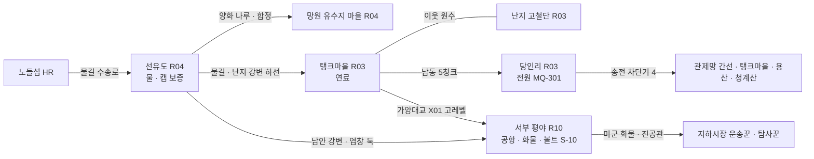

# SD-09b. 장소 카탈로그: R03 마포·상암, R04 서강·선유도, R10 서부 평야

> **서울 폴아웃 상세 기획서 세트** | 문서 ID: SD-09b | 버전: v1.0 | 작성일: 2026-10-12
> **범위**: SD-08 §11.4(R03 27곳)·§11.5(R04 20곳)·§11.11(R10 27곳) 장소 시드 전부와 추가 시드 6곳(L-R03-28, L-R10-28~32)의 장소 상세, 권역별 이름 있는 NPC(R03 55명, R04 40명, R10 37명), 권역별 사이드 퀘스트 훅(R03 15, R04 14, R10 14), 랜덤 인카운터 지점·이동 경로 / 다루지 않는 것: 퀘스트 본문(→ SD-04b), 지하철역·하저 터널·신월 빗물터널 본관·다리·나루 일부의 상세(→ SD-09f), 적·아이템 수치(→ SD-13·SD-14), 가격(→ SD-15)
> **관련 문서**: [SC-00 컨셉](00_concept.md), [SD-02 세계관](02_world-and-lore.md), [SD-03a 메인 스토리 1부](03a_main-story-part1.md), [SD-03b 메인 스토리 2부](03b_main-story-part2.md), [SD-04b 사이드 퀘스트(서부·한강)](04b_side-quests-west-river.md), [SD-04d 세력 퀘스트](04d_faction-questlines.md), [SD-05 비표시·반복·인카운터](05_misc-quests-encounters.md), [SD-06 세력](06_factions.md), [SD-07b NPC 디렉터리](07b_npc-directory.md), [SD-08 월드·권역](08_world-regions.md), [SD-09f 지하·한강](09f_locations-underground-river.md), [SD-10 캐릭터](10_character-system.md), [SD-11 전투](11_combat-system.md), [SD-12 탐험·UI](12_exploration-ui.md), [SD-13 아이템](13_items.md), [SD-14 크리처·적](14_creatures-enemies.md), [SD-15 경제](15_economy.md), [SD-16 아트](16_art-direction.md), [SD-17 사운드](17_sound.md), [SD-18 명명](18_naming-terms.md), 원작 [RD-13 장소](../reverse-design/13_locations.md), [RD-27 이식 메모](../reverse-design/27_adaptation-notes.md), 조사 [SR-02 서울 지리](research/SR-02_seoul-geography.md), [SR-03 인프라](research/SR-03_seoul-infrastructure.md)

---

## 목차
1. 개요
2. R03 마포·상암
3. R04 서강·선유도
4. R10 서부 평야
5. 원작 대응
6. 쯔꾸르 제작 메모
7. 미결 사항
- 부록 A. 신규 고유명사
- 부록 B. 참고 문서

---

## 1. 개요

### 1.1 목적
- SD-08이 정한 장소 시드(좌표·청크·위협)를 **실제로 만들 수 있는 장소 명세**로 바꾼다. 장소마다 2077년 시설, 2277년 상태, 외부 배치와 실내 구성, 사람과 적, 루팅, 연계 퀘스트, 판도 반응을 적는다.
- 세 권역은 서울판의 **서부 생활 경제**를 이룬다. 선유도의 물, 탱크마을의 연료, 당인리의 전기가 한강 서쪽 6km 안에 모여 있고, 그 바깥 서쪽에는 사람이 살 수 없는 공항 평야가 있다. 이 문서는 그 축이 장소 단위에서 보이게 설계한다.

### 1.2 요약
| 항목 | R03 마포·상암 | R04 서강·선유도 | R10 서부 평야 | 합계 |
|---|---|---|---|---|
| 장소(SD-08 시드 + 추가) | 27 + 1 = 28 | 20 | 27 + 5 = 32 | **80** |
| 지도 마커 | 27 | 19 | 30 | 76 |
| 장소 등급 S / A / B / C | 3 / 4 / 13 / 8 | 2 / 3 / 9 / 6 | 2 / 9 / 13 / 8 | 7 / 16 / 35 / 22 |
| 정착지 | 탱크마을 | 선유도, 망원 유수지 마을 | 없음(야영지 1) | 3 |
| 이름 있는 NPC | 55 | 40 | 37 | **132** |
| 사이드 퀘스트 훅 | 15 | 14 | 14 | 43 |
| 메인 퀘스트 무대 | MQ-301 당인리(3막), MQ-207 손길 | MQ-202 양화 나루(2막) | 없음 | — |
| 실내 맵(장) | 41 | 22 | 39 | 102 |
| 위협도 | 3(대부분), 4(당인리 내부·난지도 정상) | 2, 4(밤섬) | 3(목동)~5(공항) | — |
| 루팅 등급(기본/상한, SD-13 §9.2) | T2 / T4 | T1 / T2 | T4 / T5 | — |

- **S등급 7곳**: 당인리 지하 원자력 발전소(L-R03-01), 탱크마을(L-R03-03), 난지도 쓰레기 산(L-R03-04), 선유도(L-R04-01), 망원 유수지 마을(L-R04-05), 김포 피폭 공항 지대(L-R10-01 김포공항 크레이터 + L-R10-02 김포 활주로. L-R10-03·04를 부속 구역으로 묶는다).
- **추가 시드 6곳**: 다른 SD 문서가 'SD-09b에서 ID 부여'로 넘긴 장소다. L-R03-28 마포 소방서 차고(SD-13 W-117), L-R10-28 김포 전진 보급 야적장(SD-14 CR-502·미군 로봇 포드), L-R10-29 개화 방역 매몰지(SD-14 CR-093·CR-ENV-03), L-R10-30 오곡 곰 사육 농장 터(SD-14 CR-625), L-R10-31 개화산 탄약고(SD-06 '철벽경호 본사(옛 개화산 탄약고)', SD-10 흔들인형 폭발물), L-R10-32 개화 갈대밭 목동 야영지(SD-14 '서부 평야 목장' 두머리소).

### 1.3 표기 규칙
| 항목 | 규칙 |
|---|---|
| 장소 ID | SD-08 §11 시드 순서 그대로 `L-R03-01`부터. 추가 시드는 권역 표 끝 번호. 이름은 시드 이름을 바꾸지 않고, 다듬을 필요가 있으면 '통칭 변경 제안'에 적는다 |
| 좌표 | `tx·ty`는 SD-08 변환식 값이다. **이 문서의 장소는 모두 보정 0**이다(SD-08 E2~E4 조건에 걸리는 장소가 없다. 같은 청크 4곳 이상 없음, 다리 끝 장소 없음) |
| 마커 | ○ 지도 마커 있음 / × 마커 없음(구역 진입 알림만, 발견 XP 없음) |
| 등급 | SD-16 §6.6 장소 등급 S/A/B/C. 앵커 수·실내 맵 예산을 따른다 |
| 판도 단위 | SD-08 §15.2 판도 구역 `PD-Rxx-n`, 거점이면 §15.3 `PD-Hnn`을 함께 적는다 |
| BGM / BGS | SD-17 §3 큐 ID. 권역 탐험 곡(`BGM-X..`), 정착지(`BGM-S..`), 던전 유형(`BGM-D..`), 환경음(`BGS-..`) |
| 방사능 | SD-08 구역 등급 `Rad-0~4`와 SD-11 피폭 등급 `Z1~Z5`를 함께 적는다. 대응: Rad-1 = Z1, Rad-2 = Z2(실내 침수 구간은 Z3), Rad-3 = Z3~Z4, Rad-4 = Z4~Z5 |
| 적 | SD-14 `CR-` ID와 레벨대. 레벨은 SD-08 §14.4 위협도 범위 안에서 SD-14 §11.1 산정식으로 정한다 |
| 아이템 | SD-13 `W-·A-·I-·M-` ID. 고유하지 않은 루팅은 '루팅 등급'으로만 적는다 |
| 수집품 | 흔들인형 `CL-nn`(SD-10 §7.1 표 번호), 스킬북 `BK-nn`(SD-10 §7.2 스킬 번호) + 권수. 흔들인형 이름은 한결건설 마스코트 확정명에 따라 **'든든이 흔들인형'**으로 쓴다(SD-10의 '한결이'를 대체) |
| 기록물 | SD-02 §10 `LR-nn` |
| 사이드 퀘스트 훅 | 〈훅 이름〉. ID는 SD-04b가 부여한다. '권장 Lv'는 SD-08 §14.4 기준 |
| NPC ID | `N-R03-001` 형식. 바이블 §11과 다른 SD 문서가 만든 인물도 같은 이름·설정으로 등록하고 '출처'를 적는다. 주요 인물의 `C-` ID는 SD-07a가 병기한다 |
| 외형 코드 | SD-16 §7.2 형식 `몸-피부-머리-머리색-몸통계열-낡음-팔레트-머리장비-눈장비-소품`. 몸 코드는 SD-16의 몸 6벌에 맞춰 **M1 남 표준, M2 남 변형, F1 여 표준, F2 여 변형, E1 노인, K1 아동**으로 쓰고(제안), 구울은 피부 SG1, 야생화 직전 구울은 SG2, 로봇은 `RB-` + SD-14 모델 ID로 쓴다. 소품 `PR` 번호는 SD-16 소품 라이브러리 확정 전의 가번호다 |
| 이름 교체 | 육지환(구 강태오), 멍쉐밍(구 천웨이), 공보방송(구 국민방송), '부위 손상'(구 '불구'), 원칙파 약호 WP를 쓴다 |

### 1.4 세 권역의 관계: 물·연료·전기, 그리고 서쪽 끝
| 축 | 장소 | 무엇을 내는가 | 누가 노리는가 |
|---|---|---|---|
| 물 | 선유도(L-R04-01), 양평 펌프장(L-R04-15), 망원 취수탑(L-R04-08) | 정화수, 수경 식품, **캡 교환 보증** | 모두. 그래서 아무도 공격하지 않는다(SD-08 §7.4) |
| 연료 | 탱크마을(L-R03-03) 3호 정유 탱크 | 등유·윤활유·화염방사기 연료, 탄약 재생 | 난지 고철단(약탈), 비상정부(원자로 협력 요구), 새벽인력(위험 작업 인력 판매) |
| 전기 | 당인리 지하 원자력 발전소(L-R03-01) | 관제망 전원(MQ-301), 재가동 시 송전 | 비상정부·연합단·탱크마을·각성회·잔존병(전원이 돌아오면 임무 재개) |
| 위험한 보물 | 김포 피폭 공항 지대(L-R10-01~04), 전진 보급 야적장(L-R10-28), 볼트 S-10(L-R10-12) | 미군 화물(T5), 진공관·로봇 부품 | 활주로파, 철벽경호, 지하시장 운송꾼, 탐사꾼 |

- **강의 방향**: R03은 북안, R10은 남안이다. 선유도는 남안 소속(SD-08 §4.4), 망원·합정은 북안이다. 그래서 R04는 '강을 건너는 권역'이고, 양화대교(X02)·양화 나룻배(X03)·당산철교(X04)가 모두 이 권역을 지난다. R03에서 R10으로 바로 가는 길은 가양대교(X01)뿐이고 고레벨 균형 이동이다.
- **위협의 계단**: 선유도(1) → 망원·합정(2) → 마포·상암(3) → 당인리 내부·난지도 정상(4) → 목동(3)·마곡(4) → 공항(5). 볼트에서 내려온 주인공이 2막에 선유도에 닿고, 3막에 당인리로, 고레벨이 되어 서쪽 끝으로 간다.

### 1.5 이 문서의 공통 규칙
- **발견 XP**(SD-10 §4.4): 일반 장소 10, 주요 장소(정착지·볼트·S·A등급 던전·전망 지점) 25. 마커 × 장소는 주지 않는다.
- **루팅 레벨 연동**: 권역 기본 등급에서 시작해 플레이어 레벨 7·13·19·25마다 1등급 오르고 권역 상한에서 멈춘다(SD-13 §9.2). 장소별 '루팅'은 그 장소의 고정 상한·고정 배치만 적는다.
- **정착지 안 소유물**: 탱크마을·선유도·망원 유수지 마을 안의 컨테이너는 대부분 주인이 있다. 절도 적발 시 개별 호감도 -5(SD-06 §3.4), 경비 거점의 신고형 목격자(SD-12 M-14)가 적용된다.
- **실제 재난 소재 회피**: 망원동 일대의 실제 수해, 신월 빗물터널 공사 중 실제 사고를 장소 연출·퀘스트 소재로 쓰지 않는다. 침수 연출은 SD-08 §8.1 '수위 이벤트'와 SD-02의 볼트 실험(S-11)만 근거로 한다(SD-08이 성수대교를 뺀 것과 같은 기준).

---
