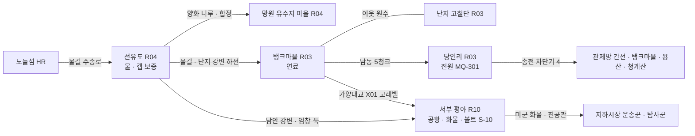
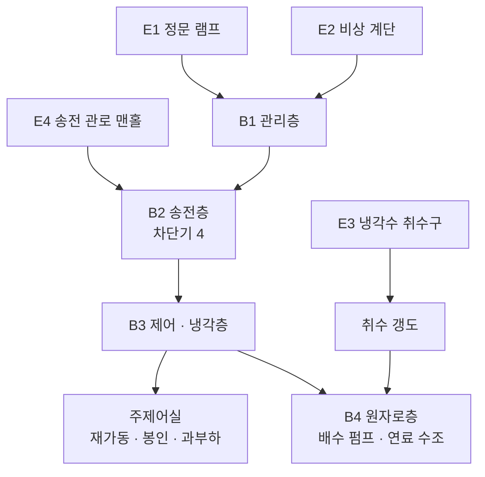
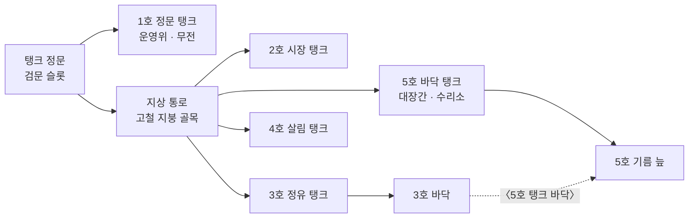
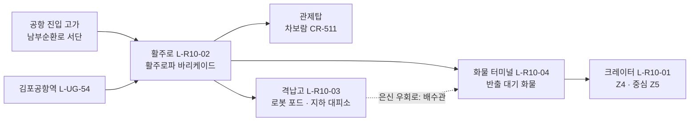

# SD-09b. 장소 카탈로그: R03 마포·상암, R04 서강·선유도, R10 서부 평야

> **서울 폴아웃 상세 기획서 세트** | 문서 ID: SD-09b | 버전: v1.2 | 작성일: 2026-10-12
> **범위**: SD-08 §11.4(R03 27곳)·§11.5(R04 20곳)·§11.11(R10 27곳) 장소 시드 전부와 추가 시드 6곳(L-R03-28, L-R10-28~32)의 장소 상세, 권역별 이름 있는 NPC(R03 55명, R04 40명, R10 37명), 권역별 사이드 퀘스트 훅(R03 18, R04 14, R10 16), 랜덤 인카운터 지점·이동 경로 / 다루지 않는 것: 양화 나루(L-R04-03)·밤섬(L-R04-19)의 상세 설계(정본 SD-09f §11.2·§11.3, ID만 이 문서), 퀘스트 본문(→ SD-04b), 지하철역·하저 터널·신월 빗물터널 본관·다리·나루 일부의 상세(→ SD-09f), 적·아이템 수치(→ SD-13·SD-14), 가격(→ SD-15)
> **관련 문서**: [SC-00 컨셉](00_concept.md), [SD-02 세계관](02_world-and-lore.md), [SD-03a 메인 스토리 1부](03a_main-story-part1.md), [SD-03b 메인 스토리 2부](03b_main-story-part2.md), [SD-04b 사이드 퀘스트(서부·한강)](04b_side-quests-west-river.md), [SD-04d 세력 퀘스트](04d_faction-questlines.md), [SD-05 비표시·반복·인카운터](05_misc-quests-encounters.md), [SD-06 세력](06_factions.md), [SD-07b NPC 디렉터리](07b_npc-directory.md), [SD-08 월드·권역](08_world-regions.md), [SD-09f 지하·한강](09f_locations-underground-river.md), [SD-10 캐릭터](10_character-system.md), [SD-11 전투](11_combat-system.md), [SD-12 탐험·UI](12_exploration-ui.md), [SD-13 아이템](13_items.md), [SD-14 크리처·적](14_creatures-enemies.md), [SD-15 경제](15_economy.md), [SD-16 아트](16_art-direction.md), [SD-17 사운드](17_sound.md), [SD-18 명명](18_naming-terms.md), 원작 [RD-13 장소](../reverse-design/13_location-catalog.md), [RD-27 이식 메모](../reverse-design/27_adaptation-notes.md), 조사 [SR-02 서울 지리](research/SR-02_seoul-geography.md), [SR-03 인프라](research/SR-03_seoul-infrastructure.md)

---

## 목차
1. 개요
2. R03 마포·상암
3. R04 서강·선유도
4. R10 서부 평야
5. 원작 대응
6. 제작 메모 (엔진: 범용 2D)
7. 미결 사항
- 부록 A. 신규 고유명사
- 부록 B. 참고 문서
- 버전 이력

---

## 1. 개요

### 1.1 목적
- SD-08이 정한 장소 시드(좌표·청크·위협)를 **실제로 만들 수 있는 장소 명세**로 바꾼다. 장소마다 2077년 시설, 2277년 상태, 외부 배치와 실내 구성, 사람과 적, 루팅, 연계 퀘스트, 판도 반응을 적는다.
- 세 권역은 서울판의 **서부 생활 경제**를 이룬다. 선유도의 물, 탱크마을의 연료, 당인리의 전기가 한강 서쪽 6km 안에 모여 있고, 그 바깥 서쪽에는 사람이 살 수 없는 공항 평야가 있다. 이 문서는 그 축이 장소 단위에서 보이게 설계한다.

### 1.2 요약
| 항목 | R03 마포·상암 | R04 서강·선유도 | R10 서부 평야 | 합계 |
|---|---|---|---|---|
| 장소(SD-08 시드 + 추가) | 27 + 1 = 28 | 20 | 27 + 5 = 32 | **80** |
| 지도 마커 | 27 | 19 | 30 | 76 |
| 장소 등급 S / A / B / C | 3 / 4 / 13 / 8 | 2 / 3 / 9 / 6 | 2 / 9 / 13 / 8 | 7 / 16 / 35 / 22 |
| 정착지 | 탱크마을 | 선유도, 망원 유수지 마을 | 없음(야영지 1) | 3 |
| 이름 있는 NPC | 55 | 40 | 37 | **132** |
| 사이드 퀘스트 훅 | 18 | 14 | 16 | 48 |
| 메인 퀘스트 무대 | MQ-301 당인리(3막), MQ-207 손길 | MQ-202 양화 나루(2막) | 없음 | — |
| 실내 맵(장) | 52 | 18 | 45 | 115 |
| 위협도 | 3(대부분), 4(당인리 내부·난지도 정상) | 2, 4(밤섬) | 3(목동)~5(공항) | — |
| 루팅 등급(기본/상한, SD-13 §9.2) | T2 / T4 | T1 / T2 | T4 / T5 | — |

- **S등급 7곳**: 당인리 지하 원자력 발전소(L-R03-01), 탱크마을(L-R03-03), 난지도 쓰레기 산(L-R03-04), 선유도(L-R04-01), 망원 유수지 마을(L-R04-05), 김포 피폭 공항 지대(L-R10-01 김포공항 크레이터 + L-R10-02 김포 활주로. L-R10-03·04를 부속 구역으로 묶는다).
- **추가 시드 6곳**: 다른 SD 문서가 'SD-09b에서 ID 부여'로 넘긴 장소다. L-R03-28 마포 소방서 차고(SD-13 W-117), L-R10-28 김포 전진 보급 야적장(SD-14 CR-502·미군 로봇 포드), L-R10-29 개화 방역 매몰지(SD-14 CR-093·CR-ENV-03), L-R10-30 오곡 곰 사육 농장 터(SD-14 CR-625), L-R10-31 개화산 탄약고(SD-06 '철벽경호 본사(옛 개화산 탄약고)', SD-10 흔들인형 폭발물), L-R10-32 개화 갈대밭 목동 야영지(SD-14 '서부 평야 목장' 두머리소).

### 1.3 표기 규칙
| 항목 | 규칙 |
|---|---|
| 장소 ID | SD-08 §11 시드 순서 그대로 `L-R03-01`부터. 추가 시드는 권역 표 끝 번호. 이름은 시드 이름을 바꾸지 않고, 다듬을 필요가 있으면 '통칭 변경 제안'에 적는다 |
| 좌표 | `tx·ty`는 SD-08 변환식 값이다. **이 문서의 장소는 모두 보정 0**이다(SD-08 E2~E4 조건에 걸리는 장소가 없다. 같은 청크 4곳 이상 없음, 다리 끝 장소 없음) |
| 마커 | `Y` 지도 마커 있음 / `N` 마커 없음(구역 진입 알림만, 발견 XP 없음). 세트 공통 표기(v1.1, 09c~f와 같음) |
| 등급 | SD-16 §6.6 장소 등급 S/A/B/C. 앵커 수·실내 맵 예산을 따른다 |
| 판도 단위 | SD-08 §15.2 판도 구역 `PD-Rxx-n`, 거점이면 §15.3 `PD-Hnn`을 함께 적는다 |
| BGM / BGS | SD-17 §3 큐 ID. 권역 탐험 곡(`BGM-X..`), 정착지(`BGM-S..`), 던전 유형(`BGM-D..`), 환경음(`BGS-..`) |
| 방사능 | SD-08 구역 등급 `Rad-0~4`와 SD-11 피폭 등급 `Z1~Z5`를 함께 적는다. 대응: Rad-1 = Z1, Rad-2 = Z2(실내 침수 구간은 Z3), Rad-3 = Z3~Z4, Rad-4 = Z4~Z5 |
| 적 | SD-14 `CR-` ID와 레벨대. 레벨은 SD-08 §14.4 위협도 범위 안에서 SD-14 §11.1 산정식으로 정한다 |
| 아이템 | SD-13 `W-·A-·I-·M-` ID. 고유하지 않은 루팅은 '루팅 등급'으로만 적는다 |
| 수집품 | 흔들인형 `CL-nn`(SD-10 §7.1 표 번호), 스킬북 `BK-nn`(SD-10 §7.2 종 번호 = RECON_SPEC §3.7 '종' ID) + 권수. 이 문서는 배치 ID를 쓰지 않는다. 흔들인형 정식명은 **'든든이 입주 기념 흔들인형'**(약칭 '든든이 흔들인형'. 옛 표기 '한결이' → '든든이' 교체, RECON_SPEC N-29) |
| 기록물 | SD-02 §10 `LR-nn` |
| 사이드 퀘스트 훅 | 〈훅 이름〉. ID는 SD-04b가 부여한다. '권장 Lv'는 SD-08 §14.4 기준 |
| NPC ID | `N-R03-001` 형식. 바이블 §11과 다른 SD 문서가 만든 인물도 같은 이름·설정으로 등록하고 '출처'를 적는다. 주요 인물의 `C-` ID는 이름 옆 괄호에 병기한다(SD-07b §6.4, X-026). 주 N-ID가 다른 장소 문서에 있는 인물은 이 문서 N-ID를 결번으로 적는다(예: C-033 허문경) |
| 외형 코드 | SD-16 §7.2 형식 `몸-피부-머리-머리색-몸통계열-낡음-팔레트-머리장비-눈장비-소품`. v1.1부터 **SD-07b §3 외형 코드 통일안** 값을 쓴다(RECON_SPEC X-141·N-84): 몸 M1·M2·F1·F2·E1(노인 남)·E2(노인 여)·K1, 구울 피부 SG1·SG2, 머리 HR00~HR11, 낡음 0~2, 머리 장비 HD00~HD18, 눈 장비 EY00~EY08, 소품 PR001~PR200(SD-07b §3.10). 로봇은 SD-07b §3.2 형식 `RB-<모델>·<표식>`(모델 = SD-14 CR 템플릿 ID 또는 세진 모델명, 예: `RB-CR303·불끄미`). 소품 번호를 하이픈으로 붙이는 옛 형식은 쓰지 않는다. 원래 값은 SD-07b §4 표가 보존한다 |
| 이름 교체 | 육지환(구 강태오), 멍쉐밍(구 천웨이), 공보방송(구 국민방송), '부위 손상'(구 '불구'), 원칙파 약호 WP를 쓴다 |

### 1.4 세 권역의 관계: 물·연료·전기, 그리고 서쪽 끝
| 축 | 장소 | 무엇을 내는가 | 누가 노리는가 |
|---|---|---|---|
| 물 | 선유도(L-R04-01), 양평 펌프장(L-R04-15), 망원 취수탑(L-R04-08) | 정화수, 수경 식품, **캡 교환 보증** | 모두. 그래서 아무도 공격하지 않는다(SD-08 §7.4) |
| 연료 | 탱크마을(L-R03-03) 3호 정유 탱크 | 등유·윤활유·화염방사기 연료, 탄약 재생 | 난지 고철단(약탈), 비상정부(원자로 협력 요구), 새벽인력(위험 작업 인력 판매) |
| 전기 | 당인리 지하 원자력 발전소(L-R03-01) | 관제망 전원(MQ-301), 재가동 시 송전 | 비상정부·연합단·탱크마을·각성회·잔존병(전원이 돌아오면 임무 재개) |
| 위험한 보물 | 김포 피폭 공항 지대(L-R10-01~04), 전진 보급 야적장(L-R10-28), 볼트 S-10(L-R10-12) | 미군 화물(T5), 진공관·로봇 부품 | 활주로파, 철벽경호, 지하시장 운송꾼, 탐사꾼 |



- **강의 방향**: R03은 북안, R10은 남안이다. 선유도는 남안 소속(SD-08 §4.4), 망원·합정은 북안이다. 그래서 R04는 '강을 건너는 권역'이고, 양화대교(X02)·양화 나룻배(X03)·당산철교(X04)가 모두 이 권역을 지난다. R03에서 R10으로 바로 가는 길은 가양대교(X01)뿐이고 고레벨 균형 이동이다.
- **위협의 계단**: 선유도(1) → 망원·합정(2) → 마포·상암(3) → 당인리 내부·난지도 정상(4) → 목동(3)·마곡(4) → 공항(5). 볼트에서 내려온 주인공이 2막에 선유도에 닿고, 3막에 당인리로, 고레벨이 되어 서쪽 끝으로 간다.

### 1.5 이 문서의 공통 규칙
- **발견 XP**(SD-10 §4.4): 일반 장소 10, 주요 장소(정착지·볼트·S·A등급 던전·전망 지점) 25. 마커 N 장소는 주지 않는다.
- **루팅 레벨 연동**: 권역 기본 등급에서 시작해 플레이어 레벨 7·13·19·25마다 1등급 오르고 권역 상한에서 멈춘다(SD-13 §9.2). 장소별 '루팅'은 그 장소의 고정 상한·고정 배치만 적는다.
- **정착지 안 소유물**: 탱크마을·선유도·망원 유수지 마을 안의 컨테이너는 대부분 주인이 있다. 절도 적발 시 개별 호감도 -5(SD-06 §3.4), 경비 거점의 신고형 목격자(SD-12 M-14)가 적용된다.
- **실제 재난 소재 회피**: 망원동 일대의 실제 수해, 신월 빗물터널 공사 중 실제 사고를 장소 연출·퀘스트 소재로 쓰지 않는다. 침수 연출은 SD-08 §8.1 '수위 이벤트'와 SD-02의 볼트 실험(S-11)만 근거로 한다(SD-08이 성수대교를 뺀 것과 같은 기준).

---
## 2. R03 마포·상암

### 2.1 권역 지도
SD-08 §4.2 격자를 20타일(반 청크) 단위로 확대해 장소 번호를 찍었다. `::` = R03, `..` = 다른 권역(R04·R05·R06·R09), `~~` = 한강 HR. 가로 머리는 청크 X, 세로 머리는 청크 Y다. 한 칸에 둘이 겹치면 작은 번호만 적었다(08 칸에 09가 함께 있다).

```
      13  14  15  16  17  18  19  20  21  22  23  24  25
16                ....................::::::::..........
                  ....................::::::::..........
17                ::::::::::::::::::::::::::::::::......
                  ::::::::::::::::::::::::::::::::......
18            ::::::::::::::::::::::::::::::::::::::::..
              ::::11::::::::::::::::::::::::::::::::::..
19        ::::10::08::::::::::::::::::::::::::::::......
          ::::::::::::12::::::::::21::::::::22::::......
20    ::::::::::::::::::::::::::::::::::::::::::::23::..
      ::::06::::04::0307::::::::::::20::::::::::::::::..
21    ~~~~05::::::::::::13::::14::::::::18::::::::::::..
      ~~~~::::::::::::::::::::::::15::::::19::::::::::..
22    ....~~~~~~~~........::::::::::::::::::::::::::27..
      ....~~~~~~~~........::::::::::::::::::::::24::::..
23    ........~~~~............::::16::::::::::::::25::..
      ........~~~~............::::::::::::17::28::::::..
24    ........................::02::::::::....::::......
      ........................01::::::::::....::26......
```

- **서쪽 고지대**: 난지도 쓰레기 산(04)과 노을 언덕(05)이 한강 북안에 두 개의 인공 산을 이룬다. 그 동쪽 매봉산 기슭에 탱크마을(03)이 반쯤 묻혀 있고, 상암 경기장(07)이 길 건너에 있다.
- **북쪽 상암**: 방송단지(08)와 볼트 S-05(09), 수색 차량기지(11)가 불광천 서쪽 평지에 모인다.
- **동쪽 구릉**: 연희(20)·신촌(18·19)·안산(22)이 내부순환로 고가 아래 홍제천(21)을 따라 이어지고, 독립문(23)·충정로(27)에서 도심 밀폐 구역 성벽과 맞닿는다.
- **남쪽 강변**: 당인리(01·02)와 홍대(16)·서강(17), 공덕(26)·애오개(25)가 한강 북안을 따라 늘어선다. 탱크마을에서 당인리까지 남동쪽 약 5청크(실경로 약 1분 20초).

### 2.2 권역 개요 표
| ID | 이름 | 유형(아이콘) | tx·ty | 청크 | 위협 | 마커 | 등급 | 판도 단위 | BGM / BGS |
|---|---|---|---|---|---|---|---|---|---|
| L-R03-01 | 당인리 지하 원자력 발전소 | 던전(#12) | 778·986 | C-19-24 | 4 | Y | S | PD-R03-3 / PD-H08 | BGM-D04, 장면 BGM-M301 / BGS-I02 |
| L-R03-02 | 당인리 굴뚝 공원 | 랜드마크(#20) | 792·977 | C-19-24 | 3 | Y | B | PD-R03-3 | BGM-X03B / BGS-L08 |
| L-R03-03 | 탱크마을 | 정착지(#2) | 661·820 | C-16-20 | 1 | Y | S | PD-R03-1 / PD-H02 | BGM-S02 / BGS-S02 |
| L-R03-04 | 난지도 쓰레기 산 | 세력 거점(#4) | 620·838 | C-15-20 | 3(정상 4) | Y | S | PD-R03-2 | BGM-X03A / BGS-L04 |
| L-R03-05 | 노을 언덕 메탄 늪 | 던전(#16) | 577·858 | C-14-21 | 3 | Y | B | PD-R03-2 | BGM-X03A / BGS-L04 |
| L-R03-06 | 난지 강변 캠프 | 야영지(#4) | 565·839 | C-14-20 | 3 | Y | C | PD-R03-2 | BGM-X03A / BGS-R01 |
| L-R03-07 | 상암 경기장 | 던전(#22) | 696·838 | C-17-20 | 3 | Y | A | PD-R03-1 | BGM-D11 / BGS-U01 |
| L-R03-08 | 상암 방송단지 | 던전(#14) | 644·774 | C-16-19 | 3 | Y | A | PD-R03-1 | BGM-X03C / BGS-U01 |
| L-R03-09 | 볼트 S-05 | 볼트(#1) | 653·768 | C-16-19 | 3 | Y | A | PD-R03-1 | BGM-D07A / BGS-V01 |
| L-R03-10 | 상암 아파트 단지 | 폐허(#5) | 615·768 | C-15-19 | 2 | Y | C | PD-R03-1 | BGM-D09 / BGS-U03 |
| L-R03-11 | 수색 차량기지 | 던전(#11) | 658·747 | C-16-18 | 3 | Y | B | PD-R03-1 | BGM-D09 / BGS-U01 |
| L-R03-12 | 마포 농수산 시장 터 | 교역소(#9) | 689·792 | C-17-19 | 2 | Y | B | PD-R03-1 | BGM-X03B(장날 BGM-S12) / BGS-L07 |
| L-R03-13 | 마포 관제 중계소 | 관제망 시설(#12) | 701·850 | C-17-21 | 3 | Y | B | PD-R03-1 | BGM-D05 / BGS-I07(깜박임 때 BGS-K01) |
| L-R03-14 | 성미산 배수지 | 기반 시설(#12) | 763·846 | C-19-21 | 2 | Y | C | PD-R03-4 | BGM-X03B / BGS-W01 |
| L-R03-15 | 연남 철길 캠프 | 야영지(#22) | 801·876 | C-20-21 | 2 | Y | C | PD-R03-4 | BGM-S12 / BGS-S07 |
| L-R03-16 | 홍대 앞 공연 골목 | 폐허(#19) | 801·924 | C-20-23 | 2 | Y | B | PD-R03-3 | BGM-X03C / BGS-U02 |
| L-R03-17 | 서강 언덕 캠퍼스 | 던전(#10) | 887·942 | C-22-23 | 2 | Y | B | PD-R03-5 | BGM-D12 / BGS-I08 |
| L-R03-18 | 신촌 대학가 | 던전(#10) | 873·858 | C-21-21 | 3 | Y | B | PD-R03-4 | BGM-D12 / BGS-I08 |
| L-R03-19 | 신촌 대학병원 | 던전(#10) | 890·876 | C-22-21 | 3 | Y | A | PD-R03-6 | BGM-D13 / BGS-I09 |
| L-R03-20 | 연희 고급 주택가 | 폐허(#19) | 835·828 | C-20-20 | 2 | Y | C | PD-R03-4 | BGM-D09 / BGS-I07 |
| L-R03-21 | 홍제천 고가 하천길 | 자연(#16) | 811·798 | C-20-19 | 2 | N | C | PD-R03-6 | BGM-X03B / BGS-R05 |
| L-R03-22 | 안산 봉수대 | 전망 지점(#16) | 901·795 | C-22-19 | 2 | Y | B | PD-R03-6 | BGM-X03C / BGS-W05 |
| L-R03-23 | 독립문 광장 | 랜드마크(#20) | 976·815 | C-24-20 | 3 | Y | B | PD-R03-6 | BGM-X03C / BGS-C01 |
| L-R03-24 | 아현 언덕 빌라 미로 | 폐허(#19) | 959·912 | C-23-22 | 2 | Y | C | PD-R03-5 | BGM-D09 / BGS-U01 |
| L-R03-25 | 애오개 바리케이드 | 세력 거점(#4) | 961·926 | C-24-23 | 2 | Y | B | PD-R03-5 | BGM-X03C / BGS-F02 |
| L-R03-26 | 공덕 오거리 고층가 | 폐허(#10) | 940·984 | C-23-24 | 3 | Y | B | PD-R03-5 | BGM-X03C / BGS-W03 |
| L-R03-27 | 충정로 관공서 거리 | 폐허(#10) | 995·888 | C-24-22 | 3 | Y | B | PD-R03-5 | BGM-X03C / BGS-C01 |
| L-R03-28 ＋ | 마포 소방서 차고 | 폐허(#10) | 928·958 | C-23-23 | 3 | Y | C | PD-R03-5 | BGM-D09 / BGS-I07 |

- **추가 시드**: L-R03-28은 SD-13 W-117 '마지막 출동'의 배치처(마포 소방서 차고)다. 공덕 오거리 서쪽 골목, 하저 터널 북쪽 출구에서 걸어서 15초 거리에 둔다. 실제 소방서 위치와 맞추지 않은 게임 속 위치다.
- **판도 거점**: SD-06 §5.9는 난지도 쓰레기 산을 R03 판도 거점(NJ, 가중치 2)으로 셌지만 SD-08 §15.3 거점 단위(24)에는 없다. 이 문서는 L-R03-04를 **PD-R03-2의 사실상 거점**으로 다루고, 거점 단위 추가 여부는 미결로 둔다(7장).

### 2.3 S등급 장소 상세

#### L-R03-01 당인리 지하 원자력 발전소 [S] — 3막 MQ-301의 무대
| 항목 | 내용 |
|---|---|
| 실제 근거 | 1930년 가동한 서울 최초 화력발전소 부지(옛 당인리발전소, 현 서울복합화력). 발전 설비를 지하로 옮기고 지상을 공원으로 만든 곳이다(SR-03 §3, 지하화 연도는 †) |
| 2077년 | [게임 속 설정] 2064년 착공, 2068년 가동. 태성그룹 도시형 소형 원자로 **TS-60 '불씨' 4기(총 1.2GW)**를 지하 4층에 넣었다. 지상은 두 굴뚝을 남긴 홍보 공원 '불씨 공원'(L-R03-02)이었고 학생 견학 코스가 B1까지 내려왔다. 2074년 관제망 주전원으로 연결. 2077-10-23 23:29 전자기 충격으로 송전망이 무너지자 4기가 설계대로 자동 정지했다(SD-02 §3.3.4) |
| 2277년 | 배수 펌프가 200년 멈춰 **1·2호기 격실과 B4 서쪽이 한강 지하수에 잠겼다.** 3·4호기 쪽은 건조하다. 2256년 비상정부 1차 탐사대가 B4 침수 구역에서 전멸했다. 2막 MQ-207 무렵부터 계엄군 공병반이 외곽을 측량한다(`V_REACTOR = 1`). 주인공이 끝내 손대지 않으면 4막 끝에 공병반이 자체 복구한다(SD-03b) |
| 외부 배치 | 한강 북안 둔치 위 제방 안쪽. 지상은 L-R03-02 굴뚝 공원이고, 발전소 본체는 그 아래 B1~B4다. 북쪽은 합정 교차로(L-R04-11), 동쪽은 홍대 공연 골목(L-R03-16), 남쪽 둔치 건너 밤섬(L-R04-19)과 여의도 금탑이 보인다. 방위 링 길잡이는 당인리 굴뚝(랜드마크 B, 6~8청크) |
| 방사능 | 지상 Rad-0. B1 Z1, B2 Z2, B3 Z2~Z3, B4 침수 구역 Z3, 노심 통로 Z4, 노심 격실 Z5(선택 구간, 메인 필수 아님). SD-08 §6.5 '당인리 원자로' |
| 위협·레벨 | 지상·B1·B2 위협 3(Lv 6~14), B3·B4 위협 4(Lv 10~22). 실내는 처음 들어간 순간 레벨을 고정한다. SD-03a §10.1의 '위협도 3'은 B2까지의 값으로 읽는다 |

**출입구 (밖 → 안, 문 전환 지점)**
| # | 출입구 | 위치 | 조건 | 도착 맵 |
|---|---|---|---|---|
| E1 | 정문 차량 램프 | 굴뚝 공원 남쪽, 강변북로 쪽 경사로 | 없음(계엄군 공병반이 있으면 검문) | B1 하역장 |
| E2 | 비상 계단 | 굴뚝 공원 북쪽 환기탑 옆 철문 | [자물쇠 따기 50] 또는 굴뚝새(N-R03-035)에게 받은 열쇠 | B1 동쪽 계단실 |
| E3 | 냉각수 취수구 | 한강 둔치 제방 아래 취수 격자(수면 아래 1타일) | 얕은 물 진입 + 격자 [수리 25] 또는 [힘 6] | 취수 갱도 → B4 서쪽 |
| E4 | 송전 관로 맨홀 | 합정 교차로 쪽 200m, 길가 맨홀 | 없음. 은신 경로(관로 안 적 없음, 변이 바퀴 CR-002 소수) | B2 송전반실 뒤 |

**실내 구성 (6장)**
| 맵 | 깊이 | 크기(국소) | 방사능 | 구성 | 문 전환 |
|---|---|---|---|---|---|
| B1 관리층 | z-1 | 70×50 | Z1 | 하역장, 경비실(2077년 판독기 문, 대기 상태), 견학 코스 전시실, 직원 식당, 정비 사무실, 사물함실, 무기 보관함(단독 보너스, SD-03a), 2256 탐사대 야영 흔적 | E1·E2, 화물 승강기(정지, 사다리로 B2) |
| B2 송전층 | z-2 | 70×45 | Z2 | **송전반실(차단기 4개: 관제망 간선·탱크마을·용산 요새·청계산)**, 변압 설비, 계엄군 공병반 캠프(`V_REACTOR = 1`일 때), 탱크마을 '송전선 연결 장치' 설치 지점 | E4, 계단(B1·B3) |
| B3 제어·냉각층 | z-3 | 80×50 | Z2~Z3 | 냉각수 배관 회랑(냉각 계통 [수리 75]), 제어봉 구동 단말(제어 계통 [과학 75]), 정비 구역 공구실, 노심 통로(문병철 순회), 야생 구울 구역 | 계단(B2·B4), 주제어실 문 |
| 주제어실 | z-3 | 40×30 | Z1 | 제어반 오브젝트(재가동·봉인·과부하, SD-03a §10.1), LR-31 터미널, 당직 일지 보관함, 23:29에 멈춘 벽시계, 잠든 파수-3 2기 | B3 회랑 문 1 |
| B4 원자로층·침수 구역 | z-4 | 90×55 | Z3(노심 통로 Z4, 격실 Z5) | 1~4호기 격실(1·2호기 침수), **배수 펌프실(배수 계통 [수리 50])**, 2호기 배수 밸브(수중 통로 이벤트), 사용후 연료 수조, 침수 구울 둥지 | 계단(B3), 취수 갱도 |
| 취수 갱도 | z-4 | 60×16 | Z2 | 반쯤 잠긴 원형 갱도. 수중 통로 이벤트 1회, 변이 메기 | E3, B4 서쪽 |



| 항목 | 내용 |
|---|---|
| 현장 무리(MQ-301) | 연합단 기술진: E1 하역장에 집결, 과제는 B3 제어 계통까지 호위 / 탱크마을 민병: E2 비상 계단 앞, 과제는 '송전선 연결 장치'(무게 20)를 B2까지 운반 / 계엄군 공병반(허문경 C-033 + 공병 6 + 기갑 1): B2 캠프, 과제는 B4 2호기 배수 밸브 / 난지 고철단(NJ 우호 이상): 굴뚝 공원 냉각탑 잔해에서 지상 엄호만 |
| 인물 | 허문경 소령(C-033, 주 N-ID N-R11-020), 공병 하사 기용준(N-R03-033), 공병 상병 추가람(N-R03-034), 당직 기사 문병철(N-R03-032, 적대 구울이지만 비전투 해법으로 대화한다) |
| 적 | B1: 야생 구울 CR-200 4~6 / B2: 야생 구울 + 빛나는 구울 CR-202 2 / B3: 야생 구울 무리(연합단 호위 구간), 노심 통로 **보스 문병철 CR-518**(Lv 14) / B4: 침수 구울 CR-206 6, 빛나는 구울 1 / 취수 갱도: 변이 메기 CR-130 2 / 주제어실: 파수-3 CR-305 2(대기. 재가동 + 관제망 간선 ON이면 G1 '인증대기' 하위 기능으로 깨어나 판독 불능자 제압. 주인공은 3등급 통과, 동행 무리는 경고 1회) / 계엄군 공병반(비상정부 경계 이하면 적대): CR-404 공병 6, CR-405 기갑 1, 허문경은 CR-407 장교 템플릿 |
| 보스 해법 | 문병철: 당직 일지(주제어실 보관함) + [과학 50]으로 제어반에서 '근무 교대' 명령을 내리면 자리를 비키고 휴면한다(SD-14 §10.3). 일지를 들고 노심 통로에서 말을 걸면 교대표의 다음 근무자 이름을 묻는다. 정답은 일지 마지막 줄 |
| 루팅 | 기본 T3, 주제어실·정비 구역 T4. 고정: **W-107 임계 토치**(B3 정비 구역 공구실, SD-13), **A-049 원자로 정비복**(B1 사물함실), **A-114 임계 차폐복**(B3 정비조 사물함, 어느 결과든), 단독 보너스 무기 보관함(B1, 협력 무리 없을 때만 열린다: W-024 플라스마 소총 1, 마이크로퓨전 전지 30), 라드어웨이 4, 라드-X 3 |
| 수집품 | **CL-15 든든이 흔들인형 - 수리**(B1 정비 사무실 책상, SD-10 §7.1) / BK-08 『세진 서비스 기사 교육 교재』 1(B2 변압 설비 관리 데스크) / BK-09 『어린이 원자력 과학 대백과』 1(B1 견학 전시실) |
| 기록물·터미널 | LR-31 당인리 제어실 기록(주제어실): "송전망 이상. 4기 자동 정지. 관제망 송전 차단" / LR-49 「불씨 안전 수칙」(B1 식당 벽, 사본) / 당직 일지(M-344, 2077-10-23 야간조, 문병철 해법 열쇠) / **LR-51** '당인리 1차 탐사 일지(2256)'(B4 계단참 유해 곁. 비상정부 탐사대장의 마지막 기록: "펌프가 돌지 않으면 아래층은 강이다. 다음 조는 수리공을 데려와라") / **LR-52** 견학 코스 터미널 「불씨는 미래입니다」(어린이용 퀴즈 3문항, 정답 시 BK-09 위치 표시) |
| 메인 퀘스트 | **MQ-301 당인리**(전 단계). 재가동 송전 대상(`V_FEED`)과 기동 키 인도처(`HO_KEY`)가 5막 MQ-501의 판을 정한다. MQ-402 무렵 비상정부 자체 복구(SD-03b). MQ-603 차단벽은 전원이 필요하다. E4 '전원선 절단'은 관제 본부 쪽 인입선에서 일어나며, 당인리 B2의 관제망 간선 차단기를 내려도 인증 전에는 관제망이 대기로 돌아갈 뿐이다(SD-02 §6.5) |
| 세력 퀘스트 | FQ-BJ-04 당인리 측량(지상·B1 외곽), FQ-GS-04 개통파(은솔의 개통파가 E4 관로로 숨어든다), FQ-JG-05 전원이 돌아오면(재가동의 결과로 북한산에서 열린다) |
| 사이드 퀘스트 훅 | 〈피폭 공병〉: 공병 하사 기용준이 B4 펌프실에 갇혀 피폭되고 있다. 구해 내면 비상정부 +5와 2077년 운전 교범(M-334)을, 두고 가면 하루 뒤 유해에서 교범을 얻는다. / 〈쓰레기 산의 구리〉: 고철단이 E4 관로의 송전 구리선을 뜯어 간다. 재가동 뒤 탱크마을 송전이 끊긴다(2.6절) / 〈겨울 난방〉: 탱크마을 송전 차단기를 올리면 해결 경로 하나가 열린다(2.6절) |

**판도 반응 (기동 키 `HO_KEY`가 누구 손에 있는가)**
| 상태 | 굴뚝 공원 깃발 슬롯 | 출입 | 월드 반응 |
|---|---|---|---|
| 미방문·공사 중(0·1) | 찢긴 천 / 계엄군 측량 깃대 | E1에 공병 검문(1) | 공보방송 "당인리 복구 공사 순조" |
| 탱크마을(82) | 줄무늬 방수포 깃발 + 탱크마을 은색 띠 | 탱크 자경대 2명 상주. 탱크마을 우호면 자유 | 탱크마을 밤에 불이 켜지고 상점 -10%(SD-03a). MQ-501 '송전 협상' 판 |
| 연합단(2) | 13개 별 패치 깃발, 모래주머니 | 기사 2 + 공작관 1 상주, 통행증 검사 | ST-03 용산 기지 방송이 R03까지 중계. MQ-501 '용산 우선 송전' |
| 비상정부(1) | 계엄군 휘장 + 확성기 슬롯 점등 | **당인리 외곽 전진 기지**(SD-08 §15.7)가 굴뚝 공원에 선다. 버티버드 착륙 패드 1 | 공보방송 "정부가 서울의 불을 되살렸다", 남산 방송 "누가 켰는지는 다들 알죠". MQ-501 '전면 계엄' |
| 주인공 보관(0) | 공백 유지 | 세 무리가 번갈아 정찰 | 핍-보이 세력 기록에 "모두가 당신 주머니의 열쇠를 안다" |
| 봉인(V_REACTOR 3)·과부하(4) | 봉인: 굴뚝 공원에 '봉인' 스텐실 / 과부하: 공원 함몰, 마포 일대 Z4 확대 | 과부하면 지상 출입 불가, 굴뚝 1개 붕괴 | 과부하 시 탱크마을 피해(SD-03a), 판도 R03 -정착지 30 |

**환경 스토리텔링**
- 주제어실 벽시계는 23:29, 그 아래 당직 교대표의 '24:00 교대' 칸에 아무도 서명하지 않았다. 문병철은 200년째 그 교대를 기다린다.
- B1 견학 전시실의 어린이 그림 공모전 벽 「내가 그린 불씨」. 그림 속 원자로는 모두 웃고 있다.
- B4 계단참에 2256년 탐사대의 유해 5구와 측량 깃발. 깃발 하나는 물속을 가리킨 채 꽂혀 있다. 1호기 격실 수면 아래로 체렌코프 청백 빛이 번진다(SD-16 R03 보조색 d).

#### L-R03-03 탱크마을 [S] — 석유 비축 탱크 5기 안의 정착지
| 항목 | 내용 |
|---|---|
| 실제 근거 | 1978년 매봉산 기슭에 판 마포 석유비축기지(탱크 5기). 지금은 문화비축기지로 바뀌었다(SR-03 §8) |
| 2077년 | 국가 석유 비축 시설로 계속 쓰였다. 자원 전쟁기(2052~)에 비축량이 바닥나 2070년대에는 탱크 바닥에 '묵은 기름'만 남은 채 경비 인원 몇 명이 지켰다. 대전쟁 때 산자락이 폭풍을 막아 탱크가 거의 온전히 남았다(SD-02 §3.3.3 '잘 버틴 곳') |
| 2277년 | 2140년대에 사람들이 탱크 안으로 들어가 **탱크마을**을 세웠다. 인구 약 380, 자경대 40, 탱크 운영위원회(탱크별 대표 5, 대표 민경자). 바닥 묵은 기름을 정제해 등유·윤활유·화염방사기 연료를 판다. 난지 고철단과 이웃 원수이고, 비상정부가 원자로 재가동 협력을 요구하고 있다 |
| 외부 배치 | 매봉산 남사면을 깎은 절개지 안에 탱크 5기가 반쯤 묻혀 있다. 절개지 입구에 고철 장벽과 **탱크 정문**(앵커), 장벽 위 망루 3, 1호·3호 탱크 지붕에 저격 거점(CR-467 고지대). 정문 앞 30타일에 검문 슬롯, 길 건너 남동쪽에 상암 경기장(L-R03-07), 북동쪽에 농수산 시장 터(L-R03-12), 서쪽 언덕 너머 난지도 쓰레기 산(L-R03-04). 탱크 사이는 지상 통로(고철 지붕을 덮은 골목)와 탱크 측면 문으로 잇는다 |
| 방사능 | Rad-0. 3호 정유 탱크 안은 유증기 구역(화염 사용 시 폭발 판정, SD-11 환경 폭발) |
| 서비스 | 상점 3(연료·잡화·무기), 대장간(탄약 재생대 [TP], A-025 금속 아머·A-026 강화 금속 아머 주문 제작(TK 신뢰), W-025·W-057 판매), 수리소(수리 서비스), 진료소(치료), 식당 '기름솥'(I-047 탱크마을 꼬치구이), 숙박(2호 탱크 상층 침상, 거처 임대는 SD-15), 무전실(정착지 소식) |

**실내 구성 (7장, 원형 탱크 내부 TS-I12)**
| 맵 | 이름 | 크기 | 구성 | 주요 NPC |
|---|---|---|---|---|
| 1호 탱크 | 정문 탱크 | 지름 44 | 운영위원회 회의실(원탁), 대표 집무실, 무전실, 자경대 막사, 탄약고 | 민경자, 민강윤, 석겨레 |
| 2호 탱크 | 시장 탱크 | 지름 44, 2층 | 1층 상점·노점 골목, 식당 '기름솥', 2층 숙박 침상 | 석주원, 표동하, 함라희, 모금동, 탁아윤 |
| 3호 탱크 | 정유 탱크 | 지름 44 | 증류탑 2기, 연료 통 창고, 화염방사기 연료 충전대, 정유공 휴게실 | 탁윤재, 탁보경 |
| 3호 하층 | 정유 탱크 바닥 | 30×30 | 탱크 바닥 배관, 슬러지 구덩이, 유증기 구역. 〈5호 탱크 바닥〉 훅의 연결 통로 | — |
| 4호 탱크 | 살림 탱크 | 지름 44, 2층 | 주거 칸막이 60세대, 학교 교실, 진료소, 공동 빨래터 | 오담희, 인해인, 탁채린 |
| 5호 탱크 | 바닥 탱크 | 지름 44 | 상층 비계 위 대장간·수리소, 바닥은 묵은 기름 늪(기름모기 CR-607) | 석해든, 은민결 |
| 5호 바닥 | 묵은 기름 늪 | 36×36 | 기름 늪, 2077년 관리 통로, 봉인된 계량실 | — |



| 항목 | 내용 |
|---|---|
| 인물 | N-R03-001~019, 021(2.5절). 대표 민경자, 탱크 운영위원 석주원(2호)·탁윤재(3호)·오담희(4호)·석해든(5호), 자경대장 민강윤 |
| 적 | 평시 없음. 5호 바닥: 탱크마을 기름모기 CR-607 떼, 변이 시궁쥐 CR-095. 습격 이벤트: 난지 고철단(CR-429·CR-423 등), 5막 이후 계엄군(MQ-507 방어전, SD-03b) |
| 루팅 | 정착지 소유물 위주(절도). 고정: **W-113 기름띠**(민경자 사이드 보상 또는 TK 신뢰, SD-13), 화염방사기 연료 반복 공급, I-008 태성 화상 연고(진료소), I-067 수리 키트(대장간) |
| 수집품 | **CL-01 든든이 흔들인형 - 힘**(5호 수리소 공구 선반. 은민결이 '행운의 부적'으로 둔다. 말로 받거나[화술 50], 사거나 200캡, 훔치거나) / BK-04 『발파 기능사 실기』 1(3호 정유공 휴게실) / BK-02 『태성 중화기 정비 교범』 1(1호 탄약고, 소유물) |
| 기록물 | **LR-53** '마포 석유비축기지 경비 일지(2077-10)'(5호 바닥 계량실 터미널, 휴대판 M-332): 비축유 장부와 실제 잔량이 맞지 않는다는 경비원의 메모 / **LR-54** 탱크마을 창립 명부(1호 회의실 벽, 2141): 첫 입주 31세대의 성씨 민·석·탁 |
| 메인 퀘스트 | MQ-207 손길(탱크마을 물자 호송, 비상정부의 '원자로 협력 공문' 전달처), MQ-301 현장 무리(TK 우호 이상), MQ-501 송전 협상 판(HO_KEY 82), MQ-502 서울 회의 대표 참석, MQ-507 계엄군 총공세 방어지 후보 |
| 세력 퀘스트 | FQ-JC-02 탱크 간 선거(TK 중립), FQ-NJ-04 탱크마을 휴전(NJ 우호, TK 연동), FQ-BJ-04 당인리 측량(탱크마을이 지켜본다) |
| 사이드 퀘스트 훅 | 〈겨울 난방〉, 〈5호 탱크 바닥〉, 〈기관차의 심장〉, 〈몸값 고철〉(2.6절) |

**판도 반응 (PD-H02 탱크마을, 개별 호감도 TK)**
| 상태 | 정문·망루 | 상점·가격 | 주민 반응 |
|---|---|---|---|
| 우세(시작) | 줄무늬 방수포 깃발 + 은색 띠, 망루 2 유인 | 기본 | 정문 문지기 엄규태: "기름 냄새 배기 전에 볼일 보고 가." |
| 장악(TK 신뢰 + 고철단 정리 또는 휴전) | 망루 3 + 정기 장 경비 상설 | 연료 -15%, 주문 제작 해금 | 아이들이 주인공을 따라다닌다. 남산 방송 "탱크마을 장날이 늘었대요" |
| 경합(고철단 공세 성공, 또는 NJ 동맹 쪽 기울기) | 정문 바리케이드 반파, 고철단 낙서 | 상점 1곳 닫힘 | 석주원: "고철단이랑 웃으며 다니는 사람한테 팔 기름은 없어." |
| 비상정부 점령(MQ-507 실패) | 계엄군 휘장, 분류반 창구 | 등록증 없으면 거래 불가 | 주민 일부 이주(4호 칸막이 절반 빈다) |
| 피해(MQ-301 과부하) | 3호 탱크 화재 흔적, 인구 -30% | 연료 공급 중단 30일 | 민경자(생존 시): "열쇠 하나로 동네 하나를 태웠어." |

**환경 스토리텔링**
- 4호 탱크 내벽의 2077년 비축 수위 눈금 '최고 수위 ▽' 아래에 아이들 키 재기 눈금이 촘촘하다. 가장 높은 눈금은 '민경자 13살'.
- 1호 회의실 원탁은 탱크 해치 뚜껑을 눕혀 만든 것이다. 다섯 자리 앞에 탱크 번호가 용접돼 있다.
- 정문의 2077년 표지판 '관계자 외 출입금지' 아래에 페인트로 '기름 친구 환영'.

#### L-R03-04 난지도 쓰레기 산 [S] — 난지 고철단(NJ) 본거지
| 항목 | 내용 |
|---|---|
| 실제 근거 | 1978~1993년 쓰레기 매립지였던 난지도. 지금은 하늘공원·노을공원이고 매립 가스 포집 시설이 있다(SR-02 §5) |
| 2077년 | 공원 그대로. 매립 가스 포집관이 태성그룹 '도시 가스 재생 시범 단지'로 개량돼 정상에 포집 관리동이 있었다. 2070년대에는 배급 탈락자들이 공원 언덕 아래 판잣집을 지었다는 기록이 남는다 |
| 2277년 | **쓰레기산**(지도 마커는 '난지도 쓰레기 산', 황무지 통칭 '쓰레기산'). 200년 동안 다시 쌓인 고철과 폐기물이 공원 위를 덮었다. 메탄 배출관 몇 개는 꺼지지 않는 불꽃(랜드마크 B, 밤 반경 1.5배)이 됐다. 난지 고철단 약 140명이 중턱 '고철 저울소'에서 고철을 사고팔고, 정상 '왕국'은 늙은 산주 쥐왕과 그 쥐몰이들이 차지한다 |
| 외부 배치 | 남쪽 강변북로에서 지그재그 계단 2줄(동쪽 '저울 계단', 서쪽 '쥐 계단')이 정상(98m, 등고 2단)까지 오른다. 사면은 쓰레기 압축 지층(층층 색, SD-16 R03 보조색 a). 중턱 남사면에 고철 저울소와 고철 갑옷 공방, 정상에 폐타이어·냉장고 왕좌. 서쪽 골짜기 너머 노을 언덕(L-R03-05), 남서쪽 강변에 난지 강변 캠프(L-R03-06). 동쪽 아래 탱크마을까지 약 1청크 |
| 방사능 | Rad-0. 침출수 웅덩이 Z1(SD-11). 메탄 배출관 반경 2타일은 화염 사용 시 폭발 |
| 위협·레벨 | 사면·중턱 3(Lv 6~14), 정상 4(Lv 10~22) |
| 출입·태도 | NJ 적대(시작 -70): 계단 아래부터 저격수(CR-430)가 쏜다. **흰 깃발 교섭**(SD-06 §10.4): 흰 깃발을 들고 계단에 오르면 첫 교전에서 한 번 사격을 멈추고 소년 정찰 들쥐(N-R03-028)가 내려온다. FQ-NJ-01 '흰 깃발'의 시작점 |

**실내 구성 (4장)**
| 맵 | 크기 | 구성 |
|---|---|---|
| 고철 저울소 | 40×30 | 공업용 저울 3대, 시세 칠판(매일 바뀌는 고철 시세), 두목 맹구철의 방, 포로 우리 2 |
| 고철 갑옷 공방 | 30×25 | 용접대, 타이어 고무판 재단대, 완성 갑옷 진열(A-083 고철단 부두목 아머의 원본). FQ-NJ-05 무대 |
| 포집 관리동 | 36×28 | 2077년 매립 가스 포집 제어실, 가스 밸브 6, 터미널. 정상 아래 지하 1층 |
| 쥐굴 | 50×40 | 쓰레기 지층 사이로 판 굴. 난지 메탄쥐 CR-606, 굴쥐 CR-096, 왕쥐 CR-097. 정상 왕좌 뒤로 이어진다(쥐왕의 탈출로) |

| 항목 | 내용 |
|---|---|
| 인물 | 두목 맹구철(별명 쇠갈퀴, N-R03-022), 산주 쥐왕(N-R03-023, 보스 CR-509), 저울(N-R03-024), 용접봉(N-R03-025), 부두목 후보 불쏘시개(N-R03-026)·드럼통(N-R03-027), 정찰 들쥐(N-R03-028) |
| 적 | 고철단 기본 템플릿 CR-420~427(집단 보정: 고철 갑옷 DR +5), 고유 CR-429 고철 갑옷 약탈자·CR-430 쓰레기 산 저격수, 길든 시궁쥐 떼, 경비견 CR-107. 정상: **쥐왕 CR-509**(Lv 12) + 시궁쥐 떼 6~10 + 왕쥐 1 |
| 보스 해법 | 쥐왕: 쥐 먹이(음식 10개)로 쥐 떼를 쥐굴로 유인 / 탱크마을 경비와 협공(〈몸값 고철〉 후속) / 포집 관리동 밸브로 정상 배출관 불꽃을 키워 왕좌 쓰레기 경사면 굴리기(3페이즈)를 막는다. NJ 신뢰면 싸우지 않고 W-118을 넘겨받는다(SD-13) |
| 루팅 | 기본 T2, 정상 T3. 고정: **W-118 쥐왕의 철근**, **A-113 쥐왕의 왕관**, 왕좌 안 미니 누크 1(소형 핵탄, SD-13 §4.1 고정 배치 수량 안, SD-14 드롭), A-083 고철단 부두목 아머(NJ 신뢰 지급), 고철 대량(M-013 강판 조각 등). 저울소에서 고철 20 공물 → NJ +1~+2(SD-06 §3.4 거래) |
| 수집품 | BK-07 『주간 만화 쇠파이프 반장』 1(들쥐의 잠자리, 들쥐가 '보물'로 아낀다) |
| 기록물 | 포집 관리동 터미널 **LR-55** 「도시 가스 재생 시범 단지 운영 보고(2077-09)」: 포집 가스로 마포 배급소 취사를 돌리던 계획 / 정상 왕좌 아래 **LR-56** 쥐왕의 '왕국 연대기'(고철판에 새긴 두목 8대의 이름) |
| 메인 퀘스트 | MQ-301 지상 엄호(NJ 우호 이상), 그 아래면 굴뚝 공원 냉각탑 잔해의 적 6이 고철단이다 |
| 세력 퀘스트 | **FQ-NJ-01~05 전부의 무대**: 흰 깃발 / 고철 저울(저울) / 쓰레기 산의 왕(쥐왕의 후계 다툼: 불쏘시개 대 드럼통) / 탱크마을 휴전 / 고철 공방(용접봉) |
| 사이드 퀘스트 훅 | 〈쓰레기 산의 구리〉, 〈몸값 고철〉, 〈메탄 포집관〉(2.6절) |

**판도 반응 (PD-R03-2, NJ 개별)**
| 상태 | 쓰레기 산 | 탱크마을 쪽 영향 |
|---|---|---|
| 장악(시작) | 정상과 계단 망루에 고철단 깃발(교통콘 주황 + 스프레이 적) | 고철단 약탈 인카운터 +50%(SD-06 §14.1) |
| NJ 우호·신뢰 | 저울소 상설 거래, 계단 저격수가 손을 흔든다. 신뢰면 "부두목" 호칭, 정상 출입 | NJ와 TK는 -0.6 연동. FQ-NJ-04 휴전 전에는 탱크마을 가격 +10% |
| 휴전(FQ-NJ-04) | 저울 계단 아래 '휴전 말뚝' | 탱크마을 정기 장에 고철단 노점 1. 약탈 인카운터 기본값으로 |
| 쇠갈퀴 사망 | 고철단이 일반 약탈자로 돌아간다(SD-06). 정상은 쥐왕파가 장악 | 습격 +50% 유지 |
| 소탕(쥐왕·쇠갈퀴 모두 처치) | 30게임일 뒤 공백 → 탱크마을 경합 진출. 메탄 불꽃만 남는다 | 탱크마을 장악 가능 |

**환경 스토리텔링**
- 쓰레기 지층 단면에 시대별 층이 보인다. 맨 아래 1990년대 비닐, 가운데 2077년 배급 봉투, 맨 위 2200년대 고철. 지층마다 작은 팻말을 꽂은 이는 쥐왕이다.
- 저울소 시세 칠판의 맨 아래 줄 '사람 — 안 삼'. 그 옆에 누군가 '새벽인력은 삼'이라고 덧쓴 것을 맹구철이 지웠다.
- 정상 왕좌 옆에 메탄 불꽃으로 데우는 냄비. 쥐왕은 쥐에게 먼저 밥을 준다.

### 2.4 A·B·C등급 장소 상세

#### L-R03-02 당인리 굴뚝 공원 [B]
- **근거·현재**: 당인리 옛 굴뚝 두 개. 2077년 홍보 공원 '불씨 공원'(냉각탑 모양 조형물, 견학 매표소). 2277년 잔디는 말라 죽었고 냉각탑 조형물이 무너져 잔해 언덕이 됐다. 환기탑 3기가 지하 B1~B4 공기를 뱉는다.
- **배치**: 당인리 출입구 E1(남쪽 램프)·E2(북쪽 비상 계단)가 여기 있다. 굴뚝 1번 아래 판잣집에 은둔자 굴뚝새(N-R03-035). 굴뚝 사다리 꼭대기(층 2)에서 밤섬·여의도 금탑·선유도가 한 화면에 든다(SD-08 §12.3 전망 지점 픽처 14번째, RECON_SPEC N-45).
- **사람·적**: 굴뚝새. 밤 흡혈모기 CR-013. MQ-301 중 NJ 우호 미만이면 냉각탑 잔해에 고철단 6.
- **연계**: MQ-301 발동 지점, FQ-BJ-04 측량 깃대, 3막 이후 비상정부 '당인리 외곽 전진 기지' 슬롯(PD-R03-3). 깃발 슬롯은 굴뚝 2번 중턱(멀리서 보인다).
- **연출**: 견학 매표소 창에 '오늘의 견학: 불씨는 미래입니다(초등 4학년 단체)' 2077-10-24자 예약표.

#### L-R03-05 노을 언덕 메탄 늪 [B]
- **근거·현재**: 노을공원(난지도 두 번째 매립 산). 2077년 정상 캠핑장. 2277년 가스 포집관이 터져 정상 평지가 **메탄 늪**이 됐다(방사능 대신 가스 폭발 지형).
- **배치·실내**: 언덕 정상 40×40 늪. 기포 타일 위에서 화염·폭발 무기를 쓰거나 총구 화염이 닿으면 폭발(반경 2, 피해 40, 연쇄). 옛 캠핑장 관리동 지하 '포집 펌프실' 1장.
- **사람·적**: 난지 메탄쥐 CR-606(화염에 폭발), 변이 뉴트리아 CR-115 무리, 흡혈모기. 고철단 채집조(낮).
- **루팅**: T2. 캠핑장 매점 통조림, 가스통(화염방사기 연료 재료), 포집 펌프실 밸브 손잡이(〈메탄 포집관〉 열쇠).
- **연계**: 〈메탄 포집관〉. 쥐왕전에서 포집 관리동(L-R03-04)과 짝을 이룬다.

#### L-R03-06 난지 강변 캠프 [C]
- **근거·현재**: 난지 한강공원 둔치. 고철단의 강변 초소. 물길 수송로(노들섬 → 선유도 → 탱크마을)의 배가 짐을 내리는 **난지 하선장**을 내려다본다.
- **사람**: 초소장 빠루(N-R03-030), 포로 탁하진(N-R03-029, 탱크마을 정유공 견습).
- **규칙**: NJ 경계 이하면 하선장 통행자에게 '강변 통행세' 10캡 또는 고철 2. 적대면 교전. 휴전(FQ-NJ-04) 뒤 초소는 '합동 하선 관리소'로 바뀐다.
- **연계**: 〈몸값 고철〉. 물길 수송대 인카운터(SD-06 §10.17)의 습격 지점.

#### L-R03-07 상암 경기장 [A]
- **근거·현재**: 서울월드컵경기장(2001). 2077년 '상암 경기장'은 동원령 시기 **징병 집결소**와 배급소였다. 2277년 지붕 막이 찢겨 관중석이 그늘과 햇빛으로 갈렸고, 변이 들개 무리가 관중석을 둥지로 쓴다(통칭 '그릇', SD-18).
- **배치·실내**: 그라운드는 외부 맵(열린 원형 공간, 관중석은 층 1~2). 실내 2장: 지하 '징병 집결소'(선수 대기실·주차장을 개조한 신검장), 장내 방송실. 동문은 탱크마을 쪽, 서문은 난지도 쪽.
- **사람·적**: 변이 들개 CR-104·105 무리 8~10, 들개 우두머리 CR-106 '그라운드 주인', 징병 집결소 야생 구울 CR-200(2077년 입영 대기자) 6. 밤 흡혈모기.
- **루팅**: T2~T3. 집결소 무기 상자(W-017 높새 돌격소총 2, 5.56mm 60), 배급표 묶음(잡화). BK-10 『예비군 사격 교범』 1(집결소 교관실).
- **기록물**: LR-07 동원 방송 녹음(장내 방송실 재생기. 틀면 그라운드에 2077년 동원 방송이 울리고 들개 무리가 흩어진다 — 비전투 우회).
- **연계**: 〈그릇의 개들〉. 5막 MQ-501 이후 **북안 버티버드 강하 거점**(SD-08 §15.7): 그라운드에 착륙 패드, PD-R03-1에 비상정부 검문 슬롯.
- **판도·연출**: 탱크마을 장악이면 장날 주차장에 두머리소 우리. 관중석 전광판 자리에 2077년 손글씨 현수막 '입영을 축하합니다, ○○구 장정 일동'.

#### L-R03-08 상암 방송단지 [A]
- **근거·현재**: 상암 DMC 방송사 빌딩군(실제 방송사 이름은 쓰지 않는다). 2077년 '상암 방송단지'에는 전시 국영방송 상암 센터와 민간 방송사 3곳이 있었고 관제 방송망 상암 중계 장비가 옥상에 섰다. 2277년 빌딩 지붕마다 안테나가 숲처럼 남았다(통칭 '안테나 숲').
- **배치·실내**: 빌딩 4동이 광장을 둘러싼다. 실내 3장: 전시 국영방송 센터 로비·스튜디오, B동 송출실·옥상 안테나, 지하 3층 주차장(볼트 S-05 전실로 이어지는 방폭 통로).
- **사람·적**: 구울 송출 엔지니어 옥상민(N-R03-039, B동 송출실, 비적대). 야생 구울 CR-200(방송국 직원) 8, 잠든 살핌-1 CR-312 2(중계소 깜박임 때 깨어난다), 들개.
- **루팅**: T2~T3. 진공관·에너지 전지, 녹음 테이프. BK-12 『면접의 정석: 합격하는 말하기』 1(아나운서 대기실).
- **기록물**: **LR-57** 전시 국영방송 상암 센터 '2077-10-24 아침 편성표'(방송되지 못한 아침 6시 「승전의 아침」).
- **연계**: 〈안테나 숲의 잡음〉, 〈전방 위문품〉. 남산 방송(F-14) 협력이면 송미래가 B동 송출실을 중계소로 써 R03 수신이 깨끗해진다.

#### L-R03-09 볼트 S-05 [A]
- **근거·현재**: 상암 방송단지 지하(SD-02 §7.3). 방송·공보 인력 보존 볼트. 숨은 실험 **'단일 채널'**: 볼트 안 라디오·텔레비전은 승전이 가까운 전쟁을 1년 주기로 되풀이하는 국영방송 '전시 특보' 테이프 한 채널만 튼다. 2277년 **아직 닫혀 있다.** 주민 약 140명이 전방 위문품을 모은다. 2270년대 개방 지령을 '적의 기만 방송'으로 거부했다. 외부 안테나가 가끔 '오늘의 전선'(LR-44)을 내보낸다.
- **배치·실내**: 전실 1장(방송단지 지하 3층 끝, 방폭문과 인터컴). 문이 열리는 결과에서만 내부 3장: 아트리움·주거층, 송출실(테이프 재생기 3대), 보도국(오버시어실). 볼트 직제가 방송국 직제다(오버시어 = 보도국장).
- **사람**: 보도국장 편시영(N-R03-036), 앵커 진예준(N-R03-037), 아이 구하은(N-R03-038). 모두 인터컴으로 먼저 만난다.
- **문이 열리는 방식(행동이 정한다)**: ① 인터컴으로 '전쟁이 끝났다'는 증거를 차례로 들려준다(MQ-303 전쟁 종결 증거 후보 중 녹음·기록 3건, 특히 ④ 공보방송 2277년 연도 낭독 녹음). 주민 투표가 열리고 스스로 연다 ② 외부 제어반 해킹 [과학 75] 또는 관리자 인증 1회(수배도 +3)로 강제 개방: 주민 공황, 경비 3과 교전, 일부가 밖으로 흩어진다(카르마 -100) ③ 아무것도 하지 않거나 '승전 테이프'를 새로 넣어 준다: 현상 유지.
- **루팅**: 내부 T2. 2077년 방송 장비, 핍-보이 부품, 위문품 상자(통조림·담배·편지).
- **기록물**: LR-44 '오늘의 전선' 방송(외부 안테나, 라디오 수신). 보도국 터미널 **LR-58** 「단일 채널 운영 지침」.
- **연계**: 〈전방 위문품〉. 설득 개방이면 주민 약 60명이 탱크마을·선유도로 이주한다(두 정착지 개별 +5, 정착지 연합 인구 증가). 남산 방송이 "상암 지하에서 140명이 나왔다"를 보도한다.

#### L-R03-10 상암 아파트 단지 [C]
- **근거·현재**: 상암동 아파트 단지. 탱크마을 외곽의 빈 단지. 고물상 용은호(N-R03-040)가 102동 1층 상가를 쓴다(고물·잡화 거래).
- **실내·루팅**: 세대 방 프리팹 2종, 지하주차장 대피소(LR-47 사본 '수용 5,800명' 표지와 "차를 빼 주세요" 쪽지). T1~T2. 적: 변이 시궁쥐, 밤 굴쥐.
- **판도**: 탱크마을 장악이면 단지 정문에 자경대 초소(검문 슬롯).

#### L-R03-11 수색 차량기지 [B]
- **근거·현재**: 수색 철도기지. 2077년 중국 전선으로 가는 군 수송 열차가 서해 항구로 떠나기 전 모이던 기지였다. 2277년 객차·화물칸·원자력 기관차 3량이 뒤엉킨 미로.
- **배치·실내**: 선로 20줄의 외부 미로. 실내 2장: 하숙 객차(길삼월 N-R03-041의 '객차 하숙집'), 원자력 기관차 운전실·노심실(노심 주변 Z2).
- **사람·적**: 길삼월. 변이 시궁쥐·굴쥐, 고철단 순찰 분대(경비견 동반).
- **루팅**: T2~T3. 군 화물칸(탄약, 전투식량), 기관차 노심(〈기관차의 심장〉 핵심 물건). BK-05 『열쇠 기능사 실기 대비』 1(기지 사무실).
- **연계**: 〈기관차의 심장〉. 하숙 객차는 침상 대여(1박 10캡).

#### L-R03-12 마포 농수산 시장 터 [B]
- **근거·현재**: 상암 농수산물시장 터. 2277년 **탱크마을 정기 장**이 서는 곳. 장날은 게임 날짜가 5로 나누어떨어지는 날 06~18시.
- **장날**: 행상 3~5(한강 행상 조합), 두머리소 거래, 탱크마을 노점, 휴전 뒤 고철단 노점 1. 평일에는 빈 시장에 관리인 석지율(N-R03-020)만 사무소에 있다.
- **실내**: 시장 사무소 1장(장날 자릿세 장부, 정기 장 게시판).
- **연계**: MQ-207 정착지 손길 '탱크마을 물자 호송'의 출발점. 물길 수송로 종점. 〈그릇의 개들〉의 피해 현장.

#### L-R03-13 마포 관제 중계소 [B]
- **근거·현재**: [게임 속 설정] 자치구 지역 중계소 25곳 중 하나이고, **자체 핵분열 전지를 가진 깜박이는 중계소 6곳 중 하나**(SD-02 §6.10). 몇 년에 한 번 몇 분씩 깨어난다.
- **배치·실내**: 불광천 하구 옆 3층 콘크리트 건물 + 무선 송수신탑. 실내 2장: 중계 연산실(진공관 랙), 로봇 정비고(잠든 파수-3 CR-305 12, 두뇌-4 CR-313 1, 관제 중계 기둥 CR-314 1).
- **깜박임 이벤트**: 평균 게임 시간 20일에 1회, 3분. 정비고 파수-3 4기가 일어나 반경 2청크를 순찰하고 다시 멈춘다. 판독 불능자(정착민·약탈자)를 경고 후 제압하므로 장날이면 시장 터에 피해가 난다.
- **사람**: 각성회 순례 당번 도보라(N-R03-042, 대기 7712)가 정비고 앞에서 '점검'을 한다.
- **루팅**: T3. 진공관, 전지. 관리자 인증 시 정비고 무기 사물함(전자 충전 팩).
- **연계**: 〈도성이 뒤척인다〉, FQ-GS-01 정비 당번(대체 장소). G1(당인리 재가동 + 관제망 간선 ON) 이후 이 중계소가 R03 각성의 원점이 된다. MQ-501 이후 PD-R03-1에 관제망 영향력이 붙는다.

#### L-R03-14 성미산 배수지 [C]
- **근거·현재**: 성미산 꼭대기 배수지(물탱크). 2277년 빈 탱크에 빗물이 고인다. 연남 캠프 사람들이 물을 긷는다(날물, 라드 +3).
- **연출·적**: 탱크 위에서 당인리 굴뚝과 탱크마을이 한눈에 보인다. 변이 들개 2~3.

#### L-R03-15 연남 철길 캠프 [C]
- **근거·현재**: 연남동 옛 철길 숲길. 떠돌이 상인 쉼터. 모닥불, 천막 3, 녹슨 객차 1량.
- **사람·서비스**: 행상 위나연(N-R03-043, 잡화·약품), 땜장이 어상구(N-R03-044, 무기·방어구 수리 상한 60%). 모닥불 대기 가능.
- **연계**: 행상 경로(홍대 → 연남 → 신촌)의 쉼터. 판도 공백일 때 크리처 인카운터 70%라 캠프 주인들이 자주 바뀐다.

#### L-R03-16 홍대 앞 공연 골목 [B]
- **근거·현재**: 홍대 앞 공연 골목. 대전쟁 밤 공연 중이던 밴드 4명이 무대 위 해골로 남았다. 확성기 앞 홀로테이프가 그날 밤 공연을 담고 있다.
- **배치·실내**: 골목 3줄의 외부 맵. 실내 2장: 지하 공연장 '23시 무대'(신규 제안 이름), 음반 가게.
- **사람·적**: 기타 떠돌이 소라율(N-R03-045). 흡혈모기, 굴쥐(밤), 떠돌이 약탈자 소수.
- **루팅**: T2. BK-07 『주간 만화 쇠파이프 반장』 1(만화방).
- **연계**: 〈공연은 계속된다〉. 완료하면 남산 방송이 그날 밤 공연 이야기를 특집 낭독(텍스트 코너 1편)으로 내보낸다(SD-17. 라디오 수록곡은 만들지 않는다, 바이블 K11).

#### L-R03-17 서강 언덕 캠퍼스 [B]
- **근거·현재**: 서강 언덕의 대학 캠퍼스(실명 학교명은 쓰지 않는다). 2077년 전자공학 연구실이 관제망 하청 연구를 맡았다. 2277년 구울 강사 양정훈(N-R03-046)이 연구동 3층에 산다.
- **실내**: 2장(연구동, 도서관). 적: 야생 구울 4, 변이 시궁쥐.
- **루팅**: T2. BK-03 『광선총의 원리』 1(연구실 서가), 진공관.
- **연계**: 〈진공관 서고〉: 양정훈이 2077년 학회에서 한유리와 나눈 대화 기록을 준다. MQ-304 기록 2건의 위치가 지도에 '표시'된다.

#### L-R03-18 신촌 대학가 [B]
- **근거·현재**: 신촌 사립대 캠퍼스(실명 학교명은 쓰지 않는다). 2077년 **종전 행진**의 학생 거점. 계엄 해산 뒤 등사기실이 봉인됐다. 2277년 도서관과 학생회관이 남았다.
- **실내**: 2장(도서관, 학생회관 등사실). 적: 대피민 구울 CR-204(학생 대피자) 휴면 군집 10, 들개.
- **루팅**: T2. LR-11 「종전」 유인물 묶음과 등사판 원본. BK-12 『면접의 정석』 1(취업 지원실).
- **연계**: 〈종전 행진의 명부〉. 유인물은 MQ-702 '종전' 방송의 메아리 소품이다.

#### L-R03-19 신촌 대학병원 [A]
- **근거·현재**: 신촌의 대형 대학병원. 2077년 **방사능 화상 환자 지정 병원**. 2277년 1층 응급실에 순회 의료반 들것(F-18)의 분소가 있고, 7층 격리 병동에는 구울 간호사 진수연(N-R03-048)이 200년째 회진을 돈다.
- **배치·실내**: 지상 12층을 플레이 층 4개로 압축(SD-16 §6.5). 실내 5장: 1층 응급실(의료반 분소), 3층 수술부, 5층 약제부, 7층 격리 병동, 지하 발전실.
- **사람·적**: 의료반원 채서하(N-R03-047), 진수연(비적대, 해법 대상). 야생 구울 CR-200(환자·의료진) 12, 빛나는 구울 1(7층), 발전실 변이 시궁쥐.
- **루팅**: T3. 스팀팩·라드어웨이·구급함, I-008 태성 화상 연고. 5층 약제부 창고([자물쇠 75] 또는 열쇠). BK-06 『응급 구조사 2급 문제집』 1(5층 교육실).
- **연계**: 〈병동 7층〉. 의료반은 DG 규칙대로 누구든 치료한다(카르마 선함 이상 무료, SD-06 §10.18).
- **연출**: 7층 간호사실 화이트보드 '회진 23:30', 그 아래 200년치 바를 정(正) 자.

#### L-R03-20 연희 고급 주택가 [C]
- **근거·현재**: 연희동 담장 높은 저택가. 은둔 노인 노덕수(N-R03-052)와 집사 로봇 살림-2 '꽃분'(N-R03-053)이 한 저택에 산다.
- **실내·루팅**: 노덕수 저택 1장. 빈 저택 금고 [자물쇠 75], T2~T3. 꽃분은 손님에게 2077년 식으로 차를 낸다(물, 라드 0).

#### L-R03-21 홍제천 고가 하천길 [C, 마커 없음]
- **근거·현재**: 내부순환로 고가 아래 홍제천 마른 수로. 북쪽 R09 은평으로 가는 그늘 회랑이다.
- **적·연출**: 한강 수달 CR-113 가족(중립), 변이 뉴트리아. 랜덤 인카운터 매복 지점(2.7절).

#### L-R03-22 안산 봉수대 [B]
- **근거·현재**: 안산(296m) 봉수대. **전망 지점 픽처**(SD-08 §12.3): 동쪽 인왕산 성곽과 도심, 서쪽 상암·난지도. 2077년 산불 감시 초소가 무인으로 남았다.
- **사람·적**: 없음. 변이 들개. PD-R03-6 공백(경합 변종)이라 변종 정찰조 CR-170 2~3이 북사면에 드나든다(서울역 무리의 바깥 정찰).
- **루팅**: T1~T2. 감시 초소 쌍안경(M-174, 인지력 일시 보정 소품).

#### L-R03-23 독립문 광장 [B]
- **근거·현재**: 독립문(실제 기념물). 기념물은 손대지 않은 랜드마크로만 둔다. 2277년 광장 동쪽으로 도심 밀폐 구역의 관제망 차단벽이 보이고(BGS-C01), 독립문역(L-UG-18, SD-09f)이 도심 서북 진입 G3다.
- **사람·적**: 변종 정찰조, 차단벽 경고 확성기(G0에서는 침묵, G1부터 '접근 금지' 차임).
- **연계**: 6막 진입로 탐색(SD-09c·09f). 광장 벤치에 2077년 '통일로 행진 금지' 공고(분위기).

#### L-R03-24 아현 언덕 빌라 미로 [C]
- **근거·현재**: 아현동 언덕. 2077년 한결건설 '세이프빌 아현' 재개발이 철거 절반에서 멈췄다. 철거된 빌라와 남은 빌라가 미로를 이룬다.
- **적**: 소속 없는 떠돌이 약탈자 분대(CR-420~424) 5~7. 〈애오개 통행증〉의 목표.
- **연출**: 공사 가림막의 분양 광고 '아현의 미래, 세이프빌'과 그 위의 철거 반대 낙서 '여기 사람 산다(2076)'.

#### L-R03-25 애오개 바리케이드 [B]
- **근거·현재**: 애오개 고개. **연합단 서쪽 전초**. 모래주머니 진지, 철조망, 13개 별 패치 깃발.
- **사람·서비스**: 초소장 기사 레베카 오(N-R03-049), 수습기사 케빈 문(N-R03-050), 공작관 서하 포스터(N-R03-051). 탄약 소량 판매(PX 출장), 연합단 의뢰 게시판, 통행증 확인(MQ-206 이후).
- **실내**: 초소 벙커 1장.
- **판도**: PD-R03-5 연합단 우세. YH 적대면 교전 지점. YH 우호 이상이면 '안전 가옥' 침상.
- **연계**: 〈애오개 통행증〉. MQ-301 연합단 기술진의 대기 지점(서하 포스터가 기술진에 합류한다).

#### L-R03-26 공덕 오거리 고층가 [B]
- **근거·현재**: 공덕 오거리 오피스 협곡. 하저 터널 북쪽 출구(마포역 환기구 사다리 → 오거리 아래, SD-08 §8.4)가 여기 있다.
- **실내**: 고층 사무 빌딩 2동(각 1장: 증권 객장 '공덕 금융 센터', 고층 사무층). 고가 위 저격 동선.
- **적**: 떠돌이 약탈자, 변이 시궁쥐. 연합단 순찰이 오거리를 돈다(우호).
- **연계**: MQ-203 하저 터널 도착 지점(강 북쪽에 발을 디딘다, `S_CROSSED`). 마포역·공덕역은 SD-09f(L-UG-10·11).

#### L-R03-27 충정로 관공서 거리 [B]
- **근거·현재**: 충정로 관공서 거리. 2077년 '충정로 민원 센터'(게임 속 이름)의 창구에 구울 주무관 국지영(N-R03-054)이 200년째 앉아 번호표를 뽑는다. 충정로역(L-UG-17)은 도심 서쪽 진입 G2다.
- **실내**: 2장(민원 센터, 지하 비상 지휘소).
- **루팅·기록물**: T2~T3. LR-03 행안부 공고 제2075-412호(사본), LR-14 신고 전화 1953 접수 기록(지하 지휘소 터미널).
- **연계**: 〈등본 한 통〉.

#### L-R03-28 마포 소방서 차고 [C, 추가 시드]
- **근거·현재**: [게임 속 위치] 공덕 서쪽 골목의 소방서. 대전쟁 당일 출동 장비를 갖춘 채 차고를 나서지 못한 소방관 유해가 소방차 운전석 옆에 앉아 있다.
- **사람·루팅**: 소방 로봇 불끄미(N-R03-055, CR-303 소방 로봇의 비적대 개체, 대기 상태). **W-117 마지막 출동**(유해 곁, SD-13). I-008 태성 화상 연고 2.
- **연계**: 〈불 꺼진 소방서〉.

### 2.5 이름 있는 NPC (R03, 55명)
창립 가문 성씨는 민·석·탁(SD-18 §3.12.2). 탱크마을 이름 있는 NPC 21명 중 민 3, 석 5, 탁 5로 약 62%다. 탱크마을은 2141년 첫 입주 31세대가 세 집안에서 나왔다는 설정이라 SD-18 권장(25~35%)보다 높게 둔다(미결 7장).

| ID | 이름 | 성·나이 | 종 | 소속 | 거주 | 역할 / 서비스 | 일과(낮 / 밤) | 외형 코드 | 성격 | 대표 대사 | 연계·출처 |
|---|---|---|---|---|---|---|---|---|---|---|---|
| N-R03-001 | 민경자(C-012) | 여 50대 | 인간 | F-12-B 탱크마을 | L-R03-03 | 대표 / 퀘스트 | 1호 회의실 / 1호 집무실 | F2-S4-HR04-H2-T12-2-PF12-HD02-EY00-PR057 | 실리적, 직설 | "기름은 거짓말 안 해. 사람이 하지." | C-012(SD-07a), 바이블 §11. MQ-301·502·507, FQ-JC-02 |
| N-R03-002 | 석주원 | 남 40대 | 인간 | 탱크마을 | L-R03-03 | 2호 위원·상인회장 | 2호 상점가 / 2호 | M1-S3-HR06-H2-T03-1-PF12-HD00-EY01-PR083 | 계산 빠름, 고철단 증오 | "고철단이 웃으면 그날 장사는 망한 거야." | FQ-JC-02 선거 부정 의혹의 당사자 |
| N-R03-003 | 탁윤재 | 남 30대 | 인간 | 탱크마을 | L-R03-03 | 3호 위원·정유 반장 / 연료 대량 거래 | 3호 증류탑 / 3호 휴게실 | M2-S2-HR02-H1-T12-2-PF12-HD02-EY06-PR104 | 무뚝뚝, 안전 집착 | "3호에선 불 피우는 놈이 제일 먼저 죽어." | 〈겨울 난방〉 |
| N-R03-004 | 오담희 | 여 60대 | 인간 | 탱크마을 | L-R03-03 | 4호 위원·살림 담당 | 4호 학교 / 4호 | E2-S3-HR08-H5-T03-1-PF12-HD00-EY02-PR001 | 다정, 기억력 | "아이들 키 눈금이 탱크 끝에 닿으면 나도 쉴 거다." | 〈종전 행진의 명부〉 |
| N-R03-005 | 석해든 | 남 50대 | 인간 | 탱크마을 | L-R03-03 | 5호 위원·대장장이 / 탄약 재생대, 주문 제작 | 5호 대장간 / 5호 상층 | M2-S4-HR01-H4-T07-2-PF12-HD00-EY06-PR046 | 과묵 | "쇠는 두드리면 펴지고 사람은 두드리면 굳어." | A-026 제작(TK 신뢰) |
| N-R03-006 | 민강윤 | 남 30대 | 인간 | 탱크마을 | L-R03-03 | 자경대장 / 지원 병력(TK 신뢰) | 정문·망루 / 1호 막사 | M1-S3-HR04-H1-T06-1-PF12-HD03-EY00-PR034 | 엄격, 고모 민경자에 충성 | "정문 30걸음 안에선 총구를 땅으로." | MQ-301 민병, MQ-507 |
| N-R03-007 | 곽솔 | 여 20대 | 인간 | 탱크마을 | L-R03-03 | 자경대 저격수 | 1호 지붕 / 막사 | F1-S2-HR09-H1-T06-1-PF12-HD01-EY05-PR014 | 말수 적음 | "탱크 지붕에선 쓰레기산 쥐 수염도 보여." | 〈그릇의 개들〉 일시 동행 |
| N-R03-008 | 스패너 | 남 10대 후반 | 인간 | 탱크마을 | L-R03-03 | 자경대 막내 / 심부름 | 정문 / 2호 | M1-S3-HR07-H6-T12-2-PF12-HD00-EY00-PR012 | 허세, 겁 | "나도 탱크 지붕 올라가 봤거든요? 한 번." | 〈몸값 고철〉 의뢰인 |
| N-R03-009 | 탁보경 | 여 30대 | 인간 | 탱크마을 | L-R03-03 | 정유공 / 화염방사기 연료 판매 | 3호 / 4호 | F1-S3-HR07-H2-T10-2-PF12-HD12-EY06-PR105 | 꼼꼼 | "반 통은 반만 터져. 통째로 가져가." | 〈5호 탱크 바닥〉 |
| N-R03-010 | 표동하 | 남 40대 | 인간 | 탱크마을 | L-R03-03 | 연료상 / 상점(등유·연료·전지) | 2호 상점 / 2호 | M1-S5-HR05-H2-T03-1-PF12-HD05-EY00-PR106 | 수다, 에누리 | "등유 한 통이면 겨울밤 사흘. 깎아 드리면 이틀 반." | 상점 |
| N-R03-011 | 함라희 | 여 30대 | 인간 | 탱크마을 | L-R03-03 | 잡화상 / 상점(잡화·탄약) | 2호 / 4호 | F1-S1-HR06-H3-T03-0-PF12-HD00-EY01-PR117 | 친절, 셈 빠름 | "물표 있으면 선유도 물도 팔아요. 수수료는 조금." | 상점 |
| N-R03-012 | 모금동 | 남 60대 | 인간 | 탱크마을 | L-R03-03 | 꼬치 노점 '솥뚜껑' / I-047 | 2호 골목 / 2호 | E1-S4-HR01-H5-T03-2-PF12-HD07-EY00-PR077 | 너털웃음 | "쥐 아냐, 뉴트리아야. 맛이 달라." | 상점 |
| N-R03-013 | 은민결 | 남 20대 | 인간 | 탱크마을 | L-R03-03 | 수리공 / 수리 | 5호 수리소 / 5호 | M1-S2-HR04-H7-T12-2-PF12-HD00-EY06-PR095 | 손재주, 미신 | "이 인형 치우면 공구가 다 망가진대요." | CL-01 보관, 〈불 꺼진 소방서〉 |
| N-R03-014 | 인해인 | 여 40대 | 인간 | 탱크마을 | L-R03-03 | 진료소 의사 / 치료 | 4호 진료소 / 4호 | F1-S3-HR08-H1-T13-1-PF12-HD00-EY02-PR011 | 차분 | "기름 화상은 물로 끄면 번져요. 모래부터." | 〈병동 7층〉 |
| N-R03-015 | 탁채린 | 여 20대 | 인간 | 탱크마을 | L-R03-03 | 4호 교사 | 4호 교실 / 4호 | F1-S2-HR07-H3-T03-0-PF12-HD00-EY02-PR144 | 열정 | "오늘 수업은 '캡 세는 법'. 다들 병뚜껑 꺼내." | 아이의 감사 편지 후보(SD-10 §7.3) |
| N-R03-016 | 석겨레 | 남 30대 | 인간 | 탱크마을 | L-R03-03 | 무전기사 / 정착지 소식 | 1호 무전실 / 같음 | M1-S3-HR03-H2-T12-1-PF12-HD13-EY00-PR023 | 소식통 | "남산 방송이 당신 얘기 했어요. 좋은 얘기였는지는 몰라도." | 〈안테나 숲의 잡음〉 |
| N-R03-017 | 민단우 | 남 9세 | 인간 | 탱크마을 | L-R03-03 | 아이 | 4호 교실 / 4호 | K1-S3-HR07-H1-T03-1-PF12-HD00-EY00-PR146 | 호기심 | "볼트엔 하늘이 없어요? 진짜요?" | 민강윤의 아들 |
| N-R03-018 | 병뚜껑 | 여 11세 | 인간 | 탱크마을 | L-R03-03 | 아이·캡 수집 / 캡 교환 놀이 | 2호 골목 / 4호 | K1-S4-HR09-H6-T16-2-PF12-HD00-EY00-PR147 | 영악 | "번개사이다 뚜껑은 하나에 하나. 뉴카 뚜껑은 하나에 둘." | 〈5호 탱크 바닥〉 통로 안내 |
| N-R03-019 | 엄규태 | 남 50대 | 인간 | 탱크마을 | L-R03-03 | 정문 문지기 | 정문 / 정문 초소 | M2-S5-HR01-H4-T06-2-PF12-HD03-EY00-PR113 | 퉁명, 공정 | "기름 냄새 배기 전에 볼일 보고 가." | 판도 반응 대사 |
| N-R03-020 | 석지율 | 여 40대 | 인간 | 탱크마을 | L-R03-12 | 시장 관리인 / 자릿세, 장날 안내 | 시장 사무소 / 2호 | F2-S3-HR05-H2-T12-1-PF12-HD05-EY01-PR044 | 규칙파 | "장날은 닷새마다. 쥐는 매일 오지만." | MQ-207 물자 호송, 〈그릇의 개들〉 |
| N-R03-021 | 탁아윤 | 여 50대 | 인간 | 탱크마을 | L-R03-03 | 식당 '기름솥' 주인 / 식사·소문 | 2호 식당 / 같음 | F2-S4-HR08-H3-T03-1-PF12-HD07-EY00-PR078 | 입담 | "기름솥 국물은 200년 안 끊겼어. 솥만 세 번 바꿨지." | 소문 경로(SD-06 §6.3) |
| N-R03-022 | 맹구철(별명 쇠갈퀴, C-068) | 남 40대 | 인간 | F-04-A 난지 고철단 | L-R03-04 | 두목 / 고철 거래(NJ 경계 이상) | 저울소 / 저울소 방 | M2-S5-HR01-H1-T04-2-PF04-HD08-EY00-PR102 | 원칙 있는 악당 | "고철은 고철 값, 사람은 안 삼. 그게 우리 법이야." | C-068(SD-07a). SD-03a(맹구철)·SD-06(쇠갈퀴)는 한 사람. FQ-NJ-01~05 |
| N-R03-023 | 쥐왕(C-069) | 남 60대 | 인간 | 난지 고철단 | L-R03-04 | 산주(전대 두목) | 정상 왕좌 / 쥐굴 | E1-S6-HR01-H5-T04-2-PF04-HD09-EY00-PR197 | 기괴, 쥐를 아낌 | "내 백성들한테 먼저 인사해. 찍찍." | C-069(SD-07a), 보스 CR-509, W-118·A-113, FQ-NJ-03 |
| N-R03-024 | 저울 | 여 30대 | 인간 | 난지 고철단 | L-R03-04 | 저울잡이 / 고철 시세 | 저울소 / 같음 | F1-S3-HR02-H7-T04-1-PF04-HD00-EY06-PR127 | 숫자만 믿음 | "오늘 구리는 근당 4캡. 내일은 네가 뭘 하느냐에 달렸지." | FQ-NJ-02, 〈메탄 포집관〉 |
| N-R03-025 | 용접봉 | 남 40대 | 인간 | 난지 고철단 | L-R03-04 | 갑옷 공방장 / 고철 갑옷 수리 | 공방 / 같음 | M2-S4-HR01-H1-T07-2-PF04-HD17-EY06-PR128 | 장인 고집 | "타이어는 세 겹. 두 겹이면 관을 짜." | FQ-NJ-05, A-083 |
| N-R03-026 | 불쏘시개 | 여 20대 | 인간 | 난지 고철단 | L-R03-04 | 부두목 후보(쇠갈퀴파) | 계단 망루 / 저울소 | F1-S2-HR06-H7-T04-1-PF04-HD08-EY05-PR130 | 대담 | "쥐가 아니라 사람이 다스려야지." | FQ-NJ-03 |
| N-R03-027 | 드럼통 | 남 30대 | 인간 | 난지 고철단 | L-R03-04 | 부두목 후보(쥐왕파·쥐몰이) | 정상 / 쥐굴 | M2-S5-HR01-H2-T04-2-PF04-HD08-EY00-PR132 | 우직 | "쥐한테 먼저 먹이 주는 분, 그게 왕이야." | FQ-NJ-03 |
| N-R03-028 | 들쥐 | 남 15세 | 인간 | 난지 고철단 | L-R03-04 | 정찰 소년 / 흰 깃발 교섭 첫 상대 | 계단 / 저울소 | K1-S3-HR07-H1-T04-2-PF04-HD00-EY00-PR025 | 겁 없는 척 | "흰 깃발? 진짜 흰 거 맞지? 회색이면 쏜다?" | FQ-NJ-01 |
| N-R03-029 | 탁하진 | 남 20대 | 인간 | 탱크마을 | L-R03-06 | 포로(정유공 견습) | 캠프 우리 / 같음 | M1-S2-HR04-H1-T12-2-PF12-HD00-EY00-PR104 | 낙천 | "몸값이 고철 50이래. 나 그거보다 무거운데." | 〈몸값 고철〉 |
| N-R03-030 | 빠루 | 남 30대 | 인간 | 난지 고철단 | L-R03-06 | 강변 초소장 / 강변 통행세 | 초소 / 같음 | M1-S4-HR01-H2-T04-1-PF04-HD03-EY05-PR127 | 탐욕, 겁 | "강물 값은 안 받아. 강변 값만 받지." | 〈몸값 고철〉 |
| C-033 (N-R03-031 결번) | 허문경(3막 당인리 공병반 현장 등장. 주 N-ID N-R11-020) | 남 40대(44세) | 인간 | F-01 비상정부 | L-R03-01 | 계엄군 공병반장 소령 | B2 캠프 / 같음(1~3막) | M1-S4-HR01-H2-T10-1-PF01-HD02-EY06-PR004 | 실무형 | "켜라면 켜고 끄라면 끕니다." | C-033(SD-07a). MQ-301, FQ-BJ-04, 육지환 유고 시 대행 |
| N-R03-032 | 문병철(C-073) | 남 (2077년 30대) | 구울(빛나는) | 없음 | L-R03-01 | 2077년 당직 기사 | 노심 통로 순회 | M1-SG2-HR00-H0-T10-2-PF00-HD00-EY00-PR094 | 절차의 화신 | "정지 절차 3단계. 확인. 정지 절차 3단계. 확인." | C-073(SD-07a), 보스 CR-518. 근무 교대 해법 |
| N-R03-033 | 기용준 | 남 20대 | 인간 | 비상정부 | L-R03-01 | 공병 하사 | B2 / 같음 | M1-S3-HR01-H1-T06-1-PF01-HD02-EY00-PR086 | 성실, 겁 | "교범엔 펌프실에서 혼자 일하지 말라고 돼 있는데요." | 〈피폭 공병〉 |
| N-R03-034 | 추가람 | 여 20대 | 인간 | 비상정부 | L-R03-02 | 공병 상병(측량) | 굴뚝 공원 / B2 | F1-S2-HR01-H1-T06-1-PF01-HD02-EY06-PR086 | 깐깐 | "측량 말뚝 건드리지 마세요. 정부 재산입니다." | FQ-BJ-04, 〈쓰레기 산의 구리〉 |
| N-R03-035 | 굴뚝새 | 남 70대 | 인간 | F-16 무소속 | L-R03-02 | 은둔자 / E2 열쇠 | 굴뚝 사다리 / 판잣집 | E1-S4-HR01-H5-T16-2-PF00-HD07-EY00-PR006 | 괴짜 | "굴뚝 위에선 다 보여. 사람 속은 빼고." | MQ-301 E2 단서 |
| N-R03-036 | 편시영 | 여 50대 | 인간 | 볼트 S-05 | L-R03-09 | 보도국장(오버시어) / 인터컴 | 보도국 | F1-S1-HR08-H4-T11-0-PF00-HD00-EY02-PR044 | 원칙, 불안 | "본 채널은 정확합니다. 정확하지 않은 건 바깥입니다." | 〈전방 위문품〉 |
| N-R03-037 | 진예준 | 남 30대 | 인간 | 볼트 S-05 | L-R03-09 | '전시 특보' 앵커 | 송출실 | M1-S2-HR05-H1-T11-0-PF00-HD00-EY00-PR041 | 연기 같은 진심 | "우리 군은 양쯔강을 건넜습니다. 오늘도, 작년에도." | 〈전방 위문품〉 |
| N-R03-038 | 구하은 | 여 12세 | 인간 | 볼트 S-05 | L-R03-09 | 아이 / 몰래 인터컴 | 아트리움 | K1-S1-HR09-H2-T01-0-PF11-HD00-EY00-PR146 | 의심 많음 | "전쟁 진짜 이기고 있어요? 노래가 맨날 똑같아서요." | 〈전방 위문품〉 열쇠 인물 |
| N-R03-039 | 옥상민 | 남 (2077년 40대) | 구울 | 없음 | L-R03-08 | 2077 송출 엔지니어 / 방송 부품 거래 | B동 송출실 | M1-SG1-HR01-H4-T12-2-PF00-HD13-EY06-PR023 | 냉소, 죄책감 | "그 승전 소식, 내가 편집한 목소리야." | 〈안테나 숲의 잡음〉, 〈전방 위문품〉 |
| N-R03-040 | 용은호 | 남 40대 | 인간 | 무소속 | L-R03-10 | 고물상 / 고물 거래 | 102동 상가 / 같음 | M1-S4-HR05-H2-T03-2-PF12-HD05-EY00-PR015 | 흥정꾼 | "탱크마을보다 1캡 싸게. 대신 출처는 묻지 마." | 상점 |
| N-R03-041 | 길삼월 | 여 70대 | 인간 | 무소속 | L-R03-11 | 객차 하숙집 주인 / 침상 10캡 | 하숙 객차 | E2-S3-HR08-H5-T03-2-PF00-HD07-EY00-PR012 | 억척, 정 | "이 객차 200년 됐어. 나는 70년밖에 안 됐고." | 〈기관차의 심장〉 |
| N-R03-042 | 도보라(대기 7712) | 여 20대 | 인간 | F-11 각성회 | L-R03-13 | 순례 당번 | 정비고 / 중계소 앞 천막 | F1-S2-HR06-H1-T14-0-PF10-HD14-EY00-PR185 | 경건, 다정 | "대기해 주십시오. 마포의 수호자는 곧 뒤척입니다." | 〈도성이 뒤척인다〉, FQ-GS-01 |
| N-R03-043 | 위나연 | 여 30대 | 인간 | F-17 한강 행상 조합 | L-R03-15 | 행상 / 잡화·약품 | 캠프 / 캠프(사흘마다 이동) | F1-S3-HR06-H2-T03-1-PF12-HD05-EY00-PR083 | 쾌활 | "신촌 길은 낮에, 홍대 길은 해 질 녘에." | 〈공연은 계속된다〉 악보 1장 |
| N-R03-044 | 어상구 | 남 50대 | 인간 | 무소속 | L-R03-15 | 땜장이 / 수리(상한 60%) | 캠프 / 같음 | M2-S4-HR01-H4-T12-2-PF12-HD17-EY06-PR046 | 투덜, 솜씨 | "고칠 수는 있어. 새것처럼은 아무도 못 해." | 수리 |
| N-R03-045 | 소라율 | 여 20대 | 인간 | 무소속 | L-R03-16 | 기타 떠돌이 / 연주(휴식 보정) | 공연 골목 / 지하 공연장 | F1-S2-HR09-H8-T03-1-PF00-HD00-EY00-PR044 | 몽상, 진지 | "그날 밤 마지막 곡을 끝까지 친 밴드가 있었대." | 〈공연은 계속된다〉 |
| N-R03-046 | 양정훈 | 남 (2077년 50대) | 구울 | 없음 | L-R03-17 | 2077 전자공학 강사 / 지식 | 연구동 3층 | M1-SG1-HR01-H4-T13-2-PF00-HD00-EY02-PR023 | 학자, 회한 | "한 박사는 진공관이 우리보다 오래 산다고 했지." | 〈진공관 서고〉, MQ-304 |
| N-R03-047 | 채서하 | 여 30대 | 인간 | F-18 들것 | L-R03-19 | 의료반원 / 치료(카르마 반응) | 응급실 / 같음 | F1-S3-HR07-H1-T13-1-PF00-HD00-EY00-PR044 | 공정, 피로 | "누구든 눕히면 고칩니다. 일어서면 각자 가세요." | 〈병동 7층〉 |
| N-R03-048 | 진수연 | 여 (2077년 20대) | 구울(야생화 직전) | 없음 | L-R03-19 | 격리 병동 간호사 | 7층 회진 | F1-SG2-HR08-H1-T13-2-PF00-HD00-EY00-PR011 | 헌신, 혼미 | "23시 30분 회진입니다. 다들 침대에 계세요." | 〈병동 7층〉 |
| N-R03-049 | 레베카 오 | 여 30대 | 인간 | F-02 연합단 | L-R03-25 | 초소장 기사 / 의뢰, 통행증 | 바리케이드 / 벙커 | F1-S3-HR02-H1-T09-1-PF02-HD03-EY00-PR114 | 직업 군인 | "Copy. 애오개는 기지의 서쪽 문이야." | 〈애오개 통행증〉 |
| N-R03-050 | 케빈 문 | 남 18세 | 인간 | 연합단 | L-R03-25 | 수습기사 | 순찰 / 벙커 | M1-S2-HR04-H2-T09-1-PF02-HD03-EY00-PR120 | 들뜸 | "콜사인 받으면 '서풍'으로 하고 싶어요." | 〈애오개 통행증〉 일시 동행 |
| N-R03-051 | 서하 포스터 | 여 20대 | 인간 | 연합단 | L-R03-25 | 공작관 / 무기 수리 | 벙커 / 같음 | F1-S2-HR07-H3-T09-1-PF02-HD00-EY06-PR095 | 기술 덕후 | "제어봉 단말, 교범대로면 3분이에요. 교범대로면." | MQ-301 연합단 기술진 |
| N-R03-052 | 노덕수 | 남 70대 | 인간 | 무소속 | L-R03-20 | 은둔 노인 | 저택 | E1-S2-HR01-H5-T11-2-PF00-HD00-EY02-PR006 | 고상, 고립 | "이 집 담장은 2077년에도 높았소. 그래서 살았지." | 꽃분의 주인 |
| N-R03-053 | 꽃분 | — | 로봇(살림-2) | 무소속 | L-R03-20 | 집사 로봇 / 차 대접 | 저택 | RB-CR300·꽃분 | 공손, 어긋난 유머 | "배급표는 거실 서랍에 있습니다. 2077년에는요." | SD-14 CR-300 개체 |
| N-R03-054 | 국지영 | 여 (2077년 30대) | 구울 | 없음 | L-R03-27 | 민원 주무관 / 등본 발급 | 민원 창구 | F1-SG1-HR08-H2-T11-2-PF00-HD00-EY02-PR002 | 친절, 기계적 | "번호표 뽑으셨어요? 2077번 손님 앞으로 오세요." | 〈등본 한 통〉 |
| N-R03-055 | 불끄미 | — | 로봇(소방) | 없음 | L-R03-28 | 소방 로봇 / 화재 진압 지원 | 차고 | RB-CR303·불끄미 | 사명감 | "출동 명령 대기 중. 대기 시간 200년 3일." | 〈불 꺼진 소방서〉 |

### 2.6 사이드 퀘스트 훅 (R03, 18개)
진영을 고르는 선택지 장면은 없다. 결과는 '무엇을 누구 손에 넘겼는지', '누구 곁에서 싸웠는지'로 정해진다. 원작 퀘스트 줄거리를 옮기지 않았다(5장 확인표).

| # | 훅 | 제공 NPC | 장소 | 요지 | 호감도·판도 방향 | 권장 Lv |
|---|---|---|---|---|---|---|
| 1 | 〈겨울 난방〉 | 탁윤재 | L-R03-03·01·11·05 | 3호 증류탑 하나가 터져 겨울 등유가 모자란다. 해법 넷: 당인리 탱크마을 차단기 ON / 수색 기관차 노심 / 노을 언덕 포집 가스(고철단과 거래) / 증류탑 수리 [수리 70] + 부품 3 | TK +10~+15, 해법에 따라 NJ +5 또는 YH·BJ 연동 | 7~12 |
| 2 | 〈5호 탱크 바닥〉 | 탁보경, 병뚜껑 | L-R03-03 | 5호 기름 늪 계량실의 2077년 경비 일지가 비축유 유출을 기록한다. 기름모기 둥지 정리 + 묵은 기름(W-113 재료) 채취. 일지를 탱크마을 게시판에 붙이면 MQ-502 서울 회의에서 쓸 수 있는 '태성그룹 비축유 유출' 증거가 된다 | TK +8, 공개 시 BJ -3 | 6~11 |
| 3 | 〈몸값 고철〉 | 스패너 | L-R03-06·04 | 정유공 견습 탁하진이 강변 초소에 잡혀 있다. 몸값 고철 50 / 흰 깃발 협상 / 구출 전투 / 쥐왕파·쇠갈퀴파 갈등 이용(드럼통에게 초소장 빠루의 횡령을 알린다) | TK +10, NJ -5~+5(방법) | 6~10 |
| 4 | 〈쓰레기 산의 구리〉 | 추가람 또는 석주원 | L-R03-01·04 | 당인리 E4 관로의 송전 구리선을 고철단이 뜯어 간다. 관로 매복 / 저울소에서 다른 구리원(수색 기관차 배선)을 소개 / 묵인 대가를 받는다 | TK +8 또는 NJ +8, BJ ±5 | 8~14 |
| 5 | 〈피폭 공병〉 | (현장) | L-R03-01 | MQ-301 전후. 공병 하사 기용준이 B4 펌프실에 갇혔다. 구조하면 2077년 운전 교범(M-334, 제어 [과학 75] 대체) | BJ +5, 카르마 +25 | 10~16 |
| 6 | 〈기관차의 심장〉 | 길삼월 | L-R03-11 | 원자력 기관차 노심이 새 하숙 객차가 피폭된다. 노심을 뽑아 누구 손에 두는가: 탱크마을(소형 전원) / 연합단 공작창 / 고철단 / 지하시장 운송꾼 | 넘긴 세력 +8~+12 | 9~15 |
| 7 | 〈그릇의 개들〉 | 석지율 | L-R03-07·12 | 경기장 들개 무리가 장날 행상을 문다. 우두머리 처치 / LR-07 동원 방송으로 흩기 / 먹이로 수색 쪽에 몰기 | TK +6, PD-R03-1 정착지 +5 | 6~10 |
| 8 | 〈전방 위문품〉 | 구하은(인터컴) | L-R03-09 | S-05의 문은 증거를 들려주거나, 억지로 열거나, 닫힌 채 둔다(2.4절) | 설득: 카르마 +100, TK·SY +5 / 강제: 카르마 -100 | 6~14 |
| 9 | 〈안테나 숲의 잡음〉 | 석겨레(송미래의 의뢰 전달) | L-R03-08·09 | S-05 '오늘의 전선' 송출이 남산 방송을 덮는다. 안테나를 끊거나, 옥상민을 설득해 S-05 안에 남산 방송을 중계한다(〈전방 위문품〉 설득이 쉬워진다) | 남산 방송 협력 플래그, TK +3 | 7~12 |
| 10 | 〈도성이 뒤척인다〉 | 도보라 | L-R03-13 | 깜박임 때 깨는 파수가 장날을 덮친다. 전지를 뽑는다 / 순찰 경로를 시장 반대로 돌린다 [과학 60] / 각성회 순례를 지킨다 | GS -10~+8, TK ±5 | 8~14 |
| 11 | 〈공연은 계속된다〉 | 소라율 | L-R03-16·15 | 악보 3장과 무대 홀로테이프를 모아 그날 밤의 마지막 곡을 완성한다. 남산 방송이 그 이야기를 낭독한다 | 라디오 특집 낭독 1, 카르마 +25 | 4~8 |
| 12 | 〈진공관 서고〉 | 양정훈 | L-R03-17 | 2077년 학회 녹음을 찾아 준다. MQ-304 기록 2건 위치 표시. 양정훈은 '한 박사가 옳았다'는 말을 남산 방송에 내 달라 한다 | 남산 방송 플래그 | 5~9 |
| 13 | 〈병동 7층〉 | 채서하 | L-R03-19 | 약제부 창고를 의료반에 넘기거나 판다. 7층 진수연에게 원무과의 '격리 해제 지시서'(M-345)를 건네 회진을 끝내 준다 | 의료반 넘기면 전역 치료 할인, 카르마 +50 | 8~13 |
| 14 | 〈애오개 통행증〉 | 레베카 오 | L-R03-25·24 | 아현 빌라 미로 약탈자 정리. 미로에 숨은 피난민 일가를 구분해 구하면 이태원 피난촌으로 보낼 수 있다 | YH +6, IT +3 | 6~10 |
| 15 | 〈불 꺼진 소방서〉 | 은민결 | L-R03-28·03 | 불끄미를 고쳐 [수리 50] 탱크마을 3호에 둔다. 5막 MQ-507 탱크마을 방어전의 화재 이벤트를 막는다. 부품으로 팔 수도 있다 | TK +6 | 6~11 |
| 16 | 〈메탄 포집관〉 | 저울 | L-R03-05·04 | 노을 언덕 포집 펌프실을 되살린다. 가스를 탱크마을 취사로 보내거나, 고철단 가스통 폭탄 생산에 쓴다 | TK 또는 NJ +8 | 7~12 |
| 17 | 〈종전 행진의 명부〉 | 오담희 | L-R03-18 | 조상 이름이 있는 2077년 종전 행진 명부를 찾는다. 남산 방송 낭독을 맡기면 MQ-702 종전 방송에 행진 회원 이름이 나온다 | TK +5, 남산 방송 플래그 | 5~9 |
| 18 | 〈등본 한 통〉 | 국지영 | L-R03-27 | 200년째 열린 민원 창구에서 주인공의 등본(M-335 주민등록 등본)이 출력된다('3등급 관리 후보'). 계엄군 검문소에 내면 수배도 1회 경감, 각성회에 주면 '등록 증명'으로 GS +5, 국지영에게 '업무 종료' 공문(M-336)을 찾아 주면 그녀가 창구를 닫는다 | BJ·GS 방향 갈림, 카르마 +25(퇴근) | 5~10 |

### 2.7 랜덤 인카운터 지점·이동 경로 (SD-05 접점)
| 구분 | 경로·지점 | 내용 |
|---|---|---|
| 순찰 | 탱크마을 자경대 고리: 탱크 정문 → 농수산 시장 터 → 상암 경기장 동문 → 마포 관제 중계소 → 정문(약 180타일) | 낮 2조, 밤 1조. TK 장악이면 3조 |
| 순찰 | 연합단: 애오개 → 공덕 오거리 → 마포대교 북단(X05) → 애오개(약 120타일) | 1조. YH 신뢰면 경례 |
| 순찰 | 계엄군 공병반: 당인리 E1 → 합정 교차로(R04) → 양화 나루 북쪽 | MQ-207 이후 1조. 3막 이후 전진 기지 출발 2조 |
| 약탈 | 고철단 채집조: 난지 강변 캠프 → 노을 언덕 → 상암 아파트 단지 → 수색 차량기지 | 낮 1조, 밤 2조. 휴전 뒤 '고물 수집조'(비적대) |
| 행상 | 물길 하선: 난지 하선장 → 강변북로 → 탱크마을(사흘마다) / 육로: 홍대 → 연남 철길 캠프 → 신촌 → 애오개(위나연) | 고철단 습격 지점은 하선장 |
| 매복 | ① 성산대교 북단 램프 아래(강변북로) ② 홍제천 고가 아래(L-R03-21) ③ 수색 차량기지 객차 사이 ④ 상암 경기장 서문 지하도 ⑤ 공덕 오거리 고가 | ⑤는 철벽경호·자율방범대 고정 매복 지점 후보(SD-06 §12.3의 '성산대교 남단(R03)'을 이 지점으로 옮기자고 제안, 7장) |
| 사건 | 마포 관제 중계소 깜박임(파수 4, 반경 2청크) / 5막 상암 경기장 버티버드 강하 → 계엄 순찰 고리(경기장 → 탱크마을 정문 앞 → 시장 터) | SD-05가 RE ID 부여 |
| 테이블 | PD-R03-6(서대문·안산, 공백): 변종 정찰 30% / 들개 40% / 뉴트리아 30% | SD-08 §15.4 공백 규칙의 권역 판본 |

---

## 3. R04 서강·선유도

### 3.1 권역 지도
R04는 한강을 사이에 둔 좁은 띠다. 20타일 단위, `::` = R04, `..` = 다른 권역, `~~` = 한강 HR. 11 칸에 12가, 13은 바로 옆 칸에 있다.

```
      15  16  17  18  19  20  21
22    ~~~~::::::::..............
      ~~~~10::0509..............
23    ~~~~080706::::::..........
      ~~~~::::::::1311..........
24    ::::::::::::03::..........
      ::::::0201::14::..........
25    ::::::::04::::::~~~~::1920
      ::1615::1718::::~~~~::::::
26    ........................~~
```

- **북안(망원·합정)**: 망원 유수지 마을(05)과 빗물 펌프장(09)이 강변북로 북쪽 저지대에, 수상 정원(06)·갈대밭(07)·취수탑(08)이 남쪽 둔치에 있다. 합정 교차로(11~13)는 R03 당인리·홍대와 맞닿는다.
- **강 위**: 선유도(01·02)는 양화대교 아래 섬이고 **남안 소속**이다. 양화 나루(03)는 합정 둔치의 북쪽 나루, 서강 폐선 정박지(14)는 그 동쪽이다.
- **남안(양평·당산)**: 양화대교 남단 초소(04), 양평 펌프장(15)·공장 지대(16), 당산 강변 아파트(17)·당산철교 정비소(18).
- **밤섬(19·20)**: 서강대교가 무너져 섬 위로 떨어진 잔해가 유일한 상륙로다. 어느 강변에도 속하지 않는다.

### 3.2 권역 개요 표
| ID | 이름 | 유형(아이콘) | tx·ty | 청크 | 위협 | 마커 | 등급 | 판도 단위 | BGM / BGS |
|---|---|---|---|---|---|---|---|---|---|
| L-R04-01 | 선유도 | 정착지(#17) | 687·987 | C-17-24 | 1 | Y | S | PD-R04-1 / PD-H04 | BGM-S04 / BGS-S04 |
| L-R04-02 | 선유도 침전지 농장 | 기반 시설(#12) | 677·993 | C-16-24 | 1 | Y | B | PD-R04-1 | BGM-X04B / BGS-S04 |
| L-R04-03 | 양화 나루 | 나루(#15) | 723·969 | C-18-24 | 1 | Y | A | PD-R04-1 | BGM-X04A, 장면 BGM-M201 / BGS-R04 |
| L-R04-04 | 양화대교 남단 초소 | 검문소(#15) | 687·1014 | C-17-25 | 1 | Y | C | PD-R04-1 | BGM-X04A / BGS-R02 |
| L-R04-05 | 망원 유수지 마을 | 정착지(#3) | 687·912 | C-17-22 | 1 | Y | S | PD-R04-2 / PD-H20 | BGM-S14 / BGS-S09 |
| L-R04-06 | 망원 수상 정원 | 기반 시설(#17) | 696·936 | C-17-23 | 1 | Y | C | PD-R04-2 | BGM-S14 / BGS-R05 |
| L-R04-07 | 망원 둔치 갈대밭 | 자연(#17) | 668·929 | C-16-23 | 2 | N | C | PD-R04-2 | BGM-X04A / BGS-R05 |
| L-R04-08 | 망원 취수탑 | 기반 시설(#12) | 658·921 | C-16-23 | 2 | Y | C | PD-R04-2 | BGM-X04B / BGS-R01 |
| L-R04-09 | 망원 빗물 펌프장 | 던전(#12) | 706·915 | C-17-22 | 2 | Y | B | PD-R04-2 | BGM-D06 / BGS-R06 |
| L-R04-10 | 성산대교 북단 고가 캠프 | 야영지(#15) | 659·911 | C-16-22 | 3 | Y | B | PD-R04-2 | BGM-X04A / BGS-W01 |
| L-R04-11 | 합정 교차로 거리 | 폐허(#19) | 756·950 | C-18-23 | 2 | Y | B | PD-R04-2 | BGM-X03C / BGS-U01 |
| L-R04-12 | 합정 공구상 골목 | 교역소(#9) | 748·959 | C-18-23 | 1 | Y | B | PD-R04-2 | BGM-S12 / BGS-S07 |
| L-R04-13 | 합정 민방위 대피소 | 던전(#8) | 737·955 | C-18-23 | 2 | Y | B | PD-R04-2 | BGM-D02 / BGS-I07 |
| L-R04-14 | 서강 폐선 정박지 | 야영지(#17) | 737·984 | C-18-24 | 2 | Y | B | PD-R04-1 | BGM-X04A / BGS-R03 |
| L-R04-15 | 양평 펌프장 | 기반 시설(#12) | 644·1025 | C-16-25 | 2 | Y | A | PD-R04-1 | BGM-D06 / BGS-S04 |
| L-R04-16 | 양평 공장 지대 | 폐허(#11) | 620·1038 | C-15-25 | 2 | Y | B | PD-R04-1 | BGM-X04B / BGS-U01 |
| L-R04-17 | 당산 강변 아파트 | 폐허(#5) | 696·1035 | C-17-25 | 2 | Y | B | PD-R04-1 | BGM-D09 / BGS-U03 |
| L-R04-18 | 당산철교 정비소 | 기반 시설(#15) | 716·1025 | C-17-25 | 2 | Y | C | PD-R04-1 | BGM-X04A / BGS-R02 |
| L-R04-19 | 밤섬 | 크리처 둥지(#17) | 825·1008 | C-20-25 | 4 | Y | A | PD-R04-3 | BGM-X04A(전투 BGM-C03) / BGS-R05 |
| L-R04-20 | 밤섬 철새 군락 | 자연(#17) | 840·1013 | C-21-25 | 4 | Y | C | PD-R04-3 | BGM-X04A / BGS-R04 |

- **MQ-202 동선 정리**: SD-08 §8.2 X03은 '양화 나루 → 선유도 → 양평 펌프장'이고, SD-03a §9.2는 발동 지점을 '양화 나루(선유도 남쪽 당산 강변)', 도착을 '합정 강변'으로 적었다. 이 문서는 **양화 나루 = 노선 이름이자 북쪽 나루(L-R04-03, 합정 둔치)**로 두고, MQ-202의 승선 지점을 **양평 펌프장 부두(L-R04-15) 또는 선유도 선착장**, 하선 지점을 L-R04-03으로 정한다. 남안 주인공이 강을 건너는 방향과 맞는다(미결 7장).
- **SD-06 판도 거점 대응**: 선유도(SY 3) = PD-H04, 양화 나루(SY 1)·합정 교차로(공백 1)는 거점 단위 없이 구역 가중치로만 처리한다.

### 3.3 S등급 장소 상세

#### L-R04-01 선유도 [S] — 물 상인 조합, 캡 보증의 근거지
| 항목 | 내용 |
|---|---|
| 실제 근거 | 한강 가운데 섬. 1978~2000년 정수장, 2002년 정수장 구조물을 살린 공원(SR-03 §1.6). 양화대교가 섬 위를 지나고, 보행교가 남쪽 강변과 잇는다 |
| 2077년 | [게임 속 설정] 수질이 나빠진 2070년대에 옛 정수 구조물을 '한강 서부 비상 정수 시설'로 되살렸다. 침전지 4면과 여과 설비가 다시 돌았고, 관리동 지하는 약품 저장고였다 |
| 2277년 | 2150년대 정수 구조물을 고친 물 농사 정착지가 서고, 2160년 **물 상인 조합**이 결성됐다. 번개사이다·뉴카-콜라 병뚜껑(캡)을 받으면 언제든 정화수를 내준다는 약속, 곧 **캡 교환 보증**이 서울판 화폐 '캡'의 근거다(SD-02 §9.1). 인구 약 210, 수조 경비 25, 조합장 탁수연. 모두가 이 물을 마시므로 어느 세력도 선유도를 공격하지 않는다 |
| 외부 배치 | 섬 동서 약 30타일. 북쪽 끝 양화대교 램프 계단(X02 북 차단문), 남쪽 끝 보행 아치교 '선유교'(X02 남 차단문 겸 당산 강변 연결), 서쪽 선착장(X03, 조합 깃발 단 나룻배 3척). 섬 가운데 **정수 수조 4면(제1~4 침전지)**과 조합 본부(옛 관리동), 동쪽 녹색 기둥 숲(옛 정수지 기둥, 수경 농장 L-R04-02). 수조 둑 위가 경비 동선(CR-469 수조 둑 엄폐) |
| 운영 규칙 | 양화대교 통행 06~22시, 밤에는 남·북 차단문을 닫는다. 통행세 10캡(물표 소지 시 무료). 섬 안 무기 사용 금지(뽑으면 경비 경고 1회). 매일 06:00 조합 본부 앞 **물값 고시판**: 정화수 1병의 캡 값(기준 20캡, 제안. SD-15 확정)과 물 교환증(M-005) 발행량 |
| 캡 보증의 실제 | 출납소에서 캡을 저울에 단다. 번개사이다 뚜껑 안쪽 번개 각인, 뉴카-콜라 뚜껑 톱니 수를 확인한다(위조 캡 판별. FQ-JC-05). 조합은 캡 보유고를 금고에 쌓아 두고, 정화수 생산량이 보유고를 넘지 않게 '물표'를 발행한다. 금고 보유고가 떨어지면 물값이 오른다(판도·사건 연동) |
| 서비스 | 정화수·수경 식품 상점, 물 교환증 환전, 의원(치료), 여관 '선유 객사'(침상·거처), 양조장(I-061 막걸리), 경비대 훈련장(비무장 수련, CL-20) |

**실내 구성 (4장)**
| 맵 | 크기 | 구성 |
|---|---|---|
| 조합 본부 | 40×30 | 2층. 1층 물표 출납소·고시판 창구, 2층 조합장실·회의실(2160년 창립 원탁) |
| 캡 보증 금고 | 30×24 | 본부 지하 옛 약품 저장고. 캡 상자 벽, 저울 3, 장부 서가. [자물쇠 100] + 조합장 열쇠 |
| 정수 기계실 | 44×30 | 수조 아래 여과 펌프·침사지 배관. 청정 참게·징거미 서식(사냥 허가) |
| 선유 객사 | 30×20 | 여관. 침상 8, 식당, 양조장 술 판매 |

| 항목 | 내용 |
|---|---|
| 인물 | N-R04-001~020(3.5절). 조합장 탁수연, 부조합장 고윤재, 경비대장 변시헌, 맑은물 2호 선장 왜가리. 뱃사공 물개(N-HR-033)는 SD-09f 등록 |
| 적 | 평시 없음. 수조 생태: 선유도 청정 참게 CR-608, 선유도 징거미 CR-609(드롭 '청정 참게살' 라드 0). MQ-202 조합 일: 제4 침전지 변이 뉴트리아 CR-115 둥지 + 거대 뉴트리아 CR-116. 적대 시 수조 경비 CR-469 |
| 루팅 | 정착지 소유물. 고정: **W-124 물지기의 산탄총**(변시헌 소지. MQ-202 경로 완료 또는 SY 신뢰), **A-018 선유도 물 상인 작업복**(SY 우호 구매), I-057 선유도 정화수, I-045 수경 상추, I-061 막걸리, I-065 해충 기피제, M-005 물 교환증 |
| 수집품 | **CL-20 든든이 흔들인형 - 비무장**(경비대 훈련장 사범 자리. 양무진과 대련 3판 승 또는 몰래) / BK-13 『태권도 품새 교본』 1(훈련장) / BK-01 『번개24 점주 매뉴얼』 1(출납소, 소유물) |
| 기록물 | **LR-59** '선유도 비상 정수 시설 운영 일지(2077-10)'(기계실 터미널) / **LR-60 조합 창립 계약서(2160) 사본**(회의실 액자. 원본은 〈조합장의 금고〉) |
| 메인 퀘스트 | **MQ-202 양화 나루**(뱃삯 첫 승선 200캡 / 조합 일 / 장부 검산 / 밤 배). MQ-502 서울 회의 SY 대표. 백인하가 죽거나 실각하면 **서울 회의 개최지가 선유도로 옮겨진다**(SD-03a §6.3): 조합 본부 회의실을 회의장으로 확장(실내 맵 변형 1) |
| 세력 퀘스트 | FQ-JC-05 캡 위조(SY 우호) |
| 사이드 퀘스트 훅 | 〈제3 침전지의 이끼〉, 〈조합장의 금고〉, 〈밤 배 협정〉, 〈마지막 유람선〉(3.6절). 물개 관련 훅은 SD-09f HR-H05 |

**판도 반응 (PD-H04 선유도, 개별 호감도 SY)**
| 상태 | 섬의 모습 | 거래·통행 |
|---|---|---|
| 장악(시작, 고정에 가깝다) | 조합 깃발(청록 물방울 + 줄무늬 방수포), 수조 둑 경비 | 기본 물값, X02·X03 정상 |
| 비상정부 우세(인근 구역) | 차단문 옆에 '등록 상담' 천막 | 임시 등록증 소지자 물값 -10%. 조합은 '누구에게나 같은 값'을 지키려 하고, 고윤재가 항의 서한을 쓴다 |
| 연합단 우세 | 연합단 물 정기 구매 마차 | 물값 변화 없음. 경비대에 연합단 교관 1 |
| SY 경계 이하 | 차단문 문지기가 무기를 맡긴다 | 물값 +50%, 나룻배 승선 거절 |
| SY 적대(정수 수조 파괴 포함) | 수조 경비 전원 적대, 깃발 반기 | **X02·X03 봉쇄**(빠른 이동 횡단 불가, SD-12 §5.7), 서울 전역 물값 +30%(남산 방송 보도) |
| 금고 보유고 위기(〈조합장의 금고〉 실패, FQ-JC-05 실패) | 고시판에 '교환 일시 중지' | 캡 가치 하락: 전역 상점 가격 +10% 7일 |

**환경 스토리텔링**
- 침전지 벽에 세 겹의 표지가 겹쳐 있다. 2002년 공원 안내판 '정수장의 기억', 그 위 2077년 '비상 정수 시설 관계자 외 출입금지', 그 위 2160년 조합 깃발.
- 금고 벽의 캡 상자마다 날짜가 붙어 있다. 가장 오래된 상자 '2160-04 창립 출자'는 열지 않는다.
- 선착장 기둥에 물에 빠져 죽은 조합원 이름판 27개. 마지막 이름 옆은 비어 있고 분필이 놓여 있다.

#### L-R04-05 망원 유수지 마을 [S] — 강보다 낮은 마을
| 항목 | 내용 |
|---|---|
| 실제 근거 | 망원 유수지(한강변 저지대의 빗물 저류지, 상부는 체육 공원)와 망원 빗물펌프장 |
| 2077년 | 유수지 상부 운동장과 저류 수조. 2070년대 수방 계획으로 둑을 높였다 |
| 2277년 | 유수지 바닥에 판잣집 마을 **망원 유수지 마을**(F-12-H, 약호 MW)이 산다. 인구 약 90, 경비 8, 자치 조직 '수문 계', 대표 반지호. 바닥 연못에서 변이 붕어를 기르고, 수문과 펌프를 관리해 비를 견딘다. 강보다 낮은 바닥에 사는 이유는 단순하다: 둑이 바람과 약탈자를 막는다 |
| 외부 배치 | 사각 둑(높이 등고 1단, 둑 위 산책로에 망루 2와 수동 사이렌), 바닥 북쪽 판잣집 30채, 가운데 양식 연못 3, 남쪽 공동 텃밭, 남쪽 둑의 **수문탑**(한강 쪽 배수 수문), 비상 사다리 6. 동쪽 담 너머 망원 빗물 펌프장(L-R04-09), 남쪽 강변북로 건너 수상 정원·갈대밭·취수탑, 서쪽 성산대교 북단 고가 캠프(L-R04-10) |
| 수위 규칙 | SD-08 §8.1 폭우 수위 이벤트(24시간 +2타일)에 연동한다. 펌프장 정상이면 바닥 연못만 넘친다. 펌프장 고장이면 **바닥 30%가 잠기고 주민이 둑 위로 피난**해 24시간 거래가 멈춘다. 〈유수지 수문〉을 끝내면 '정상'으로 고정 |
| 서비스 | 붕어 상점(변이 붕어 요리 I-089), 수문 계 게시판, 침상(공동 창고 2층) |

**실내 구성 (2장)**
| 맵 | 크기 | 구성 |
|---|---|---|
| 수문탑 | 24×30, 3층 | 1층 수문 기어실, 2층 수문 계 사무실(대표 반지호), 3층 사이렌·관측창 |
| 공동 창고 | 30×20 | 1층 양식 먹이·식량, 2층 손님 침상 4 |

| 항목 | 내용 |
|---|---|
| 인물 | N-R04-021~029. 대표 반지호, 수문지기 나건희, 양식장 모은호·모소이, 펌프 기술자 원시원, 수상 정원 관리 제유나, 노인 문봉선, 아이 반별, 취수탑 관리 경지산 |
| 적 | 평시 없음. 둑 밖 둔치 변이 참게 CR-118(산란기), 밤 흡혈모기 CR-013. PD-R04-2 경합 약탈자: 성산대교 쪽 떠돌이 약탈자 분대가 둑을 노린다(습격 이벤트 SD-05) |
| 루팅 | T1, 정착지 소유물. BK-11 『적성 분자 식별 요령(국민 배포판)』 1(수문탑 2077년 민방위 게시대) |
| 메인·세력 | 조합 밤 배가 서지 않는 마을(〈밤 배 협정〉). 정착지 연합 **가맹 사건**(SD-06 §3.2.2): 문제 하나 해결(개별 +20) + 연합 정착지와 교역로 연결 → "망원 유수지 마을이 노들섬 모임에 사람을 보내기 시작했다". FQ-JC-09 줄무늬 깃발의 대상 3곳 중 하나 |
| 사이드 퀘스트 훅 | 〈유수지 수문〉, 〈붕어가 죽는다〉, 〈정원 초과〉, 〈물막이 손님〉, 〈밤 배 협정〉(3.6절) |

**판도 반응 (PD-H20, 개별 호감도 MW)**
| 상태 | 마을 | 반응 |
|---|---|---|
| 우세(시작) | 둑 위 망루 1 유인, 줄무늬 방수포 1장 | 반지호: "물막이 손님, 신발은 둑 위에서 털고 내려와요." |
| 가맹 후 | 둑에 줄무늬 깃발 2, 노들섬 모임 대표 파견 | 선유도와 물길 정기 배(〈물막이 손님〉), 붕어 가격 -10% |
| 약탈자 경합 | 망루 바리케이드, 바닥 판잣집 일부 불탐 | 주민 일부 선유도로 피난 |
| 5막 비상정부 확산 | 둑 입구에 '등록 상담' 표지 | 주민 회의가 열린다(대화 없음, 게시판 공지) |
| 소멸(습격 방치 + 폭우 2회) | 바닥이 잠긴 빈 마을, BGM-S11 | 결말 슬라이드에 '물에 잠긴 마을' 문안 |

**환경 스토리텔링**
- 둑 안쪽 벽의 2077년 수방 표지 '계획 홍수위 ▽'는 마을 지붕보다 2m 위다. 주민들은 그 선 아래에 산다는 걸 안다.
- 판잣집 지붕마다 붕어를 말리는 줄. 비가 오면 아이들이 줄을 걷으러 뛰어다닌다.
- 수동 사이렌 손잡이에 아이 키 높이로 끈이 묶여 있다. 마을 규칙: 사이렌은 누구든 돌려도 된다.

### 3.4 A·B·C등급 장소 상세

#### L-R04-02 선유도 침전지 농장 [B]
- **근거·현재**: 옛 정수지 기둥 숲(실제 공원의 '녹색 기둥의 정원'). 기둥 사이 수조에 수경 판을 띄운 농장. 서울판에서 가장 푸른 화면(SD-16 R04 보조색 b).
- **사람·적**: 농장장 양태경(N-R04-008), 농부 고예나(N-R04-009). 수조 해충 흡혈모기.
- **루팅**: I-045 수경 상추(구매·절도). 농장 창고 '양액 통'(제작 재료).
- **연계**: MQ-202 조합 일의 뉴트리아 둥지가 농장 남쪽 제4 침전지와 붙어 있다. 〈물막이 손님〉 거래 상대.

#### L-R04-03 양화 나루 [A] — 상세 정본은 SD-09f §11.2
- **요약**: 합정 둔치의 옛 양화나루 터. 조합 나룻배 X03(양평 펌프장 부두 → 선유도 → 양화 나루)의 북쪽 나루이고 **MQ-202 하선 지점**이다. ID는 이 문서(L-R04-03), 배 노선(L-HR-10)과 나루 시설의 상세 설계는 SD-09f §11.2가 정본이다(조합 매표소 실내 1장, 승선표 M-214, 판매원 고하린 N-HR-034, 뱃사공 물개 N-HR-033).
- **운임**: 첫 승선(MQ-202) 200캡, 정기 통행 15캡(X03). 낮만 운항, 화면 전환 이동 30분.
- **이 문서가 보태는 것**: 조합 배 '맑은물 2호'의 선장 왜가리(N-R04-015)와 선착장 줄잡이 잠자리(N-R04-014)를 선유도 쪽 인물로 등록한다. 계엄군 공병 순찰(2.7절)이 나루 북쪽까지 온다. SY 경계 이하면 매표소가 승선을 거절한다.

#### L-R04-04 양화대교 남단 초소 [C]
- **근거·현재**: 양화대교 남단. 조합 경비 초소(검문 슬롯). X02 남쪽 차단문.
- **사람**: 초소장 변겸(N-R04-030). 통행세 10캡, 물표 확인. 밤 차단.
- **판도**: 조합이 늘 쥔다. 수배도 2 이상이면 문지기가 "선유도는 물을 팔지 사람을 팔지 않는다"며 새벽인력 추심조의 출입을 막아 준다(SY 우호 이상).

#### L-R04-06 망원 수상 정원 [C]
- **근거·현재**: 망원 한강 둔치. 폐타이어와 드럼통으로 띄운 부유 밭 12판. 관리인 제유나(N-R04-026).
- **연계**: 〈물막이 손님〉의 생산지. 폭우 수위 이벤트 때 밭 절반이 떠내려간다(수리 반복 퀘스트 후보, SD-05).

#### L-R04-07 망원 둔치 갈대밭 [C, 마커 없음]
- **근거·현재**: 망원 한강공원 갈대밭. 변이 참게 산란지(가을 9~11월 출현 2배).
- **연출**: 갈대 사이 2077년 자전거 대여소 잔해. 랜덤 인카운터 지점.

#### L-R04-08 망원 취수탑 [C]
- **근거·현재**: [게임 속 설정] 강변 취수 시설. 조합이 선유도 침전지로 원수를 보내는 보조 취수탑. 관리인 경지산(N-R04-029).
- **연계**: 〈취수탑 파손 의뢰〉, 〈제3 침전지의 이끼〉(파손 원인).

#### L-R04-09 망원 빗물 펌프장 [B]
- **근거·현재**: 망원 빗물펌프장. 지하 펌프실 3층. 마을의 생명선.
- **실내**: 2장(펌프 제어실, 지하 침수 펌프실). **침수 퍼즐**: 밸브 3개를 순서대로 돌려 칸마다 수위를 낮춘다(오답이면 수위 +1, 3회 오답 시 처음부터).
- **사람·적**: 펌프 기술자 원시원(N-R04-025, 낮). 지하 변이 징거미 CR-120, 변이 가물치 CR-128(매복), 침수 구울 CR-206 2.
- **연계**: 〈유수지 수문〉.

#### L-R04-10 성산대교 북단 고가 캠프 [B]
- **근거·현재**: 무너진 성산대교 북단 고가(층 1). 끊긴 상판 끝에 천막과 화로. 캠프 주인 석온(N-R04-037)이 윤활유 찌꺼기로 불을 땐다.
- **적**: 위협 3. 고가 아래 떠돌이 약탈자 분대(CR-421~424) 4~6이 램프를 오르내린다.
- **연계**: 〈붕어가 죽는다〉(폐수 원인), 〈비누와 기름〉. 고가 아래 램프는 R03 매복 지점 ①과 이어진다.

#### L-R04-11 합정 교차로 거리 [B]
- **근거·현재**: 합정 교차로 상가. R03·R04 경계. 지하로 합정역(L-UG-14, 조합 관리, SD-09f).
- **배치·적**: 사거리 4방향 상가 폐허, 지하보도. 떠돌이 약탈자, 변이 시궁쥐.
- **연계**: **철벽경호·자율방범대 고정 매복 지점**(SD-06 §12.3). 계엄군 공병 순찰 경로. MQ-301 E4 송전 관로 맨홀이 교차로 남쪽에 있다.

#### L-R04-12 합정 공구상 골목 [B]
- **근거·현재**: 합정 공구상가 골목. 조합 협력 상인들이 공구·부품을 판다.
- **사람·서비스**: 공구상 명찬(N-R04-031, 공구·수리 부품 상점), 보조 도휘(N-R04-032).
- **루팅**: BK-05 『열쇠 기능사 실기 대비』 1(골목 끝 열쇠집 폐점포). I-067 수리 키트 판매.

#### L-R04-13 합정 민방위 대피소 [B]
- **근거·현재**: 합정 지하 주차장을 지정 대피소로 쓰던 곳. 2077-10-23 '정원 초과'로 판독기 문이 닫힌 채 굳었다. 문 앞 노란 선 안쪽에 해골이 쌓여 있다(SD-02 §3.3.5).
- **실내**: 2장(문 앞 대기 구역, 문 안 대피 구역). 문 안은 [과학 50] 판독기 우회 또는 관리자 인증(수배도 +3).
- **적·루팅**: 대피민 구울 CR-204 휴면 군집 12. T2. LR-05 판독기 출력지 '대기 구역 안내'(문 앞), LR-47 수용 인원 표지.
- **연계**: 〈정원 초과〉.

#### L-R04-14 서강 폐선 정박지 [B]
- **근거·현재**: 합정 앞 둔치의 버려진 배 무덤. 2077년 한강 유람선·화물선 7척이 얕은 물에 기울어 있다.
- **사람·서비스**: 밀수 연락책 뜸부기(N-R04-038). **밤섬행 밀수 배 100캡** 예약을 대신 받는다. 배는 밀수꾼 수달(N-HR-036, SD-09f)의 무동력 보트이고 여의도 요트 계류장 터(L-HR-30)에서 뜬다(SD-08 §8.5. 조합 금기라 조합원에게 들키면 SY -5).
- **실내·적**: 유람선 선실 1장. 변이 참게, 밤 가물치.
- **연계**: 〈마지막 유람선〉. 밤섬 밀수 배(SD-09f HR-H06)의 예약 창구.

#### L-R04-15 양평 펌프장 [A]
- **근거·현재**: 양평 유수지 펌프장. [게임 속 설정] 선유도 침전지로 원수를 퍼 올리는 **주 취수 펌프**. 조합의 생명선이고, X03 남쪽 끝 '양평 펌프장 부두'가 붙어 있다.
- **실내**: 3장(펌프 제어실, 펌프실 지하 1·2층). 펌프 3기 중 1기 고장, 지하 2층 반 침수(Z1).
- **사람·적**: 펌프장 반장 고윤아(N-R04-035), 펌프 기사 1. 지하: 선유도 징거미 CR-609 무리, 변이 참게 CR-118, 털집게 참게 CR-119 1.
- **루팅**: T2. 펌프 부품, 전기 부품. 옛 사무실 서랍에 **조합 창립 계약서 원본**(LR-60 원본, 〈조합장의 금고〉).
- **연계**: **MQ-202 승선 지점**(남안). 〈양평 펌프장의 생명선〉. 펌프가 멈추면 선유도 정화수 생산이 50%로 떨어진다(물값 +20%).

#### L-R04-16 양평 공장 지대 [B]
- **근거·현재**: 양평동 소형 공장 거리. 비누 장인 피율(N-R04-036)이 옛 세제 공장에서 비누·양초를 만든다.
- **실내·적**: 공장 2장(세제 공장, 금속 가공 공장). 변이 시궁쥐, 떠돌이 약탈자.
- **루팅**: T2. BK-04 『발파 기능사 실기』 1(금속 공장 사무실).
- **연계**: 〈비누와 기름〉, 〈당산의 저격수〉(금속 공장 뒤 유골).

#### L-R04-17 당산 강변 아파트 [B]
- **근거·현재**: 당산동 강변 단지. 18층 동 옥상에 저격수 둥지. 노인 권봉수(N-R04-040)가 아들의 원수를 기다리며 양화대교 남단을 겨눈다.
- **실내·루팅**: 세대 방 프리팹 2 + 옥상 1. T2. 저격소총 탄 .308 소량.
- **연계**: 〈당산의 저격수〉.

#### L-R04-18 당산철교 정비소 [C]
- **근거·현재**: 당산철교 남단. 조합이 X04 줄다리를 관리하는 정비소. 소장 연건(N-R04-033), 줄다리꾼 거미(N-R04-034).
- **규칙**: 줄다리 구간에서 질주·과적 불가(SD-08). 〈줄다리〉 완료 시 X04 일반 통행.

#### L-R04-19 밤섬 [A] — 상세 정본은 SD-09f §11.3
- **요약**: 1968년 폭파됐다가 되살아난 섬. **접근 금지 섬**, 섬 전체 Z2. 보스는 **밤섬 어미 CR-505**(갈퀴도마뱀, Lv 18)로 통일한다. 배치(윗밤섬·아랫밤섬, 생태 관측 초소·둥지 굴 실내 2장), 적, 기록물 「밤섬 생태 관측 일지」, 판도는 SD-09f §11.3이 정본이다.
- **접근**: 서강대교 잔해 상륙로(L-HR-16), 밀수 배(수달 N-HR-036, L-HR-30 출발, 100캡. 예약 창구는 서강 폐선 정박지의 뜸부기 N-R04-038), 수영. 어느 강변에도 속하지 않아 빠른 이동 불가.
- **이 문서의 연계**: 〈철새 일지〉(L-R04-20). 알을 둘러싼 훅은 SD-09f HR-H06 '밤섬 어미의 알'을 쓴다. 선유도 조합의 금기 '밤섬 물은 마시지 않는다'가 선유도 쪽 대사에 반복된다.

#### L-R04-20 밤섬 철새 군락 [C]
- **근거·현재**: 밤섬 동쪽 숲. 변이 민물가마우지 CR-134와 철새 떼. 남산 방송이 기록을 의뢰한다.
- **연계**: 〈철새 일지〉. 군락 관측대(나무 위 발판)는 밤섬 둥지에서 25타일 떨어져 있어 은신으로 접근할 수 있다.

### 3.5 이름 있는 NPC (R04, 40명)
창립 가문 성씨는 고·변·양(SD-18 §3.12.2). 선유도 20명 중 고 6, 변 3, 양 4로 65%다(탱크마을과 같은 이유, 미결 7장). 망원 유수지 마을은 2190년대 여러 곳에서 모인 이주민이라 창립 성씨를 두지 않는다.

| ID | 이름 | 성·나이 | 종 | 소속 | 거주 | 역할 / 서비스 | 일과(낮 / 밤) | 외형 코드 | 성격 | 대표 대사 | 연계·출처 |
|---|---|---|---|---|---|---|---|---|---|---|---|
| N-R04-001 | 탁수연(C-058) | 여 40대 | 인간 | F-12-D 선유도 | L-R04-01 | 조합장 / 퀘스트 | 본부 2층 / 같음 | F1-S3-HR05-H1-T12-1-PF12-HD07-EY00-PR029 | 냉정한 신용가 | "캡은 약속이에요. 약속을 깨면 캡은 그냥 쇳조각이죠." | C-058(SD-07a). MQ-202, MQ-502, FQ-JC-05. 탱크마을 탁씨 집안 출신 |
| N-R04-002 | 고윤재 | 남 50대 | 인간 | 선유도 | L-R04-01 | 부조합장·물값 고시 | 출납소 / 본부 | M1-S3-HR05-H4-T03-1-PF12-HD00-EY01-PR032 | 원칙, 잔소리 | "물값은 06시에 정해. 06시 1분에 오면 내일 값이야." | 판도 반응(비상정부 항의 서한) |
| N-R04-003 | 변시헌 | 남 30대 | 인간 | 선유도 | L-R04-01 | 경비대장 / 지원 병력(SY 신뢰) | 수조 둑 / 막사 | M2-S4-HR04-H1-T06-1-PF12-HD03-EY00-PR034 | 무뚝뚝, 의리 | "섬 안에선 총을 뽑지 마. 뽑으면 물을 못 마셔." | W-124 소지. MQ-202 |
| N-R04-004 | 양솔 | 여 20대 | 인간 | 선유도 | L-R04-01 | 수조 경비 | 둑 순찰 / 막사 | F1-S2-HR09-H2-T06-1-PF12-HD01-EY00-PR069 | 쾌활 | "수조에 침 뱉으면 벌금 5캡. 오줌은 섬 밖으로." | 순찰 |
| N-R04-005 | 양무진 | 남 40대 | 인간 | 선유도 | L-R04-01 | 경비 교관 / 비무장 대련 | 훈련장 / 막사 | M2-S3-HR01-H1-T03-1-PF12-HD00-EY00-PR144 | 호쾌 | "세 판 중 두 판. 지면 수조 청소야." | CL-20 대련 |
| N-R04-006 | 고서담 | 여 50대 | 인간 | 선유도 | L-R04-01 | 여과공 반장 | 기계실 / 본부 | F2-S3-HR08-H4-T12-2-PF12-HD02-EY06-PR070 | 꼼꼼 | "여과는 기다림이야. 서두르면 흙탕물이 나와." | 〈제3 침전지의 이끼〉 |
| N-R04-007 | 변도겸 | 남 20대 | 인간 | 선유도 | L-R04-01 | 여과공 | 기계실 / 객사 | M1-S2-HR07-H2-T12-2-PF12-HD02-EY00-PR071 | 수줍음 | "징거미 잡으셨어요? 기계실엔 들어오지 마세요." | 수조 생태 사냥 허가 |
| N-R04-008 | 양태경 | 남 60대 | 인간 | 선유도 | L-R04-02 | 수경 농장장 / 식품 대량 거래 | 기둥 농장 / 농장 오두막 | E1-S4-HR01-H5-T03-1-PF12-HD18-EY00-PR084 | 느긋 | "상추는 사흘이면 자라. 사람은 이십 년 걸리고." | 〈물막이 손님〉 |
| N-R04-009 | 고예나 | 여 20대 | 인간 | 선유도 | L-R04-02 | 농부 | 농장 / 객사 | F1-S2-HR07-H3-T03-1-PF12-HD18-EY00-PR085 | 밝음 | "기둥 사이로 햇빛 들 때가 제일 예뻐요." | 농장 |
| N-R04-010 | 고다현 | 여 30대 | 인간 | 선유도 | L-R04-01 | 물표 출납원 / 환전, M-005 발행 | 출납소 / 본부 | F1-S1-HR02-H1-T11-0-PF12-HD00-EY02-PR115 | 정확 | "캡 열 개, 무게 확인. 하나가 가볍네요. 위조네요." | FQ-JC-05 |
| N-R04-011 | 금지후 | 남 40대 | 인간 | 선유도 | L-R04-01 | 장부 감사 | 본부 회의실 / 객사 | M1-S3-HR06-H2-T11-1-PF12-HD00-EY02-PR001 | 의심, 정직 | "장부는 맞는데 금고가 이상해. 금고는 맞는데 사람이 이상하고." | 〈조합장의 금고〉 |
| N-R04-012 | 고옥분 | 여 70대 | 인간 | 선유도 | L-R04-01 | 양조장 / I-061 막걸리 | 양조장 / 같음 | E2-S3-HR08-H5-T03-2-PF12-HD07-EY00-PR080 | 장난 | "물이 좋아야 술이 좋지. 선유도 물이 서울에서 제일이야." | 상점 |
| N-R04-013 | 사공주하 | 여 30대 | 인간 | 선유도 | L-R04-01 | 선착장 관리 / 운항표 | 선착장 / 객사 | F1-S4-HR06-H1-T03-1-PF12-HD05-EY00-PR072 | 깐깐 | "낮 배만 있어요. 밤 배는 없어요. 공식적으로는요." | MQ-202 뱃삯 |
| N-R04-014 | 잠자리 | 여 10대 후반 | 인간 | 선유도 | L-R04-01 | 선착장 줄잡이 견습 / 짐 싣기 | 선착장 / 객사 | F1-S3-HR07-H2-T03-1-PF12-HD00-EY00-PR073 | 재빠름 | "줄 던질게요! 받으세요, 아니 물에 빠뜨리지 말고!" | X03 하역, 〈마지막 유람선〉 |
| N-R04-015 | 왜가리 | 여 40대 | 인간 | 선유도 | L-R04-03 | 조합 배 '맑은물 2호' 선장 | 양화 나루 / 선착장 | F2-S4-HR01-H4-T03-1-PF12-HD05-EY00-PR072 | 과묵 | "앉아. 흔들리면 물 말고 배를 잡아." | X03 운항(SD-09f §11.2와 공유) |
| N-R04-016 | 여은채 | 여 50대 | 인간 | 선유도 | L-R04-01 | 의원 / 치료 | 의원 / 같음 | F2-S2-HR08-H4-T13-1-PF12-HD00-EY02-PR011 | 엄격 | "날물 마시고 배 아프면 내 탓 아니에요." | 치료 |
| N-R04-017 | 설태하 | 남 30대 | 인간 | 선유도 | L-R04-01 | 선유교 문지기 | 남 차단문 / 막사 | M1-S3-HR04-H2-T06-1-PF12-HD03-EY00-PR012 | 꼼꼼 | "물표 보여 주세요. 없으면 10캡." | 〈당산의 저격수〉 의뢰인 |
| N-R04-018 | 고로아 | 여 8세 | 인간 | 선유도 | L-R04-01 | 아이 / 참게 잡기 | 수조 둑 / 객사 | K1-S2-HR09-H2-T03-1-PF12-HD00-EY00-PR010 | 활발 | "청정 참게는 안 물어요. 가끔 물어요." | 아이의 감사 편지 후보 |
| N-R04-019 | 방수안 | 여 40대 | 인간 | 선유도 | L-R04-01 | 물 상점 / I-057·I-045 판매 | 상점 / 객사 | F1-S3-HR05-H2-T03-0-PF12-HD00-EY00-PR083 | 친절 | "정화수 한 병, 오늘 고시가는 스무 캡이에요." | 상점 |
| N-R04-020 | 염지담 | 남 50대 | 인간 | F-17 한강 행상 조합 | L-R04-01 | 물장수(물길 행상) | 물길 수송대 / 객사 | M2-S4-HR01-H4-T03-2-PF12-HD05-EY00-PR040 | 여유 | "노들섬에서 물 사면 바보야. 선유도에서 사서 노들섬에 팔아." | 물길 수송로 |
| N-R04-021 | 반지호 | 남 50대 | 인간 | F-12-H 망원 유수지 마을 | L-R04-05 | 대표(수문 계) / 퀘스트 | 수문탑 2층 / 같음 | M1-S4-HR05-H4-T03-2-PF12-HD02-EY00-PR034 | 신중 | "물막이 손님, 신발은 둑 위에서 털고 내려와요." | SD-06 §10.12. 가맹 사건 |
| N-R04-022 | 나건희 | 남 60대 | 인간 | 망원 유수지 마을 | L-R04-05 | 수문지기 | 수문탑 1층 / 같음 | E1-S5-HR01-H5-T12-2-PF12-HD02-EY00-PR012 | 걱정 많음 | "구름 보이지? 저게 오늘 밤 우리 집 높이야." | 〈유수지 수문〉 |
| N-R04-023 | 모은호 | 남 40대 | 인간 | 망원 유수지 마을 | L-R04-05 | 붕어 양식장 / 붕어 판매 | 연못 / 판잣집 | M1-S4-HR04-H2-T03-2-PF12-HD07-EY00-PR010 | 성실 | "붕어가 배를 뒤집었어. 셋째 연못부터." | 〈붕어가 죽는다〉 |
| N-R04-024 | 모소이 | 여 20대 | 인간 | 망원 유수지 마을 | L-R04-05 | 양식 일꾼 | 연못 / 판잣집 | F1-S4-HR09-H2-T03-1-PF12-HD00-EY00-PR076 | 당돌 | "아빠는 붕어 걱정, 나는 아빠 걱정." | 〈붕어가 죽는다〉 |
| N-R04-025 | 원시원 | 남 30대 | 인간 | 망원 유수지 마을 | L-R04-09 | 펌프 기술자 / 수리 | 펌프장 / 마을 | M1-S3-HR02-H1-T12-2-PF12-HD02-EY06-PR095 | 투덜이 장인 | "모터는 살아 있어. 기어가 죽었지." | 〈유수지 수문〉 |
| N-R04-026 | 제유나 | 여 30대 | 인간 | 망원 유수지 마을 | L-R04-06 | 수상 정원 관리 | 수상 정원 / 마을 | F1-S2-HR07-H3-T03-1-PF12-HD18-EY00-PR084 | 낙천 | "밭이 떠 있으면 비가 와도 같이 떠요." | 〈물막이 손님〉 |
| N-R04-027 | 문봉선 | 여 70대 | 인간 | 망원 유수지 마을 | L-R04-05 | 노인 | 판잣집 / 같음 | E2-S3-HR08-H5-T03-2-PF12-HD07-EY00-PR006 | 기억에 사는 사람 | "우리 할머니의 할머니가 합정 대피소 앞에서 기다렸대." | 〈정원 초과〉 |
| N-R04-028 | 반별 | 여 10세 | 인간 | 망원 유수지 마을 | L-R04-05 | 아이 / 사이렌 당번 | 둑 위 / 수문탑 | K1-S4-HR09-H1-T03-1-PF12-HD00-EY00-PR146 | 책임감 | "사이렌은 내가 돌릴 거야. 아빠가 허락했어." | 반지호의 딸 |
| N-R04-029 | 경지산 | 남 40대 | 인간 | 망원 유수지 마을 | L-R04-08 | 취수탑 관리(조합 위탁) | 취수탑 / 마을 | M2-S5-HR06-H2-T12-1-PF12-HD02-EY00-PR032 | 의심 | "누가 취수탑 볼트를 풀었어. 새벽에." | 〈취수탑 파손 의뢰〉 |
| N-R04-030 | 변겸 | 남 30대 | 인간 | 선유도 | L-R04-04 | 남단 초소장 / 통행세 | 초소 / 같음 | M1-S4-HR04-H1-T06-1-PF12-HD03-EY00-PR114 | 공정 | "선유도는 물을 팔지 사람을 팔지 않아." | 판도 반응(추심조 차단) |
| N-R04-031 | 명찬 | 남 50대 | 인간 | 무소속 | L-R04-12 | 공구상 / 공구·부품, I-067 | 공구 가게 / 같음 | M2-S3-HR01-H4-T12-2-PF12-HD00-EY06-PR108 | 실용 | "볼트는 굵기, 너트는 마음. 맞으면 끝." | 〈줄다리〉 부품 |
| N-R04-032 | 도휘 | 남 18세 | 인간 | 무소속 | L-R04-12 | 공구상 보조 | 가게 / 2층 | M1-S2-HR07-H1-T12-1-PF12-HD00-EY00-PR044 | 성급 | "사장님이 반값은 안 된대요. 7할은 된대요." | 상점 |
| N-R04-033 | 연건 | 여 40대 | 인간 | 선유도 | L-R04-18 | 당산철교 정비소장 | 정비소 / 같음 | F2-S3-HR02-H2-T12-2-PF12-HD02-EY06-PR095 | 단호 | "줄다리에서 뛰면 내가 줄을 끊어." | 〈줄다리〉 |
| N-R04-034 | 거미 | 남 20대 | 인간 | 선유도 | L-R04-18 | 줄다리꾼 / 줄다리 안내 | 철교 / 정비소 | M2-S2-HR07-H6-T12-1-PF12-HD00-EY00-PR044 | 겁 없음 | "아래 보지 마. 보면 아래가 올라와." | 〈줄다리〉 일시 동행 |
| N-R04-035 | 고윤아 | 여 50대 | 인간 | 선유도 | L-R04-15 | 펌프장 반장 | 제어실 / 펌프장 숙소 | F2-S4-HR05-H4-T12-2-PF12-HD02-EY00-PR095 | 고집 | "이 펌프가 서면 선유도 물값이 두 배야." | 〈양평 펌프장의 생명선〉 |
| N-R04-036 | 피율 | 여 30대 | 인간 | 무소속 | L-R04-16 | 비누 장인 / 비누·양초 | 세제 공장 / 같음 | F1-S3-HR07-H7-T12-1-PF00-HD00-EY00-PR044 | 발명가 기질 | "기름 찌꺼기 주세요. 향기로 돌려 드릴게요." | 〈비누와 기름〉 |
| N-R04-037 | 석온 | 남 50대 | 인간 | 무소속 | L-R04-10 | 고가 캠프 주인 / 화로·침상 | 고가 위 / 같음 | M2-S5-HR01-H4-T03-2-PF00-HD07-EY00-PR012 | 고집, 외로움 | "다리 끝은 내 거야. 강이 나한테 준 거라고." | 〈붕어가 죽는다〉 |
| N-R04-038 | 뜸부기 | 여 30대 | 인간 | 무소속 | L-R04-14 | 밀수 연락책·폐선 고물꾼 / 밤섬 배 예약 대행 | 폐선 / 같음 | F1-S5-HR06-H1-T03-2-PF00-HD05-EY05-PR015 | 대담 | "밤섬 물은 안 마셔. 밤섬 알은 팔지. 배는 수달 형님 거고." | 〈어미의 알〉. 밀수 배 선주 수달(N-HR-036, SD-09f)의 연락책 |
| N-R04-039 | 봉하경 | 여 30대 | 인간 | F-14 남산 방송(계약) | L-R04-14 | 철새 기록원 | 폐선 정박지 / 같음(조사 기간) | F1-S2-HR07-H2-T03-1-PF00-HD01-EY07-PR044 | 관찰자 | "가마우지 서른한 마리. 어제보다 둘 많아요." | 〈철새 일지〉 |
| N-R04-040 | 권봉수 | 남 70대 | 인간 | 무소속 | L-R04-17 | 저격수 노인 | 옥상 / 18층 세대 | E1-S4-HR01-H5-T03-2-PF00-HD00-EY07-PR014 | 집념 | "그놈이 저 다리를 건너는 날까지 나는 여기 있다." | 〈당산의 저격수〉 |

### 3.6 사이드 퀘스트 훅 (R04, 14개)
| # | 훅 | 제공 NPC | 장소 | 요지 | 호감도·판도 방향 | 권장 Lv |
|---|---|---|---|---|---|---|
| 1 | 〈제3 침전지의 이끼〉 | 고서담 | L-R04-01·08 | 침전지 여과 필터에 변이 조류가 번져 정수량이 30% 줄었다. 원인을 따라가면 망원 취수탑 파손으로 탁한 원수가 들어오고 있다 | SY +8 | 4~8 |
| 2 | 〈취수탑 파손 의뢰〉 | 익명 쪽지 → 경지산 | L-R04-08 | 누군가 취수탑을 망가뜨리면 200캡을 준다는 쪽지. 하면 돈과 SY -15(들키지 않으면 0). 의뢰인을 쫓으면 노들섬 쪽 물장수 패거리가 물값 경쟁 때문에 꾸민 일이다. 조합에 넘기거나 협상한다 | SY ±, ND -5(고발 시) | 5~9 |
| 3 | 〈양평 펌프장의 생명선〉 | 고윤아 | L-R04-15 | 펌프 1기 고장, 지하 침수 밸브 퍼즐, 징거미·털집게 참게 | SY +10, PD-R04-1 +5 | 4~8 |
| 4 | 〈줄다리〉 | 연건 | L-R04-18·12 | 당산철교 끊긴 1경간을 강판 6 + 케이블 2 + [수리 60](또는 거미 동행)으로 보수. X04 일반 통행 | SY +6, 횡단로 X04 개선 | 5~10 |
| 5 | 〈철새 일지〉 | 봉하경 | L-R04-20·19 | 남산 방송 의뢰. 밤섬 철새 군락을 사흘 밤 관측한다. 둥지를 건드리지 않아야 한다 | 남산 방송 플래그, 카르마 +10 | 10~16 |
| 6 | 〈마지막 유람선〉 | 뜸부기 | L-R04-14·01 | 폐선 정박지의 2077년 유람선 기관실에 소형 원자력 엔진이 남았다. 꺼내서 조합에 주면 X03에 밤 운항이 생기고, 노들섬 선주 조합에 주면 X09 배가 늘고, 지하시장에 팔면 큰돈이다 | 넘긴 쪽 SY·ND +8 또는 JH +5, ND–SY 연동 | 6~11 |
| 7 | 〈밤 배 협정〉 | 반지호 | L-R04-05·01 | 망원 마을엔 의원이 없어 밤에 아프면 끝이다. 조합의 밤 운항 금지를 바꾸려면 사공주하의 운항 기록, 탁수연의 승인, 둑 아래 임시 부두가 필요하다. 물개(N-HR-033)의 비공식 밤 배를 쓰는 길도 있다(SD-09f HR-H05와 이어진다) | MW +10(가맹 조건), SY ±5 | 5~9 |
| 8 | 〈유수지 수문〉 | 나건희 | L-R04-05·09 | 수문 기어와 펌프장 모터를 폭우 전에 고친다. 펌프장 침수 퍼즐 | MW +12(가맹 문제 해결) | 3~7 |
| 9 | 〈붕어가 죽는다〉 | 모은호 | L-R04-05·10 | 양식장 붕어 폐사. 원인은 고가 캠프의 기름 폐수. 석온과 담판 / 폐수 관 돌리기 / 쫓아내기 | MW +8 | 4~8 |
| 10 | 〈정원 초과〉 | 문봉선 | L-R04-13 | 대피소 문 안에서 2077년 대피 명단과 조상의 유품을 찾는다 | MW +5, 카르마 +25 | 3~7 |
| 11 | 〈물막이 손님〉 | 반지호 | L-R04-05·06·02 | 수상 정원 채소를 선유도에 정기로 보내는 물길을 연다(부유 밭 수리 + 양태경과 거래 성사). 가맹 사건 조건 | MW +10, 정착지 연합 가맹 | 4~8 |
| 12 | 〈당산의 저격수〉 | 설태하 | L-R04-17·16 | 남단 통행자를 쏘는 저격수는 권봉수 노인. 원수가 이미 죽었다는 증거(양평 금속 공장 뒤 유골의 문신)를 보이거나 [화술 60], 제압한다 | SY +6, 카르마 ± | 5~10 |
| 13 | 〈조합장의 금고〉 | 금지후 | L-R04-01·15 | 2160년 조합 창립 계약서 원본이 금고에서 사라졌다. 원본은 양평 펌프장 옛 사무실에. 조용히 돌려놓으면 MQ-502에서 선유도 발언권이 강해지고, 공개하면 탁수연의 체면이 깎인다 | SY +12 또는 SY +4·탁수연 개인 반응 | 6~10 |
| 14 | 〈비누와 기름〉 | 피율 | L-R04-16·10, L-R03-03 | 탱크마을 윤활유 찌꺼기로 비누를 만드는 교역을 연다. 고가 캠프 폐수를 원료로 돌리면 〈붕어가 죽는다〉가 함께 풀린다 | MW·TK +5 | 4~8 |

### 3.7 랜덤 인카운터 지점·이동 경로
| 구분 | 경로·지점 | 내용 |
|---|---|---|
| 순찰 | 수조 경비: 선유도 → 양화대교 남단 초소 → 당산철교 정비소 → 양평 펌프장(약 110타일) | 낮 2조, 밤 1조(차단문 닫힌 뒤 섬 안만) |
| 순찰 | 망원 둑: 둑 위 사각 고리(약 60타일) | 낮 1명, 밤 2명 |
| 수송 | 물길 수송대: 노들섬 → 선유도 → 양화 나루 → 난지 하선장(R03) / 물 수레: 선유도 → 양화대교 → 합정 → 망원 | 물길은 HS 짐배(화면 전환), 물 수레는 걸어서 호위 가능(SD-06 '물길 수송대') |
| 매복 | ① 합정 교차로 지하보도(SD-06 고정 매복) ② 성산대교 북단 램프 아래 ③ 당산 강변 아파트 옥상(〈당산의 저격수〉 해결 전 고정) | — |
| 크리처 | 둔치 참게 산란(망원 갈대밭, 가을 2배), 밤 가물치·황소개구리 2배(SD-14 §11.2), 밤섬 주변 수영 위협 판정 20%(중하류) | — |
| 사건 | MQ-202 물길 이벤트(밤섬 앞: 낮 배 변이 뉴트리아, 밤 배 가마우지. SD-09f §11.2), 폭우 수위 이벤트(망원 바닥 침수 판정) | SD-05 RE ID 부여 |

---

## 4. R10 서부 평야

### 4.1 권역 지도
20타일 단위, `::` = R10, `..` = 다른 권역(R02), `~~` = 한강 HR. 23 칸에 24가 함께 있다. 28~32는 추가 시드다.

```
      01  02  03  04  05  06  07  08  09  10  11  12  13  14  15
17                    ::::~~~~~~~~                              
18                ::::::::::::~~~~~~~~~~~~                    ..
19            ::::::::::::07::::::08::~~~~~~~~            ......
              ::::::::::::::09::::::::~~~~~~~~            ......
20        ::::::::::::29::::31::::::::::10::::~~~~~~~~..........
          ::::::::::::::::::::::32::::::::::::~~~~~~~~..........
21        ::::::::::::02::::::::::::11::::::::::14::::~~~~......
          ::::::::::::::::::::::::::::12::::::::::::::~~~~......
22    ::::::::::::01::::::::::::::::::::13::::::::::::::::~~~~~~
      ::::::::::::::04::03::::::::::::::::::::::::::15::::~~~~~~
23    ::::::::30::::::::::::::::::::::::::::::::::::::::::::::~~
      ::::::::::::::::::::28::::::::::::17::::16::::::::::::::~~
24        06::::::05::::::::::::::::::::::::::::::::::::::27::..
25        ::::::::::::::::::::::::::::::::::18::::::::::::::::..
26            ::::::::::::::::::::::::::::::::::::::::::::23::..
27                ::::::::::::::::21::::20::::::::::::::::::26..
                  ::::::::::::::::::19::::::::::22::::::::::::..
28                    ::::::::::::::::::::::::::::::::25::::::..
29                        ::::::::::::::::::::::::::::::::::::..
```

- **서쪽(위협 5)**: 김포 피폭 공항 지대(01~04)와 갈대 평원(05), 오곡 철조망(06), 곰 농장 터(30), 전진 보급 야적장(28). 크레이터 반경 4청크가 Rad-3, 중심 1청크가 Rad-4다.
- **북쪽 강변(위협 4)**: 개화산(07·31·32), 강서 습지(08), 방화 차량기지(09), 서남 물재생센터(10), 마곡(11~13).
- **가운데(위협 3~4)**: 가양·등촌(14·15), 강서 관제 중계소(16), 우장산(17), 화곡(18).
- **남쪽(위협 3~4)**: 신월(19~21), 신정·목동·양천(22~26), 안양천 하구 염창 둑(27).
- **설계 의도**: 동쪽 목동(3)에서 서쪽 공항(5)으로 갈수록 위협이 오르는 '계단'(SD-08 §7.10). **정착지가 없다.** 사람의 거처는 철벽경호 본사, 목동 옥상의 한 가족, 목동 야영지, 화곡 빌라 의원뿐이다.

### 4.2 권역 개요 표
| ID | 이름 | 유형(아이콘) | tx·ty | 청크 | 위협 | 마커 | 등급 | 판도 단위 | BGM / BGS |
|---|---|---|---|---|---|---|---|---|---|
| L-R10-01 | 김포공항 크레이터 | 던전(#13) | 170·898 | C-04-22 | 5 | Y | S | PD-R10-1 | BGM-X10A / BGS-U05·W06 |
| L-R10-02 | 김포 활주로 | 세력 거점(#4) | 215·858 | C-05-21 | 4 | Y | S | PD-R10-1 | BGM-X10A / BGS-U05 |
| L-R10-03 | 김포 격납고 | 던전(#13) | 238·912 | C-05-22 | 4 | Y | A | PD-R10-1 | BGM-D03 / BGS-I10 |
| L-R10-04 | 공항 화물 터미널 | 던전(#11) | 191·918 | C-04-22 | 5 | Y | A | PD-R10-1 | BGM-D03 / BGS-W06 |
| L-R10-05 | 김포 남쪽 갈대 평원 | 크리처 둥지(#16) | 167·978 | C-04-24 | 5 | Y | A | PD-R10-1 | BGM-X10B(전투 BGM-C03) / BGS-U07 |
| L-R10-06 | 오곡 경계 철조망 | 경계(#22) | 95·978 | C-02-24 | 5 | N | C | PD-R10-1 | BGM-X10B / BGS-W06 |
| L-R10-07 | 개화산 봉수대 | 전망 지점(#16) | 255·776 | C-06-19 | 3 | Y | B | PD-R10-2 | BGM-X10B / BGS-W05 |
| L-R10-08 | 강서 습지 | 자연(#17) | 334·768 | C-08-19 | 4 | Y | B | PD-R10-2 | BGM-X10B / BGS-R05 |
| L-R10-09 | 방화 차량기지 | 던전(#11) | 277·786 | C-06-19 | 4 | Y | B | PD-R10-2 | BGM-D09 / BGS-U01 |
| L-R10-10 | 서남 물재생센터 | 던전(#12) | 382·816 | C-09-20 | 4 | Y | B | PD-R10-2 | BGM-D06 / BGS-R06 |
| L-R10-11 | 마곡 연구단지 | 던전(#11) | 348·840 | C-08-21 | 4 | Y | A | PD-R10-2 | BGM-D05 / BGS-I03 |
| L-R10-12 | 볼트 S-10 | 볼트(#1) | 367·876 | C-09-21 | 4 | Y | A | PD-R10-2 | BGM-D05·BGM-D07C / BGS-I03 |
| L-R10-13 | 철벽경호 본사 | 세력 거점(#4) | 396·888 | C-09-22 | 4 | Y | A | PD-R10-2 | BGM-D03 / BGS-I10 |
| L-R10-14 | 가양 강변 단지 | 폐허(#5) | 477·858 | C-11-21 | 3 | Y | C | PD-R10-3 | BGM-D09 / BGS-U03 |
| L-R10-15 | 등촌 단지 | 폐허(#5) | 501·918 | C-12-22 | 3 | Y | B | PD-R10-3 | BGM-D09 / BGS-U03 |
| L-R10-16 | 강서 관제 중계소 | 관제망 시설(#12) | 453·948 | C-11-23 | 4 | Y | B | PD-R10-3 | BGM-D05 / BGS-I07 |
| L-R10-17 | 우장산 배수지 | 기반 시설(#12) | 391·954 | C-09-23 | 3 | Y | C | PD-R10-3 | BGM-X10B / BGS-W01 |
| L-R10-18 | 화곡 빌라 미로 | 폐허(#19) | 429·1008 | C-10-25 | 3 | Y | B | PD-R10-3 | BGM-D09 / BGS-U01 |
| L-R10-19 | 신월 빗물터널 입구 | 던전(#18) | 358·1106 | C-08-27 | 4 | Y | B | PD-R10-4 | BGM-D06 / BGS-R06 |
| L-R10-20 | 볼트 S-11 | 볼트(#1) | 386·1092 | C-09-27 | 4 | Y | A | PD-R10-4 | BGM-D07B / BGS-V03 |
| L-R10-21 | 신월 배수로파 소굴 | 세력 거점(#4) | 334·1080 | C-08-27 | 4 | Y | B | PD-R10-4 | BGM-D06 / BGS-R06 |
| L-R10-22 | 신정 차량기지 | 던전(#11) | 477·1104 | C-11-27 | 3 | Y | C | PD-R10-5 | BGM-D09 / BGS-U01 |
| L-R10-23 | 목동 단지 | 던전(#5) | 572·1068 | C-14-26 | 3 | Y | A | PD-R10-5 | BGM-D09 / BGS-U03 |
| L-R10-24 | 목동 방송사옥 | 랜드마크(#14) | 561·1070 | C-14-26 | 3 | Y | B | PD-R10-5 | BGM-X10B / BGS-W03 |
| L-R10-25 | 양천 관제 중계소 | 관제망 시설(#12) | 534·1146 | C-13-28 | 3 | Y | C | PD-R10-5 | BGM-D05 / BGS-I07 |
| L-R10-26 | 오목교 안양천 둔치 | 자연(#16) | 596·1098 | C-14-27 | 3 | Y | C | PD-R10-5 | BGM-X10B / BGS-R05 |
| L-R10-27 | 염창 둑 | 경계(#22) | 563·960 | C-14-24 | 3 | N | C | PD-R10-5 | BGM-X10B / BGS-R01 |
| L-R10-28 ＋ | 김포 전진 보급 야적장 | 던전(#13) | 252·948 | C-06-23 | 4 | Y | A | PD-R10-1 | BGM-D03 / BGS-U05 |
| L-R10-29 ＋ | 개화 방역 매몰지 | 던전(#16) | 205·812 | C-05-20 | 4 | Y | B | PD-R10-1 | BGM-X10A / BGS-W06 |
| L-R10-30 ＋ | 오곡 곰 사육 농장 터 | 크리처 둥지(#16) | 128·935 | C-03-23 | 5 | Y | B | PD-R10-1 | BGM-X10B / BGS-U07 |
| L-R10-31 ＋ | 개화산 탄약고 | 세력 거점(#13) | 268·806 | C-06-20 | 4 | Y | B | PD-R10-2 | BGM-D03 / BGS-I10 |
| L-R10-32 ＋ | 개화 갈대밭 목동 야영지 | 야영지(#22) | 300·820 | C-07-20 | 4 | Y | C | PD-R10-2 | BGM-S12 / BGS-U07 |

- **통칭 변경 제안**: L-R10-02의 지도 마커를 SD-18 §4.5 제안대로 '활주로 벌판'으로 바꾸는 안을 리드에 올린다(시드 이름은 유지). L-R10-19는 SD-18 제안 통칭 '물굴'을 대사에서만 쓴다.
- **철벽경호 본사 위치**: SD-06 §10.6은 본사를 '옛 개화산 탄약고'로, SD-08은 '마곡 업무 지구'(C-09-22)로 적었다. 이 문서는 **본사 사옥 = 마곡 업무 지구(L-R10-13), 무기고 별관 = 개화산 탄약고(L-R10-31)**로 둘 다 살린다.
- **SD-06 판도 거점 대응**: 철벽경호 본사(CB 2) = L-R10-13, 김포 방향 공항 터(YT 2) = L-R10-02, 신월 배수로(YT 1) = L-R10-21, 볼트 S-10 외곽(공백 1) = L-R10-12. 거점 단위 PD-H는 없다.

### 4.3 S등급 장소 상세

#### L-R10-01·02(+03·04) 김포 피폭 공항 지대 [S] — 서쪽 끝의 450kt
| 항목 | 내용 |
|---|---|
| 실제 근거 | 김포국제공항(강서구). 서울 서단의 공항과 평야(SR-02) |
| 2077년 | [게임 속 설정] 민간 국내선 청사와 **주한미군 수송 비행장**을 함께 쓰던 '김포 비행장'. 중국 본토 전선으로 가는 공수 화물이 화물 터미널에 쌓였다. 2077-10-23 W-2 **450kt 지면 폭발**(SD-02 §3.3.3)이 활주로 서쪽 끝에 떨어졌다 |
| 2277년 | 지름 약 24타일(국소 축척 기준 압축)의 분화구가 활주로 서쪽을 삼켰다. 활주로는 유리처럼 녹아 굳었고 국내선 청사 절반이 분화구 가장자리에 걸려 있다. 크레이터 연기(랜드마크 A, 10~20청크)가 서부 어디서나 보인다. 라드-X를 남용하는 **활주로파**(F-04-D, 약 150)가 동쪽 활주로와 관제탑을 차지했다 |
| 방사능 | 크레이터 중심 8타일 Z5, 크레이터 안 Z4, 반경 4청크 Rad-3(Z3, 활주로·화물 터미널 실내 Z4), 그 밖 공항 일대 Rad-2(Z2). 서풍이 부는 날(먼지바람의 하위 날씨 사건, 6시간, SD-08 §16.4) 한 단계 오른다 |
| 위협·레벨 | 5(Lv 16~35). 활주로 동쪽 끝 4. 루팅 기본 T4, 상한 T5 |

**구역 구성**
| 구역 | 장소 ID | 외부 배치 | 실내 | 핵심 |
|---|---|---|---|---|
| 크레이터 | L-R10-01 | 분화구 가장자리 융기(등고 1단), 바닥 유리면, 반쯤 걸린 국내선 청사, 녹아 붙은 대기 의자 열 | 청사 잔해 1장(출국장, Z4) | 공항 빛나는 구울 CR-621 무리, 활주로 시궁쥐 CR-622. 바닥의 반쯤 묻힌 미군 보급 상자(T5 1, I-052 퀀텀 1). '유리화 활주로 조각'(M-173, 교역품) |
| 활주로 | L-R10-02 | 동서 활주로 2본(동쪽 절반 사용 가능), 원자력 견인차 바리케이드 고리, 라드-X 천막, **관제탑**(활주로 북쪽, 높이 6타일 압축) | 관제탑 2장(1층 발전기실·계단·승강기, 꼭대기 관제실) | 활주로파 본거지. 두목 **관제탑 차보람**(별명 방열복, CR-511, Lv 20), 관제탑 저격수 CR-434, 활주로 약탈자 CR-433, CR-420~427(집단 보정: 라드 저항 50%, 중화기 2배) |
| 격납고 | L-R10-03 | 남동쪽 격납고 4동. 2호 격납고에 미 공군 수송기 잔해(기종명 없음) | 2장(격납고 정비동, **지하 민방위 대피소**) | 휴면 미군 로봇 포드: CR-330 프로텍트론 2, CR-333 센트리 봇 1(터미널 [과학 50]으로 일회성 아군, SD-14 §8.4). 탐사꾼 지평선(N-R10-033) 야영 |
| 화물 터미널 | L-R10-04 | 크레이터 남동 가장자리의 화물 청사, 컨테이너 열 | 3장(1층 하역장, 냉동 창고, 세관·검역 사무실) | 구울 하역 반장 구준호(N-R10-022). '반출 대기 — 산둥 전선' 컨테이너 |



| 항목 | 내용 |
|---|---|
| 출입 | ① 공항 진입 고가(동쪽, 남부순환로 서단. 활주로파 검문 바리케이드) ② 김포공항역(L-UG-54, U20 서부 대심도, SD-09f)에서 지상 출구 ③ 격납고 뒤 배수관(은신 우회로, SD-08 §14.4 '거점마다 은신 우회로 하나 이상') ④ 개화 방역 매몰지 쪽 북쪽 철조망 틈 |
| 보스 해법 | 차보람: 관제탑 1층 발전기를 끊으면 승강기가 멈춰 2페이즈(견인차 원격 폭파) 없이 계단전이 된다. [화술 75] 거래(관제탑 금고 열쇠와 맞바꿔 활주로 통행 협정)도 된다(SD-14 §10.3) |
| 루팅 | **W-116 관제탑 저격소총**(차보람 처치 또는 거래 시 관제탑 금고), **W-121 실험용 다탄두 팻맨**(화물 터미널 '반출 대기' 컨테이너, [자물쇠 100]), **W-036 팻맨** 1, **미니 누크 고정 10발**(화물 터미널 6, 격납고 4. SD-13 §4.1), **A-051 T-51b 파워 아머**(화물 터미널 냉동 창고, 파워 아머 훈련 필요), W-033 미사일 발사기, I-052 뉴카-콜라 퀀텀 3(용산과 나눈 고정 12병 중), 라드-X·라드어웨이 다수(활주로파 천막) |
| 수집품 | **CL-03 든든이 흔들인형 - 지구력**(격납고 지하 민방위 대피소 비상 식량 선반, SD-10 '고피폭 지대의 민방위 대피소') / BK-10 『예비군 사격 교범』 1(격납고 경비실) / BK-02 『태성 중화기 정비 교범』 1(화물 터미널 세관 사무실) |
| 기록물 | 관제탑 운항 정보판 터미널(2077-10-23 23시대: 지연 7편, 마지막 줄 '결항') / 하역장 화물 목록 서류철(종이 문서) **LR-61** 「반출 대기 화물 명세(2077-10-22)」: 팻맨 탄두, 시험 화물 'MIRV형', 파워 아머 12벌, 퀀텀 상자 / 세관 사무실 **LR-62** '검역 보류' 서류(HK 수송 컨테이너 1개가 '갈대 평원 임시 보관'으로 빠졌다 → L-R10-05) |
| 메인·세력 | 메인 없음(고레벨 사이드 전용, SD-08 §7.10). 노획 화물을 누구 손에 넘기는지가 세력 장비 수준을 바꾼다: 연합단 공작창에 T-51b를 넘기면 YH +10, 지하시장에 퀀텀을 팔면 JH +5 |
| 사이드 퀘스트 훅 | 〈관제탑의 왕〉, 〈반출 대기〉, 〈갈대 속 컨테이너〉(4.6절) |

**판도 반응 (PD-R10-1, 시작 약탈자 장악)**
| 상태 | 공항 | 서부 평야 |
|---|---|---|
| 활주로파 장악(시작) | 견인차 바리케이드, 해골 장식, 관제탑 깃발(방열복 천) | 공항 진입 고가에 통행세 30캡 또는 교전. 서부 인카운터 약탈자 60% |
| 통행 협정(차보람 거래) | 바리케이드 한 칸이 열린 채, 활주로파가 손짓한다 | 활주로 통행 무료. 화물 터미널은 '먼저 줍는 사람 것' |
| 활주로파 붕괴(차보람 처치 + 경보 이탈) | 바리케이드 무너짐, 공백 | 30게임일 뒤 철벽경호 정찰이 활주로까지 나온다(PD-R10-1 경합: 철벽경호). 탐사꾼 야영 증가 |
| 5막 이후 | 비상정부 버티버드가 활주로 동쪽에 연료 보급 착륙(BJ 신뢰 이상이면 MQ-604 대체 탑승 지점 후보) | 공보방송 "서부 비행장 복구" |

**환경 스토리텔링**
- 관제탑 꼭대기 창문 유리에 활주로파가 매직으로 그린 서쪽 지평선 그림. 안개 너머에 '인천'이라고 적고 물음표를 붙였다.
- 화물 컨테이너마다 '반출 대기 — 산둥 전선' 스텐실. 전쟁은 이 컨테이너가 떠나기 전에 끝났다.
- 활주로파가 유리화 활주로 위에 칠한 커다란 원: '라드-X 먹고 들어오시오'.

### 4.4 A·B·C등급 장소 상세

#### L-R10-05 김포 남쪽 갈대 평원 [A]
- **근거·현재**: 공항 남쪽 평야. 갈대가 사람 키 두 배로 자란 고방사능 평원(Rad-3). **미군 생물병기 서식지**(SD-08): 2077년 용산 연구동으로 가던 HK 수송 컨테이너가 이곳 임시 보관소에서 열렸다(세관 '검역 보류' 서류).
- **적**: 갈퀴도마뱀 CR-151 3, **늙은 갈퀴도마뱀 CR-154**(전설, 전쟁 전 개체 계열) 1, 아성체 CR-150. 갈대 속 시야 6타일(은신 보정 +, 탐지 -).
- **루팅·기록물**: 찢긴 HK 수송 컨테이너, **LR-63** 'HK 수송 기록(2077-10)'(용산 연구동 반입 목록 LR-33과 짝).
- **연계**: 〈갈대 속 컨테이너〉.

#### L-R10-06 오곡 경계 철조망 [C, 마커 없음]
- **근거·현재**: 맵 서쪽 경계. 2077년 공항 보안 철조망과 2200년대 탐사꾼이 꽂은 경고판 '여기서부터 안개'.
- **규칙**: 넘으면 서쪽 지평선 안개 Rad-4, 15초 뒤 강제 회귀 연출(SD-08 §4.5).

#### L-R10-07 개화산 봉수대 [B]
- **근거·현재**: 개화산(128m) 봉수대. **전망 지점 픽처**(SD-08 §12.3): 서쪽으로 김포 크레이터와 안개. 은둔 관측자 봉화(N-R10-023)가 봉수대 돌무더기 옆 오두막에서 크레이터 연기 색을 매일 기록한다.
- **서비스**: 봉화가 '서풍 예보'를 알려 준다(다음 서풍일 표시). 침상 1.
- **연계**: 〈갈대 속 컨테이너〉 의뢰, 서풍 사건(4.7절).

#### L-R10-08 강서 습지 [B]
- **근거·현재**: 강서습지생태공원. 오염 습지(Rad-2), 한강 하류.
- **적**: 외래 거북 떼 CR-123, 갈퀴도마뱀 CR-151(주간 둔치 일광욕), 강서습지 고라니 무리 CR-623(도주형), 변이 가물치·황소개구리.
- **연계**: 목동 고라니의 두머리소가 사라지는 곳(〈매몰지의 돼지〉 후속 소문).

#### L-R10-09 방화 차량기지 [B]
- **근거·현재**: 5호선 방화 차량기지. 정비창과 전동차 20량. 기지 선로가 김포공항역 쪽 U20 대심도로 이어진다(SD-09f).
- **실내·적**: 2장(정비창, 기지 사무소). 휴면 역무 파수-3 CR-306 6, 야생 구울 CR-200 8.
- **루팅**: T4. 전기 부품, 에너지 전지. BK-08 『세진 서비스 기사 교육 교재』 1(정비창 교육실).

#### L-R10-10 서남 물재생센터 [B]
- **근거·현재**: 서남물재생센터. 원형 침전조 8기, 그중 3기가 고인 오수 둥지.
- **실내·적**: 2장(관리동, 지하 펌프 회랑). 빗물터널 메기 CR-630 계통이 침전조로 올라온다. 구울 직원 배은영(N-R10-037)이 관리동 2층 통제실에서 200년째 수질 일지를 쓴다.
- **루팅**: T3~T4. 정수 필터 부품(선유도 조합이 비싸게 산다).

#### L-R10-11 마곡 연구단지 [A]
- **근거·현재**: 마곡 R&D 단지(실제 기업명 없음). 2077년 **세진전자 판독기 연구동**(관제망 2단계 판독기)과 **태성 2세대 소형 원자로 연구동**. 2277년 구울 연구원 2명이 각자의 연구동을 지킨다.
- **실내**: 4장(태성 연구동 2: 시험로 격실·연구실 / 세진 연구동 2: 판독기 시험실·자료실).
- **사람·적**: 권은우(N-R10-016, 태성), 안예진(N-R10-017, 세진). 순찰-5 CR-308 4, 살핌-1 CR-312 3, 시험로 격실 빛나는 구울 1.
- **루팅**: T4. W-024 플라스마 소총 1(태성 시험 무기고), 마이크로퓨전 전지, BK-03 『광선총의 원리』 1(세진 자료실), BK-09 『어린이 원자력 과학 대백과』 1(태성 홍보관).
- **기록물**: 세진 **LR-64** '판독기 생체 인식 한계 보고서'(구울이 판독 불능인 이유: 피부 생체 표지의 변화).
- **연계**: 〈판독 불능〉.

#### L-R10-12 볼트 S-10 [A]
- **근거·현재**: 마곡 산업단지 지하(SD-02 §7.3). **생산 할당** 실험: 배급과 공기를 생산 달성률에 묶었다. 2150년 마지막 노동자 사망. 2277년 감독 로봇 감독-1(N-R10-018, CR-307 S-10 감독 로봇)이 생산을 이어 가고, 생산 로봇(CR-304 S-10 생산 로봇, 개체 할당-7 N-R10-019)이 파수 부품과 진공관을 200년째 쌓는다. R10 로봇 적의 공급원.
- **실내**: 4장(방폭문·검수실, 생산 라인, 기숙사(유해와 '달성률 게시판'), 감독실).
- **적·해법**: 파수-3 CR-305(갓 생산된 기체) 6, 순찰-5 CR-308 2, 감독실 경비 돌격-6 CR-315 1. 볼트는 주인공을 '신규 노동자'로 등록한다. 감독실 터미널 [과학 75] 또는 관리자 인증(3등급 '관리 후보'를 감독-1이 상급자로 읽는다)으로 할당을 바꾼다.
- **루팅·기록물**: T4~T5. 진공관 대량, 파수 부품, 로봇 수리 재료. LR-46 생산 할당표('인원 0, 달성률 100%').
- **연계**: 〈생산 할당〉. 생산을 멈추면 R10 로봇 인카운터가 30일 뒤부터 절반으로 준다.

#### L-R10-13 철벽경호 본사 [A]
- **근거·현재**: 마곡 업무 지구의 옛 '태성 경호' 사옥(F-06). 대표 석광철, 약 180명. 2077-10-23자 '상시 경호 계약 제77-1023호'를 200년째 이행한다(SD-06 §10.6).
- **배치·실내**: 3장(1층 로비·**고객 상담 창구**·청부 상담실, 사무층·계약 보관실, 지하 훈련장·의무실). 사옥 앞 광장에 검문 슬롯, 옥상 저격 거점.
- **태도**: 1층 로비는 누구에게나 '상담 구역'이라 비적대다(카르마 선이어도 로비 안에서는 공격하지 않는다. 밖으로 나가면 처리조 판정). 사무층 이상은 무단 출입 시 적대.
- **사람**: N-R10-001~010.
- **서비스**: 무기·탄약 상점(A-034 철벽경호 전투 아머, W-029 전투 산탄총), 의무실 치료, 현상금 정보 판매, **계약 해지 서식 접수**(〈계약 제77-1023호〉).
- **루팅**: T4. **W-120 철벽**(류강민 처치), BK-12 『면접의 정석』 1(청부 상담실, PK-069 청부 계약 필요. SD-10 §7.2 '놓칠 수 있는 사본').
- **연계**: 〈계약 제77-1023호〉, 〈퇴사 면담〉, 〈이중 입찰〉(SD-06 §13.1 후보). 류강민 CR-527은 카르마 '선' 최종 암살대의 지휘관으로 본사를 떠난다.

#### L-R10-14 가양 강변 단지 [C]
- **근거·현재**: 가양동 강변 단지. 가양대교(X01) 남단 접근로. 고물상 체인(N-R10-035)과 지하시장 운송꾼 납(N-R10-032)이 101동 1층을 나눠 쓴다.
- **서비스**: 고물 거래, 방사능 구역 운송(납: 화물 터미널 물건을 대신 가져와 준다, 수수료 40%).

#### L-R10-15 등촌 단지 [B]
- **근거·현재**: 등촌동 아파트 단지 미로. 떠돌이 구울 CR-201 무리와 고참 들개 무리.
- **실내·루팅**: 세대 프리팹 2, 지하주차장 대피소 1. T3~T4. BK-06 『응급 구조사 2급 문제집』 1(관리사무소 구급함 옆).

#### L-R10-16 강서 관제 중계소 [B]
- **근거·현재**: **자체 핵분열 전지를 가진 깜박이는 중계소**(SD-02 §6.10 강서). 대기등이 꺼지지 않는다. 각성회 순례조(N-R10-020·021)가 2277년 처음 이곳까지 왔다.
- **실내·적**: 2장(중계 연산실, 로봇 정비고). 관제 순찰-5 CR-309 3(깜박임 때 기동), 파수-3 8 휴면.
- **연계**: 〈강서의 대기등〉. 중계소 전지는 회수 가능한 고가품(연합단·원칙파가 원한다).

#### L-R10-17 우장산 배수지 [C]
- **근거·현재**: 우장산(98m) 배수지 물탱크. 빗물이 고인다(날물). 탱크 위에서 공항 크레이터 연기가 정면으로 보인다.
- **적**: 변이 들개 고참 무리.

#### L-R10-18 화곡 빌라 미로 [B]
- **근거·현재**: 화곡동 빌라 골목. R10에서 유일한 의원 감순복(N-R10-034)이 빌라 지하 주차장에 진료소를 차렸다.
- **실내·적**: 진료소 1, 빌라 세대 프리팹 1. 신월 배수로파 정찰조, 떠돌이 약탈자.
- **서비스**: 치료(비싸다: 기본가 ×1.5), 라드어웨이 판매.

#### L-R10-19 신월 빗물터널 입구 [B]
- **근거·현재**: 신월 대심도 빗물터널의 유입 수직구(지하 40m, 본관 L-UG-57은 SD-09f). 2277년 SD-18 통칭 '물굴'.
- **실내**: 1장(수직구 관리동·승강 설비). 승강 설비가 멈춰 사다리로 내려간다.
- **적**: 신월 배수로파 매복조 CR-428, 빗물터널 메기 CR-630(수직구 바닥).

#### L-R10-20 볼트 S-11 [A]
- **근거·현재**: 빗물터널 상부 구조 지하(SD-02 §7.3). 수방 연구 볼트. 배수 펌프 3기 중 2기에 **고의 결함**을 둔 실험. 2078년 첫 장마에 하층 침수, 2120년 전멸.
- **실내**: 3장(상층 거주, 하층 침수 구간(수중 통로 이벤트), 펌프실).
- **적**: 빗물터널 메기 CR-630, 변이 가물치, 침수 구울 CR-206 4.
- **루팅·기록물**: T4. 펌프실 **LR-65** 'S-11 결함 설정 지시서'(실험 증거). 마지막 주민의 벽 낙서 '펌프 1번만 믿어라'.
- **연계**: 〈물이 차오르는 볼트〉. 실제 빗물터널 공사 사고를 소재로 쓰지 않는다(1.5절).

#### L-R10-21 신월 배수로파 소굴 [B]
- **근거·현재**: 신월동 배수 박스. 약탈자 **신월 배수로파**(F-04-E, 약 90, 두목 두더지). 침수 구간을 이용한 매복이 특기다.
- **실내**: 2장(배수 박스 소굴, 갑문실). 갑문실 레버로 소굴 수위를 올리면 배수로파 절반이 쓸려 나간다(환경 해법).
- **적**: **CR-428 신월 배수로파 매복조**(SD-14, 약탈자 F-04-E. 침수 구간 잠수 대기, 물속 매복 시 탐지 -30%). 두목 두더지(N-R10-014)는 이 템플릿 + 이름표.
- **연계**: 〈두더지 굴〉.

#### L-R10-22 신정 차량기지 [C]
- **근거·현재**: 5호선 신정 차량기지. 구울 기관사 유태호(N-R10-036)이 200년째 전동차 한 대를 정비한다.
- **서비스**: 유태호이 기지 선로로 목동역(L-UG-56) 지하까지 가는 길을 알려 준다(지하 지름길 '표시').

#### L-R10-23 목동 단지 [A]
- **근거·현재**: 목동 신시가지 14개 단지. 야생 구울 군집(SD-08). 7단지 옥상에 편씨 가족 3명이 옥상 농장을 꾸리고 산다. 단지 관리사무소는 새벽인력 목동 출장소가 차지했다(PD-R10-5 경합 세력).
- **실내**: 3장(7단지 옥상 농장 동, 지하주차장 대피소, 단지 관리사무소).
- **사람·적**: 편우빈·편가을·편봄(N-R10-024~026), 새벽인력 수수료·인감(N-R10-028·029). 야생 구울 CR-200 군집 20(지하주차장), 떠돌이 구울.
- **루팅**: T3~T4. BK-13 『태권도 품새 교본』 1(단지 상가 태권도장).
- **연계**: 〈옥상의 가족〉.

#### L-R10-24 목동 방송사옥 [B]
- **근거·현재**: 목동 방송사 사옥(실명 없음)과 방송 탑. 2077년 국영방송 '전시 특보' 테이프의 마스터를 보관하던 테이프실이 있다. 구울 기술자 문성호(N-R10-027).
- **실내**: 2장(로비·스튜디오, 지하 마스터 테이프실).
- **연계**: 〈전선의 메아리〉(볼트 S-05와 연결).

#### L-R10-25 양천 관제 중계소 [C]
- **근거·현재**: 지역 중계소(자체 전지 없음). 로봇 정비고에 파수-3 8 휴면. T3 진공관. MQ-501 이후 G2 각성 범위에 들어가면 깨어난다.

#### L-R10-26 오목교 안양천 둔치 [C]
- **근거·현재**: R02와의 경계 하천. 걸어서 건넌다(속도 ×0.6). 둔치에 변이 미국가재·외래 거북. 새벽인력 인솔조가 '인력'을 호송하는 길목.

#### L-R10-27 염창 둑 [C, 마커 없음]
- **근거·현재**: 안양천 하구 둑. 남안 강변에서 R10으로 들어오는 관문(R04 양평 → 염창 → 가양). 둑 위 길이 R10 '위협 계단'의 첫 칸이다.

#### L-R10-28 김포 전진 보급 야적장 [A, 추가 시드]
- **근거·현재**: [게임 속 설정] 2070년대 미군의 중국 본토 진격 보급 컨테이너 야적장(SD-14 §3.5). 보급 컨테이너를 따라 들어온 붉은불개미가 컨테이너 수십 개를 뚫어 지하 군체를 이뤘고, 열대불개미 군체가 그 옆에서 영역을 다툰다. 야적장 북쪽 끝에 '전진 보급창 터'(미군 로봇 포드).
- **실내**: 2장(지하 군체 = 컨테이너 터널, 보급창 사무소).
- **적**: 불개미 일개미·병정·전사 CR-085~087, 독침 불개미 CR-088, **컨테이너 여왕 CR-502**(Lv 18). 보급창 터: CR-331 로보브레인 1, CR-333 센트리 봇 1(휴면).
- **보스 해법**: 열대불개미 여왕 페로몬(M-155)을 뿌리면 두 군체가 전쟁을 시작한다(SD-14).
- **루팅**: T4~T5. 미군 보급 상자 열쇠(M-346, 여왕 드롭), 탄약 대량, 불개미 분비샘(탱크마을 대장간이 화염방사기 개조 재료로 산다).
- **연계**: 〈여왕의 페로몬〉.

#### L-R10-29 개화 방역 매몰지 [B, 추가 시드]
- **근거·현재**: [게임 속 설정] 2070년대 가축 전염병 방역 매몰지와 미군 방역 약제 저장 구역. 침출수 웅덩이 CR-ENV-03(Z2)과 매몰지 돼지 CR-093 무리 2~4.
- **루팅·기록물**: T3. 방역 기록 터미널(배수관 밸브 위치, 매몰 두수).
- **연계**: 〈매몰지의 돼지〉.

#### L-R10-30 오곡 곰 사육 농장 터 [B, 추가 시드]
- **근거·현재**: [게임 속 설정] 2077년 웅담 채취 농장. 녹슨 철창 30칸. 옛 곰 농장 농장곰 CR-625(어미·새끼 2)가 철창 지형을 쓴다.
- **연계**: 〈철창 속 어미〉. 실제 사육곰 문제(SR-04)는 배경으로만 쓰고 잔혹 연출을 하지 않는다.

#### L-R10-31 개화산 탄약고 [B, 추가 시드]
- **근거·현재**: 개화산 남쪽 기슭의 옛 군 탄약고 터널. 철벽경호 무기고 별관(SD-06 '옛 개화산 탄약고'). 무기고 관리 도동욱(N-R10-005).
- **실내**: 2장(탄약고 터널, 관리 사무소). 경비 철벽경호 요원 CR-440·441 2~3.
- **수집품**: **CL-11 든든이 흔들인형 - 폭발물**(탄약고 맨 안쪽 폭약 선반, SD-10 '김포 방향 군 탄약고'). BK-04 『발파 기능사 실기』 1.

#### L-R10-32 개화 갈대밭 목동 야영지 [C, 추가 시드]
- **근거·현재**: 개화산 동쪽 갈대밭. 두머리소 6마리를 치는 목동 부녀 고라니·하들(N-R10-030·031)의 천막(SD-14 '서부 평야 목장').
- **서비스**: 두머리소 우유·고기 판매, 모닥불. 서부 평야의 유일한 '사람 사는 불빛'이다.
- **연계**: 〈매몰지의 돼지〉, 〈철창 속 어미〉.

### 4.5 이름 있는 NPC (R10, 37명)
SD-18 §3.12.2는 R10을 '성씨 제한 없음, 별명·외자 50% 이상'으로 두었다. 이 표는 별명 단독 11, 외자 3, 2077년 이름(구울) 6, 로봇 2로 별명·외자·구울 이름이 과반이다. 철벽경호는 정규 성명 + 호출 부호(SD-18 §3.7).

| ID | 이름 | 성·나이 | 종 | 소속 | 거주 | 역할 / 서비스 | 일과(낮 / 밤) | 외형 코드 | 성격 | 대표 대사 | 연계·출처 |
|---|---|---|---|---|---|---|---|---|---|---|---|
| N-R10-001 | 석광철(C-063) | 남 50대 | 인간 | F-06 철벽경호 | L-R10-13 | 대표 | 사무층 대표실 / 같음 | M2-S3-HR01-H4-T11-0-PF06-HD00-EY05-PR064 | 계약 신봉 | "200년 전 서명도 서명입니다." | C-063(SD-07a). 〈계약 제77-1023호〉 |
| N-R10-002 | 류강민(C-064) | 남 40대 | 인간 | 철벽경호 | L-R10-13 | 실장 / 최종 암살대 지휘 | 지하 훈련장 / 출동 | M1-S4-HR01-H1-T06-1-PF06-HD13-EY05-PR033 | 냉정 | "개인적인 감정은 없습니다. 실장으로서도요." | C-064(SD-07a), 보스 CR-527, W-120 |
| N-R10-003 | 진세라(C-020) | 여 20대 | 인간 | 철벽경호 | L-R10-13 | 용병 / 일시 동행(퀘스트) | 출동 / 본사 숙소 | F1-S3-HR04-H1-T06-1-PF06-HD13-EY05-PR182 | 냉소, 계산 | "고객님, 오늘은 비번이에요. 내일은 몰라요." | C-020(SD-07a, 호출 부호 스패로). 주 거점은 강남 지사·노들섬, 본사는 비번일 숙소. MQ-201·507, 〈퇴사 면담〉 |
| N-R10-004 | 마수경 | 여 30대 | 인간 | 철벽경호 | L-R10-13 | 고객 상담 창구 / 해지 서식 접수 | 1층 창구 / 숙소 | F1-S1-HR03-H2-T11-0-PF06-HD00-EY02-PR002 | 상냥한 기계 | "해지 사유를 1번부터 9번 중에 골라 주세요." | 〈이중 입찰〉 |
| N-R10-005 | 도동욱 | 남 40대 | 인간 | 철벽경호 | L-R10-31 | 무기고 관리 / 탄약 판매 | 탄약고 / 관리 사무소 | M2-S4-HR01-H2-T06-1-PF06-HD03-EY00-PR117 | 꼼꼼 | "폭약 선반에 손대면 계약서 없이도 처리됩니다." | CL-11 |
| N-R10-006 | 나예지 | 여 30대 | 인간 | 철벽경호 | L-R10-13 | 의무관 / 치료 | 의무실 / 같음 | F1-S3-HR07-H1-T13-0-PF06-HD00-EY00-PR011 | 무심 | "청구서는 회사로 갑니다. 고객님 회사가 없으면 고객님께." | 치료 |
| N-R10-007 | 하상훈(호출 부호 앵커) | 남 40대 | 인간 | 철벽경호 | L-R10-13 | 훈련 교관 | 훈련장 / 숙소 | M2-S4-HR01-H1-T06-1-PF06-HD03-EY00-PR144 | 엄격 | "앵커다. 나를 넘으면 계약을 따도 좋다." | 훈련장 |
| N-R10-008 | 인슬기(호출 부호 아울) | 여 30대 | 인간 | 철벽경호 | L-R10-13 | 저격조 팀장 | 옥상 / 숙소 | F1-S2-HR02-H1-T06-1-PF06-HD01-EY05-PR014 | 과묵 | "아울. 옥상에서 다 봤습니다." | 카르마 '선' 처리조 저격수 |
| N-R10-009 | 공빈 | 남 14세 | 인간 | 철벽경호 | L-R10-13 | 사환 / 심부름 | 로비 / 숙소 | K1-S3-HR07-H1-T11-1-PF06-HD00-EY00-PR146 | 동경 | "저도 계약하면 요원 돼요. 열여섯 살에요." | 〈퇴사 면담〉 |
| N-R10-010 | 서문경민 | 남 30대 | 인간 | 철벽경호 | L-R10-13 | 계약 문서관 | 계약 보관실 / 같음 | M1-S1-HR05-H1-T11-0-PF06-HD00-EY02-PR044 | 문서 덕후 | "자동 연장 조항, 해지 통보 없음. 아름답죠." | 〈계약 제77-1023호〉 |
| N-R10-011 | 차보람(별명 방열복, C-071) | 여 30대 | 인간 | F-04-D 활주로파 | L-R10-02 | 두목 / 화술 거래 | 관제실 / 같음 | F2-S5-HR03-H7-T10-2-PF04-HD13-EY06-PR014 | 오만, 피폭 | "서쪽은 내 하늘이야. 비행기만 없지." | C-071(SD-07a). CR-511 = SD-06 두목 '방열복'. W-116 |
| N-R10-012 | 알약 | 남 20대 | 인간 | 활주로파 | L-R10-02 | 의무병 / 라드-X 조제 | 라드-X 천막 / 같음 | M1-S4-HR07-H6-T04-2-PF04-HD12-EY00-PR127 | 들뜸 | "한 알이면 버티고, 두 알이면 노래해." | 〈관제탑의 왕〉 |
| N-R10-013 | 경보 | 여 20대 | 인간 | 활주로파 | L-R10-02 | 이탈 희망자 | 바리케이드 / 천막 | F1-S3-HR09-H1-T04-2-PF04-HD00-EY00-PR128 | 지침 | "피부가 벗겨지는 게 무섭지 않은 게 무서워." | 〈관제탑의 왕〉 의뢰인 |
| N-R10-014 | 두더지 | 남 40대 | 인간 | F-04-E 신월 배수로파 | L-R10-21 | 두목 | 배수 박스 / 같음 | M2-S5-HR01-H1-T04-2-PF04-HD17-EY06-PR127 | 교활 | "물 들어오면 우린 숨 참아. 너는?" | SD-06 §10.4. 〈두더지 굴〉 |
| N-R10-015 | 원결 | 여 30대 | 인간 | F-17 한강 행상 조합 | L-R10-21 | 포로 행상 | 소굴 우리 | F1-S3-HR06-H2-T03-2-PF12-HD00-EY00-PR083 | 끈질김 | "쪽지 봤어요? 사흘 걸려 물에 띄운 건데." | 〈두더지 굴〉 |
| N-R10-016 | 권은우 | 남 (2077년 40대) | 구울 | 없음 | L-R10-11 | 태성 연구원 / 지식, 부품 거래 | 태성 연구동 / 같음 | M1-SG1-HR01-H4-T13-2-PF00-HD00-EY02-PR108 | 자부심, 후회 | "2세대 불씨는 당인리보다 작고 착했어요. 착한 원자로." | 〈판독 불능〉 보조 |
| N-R10-017 | 안예진 | 여 (2077년 30대) | 구울 | 없음 | L-R10-11 | 세진 판독기 연구원 | 세진 자료실 / 같음 | F1-SG1-HR08-H1-T13-2-PF00-HD00-EY02-PR133 | 집요 | "판독기는 우리를 못 읽어요. 우리가 바뀌어서가 아니라 기계가 안 바뀌어서." | 〈판독 불능〉 |
| N-R10-018 | 감독-1 | — | 로봇(세진 감독) | 볼트 S-10 | L-R10-12 | 생산 감독 | 감독실 | RB-CR307·감독-1 | 할당 집착 | "신규 노동자 1명 등록. 오늘 할당: 진공관 400개." | 〈생산 할당〉 |
| N-R10-019 | 할당-7 | — | 로봇(생산) | 볼트 S-10 | L-R10-12 | 생산 로봇 / 부품 교환 | 생산 라인 | RB-CR304·할당-7 | 순박 | "동료가 없어서 칭찬도 없어요. 200년째 100%예요." | 〈생산 할당〉 의뢰인 |
| N-R10-020 | 여새온(대기 7706) | 여 30대 | 인간 | F-11 각성회 | L-R10-16 | 순례조장 | 중계소 앞 / 천막 | F1-S2-HR06-H1-T14-0-PF10-HD14-EY00-PR185 | 확신 | "강서의 대기등은 한 번도 꺼진 적이 없습니다. 증거죠." | 〈강서의 대기등〉 |
| N-R10-021 | 남초롱(대기 7731) | 여 10대 후반 | 인간 | 각성회 | L-R10-16 | 순례 신도 | 중계소 / 천막 | F1-S3-HR09-H2-T14-0-PF10-HD14-EY00-PR186 | 두려움 | "로봇이 일어나면 절을 해야 해요, 도망가야 해요?" | 〈강서의 대기등〉 |
| N-R10-022 | 구준호 | 남 (2077년 50대) | 구울 | 없음 | L-R10-04 | 화물 하역 반장 / 화물 목록 | 하역장 / 세관 사무실 | M2-SG1-HR01-H4-T12-2-PF00-HD05-EY00-PR072 | 책임감 | "반출 대기 화물 3건. 반출 승인만 나면 오늘 끝납니다." | 〈반출 대기〉 |
| N-R10-023 | 봉화 | 여 60대 | 인간 | 무소속 | L-R10-07 | 관측자 / 서풍 예보 | 봉수대 / 오두막 | E2-S4-HR08-H5-T03-2-PF00-HD07-EY07-PR014 | 고독, 정확 | "연기가 노래지면 사흘 뒤 서풍이야. 집에 있어." | 〈갈대 속 컨테이너〉 |
| N-R10-024 | 편우빈 | 남 40대 | 인간 | 무소속 | L-R10-23 | 옥상 농부·가장 | 옥상 농장 / 7단지 꼭대기 층 | M1-S3-HR04-H2-T03-2-PF12-HD18-EY00-PR084 | 고집, 다정 | "아래는 구울, 위는 하늘. 우리는 그 사이에서 상추를 키워." | 〈옥상의 가족〉 |
| N-R10-025 | 편가을 | 여 40대 | 인간 | 무소속 | L-R10-23 | 옥상 농부 | 옥상 농장 / 같음 | F1-S3-HR08-H2-T03-2-PF12-HD18-EY00-PR085 | 현실적 | "새벽인력이 이주를 알선해 준대. 공짜로. 그게 무서워." | 〈옥상의 가족〉 |
| N-R10-026 | 편봄 | 여 9세 | 인간 | 무소속 | L-R10-23 | 아이 | 옥상 / 같음 | K1-S3-HR09-H1-T03-1-PF12-HD00-EY00-PR146 | 호기심 | "아저씨는 땅에서 왔어요? 땅은 어때요?" | 아이의 감사 편지 후보 |
| N-R10-027 | 문성호 | 남 (2077년 40대) | 구울 | 없음 | L-R10-24 | 방송 기술자 / 테이프 복사 | 마스터 테이프실 / 같음 | M1-SG1-HR01-H1-T12-2-PF00-HD13-EY06-PR095 | 장인, 침울 | "전시 특보 마스터는 여기 있어요. 그날 아침 원고도요." | 〈전선의 메아리〉 |
| N-R10-028 | 수수료 | 남 40대 | 인간 | F-05 새벽인력 | L-R10-23 | 목동 출장 반장 / '이주 알선' | 관리사무소 / 같음 | M1-S3-HR05-H1-T12-1-PF05-HD00-EY01-PR159 | 친절한 위협 | "견적 나왔습니다. 세 식구, 일당 기준으로 아주 좋네요." | 〈옥상의 가족〉, SD-06 F-05 |
| N-R10-029 | 인감 | 여 30대 | 인간 | 새벽인력 | L-R10-23 | 인솔조 | 관리사무소 / 호송 | F1-S2-HR02-H1-T12-1-PF05-HD00-EY02-PR183 | 사무적 | "이름은 장부에 쓰고 번호는 목에 겁니다." | 인솔 경로(4.7절) |
| N-R10-030 | 고라니 | 남 50대 | 인간 | 무소속 | L-R10-32 | 목동 / 두머리소 우유·고기 | 갈대밭 / 천막 | M2-S5-HR01-H4-T05-2-PF12-HD07-EY00-PR159 | 투박 | "소는 머리가 둘이라 걱정도 두 배야." | 〈매몰지의 돼지〉 |
| N-R10-031 | 하들 | 여 20대 | 인간 | 무소속 | L-R10-32 | 목동 딸 / 사냥 안내 | 갈대밭 / 천막 | F1-S4-HR09-H2-T05-1-PF12-HD00-EY00-PR013 | 다정, 대담 | "철창 속 곰, 새끼가 있어요. 그냥 두면 안 돼요?" | 〈철창 속 어미〉 |
| N-R10-032 | 납 | 남 (나이 불명) | 구울 | F-10 지하시장(운송꾼) | L-R10-14 | 방사능 구역 운송 / 대리 회수(수수료 40%) | 서부 운송 경로 / 101동 | M1-SG1-HR01-H1-T16-2-PF00-HD12-EY06-PR133 | 무심 | "방사능? 난 이미 다 먹었어. 짐만 줘." | 지하시장 운송 경로 |
| N-R10-033 | 지평선 | 여 30대 | 인간 | 무소속 | L-R10-03 | 탐사꾼 / 일시 동행(퀘스트) | 격납고 야영 / 같음 | F1-S4-HR06-H6-T05-2-PF00-HD01-EY06-PR015 | 모험 중독 | "서쪽 끝에 뭐가 있는지 아무도 몰라. 그래서 가는 거지." | 〈여왕의 페로몬〉 |
| N-R10-034 | 감순복 | 여 70대 | 인간 | 무소속 | L-R10-18 | 빌라 의원 / 치료(×1.5) | 지하 진료소 / 같음 | E2-S3-HR08-H5-T13-2-PF00-HD00-EY02-PR011 | 깐깐, 따뜻 | "비싸다고? 여기서 나 말고 누가 꿰매 줘?" | 치료 |
| N-R10-035 | 체인 | 남 30대 | 인간 | 무소속(전 활주로파) | L-R10-14 | 고물상 | 101동 / 같음 | M1-S4-HR07-H1-T04-2-PF04-HD00-EY00-PR127 | 후회, 생존 | "활주로파 나온 지 2년. 피부는 아직 기억해." | 〈관제탑의 왕〉 정보 |
| N-R10-036 | 유태호 | 남 (2077년 40대) | 구울 | 없음 | L-R10-22 | 5호선 기관사 / 지하 지름길 정보 | 정비 선로 / 운전실 | M1-SG1-HR01-H2-T12-2-PF00-HD05-EY00-PR095 | 고지식 | "이번 열차는 김포공항까지 운행하지 않습니다. 200년째요." | 지하 지름길 |
| N-R10-037 | 배은영 | 여 (2077년 30대) | 구울 | 없음 | L-R10-10 | 물재생센터 직원 / 수질 정보 | 통제실 / 같음 | F1-SG1-HR08-H2-T12-2-PF00-HD00-EY02-PR032 | 성실 | "오늘 방류수 수질, 기준 초과 2,000배. 기록합니다." | 정수 필터 부품 |

### 4.6 사이드 퀘스트 훅 (R10, 16개)
| # | 훅 | 제공 NPC | 장소 | 요지 | 호감도·판도 방향 | 권장 Lv |
|---|---|---|---|---|---|---|
| 1 | 〈관제탑의 왕〉 | 경보 | L-R10-02 | 차보람 처치(W-116) / [화술 75] 거래로 활주로 통행 협정 / 경보를 도와 이탈자 무리를 빼내 활주로파를 약하게 한다 | PD-R10-1 약탈자 장악 → 경합·공백 | 18~24 |
| 2 | 〈반출 대기〉 | 구준호 | L-R10-04 | 반출 대기 컨테이너 3개의 위치와 '반출 승인'(M-341 반출 승인 도장). 화물(T-51b, 미니 누크, W-121)을 연합단 공작창·지하시장·혼자 중 누구 손에 두는가. 구준호에게 '반출 완료' 도장을 찍어 주면 그는 쉰다 | 넘긴 세력 +10, 카르마 +25(도장) | 18~25 |
| 3 | 〈여왕의 페로몬〉 | 지평선 | L-R10-28 | 열대불개미 여왕 페로몬으로 군체 전쟁을 붙이고 컨테이너 여왕을 친다. 미군 보급 상자 | 보상 T5 | 16~22 |
| 4 | 〈갈대 속 컨테이너〉 | 봉화 | L-R10-05 | HK 수송 기록을 찾는다. 남산 방송에 넘기면 연합단이 숨기는 것(SD-02 M5)이 방송되고(YH -10), 연합단에 넘기면 덮인다(YH +10) | YH ±, 남산 방송 | 18~24 |
| 5 | 〈계약 제77-1023호〉 | 서문경민 | L-R10-13 | SD-06 §13.1. 해지 서식 접수처는 본사 1층. 계약서 원본은 세진 타워 저층 또는 청계산 기록실(SD-09d) | 처리조 영구 정지 | 12~20 |
| 6 | 〈퇴사 면담〉 | 진세라 | L-R10-13 | SD-06 §13.1. 진세라의 퇴직금과 회사의 '계약 기간'. 서문경민의 원본 대조로 계약 기간이 2077년 계약에 묶였다는 것을 밝힌다 | — | 12~18 |
| 7 | 〈이중 입찰〉 | 마수경 | L-R10-13 | SD-06 §13.1. 비상정부와 세이프빌이 같은 팀을 사려 한다. 주인공은 입찰서 배달꾼이다. 어느 봉투를 먼저(또는 하나만) 전하는지가 결과를 정한다 | BJ 또는 SV ±5 | 12~18 |
| 8 | 〈생산 할당〉 | 할당-7 | L-R10-12 | 라인을 멈춘다 / 할당을 '달성'으로 고쳐 감독-1을 쉬게 한다 / 생산품을 지하시장·각성회·연합단 중 누구의 정기 수거처로 등록하는가 | 넘긴 세력 +10, R10 로봇 감소 | 16~22 |
| 9 | 〈물이 차오르는 볼트〉 | (S-11 비상 신호, ST-14 형식) | L-R10-20·19 | 하층 펌프실의 결함 설정 지시서를 찾는다. 남산 방송에 주면 볼트 실험 폭로 방송, 비상정부에 주면 '전후 재건 연구반' 기록 회수로 BJ +5 | 남산 방송 또는 BJ | 14~20 |
| 10 | 〈두더지 굴〉 | 원결(물에 띄운 쪽지) | L-R10-21 | 포로 행상 구출. 갑문 수위로 소굴을 침수시킬 수도, 두더지와 몸값을 흥정할 수도 있다 | HS 투자 플래그, 카르마 ± | 14~20 |
| 11 | 〈매몰지의 돼지〉 | 고라니 | L-R10-29·32 | 매몰지 돼지가 두머리소에 병을 옮긴다. 침출수 배수관 밸브를 잠그거나 무리를 처리한다. 탱크마을·선유도에 '서부 고기 경보'를 전하면 정착지 식품 오염 사건이 막힌다 | TK·SY +3 | 14~18 |
| 12 | 〈철창 속 어미〉 | 하들 | L-R10-30 | 어미 곰과 새끼. 철창을 열고 먹이로 개화산 숲에 이끈다 / 웅담을 노린다 | 카르마 +50 / -50 | 16~22 |
| 13 | 〈옥상의 가족〉 | 편우빈 | L-R10-23 | 새벽인력의 '이주 알선' 앞에서 가족을 정착지로 데려가거나, 지하 구울을 치워 옥상을 지키거나, 넘긴다 | 데려간 정착지 +8, SB ± | 10~16 |
| 14 | 〈전선의 메아리〉 | 문성호 | L-R10-24, L-R03-09 | 마스터 테이프실의 2077-10-24 '휴전 협상 개시' 원고. 볼트 S-05에 들려주면 〈전방 위문품〉 설득 증거 2건으로 친다 | 카르마 +25, S-05 연계 | 12~18 |
| 15 | 〈강서의 대기등〉 | 여새온 | L-R10-16 | 각성회가 강서 중계소에 첫 '등록'을 하려 한다. 깨어난 순찰-5를 막아 순례조를 지키거나, 중계소 전지를 회수해 연합단·원칙파에 넘긴다 | GS +10 또는 YH·WP +8 | 14~20 |
| 16 | 〈판독 불능〉 | 안예진 | L-R10-11 | 판독기 생체 인식 한계 보고서. 마영식에게 넘기면 5막 '구울 등록 조항' 증거(JH +12), 비상정부에 넘기면 BJ +8 | JH 또는 BJ | 16~22 |

### 4.7 랜덤 인카운터 지점·이동 경로
| 구분 | 경로·지점 | 내용 |
|---|---|---|
| 순찰 | 활주로파: 활주로 → 공항 진입 고가 → 개화 방역 매몰지 → 격납고 | 원자력 견인차 1대 동반(쏘면 환경 폭발, SD-11 §9) |
| 순찰 | 철벽경호: 본사 → 개화산 탄약고 → 마곡 연구단지 → 본사 | 2조. 카르마 선이면 처리조 판정 지점 |
| 매복 | 신월 배수로파: 배수 박스 입구, 화곡 빌라 미로 골목, 우장산 아래 | 침수 구간 매복 |
| 호송 | 새벽인력 인솔조: 목동 단지 → 염창 둑 → 오목교 둔치 → R02 | 포로 2~4. 처치하면 포로 해방 |
| 운송 | 지하시장 운송꾼 납: 가양 강변 단지 → 화물 터미널 → 염창 둑 → (선유도 경유) 영등포 | 비적대. 습격당하는 장면이 인카운터 후보 |
| 매복 | 가양대교 남단(X01, 활주로파), 공항 진입 고가 아래 | — |
| 크리처 | 빛나는 구울 밤 2배, 야적장 반경 2청크 불개미 정찰, 강서 습지·갈대 평원 갈퀴도마뱀(주간), 고라니(도주형), 하구 털집게 참게(9~11월 3배) | SD-14 §11.2 |
| 사건 | **서풍**(먼지바람의 하위 날씨 사건, SD-08 §16.4·RECON_SPEC N-44): 공항 지대 방사능 한 단계 상승 6시간, 봉화가 하루 전 예보 / 강서 중계소 깜박임(순찰-5 3) | SD-05·SD-08 §16.4 날씨와 조율 |

---

## 5. 원작 대응

### 5.1 비슷한 역할의 원작 장소 (RD-13, 참고 수준)
| 서울판 장소 | 원작에서 비슷한 역할 | 계승한 것 | 바꾼 것 |
|---|---|---|---|
| 당인리 지하 원자력 발전소 | 메인 핵심 시설을 세력들이 다투는 장소(제퍼슨 기념관의 역할) | 다층 던전, 세력 현장 대치, 결과에 따른 월드 변화 | 시설은 물이 아니라 전기. '누가 켰나'가 아니라 '열쇠를 누구 손에 두고 나왔나'가 판도를 바꾼다. 희생 장면 없음 |
| 탱크마을 | 첫 대형 고철 정착지(메가톤) | 둥근 고철 마을, 상점·진료소·대장간, 정착지 운명 슬라이드 | 마을 안 폭탄과 폭파 의뢰가 없다. 위협은 이웃 원자로와 이웃 약탈자 |
| 난지도 쓰레기 산 | 레이더 거점 + 바퀴 왕 | 고지대 약탈자 요새, 동물을 부리는 기괴한 두목 | 흰 깃발 교섭과 고철 거래로 '거래가 되는 약탈자'(호감도 NJ) |
| 선유도 | 경제 중심 정착지(리벳 시티) | 섬 정착지, 상점·의원·여관, 다리 통제 | **캡 교환 보증**이라는 서울판 고유 경제 장치. 연구소·과학자 줄거리 없음 |
| 망원 유수지 마을 | 소규모 정착지(빅타운 같은 작은 마을) | 작은 마을의 문제 해결 → 연합 가맹 | 약탈 구출 줄거리가 아니라 수문·펌프·물길 같은 생활 기반 문제 |
| 볼트 S-05·S-10·S-11 | 실험 볼트들 | 볼트마다 숨은 실험, 기록 단말 | 실험 내용은 서울판 고유(단일 채널, 생산 할당, 결함 펌프) |
| 상암 방송단지 | 방송국 건물(GNR 빌딩) | 방송 장비가 남은 고층 던전 | 방송국 탈환 퀘스트를 옮기지 않았다. 남산 방송 중계 연결만 |
| 김포 피폭 공항 지대 | 서부 고방사능 평원, 공군기지(확장판) | 고레벨 외곽, 미군 화물(팻맨·T-51b·실험용 다탄두) | 공항 = 약탈자 두목의 관제탑. 메인 퀘스트 없음 |
| 전진 보급 야적장 | 거대 개미 둥지 | 여왕과 군체, 다른 군체 페로몬으로 전쟁 유도 | 과학자 실험 원인·어린이 구출 줄거리 없음 |
| 철벽경호 본사 | 탈론 컴퍼니 본부 | 선 카르마 추적자의 본거지, 계약서 | 1층 '고객 상담 구역'은 비적대. 계약 해지로 추적을 끝낼 수 있다 |
| 밤섬 | 수생 크리처 대둥지 | 알·둥지·우두머리 | 알을 두고 떠나면 전투 없이 끝난다 |

### 5.2 사이드 퀘스트 훅의 원작 줄거리 비교
| 훅 | 닮아 보일 수 있는 원작 퀘스트 | 다른 점 |
|---|---|---|
| 〈5호 탱크 바닥〉 | 마을 안 폭탄 처리 | 폭발물·폭파 선택이 없다. 2077년 비축유 유출 기록을 찾는 조사 |
| 〈전방 위문품〉 | 볼트 안 가상 세계 탈출 | 가상 현실이 아니다. 닫힌 문 너머 사람들에게 증거를 들려주는 '종전' 주제 |
| 〈여왕의 페로몬〉 | 거대 개미 퇴치 | 과학자·화재·아이 구출 없음. 군체끼리 싸우게 하는 생태 해법만 공유 |
| 〈옥상의 가족〉 | 인신매매단 관련 퀘스트 | 노예 구출 습격이 아니라 '이주 알선'을 둘러싼 가족의 이주 |
| 〈물이 차오르는 볼트〉 | 볼트 실험 기록 회수 | 기록을 누구에게 넘기는지가 결과. 원작 특정 볼트의 줄거리를 옮기지 않았다 |
- 세력을 고르는 장면이 있는 훅은 없다. 결과는 물건의 인도, 함께 싸운 쪽, 시설의 상태로만 정해진다(바이블 §5.8).

---

## 6. 제작 메모 (엔진: 범용 2D)

### 6.1 타일셋·프리팹
| 구분 | 타일셋(SD-16 §6.2) | 이 문서가 요구하는 신규 프리팹·앵커 |
|---|---|---|
| R03 | TS-O11 매립지·산업, TS-O13 정착지 고철, TS-I08 발전소·산업, TS-I12 특수(탱크 내부), TS-O05 고가 | 원형 탱크 내부 모듈(지름 44, 비계 2층) 5변형, 쓰레기 압축 지층 사면 오토타일, 메탄 기포 타일(4프레임), 원자로 격실(TS-60 '불씨') 모듈 + 체렌코프 빛 이펙트, 경기장 관중석 원형 구간, 객차·기관차 3종 |
| R04 | TS-O06 한강·다리, TS-O13, TS-I10 하수·빗물(펌프장) | 정수 수조(침전지) 모듈, 녹색 기둥 숲, 유수지 사각 둑 모듈, 부유 밭(폐타이어·드럼통), 줄다리 경간, 폐선 7척 |
| R10 | TS-O12 평야·공항, TS-I01 볼트, TS-I10, TS-O02 아파트 | 유리화 활주로, 크레이터 가장자리 융기, 관제탑(정면 6타일 압축), 화물 컨테이너 터널(개미 군체), 녹슨 철창 열, 갈대(시야 가림 오브젝트) |

- **S등급 앵커(각 6)**: 당인리(두 굴뚝, 냉각탑 잔해, 제어반, 송전 차단기 4, 원자로 해치, 23:29 시계) / 탱크마을(탱크 정문, 탱크 번호 외벽, 해치 원탁, 증류탑, 키 재기 눈금 벽, 망루) / 난지도(메탄 불꽃 배출관, 왕좌, 공업용 저울, 시세 칠판, 지층 팻말, 지그재그 계단) / 선유도(세 겹 표지 침전지, 물값 고시판, 캡 상자 벽, 보행 아치교, 녹색 기둥, 이름판 기둥) / 망원 유수지 마을(수문탑, 수동 사이렌, 수위 눈금 둑, 붕어 말림 줄, 양식 연못, 비상 사다리) / 공항(관제탑, 크레이터 연기, 유리화 활주로 페인트 원, 반출 대기 컨테이너, 운항 정보판, 견인차 바리케이드).

### 6.2 이벤트·변수 (제안 이름, 번호 대역은 SD-03a §12.3에 맞춘다)
| 변수 | 값 | 쓰는 곳 |
|---|---|---|
| `V_S05_DOOR` | 0 닫힘 / 1 설득 개방 / 2 강제 개방 / 3 승전 테이프 공급 / 4 새벽인력 개방(SD-04b, RECON_SPEC N-69) | L-R03-09, 이주 인구, 남산 방송 뉴스 |
| `V_MW_PUMP` | 0 고장 / 1 정상 | 폭우 수위 이벤트의 망원 바닥 침수 판정 |
| `V_SY_RESERVE` | 0 위기 ~ 3 넉넉 | 선유도 물값, 전역 캡 가치 보정 |
| `V_NJ_CHIEF` | 0 쇠갈퀴 / 1 불쏘시개 / 2 드럼통 / 3 소멸 | FQ-NJ-03 결과, 고철단의 호감도 대상 유지 여부 |
| `V_R10_RUNWAY` | 0 장악 / 1 협정 / 2 붕괴 | 공항 통행, PD-R10-1 |
| `V_S10_LINE` | 0 가동 / 1 정지 / 2 수거처 지정(세력 코드) | R10 로봇 인카운터 비율 |
| 공통 이벤트 | 중계소 깜박임(마포·강서), 장날(5일 주기), 물값 고시(06:00), 서풍(날씨) | 각 장소 |
- 당인리 6장은 SD-03a의 `CO_301`(협력 무리), `V_FEED`(차단기 비트), `HO_KEY`를 그대로 쓴다. 협력 무리 스폰은 출입구별로 고정한다(E1 연합단, E2 탱크마을, B2 계엄군, 지상 고철단).

### 6.3 실시간 전투·심리스 월드와의 관계
- **환경 폭발**: 메탄 늪, 3호 탱크 유증기, 원자력 견인차·기관차 노심, 왕좌의 미니 누크는 SD-11 §9 환경 폭발 규칙을 쓴다. 정착지 안 폭발은 정착지 개별 호감도 -10.
- **층과 고지대**: 탱크 지붕·쓰레기 산 정상·관제탑·성산대교 고가는 층 1~2 저격 지점이다. 아래층 인물은 위층에서 가려 보인다(SD-16 §6.5).
- **시야 가림**: 갈대 평원·강서 습지 갈대는 시야 6타일, 은신 보정 +.
- **고방사능 동선**: 크레이터 Z5는 메인 필수 구간이 아니다(SD-11). 화물 터미널 실내 Z4는 '짧은 통과' 동선으로 설계하고 루팅 상자를 입구 쪽 2/3에 둔다.
- **스트리밍**: 공항 지대는 4청크(C-04-21~C-05-22)에 걸친다. 크레이터 연기 파티클은 랜드마크 레이어로 상주시킨다(SD-08 §3.8).

### 6.4 제작량
| 권역 | 장소 | 실내 맵 | 앵커(추정) | 이름 있는 NPC 초상화 | 우선순위 |
|---|---|---|---|---|---|
| R03 | 28 | 52 | 약 62 | 55 | P1 당인리·탱크마을·굴뚝 공원 / P2 난지도·S-05·방송단지·신촌 병원 / P3 나머지 |
| R04 | 20 | 18 | 약 44 | 40 | P1 선유도·양화 나루·양평 펌프장 / P2 망원 유수지 마을·밤섬 / P3 나머지 |
| R10 | 32 | 45 | 약 76 | 37 | P3(고레벨 사이드 전용): 공항 지대 → 철벽경호 본사 → 나머지 |
| 합계 | 80 | 115 | 약 182 | 132 | — |
- 실내 맵 115장 중 방 프리팹 조립(아파트 세대·상가·객차)이 약 30장이다. 고유 배치가 필요한 맵은 당인리 6, 탱크마을 7, 선유도 4, 공항 지대 8, S-05·S-10·S-11 11장이다.

---

## 7. 미결 사항
| # | 항목 | 이 문서의 처리 | 맞출 곳 |
|---|---|---|---|
| U1 | 망원 유수지 마을 권역: SD-06은 R03, SD-08은 R04 | 해소: RECON_SPEC §4.1 N-13 — R04 | SD-06 §3.2.2·§5.9·§10.12 |
| U2 | 난지 고철단 두목 이름이 셋(SD-03a 맹구철, SD-06 쇠갈퀴, SD-13·14 쥐왕) | 해소: SD-07b X-007·X-012(RECON_SPEC §5.14) — 맹구철 = 쇠갈퀴(현 두목), 쥐왕 = 산주(전대 두목, CR-509) | SD-03a §14.1, SD-06 §10.4, SD-13 W-118·A-113, SD-14 CR-509 설명 |
| U3 | 활주로파 두목: SD-06 '방열복', SD-14 '차보람' | 해소: SD-07b X-011(RECON_SPEC §5.14) — 차보람(별명 방열복, 통칭 관제탑) = CR-511 | SD-06 §10.4, SD-14 |
| U4 | 철벽경호 본사 위치: SD-06·SD-07a(C-063) 개화산 탄약고, SD-08 마곡 | 해소: RECON_SPEC §4.2 N-22 — 본사 = 마곡(L-R10-13), 무기고 = 개화산 탄약고(L-R10-31). 이 문서 값이 정본 | SD-06 §10.6, SD-07a |
| U5 | MQ-202 승선·하선 지점 | 해소: RECON_SPEC §4.1 N-16 — 승선 양평 펌프장 부두, 하선 양화 나루(L-R04-03) | SD-03a §9.2 |
| U20 | 양화 나루·밤섬 상세 정본 | 해소: RECON_SPEC §5.14 — ID는 이 문서, 상세 정본은 SD-09f §11.2·§11.3 | SD-09f |
| U6 | 허문경 성별 | 해소: SD-07b X-027(RECON_SPEC §5.14) — C-033 남 44세, 주 N-ID N-R11-020(이 문서 N-R03-031은 결번) | SD-09d |
| U7 | 창립 가문 성씨 비율이 SD-18 권장(25~35%)을 넘는다(탱크마을 62%, 선유도 65%) | 해소: RECON_SPEC §4.2 N-81 — 창립 가문 성씨 상한 70% | SD-18 §3.12.2 |
| U8 | 외형 코드의 몸 코드(M1·M2·F1·F2·E1·K1), 로봇 `RB-`, 소품 `PR` 가번호 | 해소: RECON_SPEC §4.2 N-84 — SD-07b §3 통일안으로 치환(X-141), 로봇은 SD-07b §3.2 `RB-<모델>·<표식>` | SD-16 §7.2, SD-07b |
| U9 | 난지도 쓰레기 산을 거점 단위(PD-H)로 둘지 | 유지: PD-R03-2의 사실상 거점(RECON_SPEC §5.14) | SD-06 §5.9, SD-08 §15.3 |
| U10 | 고정 매복 지점 '성산대교 남단(R03)'은 실제로 R04·R02 쪽이다 | 해소: RECON_SPEC §4.2 N-24 — 공덕 오거리 고가(L-R03-26) | SD-06 §12.3, SD-05 |
| U11 | 신규 기록물 15건(부록 A '기록물') | 해소: RECON_SPEC §3.4 — LR-51~65 부여(본문·부록 A 반영) | SD-02 §10(LR-51~ 부여), SD-12 |
| U12 | 신규 아이템(당직 일지, 2077년 운전 교범, 유리화 활주로 조각, 변이 붕어 요리, 격리 해제 지시서, 등본, 미군 보급 상자 열쇠, 갈퀴도마뱀 알, 소형 핵탄 등) | 해소: RECON_SPEC §3.5 — M-334·335·341·344~346, M-173·174, I-089 / 기존 M-155·M-157·미니 누크 | SD-13 |
| U13 | 소방 로봇, S-10 감독·생산 로봇, 신월 배수로파 고유 템플릿 | 해소: RECON_SPEC §3.6 — CR-303 소방 로봇, CR-304 S-10 생산 로봇, CR-307 S-10 감독 로봇, CR-428 신월 배수로파 매복조 | SD-14 |
| U14 | 서풍 날씨 이벤트 | 해소: RECON_SPEC §4.2 N-44 — 먼지바람의 하위 날씨 사건(SD-08 §16.4) | SD-08 §16.4, SD-05 |
| U15 | 캡 보증 기준(정화수 1병 = 20캡)과 보유고 변수의 경제 효과 | 해소: RECON_SPEC §5.14 — SD-15 확정값과 같음 | SD-15 |
| U16 | 당인리 실내 맵: SD-03a 5장 → 6장(취수 갱도 추가), 위협: B1~B2 3 / B3~B4 4로 나눔 | 해소: RECON_SPEC §4.1 N-08 — 6장, 위협 3(B1~B2) / 4(B3~B4) | SD-03a §10.1·§12 |
| U17 | 당인리 굴뚝 꼭대기 전망 지점 픽처 추가 | 해소: RECON_SPEC §4.2 N-45 — SD-08 §12.3 픽처 14장 | SD-08 §12.3 |
| U18 | 흔들인형 마스코트 이름('한결이' → '든든이' 교체) | 해소: RECON_SPEC §4.2 N-29 — 든든이 입주 기념 흔들인형 | SD-10 §7.1 |
| U19 | MQ-702 E4 '당인리 전원선 절단'을 당인리 현장에서도 할 수 있게 할지 | 해소: RECON_SPEC §4.2 N-35 — 관제 본부 쪽 인입 차단기에서만(당인리 현장 절단은 MQ-301 봉인·파괴) | SD-03b |

---

## 부록 A. 신규 고유명사

| 명칭 | 분류 | 한 줄 설명 | 처음 나온 절 |
|---|---|---|---|
| 마포 소방서 차고 | 장소(L-R03-28) | W-117 배치처, 소방관 유해와 소방 로봇 | §1.2 |
| 김포 전진 보급 야적장 | 장소(L-R10-28) | 미군 보급 컨테이너 야적장, 불개미 군체, 보급창 터 | §1.2 |
| 개화 방역 매몰지 | 장소(L-R10-29) | 2070년대 가축 방역 매몰지, 침출수 웅덩이 | §1.2 |
| 오곡 곰 사육 농장 터 | 장소(L-R10-30) | 2077년 웅담 채취 농장 터, 농장곰 어미·새끼 | §1.2 |
| 개화산 탄약고 | 장소(L-R10-31) | 철벽경호 무기고 별관(옛 군 탄약고) | §1.2 |
| 개화 갈대밭 목동 야영지 | 장소(L-R10-32) | 두머리소 목동 부녀의 천막 | §1.2 |
| 불씨 공원 | 장소(2077 명칭) | 당인리 지상 홍보 공원, 현 굴뚝 공원 | §2.3 |
| 정문·시장·정유·살림·바닥 탱크 | 장소(구역) | 탱크마을 1~5호 탱크의 통칭 | §2.3 |
| 기름솥 | 시설 | 탱크마을 2호 식당 | §2.3 |
| 고철 저울소, 고철 갑옷 공방, 쥐굴, 포집 관리동 | 시설 | 난지도 쓰레기 산 실내 4곳 | §2.3 |
| 저울 계단, 쥐 계단 | 장소(지형) | 쓰레기 산 남사면 지그재그 계단 2줄 | §2.3 |
| 왕국, 산주 | 호칭 | 쥐왕이 다스리는 쓰레기 산 정상, 그 주인의 직함 | §2.3 |
| 흰 깃발 교섭 말뚝, 휴전 말뚝 | 소품 | FQ-NJ-04 휴전 뒤 저울 계단 아래 표지 | §2.3 |
| 난지 하선장, 합동 하선 관리소 | 장소 | 물길 수송로 하선 지점과 휴전 뒤 바뀐 초소 | §2.4 |
| 강변 통행세 | 제도 | 고철단이 하선장 통행자에게 받는 10캡 | §2.4 |
| 징병 집결소 | 장소(실내) | 상암 경기장 지하 2077년 신검장 | §2.4 |
| 안테나 숲 | 통칭 | 상암 방송단지(SD-18 제안 채택) | §2.4 |
| 전시 국영방송 상암 센터 | 장소(2077) | 방송단지의 국가 방송 건물(2262년 공보방송이 주파수를 이어받음) | §2.4 |
| 23시 무대 | 장소(실내) | 홍대 지하 공연장 | §2.4 |
| 공덕 금융 센터 | 장소(실내) | 공덕 오거리 고층 빌딩 | §2.4 |
| 충정로 민원 센터 | 장소(2077) | 국지영이 근무하는 민원 창구 | §2.4 |
| 세이프빌 아현 | 2077 재개발 사업명 | 아현 언덕 빌라 미로의 멈춘 공사 | §2.4 |
| 장날 | 제도 | 탱크마을 정기 장(5일 주기) | §2.4 |
| 한강 서부 비상 정수 시설 | 장소(2077) | 2070년대 다시 가동한 선유도 정수장 | §3.3 |
| 물값 고시판, 캡 보증 금고, 물표 출납소 | 시설·제도 | 선유도 캡 교환 보증의 장치 | §3.3 |
| 선유 객사 | 시설 | 선유도 여관 | §3.3 |
| 수문 계 사무실(수문탑) | 시설 | 망원 유수지 마을 자치 사무실 | §3.3 |
| 김포 비행장 | 장소(2077 명칭) | 국내선 + 주한미군 수송 겸용 비행장 | §4.3 |
| 반출 대기 화물 | 소품·설정 | 산둥 전선으로 못 떠난 미군 화물 | §4.3 |
| 태성 경호 | 2077 기업 계열사명 | 철벽경호의 2077년 이름(SD-06 '태성그룹 경호 계열사') | §4.4 |
| 고객 상담 창구, 청부 상담실 | 시설 | 철벽경호 본사 1층 비적대 구역 | §4.4 |
| 서풍 | 날씨 사건(먼지바람 하위) | 공항 지대 방사능 상승 6시간 | §4.3 |
| 물굴 | 통칭 | 신월 빗물터널(SD-18 제안, 대사 전용) | §4.2 |
| 원자력 기관차 | 소품 | 수색 차량기지의 2077년 군 수송 기관차 | §2.4 |
| **기록물(신규 15, LR-51~65)** | 기록물 | LR-51 당인리 1차 탐사 일지(2256), LR-52 견학 터미널 「불씨는 미래입니다」, LR-53 마포 석유비축기지 경비 일지(2077-10), LR-54 탱크마을 창립 명부(2141), LR-55 도시 가스 재생 시범 단지 운영 보고, LR-56 쥐왕의 왕국 연대기, LR-57 전시 국영방송 상암 센터 2077-10-24 아침 편성표, LR-58 단일 채널 운영 지침, LR-59 선유도 비상 정수 시설 운영 일지, LR-60 선유도 조합 창립 계약서(2160), LR-61 반출 대기 화물 명세, LR-62 검역 보류 서류, LR-63 HK 수송 기록(2077-10), LR-64 판독기 생체 인식 한계 보고서, LR-65 S-11 결함 설정 지시서(RECON_SPEC §3.4) | §2~4 |
| **아이템(신규, SD-13 등록)** | 아이템 | M-344 당직 일지, M-334 2077년 운전 교범, M-173 유리화 활주로 조각, I-089 변이 붕어 요리, M-345 격리 해제 지시서, M-335 주민등록 등본, M-346 미군 보급 상자 열쇠, M-341 반출 승인 도장, M-174 감시 초소 쌍안경. 기존 ID: 열대불개미 여왕 페로몬 = M-155, 갈퀴도마뱀 알 = M-157, 소형 핵탄 = 미니 누크(RECON_SPEC §3.5) | §2~4 |
| **R03 인물(55)** | 인물 N-R03-002~055 | 석주원, 탁윤재, 오담희, 석해든, 민강윤, 곽솔, 스패너, 탁보경, 표동하, 함라희, 모금동, 은민결, 인해인, 탁채린, 석겨레, 민단우, 병뚜껑, 엄규태, 석지율, 탁아윤, 쥐왕(설정 재정의), 저울, 용접봉, 불쏘시개, 드럼통, 들쥐, 탁하진, 빠루, 문병철(SD-14 이름의 인물화), 기용준, 추가람, 굴뚝새, 편시영, 진예준, 구하은, 옥상민, 용은호, 길삼월, 도보라, 위나연, 어상구, 소라율, 양정훈, 채서하, 진수연, 레베카 오, 케빈 문, 서하 포스터, 노덕수, 꽃분(로봇), 국지영, 불끄미(로봇). 기존 인물 등록: 민경자(바이블), 맹구철(SD-03a·06), 허문경(SD-03a) | §2.5 |
| **R04 인물(40)** | 인물 N-R04-002~040 | 고윤재, 변시헌, 양솔, 양무진, 고서담, 변도겸, 양태경, 고예나, 고다현, 금지후, 고옥분, 사공주하, 잠자리, 왜가리, 여은채, 설태하, 고로아, 방수안, 염지담, 나건희, 모은호, 모소이, 원시원, 제유나, 문봉선, 반별, 경지산, 변겸, 명찬, 도휘, 연건, 거미, 고윤아(구 고지후), 피율, 석온, 뜸부기, 봉하경, 권봉수. 잠자리. 기존 인물 등록: 탁수연·반지호(SD-06). 물개는 SD-09f N-HR-033 | §3.5 |
| **R10 인물(37)** | 인물 N-R10-004~037 | 마수경, 도동욱, 나예지, 하상훈(앵커), 인슬기(아울), 공빈, 서문경민, 알약, 경보, 원결, 권은우(구 권재석), 안예진, 감독-1(로봇), 할당-7(로봇), 여새온, 남초롱, 구준호, 봉화, 편우빈, 편가을, 편봄, 문성호, 수수료, 인감, 고라니, 하들, 납, 지평선, 감순복, 체인, 유태호, 배은영. 기존 인물 등록: 석광철·두더지(SD-06), 류강민·차보람(SD-14), 진세라(바이블) | §4.5 |
| **사이드 퀘스트 훅(48)** | 훅 이름 | R03 18, R04 14, R10 16. 이름은 §2.6·§3.6·§4.6 표가 정본 | §2.6 |

## 부록 B. 참고 문서
- 바이블: [SC-00 컨셉 v0.4](00_concept.md) §4.2~4.3, §5.4, §5.8, §6, §11
- 세트: [SD-02 세계관](02_world-and-lore.md) §3.3, §6.10, §7, §9, §10 / [SD-03a](03a_main-story-part1.md) §9.2, §10.1 / [SD-06 세력](06_factions.md) §3.2, §10, §13, §14 / [SD-08 월드·권역](08_world-regions.md) §3, §4, §7.3·7.4·7.10, §8, §11.4·11.5·11.11, §12, §14, §15 / [SD-10](10_character-system.md) §7 / [SD-11](11_combat-system.md) §11.2 / [SD-12](12_exploration-ui.md) §5.4~5.7 / [SD-13](13_items.md) §3.9, §5.9, §9 / [SD-14](14_creatures-enemies.md) §9.5, §10, §11 / [SD-16](16_art-direction.md) §4.4, §6, §7.2 / [SD-17](17_sound.md) §3, §8 / [SD-18](18_naming-terms.md) §3.12, §4
- 원작: [RD-13 장소](../reverse-design/13_location-catalog.md), [RD-27 이식 메모](../reverse-design/27_adaptation-notes.md)
- 조사: [SR-02 서울 지리](research/SR-02_seoul-geography.md), [SR-03 인프라](research/SR-03_seoul-infrastructure.md), [SR-04 생물](research/SR-04_korean-fauna.md)

## 버전 이력
| 버전 | 날짜 | 내용 |
|---|---|---|
| v1.0 | 2026-10-12 | 최초 작성 |
| v1.1 | 2026-10-12 | 세트 정합 반영(RECON_SPEC). 전시 국영방송(2077)·든든이, 고윤아·권은우, 결번 N-R03-031(C-033), 외형 코드 SD-07b 통일안, C-ID 병기, LR-51~65·SD-13 아이템 ID·SD-14 CR ID 부여, `V_S05_DOOR` 값 4, 미결 U1~U20 정리 |
| v1.2 | 2026-10-12 | 엔진(범용 2D, Godot 4 권장)·모바일 지원·범위 조정(K9~K11) 반영: 제작 메모 절 제목, 〈공연은 계속된다〉 연계 보상(라디오 수록곡 → 특집 낭독) |
