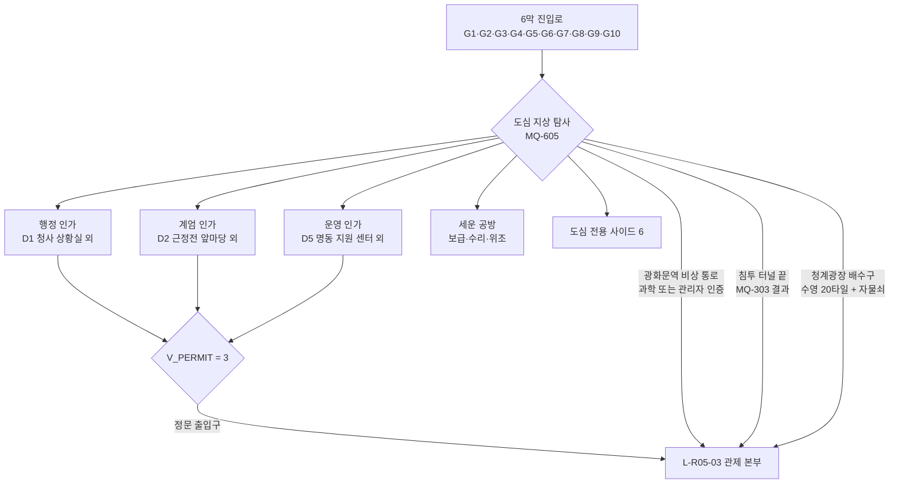
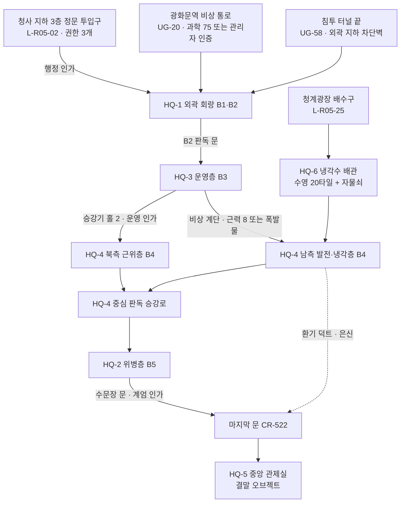

# SD-09c. 장소 카탈로그: R05 도심(밀폐) · R06 용산·남산

> **서울 폴아웃 상세 기획서 세트** | 문서 ID: SD-09c | 버전: v1.1 | 작성일: 2026-10-12
> **범위**: SD-08 §11.6(R05, 시드 35곳)·§11.7(R06, 시드 28곳)의 장소 전부와 추가 시드 3곳(R05 1, R06 2). 장소별 ID·좌표·등급·판도 단위·BGM, 실제 근거와 2077→2277 상태, 외부 배치와 실내 구성, NPC·적·보스, 루팅·수집품·기록물, 메인·세력 연계와 사이드 퀘스트 훅, 판도 반응. 특히 **광화문 지하 관제 본부(7막 최종 던전)**, 6막 '사대문 안' 주요 지점과 **관제 본부 출입 권한 3개의 획득 지점 후보**, 용산 요새(생물방어 실험동 봉인 구역 포함), 남산 방송, 이태원 피난촌, 남산 대피 터널(R06·R05 접점)을 상세히 다룬다. 이름 있는 NPC R05 45명·R06 62명, 권역 사이드 퀘스트 훅 R05 16개·R06 15개.
> **다루지 않는 것**: 지하철역·지하 시설 장소 본체(L-UG, SD-09f), 노들섬·한강 다리(L-HR, SD-09f), 퀘스트 단계·대사 정본(SD-03a·03b·04c·04d), 적 수치(SD-14), 아이템 수치(SD-13), 세력 수치(SD-06)
> **관련 문서**: [SC-00 컨셉](00_concept.md) §4.2·§5.4·§5.5·§5.8·§6.2·§11, [SD-02 세계관](02_world-and-lore.md) §3.3·§6·§7·§8.1·§10, [SD-03a 메인 1부](03a_main-story-part1.md) §9.5·§9.6, [SD-03b 메인 2부](03b_main-story-part2.md) 6막·7막, [SD-04c 사이드(북·동·도심)](04c_side-quests-north-east-center.md), [SD-04d 세력 퀘스트](04d_faction-questlines.md), [SD-05 비표시·인카운터](05_misc-quests-encounters.md), [SD-06 세력](06_factions.md), [SD-07a 주요 인물](07a_characters-major.md), [SD-07b NPC 디렉터리](07b_npc-directory.md), [SD-08 월드·권역](08_world-regions.md) §3·§4·§7.5·§7.6·§9·§10·§11.6·§11.7·§15, [SD-09f 지하·한강](09f_locations-underground-river.md), [SD-10 캐릭터](10_character-system.md) §7, [SD-12 탐험·UI](12_exploration-ui.md) §5, [SD-13 아이템](13_items.md), [SD-14 크리처·적](14_creatures-enemies.md), [SD-16 아트](16_art-direction.md) §6, [SD-17 사운드](17_sound.md) §3, [SD-18 명명](18_naming-terms.md) §3.12·§4

---

## 목차
1. 개요
2. 공통 표기와 데이터 규칙
3. 권역 지도
4. R05 도심(밀폐)
   - 4.1 권역 개요 · 4.2 장소 개요 표 · 4.3 도심 구조(구획·진입점·이동·상태) · 4.4 관제 본부 출입 권한 3개 · 4.5 L-R05-03 관제 본부(7막 최종 던전) · 4.6 S·A 장소 상세 · 4.7 B·C 장소 상세 · 4.8 이름 있는 NPC · 4.9 사이드 퀘스트 훅 · 4.10 인카운터 지점과 이동 경로
5. R06 용산·남산
   - 5.1 권역 개요 · 5.2 장소 개요 표 · 5.3 S·A 장소 상세 · 5.4 남산 대피 터널(R06·R05 접점) · 5.5 B·C 장소 상세 · 5.6 이름 있는 NPC · 5.7 사이드 퀘스트 훅 · 5.8 인카운터 지점과 이동 경로
6. 수집품·기록물·고정 자원 배치 총괄
7. 원작 대응
8. 쯔꾸르 제작 메모
9. 미결 사항
- 부록 A. 신규 고유명사 · 부록 B. 참고 문서

---

## 1. 개요

### 1.1 목적
- SD-08이 좌표와 순서만 정한 R05·R06 장소 시드 63곳에 **L-ID를 매기고**, 기획자와 제작자가 맵을 바로 찍을 수 있는 수준으로 장소마다 상태·배치·사람·적·보상·연계를 정한다.
- 두 권역은 메인 스토리의 처음과 끝을 잇는다. R06은 2막 허브(MQ-205 남산의 목소리, MQ-206 용산 요새)이고, R05는 6막(사대문 안)과 7막(종전)의 무대다. 두 권역은 서울역·숭례문·남산 북사면에서 맞닿고, 남산 대피 터널(G8)과 서울역 지하 교차역(G1)이 그 경계를 꿰뚫는다.

### 1.2 요약
| 항목 | R05 도심(밀폐) | R06 용산·남산 |
|---|---|---|
| 장소 수 | 36(시드 35 + 추가 1) | 30(시드 28 + 추가 2) |
| 등급 분포 | S 1 · A 12 · B 23 | S 2 · A 6 · B 16 · C 6 |
| 지도 마커 | 35(숨은 장소 1) | 28(부속 1·숨은 장소 1) |
| 위협도 | 3~5(권역 5) | 2~4(권역 2~4) |
| 실내 맵 | 약 62장(관제 본부 6 포함) + 구획 외부 맵 9 | 약 49장 + 외부 구역 3(심리스) |
| 이름 있는 NPC | N-R05 45명 | N-R06 62명 + 바이블 고정 인물 4명(C-ID) |
| 사이드 퀘스트 훅 | 16(6막 도심 전용 6) | 15 |
| 보스 | CR-174b·174c(거인), CR-521 관문 포대, CR-522 마지막 문 | CR-506 원형 0호, CR-174a·174d(거인), CR-525 다니엘 서(적대 시) |
| 핵심 메인 | MQ-601~605, MQ-701·702 | MQ-205, MQ-206, MQ-207, MQ-503, MQ-508(집결지) |

- **R05의 설계 축**: 6막 전에는 '들어갈 수는 있지만 살 수 없는 곳'이다. 상주하는 사람은 세운 공방의 구울 장인과 몇몇 은둔자뿐이다. 6막에 들어서면 관제망이 깨어난 거리(G3)를 9개 구획으로 나눠 탐사하고, 출입 권한 3개를 모아 광화문 지하 60m로 내려간다.
- **R06의 설계 축**: 서울 한가운데의 '군 요새 도시'다. 연합단의 의례와 계급이 공간을 지배하고, 그 둘레에 남산 방송(목소리), 이태원 피난촌(보호받는 사람들), 한남 고가파(통행세), 큰돌 무리(숨은 이웃)가 기대어 산다. 요새의 발밑에는 변종의 기원인 생물방어 실험동이 봉인돼 있다.

### 1.3 이 문서가 결정한 것
| # | 결정 | 근거·접점 |
|---|---|---|
| D-1 | 추가 시드 3곳: **L-R05-36 방산동 의무 분소**(SD-06 F-09 기원지·사이드 후보 '의무 분소'), **L-R06-29 남산 북사면 배수 터널**(SD-06 큰돌 무리 거처·판도 거점), **L-R06-30 이태원 고개 초소**(SD-06 연합단 판도 거점) | SD-06 §5.9 판도 거점 중 SD-08 시드에 없던 것 |
| D-2 | 변종 기원을 두 갈래로 정리한다: **1세대(서울역 무리)** = 용산 생물방어 실험동 배양액 → 삼각지 공동구 → S-12 아래 서울역 녹수조 L-UG-63(SD-02·SD-14 정본, 장소는 SD-09f). **을지로 무리** = 실험동이 도심에 둔 '방산동 의무 분소'의 비교 시료가 환기구로 을지로 지하상가에 번진 것(SD-06의 표현을 흡수) | SD-02 §8.1과 SD-06 §10.9의 서술 차이 해소 |
| D-3 | 관제 본부 출입 권한 3개 = **행정 인가(M-240 청사 보안 카드) · 계엄 인가(M-241 위병소 암호표) · 운영 인가(M-242 본부 승강기 열쇠)**. 주 경로 4가지는 SD-03b MQ-605 정본(D1 청사 상황실 · D2 근정전 앞마당 · D5 명동·남대문)을 따르고, 사이드 경로(SD-04c §2.6)와 이 문서의 대체 경로(SD-08 §9.4 후보였던 서울광장 지하 중계실·북악 감시 중계소 등)를 덧붙인다(§4.4, v1.1에서 03b에 맞춰 정정) | SD-03b MQ-605(정본) + SD-04c §2.6 + SD-13(M-240~242) + SD-08 §9.4 |
| D-4 | 관제 본부는 **외곽 회랑 + 위병층·운영층·연산 홀 + 냉각수 배관 + 중앙 관제실** 6장 구성이다. 층 이름·순서는 SD-03b MQ-701의 B1~B5를 따른다(§4.5.2 대응표, v1.1). 중앙 관제실에 결말 오브젝트 7종(배경 콘솔·생체 인증 판·테이프 슬롯·지휘 열쇠 배출구·관리자 고정 홈·진공관 코어·전원 분전반)을 둔다(§4.5) | SD-16 §6.9, SD-14 §8.7, SD-03b |
| D-5 | '수문장'(SD-02 본부 수비 로봇)은 **SD-14 근위 방벽-9(CR-319)의 2077년 제식 애칭**으로, '수문장 문'은 **위병층과 운영층 사이의 판독 방폭문**으로 정한다. 동행 세력이 막히는 곳이 여기다 | SD-02 §6.2, SD-03b 7막, SD-06 §9.8 |
| D-6 | 용산 요새는 **메인포스트(L-R06-01, 주거·의례·PX)**와 **국방 청사(L-R06-02, 지휘부·공작창·병기창)** 두 마커로 이루어진 하나의 요새다. 생물방어 실험동(L-R06-04)은 요새 남쪽 방벽 안 사우스포스트에 있고, 입구는 '봉인 문' 하나다 | SD-08 §11.7 메모, SD-02 §8.1, SD-14 §5.1 |
| D-7 | 이태원 피난촌은 **이태원로 동쪽 언덕과 옛 시장 골목**에 앉힌다. 2022년 실제 참사 현장(이태원역 인근 골목)에는 전투·사망·군중 연출을 두지 않고, 맵에서 그 골목을 '천막 창고 뒤 막힌 길'로 처리한다 | SD09_BRIEF 작성 규칙 9 |
| D-8 | 남산 대피 터널(L-UG-60)의 **R06 쪽 입구 2곳과 R05 출구 구조**를 이 문서가 제안하고 본체는 SD-09f가 확정한다(§5.4) | SD-08 §9.3 G8 |
| D-9 | 이름 있는 NPC의 외형 코드는 SD-07b §3 통일안을 따른다(몸 `M1 남 표준 / F1 여 표준 / M2 남 체형 변형 / F2 여 체형 변형 / E1 노인 남 / E2 노인 여 / K1 아동`). 로봇·변종은 몸 칸에 SD-14 CR-ID를 쓴다 | SD-16 §7.2, SD-07b §3(RECON_SPEC N-84로 확정) |
| D-10 | 흔들인형은 SD-09 공통 지시에 따라 한결건설 마스코트 **'든든이'**의 이름으로 적는다(SD-10의 '한결이' 표기를 교체 대상으로 본다) | SD09_BRIEF 이름 교체 |

---

## 2. 공통 표기와 데이터 규칙

### 2.1 장소 개요 표의 열
| 열 | 내용 |
|---|---|
| ID | `L-R05-nn`, `L-R06-nn`. SD-08 §11 시드 순서 그대로. 36·29·30은 추가 시드 |
| 이름 | SD-08 시드 이름. 다듬을 필요가 있으면 '통칭 제안' 열(상세 절)에 적는다 |
| 유형 / 아이콘 | SD-08 유형 어휘 / SD-12 §5.4 아이콘 번호(1 볼트 … 22 기타) |
| tx·ty / 청크 | SD-08 변환식 좌표(보정 전). 보정이 있으면 상세 절의 `보정dx,dy`에 적는다(E2). 이 문서의 보정은 모두 0이다 |
| 위협 | 장소 위협도 1~5(SD-08 §14.4 레벨 범위) |
| 마커 | `Y` 지도 마커 있음 / `N` 없음(숨은 장소는 소문·기록으로만 표시, 부속 장소는 다른 마커에 포함 — 상세 절에 적는다). 세트 공통 표기(v1.1) |
| 등급 | SD-16 §6.6 장소 등급 S/A/B/C(앵커·실내 맵 예산) |
| 판도 | SD-08 §15 판도 구역 `PD-Rxx-n` / 거점 `PD-Hnn` |
| 경비 | SD-12 §9.5 '경비 체계가 있는 거점' 플래그(Y면 신고형 목격자) |
| BGM / BGS | SD-17 §3 큐 ID. R05 외부는 6막 이전 `X05A·B`, MQ-605 이후 `M604A~C`가 대신한다 |

### 2.2 장소 상세의 틀
- **S·A 장소**: 실제 근거 → 2077 → 2277 / 외부 배치 / 실내 구성(맵·층·문 전환) / 사람 / 적·보스 / 루팅·수집품·기록물 / 메인·세력·사이드 연계 / 판도 반응 / 환경 스토리텔링.
- **B·C 장소**: 같은 항목을 표 한 개로 줄인다.
- 적 레벨은 SD-14 §11.1 산정식을 따른다. 표의 '레벨대'는 위협도 범위다.
- 루팅 등급은 SD-13 §9.2 권역값(R05 T4~T5, R06 T3~T4)이 기본이다. 장소가 다르면 적는다.

### 2.3 NPC 표의 열
| 열 | 내용 |
|---|---|
| ID | `N-R05-nnn`, `N-R06-nnn`. 바이블 §11 고정 인물(다니엘 서 C-005·송미래 C-008·큰돌 C-016·제이슨 임 C-017)은 SD-07a의 C-ID로 적고 N-ID를 주지 않는다. N-ID가 있는 주요 인물은 ID 칸에 C-ID를 함께 적는다(SD-07b §6.4) |
| 출처 | 다른 문서가 먼저 만든 인물은 그 문서를 적고 이름·설정을 그대로 쓴다 |
| 종 | 인간 / 구울 / 변종 / 로봇 |
| 외형 코드 | SD-16 §7.2 형식 `몸-피부-머리-머리색-몸통-낡음-팔레트-머리장비-눈장비-소품`. 값은 **SD-07b §3 외형 코드 통일안**(몸 M1·M2·F1·F2·E1·E2·K1, 낡음 0~2, HR00~11, HD01~18, EY01~08, 소품 PR001~200)을 따른다(RECON_SPEC N-84). v1.1에서 옛 제안 대역 `PR5nn`·`PR6nn`을 SD-07b §4 디렉터리 값으로 일괄 치환했다(원래 값은 SD-07b가 보존). 팔레트 `PF00`은 세력 팔레트 없음 |
| 일과 | 낮(06~18시) / 밤 위치. 장소 ID와 맵 이름으로 |

### 2.4 이름 짓기 검사
- SD-18 §3.12.4 D1~D7을 이 문서 범위에서 검사했다: 같은 권역 안 성명·이름 중복 없음, 같은 장소 안 초성 같은 2자 이름 없음, 바이블 예약 이름 2자와 세력·브랜드 예약어 없음. 다른 문서와의 성명 일치는 작성 시점의 SD 문서 전체에서 검색해 없음을 확인했다.
- R05 구울은 2077년 이름(P6)을 쓴다. R06 연합단은 P4 형식(영어 이름 + 한국 성 55%, 한국 이름 + 영어 성 25%, 한국 성명 15%, 영어 성명 5%)을 지켰다.

---

## 3. 권역 지도

### 3.1 청크 격자 발췌와 장소 위치
SD-08 §4.2 격자의 X 23~30 · Y 17~28 부분이다. 한 칸 = 20×20타일(청크의 1/4), `##` R05, `::` R06, `~~` 한강(HR), `.3` R03, `.8` R08, `.9` R09. `dNN` = L-R05-NN, `yNN` = L-R06-NN. 한 칸에 둘이 겹치면 옆 칸에 밀어 적었다(d04·d14·d29·d36·y07·y09·y20).

```
  청크X    C23      C24      C25      C26      C27      C28      C29      C30
 C17  | .3  .3  .9  .9  ##  ##  d07 ##  ##  ##  ##  ##  .9  .9  .9  .9
      | .3  .3  .9  .9  ##  ##  ##  ##  ##  ##  ##  ##  .9  .9  .9  .9
 C18  | .3  .3  .3  .3  ##  ##  d06 ##  d08 ##  ##  ##  ##  d35 .9  .9
      | .3  .3  .3  .3  ##  ##  ##  ##  ##  ##  ##  ##  d33 ##  .9  .9
 C19  | .3  .3  ##  ##  ##  ##  d05 ##  ##  ##  ##  d32 d31 d34 .9  .9
      | .3  .3  ##  ##  d12 ##  d02 ##  ##  ##  ##  ##  ##  ##  .9  .9
 C20  | .3  .3  .3  .3  d09 d04 d01 d03 ##  ##  ##  d24 ##  ##  ##  ##
      | .3  .3  .3  .3  ##  ##  ##  ##  d21 d20 d25 d22 d26 d36 d27 d29
 C21  | .3  .3  .3  .3  d11 d10 d15 d13 d14 ##  d23 ##  ##  ##  d28 ##
      | .3  .3  .3  .3  ##  ##  ##  ##  d16 ##  ##  d19 ##  ##  d30 ##
 C22  | .3  .3  .3  .3  ::  ::  d18 d17 ##  ##  ##  ##  .8  .8  .8  .8
      | .3  .3  .3  .3  ::  y25 ##  ##  ##  ##  ##  ##  .8  .8  .8  .8
 C23  | .3  .3  .3  .3  ::  y24 ::  ::  y29 ::  y10 ::  .8  .8  .8  .8
      | .3  .3  .3  .3  ::  ::  ::  ::  ::  y08 y09 ::  .8  .8  .8  .8
 C24  | .3  .3  ::  y26 ::  ::  ::  ::  ::  ::  y12 ::  .8  .8  .8  .8
      | .3  .3  ::  ::  ::  y28 ::  ::  ::  y13 y11 ::  .8  .8  .8  .8
 C25  | ::  ::  ::  y27 ::  ::  ::  ::  ::  ::  ::  y30 ::  ::  .8  .8
      | ::  ::  ::  ::  ::  ::  y19 ::  y01 ::  ::  ::  y16 ::  .8  .8
 C26  | ::  ::  y06 ::  ::  ::  y02 y20 ::  ::  ::  y14 ::  ::  ::  ::
      | ::  ::  ::  y05 ::  ::  ::  ::  ::  ::  y03 y07 ::  ::  y15 ::
 C27  | ~~  ~~  ::  ::  ::  ::  ::  ::  y04 ::  ::  ::  y17 ::  ~~  ~~
      | ~~  ~~  ::  ::  ::  y22 ::  y18 ::  ::  ::  ::  ::  ::  ~~  ~~
 C28  | ~~  ~~  ~~  ~~  y23 ::  ::  ::  ::  ::  ::  ::  ~~  ~~
      | ~~  ~~  ~~  ~~  ::  ::  ::  y21 ::  ::  ::  ::  ~~  ~~
```

- **읽는 법**: R05는 북쪽(Y17)의 북악·인왕부터 남쪽 숭례문·남대문시장(Y22)까지의 성곽 안 분지다. R06은 그 바로 남쪽, 서울역(Y22~23)에서 한강 북안 이촌(Y28)까지다. 남산(y08·y09·y10·y29)이 두 권역의 경계 산이다.
- 같은 청크에 장소 중심이 4곳 이상 겹치는 곳은 없다(SD-08 E3 해당 없음). 가장 가까운 쌍은 광화문 광장–관제 본부(4.5타일, 관제 본부는 지하 마커라 겹침 허용)와 서울시청–서울광장 지하 중계실(5.4타일, 같은 사유)이다.

### 3.2 도심 구획 D1~D9 개략도
SD-08 §9.2의 구획을 실제 방위대로 배치한 그림이다. `=`는 성곽, `#`은 잔해·차단벽 띠, `[ ]`는 구획 이름, 숫자는 L-R05 번호, `G`는 진입점(SD-08 §9.3), `B`는 건물 내부 통과 3곳.

```
                 북악 =====================(07)=====================  숙정문
                 = (06)            [D2 경복궁·북악]   (08)        =        (35)혜화문 G9/G4
   창의문        =         (05)경복궁   G6 터널 남쪽 출구          =  [D9 대학로·낙산]
   인왕산 ====== = (12)     (02)청사 -B1- D1                (32)(31)(33)   (34)낙산 ==
   [D3 정동·     =  [D1 광화문·세종대로]  (03)관제 본부(지하)        ==========#####
    서대문 터]   =  (09)  (01)광장 (04)탑     [D6 종로·세운]  (24)종묘          =
   G9 (11)돈의문 =  G2서대문역   (21)(20)종로   (22)세운 -B2-  (26)(36)  (27)흥인지문 G9/G5
         (10)    -B3- (13)시청 (14)   [D7 청계천 협곡 ~~~~~(25)~~~~~~~~~~~~~ G7]
                 (15) [D4 시청]       (23)을지로      [D8 동대문]  (29)(28)
                 ====(18)숭례문 G9/G1  (17)남대문  (16)명동 G8  (19)충무로  (30)광희문 ===
                         [D5 명동·남대문] ========== 남산 북사면 ===========
```

- **B1** 정부 종합청사 지하(D1 ↔ D2), **B2** 세운 공방 공중 보행로(D6 ↔ D7 ↔ D5), **B3** 서울시청 구청사(D4 ↔ D3). 그 밖의 구획 사이는 지하(U10~U13)로만 잇는다(SD-08 §9.2).

---

## 4. R05 도심(밀폐)

### 4.1 권역 개요
| 항목 | 내용 |
|---|---|
| 청크 | 30청크, X 24~30 · Y 17~22(SD-08 §7.5) |
| 위협도 | 5(장소 3~5). 적 레벨 16~35. 6막 사대문 봉쇄(G3) 뒤 스폰 레벨 하한 +2 |
| 봉쇄 | 성곽 + 잔해 + 도심 링 차단벽 38곳(SD-08 §9.1). 지상 진입 불가. 지하 진입점 G1~G5·G7, 특수 진입 G6·G8, 성문 차단벽 G9, 공중 G10 |
| 상주자 | 세운 공방 구울 장인 공동체(약 30명), 은둔자 몇, 2077년 그대로 일하는 로봇들. 각성회 순례조와 원칙파 회수조가 드나든다 |
| 적 | 변종(을지로 무리 지상·지하, 서울역 무리 남쪽), 관제망 경비 체계(G0 정지 → G1 포대 → G3 사대문 편대), 야생 구울(지하철·병원), 오염 비둘기(CR-610), 청계천 녹등거북(CR-611), 종묘 멧돼지(CR-101) |
| 고정 강적 | 광장 거인 CR-174b(L-R05-01), 문 앞 거인 CR-174c(L-R05-27), 관문 포대 CR-521(L-R05-27), 마지막 문 CR-522(L-R05-03 콘솔실 앞). 역전 거인 CR-174a는 R06 L-R06-25 |
| 루팅 | T4 기본, T5 상한(SD-13 §9.2). 청사·관제망 경비 장비, 미니 누크 고정 4(관제 본부 외곽) |
| 방사능 | 지상 Rad-1(W-5 광화문 상공 공중 폭발), 건물 안 일부 Rad-2. 방산동 분소 안 Rad-3 |
| 판도 | PD-R05-1 도심 북서(관제망 우세) / PD-R05-2 도심 중남(변종 우세) / PD-R05-3 도심 동부(변종 장악). 거점 3: 관제 본부(관제망 3), 서울역 지하(변종 2, UG), 을지로 지하상가(변종 2, UG) |
| 메인 | MQ-601~605(6막), MQ-701·702(7막). 6막 이전 진입은 순서 파괴 O-08(SD-03a §6.2) |

**6막 전과 후**
| 시점 | 도심의 얼굴 | 플레이어가 하는 일 |
|---|---|---|
| 6막 이전(G0~G2) | 차단벽은 닫혀 있고 관제망 로봇은 대부분 정지(분해해 부품을 얻는다). 변종이 지하와 D5·D8을 쥐었다. MQ-301 이후 성문 30타일 안을 감시포가 쏜다 | 세운 공방에 닿아 거래·사이드. 출입 권한을 미리 모을 수 있다(V_PERMIT 누적). 관제 본부 정문은 V_PERMIT = 3이면 6막 전에도 열린다(즉시 7막 특례) |
| 6막(G3) | 사대문 봉쇄. 사대문 편대(FD-6A)가 거리를 돌고 확보 편대(FD-6B)가 관리자를 '확보 대상'으로 쫓는다(비살상 우선). 도심 빠른 이동 금지(SD-12 F6) | MQ-605: 출입 권한 3개, 도심 전용 사이드 6개, 협력 세력 지원 |
| 7막(G4) | 관제 본부 내부만 본부 방호. 지상은 G3 유지 | MQ-701·702 |
| 에필로그(G5) | E3·E4면 성문 차단벽 4곳이 열려 지상 문 전환이 생긴다. E1·E5면 차단벽이 명령으로 여닫힌다. E2면 연합단 검문 | 후일담(MQ-E1), 세운 공방 개방 |

### 4.2 장소 개요 표 (36)
| ID | 이름 | 유형 / 아이콘 | tx·ty | 청크 | 위협 | 마커 | 등급 | 구획 | 판도 | 경비 | BGM / BGS |
|---|---|---|---|---|---|---|---|---|---|---|---|
| L-R05-01 | 광화문 광장 | 랜드마크 / 20 | 1058·804 | C-26-20 | 5 | Y | A | D1 | PD-R05-1 | N | X05B→M604A / C02 |
| L-R05-02 | 정부 종합청사 | 던전 / 10 | 1049·797 | C-26-19 | 5 | Y | A | D1 | PD-R05-1 | N | D10 / I04 |
| L-R05-03 | 관제 본부 | 던전 / 12 | 1060·808 | C-26-20 | 5 | Y | **S** | D1 지하 60m | PD-R05-1 · 거점(관제망) | N | M701·M702·M703 / I05 |
| L-R05-04 | 세종로 확성기탑 | 랜드마크 / 20 | 1058·819 | C-26-20 | 4 | Y | B | D1 | PD-R05-1 | N | X05B→M604B / C02 |
| L-R05-05 | 경복궁 | 랜드마크 / 20 | 1059·770 | C-26-19 | 4 | Y | A | D2 | PD-R05-1 | N | X05A→M604A / L06 |
| L-R05-06 | 북악 관저 터 | 던전 / 10 | 1048·728 | C-26-18 | 5 | Y | B | D2 | PD-R05-1 | N | D10 / I04 |
| L-R05-07 | 북악 감시 중계소 | 관제망 시설 / 12 | 1045·696 | C-26-17 | 5 | Y | A | D2 | PD-R05-1 | N | D05 / W05·C03 |
| L-R05-08 | 삼청 언덕 저택 | 폐허 / 19 | 1083·738 | C-27-18 | 4 | Y | B | D2 | PD-R05-1 | N | X05A→M604A / U01 |
| L-R05-09 | 경희궁 터 | 랜드마크 / 20 | 1016·819 | C-25-20 | 4 | Y | B | D3 | PD-R05-1 | N | X05A→M604A / L06 |
| L-R05-10 | 정동 옛 공관 거리 | 폐허 / 19 | 1033·849 | C-25-21 | 4 | Y | B | D3 | PD-R05-1 | N | X05A→M604B / U01 |
| L-R05-11 | 돈의문 터 차단벽 | 랜드마크 / 13 | 1011·840 | C-25-21 | 4 | Y | B | D3 | PD-R05-1 | N | X05A / C01 |
| L-R05-12 | 사직 언덕 | 폐허 / 19 | 1016·792 | C-25-19 | 4 | Y | B | D3 | PD-R05-1 | N | X05A / U06 |
| L-R05-13 | 서울시청 | 던전 / 10 | 1063·850 | C-26-21 | 4 | Y | A | D4 | PD-R05-2 | N | D02·M604B / I07 |
| L-R05-14 | 서울광장 지하 중계실 | 관제망 시설 / 12 | 1065·855 | C-26-21 | 5 | Y | A | D4 지하 | PD-R05-2 | N | D05 / C03 |
| L-R05-15 | 덕수궁 석조전 | 랜드마크 / 20 | 1050·853 | C-26-21 | 4 | Y | B | D4 | PD-R05-2 | N | M604B / L06 |
| L-R05-16 | 명동 거리 | 폐허 / 9 | 1097·866 | C-27-21 | 4 | Y | A | D5 | PD-R05-2 | N | X05B→M604B / U01 |
| L-R05-17 | 남대문시장 | 던전 / 9 | 1062·893 | C-26-22 | 4 | Y | A | D5 | PD-R05-2 | N | M604C / L07 |
| L-R05-18 | 숭례문 | 랜드마크 / 20 | 1051·888 | C-26-22 | 4 | Y | B | D5 | PD-R05-2 | N | M604C / C01 |
| L-R05-19 | 충무로 인쇄 골목 | 폐허 / 11 | 1140·879 | C-28-21 | 4 | Y | B | D5 | PD-R05-2 | N | X05B→M604B / U01 |
| L-R05-20 | 종로 대로 | 폐허 / 19 | 1107·828 | C-27-20 | 4 | Y | B | D6 | PD-R05-2 | N | X05B→M604B / U01 |
| L-R05-21 | 보신각 종루 | 랜드마크 / 20 | 1089·829 | C-27-20 | 4 | Y | B | D6 | PD-R05-2 | N | M604B / L06 |
| L-R05-22 | 세운 공방 | 정착지 / 3 | 1147·834 | C-28-20 | 3 | Y | A | D6·D7 | PD-R05-2 | **Y** | S12(구울 장인 변주 제안) / S07 |
| L-R05-23 | 을지로 공구 골목 | 교역소 / 9 | 1135·849 | C-28-21 | 4 | Y | B | D6 | PD-R05-2 | N | X05B / U01 |
| L-R05-24 | 종묘 숲 | 자연 / 16 | 1140·801 | C-28-20 | 4 | Y | B | D6 | PD-R05-2 | N | X05A / U06 |
| L-R05-25 | 청계천 협곡 | 던전 / 18 | 1121·834 | C-28-20 | 4 | Y | A | D7 | PD-R05-2(서)·PD-R05-3(동) | N | D06 / R07 |
| L-R05-26 | 청계 고가 잔해 | 랜드마크 / 19 | 1169·831 | C-29-20 | 4 | Y | B | D7 | PD-R05-3 | N | X05B / W03 |
| L-R05-27 | 흥인지문 | 랜드마크 / 20 | 1214·821 | C-30-20 | 4 | Y | A | D8 | PD-R05-3 | N | X05B·C05(보스) / C01 |
| L-R05-28 | 동대문 미래관 | 던전 / 22 | 1214·849 | C-30-21 | 5 | Y | A | D8 | PD-R05-3 | N | D11 / L07 |
| L-R05-29 | 동대문 의류 상가 | 던전 / 9 | 1201·831 | C-30-20 | 4 | Y | B | D8 | PD-R05-3 | N | D11 / U01 |
| L-R05-30 | 광희문 차단벽 | 랜드마크 / 13 | 1209·861 | C-30-21 | 4 | Y | B | D8 | PD-R05-3 | N | X05B / C01 |
| L-R05-31 | 종로 국립대학병원 | 던전 / 22 | 1164·771 | C-29-19 | 4 | Y | B | D9 | PD-R05-3 | N | D13 / I09 |
| L-R05-32 | 창경궁 온실 | 랜드마크 / 20 | 1145·771 | C-28-19 | 4 | Y | B | D9 | PD-R05-3 | N | X05A / L06 |
| L-R05-33 | 대학로 소극장 거리 | 폐허 / 19 | 1178·755 | C-29-18 | 4 | Y | B | D9 | PD-R05-3 | N | X05A / U01 |
| L-R05-34 | 낙산 성곽 전망대 | 전망 지점 / 16 | 1195·768 | C-29-19 | 3 | Y | B | D9 | PD-R05-3 | N | X05A / W05 |
| L-R05-35 | 혜화문 차단벽 | 랜드마크 / 13 | 1180·723 | C-29-18 | 4 | Y | B | D9 | PD-R05-3 | N | X05A / C01 |
| L-R05-36 | 방산동 의무 분소 *(추가)* | 던전 / 22 | 1171·837 | C-29-20 | 5 | N | B | D7 | PD-R05-3 | N | D04 / I09 |

- BGM·BGS 칸은 접두어 `BGM-`·`BGS-`를 줄였다(예: `X05B` = BGM-X05B, `C02` = BGS-C02). `→`는 MQ-605가 열린 뒤 바뀌는 곡이다(SD-17 §3.5).
- 등급 집계: S 1, A 12, B 23. 실내 맵 합계는 §8.2.

### 4.3 도심 구조: 구획·진입점·이동·상태

#### 4.3.1 구획별 장소와 출입
| 구획 | 맵 크기(SD-08) | 장소 | 지상 출입(문 전환) | 지하 출입(L-UG) | 구획의 역할 |
|---|---|---|---|---|---|
| D1 광화문·세종대로 | 80×90 | 01·02·03·04 | 청사 지하 ↔ D2(B1) / G10 착륙점(광장 북단) | 광화문역 UG-20(비상 통로 → 관제 본부) | 최종 목표. 행정 인가 |
| D2 경복궁·북악 | 90×80 | 05·06·07·08 | 청사 지하 ↔ D1(B1) / G10 보조 착륙점(경복궁 앞) | 경복궁역 UG-21, 안국역 UG-22, 침투 터널 UG-58 남쪽 출구 | 계엄 인가 ①(근정전 앞마당). 잔존병 경로(G6) 도착 |
| D3 정동·서대문 터 | 60×80 | 09·10·11·12 | 시청 구청사 ↔ D4(B3) / 돈의문 차단벽(G9) | 서대문역 UG-19 | 서문. 5호선 경로(G2) 도착 |
| D4 시청·서울광장 | 60×60 | 13·14·15 | 시청 구청사 ↔ D3(B3) | 시청역 UG-23, 을지로 지하 회랑 UG-61 서단 | 운영 인가 ④(시청 지하). 1호선 경로(G1) 도착 |
| D5 명동·남대문 | 100×60 | 16·17·18·19 | 숭례문 차단벽(G9) / 세운 공중 보행로 남단 ↔ D7(B2) | 회현 UG-30, 명동 UG-29, 충무로 UG-28, 명동 지하상가 UG-62, 남산 대피 터널 UG-60 출구 | 시장 터. 운영 인가 ①②(명동 지원 센터·나르미 물류 센터). 4호선 경로(G1) 도착 |
| D6 종로·세운 | 100×50 | 20·21·22·23·24 | 세운 공중 보행로 ↔ D7(B2) | 종각 UG-24, 종로3가 UG-25(도심 지하 허브. 부역장 구울 문재석의 '안전 방'이 6막 도심 유일의 지하 저장·수면 지점, SD-09f) | 유일한 사람 사는 곳 |
| D7 청계천 협곡 | 200×16 | 25·26·36 | 세운 공중 보행로 ↔ D6·D5(B2) | 청계천 복개 하수로 UG-59(G7), 을지로3가 UG-27, 청계광장 배수구(→ 관제 본부 냉각수 배관) | 도심의 등뼈. 은신 경로 |
| D8 동대문 | 70×70 | 27·28·29·30 | 흥인지문 차단벽(G9) | 동대문 UG-31(G5 도착), 동대문역사문화공원 UG-32 | 변종 둥지. 차단벽 보스 |
| D9 대학로·낙산 | 80×70 | 31·32·33·34·35 | 혜화문 차단벽(G9), 낙산 성곽 위(층 2) | 혜화역 UG-33(G4 도착) | 병원·극장. 도심 조망 |

- 구획 맵의 바깥 테두리(잔해·차단벽)는 구획 사이에 4~8타일씩 둔다(SD-08 E6). 테두리에는 '넘을 수 없음'을 그림으로 말하는 소품(무너진 고층 건물 단면, 반쯤 내려온 차단벽, 깨진 판독기 게이트)을 반복하지 않고 구획마다 다르게 둔다.

#### 4.3.2 진입점 G1~G10의 R05 쪽 도착 지점
| # | 진입 경로(메인) | R05 도착 장소 | 도착 직후 상황(6막) | 이 문서의 연출 메모 |
|---|---|---|---|---|
| G1 | 서울역 지하 교차역(MQ-601 1호선. L-UG-34 → L-UG-64 1호선 도심 구간 → 시청역, 정본 SD-09f) | 시청역(D4) 또는 회현역(D5) | 시청역 대합실 '대기 구역' 해골 행렬 → 지상 서울광장. 확보 편대(FD-6B)가 광장 남쪽에 있다 | 시청역 출구 계단 위로 시청 유리 신청사가 반쯤 무너져 광장을 내려다본다 |
| G2 | 충정로역 5호선 | 서대문역(D3) | 정동 돌담길 바리케이드 뒤 | 5호선은 광화문역까지 이어져 비상 통로 출입구와 가깝다 |
| G3 | 독립문역 3호선 | 경복궁역(D2) | 경복궁 서쪽 담 밖 | 침투 터널 출구와 같은 블록이라 잔존병 경계조와 마주칠 수 있다 |
| G4 | 한성대입구역 4호선 | 혜화역(D9) | 대학로 소극장 거리 | 혜화역 2번 출구 앞 소극장 간판 '오늘 공연 있음'이 200년째 켜져 있다(핵분열 전지) |
| G5 | 신설동역 1호선 | 동대문역(D8) | 변종 을지로 무리 둥지 바로 앞 | 가장 위험한 진입점. 의류 상가 지하 연결 통로로 우회 가능 |
| G6 | 침투 터널(MQ-602) | 경복궁 서쪽 담 밖 수직갱 출구(D2) / 관제 본부 외곽 차단벽 앞(지하) | 평화 경로면 잔존병 공병이 출구 덮개를 연다 | 출구는 2077년 굴진 로봇이 뚫은 원형 갱. 지상 출구는 무너진 한옥 마당 아래 |
| G7 | 청계천 복개 하수로 | 청계천 협곡 동쪽 끝(D7) | 협곡 바닥, 관제망 시야 밖 | 은신 진입로. 협곡 서쪽 끝 청계광장 배수구가 관제 본부 냉각수 배관으로 이어진다 |
| G8 | 남산 대피 터널 | 명동 지하상가 남단 → 명동 거리(D5) | 명동 지하상가 셔터 뒤 | §5.4. 남산 방송·연합단 남산 분견대 우호면 열린다 |
| G9 | 성문 차단벽 4곳(MQ-603) | 숭례문(D5) / 돈의문 터(D3) / 혜화문(D9) / 흥인지문(D8) | 관리자 권한 + 당인리 전원으로 연다. 열면 그 문은 지상 문 전환이 된다 | 각 문의 현장 정비 로봇(N-R05-031~035)이 관리자 부호를 받는다. 흥인지문은 권한 없이 강행하면 CR-521 보스전 |
| G10 | 공중 강하(MQ-604) | 광화문 광장 북단 착륙점(D1) / 경복궁 앞 보조 착륙점(D2) | 버티버드 하강 연출. 착지 직후 광장 거인 CR-174b가 깨어난다 | 착륙점은 광장 북단 이순신 동상 자리 대신 **2077년 '관제망 준공 기념 진공관 탑'** 받침대 옆(실제 동상은 쓰지 않는다) |

#### 4.3.3 6막 탐사 흐름

- 정문 출입구 외의 세 출입구는 **출입 권한 없이도** 관제 본부 외곽으로 들어가게 한다. 다만 본부 안의 B5 위병층 '수문장 문'(계엄 인가)과 B3 심층 승강기(운영 인가)에서 다시 막히므로, 권한 3개 없이 콘솔실까지 가려면 각 출입구가 주는 우회 수단(§4.5.4)을 써야 한다. 메인 진행은 막히지 않는다(바이블 §5.3).

#### 4.3.4 상태 변화가 장소에 주는 것
| 시점 | 장소 단위 변화 |
|---|---|
| G0 시작 | 세종로 확성기탑·광장 경광등 소등. 차단벽 5곳 정지. 정비 로봇 5기는 '대기'(말을 걸면 2077년 대기 문구만) |
| G1 MQ-301 재가동 | 경광등 앰버 점등. 차단벽 포대(KS-5) 가동: 성문 30타일 안 사격. 확성기탑이 LR-07 동원 방송을 재생하기 시작한다. 정비 로봇이 관리자 부호 대화를 받는다 |
| G2 MQ-501 계엄 선포 | 확성기탑이 ST-04 2단계 문구. 거리 순찰조 KS-1 ×3. 세운 공방은 공중 보행로 셔터를 내리고 하수로 출입만 연다 |
| G3 6막 진입 | FD-6A·FD-6B·KS-4·KS-5·KS-7 배치(SD-14 §8.7). 세운 공방이 '6막 보급소'로 바뀐다(가격 +20%, 대신 협력 세력 지원 보급 수령 장소) |
| G4 MQ-701 | 지상은 G3 유지. 관제 본부 안만 본부 방호 |
| G5 에필로그 | E3: 정비 로봇이 성문을 열어 두고 '시민 통행 안내'를 한다. 세운 공방이 지상 장터를 연다(소형 정착지 승격 제안). E4: 경광등 영구 소등, 로봇은 부품 자원. E1·E5: 확성기탑이 결말 포고를 반복. E2: 광화문 광장에 연합단 전진 초소 |

### 4.4 관제 본부 출입 권한 3개: 획득 지점
- **정본**: 퀘스트 단계·대사·보상 수치와 **주 경로 4가지**는 SD-03b MQ-605(§4.5 '출입 권한별 획득 방법')가 정한다. 이 절은 그 주 경로를 장소에 앉히고, 사이드 경로(SD-04c §2.6)와 이 문서의 대체 경로를 덧붙인다. 권한 이름은 SD-03b(행정·계엄·운영 인가), 아이템은 SD-13(M-240~242).
- **표기**: ①~④ = 주 경로(SD-03b 순서 그대로) / `N05`·`N27`·`N08`·`N02`·`N01` = 사이드 경로(SD-04c 퀘스트 ID. 사이드에서 얻으면 MQ-605 해당 단계가 즉시 완료) / 가·나·다·라 = 이 문서의 대체 경로. v1.0의 ①~⑤ 번호는 v1.1에서 이 표기로 바뀌었다(RECON_SPEC N-34, 03b 정합).
- 세 권한은 순서 없이 모은다. 하나 얻을 때마다 `V_PERMIT +1`, ME-17(1~3음) 재생. 6막 전에도 모을 수 있다(O-08). 세 권한을 모두 **정문 투입구**(청사 지하, 관제 본부 B1 앞)에 꽂으면 정문 램프가 열린다(SD-03b MQ-605 단계 50).
- 주 경로의 중심지가 D1(청사 상황실)·D2(경복궁 근정전 앞마당)·D5(명동·남대문)로 갈라져 있어 도심을 한 바퀴 돌게 된다. 대체 경로는 D2 북악·삼청, D4 시청·서울광장, D6 세운 공방, R09 공릉에 나눴다.

| 권한 | 아이템(SD-13) | 주 경로 장소(SD-03b) | 꽂는 곳 / 안에서 다시 읽는 문(관제 본부) | 덤으로 주는 것 |
|---|---|---|---|---|
| 행정 인가 | M-240 「청사 보안 카드」 | L-R05-02 정부 종합청사 행정안전부 상황실 | 정문 투입구 / B1 외곽 방폭문 | 인증 출입으로 들어가 외곽 회랑 편대(FD-7A)가 '대기'로 시작한다 |
| 계엄 인가 | M-241 「위병소 암호표」 | L-R05-05 경복궁 근정전 앞마당(2077년 계엄사령부 도심 전방 지휘소) | 정문 투입구 / B5 위병층 '수문장 문' | 위병소가 '참관인 통과 모드'가 되어 동행 세력 최대 4명이 수문장과 싸우지 않고 지난다 |
| 운영 인가 | M-242 「본부 승강기 열쇠」 | L-R05-16 명동 세진전자 도심 관제 지원 센터 | 정문 투입구 / B3 운영층 승강기 홀 2(심층 승강기 → B4 북측 근위층) | 근위조(KS-8) 1개를 등 뒤에서 만난다(기습 판정) |

#### 4.4.1 행정 인가 (M-240 청사 보안 카드)
| # | 장소 | 방법 | 조건·위험 | 호감도·판도 |
|---|---|---|---|---|
| ① 주 | L-R05-02 정부 종합청사 지하 1층 행정안전부 상황실 | 상황실 금고 [자물쇠 따기 75] 또는 상황실 단말 [과학 75] | 청사 지하는 계엄 순찰조(KS-4)와 야생 구울. 단말을 쓰면 확성기탑이 "관리 후보 출입증 발급"을 방송해 FD-6B가 청사로 온다 | 없음 |
| ② 주 | 같은 상황실 판독기 | 관리 요원 신분증 12장(SD-03a MQ-104)을 한 장씩 넣고 관리자 인증. "관리 요원 12명 출석 확인. 집결 완료. 호송 대기 해제." | 신분증 12장 소지. 카르마 +50(SD-03b) | 없음 |
| ③ 주 | 청사 현관 판독기(어디서든 소지만 하면 된다) | 남궁혁의 신임장(SD-03b MQ-402 '협력' 결과물) 또는 권한대행 직인(협상 퇴진 시 집무실 책상에서 집어 왔다면) | 자동. BJ 동맹이면 육지환이 카드를 미리 들고 와 집결지에서 건넨다 | 쓰는 순간 BJ +2, JC -2(소문) |
| ④ 주 | 염수진(N-R11-002)의 카드 | 염수진이 살아 있고 BJ 우호 이상이면 건넨다. 벙커 붕괴 때 탈출했다면 도심 근처 계엄군 진지에서 만난다(SD-07b) | 염수진 생존 | 없음 |
| N05 | L-R05-05 경복궁 근정전 회랑 '비상 행정 임시 분실' | 구울 사무관 황보지훈(N-R05-038)에게 2077년 서식 7종을 갖춰 내면 정식 발급(SQ-N05, 훅 H05-11) | 6막 전용. 서식이 도심 7곳에 흩어져 있다. 전투 없이 끝낼 수 있는 경로. 정식 발급본이라 FD-7A가 '대기'로 시작 | 서식 하나를 공보방송 원고와 바꿔 넣으면 BJ +3 |
| N27 | L-R05-01 광화문 광장 지하 주차장 대피소 | 2077년 청사 경비대 '마지막 교대조' 장교 유해의 가슴 주머니 [탐색](SQ-N27 단계 30에서 지난다. N27 없이도 얻을 수 있다) | 광장 거인 CR-174b의 활동 반경(광장 남쪽 40타일) 안. 밤에는 거인이 지하 입구 앞에서 잔다(웅크림 접근 가능) | 없음 |
| 가 | L-R05-22 세운 공방 | 염태식(N-R05-001)에게 청사 직원 신분증 3장(도심 시신·청사에서 수집) + 300캡 → '위조 보안 카드' | 1회용. 외곽 방폭문은 열지만 위병소에 경보 1회(FD-7A가 대기 대신 경계로 시작) | 세운 공방 +5 |

#### 4.4.2 계엄 인가 (M-241 위병소 암호표)
| # | 장소 | 방법 | 조건·위험 | 호감도·판도 |
|---|---|---|---|---|
| ① 주 | L-R05-05 경복궁 근정전 앞마당 | 2077년 계엄사령관 도정훈의 지휘 차량. 차량 안 유해에서 카드 [탐색] | 경복궁은 변종 둥지(위협 5). 앞마당은 변종 순찰조의 고리 안이다 | 없음 |
| ② 주 | 육지환(어디서든) | V_YUK = 2(투항) 또는 BJ 주력이면 그가 건넨다. BJ 신뢰 이상이 6막 동행이면 윤석진 대위가 계엄 코드로 대신 발급 | SD-03b 조건 그대로 | 발급: BJ +2 |
| ③ 주 | R06 용산 통신 벙커(L-R06-02 국방 청사) | 원정사 연락관 기록(SD-03a MQ-206 보상) + YH 우호 이상이면 통신 벙커가 미군 참관인 카드를 새로 찍어 준다(게임 시간 1일). 참관인 권한은 계엄 인가와 같은 등급이다 | 연합단 우호 이상 | YH +3(기록보관소가 기록을 받는다) |
| ④ 주 | 침투 터널(L-UG-58) | MQ-602 보상 노획 카드(SD-03b) | MQ-602 진행 | 없음 |
| N08 | L-R05-15 덕수궁 석조전 '한미 연락 사무소' | 구울 연락 장교 조셉 위(N-R05-037)가 참관인 암호표 사본을 대가 없이 준다(SQ-N08). 기록이 없으면 [화술 75] 또는 연합단 계급 증표(수습기사 이상) | 연합단 우호 이상이면 화술 없이 | YH +3(연합단 기록보관소가 알게 되면) |
| N02 | L-R05-17 남대문시장 지하 '계엄 보급소' 금고 | 관리인 구울 홍민준(N-R05-030)의 열쇠. 배급표 원부를 돌려주면 그냥 준다(SQ-N02, 훅 H05-08). 소매치기 [은신 60] | 보급소 앞은 변종 서울역 무리 입소조가 지나는 길 | 소매치기 들키면 남대문 상주 구울 적대 |
| 가 | L-R05-14 서울광장 지하 중계실 당직실 | 당직 금고 [자물쇠 75], 또는 중계 단말에서 '계엄 암호 송출 로그'를 출력 [과학 75] | 위협 5. 관제 중계 기둥(CR-314) + 두뇌-4(CR-313). 중계 기둥을 끄면 D4 거리 편대의 경보 공유가 끊긴다 | 없음 |
| 나 | L-R05-13 서울시청 지하 3층 비상 지휘소 | 2077년 서울시 계엄 연락관 책상 서랍 [자물쇠 50] | 지하 3층은 허리 높이로 침수(이동 ×0.6). 대피민 구울 떼(CR-204) | 없음 |
| 다 | MQ-604 버티버드(탈취 경로) | 조종석 코드북 [과학 50] | 코드북이 '분실 신고'된 상태라 위병소 수문장이 1회 오판정(교전 30초) | 없음 |

#### 4.4.3 운영 인가 (M-242 본부 승강기 열쇠)
| # | 장소 | 방법 | 조건·위험 | 호감도·판도 |
|---|---|---|---|---|
| ① 주 | L-R05-16 명동 세진전자 도심 관제 지원 센터 | 서버실 단말 [과학 75] | G3 감시포 3기. 간판 협곡 안 건물이라 접근로가 좁다 | 없음 |
| ② 주 | L-R05-17 남대문시장 지하 나르미 물류 센터 | 배송-7(애칭 나르미) 한 대를 따라가면(200년째 같은 길을 돈다) 물류 센터 정비 단말이 나온다. [수리 50]으로 정비 열쇠를 뽑으면 운영 인가가 붙어 있다 | 서울역 무리 입소조의 길과 겹친다 | 없음 |
| ③ 주 | 마영식(지하시장) | JH 우호 이상이고 마영식 생존(또는 주력·보조가 지하시장). 영신통신 시공 일지 + 진공관 카드 기록기([과학 50], 마영식이 있으면 자동) | SD-03b 조건 그대로 | 없음 |
| ④ 주 | L-R05-13 서울시청 지하 1층 2077년 시민 대피 통제실 | 예비 운영 카드 [자물쇠 따기 75] | 같은 층이 관제망 확보조의 구금소다(SD-03a §6.7) | 없음 |
| N01 | L-R05-22 세운 공방 | 염태식이 2077년 세운상가 열쇠 가게에서 넘겨받은 승강기 열쇠 **금형**으로 복제(SQ-N01, 훅 H05-01 「공방의 납품서」 완료 보상) | 금형 복제품은 정품과 같다(위조 경보 없음) | 세운 공방 +5 |
| 가 | L-R05-07 북악 감시 중계소 정비실 | 2077년 본부 운영 요원 순환 근무지의 열쇠함 [자물쇠 90], 또는 정비 단말 '열쇠 반출' [과학 75] | 위협 5. 북악 사면을 오르는 길(등고 4단). 돌격-6 편대와 감시포 3형. 낮에는 암벽 위 감시 구체(살핌-1)가 시야를 넓힌다 | 없음 |
| 나 | L-R05-02 정부 종합청사 지하 1층 '광화문 지하 연결 통로 관리실' | 관리실 열쇠 보관대 [탐색]. 관리실은 광화문역(UG-20)과 청사를 잇는 통로 중간 | 통로 절반이 무너져 광화문역 쪽에서만 닿는다. 을지로 무리 변종 순찰 | 없음 |
| 다 | L-R05-08 삼청 언덕 저택(옛 관제 본부장 관사) | 본부장 서재 금고 [자물쇠 75]의 예비 열쇠. 금고 비밀번호는 본부장 일지(관제 본부 B3 본부장실, LR-30 2/3)에 있다 → 7막 전에 얻으려면 자물쇠로 | 저택 정원에 변이 멧돼지 무리(종묘 숲에서 넘어온다) | 없음 |
| 라 | 원칙파 경로(R09 공릉 회수 창고) | WP 신뢰 + FQ-WP-05 '회수 목록 1번' 완료 시 그레이스 장이 회수 목록 서고의 14번 항목 '본부 승강기 열쇠(예비)'를 건넨다 | 열쇠를 받으면 원칙파가 7막 코어실 확보를 당연한 권리로 여긴다(SD-03b 약속 추적 PR_WP_SALVAGE와 연동) | WP +3 |

- 같은 권한을 두 번 얻으면 두 번째는 '사본'이 되어 팔 수 있다(BJ·WP·지하시장 정보상에게 각 200캡, 판 상대에게 그 권한의 경로가 열린다. 인도처 기록 대상, SD-06 §3.9).

### 4.5 L-R05-03 관제 본부 (7막 최종 던전, 등급 S)

#### 4.5.1 개요
| 항목 | 내용 |
|---|---|
| 실제 근거 | 광화문·정부서울청사·세종대로 지하(관제 본부 자체는 게임 설정) |
| 2077년 | 2072년 굴착, 2074년 1단계 가동. 지하 B1~B5(가장 깊은 곳 약 60m, 층 체계는 SD-03b MQ-701). 중앙 연산기 SJ-7700 '도성'(진공관 약 38만 개, 자기 드럼 기억 장치 144대, 테이프 릴 약 1,200개, 수은 지연선 기억 장치), 관리자 콘솔, 등록 대장 보관실, 비상 축전실(SD-02 §6.2). 10-23 23:21 집행 모드, 23:29 대기, 23:38 광화문 상공 폭발을 지하에서 견딘다. 본부장과 운영 요원 34명(관리자 0명)이 갇혀 9일을 버티고 11-01 일지가 끊긴다(LR-30) |
| 2277년 | 보존 축전지가 기억만 지키는 '대기'. 당인리가 다시 돌면 '인증대기'로 바뀌고(G1), 7막에 들어서면 본부 방호(G4). 내부는 2077년 11월 그대로다: 정돈된 책상, 마지막 배식표, 침낭, 유해 |
| 좌표 | 지상 투영 tx 1060 · ty 808(C-26-20:20,08), 깊이 UG z-4(SD-08 §3.4). 지상 마커는 광장 북쪽 '청사 지하 출입' 표지 |
| 위협·레벨 | 5. 적 레벨 22~35(SD-14 §11.2). 처음 들어간 순간 레벨 고정 |
| 등급·예산 | S. 전용 타일셋(TS-I06 관공서 + 진공관 홀 확장), 앵커 8개, 실내 맵 6장 + 청사 지하 3장(L-R05-02) |
| 빠른 이동 | MQ-701 시작 ~ MQ-702 완료 동안 금지(SD-12 F6). 진입 전 경고: `이곳에 들어가면 결정을 내리기 전까지 나올 수 없습니다.` |
| BGM | B1~B3(HQ-1·HQ-3) BGM-M701, B4 연산 홀·B5 위병층(HQ-4·HQ-2) BGM-M702, 중앙 관제실 BGM-M703. BGS-I05(진공관 웅웅, 60BPM) |

#### 4.5.2 층·구역 구성 (실내 맵 6장)
- **층 표기**: 층 이름과 진행 순서는 SD-03b MQ-701의 **B1 출입 통제층 → B2 판독 대기층 → B3 경비층 → B4 진공관 연산층 → B5 수문장 문 → 중앙 관제실**을 정본으로 쓴다. 맵 ID(HQ-1~6)는 제작 단위이고 깊이 순서가 아니다. §4.3의 '건물 내부 통과 B1~B3'(SD-08 문 전환 ID)과는 다른 표기다.

| 03b 층(MQ-701) | 맵 | 이 층에서 일어나는 일(SD-03b) |
|---|---|---|
| B1 출입 통제층 | HQ-1 외곽 회랑 ①②⑤⑥ | 정문 투입구 뒤 외곽 방폭문, 생체 판독 게이트. 정착지 연합 주력이면 민병 4가 출구를 지킨다 |
| B2 판독 대기층 | HQ-1 외곽 회랑 ③④(같은 맵의 안쪽 고리) | 2077년 근무자 가족 대피 구역. 노란 선 안 '대기 구역'에만 해골. 지하시장 동행이면 판독기를 해킹해 B3 문을 미리 연다 |
| B3 경비층 | HQ-3 운영층 | 전산 회랑 경비 편대. 운영 인가 승강기(→ B4 북측)와 비상 계단(→ B4 남측) |
| B4 진공관 연산층 | HQ-4 도성 연산 홀 | 진공관 랙과 수은 지연선 기억 회랑. 원칙파 확보 구역, 잔존병 폭파조·원칙파 회수조의 표적(기억 회랑 손상) |
| B5 수문장 문 | HQ-2 위병층 | 수문장(근위 방벽-9 CR-319)이 지키는 위병층 판독 방폭문(계엄 인가). 문 안쪽에 마지막 문(CR-522) |
| 중앙 관제실 | HQ-5 중앙 관제실 | 결말 오브젝트(MQ-702). 진공관 코어는 관제실 뒤 유리 격벽 안 |
| (B1~B4 경사) | HQ-6 냉각수 배관 | 청계광장 배수구 → B4 냉각수 펌프실. 03b의 '혼자 통과' 덕트와 이어진다 |

| 맵 | 층(03b) | 크기(국소) | 구역 | 문 전환·연결 |
|---|---|---|---|---|
| HQ-1 외곽 회랑 | B1·B2 | 80×60 | ① 외곽 방폭문 홀(B1. 정문 출입구 도착) ② 소독·판독 게이트(B1 생체 판독) ③ 비상 무기고(B2, 미니 누크 2) ④ 협력 세력 집결 홀(B2 판독 대기 구역. 공동 작전 브리핑 지점) ⑤ 광화문역 비상 통로 접속문(B1) ⑥ 북단 외곽 지하 차단벽(B1, 침투 터널 끝, 잔존병 폭약이 200년째 설치돼 있다) | 청사 지하 3층(L-R05-02) ↔ ①, 광화문역 UG-20 ↔ ⑤, 침투 터널 UG-58 ↔ ⑥, ④의 B3 판독 문 → HQ-3 |
| HQ-3 운영층 | B3 | 90×60 | ① 전산 회랑(자기 드럼 홀, 테이프 릴 보관고) ② 방송 제어실(확성기망 8,000과 남산 송신 중계소 회선) ③ 등록 대장 보관실 ④ 운영 요원 숙소·식당 ⑤ 본부장실(LR-30 2/3) ⑥ 승강기 홀 2(심층 승강기, 운영 인가 필요) | HQ-1 ④ ↔ ①, ⑥ 승강기 → HQ-4 북측, ⑥의 비상 계단 → HQ-4 남측 |
| HQ-4 도성 연산 홀 | B4 | 100×80 | 원형 홀. 바깥 고리 = 진공관 랙 열과 수은 지연선 기억 회랑(엄폐물). 남반부 = 발전·냉각층(비상 축전실·냉각수 펌프실·당인리 수전실). 북반부 = 근위층(근위조 대기 구역). 중심 = B5로 내려가는 판독 승강로 | HQ-3 승강기·계단 → 북·남측, HQ-6 → 냉각수 펌프실, 중심 승강로 → HQ-2 ⑤ |
| HQ-2 위병층 | B5 | 60×50 | ① 위병소(W-130 무기고) ② 수문장 대기고(근위 방벽-9 '수문장' 4기) ③ **수문장 문**(판독 방폭문, 계엄 인가) ④ 당직실(LR-30 1/3) ⑤ 승강로 도착 홀 ⑥ 수문장 뒤 환기 덕트·비상 계단 수직갱(붕괴, 대체 경로. SD-03b '혼자 통과') ⑦ 마지막 문(CR-522, 수문장 문 안쪽) | HQ-4 중심 ↔ ⑤, ③ → ⑦ → HQ-5, HQ-4 남측 ↔ ⑥ → ⑦ 앞 |
| HQ-5 중앙 관제실 | B5 안쪽 | 40×32 | 관리자 콘솔과 결말 오브젝트 7종(§4.5.6) | 마지막 문(남쪽) ↔ HQ-2 ⑦ |
| HQ-6 냉각수 배관 | B1~B4 경사 | 70×20 | 청계광장 배수구에서 내려가는 냉각수 간선. 침수 구간 20타일(수영), 배관 자물쇠 해치 [자물쇠 50] | 청계천 협곡(L-R05-25) 서쪽 끝 ↔ HQ-4 냉각수 펌프실 |



#### 4.5.3 출입구 4곳과 남는 문
| 출입구 | 위치·여는 법 | 넘는 문 | 남는 문 | 동행 세력 | 성격 |
|---|---|---|---|---|---|
| 정문 출입구 | 청사 지하 3층 정문 투입구(권한 3개, V_PERMIT = 3) → B1 외곽 방폭문. 행정 인가 | 외곽 방폭문 | B3 승강기(운영), B5 수문장 문(계엄) | 함께 들어온다(공동 작전의 기본 경로) | 정면 |
| 광화문역 비상 통로 | 5호선 승강장 끝 셔터. [과학 75] 또는 관리자 인증 1회. 셔터 앞 출입 관리 주무관 구울 정희정(N-UG-024, SD-09f)의 출입 대장에 서명하면 [화술 60]으로도 연다 | 외곽 방폭문을 우회해 B1(HQ-1 ⑤)로 | B3 승강기, B5 수문장 문 | 함께 들어온다. 승강장이 좁아 지원 병력 최대 2명 | 지하철 경로 |
| 침투 터널 끝 | 외곽 지하 차단벽. MQ-303 평화 해결이면 잔존병이 폭약을 걷어 내고 차단벽 정비 해치를 연다. 그 밖에는 [폭발물 60]으로 해체(폭약 6 획득) 또는 기폭(차단벽 개방 + 본부 전체 경보) | B1 외곽 방폭문 우회. 잔존병 동행이면 **B5 수문장 문 옆 벽을 그들이 폭파**(SD-06 §9.8, SD-03b) | B3 승강기 | 잔존병 동행이면 수문장 문 앞까지 함께 | 은밀(평화) / 강행(기폭) |
| 청계광장 배수구 | 청계천 협곡 서쪽 끝 배수 시설 → HQ-6. 수영 20타일 + 해치 [자물쇠 50] | 모든 권한 문을 우회해 B4 남측으로, 이어 HQ-2 ⑥ 환기 덕트로 수문장 뒤에 나온다 | 마지막 문 | **따라오지 못한다.** 동행 세력은 정문 출입구로 따로 공격해 경비를 끈다(공동 작전 연출) | 은신 |

- **권한 없이 남는 문을 넘는 수단**
  - B5 수문장 문: 잔존병 폭파 / 큰돌 무리 동행(무거운 문을 손으로 연다, SD-06 §9.8) / 지하시장 동행(마영식 판독기 우회) / [과학 90] 해킹 / '관리자 코드 제시'(SD-14 §8.5, 수문장 4기를 60초씩 정지시키며 지나간다) / 수문장 뒤 환기 덕트(HQ-2 ⑥, 은신. 주인공 혼자만 — SD-03b '혼자 통과').
  - B3 심층 승강기: 비상 계단(HQ-3 ⑥ → B4 HQ-4 남측). 무너진 계단참을 [근력 8]로 철판을 젖히거나 폭발물로 연다. 수직갱에는 근위조 1개가 추가로 있다. 원칙파 동행이면 회수조가 2077년 정비 사다리 위치를 안다(교전 없이 통과).

#### 4.5.4 적 배치와 공동 작전
SD-14 §8.7 '7막 관제 본부 층별 편성'을 맵에 앉혔다. 협력 세력 역할은 SD-06 §9.8.

| 맵·구역 | 편성(SD-14) | 위협 | 우회·해법 | 협력 세력이 맡는 일 |
|---|---|---|---|---|
| HQ-1 외곽 회랑(B1·B2) | FD-7A ×1, 감시포 1형 ×4 | 강 | 행정 인가로 들어오면 '대기'에서 시작(첫 사격까지 8초) | 연합단: 차단벽 회랑 고수(중화력). 정착지 연합: 출구 확보·부상자 후송 |
| HQ-2 위병층(B5) | 근위 방벽-9 '수문장' ×4(대기고), 감시포 1형 ×2 | 전설 | 계엄 인가 = 참관인 통과. 없으면 수문장 문 앞 교전 | 잔존병: 수문장 문 폭파. 큰돌 무리: 문 개방. 비상정부: 계엄 코드로 수문장 2기 정지 |
| HQ-3 전산 회랑(B3 경비층) | 순찰-8 ×4, 감시포 4형 ×4, 최루 포탑 ×2 | 강 | 회랑 단말 [과학 75]로 포탑 정지. 테이프 릴 선반이 엄폐물 | 지하시장: 회선 우회(포탑 2기 자동 정지). 각성회: 대기 신호(순찰-8 1기 30초 정지) |
| HQ-4 남측 발전·냉각층(B4) | 돌격-7 ×3, 근위 방벽-9 ×1, 두뇌-4 ×1 | 전설 | 냉각 배관 은신 경로(배관 위 층 1 통로). 두뇌-4를 먼저 끄면 돌격-7 편대가 흩어진다 | 원칙파: 진공관 코어실 확보를 위해 이 구역을 먼저 정리 |
| HQ-4 북측 근위층(B4) | KS-8 근위조 ×2 | 전설 | 한유리의 기록 8건 보유 시 근위조 1개가 '설계자 권한'으로 정지. 운영 인가로 승강기 도착 시 등 뒤 기습 | 비상정부: 기갑 계엄병이 정면 화력 |
| HQ-2 ⑦ 수문장 문 안쪽(B5) | 보스 CR-522 **마지막 문** | 유일 | 시민 보호 프로토콜 보유 시 2페이즈부터, 기록 8건이면 근위 호출 없음. 공동 작전이면 세력이 포탑 팔 하나를 맡는다 | 전 세력 |

- **동시 활성 상한**: 근경 편대 2개(로봇 20대)·전체 활성 40명(SD-11 §8.6)을 지키도록 맵마다 편성을 웨이브 2회로 나눈다. 공동 작전 세력 인원은 최대 6명(주력 4 + 보조 2)이고 상한에 포함한다.
- **명칭**: 보스 '마지막 문'(CR-522, 콘솔실 방호 기체)과 출입구 '정문 출입구'(청사 쪽, SD-08 §9.4)는 다른 것이다. 보스의 옛 이름 '정문'은 겹침을 피해 '마지막 문'으로 정정했다(RECON_SPEC §3.6, 미결 U-03 해소).

#### 4.5.5 중앙 진공관 코어
| 항목 | 내용 |
|---|---|
| 정체 | SJ-7700 '도성'의 **기억 코어**. 수은 지연선 기억 장치와 그 구동 진공관 탑이 유리 원통(3×4타일, SD-16 §6.9 96×128px) 안에 서 있다. 바깥 연산 홀의 38만 개 진공관은 '손발'이고 이 탑이 등록 대장과 명령 상태를 쥔다 |
| 위치 | 중앙 관제실 북쪽 벽 앞, 관리자 콘솔 바로 뒤(x 19~21, y 1~4). 콘솔 양옆의 **점검 계단**(x 17·23, y 4)으로 올라가 콘솔 뒤 점검 통로(y 5)를 지나야 닿는다. 콘솔 앞에서 바로 쏠 수도 있다(유리 원통 정면이 콘솔 위로 보인다) |
| 파괴 | 내구 3단계(정상 → 손상 1 → 손상 2 → 파괴). 총기·근접·폭발물 피해 누적 600(DR 20) 또는 점검 통로의 '코어 과부하 스위치' [과학 75](10초 유지). 파괴 6프레임 연출 뒤 연산 홀의 진공관이 바깥 고리부터 꺼진다 |
| 결말 규칙 | **인증 전 파괴 = 영구 정지(E4)**. 인증 뒤 파괴도 E4. 반면 전원 분전반 차단은 인증 뒤에만 영구 정지가 되고, 인증 전에는 보존 축전지가 기억을 지켜 '대기'로 돌아갈 뿐이다(SD-02 §6.5) |
| 원칙파 변형 | 원칙파가 곁에 있으면 점검 통로에 **코어 인양 고리**가 활성화된다. 고리를 걸고 분리 레버를 당기면 코어를 통째로 뽑아 '회수'한다(E4 변형: 회수 정지, SD-06 §9.8). 판정은 E4와 같고 슬라이드만 다르다 |
| 곁의 반응 | 비상정부: 주인공이 점검 계단에 오르면 육지환이 총을 든다(투항 플래그면 내린다). 각성회: 류정이 계단 아래를 막고 운다. 중국군 잔존병: "임무 완료"를 받아들인다 |

#### 4.5.6 중앙 관제실 배치도와 결말 오브젝트
```
      x 0         1         2         3
        0123456789012345678901234567890123456789
  y00  ########################################
  y01  #........r.........CCC........r........#
  y02  #........r.........CCC........r........#
  y03  #........r.........CCC........r........#
  y04  #........r.......s.CCC.s......r........#
  y05  #........r......=========.....r........#
  y06  #........r......KKKKKKKKK.....r........#
  y07  #........r......KKKKKKKKK.....r........#
  y08  #........r......KKKKKKKKK.....r........#
  y09  #........r......KKKKKKKKKF....r........#
  y10  #........r......KKKKKKKKK.....r........#
  y11  #.................T.H.L................#
  y12  #...................b..........~~~~~~~~#
  y13  #...........A...............B.........P#
  y14  #.....................................P#
  y15  #...m.m.m......................m.m.m...#
  y16  #......................................#
  y17  #...m.m.m......................m.m.m...#
  y18  #...................S..................#
  y19  #......................................#
  y20  #......................................#
  y21  #......................................#
  y22  #..J................................J..#
  y23  #......................................#
  y24  #......................................#
  y25  #......................................#
  y26  #......................................#
  y27  #......................................#
  y28  #...................+..................#
  y29  #......................................#
  y30  #......................................#
  y31  ##################DDDDD#################
```
`C` 진공관 코어 · `s` 점검 계단 · `=` 점검 통로 · `r` 진공관 랙(장식·엄폐, 연산 홀과 이어진 창) · `K` 배경 관리자 콘솔(9×5) · `T` 테이프 슬롯 · `H` 생체 인증 판 · `L` 지휘 열쇠 배출구 · `F` 관리자 고정 홈 · `P` 전원 분전반(당인리 간선 종단) · `~` 간선 덕트 · `b` 본부장 의자와 유해 · `m` 관리자 좌석 12석(빈 의자) · `A`·`B`·`S` 곁에 선 세력 대기 위치 · `J` 정지된 감시포 4형 · `+` 운영 요원 마지막 집합 유해 · `D` 마지막 문(CR-522) 자리의 출입문

| 오브젝트 | 좌표(국소) | 크기(SD-16) | 활성 조건 | 주인공의 행동 → 결과 | 곁의 세력 반응(정본 SD-03b) |
|---|---|---|---|---|---|
| 배경 관리자 콘솔 | x 16~24, y 6~10 | 288×160 | 항상 | 들어서면 앰버 CRT 6면이 켜지고 '관리 후보 1순위 — 생체 인증 대기'를 띄운다. 인증 직후 가운데 화면에 **적성 평가 10번 문항과 주인공의 답**이 다시 뜬다(SD-02 §6.7.2) | — |
| 생체 인증 판 | x 20, y 11 | 32×32 | 항상 | 손을 올린다(상호작용 길게 누르기 2초) → 인증. 테이프가 슬롯에 없으면 **기본 프로토콜(계엄)로 기동** = E1의 조건이 선다. 테이프가 꽂혀 있으면 E3 | 비상정부: 손을 올리라고 재촉(E1). 정착지 연합: 테이프 없이 손을 올리려 하면 백인하·조만석이 판독기를 몸으로 막는다(대화·밀어내기) |
| 테이프 슬롯 | x 18, y 11 | 32×32 | 시민 보호 프로토콜 테이프(M-221) 또는 재구성 사본(M-225) 소지 | 테이프를 꽂는다(삽입 3프레임 + 릴 회전) → 이어서 인증하면 E3. 꽂고 인증하지 않은 채 떠날 수는 없다(방이 잠겨 있다) | 정착지 연합: "꽂아요." 각성회: 어떤 프로토콜이든 인증을 재촉 |
| 지휘 열쇠 배출구 | x 22, y 11 | 16×32 | 인증 직후 | 인증하면 지휘 열쇠(M-245)가 튀어나온다. 뽑아서 **다니엘 서에게 건넨다** = E2. 뽑아 들고 아무에게도 주지 않은 채 고정 홈에 꽂으면 E5 | 연합단: 다니엘 서가 손을 내민다. E5를 시도하면 막아선다 |
| 관리자 고정 홈 | x 25, y 9 | 16×32(제안) | 지휘 열쇠 소지 | 열쇠를 꽂고 돌린다 → 관리자 등록이 주인공에게 고정 = E5 | 연합단·정착지 연합은 막는다. 비상정부는 E5를 '국가 찬탈'로 보고 사격 |
| 진공관 코어 | x 19~21, y 1~4 | 96×128 | 항상(인증 전·후 모두) | 파괴 → E4(§4.5.5) | 비상정부 육지환이 총을 든다. 잔존병 "임무 완료" |
| 전원 분전반 | x 38, y 13~14 | 32×64 | 항상 | 인증 후 차단 레버를 내린다 → E4(전원선 절단판). 인증 전에 내리면 '대기'로 돌아가고 관제실이 어두워질 뿐(재시도 가능) | 탱크마을(정착지 연합)은 당인리 송전이 끊긴다는 것을 안다(약속 PR_TK_POWER 판정) |

- **방 규칙**: 마지막 문(CR-522)을 넘어 들어오면 출입문이 닫히고 결말 행동 하나가 일어날 때까지 열리지 않는다. 결정 메뉴는 없다. BGM-M703이 '행동을 기다리는' 반복을 하고, 곁의 세력은 대기 위치(A·B·S)에서 대사를 한 줄씩 한다(30초 간격, 최대 6줄). 대치가 전투가 되면 감시포 4형(J) 2기는 **인증된 쪽의 명령**을 따른다(인증 전에는 정지 상태 유지).
- **세력 대기 위치**: A = 주력 세력 지도자, B = 보조 세력 지도자, S = 동맹 단독 동행(예: 큰돌, 파수-3). 세력이 없으면 비어 있고, 남산 방송 수신기만 S 자리에 놓여 '종전' 방송을 기다린다.
- **방송 연결**: 결말 행동 직후 B3 방송 제어실(HQ-3) → 남산 송신 중계소(L-R06-09) 회선으로 MQ-702 종전 방송(M-246)이 나간다. 송미래가 살아 있으면 그녀의 목소리 자막, 죽었으면 ST-04 관제망 자막만 나간다(SD-17 §4.4.6).

#### 4.5.7 사람과 기록(환경 스토리텔링)
| 지점 | 무엇이 있나 | 기록물 |
|---|---|---|
| B2 집결 홀(HQ-1 ④) | 2077년 10월 24일 아침에 운영 요원이 바닥에 분필로 그린 '본부 → 청사 → 지상' 탈출 경로 3안. 세 줄 모두 X | — |
| B5 당직실(HQ-2 ④) | 당직 책상, 11월 1일자 근무표, 마지막 당직자 유해 | LR-30 관제 본부 당직 일지 1/3(10-23~10-26) |
| B3 숙소·식당(HQ-3 ④) | 배식표('1인 1일 비스킷 2'), 침낭 34개, 마지막 9일의 낙서(가족 이름) | — |
| B3 본부장실(HQ-3 ⑤) | 본부장 책상, 삼청동 관사 금고 비밀번호가 적힌 수첩(L-R05-08 연계) | LR-30 2/3(10-27~10-30) |
| B3 등록 대장 보관실(HQ-3 ③) | 2076년 계보 시조 한유정·하준기 등록 카드 원본 열람 단말, 정규 관리자 12명의 등록 카드(여의도에서 죽은 사람들의 얼굴) | 「계보 시조 등록 카드」(SD-12에서 데이터 ID 부여) |
| 중앙 관제실(HQ-5) | 빈 관리자 좌석 12석(명패에 12명 이름), 본부장 유해(콘솔 의자), 운영 요원 마지막 집합 유해(+). 벽시계 11시 29분 | LR-30 3/3(10-31~11-01, 마지막 줄 "관리자가 오면 이 기계가 무엇을 할지 우리는 안다. 그래서 기다린다.") |

#### 4.5.8 루팅
- 등급 T5. 고정: W-130 마지막 위병(B5 위병소 무기고, HQ-2 ①. 공동 작전이면 그 세력 지휘관이 넘겨준다), 미니 누크 2(B2 비상 무기고, HQ-1 ③), 전자 충전 팩 다수, 관제망 식별 태그, 진공관 대량, 감시포 4형 부품. 스킬북 BK-08(전산 회랑 정비 책상), BK-09(숙소 침낭 아래).
- 결말 뒤(에필로그): E3·E2·E5면 본부는 '운영 중'이 되어 B1~B3(HQ-1·HQ-3)만 방문 가능(관리 주체 NPC가 상주, SD-03b). E4면 전 구역이 어둡고 고요하다. 진공관 채집 거점이 된다(SD-15). E1이면 비상정부 관할로 출입 불가(BJ 동맹이면 출입).

### 4.6 R05 S·A 장소 상세

#### L-R05-01 광화문 광장 (A, D1)
| 항목 | 내용 |
|---|---|
| 근거 → 2077 → 2277 | 광화문광장·세종대로. 2074년 광장 북단에 **'관제망 준공 기념 진공관 탑'**(높이 12m, 진공관 1,000개를 쌓은 조형물)이 섰고, 국경일마다 동원 행사가 열렸다. 23:38 폭발의 바로 아래라 판석이 유리처럼 녹아 굳었다. 2277년에는 탑이 받침대만 남았고 광장 양쪽 관청 건물이 안쪽으로 쓰러져 '돌로 된 골짜기'가 됐다 |
| 외부 배치 | D1 맵(80×90)의 가운데. 북쪽 끝에 광화문 문루(경복궁 정문, D2 경계), 그 앞 진공관 탑 받침대가 **G10 착륙점**. 서쪽에 정부 종합청사(02), 남쪽 끝에 세종로 확성기탑(04). 광장 지하 주차장 입구 2곳(동·서). 엄폐물: 쓰러진 가로등 열, 동원 행사 연단, 버스 잔해 4대 |
| 실내 | 광장 지하 주차장 대피소 1장(60×40). '수용 1,200명' 표지와 대기 구역 노란 선. 청사 경비대 장교 유해(행정 인가 사이드 경로 N27) |
| 사람 | 상주 없음. 6막에는 집결한 협력 세력이 광장 북단에 임시 지휘소를 친다(세력별 천막·깃발 프리팹) |
| 적 | **광장 거인 CR-174b**(Lv18, 가로등. 넓은 광장이라 엄폐물이 적다). 녹수 비둘기 CR-610 떼. 6막 FD-6A ×1, KS-4 순찰 고리 시작점. G10 강하 직후 거인이 깨어난다 |
| 루팅 | 대피소 민방위 비상함 3, 장교 유해(M-240), 동원 행사 연단 밑 '계엄 경축 기념품 상자'(번개사이다 섬광 1) |
| 연계 | MQ-604 착륙, MQ-605 행정 인가(사이드 SQ-N27 경로), 7막 집결(공동 작전 브리핑). 훅 H05-14 「광장의 거인」 |
| 판도 반응 | 6막 전: 아무도 없다. 6막 집결: 주력 세력 깃발. 에필로그 E2: 연합단 전진 초소, E1·E5: 확성기 연단에 결말 포고문 |
| 환경 | ① 쓰러진 분양 광고판 「세이프빌 광화문 프레스티지 — 관제망이 지키는 첫 단지」 ② 판독 게이트 앞 '대기 구역' 노란 선 안쪽에만 쌓인 해골 ③ 바람에 굴러다니는 종전 행진 유인물 「종전」(LR-11 사본) |

#### L-R05-02 정부 종합청사 (A, D1)
| 항목 | 내용 |
|---|---|
| 근거 → 2077 → 2277 | 정부서울청사. 2072년 지하 굴착으로 관제 본부와 이어졌고, 2075년부터 '국가비상대비 행정 중심'. 2277년에는 정면 열주의 절반이 무너지고 사무층은 그을음뿐이다. 지하는 2077년 그대로 단단하다 |
| 외부 배치 | 광장 서쪽. 현관 판독 게이트(전원 G1부터 작동, 주인공을 '관리 후보'로 읽는다). 북쪽 별관 지하 통로 출구가 D2(경복궁 서쪽)로 이어진다 = **건물 내부 통과 B1** |
| 실내(4장) | 1층 로비(판독 게이트·민원 창구) / 지하 1층(경비실·기록실·**행정안전부 상황실**(행정 인가 ①② 금고·단말·판독기)·**광화문 지하 연결 통로 관리실**, 북쪽 별관 통로) / 지하 2층 방호 창고(미니 누크 2, 방독면 상자) / 지하 3층 **정문 출입구**(정문 투입구 3개 → 관제 본부 B1 외곽 방폭문) |
| 사람 | 없음. 비상정부 동행 시 염수진의 '등록관리실 지상 분소'가 1층 로비에 임시로 열린다(BJ 동맹) |
| 적 | 야생 구울(CR-200)·역무원 구울 계열 '청사 직원 구울'(CR-205 팔레트 변형), 6막 KS-4 1조 로비 순찰, 지하 3층 감시포 2형 ×2(G1부터) |
| 루팅 | W-127 청사 경비 카빈(경비실 무기 보관함 [자물쇠 50]), BK-10(경비실), BK-11(기록실), 미니 누크 2(지하 2층), 행정 인가 주 경로 ①②(상황실)·③(현관 판독기), 운영 인가 대체 경로 나(통로 관리실) |
| 기록 | 「청사 경비대 마지막 교대표」(23:20 교대 칸에 서명 하나만), 기록실 단말 '비상 주민 분류 지침 시행 공문철'(LR-03 원본) |
| 연계 | MQ-605, MQ-701 정문 출입구. B1 통과 |
| 판도·환경 | E1 에필로그: 비상정부 '정통 정부 청사'로 깃발. ① 민원 창구의 번호표 기계가 '대기 번호 4,127번'에서 멈춰 있다 ② 기록실의 '충성 등급 재산정' 서류 더미 ③ 지하 3층 방폭문 앞 마지막 출근 카드 기계 |

#### L-R05-05 경복궁 (A, D2)
| 항목 | 내용 |
|---|---|
| 근거 → 2077 → 2277 | 경복궁. 2077년에는 관광지였고, 2075년 계엄 뒤 근정전 회랑에 행정안전부의 **'비상 행정 임시 분실'**이, 근정전 앞마당에 **계엄사령부 도심 전방 지휘소**가 들어섰다(청사 마비 대비, 게임 설정. SD-03b MQ-605). 200년이 지나 담장은 군데군데 무너졌지만 넓은 마당과 회랑은 남았다. 궁궐 자체를 파괴·희화 대상으로 쓰지 않고 '오래된 중심의 정적'으로 그린다 |
| 외부 배치 | D2 맵 남쪽 절반. 흥례문 앞 마당 = G10 보조 착륙점. 근정전 앞마당(2077년 계엄사령관 도정훈의 지휘 차량, **계엄 인가 ①**), 근정전 회랑(분실), 경회루 연못(녹조, 얕은 물), 서쪽 담 밖 무너진 한옥 마당 아래 **침투 터널 남쪽 출구**(G6 수직갱) |
| 실내(2장) | 근정전 회랑 분실(서류함 미로) / 침투 터널 출구 수직갱(UG-58과 연결) |
| 사람 | 황보지훈(N-R05-038, 구울 사무관, 근정전 회랑). 궈융성(N-R05-026, 잔존병 공병 상사, 침투 터널 출구 — MQ-303 평화 해결 뒤에만 비적대) |
| 적 | 변종 순찰조(CR-170 ×2 + CR-171), 큰부리까마귀, 6막 KS-4 1조(흥례문 앞). 밤에는 변종이 연못가에서 잔다 |
| 루팅 | BK-11(분실 서류함), 계엄 인가 ①(지휘 차량 유해의 카드), 행정 인가 사이드 경로 N05(서식 7종 완료) |
| 연계 | MQ-602 도착, MQ-604 보조 착륙, MQ-605. 훅 H05-11 「행정 이전 서류철」 |
| 판도·환경 | 6막: 관제망 확성기가 근정전 앞에서 '도심 출입 통제' 공고. ① 분실 입구의 손글씨 안내 "민원은 서면으로만 받습니다(2077.10.24부터)" ② 연못에 떠 있는 정지된 관광 안내 로봇 ③ 회랑 기둥마다 붙은 번호표(같은 사람의 글씨로 200년 치) |

#### L-R05-07 북악 감시 중계소 (A, D2)
| 항목 | 내용 |
|---|---|
| 근거 → 2077 → 2277 | 북악산 정상부(게임 설정 시설). 관제망 특수 중계소 3곳 중 하나로 국경 방향 감시 레이더와 도심 감시 무선을 맡았다(SD-02 §6.2). 23:13 '북방 섬광'을 기록한 곳이다. 자체 전지가 없어 200년 동안 완전히 잠들었고, G1에 가장 먼저 깨어난다 |
| 외부 배치 | 북악 남사면 등산로(등고 4단, 계단·데크). 성곽(층 2)이 중계소 뒤를 지난다. 콘크리트 돔 1, 안테나 탑 2, 감시 구체 대기 둥지 |
| 실내(2장) | 중계 기계실(진공관 랙, 레이더 화면) / 정비실·숙소(**운영 인가 대체 경로 가** 열쇠함, 운영 요원 순환 근무표) |
| 사람 | 없음 |
| 적 | G0: 정지 로봇(부품). G1 이후: 감시포 3형 ×2, 돌격-6 ×2, 살핌-1 ×2. 6막: FD-6A ×1이 사면 아래에서 올라온다 |
| 루팅 | 운영 인가(대체 경로 가), 에너지 전지, 진공관. 레이더 화면 단말에서 「북악 감시 일지」 열람(23:13 북방 섬광 다수, 발사 주체 식별 불가 — LR-02와 같은 내용을 다른 곳에서 본 기록이라 MQ-303 '전쟁 종결 증거'의 보강 자료가 된다) |
| 연계 | MQ-605 운영 인가(대체 경로). 순찰 경로상 도심 북쪽 조망 |
| 판도·환경 | ① 근무표의 '2077-10-24 06:00 교대' 칸이 비어 있다 ② 안테나 탑에 걸린 2077년 연날리기 대회 연 ③ 돔 안 레이더 화면에 200년 전 마지막 궤적 사진이 인화돼 붙어 있다 |

#### L-R05-13 서울시청 (A, D4)
| 항목 | 내용 |
|---|---|
| 근거 → 2077 → 2277 | 서울시청(유리 신청사와 석조 구청사). 2077년 신청사 지하는 '서울특별시 제1 비상 대피소(1등급 표방)'였고 지하 3층에 계엄 연락관이 있는 비상 지휘소가 있었다. 유리 외벽은 23:38에 모두 깨졌고 파도 모양 지붕 뼈대만 남았다 |
| 외부 배치 | 서울광장 북쪽. 시청역(UG-23) 출구가 광장 남쪽에 열린다(**G1 1호선 도착**). 구청사(도서관)가 서쪽으로 D3과 붙어 있어 **건물 내부 통과 B3** |
| 실내(4장) | 신청사 1층 로비(민원 안내 로봇) / 지하 1층 대피소·2077년 시민 대피 통제실(판독기 문, 대기 구역 해골 행렬, 관제망 확보조 구금소, **운영 인가 ④** 예비 운영 카드) / 지하 3층 비상 지휘소(허리 높이 침수, **계엄 인가 대체 경로 나**) / 구청사 2층 도서관 → 정동 쪽 출구 |
| 사람 | '바른이'(N-R05-036, 민원 안내 로봇, 로비). 원칙파 회수 기사 케일럽 오코너(N-R05-024)·회수 요원 나오미 카터(N-R05-025): 지하 1층 대피소 안쪽에 고립. FQ-WP-02 '돌아오지 않은 회수조'의 선발 2명이다(셋째 회수 요원 메건 포스터 N-UG-035는 1호선 도심 구간 L-UG-64 정비 측실, SD-09f) |
| 적 | 대피민 구울(CR-204) 떼(지하 1층), 침수 구울(CR-206, 지하 3층), 6막 FD-6B 확보 편대가 광장 남쪽에서 시청을 바라본다 |
| 루팅 | BK-12(구청사 도서관), BK-06(대피소 의무실), LR-05 판독기 출력지 '대기 구역 안내' 다발 |
| 연계 | MQ-601 도착, MQ-605 운영 인가 ④·계엄 인가(대체 경로), FQ-WP-02 현장. 훅 H05-10 「대기 구역」 |
| 판도·환경 | ① 대피소 입구 수용 표지 '1,500명'과 문 안쪽 사람 수를 센 분필 '2,112' ② 민원 로봇이 200년째 '계엄 중 혼인 신고는 2주 걸립니다'를 안내 ③ 구청사 도서관의 반납 연체 통지서 더미 |

#### L-R05-14 서울광장 지하 중계실 (A, D4 지하)
| 항목 | 내용 |
|---|---|
| 근거 → 2077 → 2277 | 서울광장 지하(SR-03이 말한 '용도 미상의 지하 공간'을 게임 설정으로 채웠다). 도심 링 차단벽 38곳의 제어 회선이 모이는 관제망 중계실이고, 계엄 암호를 도심 경비 로봇에 송출했다 |
| 외부 배치 | 광장 잔디 터 아래. 지상에는 환기탑 4개와 정비 해치 1개만 보인다. 해치는 G0에 [근력 7]로 열고, G1부터는 판독 해치(관리자 인증 또는 [과학 75]) |
| 실내(2장) | 중계 기계실(차단벽 38곳 상태판 — 열람하면 지도에 성문 차단벽 5곳이 '표시'된다) / 당직실(**계엄 인가 대체 경로 가** 금고) |
| 적 | 관제 중계 기둥 CR-314(고정), 두뇌-4 CR-313, 관제 순찰-5 ×2. 중계 기둥을 끄면 D4·D5 거리 편대의 경보 공유(30타일)가 끊긴다 |
| 루팅 | 계엄 인가(대체 경로 가), BK-08, 관제망 식별 태그, 진공관 |
| 연계 | MQ-605(계엄 인가 대체 경로). 중계 기둥 정지는 6막 도심 전술의 지름길 |
| 판도·환경 | ① 상태판의 38개 램프가 모두 '닫힘' ② 당직 의자에 걸린 2077년 서울시 공무원 점퍼 ③ 벽에 붙은 '계엄 암호는 매일 23시에 바뀝니다' 안내(그날의 암호는 23:21에 송출됐다) |

#### L-R05-16 명동 거리 (A, D5)
| 항목 | 내용 |
|---|---|
| 근거 → 2077 → 2277 | 명동. 2077년 미군 장병과 관광객의 쇼핑 거리, 환전소와 번개24가 몰린 곳이었다. 폭풍에 간판이 거리 위로 쏟아져 서로 걸린 채 굳어 **'간판 협곡'**이 됐다. 간판 사이로 빛이 드는 지붕 덮인 골목이다 |
| 외부 배치 | D5 맵 동쪽 절반. 간판 협곡 3갈래, 상가 2층 연결 다리, 명동역(UG-29)·명동 지하상가(UG-62) 입구, **남산 대피 터널 출구(G8)**가 지하상가 남단에 있다 |
| 실내(2장) | 번개24 명동점·세진전자 도심 관제 지원 센터(같은 건물 위층 서버실, **운영 인가 ①** [과학 75], G3 감시포 3기) / 2층 환전소 거리(모정석의 거처) |
| 사람 | 모정석(N-R05-027, 구울 환전상). '미소'(N-R05-028, 상가 안내 로봇, 명동 거리 순회) |
| 적 | 을지로 무리 변종(CR-170~172), 실패체 CR-175(간판 아래 사각), 6막 KS-4. 밤에는 간판 협곡에 변종 입소조가 지나간다(인카운터 지점 P05-3) |
| 루팅 | BK-07(만화방), BK-01(환전소), LR-13 번개24 점장 업무 일지, LR-09 볼트 분양 광고, 운영 인가 ①(지원 센터 서버실) |
| 연계 | G8 도착, MQ-605 운영 인가 ①. 훅 H05-07 「환전상의 저울」 |
| 판도·환경 | ① 간판 협곡 천장에 걸린 '미군 장병 할인' 간판과 '적성국 상품 불매' 간판이 맞물려 있다 ② 환전소 시세판 '1달러 = 배급표 3장'(2077-10-23) ③ 안내 로봇 '미소'가 아무도 없는 거리에 "오늘의 행운 쿠폰"을 내민다 |

#### L-R05-17 남대문시장 (A, D5)
| 항목 | 내용 |
|---|---|
| 근거 → 2077 → 2277 | 남대문시장. 2077년 배급제 아래에서도 '배급표 시장'으로 굴러갔고, 지하에 청솔식품이 운영한 **계엄 보급소**가 있었다. 지금은 천막 골격과 좌판이 뒤엉킨 미로다. 구울 국밥집 하나가 200년째 불을 피운다 |
| 외부 배치 | 숭례문(18) 동쪽. 천막 미로(시야 4~6타일), 상가 건물 2동, 보급소 지하 계단. 서쪽 끝은 서울역 무리 변종이 숭례문 쪽에서 들어오는 길 |
| 실내(2장) | 지하 계엄 보급소·나르미 물류 센터(**계엄 인가 사이드 경로 N02** 금고, 배급표 원부 / 배송-7 '나르미' 정비 단말, **운영 인가 ②** [수리 50]) / 상가 2층 다락 '순덕네'(국밥집·숙소) |
| 사람 | 어순덕(N-R05-029, 구울 국밥집 주인), 홍민준(N-R05-030, 구울, 보급소 관리인) |
| 적 | 서울역 무리 입소조(CR-170 ×2 + CR-173 20%), 변이 시궁쥐 떼, 6막 KS-4 |
| 루팅 | BK-01(좌판 금고 — 명동의 BK-01과 다른 사본), 배급표 다발(판매용 잡동사니), 계엄 인가(SQ-N02), 운영 인가 ②(물류 센터 정비 열쇠) |
| 연계 | MQ-605 운영 인가 ②·계엄 인가(SQ-N02). 훅 H05-08 「국밥 한 그릇의 값」 |
| 판도·환경 | 6막: 국밥집이 협력 세력 병사들에게 밥을 판다(세력 대사). ① 좌판 위 '배급표 받습니다' 팻말 ② 천막 기둥에 묶인 200년 된 장바구니 ③ 보급소 벽의 배급 순번표(충성 등급별 줄이 다르다) |

#### L-R05-22 세운 공방 (A, 정착지, D6·D7, 경비 거점)
| 항목 | 내용 |
|---|---|
| 근거 → 2077 → 2277 | 세운상가(종로에서 퇴계로까지 남북으로 긴 상가 건물과 공중 보행로). 2077년 진공관 수리점·부품상·열쇠 가게가 모인 '전자 골목'이자 세진전자 하청 수리망의 중심이었다. 길고 낮은 건물이라 폭풍에 꺾이지 않았다. 대피하지 못한 상인 일부가 구울이 되어 남았고, 2150년대부터 **'세운 공방'**이라는 이름으로 도심 안 유일한 비밀 거처가 됐다(약 30명) |
| 외부 배치 | D6 동쪽. 종로 쪽 1층은 강철 셔터와 용접한 버스로 막았다. 출입은 ① 2층 **공중 보행로**(B2: 종로 대로 ↔ 청계천 협곡 ↔ 충무로·명동 쪽) ② 지하 하수로 출구(G7 청계천 복개 하수로와 연결)뿐이다. 옥상에 진공관 등 신호등(공방의 '문 열림' 표시) |
| 실내(4장) | 2층 보행로 관문(경비, 무기 소지 규칙) / 3층 작업장(수리·개조·위조 작업대, 진공관 선반) / 4층 숙소·식당·진료실 / 5층 옥상 텃밭·관측대 |
| 사람 | 염태식(001, 공방장), 기혜원(002, 살림·상인), 방성호(003, 무기공), 옥나경(004, 약사·의사), 국건우(005, 하수로 길잡이), 납땜(006, 로봇 수리), 제소영(007, 경비대장), 봉우진(008, 경비), 한새롬 '연두'(009, 견습공), 길보늬(010, 사냥꾼), 에반 그랜트(011, 원칙파 이탈자), '똑딱이'(012, 경비 로봇) + 이름 없는 구울 장인 약 18 |
| 서비스 | 수리(상급, 상태 '양호'까지), 무기 개조, 의사(방사능 치료), 상인 2(부품·전지·식량 / 무기·탄약), 길잡이(G7 하수로 왕복, 6막 전 도심 진입 보조), 위조(행정 인가 대체 경로 가), 금형 복제(운영 인가 사이드 경로 N01), 침대(유료 20캡) |
| 적 | 없음(경비 거점). 6막 G3에는 공중 보행로 양끝에 KS-4가 지나간다. 공방이 적대가 되면 경비 구울 6 + 똑딱이 |
| 루팅 | BK-08, BK-04(작업장, 소유물 — 훔치기 카르마 -5) |
| 연계 | 6막 보급소(G3: 협력 세력 보급 상자 수령처). MQ-605 운영 인가 사이드 경로 N01(금형 복제)·행정 인가 대체 경로 가(위조). 훅 H05-01 「공방의 납품서」, H05-05 「소화전의 편지」(경유), H05-12 「종루의 종」(국건우) |
| 판도 반응 | 판도 단위는 PD-R05-2 안의 섬이다. 변종 장악이 이어지면 공중 보행로 셔터를 닫고 하수로 출입만 연다. 정착지 연합이 R05에 판도를 처음 얻으면(6막 공동 작전 뒤) 공방이 줄무늬 방수포 깃발을 옥상에 건다(가맹 후보, 미결 U-05). E3 에필로그: 지상 셔터를 올리고 장터를 연다 |
| 환경 | ① 3층 작업장 벽의 2077년 납품 달력에 '10/24 관제 본부 진공관 300개 납품'이 동그라미 쳐져 있다 ② 구울 장인들의 2077년 명함이 출입 관문 옆에 '명패'처럼 박혀 있다 ③ 옥상 진공관 신호등은 공방이 열려 있을 때만 앰버로 켜진다(멀리 낙산에서 보인다) |

#### L-R05-25 청계천 협곡 (A, D7)
| 항목 | 내용 |
|---|---|
| 근거 → 2077 → 2277 | 청계천. 이 세계에서 청계천은 2077년까지 **복개 도로와 청계 고가 아래 하천 박스**로 남아 있었다(1945 분기 이후의 서울판 설정). 폭발로 복개판이 꺼지며 폭 10~14타일, 깊이 2단의 긴 협곡이 됐다 |
| 외부 배치 | D7 맵(200×16) 전체. 서쪽 끝 청계광장 **배수구**(→ 관제 본부 HQ-6), 중간 세운 공방 공중 보행로 교각(B2), 동쪽 끝 청계 고가 잔해(26)·방산동 분소(36)·**G7 하수로 출구**. 바닥은 얕은 물과 무너진 복개판 섬 |
| 실내 | 없음(외부 맵). 배수구 안은 관제 본부 HQ-6 |
| 사람 | 도시락(N-R05-042, 구울 고물상, 협곡 중간 복개판 밑 판잣집) |
| 적 | 청계천 녹등거북 CR-611 떼, 변이 시궁쥐, 실패체. 관제망 시야 밖이라 6막에도 순찰이 내려오지 않는다(은신 경로). 동쪽 끝은 을지로 무리 변종 순찰 |
| 루팅 | 하천 바닥 잡동사니(고철·진공관), 무너진 복개판 밑 2077년 차량 트렁크 3 |
| 연계 | G7 은신 진입, MQ-701 청계광장 배수구 출입구, 세운 공방 통로 |
| 판도·환경 | ① 협곡 벽에 남은 복개 도로의 차선과 버스 정류장 표지가 거꾸로 매달려 있다 ② 녹등거북 등껍질의 녹색 형광(배수로를 탄 녹수 흔적) ③ 배수구 철문 위 '관제 시설 냉각수 — 수영 금지' 표지 |

#### L-R05-27 흥인지문 (A, D8)
| 항목 | 내용 |
|---|---|
| 근거 → 2077 → 2277 | 흥인지문(동대문). 2074년 성문 앞 도로에 도심 링 차단벽이 들어섰다. 성문 문루는 남았고 차단벽이 성문 아치를 강철로 막고 있다 |
| 외부 배치 | D8 북쪽. 안쪽(D8)과 바깥(R08, SD-09e)이 차단벽 하나를 사이에 둔다. 차단벽 위 관문 포대(감시포 3형 ×2 + 미사일 포대 + 중앙 제어탑), 성문 앞 도로의 문 앞 거인 둥지 |
| 실내(1장) | 현장 정비반 대기실(차단벽 측면 벽체 안). 정비 로봇 '빗장' 대기 |
| 사람 | 빗장(N-R05-033, 현장 정비 로봇) |
| 적 | **문 앞 거인 CR-174c**(공사장 H빔), **관문 포대 CR-521**(권한 없이 강행할 때만 보스전), 6막 FD-6C 관문 편대. 거인·포대·주인공의 3자 난전이 생길 수 있다 |
| 루팅 | 정비 대기실 공구함, 차단벽 정비 키트 |
| 연계 | **MQ-603** 차단벽 경로(관리자 권한 + 전원 → 빗장에게 부호 전달 → 차단벽 개방, 보스전 없음). G5 동대문역 도착과 가깝다 |
| 판도·환경 | E3·E4 에필로그: 차단벽이 열려 R08과 지상 문 전환. ① 차단벽 강철판에 남은 2077년 시위대의 손자국 페인트 ② 문루 처마에 매달린 확성기 ③ 빗장이 200년째 기록한 '개폐 요청 0건' 일지 |

#### L-R05-28 동대문 미래관 (A, D8)
| 항목 | 내용 |
|---|---|
| 근거 → 2077 → 2277 | 동대문디자인플라자 자리의 은빛 곡면 건물. 2077년 이름은 **'국가 미래 산업관'**(통칭 미래관), 상설 전시 「원자력과 로봇의 내일」이 열렸다. 2277년 을지로 무리 변종의 둥지이자 지휘소다 |
| 외부 배치 | D8 남쪽. 곡면 지붕(층 2, 오를 수 있다), 지하 주차장 입구, 동대문역사문화공원역(UG-32)과 지하로 이어진다 |
| 실내(3장) | 지하 주차장 둥지(포로 우리) / 전시 홀(원자력 차량 실물 모형, 로봇 전시대) / 곡면 지붕 위(소화전의 은신처) |
| 사람 | 소화전(N-R05-041, 을지로 무리를 떠나려는 변종) |
| 적 | 변종 입소관 CR-173 1, 큰덩치 CR-172 ×2, 덩치 CR-171 ×3, 실패체 ×2. 입소관은 포로를 방산동 분소(36)로 옮긴다 |
| 루팅 | BK-03(전시 홀 '청소년 과학 문고'), 전시품(원자력 차량 모형 — 판매용 고가), 포로 우리 열쇠 |
| 연계 | 훅 H05-05 「소화전의 편지」, H05-16 「의무 분소의 시료 장부」. 포로 구출은 카르마 + |
| 판도·환경 | 입소관을 처치하면 PD-R05-3 변종 영향력 -15. ① 전시 안내판 「2090년, 모든 가정에 원자로 하나」 ② 로봇 전시대 위에 변종이 줄 세워 둔 파수-3 머리들 ③ 지하 주차장 기둥에 변종이 그린 '입소 번호' |

### 4.7 R05 B·C 장소 상세
각 표는 `근거·상태 / 배치·실내 / 사람·적 / 루팅·기록 / 연계·판도·환경` 다섯 줄이다. 적 레벨은 위협도 범위(위협 4 = 10~22, 위협 5 = 16~35)에 SD-14 산정식을 쓴다.

#### L-R05-04 세종로 확성기탑 (B, D1)
| | |
|---|---|
| 근거·상태 | 세종대로 중앙(게임 설정 구조물). 관제망 확성기망의 도심 기준탑(높이 30m, 확성기 24개). G0 침묵 → G1부터 LR-07 동원 방송 재생 → 6막 ST-04 '도심 출입 통제' 문구 |
| 배치·실내 | 광장 남쪽 끝 교통섬. 탑 안 정비 계단 1장(층 2 꼭대기 정비대 = 광장 전체가 보이는 저격 지점) |
| 사람·적 | 없음 / G3 최루 포탑 1, 살핌-1 1 |
| 루팅·기록 | 정비함(진공관·전지). LR-07 동원 방송 녹음(정비대 재생기에서 홀로테이프로 복사) |
| 연계·판도·환경 | 정비대 [과학 50] 또는 파괴로 탑을 끄면 D1의 '관리자 확보' 방송이 멈추고 확보 편대(FD-6B)의 추적 개시가 30초 늦어진다. E1·E5 에필로그에 결말 포고문 반복. 환경: 탑 기단의 2074 준공 동판 「잠들지 않는 서울」, 확성기마다 다른 2077년 광고 스티커 |

#### L-R05-06 북악 관저 터 (B, D2)
| | |
|---|---|
| 근거·상태 | 북악산 아래 옛 국가원수 관저(가상화. 실제 시설명·인물명을 쓰지 않는다). 2077-10-23 23:17 차량 행렬이 떠난 뒤 기록이 없다(SD-02 미스터리 M4). 지상 건물은 무너졌고 지하 '북악 비상 지휘소'의 방폭문이 반쯤 열린 채 굳었다 |
| 배치·실내 | 북악 사면 아래 축대 정원. 실내 2장: 지하 지휘소 / 통신실 |
| 사람·적 | 없음 / 경호원 구울(CR-201 팔레트 변형) ×4, 관제 순찰-5 ×2(G1부터), 감시포 2형 ×2 |
| 루팅·기록 | BK-10(경호실), W-016 마파람 기관단총(경호 무기고, [자물쇠 75]). 「북악 관저 출발 기록」: 23:17 출발, 목적지 '청계', 경유 칸 공란. 청계 명부(LR-38)의 '미도착' 도장과 짝을 이루지만 답은 주지 않는다 |
| 연계·판도·환경 | 위협 5, 6막 MQ-605 탐사 주변부. 환경: 통신실 책상의 식은 찻잔 두 개, '출발 5분 전'에서 멈춘 일정표, 벙커 거울에 립스틱으로 쓴 '돌아온다' |

#### L-R05-08 삼청 언덕 저택 (B, D2)
| | |
|---|---|
| 근거·상태 | 삼청동 고급 주택 골목. 그중 한 채가 **관제 본부장 관사**였다. 정원은 숲이 됐다 |
| 배치·실내 | 언덕 골목 4채(그중 1채 입장). 실내 2장: 관사 1층 / 서재(금고) |
| 사람·적 | 없음 / 변이 멧돼지 무리(CR-101 ×3 + CR-102), 큰부리까마귀 |
| 루팅·기록 | 운영 인가 대체 경로 다(서재 금고 [자물쇠 75], 비밀번호는 B3 본부장실 수첩), 본부장 가족사진, 2077-10-22자 쪽지 "내일은 늦어. 먼저 자." |
| 연계·판도·환경 | MQ-605 운영 인가(대체 경로). 환경: 현관의 '관제망 근무자 가정' 표지판, 아이 방 벽의 관제망 홍보 포스터 「아빠가 서울을 지켜요」 |

#### L-R05-09 경희궁 터 (B, D3)
| | |
|---|---|
| 근거·상태 | 경희궁 터. 2077년에는 반쯤 복원된 궁궐 터와 옆의 시립 역사관이 있었다. 담장은 무너지고 넓은 터에 변종 야영 흔적이 있다 |
| 배치·실내 | D3 북쪽 터. 역사관 기념품점 1장 |
| 사람·적 | 없음 / 변종 순찰조, 6막 KS-4 |
| 루팅·기록 | 기념품점 잡동사니(판매용), '도성 수호 결의대회' 현수막 |
| 연계·판도·환경 | 6막 BGM-M604A 구역. 환경: 변종이 모닥불 주위에 2077년 관광 안내판을 둥글게 세워 '입소 대기실'처럼 꾸며 놓았다 |

#### L-R05-10 정동 옛 공관 거리 (B, D3)
| | |
|---|---|
| 근거·상태 | 정동길 돌담길과 옛 외국 공관 거리(가상화, 실제 공관 이름을 쓰지 않는다). 2077년 공관 철수 뒤 '비상 연락 공관'만 남았다. 돌담길에 2077년 시위 진압 바리케이드가 그대로 있다 |
| 배치·실내 | 서대문역(UG-19, **G2 도착**)에서 동쪽으로 이어지는 굽은 길. 실내 1장: 연락 공관 로비 |
| 사람·적 | '정동 1호'(N-R05-045, 공관 안내 로봇) / 변종 순찰, 6막 KS-4 |
| 루팅·기록 | 공관 로비 금고 [자물쇠 50](외국 화폐 — 판매용), 철수 공지문 |
| 연계·판도·환경 | G2 도착 직후의 첫 화면. 정동 1호가 "철수 안내 방송은 매시 정각입니다"를 200년째 반복하고, 말을 걸면 도심 서쪽 지도(D3·D1 장소 '표시')를 준다. 환경: 돌담길 바리케이드에 꽂힌 시든 꽃 다발(2077년의 것) |

#### L-R05-11 돈의문 터 차단벽 (B, D3)
| | |
|---|---|
| 근거·상태 | 돈의문 터(문루는 20세기에 사라졌다). 서문 차단벽. 바깥은 R03 서대문·충정로 쪽(SD-09b) |
| 배치·실내 | 차단벽과 정비 대기실 1장 |
| 사람·적 | 돌쩌귀(N-R05-032, 현장 정비 로봇) / KS-5 차단벽 수비조(G1 포대만, G3 전체) |
| 루팅·기록 | 정비 키트 |
| 연계·판도·환경 | **MQ-603** 경로 4곳 중 하나. 열면 R03과 지상 문 전환. 환경: 차단벽 바깥쪽에 200년 동안 쌓인 '열어 달라'는 낙서가 안쪽에서는 하나도 보이지 않는다(정비 로봇의 카메라 화면으로만 볼 수 있다) |

#### L-R05-12 사직 언덕 (B, D3)
| | |
|---|---|
| 근거·상태 | 사직동 주택가와 인왕산 아랫자락. 2077년 사직동 주민센터가 '비상 주민 분류 지침' 공고를 붙인 곳이다 |
| 배치·실내 | 언덕 골목, 인왕산 성곽 위 보행(층 2) 시작점(안쪽에서만 오른다). 실내 1장: 주민센터 |
| 사람·적 | 추미령(N-R05-043, 구울 양봉가) / 장수말벌 일벌(CR-075, 그녀의 벌통과 다투는 야생 둥지) |
| 루팅·기록 | LR-03 행안부 공고 제2075-412호 원본, 꿀·밀랍(추미령 판매) |
| 연계·판도·환경 | 성곽 위로 오르면 D3·D1이 내려다보인다(도심 서쪽 장소 '표시'). 환경: 주민센터 게시판의 공고 위에 덧붙인 손글씨 "이 동네는 등록 안 합니다" |

#### L-R05-15 덕수궁 석조전 (B, D4)
| | |
|---|---|
| 근거·상태 | 덕수궁 석조전. 2077년 주한미군 원정 사령부의 **'한미 연락 사무소'**가 2층에 있었다(게임 설정). 석조 건물이라 버텼고, 1층 홀은 2077년 피난소 흔적(담요·간이 침대)이 남았다 |
| 배치·실내 | D4 서쪽 궁궐 담 안. 실내 2장: 1층 홀 / 2층 연락 사무소 |
| 사람·적 | 조셉 위(N-R05-037, 구울 연락 장교) / 담 밖 변종 순찰, 6막 KS-4 |
| 루팅·기록 | 계엄 인가 사이드 경로 N08(참관인 암호표 사본), 미군 통신 장비, 「연락관 보고서 — 송신 실패 37회」 |
| 연계·판도·환경 | 훅 H05-04 「연락관의 마지막 보고」. 연합단 우호 이상이면 조셉 위가 연합단 순찰대 소식을 반긴다. 환경: 피난소 담요 위 아이 신발 한 켤레, 연락 사무소 벽의 13개 별 성조기와 태극기, 성조기 쪽 액자가 기울어 있다 |

#### L-R05-18 숭례문 (B, D5)
| | |
|---|---|
| 근거·상태 | 숭례문(남대문). 남문 차단벽이 아치를 막았다. 문 바깥(R06)은 서울역 광장과 변종 서울역 무리의 영역이다 |
| 배치·실내 | 문루와 차단벽, 정비 대기실 1장 |
| 사람·적 | 문고리(N-R05-031, 현장 정비 로봇) / KS-5, 바깥 쪽 서울역 무리 순찰. 역전 거인 CR-174a(L-R06-25)가 북쪽 고가에서 문 쪽을 내려다본다 |
| 루팅·기록 | 정비 키트, 문루 다락의 2077년 관광 안내 책자 |
| 연계·판도·환경 | **MQ-603** 경로. 열면 R06 서울역 광장과 지상 문 전환(연합단이 6막 진입 지원에 가장 많이 쓰는 문). 환경: 문루 처마의 앰버 경광등, 아치 아래 차단벽에 박힌 2077년 택시 |

#### L-R05-19 충무로 인쇄 골목 (B, D5)
| | |
|---|---|
| 근거·상태 | 충무로 인쇄소 골목. 2077년 정부 선전물 인쇄 하청이 몰렸다. 인쇄기 한 대가 핵분열 전지로 살아 있다 |
| 배치·실내 | 좁은 골목 3갈래, 충무로역(UG-28). 실내 1장: '선전물 인쇄소' |
| 사람·적 | 사공경택(N-R05-039, 구울 인쇄 기사) / 변종 소수, 6막 KS-4 |
| 루팅·기록 | BK-11(인쇄 원판 옆 견본 『적성 분자 식별 요령』), 2077년 선전 포스터 원판(시대의 광기로 풍자된 반중 포스터는 배경 소품으로만) |
| 연계·판도·환경 | 훅 H05-06 「포고문을 멈춰라」(6막 전용). 인쇄물을 바꾸면 R05 벽 표식 슬롯이 바뀐다. 환경: 골목을 덮은 '계엄 포고 제1호' 전단 눈더미, 인쇄소 벽의 '오늘 할당 50,000부' |

#### L-R05-20 종로 대로 (B, D6)
| | |
|---|---|
| 근거·상태 | 종로. 2077년 퇴근길 버스가 폭풍에 한쪽으로 쓸려 쌓였다. 대로변 종로 경찰서와 종로구청이 남았다 |
| 배치·실내 | D6 맵 북쪽 대로(동서). 버스 잔해 회랑. 실내 2장: **종로 경찰서 상황실** / 종로구청 지하 |
| 사람·적 | 없음 / 6막 KS-4 순찰 고리(세종대로–종로–을지로), 변종 |
| 루팅·기록 | **든든이 흔들인형 은신(CL-18)**: 경찰서 상황실 책상(6막 전에는 지하철·침투 터널로만 닿는다, E1 결말이면 회수 불가). BK-10(경찰서 무기 보관함), LR-14 신고 전화 1953 접수 기록(구청 지하) |
| 연계·판도·환경 | 환경: 상황실 벽면 지도에 23:21에 찍힌 '집행 모드' 붉은 핀 38개, 버스 안내판 '다음 정류장: 대피소' |

#### L-R05-21 보신각 종루 (B, D6)
| | |
|---|---|
| 근거·상태 | 보신각. 2077년에는 '관제망 준공 기념 자정 타종'을 했다. 종은 지금도 걸려 있다 |
| 배치·실내 | 종로 서쪽 교차로. 종루 2층(층 2) = 종로 대로가 보이는 망루 |
| 사람·적 | 없음 / 6막 KS-4 |
| 루팅·기록 | 망루 탄약 상자(미군 탄약) |
| 연계·판도·환경 | 훅 H05-12 「종루의 종」(6막 전용): 종을 치면 도심 변종이 소리 쪽으로 몰려 관제 본부 정문 출입구 일대 편대와 맞붙는다. 환경: 종에 매단 2077년 소원 쪽지들, 그중 '내년엔 종전'이 가장 많다 |

#### L-R05-23 을지로 공구 골목 (B, D6, 교역소)
| | |
|---|---|
| 근거·상태 | 을지로 공구상가. 2077년 세운상가 수리점에 공구와 부품을 대던 골목이다. 구울 공구상 둘이 남아 세운 공방에 물건을 댄다 |
| 배치·실내 | 좁은 골목, 공구상 셔터 가게 6, 을지로 지하상가(UG-61) 입구. 실내 1장: 엄태호 공구상 겸 창고 |
| 사람·적 | 엄태호(N-R05-013), 맹수빈(N-R05-014) / 지하상가 입구로 올라오는 을지로 무리 변종 |
| 루팅·기록 | BK-05(열쇠 가게), 공구·고철 대량, 2077년 납품 창고(H05-01의 진공관 상자) |
| 연계·판도·환경 | 상인 2(공구·고철 / 부품). 훅 H05-01. 환경: 셔터마다 2077년 상호와 200년 뒤의 '영업 중' 분필 표시가 함께 있다 |

#### L-R05-24 종묘 숲 (B, D6, 자연)
| | |
|---|---|
| 근거·상태 | 종묘. 사당 건물은 배경으로만 두고(전투 무대로 쓰지 않는다) 둘레 숲을 사냥터로 쓴다. 200년 동안 숲이 넓어져 도심 속 유일한 녹지다 |
| 배치·실내 | 숲 맵 60×50. 사당 정전 앞 마당은 진입 불가 구역(돌담) |
| 사람·적 | 길보늬(N-R05-010, 세운 공방 사냥꾼, 낮) / 변이 멧돼지 CR-101 ×4, 엄니멧돼지 CR-102 1, 변이 고라니 |
| 루팅·기록 | 멧돼지 고기, 약초, 사냥꾼 야영지 |
| 연계·판도·환경 | 세운 공방 식량 공급지. 환경: 숲 가장자리의 2077년 '도심 녹지 보존' 표지, 멧돼지가 파헤친 자리마다 나오는 2077년 동전 |

#### L-R05-26 청계 고가 잔해 (B, D7)
| | |
|---|---|
| 근거·상태 | 청계 고가 터. 이 세계에서는 2077년까지 고가도로가 남아 있었고, 폭발로 상판이 무너져 교각만 열을 지었다 |
| 배치·실내 | 협곡 동쪽 위. 교각 사이에 걸린 상판 조각(층 1)이 협곡 위 이동로이자 저격 지점 |
| 사람·적 | 없음 / 큰부리까마귀, 변종 원거리 개체 |
| 루팅·기록 | 상판 위 버려진 화물차(잡동사니) |
| 연계·판도·환경 | 방산동 분소(36) 입구가 교각 아래에 있다. 환경: 교각에 붙은 '고가 철거 반대 — 2076 시민 서명' 현수막 |

#### L-R05-29 동대문 의류 상가 (B, D8)
| | |
|---|---|
| 근거·상태 | 동대문 의류 도매 상가. 고층 상가 빌딩 몇 동이 섰다. 원단이 썩지 않는 재질이라 200년 뒤에도 쓸 만하다 |
| 배치·실내 | 실내 3장: 지하 연결 통로(동대문역 G5 → 변종 둥지 우회로) / 3층 매장 / 7층 원단 창고(차단 층) |
| 사람·적 | 인수진(N-R05-040, 구울 원단상, 7층) / 하층 변종 덩치 CR-171, 실패체 |
| 루팅·기록 | BK-07(매장 휴게실 만화), 원단·실(제작 재료) |
| 연계·판도·환경 | G5 진입의 안전한 우회로. 원단상(방어구 수선 재료). 환경: 7층으로 오르는 계단을 막은 마네킹 바리케이드 |

#### L-R05-30 광희문 차단벽 (B, D8)
| | |
|---|---|
| 근거·상태 | 광희문. 동남 차단벽. MQ-603의 4개 문에는 들지 않는 다섯 번째 성문 차단벽이다 |
| 배치·실내 | 차단벽, 정비 대기실 1장. 바깥은 R08 신당(SD-09e) |
| 사람·적 | 경첩(N-R05-035, 현장 정비 로봇) / KS-5 |
| 루팅·기록 | 정비 키트 |
| 연계·판도·환경 | 훅 H05-13 「문지기들의 순서」의 다섯 번째 문. 열면 R08과 지상 문 전환. 환경: 정비 로봇이 차단벽 안쪽에 꽃(인공 조화)을 줄 맞춰 꽂아 두었다 |

#### L-R05-31 종로 국립대학병원 (B, D9)
| | |
|---|---|
| 근거·상태 | 연건동 대학병원 자리의 대형 병원(가상 명칭 '종로 국립대학병원'). 2077년 방사선 치료동과 격리 병동을 갖췄다. 대피한 환자와 의료진 다수가 구울이 됐다 |
| 배치·실내 | 실내 3장: 응급실 로비 / 격리 병동(야생 구울 '환자'들이 침대에 묶여 있다) / 방사선 치료동 지하 |
| 사람·적 | 도하은(N-R05-015, 구울 의사), '3병동'(N-R05-016, 돌봄-4 간호 로봇) / 야생 구울 CR-200 다수, 빛나는 구울 CR-202(방사선 치료동) |
| 루팅·기록 | BK-06, 의약품 대량(스팀팩·라드어웨이·메드-X), 라드어웨이 조제기 부품 |
| 연계·판도·환경 | 의사 서비스(도하은: 치료·방사능·부위 손상 치료). 훅 H05-09 「병동 회진」, H05-16(도하은이 분소 기록에 관심). 환경: 격리 병동 침대마다 붙은 2077년 환자 이름표와 200년 치 '오늘 상태' 메모 |

#### L-R05-32 창경궁 온실 (B, D9)
| | |
|---|---|
| 근거·상태 | 창경궁 대온실. 2077년 궁궐 관리소가 쓰던 유리 온실. 유리 절반이 남아 안은 습하고 푸르다. 회색 도심에서 유일하게 '살아 있는 녹색'이 보이는 실내 |
| 배치·실내 | 실내 1장: 온실 내부(종자 금고 포함) |
| 사람·적 | 금동환(N-R05-020, 구울 정원사) / 온실 밖 변종, 온실 안 변이 하루살이 떼(CR-012) |
| 루팅·기록 | BK-09(관리소 책상), 약초·채소(금동환 판매), 「온실 일지」(2077~2277, 매일 '물 줌'만 적힌 쪽이 70,000쪽) |
| 연계·판도·환경 | 훅 H05-03 「온실의 마지막 씨앗」. 환경: 온실 입구의 2077년 '전시 식량 증산 시범 온실' 간판, 유리 깨진 자리마다 덧댄 투명 우산 |

#### L-R05-33 대학로 소극장 거리 (B, D9)
| | |
|---|---|
| 근거·상태 | 대학로 소극장 골목. 2077년 반전 연극의 거리였다. 극장 하나에서 구울 극단이 200년째 같은 연극 「종전 전야」를 올린다 |
| 배치·실내 | 혜화역(UG-33, **G4 도착**) 앞 골목. 실내 2장: 극장 객석·무대 / 분장실 |
| 사람·적 | 현준서(017, 단장), 연다은(018, 배우), 위민영(019, 조명·음향) / 골목 변종 소수, 6막 KS-4 |
| 루팅·기록 | BK-12(분장실), LR-11 종전 행진 유인물 「종전」 원본 다발 |
| 연계·판도·환경 | 공연 관람(밤 20시, 1회 30캡) → 상태 효과 '막간'(카리스마 +1, 4시간). 훅 H05-02. 환경: 핵분열 전지로 켜진 간판 '오늘 공연 있음', 객석의 2077년 관객 해골 몇이 여전히 앉아 있다(극단은 그들을 '단골'이라 부른다) |

#### L-R05-34 낙산 성곽 전망대 (B, D9, 전망 지점)
| | |
|---|---|
| 근거·상태 | 낙산 성곽. 성곽 위(층 2)를 걸을 수 있는 두 구간 중 하나(SD-08 §6.4) |
| 배치·실내 | 성곽 위 산책로와 2077년 성곽 초소. **전망 지점 픽처**(SD-08 §12.3: 서쪽으로 도심 안쪽 전체, R05 동부 장소 '표시') |
| 사람·적 | 망원경 할배(N-R05-021, 인간 은둔자) / 큰부리까마귀, 변이 들개 몇 |
| 루팅·기록 | 초소 비상함, 할배의 손그림 도심 지도 |
| 연계·판도·환경 | 훅 H05-15 「망원경의 지도」(6막 전용). 세운 공방 옥상 신호등이 여기서 보인다. 환경: 성곽 돌에 새겨진 2077년 연인 낙서와 그 옆 200년 뒤 할배의 날짜 표시 |

#### L-R05-35 혜화문 차단벽 (B, D9)
| | |
|---|---|
| 근거·상태 | 혜화문. 북동 차단벽. 바깥은 R09 성북(SD-09e) |
| 배치·실내 | 차단벽과 정비 대기실 1장 |
| 사람·적 | 걸쇠(N-R05-034, 현장 정비 로봇) / KS-5 |
| 루팅·기록 | 정비 키트 |
| 연계·판도·환경 | **MQ-603** 경로. 6막 중국군 잔존병 협력 시 북쪽 우회 진입로로 쓰인다. 환경: 차단벽 위에 둥지를 튼 까마귀가 경광등이 켜질 때마다 날아오른다 |

#### L-R05-36 방산동 의무 분소 (B, D7, 숨은 장소, 추가 시드)
| | |
|---|---|
| 근거·상태 | 방산시장 일대(방산동) 상가 건물 지하. 2077년 용산 생물방어 실험동의 도심 분소 **'방산동 연합 의무 연구 분소'**(SD-06 명칭)로, '지하 대피소 방역 시험' 명목으로 비교 시료 일부를 두었다. 23:38 화재로 배양조가 깨져 환기구를 타고 을지로 지하상가로 번졌다(D-2). 지금은 을지로 무리가 포로를 '입소'시키는 작은 배양조 **'녹수 2호'**가 있다. Rad-3 |
| 배치·실내 | 청계 고가 교각 아래 상가 셔터 뒤 계단. 지도 마커 없음: 「분소 시료 장부」 또는 소화전·도하은의 말로 '표시'된다. 실내 2장: 분소 사무실 / 녹수 2호 배양실 |
| 사람·적 | 없음 / 실패체 CR-175 ×3, 덩치 CR-171, 6막 이후 녹수 거구 CR-176 1 |
| 루팅·기록 | 「분소 시료 장부」(LR-74, 휴대판 M-355. 2076 반입 목록에 '비교 시료 3병, 용산 연구동에서 분할' — LR-33과 짝), 방독면·정화통, 녹수 표본 병 |
| 연계·판도·환경 | 훅 H05-16. 녹수 2호를 배수·봉인하면 을지로 무리의 '입소'가 멈춘다(PD-R05-3 변종 -20, 장악 → 우세). 폭파하면 즉시 효과지만 협곡 동쪽이 Rad-2가 된다. SD-06 §13.1 사이드 후보 '의무 분소'의 현장 |

### 4.8 R05 이름 있는 NPC (45명)
- 외형 코드는 SD-07b §3 통일안 값이다(몸 칸 `M1/F1/M2/F2/E1/E2/K1`). 구울은 피부 `SG1`. 로봇·변종은 몸 칸 대신 SD-14 CR-ID와 도장을 적는다.
- '세운'은 L-R05-22 세운 공방(F-16 무소속 주민의 자치 공동체, 정착지 연합 비가맹. 약호 SW, 지역값 `SW_TRUST`, 결과 코드 94 — RECON_SPEC N-42·§3.1)이다.

| ID | 이름 | 성별·나이 | 종 | 소속 | 거주 | 역할 | 서비스 | 일과(낮 / 밤) | 외형 코드 | 성격 | 대표 대사 | 퀘스트 |
|---|---|---|---|---|---|---|---|---|---|---|---|---|
| N-R05-001 | 염태식 | 남·70대 | 구울 | 세운 | L-R05-22 | 공방장, 진공관 수리 장인 | 수리(상급), 위조·금형 복제 | 3층 작업대 / 4층 숙소 | M1-SG1-HR00-H4-T12-1-PF00-HD00-EY03-PR046 | 말수 적고 엄격. 200년 늦은 납품을 지키려 한다 | "세운 3층 진공관 수리점 염태식입니다. 납기는 지킵니다. 200년 늦었지만." | H05-01, 행정 ④, 운영 ④ |
| N-R05-002 | 기혜원 | 여·60대 | 구울 | 세운 | L-R05-22 | 살림·상인 | 상인(부품·전지·식량) | 4층 매대 / 4층 매대 | F1-SG1-HR07-H5-T03-1-PF00-HD00-EY00-PR108 | 셈이 빠르고 정이 많다 | "외상은 2077년에 끊겼어요. 캡으로 주세요." | 6막 보급 상자 |
| N-R05-003 | 방성호 | 남·50대 | 구울 | 세운 | L-R05-22 | 무기공 | 무기 수리·개조 | 3층 사격장 / 4층 | M2-SG1-HR00-H1-T12-2-PF00-HD00-EY08-PR095 | 무뚝뚝, 총 얘기엔 수다 | "총은 거짓말 안 해. 사람이 하지." | — |
| N-R05-004 | 옥나경 | 여·50대 | 구울 | 세운 | L-R05-22 | 약사·의사 | 의사(치료·방사능), 약 판매 | 4층 진료실 / 진료실 | F1-SG1-HR04-H4-T13-1-PF00-HD00-EY02-PR011 | 차분하고 따뜻하다 | "구울도 감기는 걸려요. 놀랍죠?" | H05-09 |
| N-R05-005 | 국건우 | 남·40대 | 구울 | 세운 | L-R05-22 | 하수로 길잡이 | 길잡이(G7 왕복 50캡), 정보 | 하수로 출구 / 협곡 순찰 | M1-SG1-HR02-H2-T12-2-PF00-HD17-EY00-PR110 | 장난스럽고 겁이 없다 | "냄새는 참아. 살아서 나가는 길은 대개 냄새가 나." | H05-12 |
| N-R05-006 | 납땜 | 남·불명 | 구울 | 세운 | L-R05-22 | 로봇 수리공 | 로봇 수리, 파수-3 개조 | 3층 로봇 정비대 / 옥상 | M1-SG1-HR00-H4-T12-2-PF00-HD00-EY06-PR096 | 사람보다 로봇과 말이 편하다 | "이름? 명찰이 녹았어. 다들 납땜이라 불러." | — |
| N-R05-007 | 제소영 | 여·40대 | 구울 | 세운 | L-R05-22 | 경비대장 | — | 2층 관문 / 옥상 망루 | F2-SG1-HR06-H1-T06-1-PF00-HD03-EY00-PR034 | 단호한 문지기 | "무기는 집어넣고 들어와. 여긴 마지막 남은 가게야." | H05-14 |
| N-R05-008 | 봉우진 | 남·30대 | 구울 | 세운 | L-R05-22 | 경비 | 카드 노름(미니 이벤트) | 보행로 남단 / 관문 | M1-SG1-HR03-H2-T06-1-PF00-HD03-EY00-PR012 | 심심하면 내기를 건다 | "한 판? 지면 오늘 밤 내 순번 대신 서." | — |
| N-R05-009 | 한새롬('연두') | 여·17세 | 인간 | 세운 | L-R05-22 | 견습공 | — | 3층 / 4층 | F1-S2-HR09-H3-T12-1-PF00-HD00-EY00-PR146 | 호기심, 바깥 동경 | "볼트에선 하늘이 보여요? …아, 안 보이는구나." | H05-01 일시 동행 |
| N-R05-010 | 길보늬 | 여·30대 | 인간 | 세운 | L-R05-22·24 | 사냥꾼 | 고기·가죽 판매 | 종묘 숲 / 4층 | F2-S4-HR05-H1-T05-1-PF00-HD00-EY00-PR013 | 과묵, 숲을 지킨다 | "사당 근처에선 안 쏴. 그게 이 숲의 규칙이야." | — |
| N-R05-011 | 에반 그랜트 | 남·30대 | 인간 | 원칙파 이탈(F-03) | L-R05-22 | 기술 교환상 | 상인(에너지 무기 부품) | 3층 구석 / 같음 | M1-S1-HR04-H3-T09-2-PF03-HD00-EY00-PR080 | 냉소, 죄책감 | "회수 목록에 사람은 없었어. 그게 내가 나온 이유야." | FQ-WP-02 실마리(회수조 경로를 안다), 형 마이클 그랜트(N-R06-030) |
| N-R05-012 | 똑딱이 | — | 로봇 | 세운 | L-R05-22 | 경비 로봇 | — | 상시 2층 관문 | RB-CR305·개조(녹색 줄무늬) | 관제망 회로를 뜯어낸 파수-3 | "정지. 아, 아니다. 어서 오세요. 정지." | — |
| N-R05-013 | 엄태호 | 남·60대 | 구울 | 무소속 | L-R05-23 | 공구상 | 상인(공구·고철) | 가게 / 창고 2층 | M2-SG1-HR00-H4-T12-2-PF00-HD05-EY00-PR015 | 깐깐한 흥정꾼 | "을지로 공구는 200년 갑니다. 증명했잖아요." | H05-01 |
| N-R05-014 | 맹수빈 | 여·40대 | 구울 | 무소속 | L-R05-23 | 고철 수집 | 상인(부품) | 지하상가 입구 / 가게 | F1-SG1-HR08-H2-T16-2-PF00-HD00-EY03-PR108 | 대담한 넝마 수집가 | "변종들 잘 때 줍는 거야. 깨면 뛰고." | — |
| N-R05-015 | 도하은 | 여·30대 | 구울 | 무소속 | L-R05-31 | 의사(2077년 응급의학 전공의) | 의사(치료·부위 손상) | 응급실 / 격리 병동 회진 | F1-SG1-HR05-H1-T13-1-PF00-HD00-EY02-PR011 | 책임감, 피로 | "회진 시간이에요. 200년째 같은 환자들이지만." | H05-09, H05-16 |
| N-R05-016 | 3병동 | — | 로봇 | 무소속 | L-R05-31 | 간호 로봇(돌봄-4) | 붕대·스팀팩 교환 | 상시 격리 병동 | RB-(SD-14 모델)·돌봄-4(병원 흰색) | 2077년 간호 기록을 지킨다 | "보호자가 없으면 당신이 보호자입니다. 서명해 주세요." | H05-09 |
| N-R05-017 | 현준서 | 남·50대 | 구울 | 무소속 | L-R05-33 | 극단 단장·연출 | 공연(30캡) | 분장실 / 무대 | M1-SG1-HR04-H4-T11-1-PF00-HD00-EY03-PR174 | 집요한 예술가 | "막을 내리려면 마지막 장이 필요해. 2077년엔 그걸 못 썼지." | H05-02 |
| N-R05-018 | 연다은 | 여·40대 | 구울 | 무소속 | L-R05-33 | 배우 | — | 객석 청소 / 무대 | F1-SG1-HR10-H7-T11-1-PF00-HD00-EY00-PR171 | 쾌활, 배역을 권한다 | "볼트 손님, 오늘 밤 '전령' 역이 비었어요. 대사는 한 줄." | H05-02 |
| N-R05-019 | 위민영 | 여·30대 | 구울 | 무소속 | L-R05-33 | 조명·음향 기사 | 수리(하급) | 조명실 / 조명실 | F2-SG1-HR02-H1-T12-1-PF00-HD00-EY03-PR095 | 수줍고 손재주 | "조명이 꺼지면 공연은 끝나요. 그래서 안 꺼요." | — |
| N-R05-020 | 금동환 | 남·60대 | 구울 | 무소속 | L-R05-32 | 정원사 | 상인(약초·채소·종자) | 온실 / 관리실 | M1-SG1-HR00-H5-T12-1-PF00-HD05-EY00-PR007 | 느리고 다정 | "물은 매일 줘야 해요. 전쟁이 나도요." | H05-03 |
| N-R05-021 | 망원경 할배 | 남·70대 | 인간 | 무소속 | L-R05-34 | 은둔 관찰자 | 정보(도심 장소 '표시') | 성곽 초소 / 같음 | E1-S3-HR03-H5-T03-2-PF00-HD01-EY00-PR159 | 수다스러운 관찰자 | "저 앰버 불 보이나? 세운 사람들 가게 연 거야." | H05-15 |
| N-R05-022 | 편누리('대기 7703') | 여·30대 | 인간 | 각성회(F-11) | L-R05-13 | 사대문 순례조장 | 정보, 물물교환 | 서울광장 / 시청 구청사 | F1-S3-HR05-H1-T14-0-PF10-HD14-EY00-PR185 | 진지하고 부드럽다 | "대기 구역의 분들도 등록해 드려야죠. 늦었지만." | H05-10 |
| N-R05-023 | 소한울('대기 7741') | 남·20대 | 인간 | 각성회 | L-R05-13 | 순례자 | — | 순례조 / 구청사 | M1-S2-HR01-H1-T14-1-PF10-HD14-EY00-PR186 | 겁 많은 신참 | "로봇이 우릴 쏘면 그것도 시험이래요. …정말요?" | H05-10 |
| N-R05-024 | 케일럽 오코너 | 남·30대 | 인간 | 원칙파(F-03) | L-R05-13 지하 | 회수 기사(고립) | — | 대피소 안쪽 방 | M1-S1-HR04-H3-T09-1-PF03-HD03-EY03-PR066 | 규정을 붙들고 버틴다 | "회수 목록 7번은 확보했다. 나갈 길만 확보하면 된다." | FQ-WP-02(선발 2명) |
| N-R05-025 | 나오미 카터 | 여·20대 | 인간 | 원칙파 | L-R05-13 지하 | 회수 요원(부상) | — | 같음 | F1-S2-HR06-H3-T09-2-PF03-HD00-EY00-PR108 | 겁에 질렸지만 침착 | "케일럽은 날 두고 안 가요. 규정에 없대요." | FQ-WP-02(선발 2명) |
| N-R05-026 | 궈융성 | 남·불명(2077년 30대) | 구울 | 중국군 잔존병(F-08) | L-R05-05 출구 | 공병 상사, 출구 경계 | 정보(MQ-602), 폭약 해체 | 출구 수직갱 / 지상 감시 | M1-SG1-HR00-H1-T15-1-PF08-HD02-EY06-PR125 | 정확하고 지친 군인 | "출구 이상 없음. 200년째 이상 없음. 이제 이상이 생기는군." | MQ-602, MQ-701 침투 터널 끝 |
| N-R05-027 | 모정석 | 남·50대 | 구울 | 무소속 | L-R05-16 | 환전상 | 상인(캡·외국 화폐), 정보 | 2층 환전소 / 명동 지하상가 | M1-SG1-HR00-H2-T11-2-PF00-HD00-EY03-PR115 | 계산적이지만 공정 | "시세표는 2077년 10월 23일 것 그대로입니다. 아무도 안 고쳐 줘서." | H05-07 |
| N-R05-028 | 미소 | — | 로봇 | 무소속 | L-R05-16 | 상가 안내 로봇(살림-2) | 행운 쿠폰(하루 1개, 무작위 소모품) | 상시 명동 순회 | RB-CR300·(분홍 상가 도장) | 2077 관광 문구만 말한다 | "명동에 오신 것을 환영합니다! 오늘의 행운 쿠폰!" | H05-07 |
| N-R05-029 | 어순덕 | 여·80대 | 구울 | 무소속 | L-R05-17 | 국밥집 주인 | 음식, 숙소(20캡) | 가게 / 다락 | E2-SG1-HR04-H5-T03-2-PF00-HD00-EY00-PR077 | 억척스럽고 익살맞다 | "국밥 한 그릇 배급표 한 장. 없으면 이야기 한 자락." | H05-08 |
| N-R05-030 | 홍민준 | 남·50대 | 구울 | 무소속 | L-R05-17 | 보급소 관리인(2077년 청솔 배급소 직원) | — | 지하 보급소 / 같음 | M1-SG1-HR00-H4-T12-2-PF00-HD05-EY00-PR159 | 규칙에 집착 | "원부가 없으면 배급할 수 없습니다. 원부만 찾아 주세요." | H05-08, 계엄 ④ |
| N-R05-031 | 문고리 | — | 로봇 | 관제망(중립) | L-R05-18 | 차단벽 현장 정비 | 관리자 부호로 개방(MQ-603) | 상시 정비실 | RB-CR309·계열(노랑 띠 정비 도장) | 깍듯한 공무 로봇 | "숭례 1호 이상 없음. 개폐는 관리자 부호로만 받습니다." | MQ-603, H05-13 |
| N-R05-032 | 돌쩌귀 | — | 로봇 | 관제망 | L-R05-11 | 차단벽 현장 정비 | 같음 | 상시 | RB-CR309·계열 | 느릿한 말투 | "서문 이상 없음. 바깥에서 두드리는 소리가 200년째 들립니다." | MQ-603, H05-13 |
| N-R05-033 | 빗장 | — | 로봇 | 관제망 | L-R05-27 | 차단벽 현장 정비 | 같음 | 상시 | RB-CR309·계열 | 일지에 집착 | "개폐 요청 0건. 오늘은 1건이 되는군요." | MQ-603, H05-13 |
| N-R05-034 | 걸쇠 | — | 로봇 | 관제망 | L-R05-35 | 차단벽 현장 정비 | 같음 | 상시 | RB-CR309·계열 | 까마귀를 센다 | "북동문 이상 없음. 까마귀 1, 까마귀 2, 까마귀 3…" | MQ-603, H05-13 |
| N-R05-035 | 경첩 | — | 로봇 | 관제망 | L-R05-30 | 차단벽 현장 정비 | 같음 | 상시 | RB-CR309·계열 | 꽃을 가꾼다 | "광희문은 개폐 대상이 아닙니다. 그래서 꽃을 심었습니다." | H05-13 |
| N-R05-036 | 바른이 | — | 로봇 | 무소속(시청 독립 전원) | L-R05-13 | 민원 안내 로봇(살림-2) | 서식 발급(H05-11 서식 1종) | 상시 로비 | RB-CR300·(청색 공무 도장) | 친절한 관료 | "대기 인원 0명. 예상 대기 시간은 200년입니다." | H05-11 |
| N-R05-037 | 조셉 위 | 남·2077년 40대 | 구울 | 무소속(2077 원정사 연락 장교) | L-R05-15 | 연락 장교 | 정보, 계엄 인가(SQ-N08) | 2층 연락 사무소 / 무선기 앞 | M1-SG1-HR00-H1-T08-1-PF00-HD15-EY00-PR044 | 예의 바르고 고집스럽다 | "Liaison officer Joseph Wi. 보고서 서른일곱 번째 송신 실패. 서른여덟 번째를 시도합니다." | H05-04, 계엄 ③ |
| N-R05-038 | 황보지훈 | 남·2077년 40대 | 구울 | 비상 행정부(2077 소속, 지금은 홀로) | L-R05-05 | 비상 행정 사무관 | 행정 인가 발급(SQ-N05) | 근정전 회랑 / 같음 | M1-SG1-HR00-H2-T11-1-PF01-HD00-EY03-PR002 | 서식을 신봉한다 | "구비 서류는 일곱 가지입니다. 하나라도 빠지면 접수 불가. 이게 국가입니다." | H05-11, 행정 ② |
| N-R05-039 | 사공경택 | 남·50대 | 구울 | 무소속 | L-R05-19 | 인쇄 기사 | 인쇄 주문(전단·포스터) | 인쇄소 / 같음 | M1-SG1-HR00-H4-T12-2-PF00-HD00-EY00-PR072 | 일 중독 | "할당 50,000부. 2077년 10월 24일 치가 아직 덜 됐어." | H05-06 |
| N-R05-040 | 인수진 | 여·60대 | 구울 | 무소속 | L-R05-29 | 원단상 | 상인(원단·실), 방어구 수선 | 7층 창고 / 같음 | F1-SG1-HR07-H4-T03-1-PF00-HD00-EY02-PR158 | 까다로운 장인 | "200년 된 나일론이 제일 질겨. 사람보다 오래가." | — |
| N-R05-041 | 소화전 | 남(자칭) | 변종 | 을지로 무리 이탈 | L-R05-28 | 탈주 변종 | — | 상시 곡면 지붕 | BY-CR170·붉은 소화전 흉갑 | 겁 많고 순하다 | "입소… 싫어. 큰 사람들… 남산에… 있어?" | H05-05, H05-16 |
| N-R05-042 | 도시락 | 남·2077년 20대 | 구울 | 무소속 | L-R05-25 | 고물상 | 상인(잡동사니) | 판잣집 / 같음 | M1-SG1-HR03-H1-T16-2-PF00-HD08-EY00-PR015 | 해맑은 넝마주이 | "2077년에 배달하던 도시락통이야. 아직 배달 중이지." | — |
| N-R05-043 | 추미령 | 여·40대 | 구울 | 무소속 | L-R05-12 | 양봉가(2077년 주민센터 직원) | 상인(꿀·밀랍) | 벌통 / 주민센터 | F1-SG1-HR04-H2-T12-1-PF00-HD18-EY00-PR088 | 단정하고 비꼬는 유머 | "등록이요? 그 공고 붙인 게 저예요. 뗀 것도 저고요." | — |
| N-R05-044 | 안내 07 | — | 기계 | 관제망 | L-R05-03 | 관제 본부 음성 안내 단말 | 층 안내, 오브젝트 설명(묻는 것만) | 상시 B1(HQ-1)·중앙 관제실(HQ-5) | OBJ·고정 단말 오브젝트 | 공문체로만 말한다 | "관리 후보 1순위 확인. 콘솔은 중앙 관제실에 있습니다. 결정은 안내하지 않습니다." | MQ-701·702 |
| N-R05-045 | 정동 1호 | — | 로봇 | 무소속 | L-R05-10 | 공관 안내 로봇(살림-2) | 도심 서쪽 지도(장소 '표시') | 상시 공관 로비 | RB-CR300·(회색 정장 도장) | 의전 말투 | "철수 안내 방송은 매시 정각입니다. 다음 방송까지 17분." | — |

- **구성**: 구울 25, 인간 8, 로봇·기계 11, 변종 1. 상인 13, 의사 2, 수리 4, 길잡이·정보 7.
- 도심이 '위험 지역'이라는 바이블 설정에 맞춰 사람 사는 곳은 세운 공방 한 곳으로 모으고, 나머지 NPC는 2077년에 묶인 구울과 일하는 로봇으로 채웠다. 이들은 6막 탐사 동안 길잡이·보급·출입 권한 경로를 나눠 맡는다.

### 4.9 R05 사이드 퀘스트 훅 (16)
`H05-nn`은 이 문서 안의 참조 번호다. 퀘스트 ID(SQ-N)는 SD-04c가 부여한다. 어떤 훅도 진영을 고르는 질문으로 끝나지 않는다. 결과는 주인공이 무엇을 누구에게 넘겼는지, 무엇을 켜고 껐는지로 갈린다.

| # | 제목 | 제공 NPC | 장소 | 요지 | 호감도·판도 방향 | 권장 Lv | 6막 전용 |
|---|---|---|---|---|---|---|---|
| H05-01 | 공방의 납품서 | 염태식(001) | 세운 공방 → 을지로 공구 골목 창고(23) | 2077-10-24에 관제 본부로 납품하지 못한 진공관 300개가 을지로 창고에 있다. 찾아오면 공방이 그것으로 승강기 열쇠를 복제하거나, 주인공이 상자째 다른 곳에 넘길 수 있다(연합단 공작창·원칙파·각성회는 각자 다른 이유로 원한다). 한새롬가 일시 동행 | 공방 +10. 상자를 넘긴 세력 +8, 공방 -5 | 16 | — |
| H05-02 | 막을 내리지 못한 극단 | 현준서(017) | 대학로 소극장(33) → 대학병원(31) | 「종전 전야」 마지막 장 대본은 2077년 주연 배우가 병원에 실려 가며 들고 갔다. 병원 격리 병동에서 대본을 찾거나, 주인공이 [화술 60]으로 마지막 장을 직접 쓴다. 무엇을 쓰는지(종전 선언 / 계속 / 침묵)는 대사 내용으로만 기록되고 7막 결말 슬라이드의 극단 한 줄을 바꾼다 | 카르마 소폭(+). 극단이 막을 내리면 연극이 남산 방송 낭독 목록에 오른다 | 16 | — |
| H05-03 | 온실의 마지막 씨앗 | 금동환(020) | 창경궁 온실(32) | 온실 종자 금고에 2077년 '변이 없는' 벼·콩 종자가 있다. 금고 냉각기 부품을 의류 상가·병원에서 구해 종자를 살린다. 살린 종자를 선유도·양재 온실촌·봉천 중 어디로 가져가는지가 그 정착지 개별 호감도를 크게 움직인다 | 받은 정착지 +15, JC +3 | 15 | — |
| H05-04 | 연락관의 마지막 보고 | 조셉 위(037) | 덕수궁 석조전(15) → 용산 요새(R06) | 2077년 원정사에 보내지 못한 보고서를 용산 요새 기록보관소에 전달한다. 보고서 안에 'HOLD THE BASE' 무선의 지워진 2초를 설명하는 단서가 있어 R06 훅 H06-02와 이어진다 | YH +8. 조셉 위가 계엄 인가(사이드 경로 N08)를 대가 없이 준다 | 15 | — |
| H05-05 | 소화전의 편지 | 소화전(041) | 동대문 미래관(28) → 남산 북사면 배수 터널(R06 L-R06-29) | 을지로 무리를 떠나려는 변종을 지하로 남산 큰돌 무리까지 데려간다(일시 동행). 경로: U13 회현역(L-UG-30, 먼저 도망친 맷돌 N-UG-029가 기다린다) → 서울역 지하 B3 → 서울역 접경 배수 터널 → 남산 북사면 배수 터널(SD-09f §6.2 큰돌의 길). 입소관이 쫓아온다 | KD +12, 카르마 +. 실패 시 소화전 사망 | 17 | — |
| H05-06 | 포고문을 멈춰라 | 사공경택(039) | 충무로 인쇄 골목(19) | 6막에 관제망이 인쇄기를 깨워 '관리 후보 확보 공고'를 찍어 도심에 뿌린다(공고가 붙은 구획은 확보 편대 탐지 +20%). 인쇄기를 끄거나, 원판을 바꿔 남산 방송·정착지 연합의 '종전' 전단을 찍게 하거나, 공보방송 문구를 찍게 둔다 | 끄기: 탐지 보정 해제. 바꾸기: R05 벽 표식 슬롯이 협력 세력 휘장으로, 그 세력 +5. 두기: BJ +3 | 18 | ● |
| H05-07 | 환전상의 저울 | 모정석(027) | 명동 거리(16) | 모정석의 금고에 '위조 캡' 한 자루가 섞여 들어왔다. 출처를 쫓으면 명동 지하상가를 거쳐 서울역 쪽 밀수꾼(UG)으로 이어진다. 선유도의 캡 보증 위기(FQ-JC-05)와 같은 뿌리다 | SY +5, 모정석 할인 | 16 | — |
| H05-08 | 국밥 한 그릇의 값 | 어순덕(029)·홍민준(030) | 남대문시장(17) | 홍민준은 배급표 원부가 없으면 보급소를 열지 않는다. 원부는 서울역 무리 입소조가 시장에서 끌고 간 상인의 짐에 있다. 원부를 찾아오면 보급소 금고(계엄 인가, 사이드 경로 N02)와 식량 상자가 열리고, 어순덕이 시장을 '다시 연다'(6막 이후 소형 장터) | 남대문 상주 구울 +, 계엄 인가(N02) | 17 | — |
| H05-09 | 병동 회진 | 도하은(015) | 종로 국립대학병원(31) | 격리 병동에 묶인 야생 구울 '환자' 14명. 진정제를 만들어 재우거나, 방사선 치료동의 라드어웨이 조제기를 고쳐 '치료'를 시도하거나(성공해도 이성은 돌아오지 않는다), 끝내 달라는 도하은의 부탁을 들어준다 | 카르마 분기(치료 시도 +, 끝내기 0). 병원 상주 구울 + | 17 | — |
| H05-10 | 대기 구역 | 편누리(022) | 서울시청 지하 대피소(13) | 판독기 문 앞 '대기 구역' 노란 선 안의 해골 행렬. 각성회는 '등록' 의식을 치르려 하고, 원칙파 케일럽은 그 자리를 탈출로로 쓰려 한다. 주인공이 실제로 하는 일(의식에 손을 보탬 / 유해를 옮겨 묻음 / 통로를 뚫음)이 결과다 | 의식: GS +6. 매장: 카르마 +, JC +2. 통로: WP +5, GS -5 | 15 | — |
| H05-11 | 행정 이전 서류철 | 황보지훈(038) | 경복궁(05) → 도심 7곳 | 행정 인가 발급에 2077년 서식 7종(주민등록 등본·계엄 통행 신청서·충성 등급 확인서 등)이 필요하다. 시청 민원 로봇, 사직 주민센터, 청사 기록실, 정동 공관 등에 흩어져 있다. 서식 하나는 '충성 등급 확인서'라 주인공이 등급 칸에 무엇을 적는지가 대사로 남는다 | 행정 인가(사이드 경로 N05). 등급 칸에 '전원 1등급'이라 적으면 황보지훈이 처음으로 웃는다(카르마 +) | 16 | ● |
| H05-12 | 종루의 종 | 국건우(005) | 보신각 종루(21) | 종을 쳐 도심 변종을 관제 본부 정문 출입구 일대로 몰아 사대문 편대와 싸우게 만든다. 칠 시각과 횟수로 몰리는 규모가 정해진다. 세운 공방 쪽으로 몰리지 않게 하수로 덮개를 닫는 일이 먼저다 | 정문 출입구 일대 편대 -50%(1회). 실수하면 세운 공방 습격 이벤트 | 18 | ● |
| H05-13 | 문지기들의 순서 | 문고리·돌쩌귀·빗장·걸쇠·경첩(031~035) | 성문 차단벽 5곳 | MQ-603으로 문 하나를 연 뒤, 다섯 정비 로봇이 '개폐 순서표'를 맞추려 한다. 주인공이 어느 문을 어떤 순서로 열어 두는지가 6막 지원 세력의 접근로와 에필로그 지상 문 전환을 정한다(숭례문 = 연합단·서울역, 돈의문 = 마포·탱크마을, 혜화문 = 잔존병·북부, 흥인지문·광희문 = 동부·뚝섬) | 연 문의 바깥 세력 +5. 모두 닫아 두면 BJ +3(통제 유지) | 18 | ● |
| H05-14 | 광장의 거인 | 제소영(007) | 광화문 광장(01) | 광장 거인의 등 우리에 한강 행상 조합 수송대원이 갇혀 있다. 거인을 쓰러뜨리거나, 종루 종(H05-12)으로 거인을 광장 밖으로 끌어내고 우리만 연다 | HS 투자 플래그 +, 카르마 +. 거인 처치는 업적 4체 중 1 | 18 | ● |
| H05-15 | 망원경의 지도 | 망원경 할배(021) | 낙산 성곽 전망대(34) | 할배는 200년 관찰한 '로봇 순찰 시간표'를 그렸다. 지도의 빈칸(북악 감시 중계소 쪽 시야)을 채워 오면 6막 도심 장소 전부가 '표시'되고 FD-6A 순찰 경로가 지도 점선으로 뜬다 | 정보 보상. 할배가 에필로그에 세운 공방으로 내려간다 | 16 | ● |
| H05-16 | 의무 분소의 시료 장부 | 도하은(015) 또는 소화전(041) | 방산동 의무 분소(36) | 을지로 무리가 어디서 생겨나는지 알아낸다. 분소의 '녹수 2호'를 배수·봉인하거나 폭파한다. 「분소 시료 장부」를 누구에게 넘기는지(연합단: 용산 연구동의 책임 / 남산 방송: 공개 / 큰돌 무리: 이웃의 기원)가 다음 반응을 정한다. SD-06 §13.1 '의무 분소'의 장소판 | 봉인: PD-R05-3 변종 -20. 장부 인도처 +8(YH의 경우 마리아 권은 -) | 19 | — |

### 4.10 R05 인카운터 지점과 이동 경로 (SD-05 접점)
| # | 지점 | 좌표(청크) | 내용 | 시기 |
|---|---|---|---|---|
| P05-1 | 세종대로–종로–을지로 순찰 고리 | C-26-20 → C-27-20 → C-28-21 → C-26-21 | 사대문 순찰조 KS-4가 시계 방향으로 도는 고리(길이 약 180타일). 교차로 4곳이 매복·회피 지점 | 6막(G3) |
| P05-2 | 시청역·회현역 출구 앞 | C-26-21, C-26-22 | 1호선·4호선 경로(G1) 도착 직후의 첫 교전. 확보 편대 FD-6B가 비살상 무기로 시작 | 6막 |
| P05-3 | 명동 간판 협곡 | C-27-21 | 을지로 무리 입소조가 밤마다 지나간다(포로 운반 변종을 잡으면 포로가 풀린다) | 상시, 밤 2배 |
| P05-4 | 남대문시장 서쪽 | C-26-22 | 서울역 무리가 숭례문 쪽에서 들어오는 길목 | 상시 |
| P05-5 | 청계천 협곡 | C-26-20~C-29-20 | 녹등거북·실패체. 관제망 시야 밖이라 6막에도 순찰 없음 | 상시 |
| P05-6 | 경복궁 서쪽 | C-26-19 | 잔존병 출구 경계조(MQ-303 결과에 따라 비적대/적대), 변종 순찰 | 6막 전후 |
| P05-7 | 성문 차단벽 30타일 반경 | 5곳 | G1 이후 감시포 사격 구역. 경고 소품(쓰러진 순찰대 장비)을 반경 바깥에 둔다 | G1~ |
| P05-8 | 지하철 출구 사이(원칙파 회수조 경로) | 서대문–광화문–종각–종로3가 | 원칙파 회수조 3명이 지하철 출구 사이를 오간다. WP 적대면 매복 | 상시 |

- **행상 경로**: 도심에는 행상이 들어오지 않는다. 유일한 '행상'은 세운 공방의 국건우가 하수로(G7)로 R08 청계천-중랑천 합류부까지 오가는 물자 운반이다(3일 주기). 그를 따라가면 G7 경로가 '확보'된다.
- **추적 인카운터**: SD-06 §4.5에 따라 새벽인력은 R05에서 추격하지 않는다. 원칙파(WP 적대)만 R05 주변 지하철에서 판정 15%. 6막에 BJ 적대면 계엄군 버티버드 강하(광장 북단)가 추적 인카운터를 대신한다.

---

## 5. R06 용산·남산

### 5.1 권역 개요
| 항목 | 내용 |
|---|---|
| 청크 | 37청크, X 22~30 · Y 22~28(SD-08 §7.6) |
| 위협도 | 2(용산 요새·남산·이태원) / 3(서울역 지상·한남·전자상가) / 4(이촌 폭심·서울역 광장·생물방어 실험동, 봉인 구역은 5). 적 레벨 3~22 |
| 지형 | 남산(262m)과 남사면 숲, 담장으로 둘러싼 넓은 기지 평지, 한강 쪽 이촌 저지대, 서쪽 경부선 철로 둑 |
| 세력 | 연합단(F-02: 용산 요새·국방 청사·남산 분견대·이태원 고개 초소·삼각지·이촌 검문), 남산 방송(F-14), 이태원 피난촌(F-12 IT), 한남 고가파(F-04-H), 큰돌 무리(F-09-C, 숨은 거처), 변종 서울역 무리(서울역 광장) |
| 랜드마크 시야 | 남산 송신탑(S, 전역), 용산 요새 탐조등(B, 밤 ×1.5), 노들섬 크레인(C), 이촌 폭심(C) |
| 방사능 | 남산 남사면·이태원 Rad-1(W-3 요격 파편, '반짝이는 흙'), 이촌 폭심 강변 Rad-2~3(W-4), 생물방어 실험동 배양실 Rad-2 |
| 판도 | PD-R06-1 용산 기지(연합단 장악) / PD-R06-2 남산(연합단 경합, 비상정부) / PD-R06-3 서울역·청파(변종 우세, 연합단) / PD-R06-4 이태원·한남(연합단 우세, 약탈자) / PD-R06-5 이촌 강변(공백, 연합단·비상정부). 거점: PD-H13 용산 요새, PD-H11 남산 송신탑, PD-H19 이태원 피난촌, PD-H24 서울역 지하(UG) + SD-06 거점 이태원 고개 초소·한남 고가·남산 북사면 배수 터널 |
| 메인 | 2막 MQ-205(남산 방송)·MQ-206(용산 요새)·MQ-207(연합단 손길), 3막 MQ-301 연합단 기술진 출발지, 5막 MQ-503(연합단의 분열), MQ-508 집결지(연합단 주력이면 용산 요새, 큰돌 무리면 서울역 접경 배수 터널), 6막 G1·G8·G9(숭례문) 바깥 관문 |
| 루팅 | T3 기본, T4 상한. 미군 보급품, 연합단 상점, 남산 대공 진지. 미니 누크 고정 12(SD-13 '용산 12') |

**막 진행에 따른 R06**
| 시점 | 바뀌는 것 |
|---|---|
| 2막 이전(순서 파괴) | 남산 송신탑 접근만으로 MQ-205가 같은 이벤트로 시작한다. 요새는 정문 대기선까지 |
| 2막 | 강을 건너면 연합단 순찰대와 첫 조우(S2). 요새 의뢰 게시판에 MQ-207 연합단 손길 3건 |
| 3막(MQ-301 이후) | 남산 송신탑 G1 시험 통전(송출 출력 상승, 남산 방송 수신 범위 +2청크). 전지 재충전소가 남산 방송·용산 요새에 열린다(SD-13) |
| 5막(MQ-501) | 거리 순찰조 KS-1 ×2. 서울역 광장에 계엄군 버티버드 강하 거점(SD-08 §15.7). 요새 앞에서 로봇과 연합단이 대치한다 |
| 5막(MQ-503) | 아침 점호가 두 진영으로 갈라진다(연병장 좌우). 결과에 따라 지휘부 주인이 바뀐다(§5.3.1) |
| 에필로그 | E2: 요새가 '연합 관제 사령부'. E3: 피난촌이 정착지 연합 정식 가맹, 남산 방송이 서울 회의 방송국. E1: 요새 포위(BJ와 전쟁). E4·E5: 결말별 SD-03b |

### 5.2 장소 개요 표 (30)
| ID | 이름 | 유형 / 아이콘 | tx·ty | 청크 | 위협 | 마커 | 등급 | 구역 | 판도 | 경비 | BGM / BGS |
|---|---|---|---|---|---|---|---|---|---|---|---|
| L-R06-01 | 용산 요새 | 세력 거점 / 4 | 1097·1026 | C-27-25 | 2 | Y | **S** | 요새 | PD-R06-1 · PD-H13 | **Y** | S08 / F02 |
| L-R06-02 | 용산 국방 청사 | 세력 거점 / 4 | 1058·1055 | C-26-26 | 2 | Y | A | 요새 | PD-R06-1 · PD-H13 | **Y** | S08 / I10 |
| L-R06-03 | 용산 기지 남문 | 랜드마크 / 13 | 1121·1074 | C-28-26 | 2 | Y | B | 요새 | PD-R06-1 | **Y** | X06A / F02 |
| L-R06-04 | 용산 생물방어 실험동 | 던전 / 13 | 1083·1080 | C-27-27 | 4(봉인 구역 5) | Y | A | 요새 남쪽 | PD-R06-1 | N | D04 / I09 |
| L-R06-05 | 용산역 철도기지 | 던전 / 11 | 987·1074 | C-24-26 | 3 | Y | B | 이촌·철도 | PD-R06-5 | N | X06C / U01 |
| L-R06-06 | 용산 전자상가 | 교역소 / 9 | 968·1041 | C-24-26 | 3 | Y | B | 이촌·철도 | PD-R06-5 | N | X06C / U01 |
| L-R06-07 | 용산 관제 중계소 | 관제망 시설 / 12 | 1135·1062 | C-28-26 | 3 | Y | B | 요새 동쪽 | PD-R06-4 | N | D05 / C03 |
| L-R06-08 | 남산 방송 | 세력 거점 / 14 | 1112·941 | C-27-23 | 2 | Y | **S** | 남산 | PD-R06-2 · PD-H11 | **Y** | S09 / L02 |
| L-R06-09 | 남산 송신 중계소 | 관제망 시설 / 14 | 1118·948 | C-27-23 | 3 | N | A | 남산 | PD-R06-2 · PD-H11 | **Y** | D05 / L02 |
| L-R06-10 | 볼트 S-01 | 볼트 / 1 | 1123·936 | C-28-23 | 2 | Y | A | 남산 | PD-R06-2 | **Y** | D07A / V01 |
| L-R06-11 | 남산 남사면 비산 구역 | 자연 / 16 | 1130·984 | C-28-24 | 3 | Y | B | 남산 | PD-R06-2 | N | X06B / W06 |
| L-R06-12 | 남산 순환로 | 자연 / 16 | 1135·960 | C-28-24 | 2 | Y | B | 남산 | PD-R06-2 | N | X06B / U06 |
| L-R06-13 | 해방촌 언덕 | 폐허 / 19 | 1102·996 | C-27-24 | 3 | Y | B | 남산 | PD-R06-2 | N | X06A / U01 |
| L-R06-14 | 이태원 피난촌 | 정착지 / 3 | 1140·1041 | C-28-26 | 2 | Y | A | 이태원·한남 | PD-R06-4 · PD-H19 | **Y** | S12 / S07 |
| L-R06-15 | 한남 고가파 소굴 | 세력 거점 / 4 | 1207·1068 | C-30-26 | 3 | Y | B | 이태원·한남 | PD-R06-4 | N | X06C / W03 |
| L-R06-16 | 한남 언덕 저택가 | 폐허 / 19 | 1178·1026 | C-29-25 | 3 | Y | B | 이태원·한남 | PD-R06-4 | N | D09 / U01 |
| L-R06-17 | 보광 언덕 빌라 | 폐허 / 19 | 1169·1086 | C-29-27 | 3 | Y | C | 이태원·한남 | PD-R06-4 | N | D09 / R01 |
| L-R06-18 | 용산 국립박물관 | 던전 / 20 | 1075·1105 | C-26-27 | 3 | Y | B | 이촌·철도 | PD-R06-5 | N | D09 / I07 |
| L-R06-19 | 용산 전쟁기념관 | 랜드마크 / 13 | 1059·1029 | C-26-25 | 2 | Y | B | 요새 | PD-R06-1 | **Y** | S08 / F02 |
| L-R06-20 | 삼각지 바리케이드 | 검문소 / 13 | 1040·1040 | C-26-26 | 2 | Y | C | 요새 | PD-R06-1 | **Y** | X06A / F02 |
| L-R06-21 | 이촌 둔치 검문소 | 검문소 / 13 | 1073·1140 | C-26-28 | 2 | Y | C | 이촌·철도 | PD-R06-5 | **Y** | XHR1 / R01 |
| L-R06-22 | 이촌 폭심 강변 | 던전 / 17 | 1035·1119 | C-25-27 | 4 | Y | B | 이촌·철도 | PD-R06-5 | N | X06C / W06 |
| L-R06-23 | 볼트 S-06 수몰 입구 | 랜드마크 / 1 | 1002·1125 | C-25-28 | 4 | Y | C | 이촌·철도 | PD-R06-5 | N | XHR1 / R01 |
| L-R06-24 | 서울역 광장 | 랜드마크 / 20 | 1029·920 | C-25-23 | 4 | Y | A | 서울역·청파 | PD-R06-3 | N | X06C→M601 / U01 |
| L-R06-25 | 서울역 고가 보행로 | 랜드마크 / 19 | 1021·912 | C-25-22 | 4 | Y | B | 서울역·청파 | PD-R06-3 | N | X06C·C03(보스) / W03 |
| L-R06-26 | 청파 언덕 캠퍼스 | 던전 / 22 | 999·975 | C-24-24 | 3 | Y | B | 서울역·청파 | PD-R06-3 | N | D12 / I08 |
| L-R06-27 | 원효로 철로 둑 | 자연 / 16 | 987·1014 | C-24-25 | 3 | Y | C | 서울역·청파 | PD-R06-3 | N | X06C / W02 |
| L-R06-28 | 남영 장터 | 교역소 / 9 | 1035·984 | C-25-24 | 2 | Y | B | 서울역·청파 | PD-R06-3 | N | X06A / S07 |
| L-R06-29 | 남산 북사면 배수 터널 *(추가)* | 세력 거점 / 18 | 1098·927 | C-27-23 | 2 | N | B | 남산 | PD-R06-2 · SD-06 거점(KD) | N | D08 / M04 |
| L-R06-30 | 이태원 고개 초소 *(추가)* | 검문소 / 13 | 1152·1018 | C-28-25 | 2 | Y | C | 이태원·한남 | PD-R06-4 · SD-06 거점(YH) | **Y** | X06A / F02 |

- 등급 집계: S 2, A 6, B 16, C 6. 남산 송신 중계소(09)는 남산 방송 마커에 포함된 '부속', 남산 북사면 배수 터널(29)은 큰돌 무리를 만나거나(FQ-KD-01) 배수 터널 소문을 들으면 '표시'되는 숨은 장소다.
- 구역 이름은 이 문서의 편의 구분이다(요새 / 남산 / 이태원·한남 / 이촌·철도 / 서울역·청파).

### 5.3 R06 S·A 장소 상세

#### L-R06-01 용산 요새 (S, 경비 거점)

**5.3.1 개요**
| 항목 | 내용 |
|---|---|
| 근거 → 2077 | 옛 용산 기지 메인포스트. 2077년 '용산 한미 연합 기지'(주한 미 원정 사령부 + 한국군 연합 지휘). 23:31 용산 표적 탄두 2발 중 1발은 요격돼 남산 쪽으로 파편이 흩어지고(W-3), 1발은 이촌 앞 수면에서 터졌다(W-4). 지상부 반파, 23:33 지하 연합 지휘소 봉인과 마지막 무선 "HOLD THE BASE"(LR-32) |
| 2078 → 2277 | 지하 생활(2078~2140) → 지상 요새화(2120~2180) → 2186 연합단 성립 → 2266 다니엘 서 단장 취임, '기지란 서울이다' 해석 → 2273 원칙파 이탈(그레이스 장과 60명). 2277년 인구 약 900, 가동 파워 아머 34벌(SD-06 §10.2) |
| 등급·예산 | S. 전용 타일셋 TS-O09(군사 요새) + TS-I07(벙커·군사 실내), 앵커 8개(정문 기사 명판, 연병장 국기 게양대, 탐조등 탑, 교대 묘역, 성물실 테이프 진열장, PX 간판, 지하 연합 지휘소 상황판, 23:33 확성기), 요새 외부 구역(심리스 월드 위 120×100타일) + 실내 7장 |
| 마커 관계 | 요새 = 메인포스트(이 장소) + 국방 청사(L-R06-02) + 남문(03) + 전쟁기념관(19) + 삼각지 바리케이드(20). 생물방어 실험동(04)은 방벽 안 남쪽이지만 봉인된 별개 던전 |

**5.3.2 외부 배치 (요새 외부 구역 120×100타일, 심리스)**
| 구역 | 내용 |
|---|---|
| 외곽 방벽 | 옛 기지 담장 + 컨테이너·전동차 객차를 세운 방벽(높이 정면 2~3타일). 감시탑 6, 탐조등 탑 1(랜드마크 B, 밤에 한강까지 비춘다) |
| 출입문 3 | ① **동문 '이태원 정문'**(주 출입. 피난촌·이태원 고개 초소 쪽. MQ-206 정문 심사) ② **서문 '삼각지 문'**(전쟁기념관·삼각지 바리케이드·요새 지하 통로 U09 쪽, 연합단 우호 이상만) ③ **남쪽 '봉인 문'**(사우스포스트 실험동 쪽. 상시 폐쇄, 기사 2 경비) |
| 연병장 | 요새 한가운데. 06:00 아침 점호, 서임식, 23:33 의례. 국기 게양대에 13개 별 성조기와 태극기가 나란히 달렸다(C12) |
| 거리 | PX 거리(상점·식당), 숙소동 열(기사단·가족), 생도 학교, 의무실, 교대 묘역(전사자 묘지, 비석마다 'Relieved of duty') |
| 지하 입구 | 연병장 북쪽 '지휘소 계단'(지하 연합 지휘소, 성소) |

**5.3.3 실내 (7장)**
| 맵 | 내용 | 접근 |
|---|---|---|
| 정문 검문소 | 방문자 등록대, 무기 맡김 보관함(MQ-205와 같은 규칙: 경계 이하는 무기를 맡기거나 [화술·쉬움]), 정문 기사 명판(동맹이면 주인공 콜사인이 새겨진다) | 모두 |
| PX | 빅터 설의 상점(미군 보급품·탄약·전지), 퀀텀 냉장고 3(판매 안 함), 의뢰 게시판(MQ-207 연합단 손길·FQ-YH 입구) | 중립: 노점만(+10%) / 우호: 출입(-10%) |
| 숙소동·손님 숙소 | **손님 숙소**(MQ-206에서 밖에서 잠기는 방. 침대·창문 없는 방, 자물쇠 50), 기사단 숙소 | 우호 이상: 침대 무료 |
| 기록보관소·성물실 | 에밀리 차의 테이프 서고(2077 원정사 테이프 약 400개), **성물실**(HOLD THE BASE 테이프 LR-32 진열장, 마이클 그랜트가 지킨다) | 기록보관소 우호 / 성물실 신뢰(또는 은신) |
| 의무실·생도 학교 | 클레어 맹의 의무실(의사 서비스), 생도 교실(칠판에 기지 수칙 3조) | 모두 / 생도 교실 우호 |
| 기사단 무기고 | **든든이 흔들인형 중화기(CL-09)**, 미니 누크 4, 미사일·팻맨 진열(소유물), BK-02 | 신뢰: 무기 담당관 동행 / 그 밖: 자물쇠 90 + 들키면 연합 영구 적대 사유('무기고 약탈 발각', SD-06 §10.2) |
| 지하 연합 지휘소(상층·지휘실 2장) | 2077년 상황판·통신 콘솔 원형 보존, 서임 장소, 연합단 '성소'. 지휘실 단말에 '23:33 이후 수신 0건' 로그 | 신뢰 이상(서임 때 처음 들어간다), 또는 MQ-503 중 |

**5.3.4 사람·일과·의례**
- 다니엘 서(C-005, 단장): 06:00 연병장 점호 → 낮 국방 청사 지휘부 → 저녁 PX 식당 → 밤 메인포스트 단장 숙소. 제이슨 임(C-017)은 남산 분견대장이라 요새에는 MQ-206 동행·보고 때만 온다.
- 연합단 N-R06-001~030(§5.6). 요새 상주는 수호관 3, 공작관·PX·기록관·통신병, 기사장 3, 기사·수습기사, 생도 3, 의무관, 교관, 성물실 지기, 식당 관리.
- **06:00 아침 점호**(SD-06 §10.2): 기록관 에밀리 차가 기지 수칙을 영어 한 줄·한국어 한 줄로 읽고 대원이 "Hold the base!" "기지를 지켜라!"로 받는다. 주인공이 신뢰 이상이면 대열 끝자리가 비어 있다(서면 기울기 체감, 호감도 변동 없음).
- **23:33 의례**(SD-03a §9.6): 요새 전체가 멈추고 HOLD THE BASE 테이프를 튼다. 이 시각에 요새에 있으면 의례 장면.
- **서임**: 다니엘 서가 "We go together" → 주인공이 "같이 갑시다"(이 교환은 대사 선택이 아니라 서임 이벤트의 고정 연출이다. 받을지 말지는 계급장을 입는지로 드러난다, SD-06 §4.4).

**5.3.5 적·전투**
- 기본 적 없음. 연합단 적대(또는 영구 적대 사유 발생) 시: 정문 포탑 가동, 기사 CR-411·선임 기사 CR-412·기갑 기사 CR-413·공작창 기술병 CR-414, 요새 터렛, 보스 **CR-525 다니엘 서**(국방 청사 지휘부, 플레이어 비례 레벨). 해법: 화술·증거로 교리를 건드리는 설득(SD-04d).

**5.3.6 루팅·고정 자원**
- T3~T4, 대부분 소유물. 고정: 미니 누크 4(기사단 무기고), 퀀텀 3(PX 냉장고), CL-09. 연합단 동맹이면 무기 담당관이 미니 누크를 주 1발 판매(SD-13). 탄약 재생대·전지 재충전소는 국방 청사.
- 고유: W-106 용산 수호자, A-104 연합단 근위 파워 아머(동맹 시 다니엘 서가 수여, 연병장 서임 장면).

**5.3.7 연계**
| 구분 | 내용 |
|---|---|
| 메인 | **MQ-206** 정문 → 회의실(국방 청사) → 손님 숙소 → 기록보관소. MQ-207 연합단 손길(게시판). MQ-301 연합단 기술진 출발. MQ-401 강습 지원 출발. **MQ-503** 연합단의 분열(연병장·무기고·성물실이 무대: 아침 점호 원본 녹음을 연병장 확성기로 트는 것이 화해 행동). MQ-508 집결지(연합단 주력) |
| 세력 퀘스트 | FQ-YH-01~08 전체의 거점(SD-04d). FQ-YH-07 '아침 점호'의 원본 녹음 단서는 R05 덕수궁(H05-04)과 R06 성물실(H06-02)로 이어진다 |
| 사이드 훅 | H06-01, H06-02, H06-10, H06-13 |

**5.3.8 판도 반응**
| 상황 | 요새의 변화 |
|---|---|
| YH 단계(SD-06 §4.3.2) | 경계: 정문 몸수색, 무기 맡김 강제 / 중립: 정문 대기선 / 우호: 방문자 패치로 정문 통과, PX 출입 / 신뢰: 정문에서 이름을 부른다, 지휘소 출입 / 동맹: 기사 명판에 콜사인 |
| MQ-503 연합단 편 행동 | 원칙파 동조자가 요새를 떠나고 성물실이 단장 직할이 된다 |
| MQ-503 원칙파 편 행동 | 다니엘 서 실각 가능: 마리아 권이 단장 대행, 피난촌 보호 철회(이태원 고개 초소 철수 → PD-R06-4 약탈자 경합) |
| MQ-503 화해 | 아침 점호에 원칙파 대표가 서고, 공릉 창고와 요새가 공용(SD-06 §9.5) |
| 5막 G2 | 요새 앞 한강대로에 관제망 검문조(KS-2)와 연합단 모래주머니 진지가 마주 본다 |
| 에필로그 | E2: '연합 관제 사령부' 현판, 로봇이 연합단 문장으로 재도색. E1: 요새 포위전. E3: 정문 앞에 줄무늬 방수포 깃발과 연합단 깃발이 함께 |

**5.3.9 환경 스토리텔링**
① 연병장 바닥의 'HOLD THE BASE' 흰 페인트 글씨는 200년 동안 덧칠돼 두께가 손가락 마디만 하다. ② 교대 묘역 맨 앞 비석 300기에는 이름 대신 2077년 군번만 있다. ③ 생도 교실 칠판의 기지 수칙 3조 "명령이 오지 않아도…" 뒤에 아이들이 저마다 다른 끝맺음을 적었다가 지운 자국이 겹겹이 남아 있다.

#### L-R06-02 용산 국방 청사 (A, 요새 지휘부·공작창)
| 항목 | 내용 |
|---|---|
| 근거 → 2077 → 2277 | 국방부 청사 자리. 2077년 국방 행정과 한미 연합 지휘의 접점이었다. 상층은 탔고 저층과 지하는 연합단이 **지휘부·공작창·병기창**으로 쓴다 |
| 외부 배치 | 요새 서쪽 블록. 앞마당에 파워 아머 정비 격납고(옛 차고), 삼각지 바리케이드(20)와 전쟁기념관(19)이 이웃 |
| 실내(5장) | 지휘부 3층(단장실, **원로회 회의실** = MQ-206 회의실, 작전실) / 공작창 격납고(파워 아머 정비대, A-050 T-45d 격납) / 병기창(**탄약 재생대**, 미니 누크 2, BK-04) / 통신 벙커(용산 기지 방송 ST-03 송출실, 에이미 노) / 지휘부 금고실(A-051 T-51b, 자물쇠 100 또는 동맹) |
| 사람 | 다니엘 서(낮), 마리아 권·토마스 백·헨리 오(원로회), 레이철 공·브라이언 고·레베카 표(공작창), 에이미 노(통신 벙커), 가브리엘 남(격납고 교관), 기사장들(작전실) |
| 서비스 | 수리·개조(레이철 공, 우호 이상), 파워 아머 정비(신뢰), 탄약 재생대(레베카 표, 우호), 전지 재충전소(MQ-301 가동 이후), 파워 아머 훈련(가브리엘 남, 신뢰 + FQ, SD-13 §5.7.1 경로 ①) |
| 루팅 | BK-04(병기창), BK-08(공작창), 퀀텀 1(장교 클럽 냉장고), I-063 수입 위스키(장교 클럽) |
| 연계 | MQ-206 회의실(마리아 권 '보호 구금' 제안), MQ-605 계엄 인가 ③(통신 벙커가 참관인 카드 발급, YH 우호 이상 + MQ-206 원정사 연락관 기록), FQ-YH-06 공작창의 부품, CR-525 보스(적대 시) |
| 판도·환경 | ① 작전실 벽 서울 지도의 핀 색(연합단 순찰·원칙파 목격·비상정부 검문)이 판도대로 바뀐다(T1~T3 규칙대로 화면 밖에서) ② 단장실 책상의 단장 계보 액자 7대(사진 속 얼굴이 점점 한미 혼혈 얼굴로 바뀐다) ③ 공작창 벽 '회수 목록 반대 — 우리는 고친다' 낙서(2273 분열의 흔적) |

#### L-R06-04 용산 생물방어 실험동 (A, 봉인 구역 포함)
| 항목 | 내용 |
|---|---|
| 근거 → 2077 | 사우스포스트 남쪽 의무 구역 지하(게임 설정 시설). 2073년 세운 주한 미 원정 사령부 직할 **생물방어 연구동**으로 **헌터-킬러 생체 계획**(HK-7 갈퀴도마뱀, HK-9 강화 군견)과 '중국 생물무기 해독' 연구를 했다. 2076년 본토에서 들여온 FEV 계열 비교 시료(SD-02 §8.1, C16 수준)를 보관했다 |
| 그날 밤 | 23:31 이촌 폭발 충격파로 상층이 무너지고 배양조가 깨졌다. 배양액이 ① 기지 배수로 → 한강(이촌·노들섬·밤섬 방향) ② 삼각지 → 서울역 지하 공동구 → S-12 저수조(녹수조, L-UG-63 SD-09f)로 흘렀다. 우리가 열려 HK 실험체가 한강변·남산 남사면으로 퍼졌다 |
| 2277 | 연합단이 '기지를 지켜라' 교리에 따라 200년째 **봉인 문**을 지킨다. 안에 무엇이 있는지는 단장과 수호관만 안다(SD-02 미스터리 M5). 원형 0호가 봉인 구역(지하 3층)에 살아 있다 |
| 외부 배치 | 요새 남쪽 방벽 안 사우스포스트 블록. 봉인 문(콘크리트 + 강철, 연합단 기사 2 상주). 남쪽 둔치 쪽 배수구 출구(CR-506이 도주하는 길, 역방향 잠입로) |
| 실내(4장) | 지상 반파 동(경비 초소, 경비 무기고: 미니 누크 2) / 지하 1층 사육동(우리 열, HK-9 잔존 개체) / 지하 2층 배양실(깨진 배양조 6, 녹색 침전물 Rad-2, 배수로 분기점) / **지하 3층 봉인 구역**(원형 격리실, 진정 가스 단말) |
| 들어가는 법 | ① 연합단 신뢰 이상 + 레이철 공 또는 헨리 오가 봉인 해제를 주장(H06-01). 마리아 권은 반대한다(그래도 봉인 문은 단장 열쇠로 열린다) ② 잠입: 봉인 문 [자물쇠 90](경비 2 은신 회피) 또는 남쪽 배수구(수영 12타일 + 철창 [근력 8]) ③ 연합단 적대 시 전투로 |
| 적 | 지하 1층: HK-9 강화 군견 CR-156 ×3 + 사냥 우두머리 CR-157 1, 갈퀴도마뱀 아성체 CR-150 ×2. 지하 2층: 실패체 CR-175 ×2(배양액을 마신 들쥐가 아니라 2077년 피험자의 잔해), 변이 왕지네. **지하 3층: 보스 CR-506 원형 0호**(Lv22, 1페이즈 우리 사이 도약 → 2페이즈 전극 과부하 방전 → HP 30% 배수구 탈출 시도. 탈출하면 R06·HR 둔치에 '도주한 원형'으로 재등장). 해법: 단말 [과학 75] 진정 가스로 1페이즈 생략, 연합단 신뢰면 지원 병력과 함께 |
| 루팅·기록 | LR-33 생물방어 연구동 반입 목록(지하 2층 단말), LR-34 연구동 사고 보고(지하 3층 단말, 보고 수신자 없음), 「HK 계획 연구 기록」(CR-506 드롭), 원형의 갈퀴(고유 근접 무기 재료), BK-06·BK-09, 미니 누크 2(경비 무기고) |
| 연계 | 연합단 세력 퀘스트(SD-14 CR-506 연계, SD-04d), MQ-206 정보(K_ 없음, 대화 단서), H06-01 「반쯤 열린 봉인」. 변종 기원(D-2)과 S-12 녹수조(SD-09f UG-H07)를 잇는 장소 |
| 판도 반응 | 원형 처치 → 남산 남사면 HK-9 야간 출현 2배 해제. 연구 기록을 남산 방송에 넘기면(공개) JC +5·YH -10(마리아 권 -20), 연합단에 넘기면 YH +8 + 공작창이 '변종 해독' 연구 개시(에필로그 슬라이드), 큰돌 무리에 이야기하면 KD +10 |
| 환경 | ① 봉인 문 안쪽에 연합단 단장들이 대마다 새긴 서명 7개와 "열지 마라" ② 사육동 우리 문패 'HK-7 #00 — DO NOT FEED BY HAND' ③ 배양실 바닥에서 배수로 쪽으로 이어진 녹색 얼룩이 200년 동안 한 방향으로만 말라 있다 |

#### L-R06-08 남산 방송 (S, 경비 거점)
| 항목 | 내용 |
|---|---|
| 근거 → 2077 | 남산 송신탑(실제 송신탑. 상호·브랜드는 쓰지 않는다). 2077년 국가 송신탑이자 관제망 남산 송신 중계소(방송망 총괄)의 지상부였다. 1969년 남산요새화계획의 대피 터널이 아래로 지난다 |
| 2078 → 2277 | 2121년 볼트 S-01이 문을 열고 「볼트에서 보내는 밤」 제작진의 후손이 방송 장비를 들고 송신탑에 자리 잡았다(SD-02 §7.3 제안). 2250년대 송미래 이전 세대가 방송을 재개했고, 지금은 송미래와 직원 7명(F-14). 연합단 남산 분견대 6명이 '불리한 소식도 그대로 낸다'는 약속을 받고 탑을 지킨다(SD-06 §10.14) |
| 등급·예산 | S. 앵커 7(송신탑 본체 높은 스프라이트, ON AIR 램프, 녹음 부스 문, 분견대 초소, 전망층 관측창, 송신 진공관 랙, 꼭대기 저격 둥지). 외부 구역(남산 정상부 70×60타일, 심리스) + 실내 5장 |
| 외부 배치 | 남산 정상부(등고 5단). 남산 순환로(12)에서 오르는 계단길 2개(남사면 = 이태원 쪽, 서사면 = 해방촌 쪽). 정상 광장 남쪽에 **연합단 남산 분견대 초소**(MQ-205 첫 관문). 탑 기단 둘레에 방송국 건물, 북쪽 비탈 아래로 S-01 입구(10)와 배수 터널(29) |
| 실내(5장) | ① 기단 방송국(방송실 'ON AIR', **녹음 부스**, 스튜디오, 직원 숙소) ② 지하 아카이브(2077 감청 일지, LR-40 「잠들지 않는 서울」 특집 녹음, 자료실) ③ 송신 진공관실(MQ-205 [수리 50]/[과학 50] 수리 지점, 송신 중계소 L-R06-09 접속) ④ 전망층 관측실(**전망 지점 픽처**: 북쪽 성곽 너머 도심 지붕과 광화문 / 남쪽 용산 요새·한강, R05 장소 일부 '표시', **든든이 흔들인형 인지력 CL-02**) ⑤ 꼭대기 저격 둥지(W-125 송신탑의 눈) |
| 사람 | 송미래(C-008), 어현수(031, 송신 엔지니어), 채유경(032, 자료실), 위찬희(033, 낭독자), 주명옥(034, S-01 발전실), 지태웅(035, 소식꾼, 외근), 반정애(036, 살림·원로), 안테나(037, 심부름꾼). 남산 분견대: 제이슨 임(C-(07a), 분견대장), 준우 베넷(012), 올리비아 안(013) + 이름 없는 대원 3 |
| 서비스 | 정보(소식·소문), 침대(직원 숙소, 우호 이상 무료), 전지 재충전소(MQ-301 이후), 낭독 신청(주인공이 건넨 기록물을 방송: 근무일지·한유리 기록 등), 『남산 방송 원고집』(특수 스킬북, MQ-205 이후 송미래) |
| 적 | 없음(경비 거점). 남사면 쪽 계단길에 HK-9(밤), 남산 송신탑 까마귀 CR-612(탑 꼭대기). 비상정부가 남산 판도를 쥐면(PD-R06-2 BJ 우세) 공보방송 방해 송신기 분대가 순환로에 진을 친다(FQ-YH-03) |
| 루팅 | BK-12(직원 숙소 책장), CL-02(관측실), **CL-19 든든이 흔들인형 화술**(스튜디오. 송미래와 대화한 뒤 선물로 받거나 몰래 가져간다 — 몰래 가져가면 송미래 대화 1회 냉담), W-125, 2077 감청 일지(MQ-303 '전쟁 종결 증거' ①) |
| 연계 | **MQ-205**(녹음 부스 = 공적 입장, `V_STANCE`·`RADIO_PUBLIC`), MQ-303 증거 ①·⑤, MQ-304 낭독 코너, MQ-502 회의 방송, MQ-508 단독일 때 "오늘 도심으로 들어가는 사람은 혼자랍니다", **MQ-702 종전 방송**(송신 중계소 경유). G8 남산 대피 터널 남쪽 입구(§5.4). FQ-YH-03 남산 교대조. 훅 H06-04, H06-05, H06-07 |
| 판도 반응 | PD-H11(연합단 우세 + 남산 방송 중립). BJ 영향력 40 이상이면 공보방송이 남산 방송 주파수를 방해한다(SD-06 §10.14): 라디오에 잡음 띠, 방송국에 비상정부 '협조 공문'. 송미래 사망 시 방송이 자동 송출 테이프로 바뀐다(SD-17 §4.4.6) |
| 환경 | ① ON AIR 램프 옆 손글씨 "이 탑은 2077년엔 확성기였다. 지금은 귀다." ② 아카이브 선반의 '수신 0건' 일지 200년 치가 연도순으로 꽂혀 있다 ③ 녹음 부스 문에 지금까지 부스에 들어간 사람들의 이름이 칼로 새겨져 있다(MQ-205에서 들어가면 주인공 이름이 추가된다) |

#### L-R06-09 남산 송신 중계소 (A, 부속)
| 항목 | 내용 |
|---|---|
| 근거·상태 | 남산 송신 시설(게임 설정 관제망 특수 중계소). 관제망 확성기망 8,000개를 묶는 방송 총괄 중계소. 송신탑 기단 지하 2층. 남산 방송은 이 설비의 일부(송출기)만 쓴다. 관제망이 깨어나면 남산 방송이 방송망 전체를 쓸 수 있다(SD-02 §6.10) |
| 배치·실내 | 실내 2장: 송출 연산실(진공관 랙, 방송망 회선 상태판) / 관제 회선실(관제 본부 B3 방송 제어실(HQ-3)과 이어진 지하 통신관로 종단) |
| 사람·적 | 어현수가 낮에 점검. 적 없음. G1 이후 관제 순찰-5 1기가 '시험 통전'으로 깨어난다(어현수가 이름을 붙여 둔다) |
| 루팅·기록 | 「북방 주파수 200년 침묵 기록」(MQ-303 전쟁 종결 증거 ⑤, SD-06 §9.2) |
| 연계·판도·환경 | **MQ-702** 종전 방송이 여기서 서울 전역 확성기로 퍼진다. BJ가 남산을 차지하면 공보방송이 이 회선을 노린다. 환경: 상태판의 확성기 8,000개 램프 중 몇 개가 G1 이후 하나씩 켜진다(켜진 곳 = 판도상 관제망이 깨어난 구역) |

#### L-R06-10 볼트 S-01 (A, 경비 거점: 남산 방송)
| 항목 | 내용 |
|---|---|
| 근거 → 2077 → 2277 | 중구 예장동 남산 북사면 지하(SD-02 §7.2). 서울 볼트 계획의 공개 견학용 **시범 볼트**, 정원 3,000. 숨은 실험 없음(서울 볼트 중 유일한 대조군). 그날 밤 생방송 「볼트에서 보내는 밤」 제작진·출연자·경비 43명만 갇혔다. 3,000명분 물자로 44년 버티다 2121년 '사람이 그리워' 문을 열었다. 지금은 남산 방송의 지하 설비실·발전실·식량 창고 |
| 배치·실내 | 북사면 축대 아래 톱니 문(열려 있다). 실내 3장: 아트리움·견학 코스(2070년 견학 안내판, 견학 3호) / 생방송 스튜디오(「볼트에서 보내는 밤」 세트 그대로, LR-41) / 발전실·식량 창고·**봉인 창고**(3,000명분 비축 중 2121년에도 열지 않은 창고, H06-07) + 설비 통로(**남산 대피 터널 남쪽 입구**, §5.4) |
| 사람·적 | 주명옥(034, 발전실), 견학 3호(062, 견학 안내 로봇) / 봉인 창고 안 변이 시궁쥐 떼, 변이 왕지네 1 |
| 루팅·기록 | BK-09(견학 코스 기념품점 『어린이 원자력 과학 대백과』), LR-41 「볼트에서 보내는 밤」 녹음, 볼트-텍 면허 계약서 '사회 보존 협력 조항' 사본(오버시어 단말, SD-02 미스터리 M6 실마리) |
| 연계·판도·환경 | H06-07 「대조군」. G8 남쪽 입구. 환경: ① 견학 동선 바닥의 노란 화살표 끝에 '여기서부터 여러분의 200년이 시작됩니다' ② 3,000개 침대 중 43개만 쓴 흔적 ③ 스튜디오 진행석 메모 "방송은 계속됩니다"(SD-02 LR-41 대사) |

#### L-R06-14 이태원 피난촌 (A, 정착지 IT, 경비 거점)
| 항목 | 내용 |
|---|---|
| 근거 → 2077 → 2277 | 이태원. 2077년 미군 기지 앞 상가와 다국적 거리, 언덕 주택가. 2180년대부터 요새 동문 밖에 피난민이 모였고, 2266년 다니엘 서가 '기지란 서울이다'라며 보호를 시작했다(원칙파 분열의 계기). 지금은 **텐트 반장회**(반장 아미나 조)가 꾸리는 피난촌. 연합단 보호 + 자경 10(SD-06 §10.12) |
| 배치 원칙 | 피난촌 중심은 **이태원로 동쪽 언덕과 옛 시장 골목**이다. 2022년 실제 참사 현장(이태원역 인근 골목)은 맵에서 '천막 창고 뒤 막힌 길'로 처리하고 전투·사망·군중 연출을 두지 않는다(§1.3 D-7) |
| 외부 배치(70×60타일, 심리스) | 요새 동문 앞 큰길(연합단 초소와 이어진다) → 천막 골목(옛 상가 1층을 천막으로 연장) → 언덕 위 주택가(반장회 사무실, 급식소, 진료 천막) → 동쪽 끝 이태원 고개 초소(30). 빗물 저장 드럼 열, 텃밭 계단 |
| 실내(3장) | 반장회 사무실(옛 동사무소) / 급식소·공동 창고(옛 번개24) / 빈 태권도장(허다올이 아이들을 가르친다, BK-13) |
| 사람 | 아미나 조(038, 반장), 용석규(039, 자경대장), 곽시원(040, 수선공), 엄순화(041, 급식소 텐트 반장), 도빛찬(042, 아이), 구나윤(043, 진료 천막), 변도엽(044, 고물 교환상), 허다올(045, 태권도 사범) + 이름 없는 주민 약 120 |
| 서비스 | 상인 2(곽시원 수선·변도엽 고물), 의사(하급, 구나윤), 침대(급식소 다락, 우호 무료), 연합단 잡역 의뢰 게시판 |
| 적 | 없음(경비 거점). 밤에 한남 고가파가 고개 너머로 넘어오는 습격 이벤트(위협 3, 판도 PD-R06-4 약탈자 경합이면 주 1회) |
| 루팅 | BK-13(태권도장, 소유물 — 허다올에게 받거나 훔친다), LR-48 뉴카-콜라 vs 번개사이다 광고(옛 상가 벽) |
| 연계 | FQ-YH-01 이태원 초소 보급, FQ-YH-02 PX 장부(피난민에게 몰래 나눈 공작관 단서), FQ-JC(IT 개별 호감도), MQ-507 방어 대상 후보(공격받는 정착지에 피난촌이 들어가면, SD-03b). 훅 H06-03, H06-14 |
| 판도 반응 | PD-H19 정착지 연합 우세. 연합단이 보호를 철회하면(MQ-503 원칙파 편 결과) 이태원 고개 초소가 비고 한남 고가파 습격이 주 2회로 는다. JC 판도가 오르면 줄무늬 방수포 깃발이 연합단 깃발 옆에 붙는다 |
| 환경 | ① 천막마다 다른 나라 말로 쓴 '우리 집' 표지(2077년 다국적 거리의 흔적) ② 급식소 벽의 배식 순번표가 '먼저 온 순서'로만 적혀 있다(비상정부의 충성 등급 줄과 대비) ③ 아이들이 남산 남사면에서 주워 온 '반짝이는 흙' 병이 창가에 줄지어 있다(H06-14) |

#### L-R06-24 서울역 광장 (A)
| 항목 | 내용 |
|---|---|
| 근거 → 2077 → 2277 | 서울역. 2077년 경부선·대륙 진격 병력 수송의 중심역이었다. 지하에 미완공 대량 수용 볼트 S-12(문을 닫지 못한 볼트)와 1호선·4호선 대심도. 2277년 지상 광장은 변종 서울역 무리의 영역이고, 역 건물 지하가 **서울역 지하 교차역(L-UG-34, SD-09f)**이다 |
| 외부 배치 | 옛 역사(돔 지붕 석조 건물, 반파)와 신역사 유리 골조, 광장, 북쪽 서울역 고가 보행로(25)와 숭례문(R05) 방향. 광장 남쪽 끝이 남영 장터(28)와 이어진다 |
| 실내 | 옛 역사 대합실 1장. 서울역 지하 복합체(L-UG-34 교차역·L-UG-35 S-12·L-UG-63 녹수조·L-UG-64 1호선 도심 구간)의 정본은 SD-09f §6.2다. 이 장소가 맡는 지상 출입구는 **서울역 광장 지하도**(광장 남쪽 계단, 도착 타일 1029·925, 정면, 변종 경비 2~3 상시) 하나다. 나머지 지상 출입구는 고가 보행로 화물 승강기(L-R06-25)와 남영 선로 개구부(L-R06-28 옆) |
| 사람·적 | 이름 있는 NPC 없음. 변종 서울역 무리 순찰(CR-170 ×3 + CR-171), 입소조(포로 운반), 실패체. 5막(MQ-501) 이후 **계엄군 버티버드 강하 거점**(SD-08 §15.7): 비상정부 분대 4 + 기갑 계엄병 1이 광장 북쪽에 진지 |
| 루팅 | 옛 역사 매표소 금고, 2077년 군 수송 화물(미군 탄약 상자 2) |
| 연계 | **MQ-601 1호선 진입(G1)**, MQ-508 집결지 후보(SD-08 §14.2 '서울역 광장'). 숭례문 차단벽(G9)까지 북쪽 200타일 |
| 판도 반응 | PD-R06-3 변종 우세. 연합단이 6막 진입을 지원하면 광장 남쪽에 연합단 전진 진지(모래주머니 + 탐조등). 녹수조 처리(SD-09f UG-H07) 결과 서울역 무리가 줄면 연합단 경합으로 바뀐다 |
| 환경 | ① 옛 역사 시계탑이 11시 29분 ② 광장 바닥에 변종이 줄 세워 둔 2077년 피난 가방들(입소 대기 줄) ③ 대합실 전광판 '대륙행 특별 수송 — 운행 중지' |

### 5.4 남산 대피 터널 (L-UG-60, R06·R05 접점)
- **소관**: 장소 본체(본선 맵·적·루팅)는 SD-09f L-UG-60이 정본이다(실내 3장: 남쪽 입구 / 본선 / 명동 출구, 남쪽 입구 경비 클레어 한 N-UG-056). 이 절은 **R06 쪽 입구와 R05 쪽 출구가 이 문서의 장소와 어떻게 맞물리는지**만 정한다.

| 접점 | 이 문서 장소 | 연결 방식 | 여는 조건 | 메모 |
|---|---|---|---|---|
| 남쪽 입구 ① | L-R06-10 볼트 S-01 설비 통로(= '남산 방송 지하 설비실', SD-08 §9.3) | S-01 발전실 뒤 철문 → L-UG-60 남쪽 입구 맵 | 남산 방송 협력 플래그 + 연합단 남산 분견대 우호(SD-08 G8). 그 아래면 [화술 60] 또는 클레어 한에게 남산 방송 원고집을 보여 준다 | 주 입구. 6막 G8 진입은 여기서 시작한다 |
| 남쪽 입구 ② | L-R06-29 남산 북사면 배수 터널 | 배수 터널 안쪽 측갱 → 본선 중간 | KD 신뢰 이상(큰돌 무리가 길을 안다) 또는 FQ-KD-01 완료 | 남산 방송·연합단과 사이가 나빠도 열리는 대체 입구(메인 진행 잠금 없음). 측갱은 좁아 파워 아머 불가 |
| 북쪽 출구 | L-R05-16 명동 거리(D5) | L-UG-60 명동 출구(용접 철문) → 명동역(L-UG-29) → 명동 지하상가(L-UG-62) → 지상 | 용접 철문은 안쪽에서만 연다([근력 8] 또는 절단 토치). 한 번 열면 '확보' | 6막 G8 도착 지점. 남대문시장·숭례문까지 걸어서 1분 |

- **연출 축**: 남산 방송의 '목소리'가 도심으로 들어가는 길이다. G8로 6막에 들어가면 송미래가 방송으로 주인공의 진입을 알린다(RADIO_PUBLIC = 1일 때만. 0이면 "누군가 산 밑으로 내려갔대요"라고만 한다).
- **판도 연동**: BJ가 남산을 차지하면(PD-R06-2 BJ 우세) SD-09f 규칙대로 남쪽 입구에 계엄 초소가 선다. 이때 입구 ①은 계엄군 검문이 되고, 입구 ②(배수 터널)만 몰래 쓸 수 있다.

### 5.5 R06 B·C 장소 상세

#### L-R06-03 용산 기지 남문 (B, 경비 거점)
| | |
|---|---|
| 근거·상태 | 사우스포스트 정문 자리. 연합단 요새의 남쪽 관문(차량 출입). 정문 경비동 지하에 2077년 **특수전 창고**가 있다 |
| 배치·실내 | 방벽 남쪽 문, 차량 장벽, 감시탑 1. 실내 1장: 경비동 지하 특수전 창고 |
| 사람·적 | 연합단 경비(이름 없음 2) / 없음 |
| 루팅·기록 | W-003 소음 10mm 권총, A-038 정찰 아머(특수전 창고, 소유물), 미니 누크 2(특수전 창고 깊은 칸, 자물쇠 90) |
| 연계·판도·환경 | 이촌 둔치 검문소(21)·박물관(18) 쪽 순찰 출발점. 환경: 문 기둥에 2077년 'ID 확인 — 충성 등급 3 이상' 표지 위로 연합단이 덧칠한 'Friends welcome' |

#### L-R06-05 용산역 철도기지 (B)
| | |
|---|---|
| 근거·상태 | 용산역 차량기지. 2077년 대륙 수송용 군 화물 열차가 서 있었다. 객차가 미로처럼 엉켰다. 연합단 회수반이 군 화물칸을 뒤진다 |
| 배치·실내 | 선로 20여 줄 위 객차 미로(외부), 기관차 정비고 실내 1장 |
| 사람·적 | 회수반장 아담 손(024)·회수반원 소율 브룩스(028)(낮) / 변이 시궁쥐, 큰부리까마귀, 밤에 원칙파 회수조(WP 경계 이하면 교전) |
| 루팅·기록 | 군 화물칸: 미니 누크 2, 퀀텀 1, BK-02, 미군 탄약 상자 |
| 연계·판도·환경 | H06-15 「철길 아래 장」(수동 손수레). 회수 경쟁 인카운터 P06-10. 환경: 화물칸 측면 스텐실 '대륙 전선행 — 상하이 2077.11' |

#### L-R06-06 용산 전자상가 (B, 교역소)
| | |
|---|---|
| 근거·상태 | 용산전자상가. 2077년 진공관·로봇 부품 시장. 황무지 통칭 '부품골목'(SD-18 §4.5). 구울 부품상 하나와 고철상이 남았다 |
| 배치·실내 | 상가 동 3채, 셔터 골목. 실내 2장: 선기철의 부품 가게 / 상가 지하 창고 |
| 사람·적 | 선기철(055, 구울 부품상), 집게(056, 고철상) / 지하 창고에 변이 바퀴 떼 |
| 루팅·기록 | BK-08, BK-03, 진공관·회로 기판 대량(상점 재고) |
| 연계·판도·환경 | 상인 2. H06-08 「부품골목의 저울」. 환경: 셔터마다 '회수 목록 대상'이라고 원칙파가 붉은 X를 칠한 흔적과 연합단이 그 위에 덧칠한 회색 |

#### L-R06-07 용산 관제 중계소 (B)
| | |
|---|---|
| 근거·상태 | 용산구 지역 중계소(게임 설정). 연합단이 2186년 '로봇이 깨어나는 곳'이라며 콘크리트로 봉인했다. 자체 전지는 없다 |
| 배치·실내 | 요새 동쪽 담 밖, 봉인된 출입구(콘크리트 타설). 실내 1장: 중계 기계실·로봇 정비고(정지한 파수-3 30기) |
| 사람·적 | 없음 / G0: 정지 로봇(분해 가능) / G2: 관제 순찰-5 ×2, 파수-3 ×6 기동 |
| 루팅·기록 | 진공관·관제망 식별 태그·로봇 부품 대량 |
| 연계·판도·환경 | 봉인을 깨면 연합단 -5(교리 위반). 5막 G2에 이곳 로봇이 요새 앞 검문조의 출처가 된다. 미리 부수면(폭발물) 요새 앞 대치가 약해진다(YH +5, 단 G0 시점에 해야 한다). 환경: 콘크리트 봉인 위의 연합단 문장과 '잠든 것은 깨우지 마라' |

#### L-R06-11 남산 남사면 비산 구역 (B)
| | |
|---|---|
| 근거·상태 | 남산 남사면·이태원 위 숲(W-3 요격 파편의 플루토늄 비산). 저준위 광역 Rad-1. 숲 바닥에 **'반짝이는 흙'**(빛 반사 소품)이 깔렸다 |
| 배치·실내 | 숲 맵(60×40), 2077년 방공 진지 터 하나 |
| 사람·적 | 없음 / HK-9 강화 군견(밤, 출현 2배), 변이 멧돼지, 큰부리까마귀 |
| 루팅·기록 | 방공 진지 터 탄약 상자, 요격 파편 조각(판매용, 각성회가 비싸게 산다) |
| 연계·판도·환경 | H06-14 「반짝이는 흙」. 환경: 나무 줄기마다 박힌 금속 파편, 2077년 '방사능 측정 지점 07' 표지 |

#### L-R06-12 남산 순환로 (B)
| | |
|---|---|
| 근거·상태 | 남산 순환도로. 숲길. 2077년 남산 방공 포대(남산 대공 진지)가 길가 축대 위에 있었다 |
| 배치·실내 | 순환로 고리(남산 방송으로 오르는 두 계단길의 출발점). **남산 대공 진지**(외부 구역: 포대 터 2, 탄약 벙커 실내 1장) |
| 사람·적 | 연합단 남산 분견대 순찰(낮), 지태웅(035, 외근 중 지나간다) / 변이 멧돼지, HK-9(밤) |
| 루팅·기록 | 남산 대공 진지: W-033 미사일 발사기, W-020 삭풍 지정사수소총(탄약 벙커, 자물쇠 75), 미사일 4, BK-10 |
| 연계·판도·환경 | MQ-205 접근로. FQ-YH-03(공보방송 방해 송신기 분대가 순환로에 진을 친다). 환경: 축대에 남은 '1969 요새화 공사' 표석과 2077년 방공 포대 페인트 '하늘을 지킨다' |

#### L-R06-13 해방촌 언덕 (B)
| | |
|---|---|
| 근거·상태 | 해방촌. 요새 북쪽 비탈의 계단 골목 주거지. 대부분 비었고 옥상 텃밭 하나가 살아 있다 |
| 배치·실내 | 계단 골목(봉천 계단마을과 같은 계단 규칙, SD-16 §6.5), 실내 1장: 옛 주민센터(BK-11) |
| 사람·적 | 고사리 할매(058, 인간 은둔자, 옥상 텃밭) / 변이 들개 무리 |
| 루팅·기록 | BK-11(주민센터), 고사리·나물(할매 판매) |
| 연계·판도·환경 | 남산 서사면 계단길 시작점. 환경: 골목 벽에 남은 2077년 '재개발 반대'와 '재개발 확정' 현수막이 겹쳐 붙어 있다 |

#### L-R06-15 한남 고가파 소굴 (B)
| | |
|---|---|
| 근거·상태 | 한남대교 북단 램프(다리는 붕괴, 램프만 남았다). 약탈자 한남 고가파(F-04-H, 두목 '난간', 약 90)가 고가 위에서 강변북로·이태원 쪽 통행세를 뜯는다 |
| 배치·실내 | 고가 램프 2층(층 1) 요새: 버스·트럭 방벽, 통행세 초소. 실내 1장: 램프 아래 교각 속 '난간의 방' |
| 사람·적 | 난간(049, 두목), 교각(050, 부두목·몸값 창구) / 약탈자(총·근접·중화기) CR-421·424·426 ×8~12, 경비견 CR-107 |
| 루팅·기록 | 몸값 영수증 묶음(행상 이름), 통행세 장부, 약탈자 무기 |
| 연계·판도·환경 | FQ-YH-05 한남 고가(소탕 → 연합단 고가 초소, 판도 R06), H06-06 「몸값 영수증」. 세력 교전 인카운터 '고가 아래'(SD-06 §14.3). 환경: 램프 난간에 거꾸로 매단 도로 표지판 '한남대교 — 강남 방면'(끊긴 다리를 가리킨다), 2077년 분양 현수막으로 만든 망토 |

#### L-R06-16 한남 언덕 저택가 (B)
| | |
|---|---|
| 근거·상태 | 한남동 언덕 저택가. 2077년 재벌가 저택 골목(가상 일가. 실제 인물·가문을 쓰지 않는다). 한 저택에 집사 로봇이 200년째 일한다 |
| 배치·실내 | 담장 높은 저택 5채(1채 입장). 실내 2장: 저택 거실·서재 / 지하 금고실 |
| 사람·적 | 다림이(060, 살림-2 집사 로봇) / 저택 경비 포탑(감시포 1형, 집사 로봇이 끌 수 있다), 변이 왕지네(지하) |
| 루팅·기록 | 지하 금고 [자물쇠 100 또는 집사 로봇의 단서]: 'VIP 청계 출입증'(H06-12), 2077년 분양권 다발, BK-05(경비실) |
| 연계·판도·환경 | H06-12 「한남동 금고」. 환경: 거실 달력에 '10/24 청계 입소 — 가족 4명'이 적혀 있고, 현관에 여행 가방 네 개가 그대로 있다 |

#### L-R06-17 보광 언덕 빌라 (C)
| | |
|---|---|
| 근거·상태 | 보광동 강변 언덕 빌라. 강 쪽으로 기운 빌라 골목 |
| 배치·실내 | 빌라 골목, 실내 1장: 지하주차장 대피소(LR-47 '수용 5,800명' 표지와 쪽지) |
| 사람·적 | 기상우(061, 인간 낚시꾼, 옥상) / 변이 시궁쥐 |
| 루팅·기록 | LR-47, LR-06 국가 유공 통지서(빌라 거실) |
| 연계·판도·환경 | 기상우가 이촌·노들섬 쪽 강 소식을 판다(정보). 환경: 지하주차장 출입구에 끼어 멈춘 차 한 대 |

#### L-R06-18 용산 국립박물관 (B)
| | |
|---|---|
| 근거·상태 | 국립중앙박물관 자리(가상 명칭 '용산 국립박물관', 통칭 '박물관'). 2077년 전시 유물 상당수를 지방으로 '피난 반출'했고, 남은 수장고는 봉인됐다. 구울 학예사가 수장고를 지킨다. 유물은 약탈·판매 대상으로 쓰지 않는다 |
| 배치·실내 | 긴 전시동과 연못. 실내 3장: 로비·어린이 박물관 / 상설 전시관(빈 진열장) / 지하 수장고 복도(변이 왕지네 소굴) |
| 사람·적 | 남혜련(057, 구울 학예사) / 변이 왕지네 CR-070·071, 흰왕지네 CR-072 1(수장고 깊은 곳) |
| 루팅·기록 | BK-07(어린이 박물관 휴게실), 「피난 반출 목록」(2077-10, 반출 완료 표시와 미반출 표시) |
| 연계·판도·환경 | H06-09 「수장고의 문」. 환경: 빈 진열장마다 '피난 반출 중 — 전쟁이 끝나면 돌아옵니다' 안내문 |

#### L-R06-19 용산 전쟁기념관 (B, 경비 거점)
| | |
|---|---|
| 근거·상태 | 전쟁기념관 자리(통칭 '고철 전시장'). 2077년 야외에 한국전쟁부터 2070년대 중미 전쟁까지의 무기가 전시됐다. 연합단은 이곳을 **서임·장례 의례 장소**로 쓴다 |
| 배치·실내 | 야외 전시장(전차·항공기·미사일 전시물 = 엄폐물), 실내 1장: 2077년 특별전 「끝나지 않은 전쟁」 전시실 |
| 사람·적 | 연합단 의례 때 대원 다수 / 없음 |
| 루팅·기록 | 특별전 안내 녹음(1953 정전 협정 → 2077 대륙 진격을 한 줄로 잇는 선전), 전시 무기는 고철 |
| 연계·판도·환경 | 기사 서임 장면(신뢰 단계), 전사자 장례 '임무 교대'. 환경: 정전 협정 전시 패널 옆에 연합단이 붙인 쪽지 "우리 전쟁도 끝나지 않았다" — 주제 '끝나지 않은 명령'의 거울 |

#### L-R06-20 삼각지 바리케이드 (C, 경비 거점)
| | |
|---|---|
| 근거·상태 | 삼각지 교차로. 연합단 검문소이자 요새 지하 통로(U09, 삼각지역 L-UG-36) 입구 |
| 배치·실내 | 모래주머니·방패 바리케이드(판도 슬롯), 삼각지역 출입 계단 |
| 사람·적 | 윌리엄 서(027, 기사, 검문) / 북쪽 고가 아래 **고가 밑 거인 CR-174d**(레벨 무관 고정, '아직 가면 안 되는 곳') |
| 루팅·기록 | 검문소 탄약 상자 |
| 연계·판도·환경 | 연합단 통행증(MQ-206 이후) 검문. H06-13 「고가 밑 거인」. 환경: 바리케이드 북쪽에 '여기서부터 거인 — 연합단' 경고판과 부서진 순찰대 헬멧 |

#### L-R06-21 이촌 둔치 검문소 (C, 경비 거점)
| | |
|---|---|
| 근거·상태 | 동작대교 북단(X10). 연합단 검문(남단은 계엄군). 이촌 폭심 Rad-2 구간을 지나 4호선 거더 위로 건넌다 |
| 배치·실내 | 둔치 검문소(모래주머니, 통행증 창구), 이촌역(L-UG-37) 입구 |
| 사람·적 | 소피아 강(015, 검문소장) / 둔치의 변이 거북, 갈퀴도마뱀(낮 일광욕, HR) |
| 루팅·기록 | 검문소 보급 상자 |
| 연계·판도·환경 | X10 동작대교 북단. 5막 G2 KS-2(동작대교 남단)와 마주 본다. 환경: 검문소 지붕의 연합단 깃발과 강 건너 남단 계엄군 깃발이 서로 보인다 |

#### L-R06-22 이촌 폭심 강변 (B)
| | |
|---|---|
| 근거·상태 | 이촌 한강변. W-4 350kt 저고도 폭발의 폭심 앞. 아파트 단지가 모두 쓰러졌고 지면이 유리처럼 굳었다. Rad-2(수면 쪽 Rad-3) |
| 배치·실내 | 유리화된 강변 평지(60×50), 쓰러진 아파트 동 3(그중 하나 실내 1장: 원정사 군속 숙소 — MQ-206 에밀리 차의 원정사 테이프 3개가 있는 곳) |
| 사람·적 | 없음 / 빛나는 구울 CR-202, 늑대거북 CR-125, 갈퀴도마뱀(둔치) |
| 루팅·기록 | 원정사 테이프 3개(MQ-206 선택 단계, SD-03a §9.6 'Z3'), 라드어웨이 상자 |
| 연계·판도·환경 | MQ-206 기록보관소 선택 단계, MQ-205 제이슨 임 동행 안내 구간(SD-03a 'Z3'). 환경: 유리화된 바닥에 남은 사람 그림자 자국, 쓰러진 단지 측벽의 동 번호 '107' |

#### L-R06-23 볼트 S-06 수몰 입구 (C)
| | |
|---|---|
| 근거·상태 | 이촌 한강변 단지 지하(SD-02 §7.3). 한미 군속 가족 볼트. 23:31 입구 붕괴·수몰, 입주민 112명 사망. **진입 불가** |
| 배치·실내 | 둔치에 반쯤 잠긴 외곽 표지와 기울어진 방폭문 상단. 실내 없음 |
| 사람·적 | 없음 / 변이 참게 |
| 루팅·기록 | 방폭문 옆 명판(112명 이름, 탁본 가능 — H06-10) |
| 연계·판도·환경 | 연합단은 '용산의 형제들이 잠든 곳'이라 부른다. H06-10 「형제들이 잠든 곳」. 환경: 방폭문 위에 연합단이 해마다 두고 가는 13개 별 성조기·태극기 작은 깃발 두 개 |

#### L-R06-25 서울역 고가 보행로 (B)
| | |
|---|---|
| 근거·상태 | 서울역 고가 보행로(옛 고가도로를 공원으로 바꾼 길, 통칭 없음). 화단 화분이 200년 동안 고가 위 숲이 됐다 |
| 배치·실내 | 고가 상판(층 1) 900m 압축 60타일, 계단 3곳. 숭례문(R05) 방향 끝이 차단벽 30타일 경계. 상판 중간 **화물 승강기 축**이 서울역 지하 B1 천장 배관층으로 떨어지는 은신 출입구다(낙하 피해 10, SD-09f §6.2) |
| 사람·적 | 없음 / **역전 거인 CR-174a**(신호등 기둥. 고가 위라 아래에서 쏘면 '높은 쪽 낮은 엄폐' 판정), 변종 원거리 개체 |
| 루팅·기록 | 거인 등 우리의 포로(H06-11), 고가 위 화분 사이 2077년 시민 피크닉 가방 |
| 연계·판도·환경 | H06-11 「역전 거인의 우리」. 6막 G1·G9(숭례문) 바깥 저격 지점. 환경: 고가 난간에 매달린 자물쇠 수백 개(2077년 연인들의 것) |

#### L-R06-26 청파 언덕 캠퍼스 (B)
| | |
|---|---|
| 근거·상태 | 청파동 언덕 대학 캠퍼스(실제 학교 이름을 쓰지 않는다). 2077년 학도 동원 훈련장. 도서관이 남았고 구울 사서가 지킨다 |
| 배치·실내 | 언덕 캠퍼스 건물 4동. 실내 2장: 도서관 / 강의동(동원 훈련 교실) |
| 사람·적 | 엄유진(059, 구울 사서) / 야생 구울(학생) CR-200, 변이 바퀴 |
| 루팅·기록 | BK-03, BK-12(도서관), 학도 동원 명부 |
| 연계·판도·환경 | 엄유진: 스킬북 매입·판매 상인(책 한정). 환경: 강의실 칠판의 '오늘 휴강 — 동원 훈련(10/24)' |

#### L-R06-27 원효로 철로 둑 (C)
| | |
|---|---|
| 근거·상태 | 경부선 철로 둑. 서울역에서 노량진으로 이어지는 1호선 지상 구간(SD-08 §6.4). 둑 위가 길잡이 선 |
| 배치·실내 | 둑길(층 0~1), 손수레 레일 |
| 사람·적 | 레일(052, 철로 행상, 이동) / 변이 들개, 시궁쥐 |
| 루팅·기록 | 둑 아래 부서진 화물칸 |
| 연계·판도·환경 | H06-15. 한강철교(X07) 북단으로 이어진다. 환경: 레일 위에 놓인 200년 된 신호등이 행상들의 '역'이다 |

#### L-R06-28 남영 장터 (B, 교역소)
| | |
|---|---|
| 근거·상태 | 남영동. 요새 서북쪽 바깥 시장. 연합단 보호 아래 행상과 피난민이 연다. 서울역 쪽 위험이 가까워 담이 높다 |
| 배치·실내 | 고철 담장 장터(천막 20), 실내 1장: 장터 관리소 |
| 사람·적 | 연가희(051, 장터 관리), 레일(052, 철로 행상), 심영란(053, 탄약·무기 상인), 양우람(054, 정보·심부름) / 밤에 서울역 무리 입소조가 담을 넘보는 이벤트 |
| 루팅·기록 | BK-01(관리소), 퀀텀 1(심영란의 '수집품' 진열장, 비매품 → 신뢰 시 판매) |
| 연계·판도·환경 | 상인 3. H06-06(행상 몸값 의뢰를 연가희가 중개), H06-11(양우람). 한강 행상 '북로'의 경유지. 장터 북쪽 1호선 지상 선로 둑의 **남영 선로 개구부**(1031·958, C-25-23)가 서울역 지하 B3 남단으로 이어지는 은신 출입구다(MQ-601 '남영역' 경로의 처리, SD-09f U-10). 장터 사람들은 이 구멍을 판자로 덮어 두고 '밤엔 소리가 올라온다'고 한다. 환경: 장터 입구 '물건은 사고, 사람은 안 판다'(새벽인력 출입 금지 표시) |

#### L-R06-29 남산 북사면 배수 터널 (B, 숨은 장소, 추가 시드)
| | |
|---|---|
| 근거·상태 | 남산 북사면 배수 터널(SD-06 §10.9 큰돌 무리 거처, 게임 설정). 2077년 남산 빗물 배수 간선. 큰돌 무리 12명이 사는 '숨은 이웃'. 맑은 지하수가 흐른다 |
| 배치·실내 | 북사면 덤불 속 배수구. 실내 2장: 은신처(무리가 모은 2077년 잡동사니, 그림책 서가) / 안쪽 측갱(→ 남산 대피 터널 본선, → 서울역 접경 배수 터널 → 서울역 지하 B3, SD-09f) |
| 사람·적 | 큰돌(C-016), 벽돌(046), 철판(047), 기둥(048) + 이름 없는 변종 8 / 없음(무리는 공격하지 않는다. 적대가 되면 떠난다) |
| 루팅·기록 | 무리의 물물교환(2077년 잡동사니), 「대피소 명부 조각」(FQ-KD-05 실마리) |
| 연계·판도·환경 | FQ-KD-01~05 거점(SD-04d), MQ-508 큰돌 무리 집결지(서울역 접경 배수 터널 쪽), 남산 대피 터널 입구 ②(§5.4), H06-03. KD 단계에 따라 입구 돌무더기·열림·물건 걸기가 바뀐다(SD-06 §4.3.10). 환경: 터널 입구에 2077년 대피 안내 표지 '대피소는 이쪽입니다'를 무리가 손으로 다시 칠해 두었다 |

#### L-R06-30 이태원 고개 초소 (C, 경비 거점, 추가 시드)
| | |
|---|---|
| 근거·상태 | 이태원 고개(이태원 동쪽 언덕길). 연합단 초소(SD-06 판도 거점 '이태원 고개 초소'). 피난촌의 동쪽 방패이자 한남 고가파를 막는 선 |
| 배치·실내 | 모래주머니 진지, 감시탑 1, 탐조등 |
| 사람·적 | 오스틴 임(016, 수습기사), 기사장 케빈 임(008, 낮 순찰 지휘) / 밤 한남 고가파 습격 |
| 루팅·기록 | 초소 탄약 상자 |
| 연계·판도·환경 | FQ-YH-01 이태원 초소 보급의 목적지. MQ-503 결과로 철수할 수 있다. 환경: 초소 벽의 '오늘 근무: 기지 밖 = 기지'(다니엘 서의 해석을 누군가 분필로 적었다) |

### 5.6 R06 이름 있는 NPC (N-R06 62명 + 바이블 고정 4명)
**바이블 고정 인물(C-ID는 SD-07a)**
| ID | 이름 | 소속 | 거주 | 이 문서에서 정한 것 |
|---|---|---|---|---|
| C-005 | 다니엘 서 | 연합단 단장 | L-R06-01·02 | 일과: 06:00 연병장 점호 → 낮 국방 청사 지휘부 → 저녁 PX 식당 → 밤 메인포스트 단장 숙소. 적대 시 보스 CR-525 |
| C-017 | 제이슨 임 | 연합단 기사, 남산 분견대장 | L-R06-08 | 낮 분견대 초소 / 밤 송신탑 순찰. MQ-205 → MQ-206 일시 동행, YH 동맹 지원 병력 지휘자 |
| C-008 | 송미래 | 남산 방송 진행자 | L-R06-08 | 낮 방송실 / 밤 녹음 부스·아카이브. 『남산 방송 원고집』, CL-19 선물 |
| C-016 | 큰돌 | 큰돌 무리(F-09-C) | L-R06-29 | 낮 은신처 / 밤 남산 북사면 숲. FQ-KD 거점, KD 동맹 지원 병력 |

**N-R06** (연합단 001~030은 P4 형식. 창립 가문 성씨 서·임·한이 연합단 이름 있는 NPC의 약 31%)
| ID | 이름 | 성별·나이 | 종 | 소속 | 거주 | 역할 | 서비스 | 일과(낮 / 밤) | 외형 코드 | 성격 | 대표 대사 | 퀘스트 |
|---|---|---|---|---|---|---|---|---|---|---|---|---|
| C-038 · N-R06-001 | 마리아 권(SD-06) | 여·50대 | 인간 | 연합단 수호관 | L-R06-02 | 원로회 강경파 | — | 원로회 회의실 / 숙소동 | F2-S3-HR04-H4-T09-1-PF02-HD03-EY00-PR120 | 열쇠는 금고에 | "열쇠는 금고에 넣는 거다. 열쇠한테 의견을 묻는 게 아니라." | MQ-206, MQ-503, H06-01(반대) |
| C-039 · N-R06-002 | 토마스 백(SD-06) | 남·60대 | 인간 | 연합단 수호관 | L-R06-02 | 원로회, 단장 지지자 | — | 회의실 / 교대 묘역 산책 | E1-S3-HR00-H5-T09-2-PF02-HD00-EY02-PR044 | 온화한 원로 | "다니엘의 '기지'는 넓지. 나도 그게 맞다고 본다." | MQ-503 |
| C-040 · N-R06-003 | 헨리 오(SD-06) | 남·40대(49세) | 인간 | 연합단 수호관 | L-R06-02 | 원로회 중도, 장례 집전 | — | 회의실 / 전쟁기념관 | M1-S3-HR03-H2-T09-1-PF02-HD00-EY00-PR143 | 신중, 기록을 믿는다 | "Relieved of duty. 우리가 아는 교대는 그것뿐이야." | H06-01, H06-10 |
| C-043 · N-R06-004 | 레이철 공(SD-06) | 여·40대 | 인간 | 연합단 수석 공작관 | L-R06-02 | 공작창 책임 | 수리·개조(우호), 파워 아머 정비(신뢰) | 공작창 / 격납고 | F2-S4-HR03-H1-T12-2-PF02-HD02-EY06-PR004 | 고치는 것이 신앙 | "부수는 건 원칙파가 해. 우리는 고쳐." | H06-01, FQ-YH-06 |
| C-044 · N-R06-005 | 빅터 설(SD-06) | 남·50대(53세) | 인간 | 연합단 PX 관리관 | L-R06-01 | 보급·상점 | 상인(미군 보급품·탄약·전지) | PX / PX 창고 | M2-S3-HR01-H4-T09-1-PF02-HD05-EY00-PR001 | 장부에 깐깐 | "PX 물건은 기지 것이야. 돈 내면 네 것이고." | FQ-YH-02 |
| C-041 · N-R06-006 | 에밀리 차(SD-03a) | 여·30대 | 인간 | 연합단 기록관 | L-R06-01 | 기록보관소, 아침 점호 낭독 | 기록물 매입(테이프) | 기록보관소 / 같음 | F1-S2-HR05-H2-T09-0-PF02-HD00-EY02-PR044 | 꼼꼼, 테이프 애호가 | "테이프는 늘어나도 거짓말은 안 해요." | MQ-206, H06-02 |
| C-042 · N-R06-007 | 에이미 노(SD-06·17) | 여·20대 | 인간 | 연합단 통신병 | L-R06-02 | 용산 기지 방송(ST-03) | 정보(무전 소식) | 통신 벙커 / 같음 | F1-S3-HR04-H1-T09-0-PF02-HD13-EY00-PR033 | 밝고 수다스럽다 | "Good evening, Yongsan. 오늘도 기지 수칙 3조는 미완입니다." | H06-02 |
| N-R06-008 | 케빈 임 | 남·40대 | 인간 | 연합단 기사장 | L-R06-01 | 제1랜스(동문·이태원 고개) | — | 이태원 고개 순찰 / 정문 | M2-S3-HR01-H1-T09-1-PF02-HD03-EY00-PR120 | 과묵한 현장 지휘관 | "Move along. 고개 너머는 우리가 본다." | FQ-YH-01, FQ-YH-05 |
| N-R06-009 | 줄리아 한 | 여·30대 | 인간 | 연합단 기사장 | L-R06-01 | 제2랜스(삼각지·이촌) | — | 이촌 순찰 / 작전실 | F2-S3-HR04-H1-T09-1-PF02-HD03-EY00-PR121 | 냉정한 전술가 | "강변은 거북보다 계엄군이 더 무섭지." | — |
| N-R06-010 | 서준 워커 | 남·30대 | 인간 | 연합단 기사장 | L-R06-01 | 제3랜스(회수·철도) | — | 철도기지 / 공작창 | M1-S2-HR05-H3-T09-1-PF02-HD03-EY03-PR119 | 회수와 원칙파 사이에서 고민 | "원칙파가 가져가면 회수고, 우리가 가져가면 보급이야. 웃기지?" | H06-08 |
| N-R06-011 | 한나 장 | 여·20대 | 인간 | 연합단 기사 | L-R06-01 | 그레이스 장의 딸(잔류) | — | 연병장 훈련 / 숙소 | F1-S3-HR06-H1-T09-0-PF02-HD03-EY00-PR123 | 어머니를 그리워하지만 말하지 않는다 | "편지라면… 받지 않을 거야. 읽기만 할게." | FQ-WP-04, MQ-503 화해 |
| N-R06-012 | 준우 베넷 | 남·30대 | 인간 | 연합단 기사 | L-R06-08 | 남산 분견대 부대장 | — | 분견대 초소 / 송신탑 순찰 | M1-S4-HR01-H2-T09-1-PF02-HD03-EY00-PR120 | 송미래 팬 | "방송 들었어? 오늘 연속극 회차 안 끝났대." | FQ-YH-03 |
| N-R06-013 | 올리비아 안 | 여·20대 | 인간 | 연합단 기사 | L-R06-08 | 남산 분견대 저격수 | — | 저격 둥지 / 초소 | F2-S2-HR05-H1-T09-1-PF02-HD03-EY08-PR014 | 말 대신 조준 | "까마귀 셋. 하나는 내가 맞힐 수 있어." | H06-05 |
| N-R06-014 | 벤자민 서 | 남·30대 | 인간 | 연합단 기사 | L-R06-01 | 정문 수비, 다니엘 서의 동생 | — | 정문 / 숙소 | M2-S3-HR01-H1-T09-1-PF02-HD03-EY00-PR124 | 형을 지키려 고집 | "형이 문을 열면 난 그 문을 지켜." | MQ-503 |
| N-R06-015 | 소피아 강 | 여·30대 | 인간 | 연합단 기사 | L-R06-21 | 이촌 둔치 검문소장 | 통행증 검문 | 검문소 / 이촌역 | F1-S3-HR04-H2-T09-1-PF02-HD03-EY00-PR114 | 원칙주의 | "통행증. 없으면 저기 거북이랑 수영해." | — |
| N-R06-016 | 오스틴 임 | 남·19세 | 인간 | 연합단 수습기사 | L-R06-30 | 이태원 고개 초소 근무 | — | 초소 / 초소 | M1-S2-HR09-H1-T09-1-PF02-HD03-EY00-PR159 | 열정적 신참 | "Probie 오스틴 임! 아, 경례는 받아 줘야죠." | FQ-YH-01 |
| N-R06-017 | 매슈 윤 | 남·18세 | 인간 | 연합단 수습기사 | L-R06-01 | PX 경비 | — | PX 앞 / 숙소 | M1-S3-HR02-H1-T09-0-PF02-HD03-EY00-PR034 | 장난꾸러기 | "PX 사탕은 셋까지 몰래 줄 수 있어." | — |
| N-R06-018 | 예린 밀러 | 여·19세 | 인간 | 연합단 수습기사 | L-R06-05 | 회수반 보조 | — | 철도기지 / 숙소 | F1-S2-HR05-H3-T09-1-PF02-HD03-EY00-PR120 | 호기심 많은 기계광 | "이 객차 번호 2077이야. 웃기지?" | H06-15 |
| N-R06-019 | 윤겸 | 남·12세 | 인간 | 연합단 생도 | L-R06-01 | 영어 이름을 받지 못한 생도 | — | 생도 교실 / 숙소 | K1-S4-HR01-H1-T09-0-PF02-HD00-EY00-PR117 | 외톨이 | "난 이름이 반쪽이래. 영어 쪽이 없어서." | FQ-YH-04 |
| N-R06-020 | 애나 한 | 여·11세 | 인간 | 연합단 생도 | L-R06-01 | 생도 반장 | — | 교실 / 숙소 | K1-S3-HR06-H2-T09-0-PF02-HD00-EY00-PR030 | 똑 부러진다 | "3조 끝은 내가 지을 거야. 어른들은 못 지었으니까." | — |
| N-R06-021 | 잭 서 | 남·13세 | 인간 | 연합단 생도 | L-R06-01 | 다니엘 서의 조카, 사고뭉치 | — | 연병장 담 / 숙소 | K1-S3-HR02-H1-T09-1-PF02-HD00-EY00-PR041 | 무모 | "삼각지 거인 봤어? 난 봤어. 진짜야." | H06-13 |
| N-R06-022 | 브라이언 고 | 남·40대 | 인간 | 연합단 공작관 | L-R06-02 | 파워 아머 정비 | 파워 아머 수리(신뢰) | 격납고 / 같음 | M2-S4-HR00-H1-T12-2-PF02-HD00-EY06-PR095 | 투박한 장인 | "관절은 200년 전 것. 기름은 어제 것." | FQ-YH-06 |
| N-R06-023 | 레베카 표 | 여·30대 | 인간 | 연합단 공작관 | L-R06-02 | 병기창 | 탄약 재생대(우호) | 병기창 / 같음 | F1-S3-HR02-H1-T12-1-PF02-HD00-EY03-PR117 | 숫자에 밝다 | "5.56 세 발 값으로 .308 한 발. 공정하지?" | — |
| N-R06-024 | 아담 손 | 남·50대 | 인간 | 연합단 회수반장 | L-R06-05·06 | 회수반 지휘 | 고철 매입 | 철도기지 / 전자상가 | M2-S4-HR03-H4-T09-2-PF02-HD03-EY00-PR015 | 노련한 넝마 군인 | "회수 목록? 우린 필요 목록을 써." | H06-08 |
| N-R06-025 | 클레어 맹 | 여·40대 | 인간 | 연합단 의무관 | L-R06-01 | 의무실 | 의사(치료·방사능·부위 손상) | 의무실 / 같음 | F1-S3-HR04-H2-T13-0-PF02-HD00-EY02-PR011 | 차분한 군의관 | "피난촌 아이들 먼저. 단장 명령이야." | H06-14 |
| N-R06-026 | 가브리엘 남 | 남·50대 | 인간 | 연합단 교관 | L-R06-02 | 파워 아머 훈련 | 파워 아머 훈련(신뢰 + FQ) | 격납고 / 연병장 | M2-S3-HR00-H4-T09-1-PF02-HD03-EY00-PR121 | 혹독하지만 공정 | "다리부터 움직여. 아머는 생각보다 빨리 넘어진다." | SD-13 §5.7.1 경로 ① |
| N-R06-027 | 윌리엄 서 | 남·30대 | 인간 | 연합단 기사 | L-R06-20 | 삼각지 바리케이드 검문 | 통행증 검문 | 바리케이드 / 삼각지역 | M1-S3-HR01-H1-T09-1-PF02-HD03-EY00-PR114 | 거인을 증오한다 | "북쪽은 가지 마. 거인은 진짜야." | H06-13 |
| N-R06-028 | 소율 브룩스 | 여·20대 | 인간 | 연합단 회수반원 | L-R06-05 | 회수반 | — | 철도기지 / 숙소 | F1-S2-HR07-H2-T09-2-PF02-HD03-EY00-PR121 | 손이 빠르다 | "쓸 만한 건 다 빨간 X가 칠해져 있어. 누군가 먼저 왔다는 거지." | H06-08 |
| N-R06-029 | 현도경 | 남·40대 | 인간 | 연합단 취사 관리 | L-R06-01 | PX 식당 | 음식 | 식당 / 같음 | M2-S3-HR02-H1-T12-1-PF02-HD00-EY00-PR077 | 넉넉하다 | "기지를 지키려면 먼저 배를 지켜야지." | — |
| N-R06-030 | 마이클 그랜트 | 남·40대 | 인간 | 연합단 성물실 지기 | L-R06-01 | HOLD THE BASE 테이프 관리 | — | 성물실 / 같음 | M1-S1-HR03-H3-T08-0-PF02-HD00-EY00-PR048 | 엄숙, 동생(에반) 이야기를 피한다 | "23시 33분에는 숨도 크게 쉬지 마." | H06-02, 동생 에반(N-R05-011) |
| N-R06-031 | 어현수 | 남·40대 | 인간 | 남산 방송(F-14) | L-R06-08·09 | 송신 엔지니어 | 수리(진공관) | 송신 진공관실 / 직원 숙소 | M1-S3-HR03-H2-T12-1-PF00-HD00-EY06-PR023 | 기계와 수다 | "출력 3퍼센트만 더 올리면 관악산에서도 들려." | MQ-205, H06-05 |
| N-R06-032 | 채유경 | 여·30대 | 인간 | 남산 방송 | L-R06-08 | 자료실·아카이브 | 기록물 매입·열람 | 아카이브 / 같음 | F1-S2-HR04-H1-T11-0-PF00-HD00-EY02-PR044 | 조용한 수집가 | "200년 치 '수신 0건'이에요. 그것도 기록이죠." | MQ-205 아카이브 |
| N-R06-033 | 위찬희 | 남·20대 | 인간 | 남산 방송 | L-R06-08 | 낭독자(연속극) | — | 녹음 부스 / 같음 | M1-S2-HR09-H3-T03-0-PF00-HD00-EY00-PR141 | 목소리에 자부심 | "탐정 고대호, 오늘은 진공관 도둑을 쫓습니다!" | H06-04 |
| N-R06-034 | 주명옥 | 여·50대 | 인간 | 남산 방송 | L-R06-10 | S-01 후손, 발전실 관리 | 침대(S-01 숙소) | 발전실 / S-01 숙소 | F1-S3-HR04-H4-T01-1-PF11-HD00-EY00-PR012 | 볼트 사람 특유의 정돈 | "우리 할머니의 할머니가 '방송은 계속됩니다'라고 했대요." | H06-07 |
| N-R06-035 | 지태웅 | 남·30대 | 인간 | 남산 방송 | L-R06-08(이동) | 소식꾼(외근 취재) | 정보 | 서울 순회 / 방송국 | M2-S4-HR05-H2-T03-2-PF00-HD05-EY00-PR182 | 발이 넓다 | "노들섬 통행세가 올랐어. 이건 뉴스지." | — |
| N-R06-036 | 반정애 | 여·60대 | 인간 | 남산 방송 | L-R06-08 | 살림·원로 | 음식 | 식당 / 숙소 | E2-S3-HR03-H5-T03-1-PF00-HD00-EY00-PR077 | 잔소리 많고 다정 | "방송국 밥은 공짜가 아니야. 설거지가 값이지." | — |
| N-R06-037 | 안테나 | 남·14세 | 인간 | 남산 방송 | L-R06-08 | 심부름꾼·전령 | 전령(쪽지 배달) | 남산 계단길 / 숙소 | K1-S2-HR09-H1-T03-1-PF00-HD00-EY00-PR110 | 빠르고 호기심 | "송미래 누나가 그러는데요, 아저씨 목소리 방송 타면 유명해진대요." | — |
| N-R06-038 | 아미나 조(SD-06) | 여·40대 | 인간 | 이태원 피난촌(IT) | L-R06-14 | 텐트 반장회 반장 | 의뢰 | 반장회 사무실 / 언덕 순찰 | F2-S5-HR06-H1-T03-1-PF12-HD00-EY00-PR001 | 단단하고 공정 | "여기선 먼저 온 순서대로 먹어요. 등급 같은 건 없어요." | H06-03, FQ-YH-01 |
| N-R06-039 | 용석규 | 남·50대 | 인간 | 피난촌 | L-R06-14 | 자경대장(10) | — | 고개 쪽 / 반장회 | M2-S4-HR00-H4-T05-2-PF12-HD03-EY00-PR034 | 연합단에 고마워하면서도 의존을 걱정 | "기사들이 떠나면 우리가 서야지. 연습은 해 둬야 해." | — |
| N-R06-040 | 곽시원 | 남·30대 | 인간 | 피난촌 | L-R06-14 | 수선공(연합단 잡역) | 상인(의복·방어구 수선) | 수선 천막 / 같음 | M1-S3-HR05-H2-T03-1-PF12-HD00-EY00-PR158 | 손재주, 말이 적다 | "찢어진 건 꿰매. 끊어진 건… 다시 묶어." | — |
| N-R06-041 | 엄순화 | 여·60대 | 인간 | 피난촌 | L-R06-14 | 급식소 텐트 반장 | 음식, 침대(다락) | 급식소 / 다락 | E2-S4-HR04-H4-T03-1-PF12-HD00-EY00-PR077 | 억척 | "줄은 먼저 온 순서. 볼트 사람도 마찬가지." | H06-03 |
| N-R06-042 | 도빛찬 | 남·9세 | 인간 | 피난촌 | L-R06-14 | 아이 | — | 남산 남사면 / 텐트 | K1-S3-HR09-H2-T03-1-PF12-HD00-EY00-PR146 | 겁 없는 수집가 | "이 흙 반짝이지? 형한테 하나 줄게." | H06-14 |
| N-R06-043 | 구나윤 | 여·20대 | 인간 | 피난촌 | L-R06-14 | 진료 천막 | 의사(하급) | 진료 천막 / 같음 | F1-S2-HR06-H1-T13-1-PF12-HD00-EY00-PR011 | 성실한 견습 의료인 | "의무관님께 배운 대로만 해요. 모르는 건 모른다고." | H06-14 |
| N-R06-044 | 변도엽 | 남·40대 | 인간 | 피난촌 | L-R06-14 | 고물 교환상 | 상인(잡동사니) | 공동 창고 / 같음 | M2-S5-HR03-H1-T12-2-PF12-HD05-EY00-PR015 | 흥정 좋아함 | "이건 2077년 진품이야. 아마도." | — |
| N-R06-045 | 허다올 | 여·30대 | 인간 | 피난촌 | L-R06-14 | 태권도 사범(빈 도장) | 비무장 훈련(BK-13 증정, IT 우호) | 도장 / 같음 | F2-S3-HR02-H1-T03-0-PF12-HD00-EY00-PR144 | 엄하고 유쾌 | "주먹은 마지막 민원 창구라더라. 그 전에 다리부터." | — |
| N-R06-046 | 벽돌 | 남(자칭) | 변종 | 큰돌 무리(KD) | L-R06-29 | 무리의 경계병 | — | 입구 / 숲 | BY-CR171·벽돌 흉갑 | 의심 많다 | "작은 사람… 무기… 내려." | FQ-KD-01 |
| N-R06-047 | 철판 | 여(자칭) | 변종 | 큰돌 무리 | L-R06-29 | 무리의 물물교환 담당 | 물물교환(2077 잡동사니) | 은신처 / 같음 | BY-CR170·철판 앞치마 | 수집을 좋아한다 | "반짝… 이거… 바꿔." | H06-03 |
| N-R06-048 | 기둥 | 남(자칭) | 변종 | 큰돌 무리 | L-R06-29 | 막내, 이름을 찾는 중 | — | 은신처 / 배수 터널 안쪽 | BY-CR170·명찰 목걸이 | 순하고 잘 웃는다 | "이름… 명찰… 찾으면… 기둥 아니야?" | FQ-KD-04 |
| N-R06-049 | 난간(SD-06) | 남·40대 | 인간 | 한남 고가파(F-04-H) 두목 | L-R06-15 | 약탈자 두목 | 몸값 협상(H06-06) | 고가 위 / 난간의 방 | M2-S4-HR00-H1-T04-2-PF04-HD08-EY00-PR127 | 계산적 폭군 | "고가는 길이고 길은 내 거야. 통행세는 오늘만 이 가격!" | FQ-YH-05, H06-06 |
| N-R06-050 | 교각 | 여·30대 | 인간 | 한남 고가파 부두목 | L-R06-15 | 몸값 창구 | 몸값 수령 | 통행세 초소 / 같음 | F2-S4-HR06-H7-T04-2-PF04-HD00-EY00-PR128 | 장사꾼 기질 | "영수증 줄게. 우린 정직한 약탈자야." | H06-06 |
| N-R06-051 | 연가희 | 여·40대 | 인간 | 무소속(남영 장터) | L-R06-28 | 장터 관리 | 상인(일반), 의뢰 중개 | 관리소 / 같음 | F1-S3-HR04-H2-T03-1-PF12-HD00-EY00-PR083 | 단호한 중재자 | "물건은 사고, 사람은 안 팝니다. 그 규칙만 지켜요." | H06-06 |
| N-R06-052 | 레일 | 남·50대 | 인간 | 한강 행상 조합(F-17) | L-R06-27·28 | 철로 행상(이동) | 이동 상인(손수레) | 철로 둑 / 남영 장터 | M2-S5-HR03-H4-T12-2-PF12-HD05-EY00-PR083 | 철길만 믿는다 | "길은 끊겨도 레일은 이어져 있어." | H06-15 |
| N-R06-053 | 심영란 | 여·50대 | 인간 | 무소속 | L-R06-28 | 탄약·무기 상인(연합단 납품 허가) | 상인(무기·탄약) | 장터 / 같음 | F1-S4-HR04-H4-T05-1-PF12-HD00-EY00-PR117 | 무뚝뚝한 총포상 | "연합단 허가증 있어. 탄은 진품이야." | — |
| N-R06-054 | 양우람 | 남·20대 | 인간 | 무소속 | L-R06-28 | 정보·심부름 | 정보(서울역 쪽) | 장터 / 서울역 광장 가장자리 | M1-S3-HR09-H1-T03-2-PF12-HD00-EY00-PR044 | 겁 많은 허풍선이 | "거인 등 우리에 우리 동네 형이 있어. 진짜로." | H06-11 |
| N-R06-055 | 선기철 | 남·2077년 50대 | 구울 | 무소속 | L-R06-06 | 부품상(2077년 전자상가 상인) | 상인(진공관·회로) | 가게 / 지하 창고 | M1-SG1-HR00-H4-T11-2-PF00-HD00-EY03-PR023 | 2077 시세를 고집 | "진공관은 정찰제입니다. 2077년 정찰제." | H06-08 |
| N-R06-056 | 집게 | 여·30대 | 인간 | 무소속 | L-R06-06 | 고철상 | 상인(고철 매입) | 상가 골목 / 같음 | F2-S5-HR05-H1-T16-2-PF12-HD05-EY00-PR015 | 억척스러운 넝마주이 | "붉은 X든 회색 칠이든 고철은 고철이야." | H06-08 |
| N-R06-057 | 남혜련 | 여·2077년 40대 | 구울 | 무소속 | L-R06-18 | 학예사 | 정보(유물·기록) | 상설 전시관 / 수장고 앞 | F1-SG1-HR04-H4-T11-0-PF00-HD00-EY02-PR044 | 품위 있는 관리자 | "꺼내는 게 아니라 닫는 걸 도와주세요." | H06-09 |
| N-R06-058 | 고사리 할매 | 여·80대 | 인간 | 무소속 | L-R06-13 | 은둔 노인, 옥상 텃밭 | 상인(나물) | 옥상 텃밭 / 같음 | E2-S4-HR04-H5-T03-2-PF00-HD00-EY00-PR084 | 정정하고 퉁명 | "요새 놈들이 밥을 줘도 안 내려가. 여기가 내 동네야." | — |
| N-R06-059 | 엄유진 | 여·2077년 30대 | 구울 | 무소속 | L-R06-26 | 대학 도서관 사서 | 상인(스킬북 매입·판매) | 도서관 / 같음 | F1-SG1-HR06-H2-T11-1-PF00-HD00-EY02-PR083 | 연체를 용서하지 않는다 | "반납 기한이 200년 지났네요. 연체료는 받지 않을게요." | — |
| N-R06-060 | 다림이 | — | 로봇 | 무소속 | L-R06-16 | 집사 로봇(살림-2) | 금고 단서 | 상시 저택 | RB-CR300·(진주색 집사 도장) | 주인 가족을 기다린다 | "사모님 일행은 청계로 떠나셨습니다. 곧 돌아오십니다." | H06-12 |
| N-R06-061 | 기상우 | 남·40대 | 인간 | 무소속 | L-R06-17 | 낚시꾼 | 정보(강 소식), 생선 판매 | 빌라 옥상 / 둔치 | M1-S5-HR03-H2-T03-2-PF00-HD05-EY00-PR010 | 느긋 | "이촌 물은 낚아도 먹진 마. 노들섬 아래가 낫지." | — |
| N-R06-062 | 견학 3호 | — | 로봇 | 남산 방송 | L-R06-10 | S-01 견학 안내 로봇(살림-2 견학형) | 볼트 견학 안내 | 상시 아트리움 | RB-CR300·(볼트 청·황 도장) | 2070년 견학 대본만 | "여기서부터 여러분의 200년이 시작됩니다! 질문은 견학 후에." | H06-07 |

- **구성**: 인간 54(연합단 30·남산 방송 7·이태원 8·한남 2·남영 4·기타 3), 구울 3, 변종 3, 로봇 2. 상인 15, 의사 3, 수리·정비 5, 정보 6.

### 5.7 R06 사이드 퀘스트 훅 (15)
| # | 제목 | 제공 NPC | 장소 | 요지 | 호감도·판도 방향 | 권장 Lv |
|---|---|---|---|---|---|---|
| H06-01 | 반쯤 열린 봉인 | 레이철 공(004) | 생물방어 실험동(04) | 공작창이 HK 연구 기록에서 '변종 해독' 단서를 원한다. 마리아 권은 봉인 유지를 고집한다. 주인공이 봉인 문을 실제로 여는지(레이철·헨리 오와 함께 / 몰래 / 열지 않음), 원형 0호를 처치·진정시키는지, 기록을 누구 손에 두는지로 갈린다 | 기록 인도처: YH +8 또는 공개(JC +5, YH -10) 또는 KD +10. 연합단 원로회 내 기울기(마리아 권 ±) | 14 |
| H06-02 | 23시 33분의 2초 | 에밀리 차(006) | 용산 요새 기록보관소·성물실 | HOLD THE BASE 테이프의 지워진 2초. 원본에 가까운 사본은 덕수궁 조셉 위(H05-04)와 남산 송신 중계소 감청 기록에 있다. 복원한 2초의 내용은 FQ-YH-07 '아침 점호'의 실마리가 된다(정본 SD-04d) | YH +6, 마이클 그랜트 신뢰 | 12 |
| H06-03 | 고개 너머 물길 | 아미나 조(038) | 이태원 피난촌 → 남산 북사면 배수 터널(29) | 피난촌 물이 모자란다. 맑은 지하수는 큰돌 무리 거처를 지난다. 무리와 물물교환으로 관을 놓거나, 몰래 관을 놓거나, 연합단에 알려 무리를 쫓아낸다 | 교환: KD +8, IT +10. 몰래: IT +10(무리가 알면 KD -10). 쫓아냄: YH +3, KD 영구 이탈 | 8 |
| H06-04 | 연속극의 빠진 회차 | 위찬희(033) | 남산 방송 → 서울 곳곳 | 「탐정 고대호의 원자력 사건부」(SD-17) 원고 5회차가 빠졌다. 2077년 잡지·라디오 대본을 R06 2곳(청파 도서관, 해방촌 주민센터)과 다른 권역 3곳에서 찾는다 | 남산 방송 낭독 목록 갱신, 라디오 청취 버프 소폭 | 6 |
| H06-05 | 송신탑 까마귀 | 어현수(031) | 남산 방송 탑 꼭대기 | 남산 송신탑 까마귀(CR-612) 떼가 안테나 진공관을 물어 갔다. 둥지를 털거나 반짝이는 미끼로 둥지를 옮긴다(올리비아 안의 저격 지원) | 송출 출력 회복(남산 방송 수신 범위 +2청크) | 7 |
| H06-06 | 몸값 영수증 | 연가희(051) | 남영 장터 → 한남 고가파 소굴(15) | 한강 행상 조합 행상이 고가파에 잡혔다(SD-06 §13.1 후보). 몸값(400캡)을 전하거나, 구출하거나, 난간과 '통행세 계약'을 맺어 한강 북로를 다시 연다 | 전달: HS +, 고가파 유지. 구출: YH +5(FQ-YH-05로 이어짐). 계약: 행상로 개통, 카르마 - 소폭 | 9 |
| H06-07 | 대조군 | 주명옥(034) | 볼트 S-01 | 오버시어 단말의 '실험 없음' 기록과 볼트-텍 면허 '사회 보존 협력 조항' 사본을 찾는다(SD-02 미스터리 M6의 실마리, 답은 주지 않는다). 2121년에도 열지 않은 봉인 창고의 비축분(식량·의약품)을 피난촌·남산 방송·연합단 중 누구에게 넘기는지가 결과 | 받은 쪽 +8(IT는 JC +3) | 7 |
| H06-08 | 부품골목의 저울 | 집게(056) | 용산 전자상가(06) | 회수반이 원칙파 붉은 X가 칠해진 부품을 압수하려 하고, 밤에는 원칙파 회수조가 같은 재고를 노린다. 선기철의 2077년 재고 장부로 진짜 주인을 가리거나, 한쪽에 실제로 부품을 넘긴다 | YH ±5 / WP ±5(세력 교전 인카운터 '회수 경쟁' 연결) | 10 |
| H06-09 | 수장고의 문 | 남혜련(057) | 용산 국립박물관(18) | 수장고 깊은 곳의 흰왕지네 소굴을 정리하고 수장고 문을 다시 봉인한다. 유물은 꺼내지 않는다. 보상은 「피난 반출 목록」과 박물관을 '안전한 쉼터'로 쓸 권리 | 카르마 +. 박물관 침대 사용 | 11 |
| H06-10 | 형제들이 잠든 곳 | 헨리 오(003) | 볼트 S-06 수몰 입구(23) | 연합단 장례 '임무 교대'를 위해 S-06 명판 112명의 이름을 탁본해 온다. 이촌 폭심 Rad-2 구간과 늑대거북을 지난다. 탁본을 들고 오면 전쟁기념관에서 합동 장례 | YH +8, 장례 장면 | 12 |
| H06-11 | 역전 거인의 우리 | 양우람(054) | 서울역 고가 보행로(25) | 역전 거인 CR-174a의 등 우리에 남영 장터 상인의 아들이 있다. 고가 위 전투(높은 쪽 낮은 엄폐)나 고가 화물 승강기 축을 이용한 우회 | 카르마 +, 남영 장터 할인. 거인 업적 4체 중 1 | 15 |
| H06-12 | 한남동 금고 | 다림이(060) | 한남 언덕 저택가(16) | 집사 로봇이 기억하는 가족 생일 단서(거실 달력·사진·아이 방 일기)로 지하 금고를 연다. 안에서 'VIP 청계 출입증'이 나온다: 청계산 벙커 출입 패스(M-235)의 대체 경로(MQ-402, 정본 SD-03b). 다림이에게 가족이 돌아오지 않는다는 것을 말할지는 대사로 남는다 | 정보 보상. 출입증을 BJ에 넘기면 BJ +5 | 10 |
| H06-13 | 고가 밑 거인 | 윌리엄 서(027) | 삼각지 북쪽 고가 아래 | 도심 밖 유일한 거인 CR-174d. 생도 잭 서가 몰래 보러 갔다가 거인 반경에 갇혔다. 아이를 데려 나오는 것이 목표이고 거인 처치는 선택. 낮은 레벨이면 은신 구출로 | YH +6, 카르마 +. 처치 시 업적 | 18(은신 시 8) |
| H06-14 | 반짝이는 흙 | 도빛찬(042)·구나윤(043) | 남산 남사면 비산 구역(11) | 피난촌 아이들이 플루토늄 비산 흙을 모아 논다. 흙을 수거·매립하고 경고 표지를 세우거나, 각성회 순례조가 '성토'로 사 가게 둔다 | IT +8, 카르마 +. 판매: GS +5, 캡 | 6 |
| H06-15 | 철길 아래 장 | 레일(052) | 원효로 철로 둑(27)·용산역 철도기지(05) | 철도기지의 수동 손수레를 고치고 철로 둑의 들개·시궁쥐를 정리해 남영 ↔ 이촌 ↔ 노들섬 북문 물자 길을 연다 | HS 투자 플래그, PD-R06-3 연합단 +5 | 8 |

### 5.8 R06 인카운터 지점과 이동 경로 (SD-05 접점)
| # | 지점 | 좌표(청크) | 내용 | 시기 |
|---|---|---|---|---|
| P06-1 | 연합단 순찰 고리 | C-27-25 → C-28-25 → C-28-24 → C-27-24 → C-25-24 → C-26-26 → C-27-25 | 요새 동문 → 이태원 고개 → 남산 순환로 → 해방촌 → 남영 → 삼각지 → 요새(약 200타일). 3~4명(기사 1). 밤 2배 | 2막 이후 상시 |
| P06-2 | 한남 고가 아래 | C-30-26 | 세력 교전 '고가 아래'(연합단 순찰조 vs 한남 고가파, SD-06 §14.3). 편든 쪽 +2 | 상시 |
| P06-3 | 한강 북로 행상 경로 | 노들섬 북문 → C-25-27 → C-26-26 → C-28-26 → C-30-26 → R08 | 한강 행상 조합 수송대(행상 2 + 경비 2 + 두머리소). 한남 램프 아래가 습격 지점 | 낮 |
| P06-4 | 남산 남사면 숲 | C-28-24 | HK-9 강화 군견(밤 2배), 변이 멧돼지 | 밤 |
| P06-5 | 서울역 광장 | C-25-23 | 서울역 무리 입소조(포로 운반 변종을 잡으면 포로 해방). 5막 이후 계엄군 버티버드 강하 | 상시 / 5막~ |
| P06-6 | 삼각지 북쪽 고가 아래 | C-26-25 북단 | 고가 밑 거인 반경. 경고 소품을 반경 바깥에 둔다 | 상시 |
| P06-7 | 이촌 둔치 | C-25-27~C-26-28 | 변이 거북·늑대거북, 갈퀴도마뱀 일광욕(낮). 방사능 Rad-2 | 낮 |
| P06-8 | 이태원 고개 동쪽 | C-28-25~C-29-25 | 한남 고가파의 피난촌 습격(PD-R06-4 약탈자 경합이면 주 1회, 보호 철회 뒤 주 2회) | 밤 |
| P06-9 | 남산 순환로 | C-28-24 | FQ-YH-03 공보방송 방해 송신기 분대(BJ 남산 영향력 40 이상), 5막 KS-1 | 3막~ |
| P06-10 | 용산역 철도기지·전자상가 | C-24-26 | 세력 교전 '회수 경쟁'(원칙파 회수조 vs 연합단 회수반) | 밤 |

- **추적 인카운터**: 연합단 적대면 기사단 추격조(R06 하루 1회 20%, SD-06 §4.5). 새벽인력 추격은 R06 전역에서 판정되지만 요새·피난촌 30타일 안에서는 연합단 순찰이 먼저 막는다(교전 이벤트).
- **5막 이후**: 요새 앞 한강대로에 관제망 검문조 KS-2와 연합단 진지가 마주 서 '로봇 대 기사' 인카운터가 상시 생긴다.

---

## 6. 수집품·기록물·고정 자원 배치 총괄

### 6.1 든든이 흔들인형 (SD-10 §7.1, R05 1 · R06 3)
| CL | 효과 | 장소 | 위치 | 놓칠 수 있음 |
|---|---|---|---|---|
| CL-02 | 인지력 +1 | L-R06-08 남산 방송 | 전망층 관측실 망원경 받침 | — |
| CL-09 | 중화기 +10 | L-R06-01 용산 요새 | 기사단 무기고(신뢰 동행 / 자물쇠 90 + 발각 시 영구 적대 위험) | — |
| CL-18 | 은신 +10 | L-R05-20 종로 대로 | 종로 경찰서 상황실 책상 | E1 결말이면 회수 불가 |
| CL-19 | 화술 +10 | L-R06-08 남산 방송 | 스튜디오(송미래 선물 또는 몰래) | — |

### 6.2 스킬북 (SD-10 §7.2: R05 22권, R06 18권)
| 권역 | 배치(장소: BK 종류) |
|---|---|
| R05 | 02: BK-10·BK-11 / 03: BK-08·BK-09 / 05: BK-11 / 06: BK-10 / 13: BK-12·BK-06 / 14: BK-08 / 16: BK-07·BK-01 / 17: BK-01 / 19: BK-11 / 20: BK-10 / 22: BK-08·BK-04 / 23: BK-05 / 28: BK-03 / 29: BK-07 / 31: BK-06 / 32: BK-09 / 33: BK-12 — 합계 22(종류별 BK-01 2, 03 1, 04 1, 05 1, 06 2, 07 2, 08 3, 09 2, 10 3, 11 3, 12 2) |
| R06 | 01: BK-02 / 02: BK-04·BK-08 / 04: BK-06·BK-09 / 05: BK-02 / 06: BK-08·BK-03 / 08: BK-12 / 10: BK-09 / 12: BK-10 / 13: BK-11 / 14: BK-13 / 16: BK-05 / 18: BK-07 / 26: BK-03·BK-12 / 28: BK-01 — 합계 18(BK-01 1, 02 2, 03 2, 04 1, 05 1, 06 1, 07 1, 08 2, 09 2, 10 1, 11 1, 12 2, 13 1) |
| 특수 | 『남산 방송 원고집』(송미래, MQ-205 이후) |
- 소유물(훔치기 카르마 -5): 세운 공방 BK-08·BK-04, 이태원 피난촌 BK-13, 용산 요새 BK-02. 놓칠 수 있는 사본은 BK-13(피난촌이 무너지면 사라짐) 하나다.

### 6.3 기록물 (SD-02 §10 LR)
| LR | 장소 | 메모 |
|---|---|---|
| LR-03 | L-R05-12 사직 주민센터(원본), L-R05-02 기록실(공문철) | — |
| LR-05 | L-R05-13 시청 지하 대피소 | 판독기 출력지 다발 |
| LR-06 | L-R06-17 보광 빌라 거실 | — |
| LR-07 | L-R05-04 확성기탑 정비대 | G1부터 확성기 재생 |
| LR-09 · LR-13 | L-R05-16 명동 | 볼트 분양 광고 / 번개24 점장 일지 |
| LR-11 | L-R05-33 대학로(원본), L-R05-01 광장(사본) | 종전 행진 유인물 |
| LR-14 | L-R05-20 종로구청 지하 | — |
| LR-30 | L-R05-03 관제 본부(1/3 당직실, 2/3 본부장실, 3/3 중앙 관제실) | MQ-701 |
| LR-32 | L-R06-01 성물실 | HOLD THE BASE |
| LR-33 · LR-34 | L-R06-04 생물방어 실험동 | 반입 목록 / 사고 보고 |
| LR-40 | L-R06-08 남산 방송 아카이브 | 「잠들지 않는 서울」 특집 |
| LR-41 | L-R06-10 볼트 S-01 스튜디오 | — |
| LR-47 | L-R06-17 보광 빌라 지하주차장 | — |
| LR-48 | L-R06-14 이태원 피난촌 | — |
| LR-74 | L-R05-36 방산동 의무 분소 | 「분소 시료 장부」. 휴대판 M-355(SD-04c NQ-05), RECON_SPEC §3.4 |
- **이 문서가 새로 둔 기록**(데이터 ID는 SD-12): 「청사 경비대 마지막 교대표」, 「북악 감시 일지」, 「북악 관저 출발 기록」, 「연락관 보고서 — 송신 실패 37회」, 「분소 시료 장부」(→ LR-74), 「온실 일지」, 「계보 시조 등록 카드」, 「북방 주파수 200년 침묵 기록」, 「피난 반출 목록」, 「HK 계획 연구 기록」.
- **한유리의 기록(LR-15~22)**은 R05·R06에 두지 않는다. SD-08 §14.2가 후보로 든 서울광장 지하 중계실·북악 감시 중계소·남산 송신 중계소는 SD-03a §10.4 확정 배치에서 빠졌다.

### 6.4 고정 자원과 고유 장비
| 자원 | R05 | R06 |
|---|---|---|
| 미니 누크(SD-13 고정 40 중 '관제 본부 외곽 4'·'용산 12') | 관제 본부 B2 비상 무기고(HQ-1) 2, 정부 종합청사 지하 2층 2 | 용산 요새 기사단 무기고 4, 국방 청사 병기창 2, 생물방어 실험동 경비 무기고 2, 용산역 철도기지 군 화물칸 2, 용산 기지 남문 특수전 창고 2 |
| 뉴카-콜라 퀀텀(고정 12 중 용산 몫 6, 제안) | — | PX 냉장고 3, 국방 청사 장교 클럽 1, 철도기지 화물칸 1, 남영 장터 심영란 진열장 1 |
| 번개사이다 '섬광'(고정 60 중, 제안) | 광장 기념품 상자 1, 명동 번개24 1, 남대문 좌판 1, 세운 공방 4층 1 | 이태원 옛 번개24 1, 해방촌 주민센터 1 |
| 고유 무기 | W-127 청사 경비 카빈(L-R05-02), W-130 마지막 위병(L-R05-03) | W-106 용산 수호자(동맹), W-125 송신탑의 눈(L-R06-08) |
| 고유 방어구 | — | A-104 연합단 근위 파워 아머(동맹), A-051 T-51b(국방 청사 금고), A-050 T-45d(공작창 격납고) |

---

## 7. 원작 대응
| 원작 (RD) | 서울판 처리 | 구분 |
|---|---|---|
| D.C. 도심 구역(지하철로만 오가는 분할 외부 맵, RD-12 §2.4) | R05 구획 D1~D9 + 건물 내부 통과 3곳. 진입로가 메인 스토리 경로(MQ-601~604)와 맞물린다 | 계승·확장 |
| 레이븐 록·정화 시설 등 최종 무대 | 관제 본부: 출입구 4, 권한 문 3, 층별 편대, 콘솔 오브젝트 7종. 결말이 메뉴가 아니라 오브젝트 행동이다 | 변형(구조 새로 설계) |
| 시타델(브라더후드 본거지) | 용산 요새: 의례(아침 점호·23:33·서임·임무 교대), 계급이 공간을 정한다. 브라더후드 문장·인물·의례를 옮기지 않았다 | 역할만 계승 |
| GNR 방송국과 스리 독 | 남산 방송과 송미래: 녹음 부스 문(들어가지 않는 것도 행동), 낭독 코너, 종전 방송의 송출처 | 역할 계승 |
| 볼트 87(FEV 둥지) | 서울역 녹수조(SD-09f)와 방산동 분소 '녹수 2호', 용산 생물방어 실험동 = 기원의 세 지점 | 변형 |
| 슈퍼 뮤턴트 베히모스 | 거인 변종 4체 중 3체가 이 문서 장소(광장·흥인지문·고가·삼각지 중 R05 2, R06 2) | 계승 |
| 언더월드(구울 공동체) | 세운 공방: 도심 안 구울 장인 공동체(규모를 줄인 '비밀 거처') | 역할 일부 |
| 정착지 주민 | 이태원 피난촌: 보호받는 쪽의 시선, 보호가 철회될 수 있는 정착지 | 신규 |
| 원작 사이드 퀘스트 | 훅 31개는 원작 줄거리를 옮기지 않았다(설계 패턴: 다중 해법·인도처·카르마 분기만 계승) | 패턴만 계승 |

---

## 8. 쯔꾸르 제작 메모

### 8.1 그래픽 에셋
| 항목 | R05 | R06 |
|---|---|---|
| 타일셋 | TS-O08 도심(성곽·궁궐 담·청사·차단벽) 주력, TS-O01·O03·O05, 실내 TS-I06(관공서·관제 본부), TS-I02(역), TS-I05, TS-I08(관제 본부 발전·냉각층 일부 재사용) | TS-O09 군사 요새 주력, TS-O13 정착지 고철(피난촌), TS-O07(남산), 실내 TS-I07(요새·실험동), TS-I01(S-01) |
| 신규 프리팹 | 관제망 차단벽 구간 3종(닫힘·반쯤·열림), 간판 협곡 2종, 천막 미로 1, 진공관 탑 받침대, 성문 정비 대기실 1, 진공관 랙 홀(원형) 1 | 요새 방벽(컨테이너·객차) 4, 감시탑·탐조등 탑, 연병장, 교대 묘역, 송신탑 기단 방송국, 천막 골목 2 |
| 앵커 소품 | 관제 본부 8, 세운 공방 5, 광장 3, 경복궁 3, 명동·남대문 각 3, 그 밖 B 장소 1~2 | 용산 요새 8, 남산 방송 7, 피난촌 4, 실험동 3, 그 밖 1~2 |
| 콘솔 세트 | SD-16 §6.9 배경 콘솔·인증 판·테이프 슬롯·코어·지휘 열쇠 + **관리자 고정 홈(16×32, 신규 제안)**, 전원 분전반(32×64) | — |
| NPC | N2 전용 파츠: 없음(바이블 인물은 SD-07a). N3 시그니처 소품: SD-07b §3.10 소품 라이브러리(PR001~200)에서 배정(107명분) | 연합단 계급 스텐실 변형 6 |

### 8.2 실내 맵 수
| 권역 | 맵 | 합계 |
|---|---|---|
| R05 | 관제 본부 6, 청사 4, 시청 4, 세운 공방 4, 미래관 3, 의류 상가 3, 대학병원 3, 경복궁 2, 북악 관저 2, 북악 중계소 2, 삼청 저택 2, 서울광장 중계실 2, 덕수궁 2, 명동 2, 남대문 2, 종로 대로 2, 대학로 2, 방산동 분소 2, 그 밖 B 장소 1장씩 13 | 약 62 |
| R06 | 용산 요새 7, 국방 청사 5, 남산 방송 5, 실험동 4, S-01 3, 피난촌 3, 박물관 3, 송신 중계소 2, 전자상가 2, 저택가 2, 청파 2, 배수 터널 2, 그 밖 1장씩 9, 외부 구역(요새·남산 정상·피난촌) 3은 월드 위 | 약 49 + 외부 구역 3 |
- R05 구획 D1~D9는 **외부 분할 맵 9장**(SD-08 §9.2 크기)으로 따로 센다.

### 8.3 이벤트 구현
| 이벤트 | 구현 메모 |
|---|---|
| 출입 권한 | 아이템 M-240~242 + 변수 `V_PERMIT`(획득 시 +1, 사본은 가산 안 함). 권한 문 3곳은 아이템 소지 판정. 우회 수단마다 스위치 1개 |
| 관제 본부 출입구 | 출입구별 진입 스위치 4개(정문 출입구·광화문역·침투 터널·배수구). 동행 세력 수용 여부는 출입구 스위치로 분기 |
| 콘솔 방 | 출입문 잠금 → 오브젝트 7개 각자 공통 이벤트. 결말 판정은 '최초로 완료된 행동'(인증·열쇠 인도·고정·코어 파괴·분전반)이며 SD-03b가 정본. 곁의 세력 대사는 30초 타이머 병렬 이벤트 |
| 23:33 의례·06:00 점호 | 시계 공통 이벤트. 플레이어가 요새 외부 구역 또는 실내에 있으면 컷신, 없으면 생략 |
| 차단벽 정비 로봇 | 관리자 부호 대화 → 차단벽 상태 변수(5곳) 0 닫힘 / 1 열림. 열린 문은 지상 문 전환 이벤트 활성 |
| 판도 슬롯 | SD-08 §15.4 슬롯을 장소별 레이어로(요새·피난촌·남산·서울역 광장). T1 규칙(2청크 밖에서 교체) 준수 |
| 세운 공방 경비 | SD-12 §9.5 경비 거점 플래그. 무기 소지 경고 → 3회 무시 시 적대 |

### 8.4 실시간 전투·심리스 월드와의 관계
- R05는 SD-08 §9.2대로 **구획별 분할 맵**이라 3×3 청크 스트리밍 대신 구획 단위 로딩이다. 구획 경계 잔해 띠(4~8타일)가 로딩 지점을 가린다.
- 관제 본부 편대는 맵당 웨이브 2회로 나눠 활성 상한 40명(SD-11 §8.6)을 지킨다. 공동 작전 세력 인원(최대 6)을 상한에 포함한다.
- R06은 심리스 월드다. 요새 외부 구역·피난촌·남산 정상부는 실내가 아닌 월드 타일이라, 연합단 순찰과 한남 고가파 습격이 같은 화면에서 이어진다.

---

## 9. 미결 사항
| # | 항목 | 내용 | 결정 주체 |
|---|---|---|---|
| U-01 | 출입 권한 정본 | 행정·계엄·운영 인가 = M-240·241·242 매칭과 권한별 5가지 방법(§4.4)을 SD-03b MQ-605가 확정해야 한다 | 해소: RECON_SPEC §4 N-34 + SD-03b 정합(v1.1). 주 경로 4가지는 SD-03b MQ-605 정본, 이 문서 §4.4는 장소 배치·사이드 경로(SD-04c)·대체 경로를 맡는다. 관제 본부 층 표기도 SD-03b B1~B5로 맞췄다(§4.5.2) |
| U-02 | 관리자 고정 홈 | SD-16 §6.9 콘솔 세트에 없는 E5 전용 오브젝트(16×32)를 추가 제안. SD-03b의 'E5 = 지휘 열쇠를 넘기지 않고 고정' 행동을 물건으로 만든 것이다 | 해소: RECON_SPEC §5.15(승인, SD-16 콘솔 세트에 추가) |
| U-03 | '정문' 명칭 충돌 | 보스 CR-522 '정문'과 관제 본부 '정문 출입구'(SD-08 §9.4). 보스 이름을 '콘솔실 문' 등으로 바꾸는 안 | 해소: RECON_SPEC §3.6(CR-522 '마지막 문'으로 정정, '정문 출입구'는 그대로) |
| U-04 | 수문장 | '수문장'을 근위 방벽-9의 애칭, '수문장 문'을 위병층 판독 방폭문으로 정했다(D-5). SD-02·SD-14·SD-03b 표기 통일 필요 | 해소: RECON_SPEC §4 N-41(D-5 채택) |
| U-05 | 세운 공방의 지위 | 정착지 연합 비가맹 자치 공동체로 두었다. 에필로그 E3에서 가맹·판도 거점 승격(PD-H 추가)을 할지 | 해소: RECON_SPEC §4 N-42(비가맹 자치 공동체 SW 유지, 에필로그 승격 없음) |
| U-06 | 변종 기원 두 갈래 | D-2(을지로 무리 = 방산동 분소 기원)를 SD-02 §8.1·SD-06 §10.9·SD-14 §6.1에 반영할지 | 해소: RECON_SPEC §4 N-40(두 갈래 채택) |
| U-07 | 외형 코드 몸 칸 | M1/F1/M2/F2/E1/K1(D-9)과 소품 번호 대역 PR5xx·PR6xx는 제안. SD-09f는 PR2xx를 쓴다. SD-16이 일괄 재번호 | 해소: RECON_SPEC §4 N-84(SD-07b §3 통일안, v1.1에서 치환) |
| U-08 | 퀀텀·섬광 배분 | 용산 몫 퀀텀 6과 섬광 R05 4·R06 2는 제안(SD-13 §9.4 고정 수량 안) | 해소: RECON_SPEC §5.15(제안 승인) |
| U-09 | 흔들인형 이름 | SD-10의 '한결이' 표기를 '든든이'로 바꾸는 교체가 SD-10에 아직 반영되지 않았다 | 해소: RECON_SPEC §4 N-29·§1 G-17(든든이) |
| U-10 | SD-14 이름 충돌(이 문서 밖) | CR-523 선우진(각성회)과 SD-03a 선우진(계엄군 중위), CR-524 로건 백과 SD-06 루카스 문(원칙파 회수 목록 대장), CR-528 홍순례와 SD-06 오순례. 또 '루카스'는 SD-18 §3.5 회피 목록에 있다 | 해소: RECON_SPEC X-001(CR-523 → 은솔)·X-004(CR-528 → 오순례)·§2 P-07(루카스 문 → 펠릭스 문) |
| U-11 | 이태원 배치 | 2022년 실제 참사 현장 회피 처리(D-7)를 SD-16 맵 제작 지침에 명시 | 해소: RECON_SPEC §4 N-93(SD-16 맵 제작 지침에 명시) |
| U-12 | 국민방송 표기 | LR-40 등 2077년 방송국 이름이 '국민방송'으로 남아 있다(SD-02). 이 문서는 방송국 이름 없이 기록 제목만 썼다. 2077년 방송국 이름도 교체 대상인지 | 해소: RECON_SPEC §1.1 G-11(2077년 국영 방송 = 전시 국영방송) |

---

## 부록 A. 신규 고유명사
| 명칭 | 분류 | 한 줄 설명 | 처음 나온 절 |
|---|---|---|---|
| 방산동 의무 분소(통칭, 정식 '방산동 연합 의무 연구 분소'는 SD-06) | 장소 L-R05-36 | 실험동의 도심 분소, 을지로 무리의 녹수 2호 | 1.3 |
| 녹수 2호 | 설정 | 방산동 분소의 작은 배양조 | 4.7 |
| 남산 북사면 배수 터널(장소화), 이태원 고개 초소(장소화) | 장소 L-R06-29·30 | SD-06 거점을 시드로 받음 | 1.3 |
| 행정 인가·계엄 인가·운영 인가의 획득 지점 | 설정 | 관제 본부 출입 권한 3개의 장소 쪽 후보 | 4.4 |
| 관제망 준공 기념 진공관 탑 | 랜드마크 소품 | 광화문 광장 북단, G10 착륙점 | 4.3.2 |
| 외곽 방폭문, 수문장 문, 심층 승강기, 비상 계단 수직갱 | 장소 구성 | 관제 본부의 권한 문과 우회로 | 4.5.2 |
| HQ-1 외곽 회랑(B1·B2) · HQ-3 운영층(B3) · HQ-4 도성 연산 홀(B4) · HQ-2 위병층(B5) · HQ-5 중앙 관제실 · HQ-6 냉각수 배관 | 실내 맵 | 관제 본부 6장(층 표기는 SD-03b B1~B5) | 4.5.2 |
| 기억 코어, 코어 과부하 스위치, 코어 인양 고리, 관리자 고정 홈, 전원 분전반, 점검 계단·통로 | 오브젝트 | 중앙 관제실 결말 오브젝트 | 4.5.5 |
| 안내 07 | 기계 NPC | 관제 본부 음성 안내 단말 | 4.8 |
| 비상 행정 임시 분실 | 장소 하위 | 경복궁 근정전 회랑의 2077년 행안부 분실 | 4.6 |
| 한미 연락 사무소 | 장소 하위 | 덕수궁 석조전 2층 | 4.7 |
| 북악 비상 지휘소 | 장소 하위 | 북악 관저 터 지하 | 4.7 |
| 관제 본부장 관사 | 장소 하위 | 삼청 언덕 저택 | 4.7 |
| 계엄 보급소 | 장소 하위 | 남대문시장 지하 청솔 배급소 | 4.6 |
| 국가 미래 산업관(통칭 미래관), 「원자력과 로봇의 내일」 | 장소 명칭·전시 | 동대문 미래관의 2077년 이름 | 4.6 |
| 간판 협곡 | 지형 | 명동의 무너진 간판 터널 | 4.6 |
| 종로 국립대학병원, 종로 경찰서 상황실, 종로구청 지하 | 장소 하위 | D6·D9 실내 | 4.7 |
| 「종전 전야」 | 작중 연극 | 대학로 구울 극단이 200년째 올리는 연극 | 4.7 |
| 막간 | 상태 효과 | 공연 관람 버프(카리스마 +1, 4시간) | 4.7 |
| 세운 공방 인물 염태식·기혜원·방성호·옥나경·국건우·납땜·제소영·봉우진·한새롬·길보늬·에반 그랜트·똑딱이 | 인물 | N-R05-001~012 | 4.8 |
| 엄태호·맹수빈·도하은·3병동·현준서·연다은·위민영·금동환·망원경 할배·편누리·소한울·케일럽 오코너·나오미 카터·궈융성·모정석·미소·어순덕·홍민준 | 인물 | N-R05-013~030 | 4.8 |
| 문고리·돌쩌귀·빗장·걸쇠·경첩 | 로봇 인물 | 성문 차단벽 현장 정비 로봇 | 4.8 |
| 바른이·조셉 위·황보지훈·사공경택·인수진·소화전·도시락·추미령·정동 1호 | 인물 | N-R05-036~045 | 4.8 |
| 메인포스트 시설: 이태원 정문·삼각지 문·봉인 문, 교대 묘역, 성물실, 손님 숙소(SD-03a), 기사단 무기고, 지하 연합 지휘소(SD-06) | 장소 하위 | 용산 요새 | 5.3 |
| 남산 대공 진지 | 장소 하위 | 남산 순환로의 2077년 방공 포대 터 | 5.5 |
| 원정사 군속 숙소 | 장소 하위 | 이촌 폭심 강변의 MQ-206 테이프 위치 | 5.5 |
| 봉인 창고 | 장소 하위 | 볼트 S-01의 미개봉 비축 창고 | 5.3 |
| 연합단 인물 케빈 임·줄리아 한·서준 워커·한나 장·준우 베넷·올리비아 안·벤자민 서·소피아 강·오스틴 임·매슈 윤·예린 밀러·윤겸·애나 한·잭 서·브라이언 고·레베카 표·아담 손·클레어 맹·가브리엘 남·윌리엄 서·소율 브룩스·현도경·마이클 그랜트 | 인물 | N-R06-008~030 | 5.6 |
| 남산 방송 직원 어현수·채유경·위찬희·주명옥·지태웅·반정애·안테나 | 인물 | N-R06-031~037 | 5.6 |
| 이태원 피난촌 용석규·곽시원·엄순화·도빛찬·구나윤·변도엽·허다올 | 인물 | N-R06-039~045 | 5.6 |
| 큰돌 무리 벽돌·철판·기둥, 한남 고가파 교각 | 인물 | N-R06-046~048·050 | 5.6 |
| 연가희·레일·심영란·양우람·선기철·집게·남혜련·고사리 할매·엄유진·다림이·기상우·견학 3호 | 인물 | N-R06-051~062 | 5.6 |
| VIP 청계 출입증 | 아이템 | 한남 저택 금고, 청계산 벙커 출입 패스 대체(M-ID는 SD-13) | 5.5 |
| 「청사 경비대 마지막 교대표」 외 기록 10종 | 기록물 | §6.3 목록 | 6.3 |

## 부록 B. 참고 문서
- 바이블: [SC-00 v0.4](00_concept.md) §4.1·§4.2·§5.4·§5.5·§5.8·§6.2·§11
- 좌표·구조: [SD-08](08_world-regions.md) §3.2·§4.3·§7.5·§7.6·§9·§10·§11.6·§11.7·§12.3·§14·§15
- 설정: [SD-02](02_world-and-lore.md) §3.3·§6·§7.3·§8.1·§10 / [SD-06](06_factions.md) §4.3·§4.4·§5.9·§8·§9·§10·§13·§14
- 메인: [SD-03a](03a_main-story-part1.md) §4.1·§6.2·§9.5·§9.6·§10.4 / [SD-03b](03b_main-story-part2.md) 6막·7막
- 적·아이템·수집품: [SD-14](14_creatures-enemies.md) §5·§6·§8.5~8.7·§10·§11.2 / [SD-13](13_items.md) §3.9·§5.9·§7.7·§9 / [SD-10](10_character-system.md) §7
- 표현: [SD-12](12_exploration-ui.md) §5.4~5.6·§9.5 / [SD-16](16_art-direction.md) §4·§6·§7.2 / [SD-17](17_sound.md) §3.5~3.9·§4.6 / [SD-18](18_naming-terms.md) §3.5·§3.12·§4
- 인접 카탈로그: [SD-09f](09f_locations-underground-river.md)(L-UG-34·35·60·63·64, 서울역 지하 복합체), [SD-09b](09b_locations-r03-r04-r10.md)(돈의문 바깥), [SD-09e](09e_locations-r08-r09.md)(흥인지문·혜화문·광희문 바깥)
- 원작: [RD-12 월드 구조·정착지](../reverse-design/12_world-structure-settlements.md) §2.4·§2.7, [RD-27 이식 시사점](../reverse-design/27_adaptation-notes.md)

---

## 버전 이력
| 버전 | 날짜 | 내용 |
|---|---|---|
| v1.0 | 2026-10-12 | 최초 작성 |
| v1.1 | 2026-10-12 | 세트 정합 반영(RECON_SPEC). 관제 본부 출입 권한 주 경로·층 표기(B1~B5)를 SD-03b에 맞춤, CR-522 마지막 문, 외형 코드 SD-07b 통일안, 마커 Y/N |
