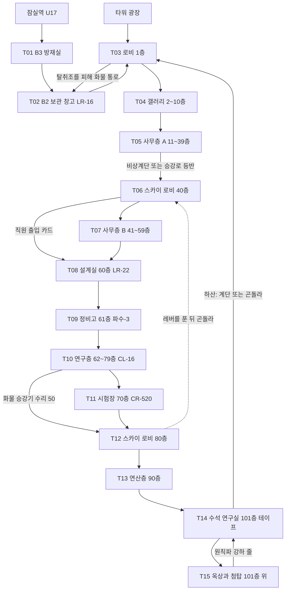
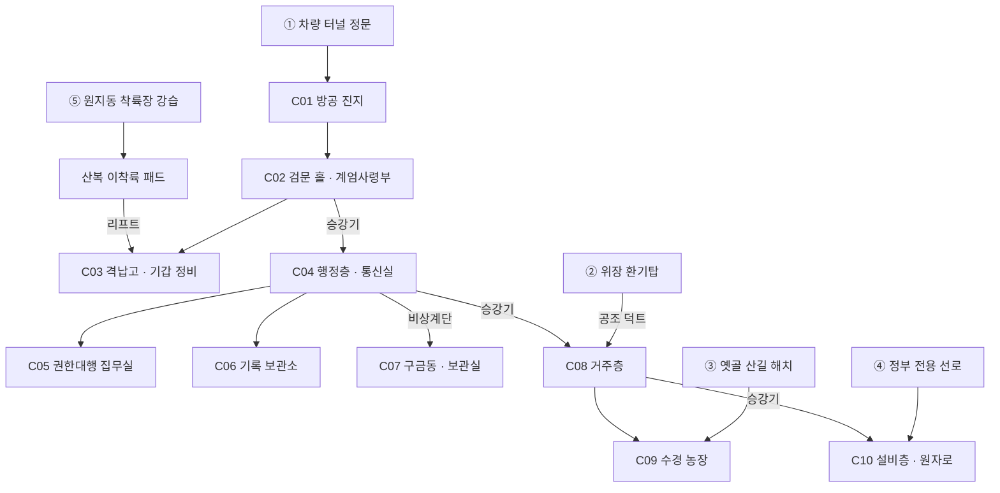

# SD-09d. 장소 카탈로그: R07 강남, R11 청계산

> **서울 폴아웃 상세 기획서 세트** | 문서 ID: SD-09d | 버전: v1.1 | 작성일: 2026-10-12
> **범위**: SD-08 §11.8(R07 강남 33곳)과 §11.12(R11 청계산 21곳) 장소 시드 54곳 전부의 L-ID·좌표·등급·판도·음향 배정, 장소 상세(S·A 상세, B·C 간결), S등급 5곳 심층 설계(세진전자 타워 수직 던전 15장, 세이프빌, 고속터미널 지하상가, 양재 온실촌, 청계산 벙커), 권역별 이름 있는 NPC(R07 59명, R11 46명), 사이드 퀘스트 훅(주 훅 R07 15개·R11 13개, R07 소형 훅 12개), 수집품·기록물 배치, 랜덤 인카운터 지점과 이동 경로. **다루지 않는 것**: 퀘스트 본문(→ SD-03a·03b·04a·04d), 지하철역·대심도 선로 실내(→ SD-09f, 이 문서는 연결부만), 적 수치(→ SD-14), 아이템 수치(→ SD-13)
> **관련 문서**: [SC-00 컨셉](00_concept.md), [SD-02 세계관](02_world-and-lore.md), [SD-03a 메인 1부](03a_main-story-part1.md), [SD-03b 메인 2부](03b_main-story-part2.md), [SD-04a 사이드(남부)](04a_side-quests-south.md), [SD-04d 세력 퀘스트](04d_faction-questlines.md), [SD-05 비표시·인카운터](05_misc-quests-encounters.md), [SD-06 세력](06_factions.md), [SD-07a 주요 인물](07a_characters-major.md), [SD-07b NPC 디렉터리](07b_npc-directory.md), [SD-08 월드·권역](08_world-regions.md), [SD-09f 지하·한강](09f_locations-underground-river.md), [SD-10 캐릭터](10_character-system.md), [SD-12 탐험·UI](12_exploration-ui.md), [SD-13 아이템](13_items.md), [SD-14 크리처·적](14_creatures-enemies.md), [SD-15 경제](15_economy.md), [SD-16 아트](16_art-direction.md), [SD-17 사운드](17_sound.md), [SD-18 명명](18_naming-terms.md), 원작 [RD-12](../reverse-design/12_world-structure-settlements.md)·[RD-13](../reverse-design/13_location-catalog.md)·[RD-27](../reverse-design/27_adaptation-notes.md)

---

## 목차

1. [개요](#1-개요)
2. [R07 강남](#2-r07-강남)
3. [R11 청계산](#3-r11-청계산)
4. [권역 사이의 길: 강남에서 청계산까지](#4-권역-사이의-길-강남에서-청계산까지)
5. [원작 대응](#5-원작-대응)
6. [쯔꾸르 제작 메모](#6-쯔꾸르-제작-메모)
7. [미결 사항](#7-미결-사항)
8. [부록](#8-부록)

---

## 1. 개요

### 1.1 목적
- SD-08이 좌표와 순서를 정한 R07·R11 장소 시드 54곳에 **L-ID를 부여하고**, 제작자가 맵을 조립하고 이벤트를 놓을 수 있을 만큼 장소를 정한다.
- 두 권역은 메인 스토리의 '권력의 축'이다. R07은 재벌이 남긴 도시(2막 MQ-204, 3막 MQ-302), R11은 국가가 남긴 산(4막 MQ-402)이다. 경부고속도로 한 줄이 둘을 잇는다(§4).

### 1.2 요약
- **R07 강남(33곳)**: S등급 3곳(세진전자 타워, 세이프빌, 고속터미널), A등급 10곳, B등급 17곳, C등급 3곳. 정착지 2(세이프빌, 고터 지하상가), 세력 거점 3(철벽경호 강남 지사, 대로파 버스 요새, 각성회 송파 대기소), 계엄군 검문소 2(반포·영동 남단).
- **세진전자 타워**는 플레이 층 **15장**의 수직 던전이다. SD-03a의 퀘스트 비트(B2·1·40·60·61·90·101층)를 그대로 두고 그 사이를 층 묶음 맵으로 채웠다. 시민 보호 프로토콜 테이프는 **101층 수석 연구실의 손바닥 금고**에 있다.
- **R11 청계산(21곳)**: S등급 2곳(청계산 벙커, 양재 온실촌), A등급 7곳, B등급 11곳, C등급 1곳. 비상정부 판도 '장악' 권역이며, 정착지는 양재 온실촌 하나뿐이다.
- **청계산 벙커**는 지상부 + 지하 4단(터널층·행정층·거주층·설비층) 10장이다. 들어가는 길은 다섯(정문 출두, 위장 환기탑, 옛골 산길, 정부 전용 선로, 강습)이다.
- **이름 있는 NPC 105명**(R07 59, R11 46). 바이블·SD-06·SD-03a·SD-14 인물 12명을 같은 설정으로 등록했다.
- **사이드 퀘스트 주 훅 28개**(R07 15, R11 13) + R07 소형 훅 12개. 진영을 고르는 장면 없이 행동으로 기울게 썼다.

### 1.3 표기 규칙
| 항목 | 규칙 |
|---|---|
| L-ID | SD-08 §11 시드 순서 그대로 `L-R07-01`~`L-R07-33`, `L-R11-01`~`L-R11-21`. 추가 시드는 없다 |
| 좌표 | `tx·ty`는 SD-08 변환식 값. **보정 dx·dy는 54곳 모두 0**이다(E3 겹침 청크 C-41-29·C-38-29·C-34-39·C-31-36은 장소 중심 간격이 8타일 이상이라 보정이 필요 없다) |
| 위협 | SD-08 시드 값(1~5). 적 레벨 범위는 SD-14 §11.2(R07 9~18, R11 14~24)를 장소 위협으로 좁혀 상세에 적는다 |
| 마커 | ● 지도 마커 / ○ 비표시(가 보면 지역 지도에만 남고 발견 XP 없음, SD-10 §4.4) |
| 아이콘 | SD-12 §5.4의 22종 번호(예: `21 초고층`) |
| 등급 | SD-16 §6.6의 S/A/B/C. 실내 맵 수는 등급 예산 안에서 정한다 |
| 판도 | SD-08 §15.2 판도 구역 `PD-R07-n`, 거점은 `PD-Hnn` |
| 음향 | SD-17의 BGM 곡군 / BGS ID |
| 외형 코드 | SD-16 §7.2 `몸-피부-머리-머리색-몸통계열-낡음-팔레트-머리장비-눈장비-소품`. 값은 **SD-07b §3 외형 코드 통일안**을 따른다(몸 M1·M2·F1·F2·E1 노인 남·E2 노인 여·K1 아동, 낡음 0~2, 머리 HR00~11, 머리 장비 HD01~18, 눈 장비 EY01~08, 소품 PR001~200. RECON_SPEC N-84). `PF00`은 세력 팔레트 없음(민간), `HD00`·`EY00`은 장비 없음. 로봇은 `RB-<SD-14 모델>`과 개체 표식을 적는다 |
| 수집품 | 흔들인형 `CL-nn`(nn = SD-10 §7.1 표의 번호), 스킬북 배치 ID `BK-<종 2자리>-<권역>-<순번 2자리>`(예: `BK-11-R07-02` = 은신 R07 두 번째 권. 종 번호는 SD-10 §7.2 표 #, RECON_SPEC §3.7) |
| 다른 문서 소관 ID | 사이드 퀘스트는 ID 없이 '훅' 이름으로 쓴다. 지하철역·대심도 선로는 SD-08 §11.13 순서로 본 `L-UG-nn`을 참고 표기만 한다 |

### 1.4 이 문서가 맞춘 정합 결정
| # | 충돌 | 근거 문서들 | 이 문서의 처리 |
|---|---|---|---|
| J1 | 세진전자 타워 높이 | SD-02·SD-08(실재 잠실 초고층과 같은 층수·높이 수치), SD-03a '지상 101층(가상)' | **지상 101층 + 첨탑(층 번호 없는 기계부), 첨탑 끝 약 500m**(RECON_SPEC N-07, 리드 결정 H-02). 2277년에는 **90층까지 내장**이 남았고, 91~100층은 냉각·변전층, 101층은 수석 연구실, 그 위는 옥상 전망 데크와 첨탑이다. 실재 초고층의 층수·전망대 층·높이 수치는 쓰지 않는다(실명 가상화) |
| J2 | 설계실·연구실 위치 | SD-02 '최상층 설계실', SD-08 '연산 홀(100층대) → 설계실', SD-03a '60층 설계실, 101층 수석 연구실' | 퀘스트 비트는 **SD-03a를 따른다**. 60층은 2075년 좌천 뒤의 '설계실', 101층은 원래의 수석 연구실이다. 101층이 최상층이므로 SD-02의 '최상층'과도 맞다 |
| J3 | 타워 맵 수 | SD-03a '층 묶음 7장', SD-08 '12~14장', SD-12 '플레이 층 12~16장(SD-09d)' | **15장**으로 확정(§2.4.1). SD-03a 연출 메모의 7장은 이 문서 기준으로 갱신을 요청한다 |
| J4 | 양재 온실촌·양재 검문소의 권역 | SD-06 §3.2.2·§5.9 'R07', SD-08 §11.12 'R11' | 좌표 권역 판정(SD-08 §4.3)을 따라 **R11**에 둔다. SD-06의 '강남 검문소(양재)'는 `L-R11-08 양재 고개 검문소`와 같은 곳이다 |
| J5 | 대로파 두목 | SD-06 '배기통', SD-14 CR-510 '버스왕 방석구' | 본명 방석구, 패거리 별명 '배기통', 버스 요새의 통칭 '버스왕'으로 합친다 |
| J6 | 한결건설 마스코트 | SD-10 '한결이', 리드 지시 '든든이' | 흔들인형 이름을 **'든든이 입주 기념 흔들인형'**으로 쓴다. 효과·번호는 SD-10 표 그대로 |
| J7 | 세진 로봇 이름 | SD-02 §5.2(파수 1~4·천둥·알림이), SD-14 §8.2(살림-2·파수-3·순찰-5·살핌-1 등) | 적·장치 이름은 **SD-14**를 쓴다. 파수-3(바이블 NPC)은 두 문서에서 같다 |
| J8 | 공보방송 | SD-17·SD-02 일부 '국민방송' | 2277년 비상정부 방송은 **공보방송**으로 쓴다. 2077년 국영 방송은 **전시 국영방송**(RECON_SPEC §1.1 G-10·G-11) |
| J9 | 한유리의 옛 집 1301호 | SD-06 §9.2 제안(세이프빌이 한유리 기록 1건 보관), SD-03a §10.4(8건 위치 확정, 세이프빌 없음) | SD-03a를 따른다. 1301호에는 **8건 밖의 보조 기록**(엽서·가계부)만 두고 사이드 훅으로 쓴다(§2.4.2) |

---

## 2. R07 강남

### 2.1 권역 지도
SD-08 §4.2 정본 격자에서 X 27~48 · Y 25~38을 떼어 왔다. 숫자는 장소 번호(`L-R07-nn`의 nn)다. `+`는 같은 청크에 장소가 둘 있다는 표시다(C-41-29: 01·03, C-38-29: 05·07). `7` 강남, `B` 청계산, `6` 용산, `8` 동부, `1` 관악, `~` 한강.

```
     27 28 29 30 31 32 33 34 35 36 37 38 39 40 41 42 43 44 45 46 47 48
 25   6  6  6  8  8  ~  ~  8  8  8  8  8  8  ~  ~  8  8  8  8  8  8  8
 26   6  6  6  6  ~  ~  7  ~  ~  ~  8  8  8  ~  7  7  7  8  8  8  8  8
 27   6  6  6  ~  7 06  7  7 08 09  ~  ~  ~  7  7 29  7  7  8  8  8  8
 28   6  6  ~  7 10  7  7 20  7  7 25  7 26  7 27  7 28  7  7  7  8  8
 29   ~ 14  7  7 11  7  7  7  7 21  7 05+04 02 01+ 7  7  7  7  7  7  .
 30   1 13 12  7  7  7  7 19  7  7  7  7  7  7  7 30  7  7  7  7  7  .
 31   1 15  7  7  7 18  7  7  7  7  7  7  7  7  7  7  7  7  7  7  7  .
 32   1  7  7 16  7  7  7  7  7 22  7  7  7  7  7 31  7  7  7  7  .  .
 33   1  7  7  7  7  7  7  7 23  7  7  7 33  7  7  7 32  7  7  7  .  .
 34   1  7  7 17  7  7  7  7 24  B  B  B  B  B  7  B  7  7  7  .  .  .
 35   1  B  B  B  B  B  B  B  B  B  B  B  B  B  7  7  7  7  .  .  .  .
 36   1  B  B  B  B  B  B  B  B  B  B  B  B  B  B  7  .  .  .  .  .  .
 37   1  .  B  B  B  B  B  B  B  B  B  B  B  B  7  .  .  .  .  .  .  .
 38   .  .  .  B  B  B  B  B  B  B  B  B  B  .  .  .  .  .  .  .  .  .
```

- **읽는 법**: 서쪽 끝(X 28~30)이 반포·서초, 가운데(X 31~35)가 신사·강남역·테헤란로, 동쪽(X 36~42)이 삼성·잠실·세이프빌, 남동(X 40~46)이 송파·가락이다. 북쪽 강변은 다리 남단 검문소(14·09)가 쥐고 있고, 남쪽은 우면산·대모산 능선을 넘으면 R11이다.
- **동선의 뼈대**: 테헤란로(Y 30, 동서), 강남대로(X 31~33, 남북), 올림픽대로(강변, 고가), 탄천(X 37~38, 마른 수로), 2호선 지하(U17)와 3호선 지하(U18).

### 2.2 권역 개요 표 (33곳)
| L-ID | 이름 (통칭 변경 제안) | 유형 / 아이콘 | tx·ty | 청크 | 위협 | 마커 | 등급 | 판도 | BGM / BGS |
|---|---|---|---|---|---|---|---|---|---|
| L-R07-01 | 세진전자 타워 (통칭 '바늘탑', SD-18 고정) | 던전 / 21 초고층 | 1657·1172 | C-41-29 | 4 | ● | S | PD-R07-5, PD-H09 | D05 + M302 / L05·I03 |
| L-R07-02 | 원자랜드 | 던전 / 9 상업 | 1636·1181 | C-40-29 | 4 | ● | A | PD-R07-5 | D09 / I07 |
| L-R07-03 | 석촌호수 | 자연 / 17 강변·섬 | 1665·1194 | C-41-29 | 3 | ● | B | PD-R07-5 | X07A / R05 |
| L-R07-04 | 세이프빌 | 정착지 / 5 아파트 단지 | 1564·1185 | C-39-29 | 2 | ● | S | PD-R07-5, PD-H06 | S06 / S06 |
| L-R07-05 | 볼트 S-03 | 볼트 / 1 볼트 | 1557·1191 | C-38-29 | 3 | ● | A | PD-R07-5 | D07A / V02 |
| L-R07-06 | 압구정 강변 단지 ('압구정 물막이 단지') | 폐허 / 5 아파트 단지 | 1312·1080 | C-32-27 | 3 | ● | B | PD-R07-2 | D09 / U03 |
| L-R07-07 | 철벽경호 강남 지사 | 세력 거점 / 4 요새·거점 | 1545·1164 | C-38-29 | 3 | ● | A | PD-R07-5 | D03 / I10 |
| L-R07-08 | 청담 고급 빌라 | 폐허 / 19 폐허 | 1407·1104 | C-35-27 | 3 | ○ | B | PD-R07-2 | D09 / I07 |
| L-R07-09 | 영동대교 남단 검문소 | 검문소 / 13 군사 | 1448·1101 | C-36-27 | 4 | ● | B | PD-R07-2 | X07B / I10 |
| L-R07-10 | 신사 가로수길 | 폐허 / 9 상업 | 1278·1128 | C-31-28 | 2 | ○ | C | PD-R07-2 | X07A / U01 |
| L-R07-11 | 논현 가구 거리 | 폐허 / 9 상업 | 1273·1182 | C-31-29 | 3 | ○ | B | PD-R07-2 | X07A / U01 |
| L-R07-12 | 고속터미널 (통칭 '고터', SD-18 제안) | 던전 / 7 지하상가 | 1192·1219 | C-29-30 | 3 | ● | S | PD-R07-1 | S12 / M03 |
| L-R07-13 | 반포 강변 아파트 | 폐허 / 5 아파트 단지 | 1145·1200 | C-28-30 | 3 | ○ | B | PD-R07-1 | D09 / U03 |
| L-R07-14 | 반포대교 남단 검문소 | 검문소 / 13 군사 | 1152·1188 | C-28-29 | 4 | ● | B | PD-R07-1 | X07B / I10 |
| L-R07-15 | 방배 서래 마을 | 폐허 / 19 폐허 | 1159·1260 | C-28-31 | 2 | ○ | C | PD-R07-1 | X07A / U01 |
| L-R07-16 | 서초 법조단지 | 던전 / 10 관공서 | 1202·1290 | C-30-32 | 3 | ● | A | PD-R07-1 | D10 / I07 |
| L-R07-17 | 우면 공연장 | 던전 / 20 기념물 | 1221·1377 | C-30-34 | 3 | ● | B | PD-R07-1 | D09 / I07 |
| L-R07-18 | 강남역 사거리 | 랜드마크 / 22 기타 | 1300·1260 | C-32-31 | 3 | ● | C | PD-R07-3 | X07B / U04 |
| L-R07-19 | 테헤란로 오피스 협곡 | 던전 / 10 관공서 | 1383·1230 | C-34-30 | 4 | ● | A | PD-R07-3 | X07B / W03 |
| L-R07-20 | 강남 관제 중계소 | 관제망 시설 / 12 발전·기반 | 1393·1146 | C-34-28 | 3 | ● | B | PD-R07-3 | D05 / I03 |
| L-R07-21 | 무역센터 | 던전 / 7 지하상가 | 1450·1179 | C-36-29 | 4 | ● | A | PD-R07-5 | D01B / M03 |
| L-R07-22 | 대치 학원가 (통칭 '시험지 골목', SD-18 제안) | 던전 / 9 상업 | 1472·1281 | C-36-32 | 3 | ● | A | PD-R07-4 | X07C·D12 / I08 |
| L-R07-23 | 도곡 주상복합 3탑 | 던전 / 21 초고층 | 1421·1320 | C-35-33 | 4 | ● | A | PD-R07-4 | D09 / L05 |
| L-R07-24 | 개포 단지 | 폐허 / 5 아파트 단지 | 1431·1368 | C-35-34 | 3 | ○ | B | PD-R07-4 | D09 / U03 |
| L-R07-25 | 잠실 종합경기장 ('잠실 경기장') | 던전 / 20 기념물 | 1517·1158 | C-37-28 | 3 | ● | B | PD-R07-5 | D02 / L01 |
| L-R07-26 | 대로파 소굴 ('버스 요새') | 세력 거점 / 4 요새·거점 | 1579·1134 | C-39-28 | 4 | ● | A | PD-R07-5 | D11 / U01 |
| L-R07-27 | 신천 단지 미로 ('미분양촌') | 폐허 / 5 아파트 단지 | 1645·1140 | C-41-28 | 3 | ○ | B | PD-R07-5 | D09 / S07 |
| L-R07-28 | 올림픽공원 토성 | 자연 / 16 산·자연 | 1731·1128 | C-43-28 | 3 | ● | B | PD-R07-6 | X07A / U06 |
| L-R07-29 | 송파 대학병원 | 던전 / 22 기타 | 1684·1089 | C-42-27 | 3 | ● | B | PD-R07-6 | D13 / I09 |
| L-R07-30 | 송파 관제 중계소 ('송파 대기소') | 관제망 시설 / 12 발전·기반 | 1693·1218 | C-42-30 | 3 | ● | B | PD-R07-6 | S10 / F03 |
| L-R07-31 | 가락시장 | 교역소 / 9 상업 | 1693·1290 | C-42-32 | 3 | ● | A | PD-R07-6 | S12 / S07 |
| L-R07-32 | 문정 물류 창고 | 던전 / 11 공장·산업 | 1750·1338 | C-43-33 | 3 | ● | B | PD-R07-6 | D05 / I07 |
| L-R07-33 | 일원 대학병원 | 던전 / 22 기타 | 1574·1320 | C-39-33 | 3 | ● | B | PD-R07-4 | D13 / I09 |

- 합계: 마커 ● 26 / ○ 7, 등급 S 3 · A 10 · B 17 · C 3.
- 고속터미널의 지하상가는 SD-08 §11.13 UG 39번 시드(고속터미널 지하상가, 정착지)와 같은 공간이다. **설계 본문은 이 문서 §2.4.4가 맡고**, SD-09f는 `L-UG` ID와 지하철 승강장 연결만 등록한다(중복 기술 방지).

### 2.3 권역 운영 데이터

#### 2.3.1 판도 구역과 슬롯 (SD-08 §15)
| 판도 구역 | 초기 우세 / 단계 | 경합 | 검문 슬롯(위치) | 순찰 경로 | 깃발·확성기 | 거점 |
|---|---|---|---|---|---|---|
| PD-R07-1 반포·서초 | 비상정부 / 우세 | 정착지 연합 | 반포대교 남단(L-R07-14, 1막 이후), 고속터미널 지상 출입구 앞, 교대역 출구 | 반포 검문소 → 고터 → 법조단지 고리(140t) | 반포 단지 측벽 3, 확성기 1(법조단지) | — |
| PD-R07-2 압구정·신사 | 공백 | 약탈자 | 영동대교 남단(L-R07-09, 1막 이후), 신사 사거리 | 없음(공백: 변이 까마귀 배회) | 찢긴 천 1 | — |
| PD-R07-3 강남역·테헤란로 | 약탈자(대로파 분파) / 경합 | 비상정부 | 강남역 사거리(L-R07-18), 테헤란로 중간 | 대로파 무리 ↔ 계엄군 분대가 반대 방향으로 도는 테헤란로 왕복(200t) | 서로 찢는 깃발 2 | — |
| PD-R07-4 대치·도곡·개포 | 공백 | 약탈자 | 양재천 다리(대치 남쪽) | 없음 | 없음 | — |
| PD-R07-5 잠실·세이프빌 | 정착지 연합(세이프빌) / 우세 | 비상정부·약탈자 | 세이프빌 정문 앞 30t, 잠실대교 남단, 잠실역 출구, 탄천 마른 수로 다리 | 세이프빌 → 타워 광장 → 경기장 고리(180t, 철벽경호 2인조) | 장벽 깃발 6, 타워 광장 확성기 1(G1부터) | PD-H06 세이프빌, PD-H09 세진전자 타워(관제망) |
| PD-R07-6 송파·가락 | 약탈자 / 경합 | 정착지 연합 | 가락시장 정문, 송파대로 중간 | 행상 수송대(잠실 우회로: 뚝섬 → 세이프빌 → 가락 → 양재) | 시장 천막 깃발 2 | — |

- **5막 이후**: G2 단계(SD-14 §8.7)에서 R07에 KS-1 ×4, KS-2 ×2(반포·영동 남단), FD-5A ×1이 뜬다. 세이프빌은 '등록 단지' 판정이라 KS-2 검문조만 정문에 선다(세이프빌 호감도 우호 이상이면 검문 대사만, 경계 이하면 주인공에게 '정지 명령').

#### 2.3.2 수집품 배치
| 수집품 | 종류 | L-ID · 세부 위치 | 조건 |
|---|---|---|---|
| CL-07 | 든든이 - 행운(행운 +1) | L-R07-04 세이프빌 분양 홍보관 추첨함 | 추첨함 [자물쇠 따기 50] 또는 관리인 옥우빈의 '경품 추첨'(세 번째에 반드시 당첨) |
| CL-16 | 든든이 - 과학(과학 +10) | L-R07-01 타워 연구층 묶음, 72층 '어린이 과학 교실' 진열장 | 연구층 경비 통과 |
| 특수 | 과학 『세진전자 신입 연수 교재 - 관제망 개론』 | L-R07-01 40층 사원 교육장 | SD-10 특수 판본 |

**스킬북 22권** (`BK-<종>-R07-<nn>` 종류 — 위치. 정착지 안 사본은 훔치면 카르마 -5)
- BK-08-R07-01 수리 — 타워 B3 방재실 / BK-12-R07-01 화술 — 타워 사무층 A 인사팀 / BK-03-R07-01 에너지 무기 — 타워 연구층 휴게실
- BK-13-R07-01 비무장 — 세이프빌 주민 체육관 / BK-06-R07-01 의학 — 세이프빌 단지 의원 / BK-07-R07-01 근접 무기 — 세이프빌 112동 아이 방
- BK-05-R07-01 자물쇠 따기 — S-03 관리 사무소 / BK-01-R07-01 물물교환 — 고터 옛 번개24 창고 / BK-11-R07-01 은신 — 고터 대피 구역 게시대
- BK-10-R07-01 소형 화기 — 반포 검문소 막사 / BK-02-R07-01 중화기 — 영동 검문소 무기 컨테이너 / BK-11-R07-02 은신 — 강남역 지하 출입구 게시대
- BK-12-R07-02 화술 — 테헤란로 23층 인사 컨설팅 사무실 / BK-08-R07-02 수리 — 강남 관제 중계소 정비고 / BK-03-R07-02 에너지 무기 — 대치 과학 학원
- BK-09-R07-01 과학 — 대치 독서실 / BK-04-R07-01 폭발물 — 도곡 C탑 공사 사무소 / BK-04-R07-02 폭발물 — 잠실 경기장 지붕 보수 현장
- BK-07-R07-02 근접 무기 — 신천 미로 분식집 / BK-05-R07-02 자물쇠 따기 — 청담 빌라 경비실 / BK-06-R07-02 의학 — 일원 대학병원 응급실 / BK-01-R07-02 물물교환 — 가락시장 관리 사무소

- 합계 일반 22권(SD-10 §7.2 R07 배분 22와 같다) + 특수 1권. 종류별: 물물교환 2, 중화기 1, 에너지 무기 2, 폭발물 2, 자물쇠 2, 의학 2, 근접 2, 수리 2, 과학 1, 소형 화기 1, 은신 2, 화술 2, 비무장 1. 한 장소에 같은 종류 2권은 없다.

#### 2.3.3 기록물(LR) 배치
| LR | 제목 | L-ID · 세부 | 비고 |
|---|---|---|---|
| LR-16 | 한유리 메모 「끄는 법」 | L-R07-01 B2 보관 창고 | MQ-302·MQ-304 기록 2 |
| LR-22 | 한유리 마지막 터미널 기록 | L-R07-01 60층 설계실 | MQ-302·MQ-304 기록 8 |
| LR-20 | 적성 평가 10번 문항 원고 | L-R07-22 대치 학원가 '세진 채점기 지점' | MQ-304 기록 6, [수리 50] |
| LR-10 | 전산 모의고사 성적표 | L-R07-22 '국가 대피 적성 검사 대비반' 교실 | 출력 시각 21:58 |
| LR-08 | 세이프빌 분양 광고 | L-R07-04 정문 아치 광고판 | S-03 단서 |
| LR-06 | 국가 유공 통지서 | L-R07-04 108동 세대 거실 | — |
| LR-43 | 세대별 관리비 장부 | L-R07-05 S-03 관리 사무소 터미널 | 훅 '관리비 200년' |
| LR-05 | 판독기 출력지 '대기 구역 안내' | L-R07-12 고터 지하 대피소 노란 선 | 해골 행렬 |
| LR-47 | 대피소 수용 인원 표지와 쪽지 | L-R07-06 압구정 단지 지하주차장 기둥 | 원문 그대로 쓴다(SD-02 §10.2) |
| LR-09 | 서울 볼트 분양 광고 | L-R07-18 강남역 지하 광고판 | — |
| LR-11 | 종전 행진 유인물 「종전」 | L-R07-16 법조단지 피고인 대기실 해골의 손 | — |
| LR-14 | 신고 전화 1953 접수 기록 | L-R07-16 법조단지 지하 증거 보관실 | — |
| LR-13 | 번개24 점장 업무 일지(본사 지시 사본철) | L-R07-32 문정 물류 창고 사무실 | — |
| LR-49 | 원자 충전소 「불씨 안전 수칙」 | L-R07-11 논현 충전소 폐허 | — |
| LR-67 | 상시 경호 계약 제77-1023호 | L-R07-01 T03 로비 안내 데스크 또는 L-R11-01 기록 보관소(먼저 들어간 쪽, SD-04b U16) | 휴대판 M-343, SD-04b §6.3(RECON_SPEC §3.4) |

### 2.4 S등급 장소 상세

#### 2.4.1 L-R07-01 세진전자 타워 (통칭 '바늘탑')
| 항목 | 내용 |
|---|---|
| 실제 근거 | 잠실 석촌호수 북쪽의 초고층 타워(실명·브랜드·수치 미사용) |
| 2077년 | 세진전자 본사. 2076년 완공, **지상 101층 + 첨탑**(층 번호 없는 기계부), 첨탑 끝 높이 약 500m. B2에 자체 불씨 원자로 2기. 저층은 세진 갤러리(쇼룸), 중층은 세진시스템 관제망 사업본부, 상층은 중앙연구소와 수석 연구실. 10월 23일 23:21 관제망 집행 명령과 함께 건물 '야간 보안 모드'로 봉쇄 |
| 2277년 | 타워 원자로 1기가 아직 저출력으로 돈다(국지 전원 구역, SD-14 G0 예외). **90층까지 내장이 남았다. 91~100층은 냉각·변전층(기계 설비만 있는 층), 101층은 수석 연구실이고, 그 위 옥상 전망 데크와 첨탑은 폭풍에 외장 패널이 날아가 철골이 드러났다.** 타워 로봇은 관제망이 아니라 2077년 그날 밤의 '야간 보안 모드'를 지킨다. 황무지 사람들은 '바늘탑'이라 부르고, 밤마다 첨탑 경광이 깜박이는 것을 '도성이 뒤척인다'의 증거로 든다 |
| 위협 · 적 레벨 | 3(B3~60층) / 4(61~101층) / 5(옥상·첨탑, 시험층 보스 구역). 적 Lv 9~18 |
| 실내 맵 | **15장**(S 예산 상한 10을 넘는 예외. SD-08 §16.6·SD-12가 12~16장으로 지정) |
| 루팅 | T3 기본, 연구층 이상 T4. 세진 보안 장비(충격 권총 W-010, 전기 진압봉 W-042, 충격 장갑 W-055), 에너지 전지, 진공관, 펄스 수류탄 W-061 |
| 판도 | 거점 PD-H09(관제망 '우세'). MQ-302 뒤 HO_TAPE 결과와 무관하게 거점 소유는 '관제망'으로 남는다. 타워 광장 확성기 슬롯은 G1에서 켜진다 |

**외부 배치**
- 타워는 석촌호수 북쪽 둔치 위 원형 광장(지름 36타일) 한가운데 선다. 기단은 6타일 높이로 압축해 그리고(SD-16 §6.5), 기단 위 몸체는 원경 레이어로 화면 위쪽까지 뻗는다. 남쪽 광장 건너 석촌호수(L-R07-03), 서쪽 담장 너머 원자랜드(L-R07-02), 북쪽 도로 건너 신천 단지 미로(L-R07-27)다.
- **출입구 5곳**: ① 남면 회전문(정문, 1층 로비) ② 동면 화물 하역 램프(B1 하역장, 차량 출입구) ③ 잠실역 지하 연결 통로(B3, U17 지하철 구간에서 들어온다) ④ 101층 서쪽 창문(옥상 강하 줄이 걸려 있을 때만, 원칙파 협력 경로) ⑤ 40층 외벽 곤돌라 정류장(80층 쪽에서 레버를 풀어야 움직이는 되돌아오는 지름길).
- **앵커 소품 7**: 동심원 'SJ' 로고 조형물(기단 정면, 3×3타일) / 마른 광장 분수와 '파수가 지키는 골목' 광고 입간판 / 회전문 4익 / 광장 확성기탑 / 외벽 곤돌라 / 첨탑 앰버 경광(전역 시야) / 기단 측면의 2077년 시위 흔적(스프레이 '판독기를 꺼라').

**층 구성 (플레이 맵 15장)**
| # | 맵 | 층 | 구역 구성 | 문 전환 | 적·장치(SD-14) | 오브젝트·기록·아이템 | 위협 |
|---|---|---|---|---|---|---|---|
| T01 | 잠실역 연결 통로·방재실 | B3 | 잠실역 연결 개찰구(판독기 문), 상가 통로, **방재실**(구울 용준호의 거처), 원자로 2호기 냉각수 펌프실 | 잠실역 U17(지하철 실내) / 화물 승강기 → T02 / 비상계단 → T03 | 시궁쥐 CR-095·굴쥐 CR-096, 야생 구울 CR-200(잠실역 쪽 유입), 배송-7 CR-301 2 | BK-08-R07-01, 방재실 단말(층별 경비 배치도 → 지도 표시), 화물 통로 열쇠 | 3 |
| T02 | 보관 창고·원자로실 | B2 | 설계 자료 보관 창고, **소각로**, 원자로실(1호기 정지·2호기 저출력), 화물 통로(B3 하역장으로 이어지는 은신 탈출로) | 화물 승강기(T01·T03) | 감시포 1형 CR-320 2, 살림-2 CR-300(고장 '청소' 개체) | **LR-16 「끄는 법」**(M-227), 마영식이 MQ-207에서 부탁한 관제망 회로도 원본, 원자로 제어반([과학 50]으로 타워 전력 차단 시 T03~T14 조명·감시포 정지 10분), A-011 세진전자 정비복 | 3 |
| T03 | 로비 | B1·1 | 회전문 홀, 판독기 개찰구 4열(최루 포탑 CR-323 2), **각성회 제단**(꺼진 진공관 등 12개), 로비 단말, 안내 데스크, 직원 엘리베이터 홀(정지), 비상계단 | 외부 회전문 / 비상계단 → T04 / 화물 승강기 | 순찰-5 민수형 CR-308 1(로비 경비), 살핌-1 CR-312 2 | 로비 단말('관리자 후보 방문 기록', K_CODE 순서 파괴 진입점), 2077년 방문객 명부, 각성회 공양 바구니(진공관·번개사이다) | 3 |
| T04 | 세진 갤러리 | 2~10 | 쇼룸 3구역(살림-2 체험관, 나르미 배송 체험, 학원가 단말 체험), 번개24 사내점, 10층 **로보틱스 관절 시험실** | 비상계단(층수 카운터 `2F → 10F`) | 살림-2 CR-300 3('영업 종료 안내' 후 공격), 감시포 2형 CR-321 1 | 살림-2 '방긋'(N-R07-038), 파워 아머 관절 부품(FQ-YH-06), 쇼룸 광고 RS-K14 오르골 | 3 |
| T05 | 사무층 묶음 A | 11~39 | 대표 사무층(칸막이 미로), 인사팀, 회의실, 휴게실, **승강로 B 점검구**(단독 경로의 수직 등반 구간 시작) | 비상계단(`11F → 39F`) / 승강로 B 점검구 → T06 | 파수-3 CR-305 4(야간 보안 순찰), 감시포 1형 CR-320 2 | BK-12-R07-01, 사원증 M-072 2장(책상), 2077년 10월 23일 야근 명단 | 3 |
| T06 | 스카이 로비 1 | 40 | 환승 로비(고속 엘리베이터 정지), **사원 교육장**, **'아버지의 사무실'**(관제망 운영기획팀), 외벽 곤돌라 정류장(하부), 60층 직통 승강기(세진 직원 출입 카드 필요) | 비상계단 / 직통 승강기 → T08 / 곤돌라 → T12(풀린 뒤) | 순찰-5 민수형 CR-308 2, 살핌-1 CR-312 1 | 특수 스킬북(관제망 개론), 운영기획팀 업무 일지(훅 '아버지의 사무실'), 우태현 7대조의 명패 | 3 |
| T07 | 사무층 묶음 B | 41~59 | 세진시스템 관제망 사업본부. 관제 단말 홀(서울 25개 구 중계소 표시판, 2077-10-23 23:29에 멈춘 표시등), 법무팀(지침 연동 계약서철) | 비상계단(`41F → 59F`) | 파수-3 CR-305 3, 감시포 2형 CR-321 2, 순찰-5 CR-308 1 | 관제 단말 홀 표시판(송파·노량진 등 '깜박이는 중계소 6곳' 위치가 지도에 표시), 수의계약서 사본(5막 회의 보조 증거) | 3 |
| T08 | 설계실 | 60 | 한유리의 좌천 뒤 설계실. 제도대, 23:29에 멈춘 벽시계, 결재 문서철, 단말 | 직통 승강기 / 비상계단 → T09 | 없음(유일하게 고요한 층) | **LR-22**(M-233), **계보 시조 등록부 원본**(K_LINEAGE), 결재 문서 '적성 평가 문항 10 — 수정 금지(한)'(K_Q10 보조) | 3 |
| T09 | 정비고 | 61 | 파수 경비 로봇 정비 라인 4열, 충전 거치대 48기, 정비 감독실 | 비상계단(T08·T10) / 화물 승강기(연구층) | 정지 파수-3 수십 기(배경), 돌격-6 CR-315 1(정비고 경비, 깨어 있음) | **파수-3**(N-R07-034) 각성, 정비 감독실 단말 '여의도 해산 사건 투입 기체 목록'(파수-3 기체 번호 포함) | 4 |
| T10 | 연구층 묶음 | 62~79 | 세진 중앙연구소 대표층: 실험실 3, 72층 '어린이 과학 교실'(2077년 견학 코스), 연구원 휴게실, 연구층 화물 승강기([수리 50]으로 가동: 70층을 건너뛴다) | 비상계단(`62F → 79F`) / 화물 승강기 → T12 | 순찰-6 CR-310 1 + 순찰-5 CR-308 2, 감시포 2형 2, 외벽 쪽 창 파손부에 등검은말벌 CR-077 | **CL-16**(72층), BK-03-R07-01, 연구 일지 '판독기 오판정률 보고서'(판독 불능 = 생체 변형 사례) | 4 |
| T11 | 로봇 성능 시험장 | 70 | 2개 층 높이 시험장, 레일 위 표적 로봇, 관측 제어실 | 연구층 비상계단(70층 구간은 시험장을 가로질러야 이어진다) | **보스 CR-520 방벽-9 시제기**, 표적 파수-3 CR-305 ×4 | 제어실 터미널 '시험 종료' 시퀀스([과학 75] 또는 한유리의 기록 3건 소지), 시제기 정비 기록 | 5 |
| T12 | 스카이 로비 2 | 80 | 환승 로비, 연구 지원층(81~89층 자료실·층별 기계실 묶음을 이 맵에 흡수), 외벽 곤돌라 정류장(상부, 레버) | 비상계단 / 곤돌라 ↔ T06 / 화물 승강기 | 두뇌-4 CR-313 1 + 파수-3 3(편대), 큰부리까마귀 CR-133(파손 창) | 곤돌라 레버(풀면 40↔80 왕복 지름길), 2077년 직원 안내 방송 테이프 | 4 |
| T13 | 진공관 연산층 | 90 | **연산 홀**(랙 2×3타일 48개), 시제 연산 코어 '도성 0호'(관제망 중앙 연산기 SJ-7700의 시제 판), 냉각 배관 회랑, 연산 감독실 | 비상계단 / 냉각 배관 회랑(은신 우회) | 두뇌-4 CR-313 1, 돌격-6 CR-315 2, 감시포 2형 2. 원칙파 협력 경로면 로봇 웨이브 3 | 연산 로그 '관리자 미도착 73,0xx일째'(매일 자정 한 줄, 날짜는 게임 시작일에서 계산), 코어 반출 장비 거치대(원칙파) | 4 |
| T14 | 수석 연구실 | 101 | 한유리의 원래 연구실(2075년 좌천 전), 비서실, 서쪽 창(파손, 강하 줄 진입점), **손바닥 금고**, 벽 진열 금고 | 비상계단(91~100층 냉각·변전 층은 카운터로만 지난다) / 서쪽 창 → 외벽 | 파수-3가 동행 중이면 없음. 단독이면 순찰-6 1 + 감시포 1형 2 | **시민 보호 프로토콜 테이프**(M-221) 상자, W-108 SJ-0 시제 레이저(벽 진열 금고), A-112 한유리의 실험복(옷걸이) | 4 |
| T15 | 옥상·전망대·첨탑 | 옥상(101층 위) | 외장이 날아간 옥상 기계층(바람·추락 위험), 옥상 전망 데크(유리 난간 대부분 파손, 방명록), 첨탑 기계부·앰버 경광, 원칙파 강하 캠프 | 비상계단(101층 위는 철골 사다리) / 옥상 강하 줄 → T14 창 | 등검은말벌 CR-077 둥지(첨탑 기계부), 큰부리까마귀 CR-133 무리, 원칙파 회수조(WP 경계 이하면 적대) | 전망 지점(전 방위, SD-08 §12.3), 2077년 전망대 방명록, 첨탑 경광 제어반(끄면 '바늘탑의 불이 꺼졌다' 남산 방송 소식) | 5 |

- 층수 카운터(SD-08 §16.6)는 비상계단 전환마다 뜬다(`11F → 39F`). 91~100층(냉각·변전)은 맵을 만들지 않고 카운터와 암전 연출로 지난다. 101층 위는 층 번호 없이 `RF`(옥상)로 표시한다.

**타워 경비 규칙 ('야간 보안 모드')**
| 대상 | 판정 | 로봇 반응 |
|---|---|---|
| 세진 사원증(M-072)·세진 직원 출입 카드 소지자 | 직원 | 저층(T03~T04)은 통과. 사무층 이상은 '야근 확인' 대사 뒤 통과. 연구층 이상은 임원 출입 카드(M-220) 필요 |
| 그 밖의 모든 사람 | 방문객(영업 종료) | 저층: '영업이 종료되었습니다. 출구로 안내합니다' → 따라오지 않으면 10초 뒤 공격. 사무층 이상: 경고 1회 뒤 제압 |
| 주인공(관리자 후보) | 로비 단말·파수-3만 인식 | 일반 로봇은 방문객으로 본다. **61층에서 파수-3가 깨어난 뒤**에는 파수-3가 앞서 걸으며 문을 열고 같은 층 파수 계열을 '대기 유지'시킨다(수배도 증가 없음, SD-03a). 두뇌-4·돌격-6·시제기는 따르지 않는다 |
- 관제망 G 단계와의 관계: 타워 로봇은 관제망 소속 휘장을 달았지만 2077년 이후 관제망 명령을 받은 적이 없다. **G1**(당인리 재가동)이 되면 로비 확성기와 광장 확성기탑이 켜지고, **G2**(MQ-501)부터는 타워 로봇이 관제망 판정(SD-14 §8.5)으로 바뀌어 광장까지 순찰한다(세진 축, SD-14 §8.6 G1 표).

**오르는 길 (MQ-302 단계 20, SD-03a §10.2)**
| 경로 | 조건 | 실제 동선 | 남는 것 |
|---|---|---|---|
| 각성회 | GS 우호 이상, T03 제단의 진공관 등 재점등([수리 25] 또는 진공관 1개) | 신도 둘이 2077년 비상계단 동선을 안다 → T05·T07의 파수-3 순찰 구간을 비상계단 '방화 구획 B'로 우회 | 로비 제단이 계속 켜져 있다. 이후 각성회 순례조가 타워 저층에 상주 |
| 세이프빌 수색조 | SV 우호 이상, 우태현(N-R07-002)을 T06 '아버지의 사무실'까지 호위 | 세진 직원 출입 카드 → T06 직통 승강기 → T08(60층) | 우태현이 가문 명패를 가져간다(훅 '아버지의 사무실'의 출발점) |
| 원칙파 회수조 | WP 우호 이상, T13에서 코어 반출 장비 설치 동안 엄호(웨이브 3) | 회수조가 T15에 걸어 둔 옥상 강하 줄 → T14 서쪽 창 진입 | T13 코어 거치대에 반출 장비가 걸린 채 남는다(5막 원칙파 쟁점) |
| 단독 | 없음 | T05 승강로 B 점검구 → 승강로 수직 등반 구간([힘 6] 또는 [민첩성 7], 실패 시 추락 피해 30과 한 층 아래로) → T06 → 비상계단 | 승강로에 주인공이 박은 쇠못 사다리가 남아 재방문이 빨라진다 |
- 어느 경로든 T08(60층) → T09(61층)에서 파수-3가 깨어나고, 파수-3 동행으로 T10 → (T11 또는 화물 승강기) → T12 → T13 → T14로 오른다. 곤돌라(T06↔T12)는 **T12에서 레버를 푼 뒤**에만 쓴다(재방문·하산 지름길).



**시민 보호 프로토콜의 소재 (T14 수석 연구실)**
- **손바닥 금고**: 책상 뒤 벽에 묻힌 강철 금고. 다이얼도 열쇠 구멍도 없고 손바닥 판(진공관 판독기)만 있다. 한유리가 **계보 1(동생 한유정)의 관리 후보에게만** 열리게 했다(SD-03a). 하도윤(계보 2)이 손을 올리면 판이 한 번 깜박이고 닫힌다. 다른 사람은 반응조차 없다.
- **금고 내용**: 회색 철제 상자 하나. 안에 ① 자기 테이프 릴 6개(라벨 '시민 보호 1/6'~'6/6', 6번에만 손글씨 '검산 끝') ② 천공 카드 설정집 1벌(고무줄로 묶은 카드 약 400장, SD-02 §6.8) ③ 쪽지("네 손으로 열었다면, 이건 네 거야. 그리고 네가 고를 일이야.") ④ 쪽지 뒷면의 결재 반려 사본(K_SIGNER). ①②가 아이템 M-221 하나로 묶인다(무게 0, 건네기·두기 가능).
- **벽 진열 금고**: 손바닥 금고와 별개. W-108 SJ-0 시제 레이저. [과학 75] 단말 또는 금고 열쇠(비서실 서랍, 임원 출입 카드 M-220과 같은 열쇠고리).
- **테이프를 둔 곳의 물리적 위치**(HO_TAPE, SD-03a): 0 주인공 소지 / 96 이 금고에 다시 잠금 / 5 각성회(노량진 중계소 '성물' 제단, R01) / 3 원칙파(공릉 회수 창고, R09) / 86 세이프빌(L-R07-05 S-03 관리소장 금고) / 99 T02 소각로(재가 남는다. 소각로 문 안쪽에 녹은 릴 6개).
- **출구 탈취조**: BJ ≤ -20이면 하산 때 T03 로비에 계엄군 6명(분대장 CR-403 1 + 보병 CR-401 4 + 공병 CR-404 1). 우회로는 T02 화물 통로 → T01 → 잠실역(은신)이다.

**보스: CR-520 방벽-9 시제기 (T11)**
- 시험장은 가로 28 × 세로 18타일, 가운데 레일 2줄(시제기가 레일 위를 왕복)과 콘크리트 엄폐 블록 6개. 관측 제어실은 북쪽 벽 위 1.5층 높이(사다리).
- 시제기를 피하는 길: 연구층 화물 승강기([수리 50]). 시제기를 멈추는 길: 제어실 '시험 종료' 시퀀스([과학 75] 또는 한유리의 기록 3건 소지), 각성회 협력 경로면 깨움이가 '축복'(비적대). 처치 보상 165 XP, 진공관 ×6, 방벽-9 장갑판(SD-13 제작 재료).

**거주·등장 NPC**: N-R07-034~038(§2.7). 류정(R01)은 MQ-302 각성회 신뢰 경로에서만 로비에 온다.

**연계**
- 메인: **MQ-302**(전 구간), MQ-304(LR-16·LR-22), MQ-207(마영식의 회로도 원본 부탁 → T02), MQ-204 보상(세이프빌 옥상에서 타워 마커), MQ-501(G2 광장 순찰 개시), MQ-702(테이프 슬롯).
- 세력: FQ-YH-06 공작창의 부품(T04 관절 시험실), FQ-JH-04 하청 기술자(고터의 어승민이 B2 화물 통로·로비 단말 정보를 준다), FQ-GS-01 정비 당번의 확장(로비 제단 진공관 교체), FQ-WP 회수조(T13 코어).
- 사이드 훅: '파수 부대의 처분'(T09), '아버지의 사무실'(T06), '바늘탑의 불'(T15 경광), '코어 거치대'(T13) — §2.8.

**판도·상태 변화**: MQ-302 각성회 협력 → 로비 제단 상시 점등, 신도 2~4 상주(각성회 상인 1) / 원칙파 협력 → T15 강하 캠프 상설, 코어 반출 진행(SD-03b MQ-503) / G1 → 첨탑 경광 빠른 점멸, 광장 확성기 '비상 근무 수칙' / G2 → 타워 로봇이 관제망 판정으로 바뀌어 광장에 KS-1 순찰 / E1 '강남 등록 본부', E3 로비 단말이 '시민 등록 창구', E4 경광 소등·로봇 정지, 저층이 진공관 채굴장.

**환경 스토리텔링**
1. T05 사무층 책상마다 10월 23일 야근 식권이 놓여 있고, 식권 날짜 도장은 모두 '23:00 이후 사용 불가'다.
2. T08 설계실의 제도대 위에는 관제망 배선도 대신 아이가 그린 집 그림(동생 한유정의 아이가 보낸 것)이 압정으로 꽂혀 있다. 그림 뒤 '이모 집은 왜 하늘에 있어?'
3. T15 옥상 전망 데크 방명록 마지막 장(2077-10-23 18:40): "엄마 아빠랑 서울 다 봤다. 우리 집이 제일 작다." 그 아래 200년 뒤 원칙파가 남긴 한 줄: "회수 대상 아님."

#### 2.4.2 L-R07-04 세이프빌 (정착지, F-12 SV)
| 항목 | 내용 |
|---|---|
| 실제 근거 | 잠실의 고층 아파트 대단지(실제 단지명·브랜드 미사용) |
| 2077년 | 한결건설 '세이프빌 잠실' 대단지. 25~30층 판상형 28개 동, 약 5,600세대. 분양 광고 "지하 30미터의 평화". 지하 방호층 아래가 입주민 전용 분양 볼트 S-03(L-R07-05). 입주 조건 '전 세대 충성 2등급 이상'(LR-08) |
| 2277년 | 2203년 S-03 상층 세대 협의회가 문을 열고 단지 북쪽 12개 동(101~112동)을 고철 장벽으로 둘렀다(사람이 사는 동은 8개, 나머지는 창고·텃밭 동). 인구 약 300, 입주자대표회의(회장 기세훈)가 다스린다. 경비는 철벽경호 계약 경비 30명. 바깥 사람을 '미분양자'라 부른다. 일부 주민은 2077년 4등급 등록증을 대대로 보관해 관제망 판독기가 '4등급'으로 읽는다(SD-06 §14.5) |
| 위협 · 적 레벨 | 2(장벽 안), 장벽 밖 3. 장벽 밖 적 Lv 9~13 |
| 실내 맵 | 7장(정문 게이트하우스, 관리동, 상가동, 주거동 세대 프리팹 2종, 분양 홍보관, 108동 옥상) + S-03(별도 장소) |
| 루팅 | T2(장벽 안 컨테이너는 대부분 주인 있음). 2077년 자산: 진공관 라디오 M-083, 분양 홍보 책자 M-099, 진공관 전기밥솥 M-088 |
| 판도 | 거점 PD-H06(정착지 연합 '우세', 세이프빌은 FQ-JC-04 완료 전까지 연합 비가맹이라 내부값 SV로 따로 계산) |

**외부 배치 (단지 남북 340 × 동서 280타일 압축 → 맵상 120×96타일)**
| 구역 | 위치 | 구성 | 비고 |
|---|---|---|---|
| A 정문 | 남서 모서리, 탄천 쪽 큰길 | **세이프빌 아치**(앵커, 2077년 분양 기념 금속 아치 + 든든이 조형물), 판독기 출입문 2열, 게이트하우스(철벽경호 경비 6) | MQ-204 해법의 무대. 통행 06:00~22:00 |
| B 상가동 | 정문 안쪽 | 세이프마트(잡화), 단지 의원, 수리점, 관리동 식당 | 서비스 집중 |
| C 관리동 | 단지 중앙 | 관리사무소(관리비 창구), 입주자대표회의실, 게스트 세대, 방송실(살림-2 '관리 반장'의 공지 방송) | 숙소 |
| D 로열동 | 북쪽 강변 101~104동 | 2077년 펜트·로열 분양가 세대의 후손. 103동 1301호(봉인 세대) | 동대표 차다온(101동) |
| E 일반동 | 남쪽 105~112동 | 일반 세대 후손, 108동 옥상 감시망, 112동 1503호(임대 가능 세대) | 동대표 성한별(110동) |
| F 분양 홍보관 | 정문 옆 | 2077년 모델하우스. 견본 세대 3개, 추첨함(**CL-07**), 홍보 영상 단말 | 관리인 옥우빈 |
| G 체육관·텃밭 | 단지 동쪽 | 주민 체육관(BK-13-R07-01), 놀이터를 갈아엎은 텃밭, 빗물 저수조 | 아이들 |
| H 지하주차장 입구 | 단지 중앙 북쪽 | 경사로 → 방호층 → 볼트 S-03 외곽문 | L-R07-05로 문 전환 |
| I 경비 숙소 | 장벽 북동 모서리 | 철벽경호 경비 숙소(컨테이너 4) | 지사(L-R07-07)와 무전 |
| J 장벽 밖 | 장벽 북동쪽 | 판자 '미분양촌'(L-R07-27로 이어진다): 구울과 출입 불허자 약 40명 | 장벽 문 하나(쪽문, 밤에만 열림) |

- **앵커 소품 6**: 세이프빌 아치 / 동 측벽 브랜드 띠(청·황, 동 번호 3자리) / 108동 옥상 망원경 / 관리동 확성기(2077년 '관리비 납부 안내' 차임) / 분양 홍보관 추첨함 / 장벽에 용접한 2077년 분양 현수막 강판("당첨되면 200년이 편안합니다").

**단지 규약 (입주자대표회의, 정문 게시판)**
| 조 | 내용 | 게임 처리 |
|---|---|---|
| 제1조 | 입주민은 관리비를 낸다. 관리비는 캡 또는 노역으로 낸다 | '연체 세대'(S-03 일반 구역 후손) 노역반이 장벽 보수·원자로 정비를 한다 |
| 제2조 | 방문객은 등록 확인 또는 입주민 보증으로 들어온다. 체류비 1일 20캡 | 출입 카드(MQ-204 보상) 소지 시 면제 |
| 제3조 | 생체 변형자(구울) 출입을 제한한다 | 구울 NPC는 장벽 밖 J구역에만 있다. 주인공이 구울 동행 NPC와 오면 정문에서 멈춘다(대화로 1회 예외: [화술·어려움] 또는 SV 신뢰) |
| 제4조 | 22시 이후 통행 금지 | 밤에는 쪽문(J)으로만 출입 |
| 제5조 | 단지 안 무기 발사 금지 | 위반 시 SV -10, 경비 적대 |

**서비스와 경제**
| 서비스 | NPC | 내용 |
|---|---|---|
| 잡화·탄약 | 금새봄(N-R07-006) | T2 상점. 세이프빌 우호 -10%, 신뢰 '입주민 가격' -20% |
| 의사 | 표은채(N-R07-008) | 치료·방사능 제거·부위 손상 치료. 구울에게는 치료하지 않는다(규약) → 장벽 밖 구울은 고터의 제수연에게 간다 |
| 수리 | 길시헌(N-R07-009) | 수리 스킬 60 상당, 세진 계열 장비 수리 +10% 정확 |
| 전지 충전 | 노가온(N-R07-007) | 단지 원자로(방호층) 전력으로 핵분열 전지·에너지 전지 재충전(1개 25캡). 세이프빌의 주 수입원이다 |
| 숙소 | 관리사무소 | 게스트 세대 1박 30캡. SV 신뢰 이상이면 112동 1503호를 '입주민' 대우로 임대(주인공 거처 후보, SD-15) |
| 식사 | 경소이(N-R07-017) | 관리동 식당. 온실 채소는 양재 온실촌에서 들여온다(잠실 우회로 행상) |

**거주 NPC**: N-R07-001~020(§2.7). 철벽경호 경비팀장 은다은(022)이 정문에 선다.

**적·위협**: 장벽 안은 비전투 구역. 경비는 세이프빌 경비 CR-471(Lv10) ×6(정문) + 파수-3 세이프빌 판본(CR-305, 단지 경비 프로그램) 2기. 장벽 밖 J구역은 밤에 대로파 무리(CR-421·424·431)가 쪽문을 노린다. 세이프빌 적대 시 자경 추격대(SD-14 §9.13).

**연계**
- **MQ-204 잠실 우회**: 정문(A)의 판독기 출입문이 첫 관문이다. 해법별 공간: 위조 등록증 → 판독기 출입문 / [화술·보통] 우태현 → 관리동(C)에서 면담 / [과학 50] 판독기 → 게이트하우스 옆 판독기 배전함(들키면 SV -10) / 단지 의뢰 → 지하주차장(H) → 방호층 변이 쥐 정리(L-R07-05 상층) → 출입 카드. 통과 뒤 108동 옥상(E)에서 세진전자 타워 마커를 얻는다. 우회로는 장벽 밖 탄천 마른 수로(대로파 매복).
- **MQ-204 밀고**: BJ ≤ -20이면 등록 주민회의 차다온 쪽 사람이 밀고(수배도 +5) → 다음 날 양재 고개 검문소(L-R11-08) 추격조.
- **MQ-302**: 세이프빌 수색조(SV 우호 이상, 우태현 + 주민 2). 테이프를 우태현에게 건네면 HO_TAPE 86 → S-03 관리소장 금고.
- **MQ-502·507**: 서울 회의의 SV 대표는 기세훈. 5막 총공세에서 세이프빌은 '등록 단지'라 계엄군 공격 대상이 아니다. 대신 미등록 주민 인도 요구가 온다(SD-03b 접점).
- **세력**: FQ-JC-04 입주 심사(세이프빌 가맹, SV +15), FQ-BJ 계열의 '등록 단지' 지정(BJ 판도 R07 상승), 철벽경호 '이중 입찰'(SD-06 §13.1).
- **사이드 훅**: '관리비 200년', '1301호의 봉인', '등록 명부', '담 넘는 애' — §2.8.

**판도 반응**
| 우세 세력 | 정문·장벽 | 사람들 | 상점·방송 |
|---|---|---|---|
| 정착지 연합(가맹 뒤) | 아치에 줄무늬 방수포 깃발 추가, 쪽문이 낮에도 열림 | 미분양촌 주민 일부가 장벽 안 노역에서 임금 노동으로 바뀜 | 상점에 노들섬·선유도 물품 |
| 비상정부 | 아치 옆 확성기 슬롯 점등, 계엄군 분류반 창구 상주 | 등록 주민회가 동대표 과반 | 공보방송 '모범 등록 단지 세이프빌' |
| 약탈자(대로파) | 장벽 북동 모서리 파손, 경비 2배 | 주민 일부 이주 소식 | 가격 +25% |
| E1 / E3 | E1: 단지 전체가 1등급 '등록 단지', 장벽 밖 미분양촌이 철거 / E3: 장벽 문이 열리고 J구역 사람들이 장벽 안 빈 동(109·111동)으로 옮겨온다 | | |

**환경 스토리텔링**
1. 관리사무소 창구의 '관리비 납부 확인' 도장 날짜가 2077-10-23에서 2203-04-02로 바로 넘어간다. 볼트 안의 126년이 장부에서는 한 줄이다.
2. 103동 1301호 현관에는 200년 된 '관리비 체납 세대 — 단전 조치' 스티커와, 그 위에 덧붙인 2203년 협의회 봉인지가 겹쳐 있다(한유리의 옛 집, 훅 '1301호의 봉인').
3. 분양 홍보관 견본 세대의 거실 벽 '가족 사진' 액자 속 모델 가족은 웃고 있고, 사진 아래 금속판에 '충성 2등급 가정 예시'라고 새겨져 있다.

#### 2.4.3 L-R07-12 고속터미널 (통칭 '고터') — 지하상가 공동체 포함
| 항목 | 내용 |
|---|---|
| 실제 근거 | 반포 고속버스터미널, 터미널 지하상가, 3호선 고속터미널역(실제 상호·상가 브랜드 미사용) |
| 2077년 | 경부·호남 방면 원자력 고속버스 터미널. 3층은 꽃 도매 상가, 지하는 600m 의류·잡화 지하상가이자 **민방위 지정 대피소**. 10월 23일 마지막 배차는 23:40 부산행이었고 출발하지 못했다. 23:22 판독기가 대피민을 등급별로 갈랐고, 4등급 이하는 지하상가 남쪽 '대기 구역' 노란 선 안에 남았다(LR-05) |
| 2277년 | 지상 대합실은 반쯤 무너졌고 승차장에 원자력 버스 잔해 30여 대가 서 있다. **지하상가 북쪽 절반이 정착지 '고터 지하상가'**다. 인구 약 90(사람 60, 구울 30). 세이프빌에서 받아 주지 않은 사람, 세이프빌 규약 제3조로 밀려난 구울, 3호선 지하철 정착민이 섞였다. 자치 조직 '고터 점포회'(회장 고터 순복). 정착지 연합 비가맹 |
| 위협 · 적 레벨 | 3. 지상 대합실·기계실 적 Lv 9~13. 지하상가 북쪽은 비전투 구역 |
| 실내 맵 | 6장(지상 대합실·매표소, 3층 꽃상가 터, 점포 거리, 대피 구역, 3호선 승강장 연결부, 지하 기계실·배수 펌프실) |
| 루팅 | T2~T3. 2077년 의류(A-005·A-006·A-008), 승객 유실물(잡동사니), 버스 원자로 부품(정비고) |
| 판도 | PD-R07-1(비상정부 우세 구역 안의 독립 거점). 거점 단위가 아니다(SD-06 판도 거점 60곳에 없음) |

**외부 배치**
- 터미널 건물은 동서 길이 22타일, 남쪽 승차장 쪽 4층 높이로 압축해 그린다. 북쪽 큰길 건너 반포 강변 아파트(L-R07-13), 서쪽은 반포대교 남단 검문소(L-R07-14)로 이어지는 도로, 남동쪽은 교대·서초 방향.
- **출입구**: ① 남면 승차장 대합실 문 ② 북면 지하상가 출입구 계단 4곳(셔터. 고터 점포회가 1곳만 열어 둔다: 북동 1번 출구) ③ 3호선 지하 통로(U18, 압구정·교대 쪽에서 지하로 온다) ④ 3층 꽃상가 외부 비상계단(지상에서 바로 오른다).
- **앵커 소품 5**: 기계식 배차표판(마지막 줄 '23:40 부산 — 출발 대기', 판이 바람에 한 칸씩 넘어간다) / 승차장 '경부선 1번' 표지와 버스 잔해 열 / 꽃상가 외벽의 2077년 꽃 광고판 / 지하 1번 출구 셔터의 손글씨 상호 '고터' / 대피 구역의 노란 선.

**지하상가 공동체**
| 구역 | 구성 | 사람 |
|---|---|---|
| 1번 출구 셔터 | 점포회 경비 초소, 방문객 명부(이름만 적는다, 등록 묻지 않음) | 고터 무진(셔터 지기), 경비 8(정착지 민병 CR-472) |
| 점포 거리(북쪽 300m 압축 → 맵 60×14타일) | 셔터 점포 40칸 중 22칸이 가게·집. 무기점, 잡화(순복의 점포), 수선집, 수리점, 약국 겸 의원, **막차 여관**(숙소), 공동 부엌 | 고터 순복, 고터 라희, 고터 건희, 제수연, 모재석, 어승민, 고터 찬 |
| 3층 꽃상가 터(지상 3층) | 깨진 천창 아래 수경 재배장(상추·쑥갓·콩나물), 빗물 집수조 | 고터 해인 |
| 대피 구역(남쪽, 봉쇄) | 노란 선 안 해골 행렬. 점포회가 2190년대에 앞쪽 절반을 정리해 **공동 묘역**으로 만들었고 해골 자리마다 이름표를 놓았다. 안쪽 절반은 대피민 구울 소굴이라 철망으로 막았다 | — |
| 3호선 승강장 연결부 | 개찰구(정기권 M-071 차단기), 승강장으로 내려가는 계단. 압구정·교대 방향 터널(U18) | 지하철 정착민이 드나든다 |
| 지하 기계실·배수 펌프실 | 침수 구간 무릎 깊이, 펌프 3기 중 1기 가동 | 변이 미국가재·시궁쥐 |

- **경제**: 세이프빌과 거래한다(수선·옷·노역 인력을 팔고 전력을 산다). 세이프빌 단지 원자로에서 탄천 수로를 따라 케이블 한 가닥을 임대해 쓴다(점포 거리 조명·펌프 1기). 3층 수경 채소와 양재 온실촌 종자를 중계하고, 지하철 U18로 압구정~양재 구간 길 안내를 판다.
- **규칙**: 셔터 시간 06:00~22:00. 무기 휴대 자유, 발포 금지. 사람과 구울이 같은 공동 부엌을 쓴다. 세이프빌을 '위층', 자기들을 '지하층'이라 부른다.

**서비스**
| 서비스 | NPC | 내용 |
|---|---|---|
| 무기·탄약 | 고터 라희(N-R07-033) | T3 상점. 2077년 경찰·예비군 장비 재고, 탄약 재장전 |
| 잡화·고물 매입 | 고터 순복(N-R07-025) | 기본 상점. 2077년 의류 일괄 매입(무게 대비 값이 좋다) |
| 의사 | 제수연(N-R07-031, 구울) | 치료·방사능 제거. 구울·사람 구분 없이 같은 값 |
| 수리 | 고터 건희(N-R07-032) | 수리 스킬 55 상당 |
| 숙소 | 막차 여관(순복 운영) | 1박 15캡. 점포회 우호면 무료 침대 1칸 |
| 길 안내 | 고터 찬(N-R07-030) | 지하철 U18 압구정~양재 구간 지도 표시 20캡 |

**적·위협**: 지상 대합실 — 변이 비둘기 떼 CR-132(중립), 야생 구울 CR-200 3~5(대합실 매표소 안쪽). 대피 구역 안쪽 — 대피민 구울 CR-204 6~10(노란 선 안에서 움직이지 않다가 소리에 반응한다). 기계실 — 변이 미국가재 CR-121 4, 시궁쥐 CR-095.

**수집·기록**: BK-01-R07-01(물물교환, 옛 번개24 창고), BK-11-R07-01(은신, 대피 구역 게시대), **LR-05**(판독기 출력지, 대피 구역 노란 선 앞), 터미널 승객 명부 터미널(23:40 부산행 예매자 41명, 훅 '고터 막차').

**연계**
- 메인: 4막 MQ-402의 **지하 우회로 시작점**이다. 3호선을 따라 교대 → 양재역(L-UG-44, 계엄군 순찰) → 수서역(L-UG-45) → 정부 전용 대심도 선로(L-UG-46) → 청계산 벙커 후방(§3.4.1). 고터 찬이 양재역까지의 안전한 터널을 안다.
- 세력: **FQ-JH-04 하청 기술자** — 마영식의 옛 동료 구울 어승민(N-R07-028)이 여기 산다. 2077년 세진 협력사로 타워 B2 화물 통로·로비 단말을 시공했다(MQ-302 보조 정보: T02 화물 통로 지도, T03 로비 단말 우회 암호).
- 사이드 훅: '고터 막차', '꽃 대신 상추', '노란 선의 이름표', '전깃줄 한 가닥' — §2.8.

**판도 반응**
| 조건 | 바뀌는 것 |
|---|---|
| PD-R07-1 비상정부 우세 유지(기본) | 지상 북동 1번 출구 앞 검문 슬롯에 계엄군 '정기 점검'(주 1회, 분류관이 명부를 본다). 점포회가 셔터를 내리는 시간이 길어진다 |
| PD-R07-1 정착지 연합 우세 | 검문 슬롯이 점포회 고철 문으로 바뀐다. 행상 조합이 남부 고개길 수송로를 고터까지 늘린다 |
| 세이프빌 적대 또는 세이프빌 비상정부 장악 | 케이블이 끊긴다. 점포 거리 조명이 반으로 줄고 펌프가 멎어 기계실 침수가 점포 거리까지 올라온다(훅 '전깃줄 한 가닥'이 자동 시작) |
| E1 | 고터는 '미등록 집결지'로 지정돼 봉쇄된다(결말 슬라이드 소재) |

**환경 스토리텔링**
1. 배차표판은 200년째 '23:40 부산 — 출발 대기'를 띄운다. 바람이 불면 판 한 칸이 넘어갔다가 같은 글자로 돌아온다.
2. 대피 구역 공동 묘역의 이름표는 해골이 쥐고 있던 주민등록증에서 옮겨 적은 것이다. 등급 칸은 모두 검은 매직으로 지웠다.
3. 3층 상추 화분에 2077년 꽃상가의 근조 리본이 지지대 끈으로 묶여 있다. 리본 글씨는 '삼가 고인의 명복을'에서 '삼가'만 남았다.

### 2.5 A등급 장소 상세

#### L-R07-05 볼트 S-03 (분양 볼트, '관리비 서열')
| 항목 | 내용 |
|---|---|
| 근거·상태 | 세이프빌 대단지 지하 30m(게임 설정). 정원 1,200 / 입주 1,184. 분양가 3단계(펜트·로열·일반)가 거주 공간·공기·배급을 정했고 관리비 미납이 대물림됐다. 2152 '연체 세대' 반란 진압, 2203 상층 협의회가 개방(SD-02 §7.3). 지금은 세이프빌의 **방호층**: 창고·단지 원자로·피난처, 맨 아래 일반 구역에는 연체 세대 후손 약 40명이 산다 |
| 배치·실내(4장) | 세이프빌 지하주차장(H) → ① 방호층(주차장 아래 1단: 창고, 변이 쥐 구역, 단지 원자로 기계실) → ② 볼트 외곽문(HG-100 방폭문 'S-03', 열린 채 고정)과 펜트·로열 구역(빈 넓은 세대, 협의회 창고) → ③ 일반 구역(좁은 2층 침상, 노역반 숙소, 공기 정화 설비실) → ④ 관리 사무소(관리비 장부 터미널, 관리소장 금고) |
| NPC | 함지율(012, 노역반장), 노가온(007, 원자로 기사장, 낮에 ①), 맹나래(005, 관리 사무소 경리) |
| 적 | ① 방호층 동쪽 창고: 변이 시궁쥐 CR-095 6~8 + 왕쥐 CR-097 1(MQ-204 단지 의뢰). 그 밖은 비전투 |
| 루팅·수집·기록 | T2. **LR-43 세대별 관리비 장부**(관리 사무소 터미널: 200년 연체 이자 계산, 함지율 가문의 빚 잔액 '1,184,033캡'), BK-05-R07-01(자물쇠, 관리 사무소), 관리소장 금고(HO_TAPE 86일 때 테이프가 여기 보관된다) |
| 연계 | MQ-204 단지 의뢰, MQ-302 테이프 보관처(86), 훅 '관리비 200년', 5막 '친비상정부 주민의 테이프 인도' 위험(SD-03a) |
| 판도·환경 | 판도는 세이프빌을 따른다. 환경: ③ 일반 구역 벽에 2152년 반란 때 탄흔과 손으로 쓴 '이자는 누가 정했나', ② 펜트 세대 욕조에 2077년 생수병이 천장까지 쌓여 있다(공기 배분표대로 산 사람들의 사재기) |

#### L-R07-02 원자랜드 (실내 유원지 폐허)
| 항목 | 내용 |
|---|---|
| 근거·상태 | 잠실 실내 유원지(실명 미사용). 2077년 태성그룹 '원자력 시대' 테마 실내 유원지. 2277년 유리 돔 지붕이 깨지고 놀이기구가 멈췄다. 마스코트 로봇 퍼레이드가 아직 하루 한 번 돈다(타워 원자로 전력선 잔류) |
| 배치·실내(3장) | 타워 서쪽 담장 너머. ① 메인 홀(회전목마 '원자 궤도', 롤러코스터 레일이 천장까지) ② 호수섬 성(석촌호수 위 다리로 이어진 외부 구역, 맵은 외부) ③ 지하 기계실·퍼레이드 차고 |
| NPC | 원자 토끼 퐁이(053, 마스코트 로봇) |
| 적 | 위협 4. 옴 너구리 CR-136 떼, 살림-2 CR-300(청소 개체) 2, 감시포 1형 CR-320 1(매표소), 롤러코스터 레일 위 큰부리까마귀 CR-133. 퍼레이드 시간(15:00)에는 퍼레이드 로봇(CR-336, 비전투 배경 로봇) 행렬 앞을 가로막으면 밀려 넘어진다(환경 위험) |
| 루팅 | T3. 기념품점 장난감 배달 로봇(M-096), 경품 교환소 금고([자물쇠 따기 75]: 퀀텀 대신 번개사이다 '섬광' I-050 3, 캡 300) |
| 연계 | 훅 '퍼레이드는 계속된다'(석촌호수 묶음, §2.8). 세이프빌 아이들의 담력 시험 장소 |
| 판도·환경 | 판도 영향 없음. 환경: 회전목마 말마다 '충성 1등급 가족 우선 탑승' 표지, 메인 홀 미아 보호소 칠판에 2077-10-23 미아 명단 7명, 마지막 줄에 다른 글씨로 '찾음'이 하나 |

#### L-R07-07 철벽경호 강남 지사 (세력 거점, F-06)
| 항목 | 내용 |
|---|---|
| 근거·상태 | 잠실 상가 빌딩(게임 설정). 2077년 태성 경호 계열사 '철벽경호'의 강남 영업소. 2277년 세이프빌 입주자대표회의와 '단지 경비 계약'을 맺고 요원 약 40명(세이프빌 상주 30 포함)이 머문다. 본사는 R10 개화산 |
| 배치·실내(2장) | 세이프빌 서쪽 큰길 건너 6층 상가 빌딩. 1층 접수·계약실, 2~3층 숙소, 4층 무기고, 옥상 무전탑. ① 1~2층 ② 3~4층·옥상 |
| NPC | 봉상훈(021, 지사장), 은다은(022, 경비팀장), 구승우(023, 처리조 팀장), 소혜린(024, 계약 담당). 진세라(바이블)는 본사 소속으로 가끔 들른다(등록은 SD-07a) |
| 적 | 비적대 거점. 카르마 '선' 이상이면 처리조가 여기서 출발한다(SD-06 §12.2). 적대 시 철벽경호 요원 CR-440~442 8~10, 특급 요원 CR-443 1(무기고) |
| 루팅·수집 | T3(4층 무기고, 잠금 어려움). A-034 철벽경호 전투 아머, 경호 계약서 사본(**상시 경호 계약 제77-1023호 사본** — 원본 위치 단서: 본사 R10), 계약실 터미널 |
| 연계 | SD-06 §13.1 사이드 후보 '이중 입찰'(비상정부와 세이프빌이 같은 날 같은 팀을 사려 한다)·'계약 제77-1023호'(사본 단서)·'퇴사 면담', MQ-204 세이프빌 경비, MQ-302 타워 하층 경비 용역(지사는 세진 타워 1층 로비 경비 용역 입찰서를 들고 있다) |
| 판도·환경 | 비상정부 우세가 되면 계약실 벽에 계엄군 용역 계약서가 붙는다. 환경: 접수대 위 2077년 '고객 만족도 평가' 카드 통에 200년 동안 쌓인 평가 카드(대부분 '1점: 쏘지 마세요'), 무기고 문 안쪽 '개인적인 감정은 없습니다' 사훈 액자 |

#### L-R07-16 서초 법조단지 ('적성 분자 재판' 기록)
| 항목 | 내용 |
|---|---|
| 근거·상태 | 서초동 법원 일대(실명 기관명 미사용, '서초 법조단지'). 2077년 비상 주민 분류 지침 아래 **적성 분자 신속 심판정**이 들어섰다(하루 300건, 진공관 판결 단말). 2277년 석조 청사가 반쯤 무너졌다 |
| 배치·실내(3장) | ① 신속 심판정(법정 6실, 판결 단말 줄) ② 피고인 대기실·구치 통로 ③ 지하 증거 보관실(서류 보관 랙, 침수 일부) |
| NPC | 왕상현(052, 2077년 법원 서기 구울. 증거 보관실에 산다. 판결 기록을 '정리 중'이라고 한다) |
| 적 | 위협 3. 야생 구울 CR-200·떠돌이 구울 CR-201 6~8(대기실), 감시포 2형 CR-321 2(심판정 입구), 최루 포탑 CR-323 1 |
| 루팅·기록 | T2~T3. **LR-11**(피고인 대기실 해골의 손), **LR-14**(증거 보관실), 판결 단말: 2077-10-23 판결 목록(23:20까지 처리 412건, '적성 분자' 판정 388건) |
| 연계 | 5막 MQ-502 서울 회의의 보조 증거(판결 목록은 '지침의 실제'를 보여 주는 증거로 쓸 수 있다, SD-03b 접점). 훅 '판결 정정'(§2.8). FQ-BJ-05 강등된 사무관의 2077년 선대 기록이 여기 있다(연결 단서) |
| 판도·환경 | 비상정부 우세면 확성기 슬롯 점등('국민 여러분, 신고는 1953'). 환경: 법정 피고인석 의자 등받이마다 피고인 번호 스티커, 판사석 단말에 마지막 입력 '심리 생략 — 지침 제9조' |

#### L-R07-19 테헤란로 오피스 협곡
| 항목 | 내용 |
|---|---|
| 근거·상태 | 테헤란로 고층 오피스 열. 2077년 재벌 계열사·학원 본사 거리. 2277년 유리 외벽이 무너져 도로가 유리 파편 협곡이 됐다. 대로파 분파와 계엄군 분대가 서로 사격하는 경합 구역(PD-R07-3) |
| 배치·실내(2장) | 동서 160타일 도로 구간(외부)과 양쪽 건물 1~3층 통로. 실내 ① 23층 저격 둥지 빌딩(엘리베이터 정지, 계단) ② 원자 충전소 지하 주차장 |
| NPC | 독수리(057, 대로파 저격수. 처치 대신 협상하면 정보 상인으로 남는다) |
| 적 | 위협 4. 약탈자 CR-421·422·427 5~8(대로파 분파), 계엄군 보병 분대 CR-401·403(낮 순찰), 큰부리까마귀 CR-133. 고층에서 내려오는 저격(사거리 18t) 구간이 있다 |
| 루팅·수집 | T3. BK-12-R07-02(화술, 23층 인사 컨설팅 사무실), 2077년 재벌 계열사 결재 문서(잡화), 저격소총 W-021(독수리) |
| 연계 | SD-14 R07 고정 강적 지대. 훅 '독수리의 시야'(§2.8). 대로파와 계엄군이 같은 도로를 반대로 도는 판도 경합의 대표 지점 |
| 판도·환경 | 경합 해소 시 승자 쪽 바리케이드만 남는다. 환경: 도로 한가운데 서 있는 2077년 광고 기둥 '세진 SJ-2000으로 전산 모의고사 1등급', 유리 파편 위에 남은 계엄군 군화 자국과 약탈자 타이어 자국이 교차 |

#### L-R07-21 무역센터 (지하몰)
| 항목 | 내용 |
|---|---|
| 근거·상태 | 삼성동 무역센터·전시장·지하몰(실명 미사용). 2077년 '전시 산업 박람회' 개최 중. 지하몰이 대피소로 쓰였고 대피민 다수가 구울이 됐다. 2277년 지하몰은 **야생 구울 대군**의 소굴(SD-08 UG 42번 '삼성역·무역센터 지하몰'과 같은 공간) |
| 배치·실내(3장) | 지상 전시장 ① 박람회장(태성 '원자력 자동차' 전시 부스, 세진 '파수' 시연대) ② 지하몰 북쪽(상가·푸드코트, 구울 밀도 높음) ③ 지하몰 남쪽 냉장 창고·삼성역 연결부(U17) |
| 적 | 위협 4. 야생 구울 CR-200 15~20, 떠돌이 구울 CR-201 4, 빛나는 구울 CR-202 1(냉장 창고 원자 냉각기 옆), 박람회장 시연대의 파수-3 CR-305 2(전시 모드) |
| 루팅 | T3~T4. 박람회장 시제품(에너지 전지, 진공관 대량), 냉장 창고의 2077년 냉동 식품(I-034 냉동 왕만두 — 아직 먹을 수 있다는 설정은 원작 계승) |
| 연계 | 훅 '냉장 창고의 겨울'(§2.8: 세이프빌이 냉장 창고 물자를 원한다). U17 강남 지하 경로의 중간 관문. 순서 파괴로 잠실역 → 타워 B3에 가려면 지나야 한다 |
| 판도·환경 | 판도 영향 없음. 환경: 박람회장 원자력 자동차 운전석에 '시승 대기 번호 77' 표를 쥔 해골, 푸드코트 진동벨 수백 개가 한 테이블에 쌓여 있다(주문이 나오지 않았다) |

#### L-R07-22 대치 학원가 (통칭 '시험지 골목')
| 항목 | 내용 |
|---|---|
| 근거·상태 | 대치동 학원가. 2077년 '국가 대피 적성 검사 대비반'이 성업했고 세진 전산 모의고사 채점기 지점이 있었다. 10월 23일 21:58 마지막 성적표 출력(LR-10). 2277년 학원 건물 골목이 미로처럼 남았다. 과외-3 로봇이 아직 쪽지 시험을 낸다 |
| 배치·실내(3장) | 남북 골목 3줄 × 동서 4블록(외부). ① 대비반 학원(교실 6, 자습실 단말 줄) ② **세진 채점기 지점**(채점기 4대, 원고 보관실) ③ 독서실·과학 학원 |
| NPC | 과외-3 '선생님'(041, CR-302 비전투), 시험지(042, 떠돌이 아이들 대장, 10대) |
| 적 | 위협 3. 옴 너구리 CR-136(양재천 쪽), 시궁쥐, 약탈자 CR-420·423 3(빈 학원 점거). 자습실 단말 줄 사이는 은신 보너스 |
| 루팅·수집·기록 | T2. **LR-20**(채점기 지점 원고 보관실, 멈춘 채점기 [수리 50]으로 원고 출력, M-231), **LR-10**(대비반 교실), BK-03-R07-02(에너지 무기), BK-09-R07-01(과학), 집중정 '만점' I-017(학원 사물함) |
| 연계 | MQ-304 기록 6(K_Q10), 훅 '시험지 골목의 졸업식'(§2.8). 과외-3의 쪽지 시험(SD-12 상호작용)을 3번 통과하면 학원 열쇠(원고 보관실 문 '쉬움') |
| 판도·환경 | 공백 구역. 환경: 칠판마다 '문항 10은 오답 처리하지 않음'이라는 2077년 채점 지침(한유리의 흔적), 학원 셔틀 정류장 벤치에 책가방 줄, 자습실 단말 화면에 '귀가하십시오 — 21:58' |

#### L-R07-23 도곡 주상복합 3탑
| 항목 | 내용 |
|---|---|
| 근거·상태 | 도곡동 초고층 주거 3동(실명 미사용, A·B·C탑). 2077년 재벌 임원 주거. C탑은 상층부 미완공(한결건설 공사 중). 2277년 A·B탑은 변이 큰부리까마귀 서식지, C탑 공사 현장은 비어 있다. 랜드마크 A(10청크 시야) |
| 배치·실내(7장, SD-08 §16.6) | 탑마다 로비 + 층 묶음 1 + 옥상(3×2 = 6장) + **A·B탑 40층 공중 다리** 1장. C탑 공사 사무소는 C탑 로비 맵에 포함 |
| 적 | 위협 4. 큰부리까마귀 CR-133 떼(옥상), 등검은말벌 CR-077(외벽 둥지), 살림-2 CR-300(고장, 임원 세대) 2~3, 감시포 1형(로비) |
| 루팅·수집 | T3~T4. 임원 세대 금고(재벌 임원 정장 A-007, 수입 위스키 I-063, 캡), BK-04-R07-01(폭발물, C탑 공사 사무소), 옥상 저격 둥지에서 테헤란로·타워 전망 |
| 연계 | 훅 '공중 다리'(§2.8). 대로파 분파의 고지대 감시 거점 후보(판도 약탈자 우세 시 B탑 옥상에 망루) |
| 판도·환경 | 환경: A탑 펜트하우스 거실의 진공관 홈시어터에 2077년 증권 방송 녹화본이 반복 재생, C탑 공사장 크레인 운전석에 '10/24 07:00 양중 작업' 작업 지시서 |

#### L-R07-26 대로파 소굴 ('버스 요새', F-04-B 본거지)
| 항목 | 내용 |
|---|---|
| 근거·상태 | 올림픽대로 잠실 구간 고가와 둔치. 폐 원자력 버스 10여 대를 쌓은 요새(SD-14 CR-510). 대로파 약 160명 중 요새 상주 약 50. 나머지는 R08 올림픽대로 소굴과 테헤란로 분파 |
| 배치·실내(2장) | 고가 위(층 1) 버스 3단 적층 요새 + 고가 아래(층 0) 정비장. 실내 ① 버스 내부 연결 통로(버스 6대를 이어 붙인 미로) ② 두목 버스('막차', 원자로 엔진 개조) |
| NPC | 방석구(C-070, 두목), 경광(044, 부두목), 휘발유(045, 원자로 버스 정비) |
| 적·보스 | 위협 4. 약탈자 CR-421·424·426 다수, 버스 요새 약탈자 CR-431 4(창문), 차량 폭파꾼 CR-432 2, 경비견 CR-107 3. **보스 CR-510 버스왕 방석구** |
| 루팅 | T3. 대로파 장부(습격 일정: 세이프빌 쪽문·행상 수송대), 원자력 엔진 부품, 화염방사기 W-030 |
| 연계 | SD-06 §13.1 '폭주 신호'(원자력 버스 노심), MQ-204 탄천 우회로 매복의 출발점, 잠실대교(X13) 남단 위협. 훅 '막차는 남쪽으로'(§2.8). 화술 70으로 거래하면 요새를 넘기고 떠난다(대로파 해산 분기, SD-14) |
| 판도·환경 | 해산·처치 시 PD-R07-5·R07-3 약탈자 영향 감소, 행상 잠실 우회로 위협 제거. 환경: 버스 앞 행선지 판을 전부 '부산'으로 바꿔 끼웠다. 두목 버스 계기판에 '노심 온도' 바늘이 붉은 칸에 붙어 있고 테이프로 고정돼 있다 |

#### L-R07-31 가락시장 (교역소)
| 항목 | 내용 |
|---|---|
| 근거·상태 | 가락동 농수산물 도매시장(공공 시장 일반명). 2277년 한강 행상 조합(F-17)의 **잠실 우회로 기착지**. 정착지는 아니고, 낮에만 열리는 장(행상 10~20, 두머리소 수송대) |
| 배치·실내(1장) | 경매장 지붕 아래 열린 장터(외부), 관리 사무소(실내 1장: 행상 장부·금고), 두머리소 우리, 냉동 창고(폐쇄) |
| NPC | 추영훈(046, 기착지 관리인, HS), 경매 덕수(047, 두머리소 경매인), 선결(048, 장터 국밥집) |
| 적 | 낮 비전투. 밤 위협 3: 대로파 무리 습격(RE), 옴 너구리. 냉동 창고 안 변이 시궁쥐 소굴 |
| 루팅·수집 | 상인 4명(행상 순환). BK-01-R07-02(물물교환, 관리 사무소) |
| 연계 | 행상 수송로 '잠실 우회로'(뚝섬 → 세이프빌 → 가락 → 양재 온실촌), SD-06 §14.3 '수송대 습격'. 훅 '두 머리 경매'(§2.8). 정착지 연합 우세면 장날이 주 2회로 늘고 R11 양재 온실촌까지 수송대가 정기 운행 |
| 판도·환경 | 판도 PD-R07-6 경합의 승부처(정착지 연합 vs 대로파). 환경: 경매장 전광판 대신 칠판 시세표(두머리소 1마리 = 물 40병), 2077년 '전시 배급 농산물 집하장' 현수막 |

### 2.6 B·C등급 장소 상세 (간결)
| L-ID · 이름 | 근거 → 2077 → 2277 | 배치 · 실내 맵 | NPC · 적(CR, Lv) | 루팅 · 수집 · 기록 | 연계 · 훅 | 판도 반응 · 환경 |
|---|---|---|---|---|---|---|
| R07-03 석촌호수 (B) | 옛 송파강 흔적의 호수 → 2077 산책로 → 반려 거북 방생의 결과로 **외래 거북 떼**의 호수 | 타워 남쪽, 동·서 두 호수. 둔치 산책로와 원자랜드 호수섬 다리. 실내 0 | 외래 거북 떼 CR-123, 늑대거북 CR-125 1(동호 중앙), 자라 CR-124. Lv 9~13 | T2. 호수 바닥 반려 거북 인식 칩(수집), 오리배 선착장 금고 | 훅 '퍼레이드는 계속된다'. 잠실도(사라진 섬) 안내판 — SD-08 §8.7 흔적 | 환경: 오리배가 거북 등에 올라앉아 떠다닌다, 산책로 '방생 금지' 표지 아래 빈 어항 수십 개 |
| R07-06 압구정 강변 단지 (B) | 강변 고가 단지 → 2077 강변 고급 단지 → 세이프빌로 떠난 뒤 빈 단지. 저층부 침수('물막이') | 15층 동 8개, 올림픽대로 고가가 단지 북쪽을 가린다. 실내 2(대표 세대, **지하주차장 대피소**) | 편옥분(049, 홀로 남은 노인). 변이 시궁쥐, 침수 구울 CR-206 3(지하주차장). Lv 9~12 | T2. **LR-47**(지하주차장 기둥 쪽지 '차를 빼 주세요'), 2077 대피 키트 | 훅 '마지막 입주민'. U18 압구정역 입구 근처 | PD-R07-2 공백. 환경: 주차장 차량마다 피난 짐이 실려 있고, '수용 인원 5,800명' 표지 아래 차가 빽빽하다 |
| R07-08 청담 고급 빌라 (B) | 고급 빌라 골목 → 2077 재벌 2·3세 빌라 → 약탈 끝난 폐허, 경비실 로봇 | 3~4층 빌라 6동, 골목 미로. 실내 1(빌라 대표 세대) | 살림-2 CR-300 2('사모님 부재 중' 안내 뒤 공격), 큰부리까마귀. Lv 9~12 | T2~T3. BK-05-R07-02(자물쇠, 경비실), 와인 저장고(수입 위스키 I-063) | 영동대교 남단 검문소와 가까워 계엄군 순찰이 지나간다 | 환경: 빌라 현관 비밀번호 판 옆 '생일 말고 다른 숫자 쓰세요' 관리 공지(든든이 흔들인형 문구의 메아리) |
| R07-09 영동대교 남단 검문소 (B) | 영동대교 남단 → 2077 판독기 교량 검문 → **계엄군 검문소(1막 이후)**, X12 남단 | 다리 남단 램프 위 컨테이너 검문소, 차단봉, 확성기. 실내 1(분류반 컨테이너) | 심의진 중위(056), 추가인 주무관(054). 계엄 분대장 CR-403 1, 보병 CR-401 3, 분류관 CR-408 1. Lv 12~16 | T3. BK-02-R07-01(중화기, 무기 컨테이너), 판독 기록(통과자 명부) | X12 영동대교 '계엄군 검문'. FQ-BJ-01 지문 카드의 분소. 훅 '분류반의 아이' | 1막 이후 활성(SD-08 §15.7). 연합 우세 시 버려진 검문소. 환경: 차단봉에 '판독 불능자는 노란 선 안 대기' 스텐실 |
| R07-10 신사 가로수길 (C) | 상점 거리 → 2077 수입 잡화 거리 → 가로수가 상점 안까지 자란 폐허 | 거리 1줄(외부). 실내 0 | 옴 너구리, 변이 비둘기. Lv 9 | T1~T2 잡화 | 압구정 ↔ 강남역 이동로 | 환경: 쇼윈도 마네킹이 모두 방독면을 쓰고 있다(2077년 '안전 패션' 기획전) |
| R07-11 논현 가구 거리 (B) | 가구 상가 → 2077 가구 거리·원자 충전소 → 가구로 만든 약탈자 바리케이드 거리 | 가구점 4동 + 원자 충전소 폐허. 실내 1(가구 전시장) | 약탈자 CR-420·423 3~4(가구 바리케이드). Lv 9~12 | T2. **LR-49**(충전소 수칙), 원자 충전소 핵분열 전지 1~2 | 훅 없음. 반포 ↔ 강남역 이동로의 매복 지점(§2.9) | 환경: 소파로 쌓은 바리케이드 뒤에 '할인 마지막 날' 가격표가 그대로 |
| R07-13 반포 강변 아파트 (B) | 강변 고급 단지 → 2077 '세이프빌 반포 리버'(SD-18 예시) → 계엄군 반포 검문소의 감시 고지 | 25층 동 6개. 북쪽 동 옥상에 계엄군 관측 초소. 실내 1(옥상) | 계엄 보병 CR-401 2(옥상 관측), 변이 까마귀. Lv 10~14 | T2~T3. 옥상 초소 무전기(계엄군 순찰 시간표 → 지도 점선) | 반포대교·잠수교(X11) 감시. 서래섬 나루 접근로 | 비상정부 우세 해제 시 옥상 초소가 빈다. 환경: 동 측벽 '세이프빌' 띠를 페인트로 지우고 '정부 관측 지점'이라 써 놓았다 |
| R07-14 반포대교 남단 검문소 (B) | 반포대교·잠수교 남단 → **계엄군 검문소(1막 이후)** | 남단 램프 아래 모래주머니 진지, 막사 컨테이너. 실내 1(막사) | 마경민 중위(055). 계엄 분대장 1, 보병 3, 기갑 계엄병 CR-405 1(3막 이후). Lv 12~16 | T3. BK-10-R07-01(소형 화기, 막사), 잠수교 침수 일정표 | X11 잠수교 감시. 고터 정기 점검 순찰의 출발점 | PD-R07-1 비상정부 우세의 핵심 슬롯. 환경: 진지 모래주머니가 2077년 '서울 볼트 분양' 현수막 천으로 만들어져 있다 |
| R07-15 방배 서래 마을 (C) | 언덕 골목 → 2077 외국인 주거 골목 → 빈 언덕 마을 | 계단 골목(TS-O04 빌라 프리팹 재사용). 실내 0 | 들개 CR-104 무리. Lv 9 | T1~T2 | 서래섬 나루로 내려가는 길 | 환경: 골목 카페 칠판 '오늘의 메뉴: 평화'(2076년 반전 모임 흔적) |
| R07-17 우면 공연장 (B) | 우면산 아래 국립 공연장 → 2077 오페라 극장 → 지붕 무너진 극장, 떠돌이 피아니스트 | 오페라 극장 본관. 실내 2(객석·무대, 무대 뒤 악보 보관실) | 현로아(050). 옴 너구리, 장수말벌 CR-075(우면산 쪽 창). Lv 10~13 | T2. 악보 보관실의 2077-10-24 공연 악보 | 훅 '마지막 공연'. 남쪽 능선 너머가 R11 우면 크레이터 | 환경: 객석 3층 귀빈석 명패 '국무위원석', 무대 위 피아노만 먼지가 없다 |
| R07-18 강남역 사거리 (C) | 10차선 교차로 → 2077 서울 최대 환승 교차로 → 버스·차량 잔해가 엉킨 광장 | 교차로(외부, 고가 육교). 강남역 지하 출입구 4(U17, SD-09f) | 대로파·계엄군 경합 순찰이 마주친다. Lv 10~14 | BK-11-R07-02(은신, 지하 출입구 게시대), **LR-09**(지하 광고판) | 카르마 추적자 매복 지점 '강남대로 정류장'(SD-06 §12.3)이 여기 | PD-R07-3 경합. 환경: 육교 위 대형 광고판 '당신의 충성 등급, 오늘 확인하셨나요?' |
| R07-20 강남 관제 중계소 (B) | 강남구 관제망 지역 중계소(게임 설정) → 2077 진공관 중계 연산기 + 로봇 정비고 → 잠든 중계소(자체 전지 없음) | 2층 콘크리트 건물 + 무선 송수신탑. 실내 2(중계 연산실, 정비고) | 정지 파수-3·순찰-5(배경, G2에 깨어난다), 감시포 1형 2(잔류 전지). Lv 10~14 | T3. BK-08-R07-02(수리), 중계 연산기 진공관 대량, 중계소 배치도(R07 관제망 순찰 경로) | G2 이후 KS-3 진압조 출동 기지. 각성회 순례조가 낮에 '점검' | 환경: 정비고 거치대마다 2077년 정비 일지 '배터리 교체 예정 10/24' |
| R07-24 개포 단지 (B) | 저층 단지 → 2077 재건축 직전 5층 단지 → 저층 단지 미로 | 5층 동 20개 미로(TS-O02 저층 프리팹). 실내 1(관리 사무소) | 들개 무리, 옴 너구리, 약탈자 3. Lv 9~12 | T2 | 대모산 쪽 R11 경계 진입로 | 환경: 동 외벽 '재건축 확정 축하' 현수막(2077-10-15 조합 총회) |
| R07-25 잠실 종합경기장 (B) | 잠실종합운동장 → 2077 **대피소 지정 경기장**(수만 명) → 지붕 무너진 경기장, 까마귀·비둘기 서식 | 주경기장(외부 + 실내 2: 관중석 통로·지하 매점 창고). 랜드마크 B | 배은지(058, 방송실). 변이 비둘기, 큰부리까마귀 떼, 대피민 구울 CR-204 무리(지하). Lv 9~13 | T2. BK-04-R07-02(폭발물, 지붕 보수 현장), 매점 창고 통조림 | 훅 '응원 방송'. 탄천 하구 횡단 방향 길잡이 | 환경: 전광판 대신 기계식 점수판에 '대피 인원 31,240', 관중석에 담요가 줄지어 있다 |
| R07-27 신천 단지 미로 ('미분양촌', B) | 신천동 빈 단지 → 2077 일반 단지 → **세이프빌 장벽 밖 판자촌**(구울·출입 불허자 약 40) | 단지 3동 + 판자 골목. 세이프빌 J구역 쪽문과 이어진다. 실내 1(판자 공동 부엌) | 지동하(016)가 드나든다. 밤 대로파 습격. Lv 9~12 | T1~T2. BK-07-R07-02(근접, 분식집) | 훅 '담 넘는 애'. 세이프빌 규약 제3조의 결과가 보이는 곳 | 세이프빌 E3·가맹 결과에 따라 사람이 장벽 안으로 옮겨 간다. 환경: 판자 벽마다 세이프빌 분양 광고 강판, 광고 속 단지 사진에 아이들이 낙서로 자기 집을 그려 넣었다 |
| R07-28 올림픽공원 토성 (B) | 몽촌토성 → 2077 공원 → 흙 성벽 지형, 변이 멧돼지 서식 | 토성 능선(외부), 평화의 문 광장. 실내 0 | 변이 멧돼지 CR-101·엄니멧돼지 CR-102, 줄무늬 새끼 CR-100. Lv 9~14 | T2. 멧돼지 고기 I-038 | 올림픽대교 주탑(B 랜드마크) 시야 | 환경: 공원 조형물 받침에 '평화'라는 글자만 남고 조형물은 고철로 뜯겨 갔다 |
| R07-29 송파 대학병원 (B) | 풍납동 대학병원 → 2077 원정군 부상병 후송 병원 → 강변 병원 폐허 | 본관 12층(층 묶음 1장) + 응급실. 실내 2 | 국은영(051, 구울 간호사). 야생 구울, 돌봄-4(CR 비전투 배경). Lv 10~13 | T2~T3. 의약품(스팀팩 I-001, 수혈 팩 I-004), 원정군 후송 명단 | 훅 '후송 명단'. 의료 서비스(국은영) | 환경: 병상마다 '원정군 후송 — 상하이 전선' 꼬리표, 소아 병동 벽에 세진 '보듬이' 광고 |
| R07-30 송파 관제 중계소 ('송파 대기소', B) | 송파구 지역 중계소 → 2077 **자체 핵분열 전지 보유**(SD-02 §6.10 깜박이는 6곳 중 하나) → **각성회 송파 대기소**(분소, 신도 약 15) | 중계소 건물 + 녹색 대기등. 실내 2(중계 연산실 = 제단, 정비고 = 숙소) | 한울(039, 분소장), 이슬(040, 개통파 성향). 각성회 신도 CR-460(비적대). 몇 년에 한 번 깨어나는 파수-3 2 | T2. 각성회 상점(진공관·등록 카드), 대기등 램프(호출 수단 M-ID SD-13) | 각성회 FQ의 R07 거점(FQ-GS-01 정비 당번 분소판), 타워 MQ-302 각성회 순례조의 출발지. 훅 '깜박임' | 각성회 적대 시 분소 폐쇄. 환경: 중계 연산기 앞에 신도들이 2077년 천공 카드를 흉내 낸 등록 카드를 줄지어 꽂아 두었다 |
| R07-32 문정 물류 창고 (B) | 문정동 물류 단지 → 2077 **번개24 물류 창고**(배송-7 기지) → 아직 배송을 나가는 로봇들 | 창고 2동, 하역장. 실내 2(분류 라인, 사무실) | 배송-7 '번개 3호'(059, 개체 로봇). 배송-7 CR-301 6~8, 살림-2 1. Lv 9~12 | T2. **LR-13**(점장 업무 일지 본사 지시 사본철), 번개사이다·통조림 대량(파손 상자) | 훅 '배송지 불명' | 환경: 분류 라인에 200년째 같은 상자가 돈다(주소: 세이프빌 108동 1201호) |
| R07-33 일원 대학병원 (B) | 일원동 대학병원 → 2077 대형 병원 → 대모산 기슭 병원 폐허 | 본관(층 묶음 1장) + 응급실. 실내 2 | 야생 구울, 떠돌이 구울, 변이 멧돼지(주차장). Lv 10~13 | T2~T3. BK-06-R07-02(의학, 응급실), 의약품 | R11 대모산 숲 진입로 | 환경: 응급실 분류 데스크의 환자 분류표에 의료 등급 대신 '충성 등급' 칸이 먼저 있다 |

### 2.7 이름 있는 NPC (R07, 59명)
- 출처 표시: [바이블] SC-00 §11, [06] SD-06, [03a] SD-03a, [14] SD-14. 표시가 없으면 이 문서의 신규 인물이다. 성씨는 SD-18 §3.12.2(세이프빌: 성씨 제한 없음, 2045~2065년 고유어 이름 비율 높음)를, 고터는 지하철 정착민 형식(장소명 + 이름)을 따랐다.
- 외형 코드는 SD-07b §3 통일안 값이다(v1.1에서 SD-07b §4 디렉터리 값으로 일괄 치환, 원래 값은 SD-07b가 보존). 소품 번호(PR)는 같은 장소 안에서 겹치지 않는다(SD-16 §7.2). 주요 인물은 ID 칸에 C-ID를 함께 적는다(SD-07b §6.4).

| ID | 이름 | 성별·나이 | 종 | 소속 | 거주 | 역할 | 서비스 | 일과(낮 / 밤) | 외형 코드 | 성격 | 대표 대사 | 퀘스트 연계 |
|---|---|---|---|---|---|---|---|---|---|---|---|---|
| C-060 · N-R07-001 | 기세훈 [06] | 남 60대 | 인간 | F-12 SV | R07-04 | 입주자대표회의 회장 | — | 대표회의실 / 101동 자택 | M2-S2-HR08-H6-T11-0-PF00-HD00-EY01-PR190 | 체면과 단지 질서가 전부. 계산은 빠르다 | "세이프빌은 문을 연 게 아닙니다. 분양을 재개한 겁니다." | MQ-502 SV 대표, FQ-JC-04, 훅 '등록 명부' |
| C-061 · N-R07-002 | 우태현 [03a] | 남 40대 | 인간 | F-12 SV | R07-04 | 관리소장, 수색조 대장 | 출입 카드 발급 | 관리동 / 정문 순찰 | M1-S3-HR02-H1-T12-0-PF00-HD00-EY00-PR012 | 실무형, 7대조 '세진 사람' 가문 자부심 | "출입 카드는 일을 하면 나옵니다. 일은 지하에 많고요." | MQ-204, MQ-302 수색조(HO_TAPE 86), 훅 '아버지의 사무실' |
| N-R07-003 | 차다온 | 여 30대 | 인간 | F-12 SV | R07-04 | 101동 동대표, 등록 찬성 측 대변인 | — | 관리동 / 101동 | F1-S2-HR05-H1-T11-0-PF00-HD00-EY00-PR002 | 똑똑하고 불안하다. 보호가 곧 등록이라고 믿는다 | "등록증 한 장이면 로봇이 우리를 지켜요. 그게 왜 나빠요?" | 훅 '등록 명부', MQ-502 |
| N-R07-004 | 성한별 | 남 50대 | 인간 | F-12 SV | R07-04 | 110동 동대표, 등록 반대 측 | — | 텃밭 / 110동 | M1-S4-HR05-H3-T03-1-PF00-HD00-EY00-PR116 | 고집 세고 다정하다. S-03 일반 구역 출신 | "지침은 등급을 나눴어. 그 다음엔 사람을 버렸고." | 훅 '등록 명부', '관리비 200년' |
| N-R07-005 | 맹나래 | 여 40대 | 인간 | F-12 SV | R07-05 | 관리 사무소 경리, 관리비 장부 담당 | — | S-03 관리 사무소 / 105동 | F1-S3-HR07-H2-T11-1-PF00-HD00-EY01-PR159 | 숫자에 충실하지만 장부가 틀렸다는 걸 안다 | "이자율은 2077년 약관대로입니다. 약관을 바꿀 사람이 없어요." | 훅 '관리비 200년'(LR-43) |
| N-R07-006 | 금새봄 | 여 20대 | 인간 | F-12 SV | R07-04 | 잡화점 '세이프마트' 주인 | 상점(T2) | 상가동 / 상가동 2층 | F1-S2-HR09-H4-T05-0-PF00-HD00-EY00-PR083 | 밝고 셈이 빠르다. 바깥 물건을 좋아한다 | "노들섬 물건이면 웃돈 드려요. 위층 분들은 '바깥 것'을 좋아하거든요." | 상점 |
| N-R07-007 | 노가온 | 남 50대 | 인간 | F-12 SV | R07-05 | 단지 원자로 기사장 | 전지 충전 | 방호층 원자로실 / 106동 | M2-S3-HR01-H1-T12-2-PF00-HD02-EY06-PR095 | 과묵하다. 원자로를 '어르신'이라 부른다 | "어르신은 하루 여섯 칸만 먹어요. 더 달라면 안 됩니다." | 충전 서비스, 훅 '전깃줄 한 가닥' |
| N-R07-008 | 표은채 | 여 30대 | 인간 | F-12 SV | R07-04 | 단지 의원 의사 | 의사 | 상가동 의원 / 102동 | F1-S1-HR04-H1-T13-0-PF00-HD00-EY01-PR011 | 원칙적이지만 몰래 장벽 밖에 약을 보낸다 | "규약상 구울은 진료할 수 없어요. …제수연 선생께 이걸 전해 주시겠어요?" | 훅 '담 넘는 애' |
| N-R07-009 | 길시헌 | 남 30대 | 인간 | F-12 SV | R07-04 | 수리공, 세진 직원 후손 | 수리 | 상가동 수리점 / 107동 | M1-S2-HR03-H2-T12-1-PF00-HD00-EY06-PR095 | 손재주 좋고 수다스럽다 | "우리 집안 출입 카드로는 60층까지 간대요. 증조부 말로는." | MQ-302 수색조 일원 |
| N-R07-010 | 연서하 | 여 10대 | 인간 | F-12 SV | R07-04 | 108동 옥상 망원경 지기(아이) | 소문 | 108동 옥상 / 108동 | K1-S2-HR04-H1-T03-0-PF00-HD00-EY00-PR044 | 호기심 많다. 타워 불빛 일지를 쓴다 | "바늘탑 불이 어젯밤엔 세 번 깜박였어요. 그건 좋은 날이에요." | MQ-204 타워 마커 연출, 훅 '바늘탑의 불' |
| N-R07-011 | 옥우빈 | 남 60대 | 인간 | F-12 SV | R07-04 | 분양 홍보관 관리인 | 경품 추첨(CL-07) | 홍보관 / 홍보관 숙직실 | E1-S3-HR06-H7-T11-1-PF00-HD00-EY02-PR041 | 2077년 홍보 문구를 외워서 말한다 | "당첨되면 200년이 편안합니다. 저도 그렇게 들었습니다." | CL-07 |
| N-R07-012 | 함지율 | 여 20대 | 인간 | F-12 SV | R07-05 | '연체 세대' 노역반장 | — | 장벽 보수 / S-03 일반 구역 | F2-S5-HR02-H1-T12-2-PF00-HD02-EY00-PR001 | 지쳤지만 날카롭다 | "우리 집 빚이 백십팔만 캡이래요. 2077년에 냉장고 한 대 산 값으로." | 훅 '관리비 200년' |
| N-R07-013 | 엄정민 | 남 70대 | 인간 | F-12 SV | R07-04 | 2077년 분양 계약서 보관자, 103동 1302호 | 소문 | 103동 / 103동 | E1-S2-HR01-H7-T03-1-PF00-HD00-EY01-PR182 | 옛이야기를 좋아한다 | "옆집 1301호는 200년 동안 아무도 안 열었어. 주인이 높은 사람이었대." | 훅 '1301호의 봉인' |
| N-R07-014 | 설담희 | 여 40대 | 인간 | F-12 SV | R07-04 | 단지 학당 강사 | — | 관리동 학당 / 104동 | F1-S3-HR08-H2-T11-0-PF00-HD00-EY01-PR144 | 2077년 교과서로 가르치며 불편해한다 | "'적성 분자'는 교과서에서 빼고 가르쳐요. 회장님은 모르세요." | 훅 '등록 명부' 정보 |
| N-R07-015 | 사공재윤 | 남 30대 | 인간 | F-12 SV | R07-04 | 정문 판독기 게이트 관리 | — | 정문 / 게이트하우스 | M1-S2-HR04-H1-T12-0-PF00-HD00-EY00-PR072 | 규정을 좋아하지만 뇌물도 좋아한다 | "판독기가 '판독 불능'이라네요. 저는 판독기 말을 따를 뿐이고요." | MQ-204 판독기 해법 |
| N-R07-016 | 지동하 | 남 20대 | 인간 | F-12 SV | R07-04 | 비등록 청년, 장벽 밖과 몰래 거래 | 밀거래 | 텃밭 / 쪽문·미분양촌 | M1-S4-HR07-H1-T03-1-PF00-HD00-EY00-PR001 | 반항적이고 의리 있다 | "담 넘어가면 사람 사는 거 똑같아. 냄새만 달라." | 훅 '담 넘는 애' |
| N-R07-017 | 경소이 | 여 60대 | 인간 | F-12 SV | R07-04 | 관리동 식당 주인 | 식사 | 식당 / 식당 뒷방 | E2-S3-HR05-H7-T03-0-PF00-HD00-EY00-PR077 | 손이 크고 입이 무겁다 | "온실 상추가 안 오면 오늘은 콩나물국이야." | 훅 '꽃 대신 상추'(고터 연계) |
| N-R07-018 | 위하겸 | 남 40대 | 인간 | F-12 SV | R07-04 | 옥상 감시조장(주민 감시조) | — | 108동 옥상 / 108동 | M2-S3-HR01-H1-T05-1-PF12-HD03-EY00-PR014 | 의심 많고 정확하다 | "대로파는 늘 밤 두 시에 와. 시계보다 정확하지." | 세이프빌 방어 RE |
| N-R07-019 | 살림-2 '관리 반장' | — | 로봇 | F-12 SV(장비) | R07-04 | 관리사무소 공지 방송 로봇 | 공지 | 관리동 / 관리동 | RB-SJ-H66·개체 '관리 반장'(관리비 고지서 투입구 덧댐) | 200년째 같은 공지를 한다 | "입주민 여러분, 관리비 납부 기한은 매월 25일입니다." | 환경 |
| N-R07-020 | 인보경 | 여 50대 | 인간 | F-12 SV | R07-04 | '등록 주민회' 장부 담당, 4등급 등록증 대물림 보관 | — | 관리동 / 101동 | F1-S2-HR06-H6-T11-0-PF00-HD00-EY01-PR139 | 조용하고 계산적이다 | "우리 할머니의 할머니가 받은 등록증이에요. 아직 읽혀요." | MQ-204 밀고자(BJ ≤ -20), 훅 '등록 명부' |
| N-R07-021 | 봉상훈 | 남 50대 | 인간 | F-06 CB | R07-07 | 철벽경호 강남 지사장 | — | 지사 1층 / 지사 3층 | M2-S2-HR02-H6-T11-0-PF06-HD00-EY02-PR034 | 기업 존댓말, 철저한 계약주의 | "고객님, 계약서에 없는 일은 하지 않습니다. 계약서를 쓰시죠." | '이중 입찰', '계약 제77-1023호' |
| N-R07-022 | 은다은 ('스파크') | 여 30대 | 인간 | F-06 CB | R07-04 | 세이프빌 경비팀장 | — | 세이프빌 정문 / 경비 숙소 | F1-S3-HR03-H1-T06-0-PF06-HD00-EY02-PR034 | 냉정하지만 주민을 좋아한다 | "정문 안에서는 총 안 뽑습니다. 정문 밖은 계약 밖이고요." | MQ-204, 세이프빌 방어 |
| N-R07-023 | 구승우 ('하푼') | 남 30대 | 인간 | F-06 CB | R07-07 | 처리조 팀장 | — | 지사 / 출동 | M1-S2-HR01-H1-T06-0-PF06-HD00-EY02-PR064 | 말수 적은 직업인 | "{이름} 고객님 맞으시죠? 계약 이행 건입니다." | 선 카르마 처리조(SD-06 §12.2) |
| N-R07-024 | 소혜린 | 여 20대 | 인간 | F-06 CB | R07-07 | 계약 담당 | 계약서 열람 | 지사 계약실 / 지사 2층 | F1-S2-HR04-H2-T11-0-PF06-HD00-EY01-PR001 | 서류를 사랑하고 회사를 의심한다 | "제77-1023호요? 사본은 여기 있어요. 원본은 본사 금고고요." | '계약 제77-1023호' 단서 |
| N-R07-025 | 고터 순복 | 여 70대 | 인간 | 고터 점포회 | R07-12 | 점포회 회장, 잡화·막차 여관 | 상점, 숙소 | 점포 거리 / 여관 | E2-S4-HR11-H7-T03-1-PF00-HD00-EY01-PR012 | 억척스럽고 공평하다 | "위층은 전기를 팔고 우리는 바느질을 팔지. 누가 더 오래 버틸까?" | 훅 '전깃줄 한 가닥', '노란 선의 이름표' |
| N-R07-026 | 고터 무진 | 남 40대 | 인간 | 고터 점포회 | R07-12 | 1번 출구 셔터 지기, 경비 반장 | — | 1번 출구 / 초소 | M2-S4-HR04-H1-T05-1-PF12-HD03-EY00-PR034 | 무뚝뚝한 문지기 | "이름만 쓰세요. 등급은 안 물어요." | 고터 방어 |
| N-R07-027 | 모재석 | 남 2077년 50대 | 구울 | 고터 점포회 | R07-12 | 2077년 고속버스 기사, '막차 기사' | 소문 | 승차장 1번 / 점포 거리 | M1-SG1-HR00-H1-T11-2-PF00-HD06-EY00-PR044 | 정중하고 시간에 집착한다 | "23시 40분 부산행 기사 모재석입니다. 승객이 아직 안 오셨어요." | 훅 '고터 막차' |
| N-R07-028 | 어승민 | 남 2077년 30대 | 구울 | 고터 점포회 | R07-12 | 2077년 세진 협력사 3팀 기술자 | 정보 | 점포 거리 수리점 뒤 / 같음 | M1-SG2-HR00-H1-T12-2-PF00-HD00-EY06-PR095 | 겁 많고 손이 정확하다 | "세진 협력사 3팀 어승민입니다. B2 화물 통로요? 제가 깔았죠." | FQ-JH-04, MQ-302 보조 정보 |
| N-R07-029 | 고터 해인 | 여 30대 | 인간 | 고터 점포회 | R07-12 | 3층 수경 재배장 | 채소 판매 | 3층 꽃상가 터 / 점포 거리 | F1-S3-HR09-H2-T03-0-PF00-HD00-EY00-PR084 | 차분하고 끈기 있다 | "상추는 사흘이면 새 잎이 나요. 사람보다 낫죠." | 훅 '꽃 대신 상추' |
| N-R07-030 | 고터 찬 | 남 10대 | 인간 | 고터 점포회 | R07-12 | 심부름꾼, 지하철 길잡이 | 길 안내, 소문 | 점포 거리 / 3호선 승강장 | K1-S4-HR07-H1-T03-1-PF00-HD00-EY00-PR110 | 재빠르고 허세 있다 | "양재역까지 계엄군 안 만나는 길, 스무 캡." | 4막 지하 우회로 |
| N-R07-031 | 제수연 | 여 2077년 30대 | 구울 | 고터 점포회 | R07-12 | 2077년 터미널 약국 약사, 의사 | 의사 | 약국 / 약국 | F1-SG1-HR00-H1-T13-1-PF00-HD00-EY01-PR011 | 다정하고 냉소적이다 | "사람이든 구울이든 피 색은 같아요. 값도 같고요." | 훅 '담 넘는 애'(표은채의 약) |
| N-R07-032 | 고터 건희 | 남 50대 | 인간 | 고터 점포회 | R07-12 | 수리점 | 수리 | 수리점 / 수리점 | M2-S3-HR03-H6-T12-2-PF00-HD00-EY06-PR096 | 투덜대지만 실력 있다 | "세진 물건은 고치는 게 아니라 달래는 거야." | — |
| N-R07-033 | 고터 라희 | 여 40대 | 인간 | 고터 점포회 | R07-12 | 무기·탄약 상인 | 상점(T3) | 무기점 / 무기점 | F2-S2-HR01-H2-T05-1-PF00-HD00-EY00-PR117 | 시원시원하다 | "예비군 창고에서 나온 거야. 2077년산이지만 새것이야." | 상점 |
| C-019 · N-R07-034 | 파수-3 [바이블] | — | 로봇 | 없음(세진 경비 로봇) | R07-01 | 타워 안내(일시 동행) | — | 61층 정비고 대기 / 같음 | RB-CR305·낡은 도색·손글씨 일련번호 0311(PR065)·방패 팔 교체 | 정확하고 기록을 지우지 못한다 | "2077년 3월 14일 여의도. 해산 명령 수행. 사상자 11. 이 기록은 삭제할 수 없습니다." | MQ-302 일시 동행, 훅 '파수 부대의 처분' |
| N-R07-035 | 다솜 ('대기 7735') | 여 30대 | 인간 | F-11 GS | R07-01 | 각성회 응답자, 로비 제단지기 | 각성회 소문 | 타워 로비 제단 / 송파 대기소 | F1-S2-HR08-H1-T14-0-PF10-HD14-EY00-PR185 | 경건하고 친절하다 | "수호자의 머리가 다시 빛나면 등록은 곧입니다. 대기해 주십시오." | MQ-302 각성회 경로, FQ-GS-01 |
| N-R07-036 | 케일럽 헤이스 | 남 30대 | 인간 | F-03 WP | R07-01 | 원칙파 회수조장(3막 이후 T15 캠프) | 회수품 교환 | 타워 옥상 캠프 / 같음 | M1-S2-HR02-H3-T07-1-PF03-HD03-EY02-PR032 | 규정 인용, 의외로 고소공포증 | "규정 제1조에 따라 이 코어는 회수 대상이다. 엄호를 요청한다." | MQ-302 원칙파 경로, 훅 '코어 거치대' |
| N-R07-037 | 용준호 | 남 2077년 40대 | 구울 | 없음 | R07-01 | 2077년 타워 방재실 당직 | 지도 정보 | B3 방재실 / 같음 | M1-SG2-HR00-H1-T12-2-PF00-HD00-EY00-PR110 | 200년째 근무 중이라 믿는다 | "방재실입니다. 61층 위로는 결재 없이 못 올라가십니다. 결재요? 받을 사람이 없죠." | MQ-302 지도 표시, 훅 '파수 부대의 처분' |
| N-R07-038 | 살림-2 '방긋' | — | 로봇 | 없음 | R07-01 | 세진 갤러리 안내 로봇 | — | 갤러리 / 같음 | RB-SJ-H66·개체 '방긋'(전시용 분홍 리본) | 영업 종료를 받아들이지 못한다 | "관람 시간이 종료되었습니다! 내일 다시 와 주세요! 내일은… 언제였죠?" | FQ-YH-06 길 안내 |
| N-R07-039 | 한울 ('대기 7702') | 남 50대 | 인간 | F-11 GS | R07-30 | 송파 대기소 분소장 | 각성회 상점 | 대기소 제단 / 대기소 숙소 | M2-S3-HR06-H6-T14-1-PF10-HD14-EY00-PR185 | 온화하고 기다림에 익숙하다 | "송파의 등은 7년 만에 깜박였습니다. 다음은 우리 차례입니다." | 훅 '깜박임', FQ-GS 분소 |
| N-R07-040 | 이슬 ('대기 7764') | 여 20대 | 인간 | F-11 GS | R07-30 | 개통파 성향 신도 | — | 대기소 / 중계소 정비고 | F1-S2-HR05-H1-T14-0-PF10-HD14-EY00-PR186 | 조급하다 | "기다리는 건 노량진이나 하라고 해요. 송파는 깨울 거예요." | 훅 '깜박임', MQ-505 전조 |
| N-R07-041 | 과외-3 '선생님' [14] | — | 로봇 | 없음 | R07-22 | 학원 학습 보조 로봇(비전투) | 쪽지 시험 | 대비반 교실 / 같음 | RB-SJ-H71·개체 '선생님'(빨간 분필 팔) | 200년째 모의고사를 낸다 | "문항 10번입니다. 문을 열고 밖을 본다. 오답이 없는 문제입니다." | 훅 '시험지 골목의 졸업식', LR-20 |
| N-R07-042 | 시험지 | 남 10대 | 인간 | 없음 | R07-22 | 학원가 떠돌이 아이들 대장 | 소문 | 학원 옥상 / 독서실 | K1-S5-HR07-H1-T16-2-PF00-HD00-EY00-PR044 | 허세와 겁이 반반 | "선생님한테 백 점 맞으면 사탕 줘. 이백 년 된 사탕." | 훅 '시험지 골목의 졸업식' |
| C-070(등장) · N-R07-043 결번 | 방석구 ('배기통', 통칭 '버스왕') [06·14] | 남 40대 | 인간 | F-04-B 대로파 | R07-26 | 대로파 두목(CR-510). 주 N-ID는 N-R08-061(SD-09e), 보스전 정본은 L-R08-34(RECON_SPEC N-91) | — | 두목 버스 / 같음 | M2-S5-HR04-H7-T04-2-PF04-HD09-EY08-PR129 | 허풍과 협박, 거래에는 진지하다 | "막차 출발이다. 표 없는 놈은 엔진이랑 같이 터진다." | 훅 '막차는 남쪽으로', SD-06 '폭주 신호' |
| N-R07-044 | 경광 | 여 20대 | 인간 | F-04-B 대로파 | R07-26 | 부두목, 신호수 | — | 고가 망루 / 버스 요새 | F2-S4-HR03-H5-T04-1-PF04-HD08-EY00-PR127 | 영리하고 두목을 깔본다 | "두목은 남쪽 간대. 난 여기 남을 거야. 버스는 내가 가져." | 훅 '막차는 남쪽으로'(해산 분기) |
| N-R07-045 | 휘발유 | 남 30대 | 인간 | F-04-B 대로파 | R07-26 | 원자로 버스 정비(피폭) | 고물 거래 | 정비장 / 같음 | M1-S6-HR00-H1-T04-2-PF04-HD12-EY06-PR128 | 피폭으로 지쳤다 | "노심이 노래하면 대피하랬지. 이건 노래가 아니라 비명이야." | 훅 '막차는 남쪽으로' |
| N-R07-046 | 추영훈 | 남 40대 | 인간 | F-17 HS | R07-31 | 가락 기착지 관리인 | 상점, 행상 정보 | 관리 사무소 / 같음 | M1-S3-HR05-H2-T03-1-PF00-HD05-EY00-PR083 | 셈이 정확하고 길을 잘 안다 | "잠실 우회로는 세 번 습격당하면 닫혀. 지금 두 번째야." | 훅 '두 머리 경매', 수송대 |
| N-R07-047 | 경매 덕수 | 남 60대 | 인간 | F-17 HS | R07-31 | 두머리소 경매인 | 두머리소 거래 | 경매장 / 우리 옆 천막 | E1-S4-HR01-H7-T03-1-PF00-HD05-EY00-PR159 | 목청 크고 정 많다 | "머리 둘, 다리 넷, 물 마흔 병! 더 없소?" | 훅 '두 머리 경매' |
| N-R07-048 | 선결 | 여 30대 | 인간 | F-16 MS | R07-31 | 장터 국밥집 | 식사 | 국밥집 / 같음 | F1-S3-HR02-H1-T03-0-PF00-HD00-EY00-PR077 | 무심한 듯 챙긴다 | "국물은 공짜, 건더기는 캡." | — |
| N-R07-049 | 편옥분 | 여 80대 | 인간 | F-16 MS | R07-06 | 압구정 단지의 마지막 주민 | 소문 | 동 앞 벤치 / 7층 자택 | E2-S2-HR11-H7-T03-2-PF00-HD00-EY01-PR044 | 고집스럽고 품위 있다 | "세이프빌? 우리 집이 여기 있는데 왜 가." | 훅 '마지막 입주민' |
| N-R07-050 | 현로아 | 여 30대 | 인간 | F-16 MS | R07-17 | 떠돌이 피아니스트 | — | 공연장 무대 / 악보 보관실 | F1-S1-HR09-H4-T03-1-PF00-HD00-EY00-PR044 | 몽상가, 공연을 꿈꾼다 | "2077년 10월 24일 공연 악보예요. 리허설까지만 했대요." | 훅 '마지막 공연' |
| N-R07-051 | 국은영 | 여 2077년 20대 | 구울 | 없음 | R07-29 | 2077년 후송 병동 간호사 | 의사(기초) | 병원 응급실 / 소아 병동 | F1-SG1-HR00-H1-T13-2-PF00-HD00-EY00-PR011 | 지친 상냥함 | "후송 명단은 제가 지켜요. 가족이 찾으러 올 거래서요." | 훅 '후송 명단' |
| N-R07-052 | 왕상현 | 남 2077년 40대 | 구울 | 없음 | R07-16 | 2077년 법원 서기 | 기록 열람 | 증거 보관실 / 같음 | M1-SG2-HR00-H1-T11-2-PF00-HD00-EY01-PR044 | 꼼꼼하고 죄책감이 깊다 | "412건. 저는 412번 도장을 찍었습니다. 하나도 읽지 않고요." | 훅 '판결 정정' |
| N-R07-053 | 원자 토끼 퐁이 | — | 로봇 | 없음 | R07-02 | 원자랜드 마스코트 퍼레이드 로봇 | — | 퍼레이드(15:00) / 차고 | RB-CR336·태성 퍼레이드형 개체 '퐁이'(분홍 귀, 원자 궤도 머리띠) | 영원히 즐겁다 | "원자랜드에 오신 걸 환영해요! 오늘도 안전한 원자력과 함께!" | 훅 '퍼레이드는 계속된다' |
| N-R07-054 | 추가인 | 여 20대 | 인간 | F-01-A BJ | R07-09 | 분류반 주무관(검문소 판독 담당) | — | 영동 검문소 / 검문소 컨테이너 | F1-S2-HR04-H1-T11-0-PF01-HD00-EY01-PR159 | 규정을 믿고 싶어 한다 | "판독 불능입니다. 노란 선 안에서 대기하십시오. …죄송합니다." | 훅 '분류반의 아이', FQ-BJ-01 |
| N-R07-055 | 마경민 | 남 30대 | 인간 | F-01-B BJ | R07-14 | 반포 검문소장(중위) | — | 반포 검문소 / 막사 | M1-S3-HR01-H1-T08-0-PF01-HD04-EY00-PR034 | 강압적이지만 겁이 있다 | "정지. 등록증 제시하십시오. 없으면 돌아가십시오. 돌아가면 쏘지 않습니다." | 고터 정기 점검, 반포 검문 |
| N-R07-056 | 심의진 | 남 30대 | 인간 | F-01-B BJ | R07-09 | 영동 검문소장(중위) | — | 영동 검문소 / 같음 | M1-S2-HR02-H1-T08-0-PF01-HD04-EY02-PR034 | 융통성 있다. 뇌물 판정 가능 | "다리 건너는 값은 정부가 정합니다. 오늘 정부는 기분이 좋습니다." | X12 통과 협상 |
| N-R07-057 | 독수리 | 남 30대 | 인간 | F-04-B 대로파 | R07-19 | 테헤란로 저격수 | 정보(협상 시) | 23층 저격 둥지 / 같음 | M1-S4-HR05-H1-T05-2-PF04-HD03-EY08-PR127 | 고독하고 관찰력이 좋다 | "여기서 보면 다 보여. 계엄군 교대 시간도, 네 발걸음도." | 훅 '독수리의 시야' |
| N-R07-058 | 배은지 | 여 2077년 20대 | 구울 | 없음 | R07-25 | 2077년 경기장 장내 아나운서 | 소문 | 경기장 방송실 / 같음 | F1-SG2-HR00-H1-T11-2-PF00-HD00-EY00-PR044 | 명랑한 방송 말투가 굳었다 | "대피하신 시민 여러분, 질서 있게 입장해 주세요. 남은 좌석은… 많습니다." | 훅 '응원 방송' |
| N-R07-059 | 배송-7 '번개 3호' | — | 로봇 | 없음 | R07-32 | 번개24 배송 로봇(개체) | — | 물류 창고 / 배송 시도 | RB-SJ-D72·개체 '번개 3호'(깃발 안테나 꺾임) | 집요하다 | "배송지: 세이프빌 108동 1201호. 수령인 부재. 재배송합니다." | 훅 '배송지 불명' |

### 2.8 R07 사이드 퀘스트 훅 (SD-04a가 퀘스트로 쓴다)
- 모든 훅은 묻지 않고 시작하고(엿들은 사정·게시판·부탁), 진영을 고르는 장면이 없다. 결과는 **주인공이 실제로 한 일**(무엇을 누구에게 건넸는지, 무엇을 고치거나 부쉈는지)로 갈린다. 원작 텐페니 타워의 '구울 입주' 줄거리는 쓰지 않는다(세이프빌의 구울 출입 제한은 배경 규칙으로만 둔다).
- **주 훅 15개**(SD-04a 사이드 퀘스트 후보)와 **소형 훅 12개**(SD-05 비표시·반복 후보)로 나눴다.

**주 훅 (15)**
| # | 훅 | 제공 NPC | 장소 | 요지 | 기울기 방향 | Lv |
|---|---|---|---|---|---|---|
| 1 | 관리비 200년 | 함지율(012) | R07-05, R07-04 | 연체 세대의 빚이 2077년 약관 이자로 200년째 불어났다(LR-43). 장부를 고쳐 쓰거나, 서울 회의 증거로 들고 가거나, 관리 사무소 금고의 약관 원본 '해지 조항'을 찾는다. 장부를 누구 손에 두고 나오는지가 결과다 | 연체 세대에: SV -5·카르마 + / 회장에: SV +5 / 회의 증거: JC +3 | 8~12 |
| 2 | 1301호의 봉인 | 엄정민(013) | R07-04 103동 | 200년 봉인된 한유리의 옛 집. 안에 동생에게 받은 엽서와 가계부(8건 밖 보조 기록, K_LINEAGE 힌트). 봉인을 몰래 뜯으면 규약 위반, 허락은 [화술] 또는 우태현 신뢰 | 몰래: SV -5 / 엽서를 송미래에게: NS 협력 | 8~14 |
| 3 | 등록 명부 | 성한별(004), 설담희(014) | R07-04 | 인보경이 비등록 세대 명단을 검문소에 넘긴다. 증거를 붙이거나, 명단을 바꿔치기하거나, 그대로 둔다 | 폭로: BJ -5(알려지면) / 바꿔치기: 수배도 +3 / 방치: BJ +3 | 9~13 |
| 4 | 파수 부대의 처분 | 용준호(037) | R07-01 T09 | MQ-302 뒤 남은 파수 수십 기. 정비고 전원을 내리거나, 단지 경비 프로그램을 넣어 세이프빌로 보내거나, 각성회 정비 대상으로 남긴다. 그대로면 G2에 광장 순찰로 깨어난다 | 정지: GS -5 / 세이프빌: SV +8, 5막 방어 파수 4 / 각성회: GS +6 | 12~16 |
| 5 | 아버지의 사무실 | 우태현(002) | R07-01 T06 | 7대조 업무 일지에 여의도 해산 사건 파수-3 배치 계획서가 있다. 명패만 가져가거나, 일지를 보여 주거나, 파수-3에게 대 준다 | 보여 주면 우태현이 장부 개혁에 선다(훅 1 쉬워짐) / 숨기면 SV +3 | 12~16 |
| 6 | 고터 막차 | 모재석(027) | R07-12 | 23:40 부산행 예매자 41명 다수가 볼트 추첨에 당첨돼 표를 버린 세이프빌 로열동 가문이다. 기사에게 승객이 오지 않는다고 알리거나, 후손을 승차장에 데려와 '탑승'시킨다 | 탑승: 고터 케이블 요금 인하 / 알림: 모재석이 점포회 정회원 | 8~12 |
| 7 | 꽃 대신 상추 | 고터 해인(029) | R07-12 → R11-09 | 종자 운송(양재 고개 검문소 통과) 또는 세곡 종자 저장고(R11-18) 탐색 | YJ +5, 고터 우호 / 몰래 통과: 수배도 +2 | 9~14 |
| 8 | 노란 선의 이름표 | 고터 순복(025) | R07-12 대피 구역 | 대피민 구울 소굴 정리. 2077년 '대피 해제 방송'을 틀면 구울 일부가 걸어 나간다(장비는 소형 훅 '응원 방송') | 방송: 카르마 +, 고터 우호 / 소탕: 고터 우호 | 9~13 |
| 9 | 전깃줄 한 가닥 | 고터 순복(025), 노가온(007) | R07-12, R07-04 | 세이프빌이 케이블 요금을 세 배로 올렸다. 협상, 절도, 자체 전원(가락 냉동 창고 발전기 이전) 중 실제로 한 일 | 협상: 둘 다 +3 / 절도: SV -10 / 자체 전원: 고터 독립 | 10~14 |
| 10 | 시험지 골목의 졸업식 | 시험지(042) | R07-22 | 과외-3은 아이들이 졸업해야 시험을 멈춘다. 졸업장 양식과 진공관 인쇄기를 고쳐 졸업식을 열거나, 로봇을 부순다 | 졸업식: 카르마 +, 아이들이 세이프빌 학당으로(SV +3) | 9~12 |
| 11 | 막차는 남쪽으로 | 휘발유(045), 경광(044) | R07-26 | 방석구가 노심이 녹기 직전인 버스로 맵 밖 '부산'에 가려 한다. 노심 수리([수리 60])로 보내기, 노심 제거, 경광의 하극상, 경부 요금소 검문에 들이받게 두기 | 보내기: 대로파 해산 / 하극상: 약화·존속 / 들이받기: BJ 검문소 파괴 | 13~17 |
| 12 | 판결 정정 | 왕상현(052) | R07-16 | 판결 412건 가운데 '적성 분자' 388건 정정. 판사석 금고의 인가 코드가 필요하다. 정정 기록은 5막 회의 증거 | 회의 증거: JC +3, BJ -3 | 11~15 |
| 13 | 마지막 입주민 | 편옥분(049) | R07-06 | 장마 전에 노인을 실제로 데려다준 정착지에 정착시킨다. 먼저 지하주차장의 남편 차(유품)를 찾아야 한다 | 데려다준 정착지 +5 | 9~12 |
| 14 | 마지막 공연 | 현로아(050) | R07-17 | 2077-10-24 예정 공연을 연다. 발전기, 악보 2장(보관실·원자랜드), 정착지마다 건넨 초대장이 관객을 정한다 | 참석 정착지 각 +3, 남산 방송 소식 | 10~14 |
| 15 | 분류반의 아이 | 추가인(054) | R07-09 | '판독 불능' 아이(뚝섬 출신)가 노란 선에 사흘째. 위조 판독 카드, 심의진 매수, 밤 구출, 양재 고개의 상급자 서류 중 하나 | 구출: TS +5, 카르마 + | 9~13 |

**소형 훅 (12)**
| 훅 | NPC · 장소 | 요지 | 방향 |
|---|---|---|---|
| 담 넘는 애 | 지동하(016) · R07-27 | 장벽 밖 미분양촌에 표은채의 약을 몰래 나른다(반복 가능) | 카르마 +, SV 들키면 -3 |
| 바늘탑의 불 | 연서하(010) · R07-01 T15 | 첨탑 경광을 끄면 '도성이 뒤척인다' 소문이 잦아든다. 켜 두면 각성회가 좋아한다 | GS ±3 |
| 코어 거치대 | 케일럽 헤이스(036) · T13 | 반출 장비가 걸린 코어. 5막 전에 코어를 내리면 원칙파, 장비를 끊으면 각성회가 안다 | WP ±5 / GS ±3 |
| 퍼레이드는 계속된다 | 원자 토끼 퐁이(053) · R07-02·03 | 퍼레이드 경로가 석촌호수 거북 소굴로 바뀌어 로봇이 물에 빠진다. 경로 단말 수리 | 카르마 + |
| 독수리의 시야 | 독수리(057) · R07-19 | 저격수에게 물과 탄을 대면 계엄군 순찰 시간표를 판다(반복) | — |
| 냉장 창고의 겨울 | 기세훈(001) · R07-21 | 무역센터 지하몰 냉장 창고의 2077년 식품을 세이프빌로 운반(야생 구울 대군) | SV +5 |
| 공중 다리 | 위하겸(018) · R07-23 | 도곡 A·B탑 공중 다리 위 대로파 망루를 치우면 세이프빌 옥상 감시가 넓어진다 | SV +3, 약탈자 판도 - |
| 두 머리 경매 | 경매 덕수(047) · R07-31 | 두머리소 수송대 호위(가락 → 양재 온실촌) | HS 투자, YJ +3 |
| 응원 방송 | 배은지(058) · R07-25 | 경기장 방송 설비를 고치면 '대피 해제' 방송을 할 수 있다(훅 8의 방송 해법 장비 입수처) | 카르마 + |
| 깜박임 | 한울(039) · R07-30 | 송파 중계소 전지가 깜박일 때 깨어난 파수-3 2기를 신도들이 맞이하려 한다. 기다리기 / 이슬의 '개통' 시도를 말리기 | GS ±3, MQ-505 전조 |
| 후송 명단 | 국은영(051) · R07-29 | 원정군 후송 명단의 이름을 연합단 기록관(에밀리 차)에게 전한다(연합단 계보 확인) | YH +3 |
| 배송지 불명 | 번개 3호(059) · R07-32 | 200년째 배송 중인 상자(세이프빌 108동 1201호)를 대신 배달한다. 수령인의 후손이 상자를 연다 | SV +2, 상자 안 2077년 생일 선물 |

### 2.9 랜덤 인카운터 지점 · 이동 경로 (SD-05 접점)
| 구분 | 위치 | 내용 |
|---|---|---|
| 순찰로 | 반포 검문소 → 고터 → 법조단지(140t) | 계엄군 분대(06~20시). 1막 이후 상시 |
| 순찰로 | 세이프빌 정문 → 타워 광장 → 경기장(180t) | 철벽경호 2인조(상시). G2부터 KS-1 관제망 순찰이 겹친다 |
| 경합 고리 | 테헤란로 왕복(200t) | 대로파 무리와 계엄군 분대가 반대 방향으로 돈다(SD-08 §15.4). 마주치면 세력 교전 RE |
| 매복 지점 | 논현 가구 바리케이드(R07-11), 탄천 마른 수로 다리(MQ-204 우회로), 잠실대교 남단 램프 | 대로파 매복(밤 +50%) |
| 매복 지점 | 강남대로 정류장(R07-18 인근) | 카르마 추적자 고정 매복 지점(SD-06 §12.3) |
| 행상 경로 | 잠실 우회로: 잠실대교 → 세이프빌 → 가락시장 → 헌릉로 → 양재 온실촌 | 행상 수송대(낮). 수송대 습격 RE(대로파) |
| 지하 경로 | U17(강남 → 삼성 → 잠실), U18(압구정 → 고터 → 교대 → 양재) | 야생 구울(U17 삼성 구간), 지하철 정착민 행상(U18) |
| 크리처 | 석촌호수 둔치(거북), 올림픽공원(멧돼지), 양재천·대치(옴 너구리, 밤 2배), 역삼·도곡 고층(큰부리까마귀, 밤 비활동) | SD-14 §11.2 R07 편성 |
| 추적대 | 잠실대교·반포대교 남단 도착 지점 | 새벽인력 추심조·계엄군 수색대(수배도 2 이상) 스폰 지점 |

---

## 3. R11 청계산

### 3.1 권역 지도
SD-08 §4.2 격자의 X 27~43 · Y 33~42. 숫자는 `L-R11-nn`의 nn. `+`: C-34-39(01·02), C-31-36(10·13). `B` 청계산, `7` 강남, `1` 관악.

```
     27 28 29 30 31 32 33 34 35 36 37 38 39 40 41 42 43
 33   1  7  7  7  7  7  7  7  7  7  7  7  7  7  7  7  7
 34   1  7  7  7  7  7  7  7  7  B  B  B 15  B  7 19  7
 35   1  B  B 12  B  B 11  B  B 14  B  B  B  B  7  7  7
 36   1  B  B  B 10+ B 08  B  B  B  B 17  B  B 18  7  .
 37   1  .  B  B  B  B 09 06 05  B 16  B  B  B  7  .  .
 38   .  .  .  B  B  B  B  B 03 21  B  B  B  .  .  .  .
 39   .  .  .  .  B  B  B 01+ B 20  B  B  .  .  .  .  .
 40   .  .  .  .  .  .  B 04  B 07  .  .  .  .  .  .  .
 41   .  .  .  .  .  .  .  B  B  .  .  .  .  .  .  .  .
```

- **읽는 법**: 북쪽 능선(Y 34~35: 우면산 12 · 양재 숲 11 · 구룡산 14 · 대모산 15)이 R07과의 경계다. 그 아래 양재 분지(08 검문소 · 09 온실촌 · 10 크레이터)와 원지동 평지(05 주둔지 · 06 착륙장)를 지나면 청계산 북사면(03 터널 · 01 벙커 · 02 환기탑 · 21 등산로 · 20 옛골)이고, 남쪽 끝이 매봉(04)과 경부 요금소(07)다. 동쪽은 헌릉로 차단선(17)과 수서·세곡(19·18).
- **경부고속도로**가 X 34~36을 따라 북에서 남으로 내려와 08 → 05 → 03 → 07을 잇는다(§4 '권력의 길').

### 3.2 권역 개요 표 (21곳)
| L-ID | 이름 | 유형 / 아이콘 | tx·ty | 청크 | 위협 | 마커 | 등급 | 판도 | BGM / BGS |
|---|---|---|---|---|---|---|---|---|---|
| L-R11-01 | 청계산 벙커 | 세력 거점 / 4 요새·거점 | 1388·1566 | C-34-39 | 5 | ● | S | PD-R11-1, PD-H17 | D10 + M401 / I04 |
| L-R11-02 | 청계산 위장 환기탑 | 던전 / 18 동굴·터널 | 1369·1584 | C-34-39 | 5 | ● | A | PD-R11-1 | D10 / W05 |
| L-R11-03 | 청계산 차량 터널 | 던전 / 18 동굴·터널 | 1407·1542 | C-35-38 | 5 | ● | A | PD-R11-1 | D03 / I10 |
| L-R11-04 | 청계산 매봉 | 전망 지점 / 16 산·자연 | 1397·1608 | C-34-40 | 4 | ● | B | PD-R11-1 | X11A / W01 |
| L-R11-05 | 원지동 계엄군 주둔지 | 세력 거점 / 13 군사 | 1421·1506 | C-35-37 | 4 | ● | A | PD-R11-1 | D03 / I10 |
| L-R11-06 | 버티버드 착륙장 | 세력 거점 / 13 군사 | 1383·1518 | C-34-37 | 5 | ● | A | PD-R11-1 | D03 / W01 |
| L-R11-07 | 경부 요금소 검문 | 검문소 / 13 군사 | 1474·1602 | C-36-40 | 4 | ● | B | PD-R11-1 | X11B / W02 |
| L-R11-08 | 양재 고개 검문소 (SD-06 '강남 검문소(양재)') | 검문소 / 13 군사 | 1355·1458 | C-33-36 | 4 | ● | A | PD-R11-2 | X11B / I10 |
| L-R11-09 | 양재 온실촌 | 정착지 / 3 소형 정착지 | 1326·1488 | C-33-37 | 2 | ● | S | PD-R11-2, PD-H21 | S12 / S07 |
| L-R11-10 | 우면 크레이터 | 던전 / 22 기타 | 1264·1470 | C-31-36 | 5 | ● | A | PD-R11-2 | X11B / W06 |
| L-R11-11 | 양재 숲 | 자연 / 16 산·자연 | 1340·1434 | C-33-35 | 3 | ○ | B | PD-R11-2 | X11A / U06 |
| L-R11-12 | 우면산 능선 | 자연 / 16 산·자연 | 1207·1427 | C-30-35 | 3 | ○ | B | PD-R11-2 | X11A / W05 |
| L-R11-13 | 우면산 송전탑 | 랜드마크 / 12 발전·기반 | 1240·1452 | C-31-36 | 3 | ○ | C | PD-R11-2 | X11A / W05 |
| L-R11-14 | 구룡산 감시탑 | 전망 지점 / 16 산·자연 | 1456·1416 | C-36-35 | 3 | ● | B | PD-R11-3 | X11A / W05 |
| L-R11-15 | 대모산 숲 | 자연 / 16 산·자연 | 1565·1391 | C-39-34 | 3 | ○ | B | PD-R11-3 | X11A / U06 |
| L-R11-16 | 내곡 숲 마을 터 | 폐허 / 19 폐허 | 1502·1500 | C-37-37 | 3 | ● | B | PD-R11-3 | D09 / U06 |
| L-R11-17 | 헌릉로 바리케이드 | 검문소 / 13 군사 | 1550·1458 | C-38-36 | 4 | ● | B | PD-R11-3 | X11B / I10 |
| L-R11-18 | 세곡 비닐하우스 터 | 폐허 / 19 폐허 | 1669·1458 | C-41-36 | 3 | ○ | B | PD-R11-3 | D09 / U07 |
| L-R11-19 | 수서 차량기지 | 던전 / 6 지하철역 | 1693·1386 | C-42-34 | 4 | ● | A | PD-R11-3 | D01A / M01 |
| L-R11-20 | 옛골 계곡 캠프 | 야영지 / 16 산·자연 | 1479·1560 | C-36-39 | 4 | ● | B | PD-R11-1 | X11A / U06 |
| L-R11-21 | 청계산 등산로 계단 | 자연 / 16 산·자연 | 1445·1548 | C-36-38 | 4 | ○ | B | PD-R11-1 | X11A / W05 |

- 합계: 마커 ● 15 / ○ 6, 등급 S 2 · A 7 · B 11 · C 1.
- 벙커 후방의 **정부 전용 대심도 선로**(SD-08 UG 46번)와 수서역(UG 45번)·양재역(UG 44번)은 SD-09f가 등록한다. 이 문서는 벙커 쪽 끝(설비층 하역장)과 수서 차량기지 쪽 분기점만 쓴다.

### 3.3 권역 운영 데이터

#### 3.3.1 판도 구역과 슬롯
| 판도 구역 | 초기 우세 / 단계 | 경합 | 검문 슬롯 | 순찰 | 깃발·확성기 | 거점 |
|---|---|---|---|---|---|---|
| PD-R11-1 청계산 | 비상정부 / 장악 | — | 차량 터널 정문, 원지동 주둔지 정문, 경부 요금소, 옛골 입구 | 계엄군 분대 2조(원지동 ↔ 터널 ↔ 요금소), 버티버드 야간 정찰(밤) | 휘장 깃발 6(전 슬롯), 확성기 2(주둔지·요금소, 공보방송 상시) | PD-H17 청계산 벙커 |
| PD-R11-2 양재·우면 | 비상정부 / 우세 | 정착지 연합 | 양재 고개 검문소(시작부터 켜짐, SD-08 §15.7), 온실촌 정문 앞 | 계엄군 분대 1조(검문소 ↔ 온실촌 ↔ 원지동) | 검문소 깃발 2, 확성기 1 | PD-H21 양재 온실촌(정착지 연합 '경합') |
| PD-R11-3 수서·세곡 | 비상정부 / 우세 | 약탈자 | 헌릉로 바리케이드, 수서 차량기지 입구 | 계엄군 분대 1조(헌릉로 ↔ 내곡) | 바리케이드 깃발 2 | — |

- **판도 의미**: R11은 SD-06 §9.3 `F_BJ_NEUTRALIZED` 조건 ④(R11 비상정부 영향력 30 미만)의 무대다. MQ-402 사보타주 성공 시 R11 비상 -30(SD-03b). 4막 이후 비상정부가 무력화되면 슬롯이 '버려진' 변형으로 바뀌고, 양재 온실촌 깃발이 줄무늬 방수포로 바뀐다(가맹 시).

#### 3.3.2 수집품·기록물 배치
| 수집품·기록 | 종류 | L-ID · 세부 위치 | 조건 |
|---|---|---|---|
| CL-10 | 든든이 - 에너지 무기(+10) | L-R11-01 거주층 장교 숙소 7호실 사물함 | **놓칠 수 있다**(SD-10): 사보타주로 벙커가 무너지면 회수 불가. 붕괴 타이머 중에도 거주층 경유로 회수 가능 |
| LR-38 / LR-39 | 청계 명부 / 청계 통신실 기록 | L-R11-01 기록 보관소 / 행정층 통신실 | MQ-402 |
| LR-03 / LR-07 | 행안부 공고 / 동원 방송 녹음 | L-R11-08 등록 상담 창구 게시판 / L-R11-05 주둔지 확성기 | — |

**스킬북 8권** (`BK-<종>-R11-<nn>`): BK-11-R11-01 은신 — 벙커 기록 보관소 / BK-06-R11-01 의학 — 벙커 의무실 / BK-02-R11-01 중화기 — 벙커 기갑 정비 라인 / BK-10-R11-01 소형 화기 — 원지동 주둔지 막사 / BK-08-R11-01 수리 — 착륙장 정비 천막 / BK-04-R11-01 폭발물 — 헌릉로 공병 컨테이너 / BK-09-R11-01 과학 — 온실촌 아이 방(카르마 -5) / BK-05-R11-01 자물쇠 따기 — 수서 차량기지 역무실

- 스킬북 8권은 SD-10 §7.2의 R11 배분 8과 같다. 흔들인형 1(CL-10).

### 3.4 S등급 장소 상세

#### 3.4.1 L-R11-01 청계산 벙커 (중앙 비상 지휘 시설 '청계', 비상정부 본거지)
| 항목 | 내용 |
|---|---|
| 실제 근거 | 청계산 북쪽 사면(게임 설정. 실제 시설과 무관) |
| 2077년 | 2071 태성·한결 컨소시엄 착공, 2076 완공. 국가 지도부·재벌 일가용 심층 벙커, 정원 약 1,500. 10월 23일 약 1,100명 입소, 대통령은 도착하지 못했다(LR-38). 23:47 입구 피폭(LR-39) |
| 2277년 | 인구 약 2,400(비상 행정부 약 600 + 계엄군 약 420 + 거주민). 2077년의 지침이 그대로 법이다. 충성 등급 1~5가 거주 층·배급·결혼을 정한다. 계엄군 지상 상시 약 160, 벙커 안 약 260. 버티버드 6대(가동 4) |
| 위협 · 적 레벨 | 5. Lv 16~24(4막 기준). 출두·협력 경로에서는 비전투 |
| 실내 맵 | 10장(S 예산 상한). 차량 터널(L-R11-03)·환기탑(L-R11-02)·선로(UG)는 별도 장소 |
| 루팅 | T4(SD-13 §9.2 R11 고정). 계엄 개수형 파워 아머 A-052(정비 라인, 잠금 매우 어려움), 플라스마 소총 W-024, 태성 전투식량 I-031, 구급함(대) |
| 판도 | 거점 PD-H17(비상정부 '장악', 가중치 3). 북사면 환기탑(BJ, 1)과 함께 R11 판도의 핵심 |

**들어가는 길 (MQ-402·O-06, SD-03a·03b)**
| # | 경로 | 지상 출발점 | 벙커 도착점 | 조건·판정 |
|---|---|---|---|---|
| ① | 정문 '출두' | L-R11-03 차량 터널 | C02 검문 홀 | BJ 적대가 아니면 무기를 정문 보관함에 맡기고 들어간다. 4막 전에는 BJ ≥ 20이면 '자진 출두자' 안내(SD-03a O-06) |
| ② | 위장 환기탑 | L-R11-02 | C08 거주층 공조실 | 은신, [힘 7] 철망. 배소영(012)의 도면이 있으면 철망 없이 점검 해치로 |
| ③ | 옛골 산길 | L-R11-20 → L-R11-21 | C09 수경 농장 비상 탈출구(산복 해치) | 은신, 해치 [자물쇠 따기 75] 또는 도강토(042)의 탈영 경로 |
| ④ | 정부 전용 선로 | L-R11-19 수서 차량기지 → UG 46 | C10 설비층 선로 하역장 | 금진영(045)의 선로 지도 또는 수서역에서 4.8km 대심도 도보(위협 5) |
| ⑤ | 강습 | L-R11-06 착륙장 → 산복 이착륙 패드 | C03 격납고 | 신뢰 이상 세력과 함께(SD-03b). 착륙장을 먼저 제압하면 격납고 리프트가 내려온다 |
| ⑥ | 생포 | (이벤트) | C07 구금동 | SD-03a §6.7. 4막 전 V_POWER 0이면 C05 귀빈실(3일) |

**층 구성 (실내 10장)**
| # | 맵 | 깊이 | 구역 | 연결 | 상주·적 | 오브젝트·아이템·기록 |
|---|---|---|---|---|---|---|
| C01 | 정문 방공 진지 | 지상(터널 입구) | 방공 진지 2개(감시포 3형), 정문 방폭문(태성·한결 'HG-100' 대형판), 무기 보관함 창구 | 차량 터널(L-R11-03) ↔ C02 | 감시포 3형 CR-322 2, 보병 계엄병 CR-401 4, 기갑 계엄병 CR-405 1 | 정문 무기 보관함(출두 시 무기가 여기 보관, 나올 때 돌려받는다) |
| C02 | 검문 홀·계엄사령부 | z-1 터널층 | 분류 심사실(분류반), 보급소(PX), 계엄사령부(육지환 집무실·작전실), 무기고 | C01 / C03 / 승강기 → C04 | 육지환(018), 한태준(019), 분대 2 | 작전실 지도(R01·R07 검문 배치 → 지도 표시), 무기고(T4), W-110(육지환 '동맹' 수여) |
| C03 | 격납고·기갑 정비 라인 | z-1 터널층(산 속) | **버티버드 격납고**(정비 2대), 리프트(산복 이착륙 패드로 상승), 연료 저장고, 기갑 정비 라인(파워 아머 정비대 8), 군견사(HK-9·통제 갈퀴도마뱀 우리) | C02 / 리프트 → 산복 패드 / 연료 배관 통로 | 우나은(032), 공병 CR-404 2, 기갑 계엄병 2, HK-9 CR-156 2, 통제 갈퀴도마뱀 CR-153 1(장교가 우리를 연다) | **사보타주 표적 ③**: 폭발물 설치 지점 2곳(연료 저장고 밸브실, 리프트 기어실), A-052 정비대, BK-02-R11-01, M-244 버티버드 호출 코드(정비 사무실) |
| C04 | 행정층 | z-2 | 국무회의실(7석), 실장실 4(기획조정·등록관리·배급·재건계획), **통신실**(공보방송 송신기), 공보실 | 승강기(C02·C05·C08) | 염수진(002), 황보규원(008), 선우채서(009), 한준영(010), 차민혁(004), 근위병 CR-406 2 | **사보타주 표적 ②** 통신실 송신기([과학 50] 과부하 또는 폭발물), **LR-39**, 등록 대장 원본(염수진 실장실 금고, 훅 '염수진의 등록 대장') |
| C05 | 권한대행 집무실·비서실·귀빈실 | z-2 | 비서실(남궁서현), **권한대행 집무실**, 귀빈실(3일 구간), 경호대 대기실 | C04 복도 | 남궁혁(001), 남궁서현(005), 유상민(011), 남궁도현(024) + 기갑 근위병 2 | 아래 상세. W-111(진열장), A-103(경호대 제복) |
| C06 | 기록 보관소 | z-2 | 2077년 문서 서고(랙 40), 판독 열람대, 마이크로필름실 | C04 | 연가인(013) | **LR-38**, BK-11-R11-01, 한유리 기록 사본철(SD-06 §9.2 '비상정부가 가진 기록': MQ-304 원본 8건의 **사본**. BJ 우호 이상이면 열람, 원본 대체 불가) |
| C07 | 구금동·예비 관리자 보관실 | z-2 하부 | 감방 12, 심문실, 배식구, **예비 관리자 보관실**(하도윤, V_DOYUN = 1일 때) | C04 비상계단 | 경비 계엄병 2, 분류관 CR-408 1 | 윤정인(4막, MQ-403), 감방 [자물쇠 따기 50], 배식 경비 [화술·보통] |
| C08 | 거주층 | z-3 | 등급 거주 구역(1·2등급 상층동 / 3등급 중앙 / 4·5등급 원자로 쪽 열기 구역), 식당, 청계 학당, 의무실, 장교 숙소, 공조실(환기탑 도착점) | 승강기 / 공조 덕트 → L-R11-02 | 신소진(015), 지해원(017), 거주민 다수(비전투) | **CL-10**(장교 숙소 7호실), BK-06-R11-01(의무실), 등급별 배급표 게시판 |
| C09 | 수경 농장·저수조 | z-3 하부 | 수경 재배 라인 6열(콩·감자·상추), 저수조, 산복 비상 탈출구(옛골 쪽 해치) | C08 / 해치 → L-R11-21 | 농장 노역반(4·5등급, 비전투) | 비상 탈출구 해치(경로 ③), 배급 장부(4등급 배급이 1등급의 40%) |
| C10 | 설비층·원자로·선로 하역장 | z-4 | 벙커 원자로(태성 소형 원자로 1기 + 예비 1), **원자로 제어실**, 공조 기계실, 정부 전용 선로 하역장(UG 46 종점, 2077년 열차 1편성 정차) | 승강기 / 선로 → UG | 방준재(016), 배소영(012), 원자로 경비 2 | **사보타주 표적 ①** 제어봉 조작([과학 75] 또는 [수리 75], 8분 붕괴 타이머), 제어실 기록 |

**권한대행 집무실 (C05)**
- 2077년 정부서울청사 행정안전부 장관실의 가구를 옮겨 놓은 방. 책상, 태극기와 13개 별 성조기가 나란히 걸린 깃대(한미 연합 체제의 흔적), 벽에 **23:29에 멈춘 시계**, 서류함 6개.
- **책상 위 오브젝트**(행동이 결과다, SD-03b MQ-402): ① 2077년 지침 원본(남궁혁 서명) ② S-07 계보 대장 사본 ③ **관리자 등록 서류**(서명 오브젝트) ④ 생체 인증 견본 판(손을 올리면 HO_SAMPLE = 1) ⑤ 권한대행 직인(퇴진 시 남궁혁이 내려놓는다).
- **진열장**: W-111 권한대행의 경호 권총(잠금 매우 어려움), 2077년 국무위원 배지 7개(빈 자리 4).
- **연출**: BGM 없음, 시계 초침 소리 없음, 서류 넘기는 효과음만(SD-03b). 남궁혁은 의자에서 일어나지 않는다.

**버티버드 이착륙 체계**
| 시설 | 위치 | 기체 | 역할 |
|---|---|---|---|
| 산복 이착륙 패드 | 벙커 북사면(C03 리프트 위, 위장망 개폐 지붕) | 이착륙 1대씩 | 권한대행·고위 인사 수송, 4막 강습 진입점 ⑤ |
| 격납고(C03) | 산 속 | 정비 중 2(가동 불가 2대 중 1대는 부품용) | 정비·재무장. MQ-604 탈취 지점 후보 1 |
| 원지동 착륙장(L-R11-06) | 지상 평지 | 상주 2 | 회전익반 일상 운용·급유. 5막 강하 거점 출격지. MQ-604 탈취 지점 후보 2 |
- 가동 4대의 일과: 낮 2대 착륙장 대기, 1대 R01·R07 정찰 비행(항적 이벤트), 1대 격납고 대기. 밤 1대 R11 야간 정찰(SD-06 §14.1).



**사보타주와 붕괴 (MQ-402)**
- 표적 3곳 중 2곳 이상: ① C10 제어봉 ② C04 통신실 ③ C03 격납고(폭발물 2). ①을 고르면 **8분 붕괴 타이머**: 2분째 C10 침수, 4분째 C09·C08 하부 화재(붉은 경광), 6분째 승강기 정지(비상계단만), 8분째 C07 이하 붕괴. 구금동은 C04 비상계단 경유 왕복 약 90초.
- 붕괴 뒤 상태 '무너진 벙커': C07~C10 진입 불가, 생존 거주민 약 1,400이 원지동 주둔지와 내곡 숲 마을 터로 나와 **피난 천막촌**이 생긴다(훅 '벙커의 아이들' 결과 분기, SD-05 반복 퀘스트 후보). 원자로 조작으로 대량 사망이면 BJ 영구 적대(SD-06).

**거주·등장 NPC**: N-R11-001~019·024·032(§3.7). 4막에 윤정인(C07), 하도윤(C07 보관실, 조건부)이 온다(등록은 SD-07a).

**연계**
- 메인: MQ-402(전 구간), MQ-403(구금동), MQ-106 '걸어 들어간다'(C05 귀빈실 3일), 생포 이벤트(C07), MQ-501 계엄 선포(C04 통신실에서 송출), MQ-507 총공세(C02 작전실 출격), MQ-604 버티버드(C03·L-R11-06).
- 세력: FQ-BJ-03 회전익 추락(조종사 정한솔), FQ-BJ-06 공보방송 원고(C04 송신 중계기), FQ-BJ-07 대령의 선서(육지환 지상 순찰 출발), FQ-BJ-05 강등된 사무관(원재현의 강등 기록이 C06에).
- 사이드 훅: '벙커의 아이들', '염수진의 등록 대장', '조종사의 망명', '배급표의 40%' — §3.8.

**판도·상태 변화**
| 결과 | 벙커 | 세계의 반응 |
|---|---|---|
| 협력(서명 + 견본) | 거주층 게시판에 '관리자 등록 완료' 공고, 주인공 1등급 대우(C02 PX 할인) | 공보방송 "관리자 후보가 정부에 등록했다", 계엄군 검문소가 경례(SD-03b) |
| 사보타주 | '무너진 벙커' + 원지동 피난 천막촌 | 공보방송 2시간 침묵 뒤 육지환 독자 계엄 예고 |
| 퇴진(협상) | 집무실이 비고 직인만 책상에 | 공보방송 "권한대행 유고. 계엄사령관 대행 체제" |
| 투항(협상) | 육지환이 근위병 일부와 지상으로 나온다(원지동 주둔지가 중립 거점) | 계엄군 분열, R11 판도 '경합'으로 하락 |
| 5막 이후 BJ 무력화 | C01 방공 진지 무인, 정문 개방 | 거주민이 지상 양재 온실촌·내곡으로 이주 시작(판도 정착지 +) |

**환경 스토리텔링**
1. C08 거주층 복도 바닥에 등급별 색 띠(1등급 금, 5등급 회색)가 칠해져 있고, 회색 띠 구역 아이들이 금색 띠를 밟지 않으려 까치발로 걷는 모습(생활 모션).
2. C06 기록 보관소 맨 끝 랙은 '2077-10-24 이후 국무회의록'이다. 첫 권부터 200년 치가 모두 같은 안건으로 시작한다: "제1안건: 관제망 기동 조건 확보."
3. C05 집무실 서류함 맨 아래 칸에 남궁혁이 2077년에 받은 시민 탄원서 한 묶음(종전 행진, LR-11과 같은 유인물이 첨부)이 '검토 중' 도장이 찍힌 채 남아 있다.

#### 3.4.2 L-R11-09 양재 온실촌 (정착지, F-12 YJ)
| 항목 | 내용 |
|---|---|
| 실제 근거 | 양재 화훼 단지·화훼 공판장 일대(실명 기관 미사용) |
| 2077년 | 유리·비닐 온실 수백 동의 꽃 단지. 2074년 전시 '온실 동원령'으로 꽃 대신 채소 증산 온실이 됐다. 공판장은 배급용 채소 집하장 |
| 2277년 | 우면 크레이터(L-R11-10)에서 남동쪽 3km. 유리 온실 12동과 비닐하우스 20동 가운데 9동을 고쳐 쓴다. 인구 약 70, 자치 조직 온실 조합(대표 서보람), 경비 6. 강남·청계 사이에서 **유일하게 신선한 채소가 나는 곳**이다. 양재 고개 검문소(L-R11-08)에 채소를 '납품'한다. 말이 납품이지 등록 수수료 대신 바치는 공납이다 |
| 위협 · 적 레벨 | 2(마을 안). 주변 3. 적 Lv 10~14 |
| 실내 맵 | 4장(공판장 조합 회관, 대표 유리 온실, 양봉 작업실·꿀 창고, 납품 창고·지하 종자 냉장고) |
| 루팅 | T2(주인 있는 것이 대부분). 선유도 수경 상추 대응 품목 '양재 온실 상추'(I-045 판본, SD-13 확인), 꿀, 종자 |
| 판도 | 거점 PD-H21(정착지 연합 '경합', 경합 세력 비상정부). 가맹 전에는 내부값 YJ로 따로 계산(시작 0) |

**외부 배치 (맵 64×52타일)**
| 구역 | 구성 |
|---|---|
| 정문 | 경부고속도로 서쪽 측도에서 들어오는 고철 문 1, 망루 1(경비 2). 검문소에서 남쪽으로 약 40타일 |
| 공판장 | 옛 화훼 공판장 지붕 아래 조합 회관(실내), 장터(행상 기착), 경매 칠판 |
| 유리 온실 구역 | 9동 가동. 깨진 유리를 비닐로 덧댄 '누더기 온실'(앵커). 상추·감자·고추·콩. 온실마다 손 펌프 물뿌리개 |
| 양봉장 | 온실 남쪽, 벌통 24(계엄군 탄약 상자 재활용). 꽃가루받이는 꿀벌과 손 붓질 |
| 집수 탑 | 빗물 집수 탱크 3기(높이 3타일, 앵커), 우면산 쪽 계곡물 관(크레이터 반대편 사면에서 끌어옴) |
| 방풍림 | 서쪽 경계의 측백나무 줄. 서풍이 부는 날 크레이터 낙진 바람(Rad-1 구역 일시 확장)을 막는다 |
| 납품 창고 | 정문 옆. 검문소로 가는 채소 상자, 지하 종자 냉장고(2077년 공판장 냉장실) |
- **앵커 소품 6**: 누더기 온실 / 집수 탑 / 탄약 상자 벌통 / 경매 칠판 / 2077년 '온실 동원령' 스텐실 유리 / 정문의 줄무늬 방수포 차양(가맹 전에는 회색 천).

**생활 규칙과 경제**
- **납품의 날**: 사흘마다 아침 08시, 분류반 주무관(권다영, R11-014)과 계엄병 2명이 수레를 끌고 온다. 수확의 약 60%가 검문소로 간다. 그 대가로 '임시 거주 확인증'이 갱신된다(등록이 아니다).
- **물**: 빗물 + 계곡물. 양재천 물은 크레이터 오염(Rad-1)으로 쓰지 않는다. 가뭄이면 고터·세이프빌에 물을 산다.
- **위협**: 장수말벌(청계산 땅벌집에서 내려와 꿀벌을 습격), 변이 고라니(작물), 옴 너구리(밤), 서풍 낙진. 사람 위협은 약탈자보다 '시범 등록 구역' 지정(FQ-BJ-08) 쪽이 크다.
- **교역**: 한강 행상 조합 '잠실 우회로'의 종점(가락시장 → 헌릉로 → 온실촌). 고터 3층 수경 재배장과 종자를 바꾼다.

**서비스**
| 서비스 | NPC | 내용 |
|---|---|---|
| 채소·꿀 | 서보람(036) | 식량 상점(채소 I-045 판본, 꿀, 감자). 우호 -10% |
| 의원 | 약초 길수(041) | 기초 치료, 약초 해독. 방사능 제거는 라드어웨이 재고가 있을 때만 |
| 숙소 | 조합 회관 다락 | 1박 10캡, YJ 우호면 무료 |
| 수리 | 서담(038) | 수리 스킬 45 상당(유리·배관 전문) |

**거주 NPC**: N-R11-036~041(§3.7). 검문소 초병 마은비(034)는 이 마을 출신이라 비번 날 밤에 온다.

**적·위협**: 마을 안 비전투. 주변 장수말벌 일벌 CR-075·경비벌 CR-076(양봉장 습격 RE), 변이 고라니 CR-137, 옴 너구리 CR-136. 정착지 경비는 정착지 민병 CR-472 6.

**수집·기록**: BK-09-R11-01(과학, 아이 방), 조합 장부(200년 치 납품 기록이 아니라 '받은 것 없음' 줄이 이어지는 2250년 이후 장부).

**연계**
- 세력: **FQ-BJ-02 등록 심사관의 하루**(권다영 호위, 심사 현장은 조합 회관), **FQ-BJ-08 시범 등록 구역**(온실촌이 '국토 정상화 시범 구역'이 되는 작전. 미등록자 처리 현장에 주인공이 선다. 주인공이 그 자리에서 무엇을 하는지가 결과: 막아서기·지켜보기·서류 조작), FQ-JC 가맹 사건(YJ +20 이상 + 교역로 연결 → 노들섬 모임에 대표).
- 메인: MQ-402 접근 동선의 마지막 민간 거점(검문소 남쪽). 4막 시작 후 계엄군 분대가 상주한다. MQ-507 총공세 때 정착지 방어 지점 후보(SD-03b 접점).
- 사이드 훅: '땅벌집', '크레이터의 유리', '양재천 물길', '납품 장부', '세곡의 씨앗' — §3.8. R07 훅 '꽃 대신 상추'의 도착지.

**판도 반응**
| 조건 | 바뀌는 것 |
|---|---|
| 비상정부 우세(기본) | 납품의 날 유지, 정문 앞 검문 슬롯에 계엄병 1 |
| FQ-BJ-08 완료(시범 구역) | 정문이 계엄군 판독기 문으로 바뀌고 미등록 주민 일부가 사라진다(마을 인구 -20). 확성기 슬롯 점등. YJ 영구 '경계' 이하 |
| 정착지 연합 우세·가맹 | 줄무늬 방수포 차양, 납품 대신 판매(검문소에 값을 받는다), 행상 정기 운행 주 2회 |
| 비상정부 무력화(4막 사보타주·퇴진) | 검문소가 비고 납품이 끊긴다. 벙커 거주민이 일자리를 찾아 온실촌으로 내려온다(훅 '벙커의 아이들' 후속) |
| E1 / E3 | E1: 1등급 '식량 생산 구역', 주민은 노역 등급 / E3: 관제망 로봇이 온실을 지키는 슬라이드 |

**환경 스토리텔링**
1. 공판장 경매 칠판: '오늘 납품 — 상추 40kg(정부) / 4kg(우리)'. 아래 줄에 아이 글씨로 '꿀 1병(우리끼리)'.
2. 유리 온실 벽에 2077년 스텐실 '꽃 대신 배추를! 온실 동원령 — 행정안전부', 그 옆에 2277년 누가 그려 넣은 해바라기 한 송이.
3. 벌통으로 쓴 탄약 상자 옆면에 계엄군 보급 표식 '청계 보급 — 5.56mm'. 꿀벌이 그 글자 위를 드나든다.

### 3.5 A등급 장소 상세
| L-ID · 이름 | 근거 → 2277 | 배치 · 실내 | NPC · 적(Lv) | 루팅 · 기록 | 연계 | 판도 · 환경 |
|---|---|---|---|---|---|---|
| R11-02 청계산 위장 환기탑 | 벙커 공조 배기구 4기 중 주 배기탑. 2077년 '산림 관측탑'으로 위장(랜드마크 C 청계산 환기탑) | 북사면 소나무 숲 속 원통 탑(높이 4타일). 실내 2: ① 탑 내부 수직 덕트(사다리 3단, 환기 팬 2기 — 팬 정지 [수리 50] 또는 팬 사이 타이밍 통과) ② 필터실 → C08 공조실 | 경비 없음(감지기 2: [과학 50] 해제). 덕트 안 시궁쥐·흡혈모기. Lv 14~18 | T3. 필터실 방독면 정화통 I-066, 2077년 위장 공사 도면 | MQ-402 경로 ②, SD-03a O-06(4막 전 침입). 판도 거점(BJ, 1) | 사보타주로 벙커가 무너지면 이 탑에서 검은 연기가 사흘 오른다(전역 시야). 환경: 탑 외벽 '산림 관측 — 출입 금지 산림청' 가짜 명판 |
| R11-03 청계산 차량 터널 | 벙커 정문 차량 터널(600m 압축 → 실내 1장) | 경부고속도로 측도에서 갈라진 진입로 → 터널 입구 차단 셔터 → C01 방공 진지. 실내 1: 터널(차량 대피소 3, 비상 조명) | 계엄 분대장 CR-403 1, 보병 CR-401 3, 감시포 2형 2(터널 천장). 출두 시 비적대. Lv 16~22 | T3. 대피소 무기 사물함 | MQ-402 경로 ①, MQ-507 총공세 출격로 | BJ 무력화 시 셔터가 열린 채 고정. 환경: 터널 벽 '국가 연속성 — 정숙' 표지와 200년 된 버스 정류장 표지판(2077년 공사 중 위장용) |
| R11-05 원지동 계엄군 주둔지 | 원지동 지상 병영(게임 설정). 계엄군 제2중대 본거지 | 막사 6동, 연병장, 차량고(원자력 트럭 4), PX 천막, 사격장, 확성기탑. 실내 2: 지휘 막사, PX·보급 막사 | 권용준(023), 윤석진(022, 1·4막 출동 외), 주대현(031), 용인호(035). 보병 분대 3, 기갑 1. Lv 15~20 | T4. BK-10-R11-01, **LR-07**(확성기 재생), PX 상점(BJ 우호 이상: 계엄군 장비 판매) | FQ-BJ-07 대령의 선서 출발점, MQ-507 총공세 집결지, 사보타주 뒤 피난 천막촌 | BJ 투항 경로면 육지환 지지 병력이 남는 중립 거점. 환경: 연병장 국기 게양대에 '계엄 선포 2075-04 — 해제 기록 없음' 동판 |
| R11-06 버티버드 착륙장 | 원지동 평지 회전익반 기지 | 이착륙 패드 3, 소형 관제탑(2층), 연료 탱크 2, 정비 천막. 실내 1: 관제탑·조종사 대기실 | 신가람(021), 정한솔(029), 엄기현(030), 우나은(032, 격납고와 교대). 회전익 조종사 CR-409 2, 보병 4, 버티버드 CR-337 2(대기). Lv 16~22 | T4. BK-08-R11-01, 연료 탱크(폭파 시 착륙장 기능 정지 24시간) | MQ-604 공중 강하(탈취 지점 후보 2), MQ-402 강습 경로 ⑤, FQ-BJ-03 회전익 추락 | 5막 북안 강하 거점 출격지(SD-08 §15.7). 환경: 관제탑 칠판의 비행 일지 '2241 첫 시험 비행 — 3분 체공' 액자 |
| R11-08 양재 고개 검문소 | 양재 IC 고개. **게임 시작부터 켜진 계엄군 검문소**(SD-08 §15.7). SD-06 '강남 검문소(양재)' | 고개 정상 컨테이너 검문소, 판독기 개찰구 2, **등록 상담 창구**, 노란 선 대기 구역, 확성기. 실내 1: 검문소 사무실 | 서동욱(026, 검문소장), 문소연(025, 분류반장), 마은비(034). 분대장 1, 보병 4, 분류관 2. Lv 14~18 | T3. **LR-03**(게시판), 지문 카드 접수함(FQ-BJ-01) | FQ-BJ-01 지문 카드, MQ-204 밀고 추격조 출발지, R07 ↔ R11 경부고속도로 관문 | 판도 PD-R11-2 핵심 슬롯. BJ 무력화 시 버려진 검문소. 환경: 노란 선 안 대기 의자 30개, 등받이에 '대기 번호' 스티커가 200년 치 겹겹이 |
| R11-10 우면 크레이터 | 우면산 남사면 지면 폭발(W-7, 500kt). 청계 시설을 노린 탄두가 약 4km 빗나갔다(LR-36 중국 노획 문서에 청계 위치가 있다) | 지름 약 1.2km(맵 압축 40타일) 유리화 분화구, 바닥 '유리 호수'(빗물이 고인 방사능 호수), 가장자리 2077년 기상 관측소 폐허. 실내 1: 관측소 | 빛나는 구울 CR-202 3~5, 야생 구울, 변이 왕지네 CR-070. Rad-2(가장자리)~Rad-4(중심). Lv 16~24 | T4. 관측소 2077-10-23 기상 기록('23:31 우면 관측소 직상 섬광'), 유리화 모래(제작 재료, 훅 '크레이터의 유리') | 랜드마크 B. 양재천 오염원(Rad-1 수로). 훅 '크레이터의 유리', '양재천 물길' | 환경: 분화구 사면 유리 속에 2077년 등산객 스틱과 배낭이 박혀 있다. 관측소 풍향계는 여전히 서풍을 가리킨다 |
| R11-19 수서 차량기지 | 3호선 수서 차량기지(정부 전용 선로 분기점, 게임 설정) | 검수고 2동, 유치선 12줄, 기지 역무동, **정부 전용 선로 분기 문**(방폭문, 선로 지도 필요). 실내 2: 검수고, 역무동 | 금진영(045, 구울 기관사). 역무원 구울 CR-205 4, 역무 파수-3 CR-306 2(정기권 소지 시 우호), 시궁쥐. Lv 14~18 | T3. BK-05-R11-01, 2077년 정부 전용 열차 운행표(10-23 23:10 '청계행 1편성 — 도착'), 선로 지도 | MQ-402 경로 ④(UG 46으로 이어짐), 훅 '마지막 열차' | 판도 PD-R11-3. 환경: 유치선 객차마다 2077년 출근 시간 정지 상태, 정부 열차 객실에만 금장 커튼 |

### 3.6 B·C등급 장소 상세 (간결)
| L-ID · 이름 | 근거 → 2277 | 배치 · 실내 | NPC · 적(Lv) | 루팅 · 수집 | 연계 · 훅 | 판도 · 환경 |
|---|---|---|---|---|---|---|
| R11-04 청계산 매봉 (B) | 청계산 매봉 582m → 남쪽 끝 전망 지점 | 정상 바위, 2077년 정상석. 실내 0 | 장수말벌, 삵 CR-138. Lv 14~18 | 전망 픽처(SD-08 §12.3: 북으로 우면 크레이터·양재·강남, 세진 타워) | 발견 XP 25(전망 지점), 빠른 이동 가능 | 환경: 정상석 뒤 '청계 시설 준공 2076' 비공개 동판(풀에 덮여 있다) |
| R11-07 경부 요금소 검문 (B) | 서울 요금소 방면 → **남쪽 관문**(맵 경계, 성남 방향 낙진대) | 요금소 지붕, 차단봉, 확성기. 실내 1(요금소 사무실) | 방창민(028). 보병 3, 분대장 1. Lv 14~18 | T3. 경계 너머 정찰 기록(남쪽은 Rad-2 낙진대) | 훅 '요금소의 세 사람', 대로파 '막차' 도착 가능 지점 | 경계 처리: 요금소 남쪽은 보이지 않는 벽 + 핍-보이 경고(SD-08 §4.5). 환경: 요금 부스 안 2077년 통행권 묶음 '서울 → 부산' |
| R11-11 양재 숲 (B, ○) | 양재 시민의 숲 → 숲 지대, 양재천 오염 수로 | 숲(외부). 실내 0 | 변이 고라니, 옴 너구리(밤 2배). Lv 10~14 | 약초(제작 재료) | 훅 '양재천 물길' 수로 구간 | 환경: 숲 속 2077년 기념비 받침만 남은 자리(실제 기념 시설 묘사 없음) |
| R11-12 우면산 능선 (B, ○) | 우면산 → R07 경계 능선 | 능선 길(외부), 송전선 아래. 실내 0 | 멧돼지, 장수말벌. Lv 10~14 | — | R07 우면 공연장 ↔ R11 크레이터 산길 | 환경: 능선 길 안내판 화살표가 모두 '대피소' 방향으로 덧칠돼 있다 |
| R11-13 우면산 송전탑 (C, ○) | 송전선 길잡이(SD-08 §12.4) | 송전탑 열(외부) | 등검은말벌 둥지(탑 위) | — | 훅 '양재천 물길'의 펌프 전원 후보 | 길잡이 선. 환경: 탑 다리에 '고압 위험 — 관제망 간선' 표지 |
| R11-14 구룡산 감시탑 (B) | 산불 감시탑 → 계엄군 관측 초소 | 철제 감시탑(3층), 무전 안테나. 실내 1(감시실) | 국진혁(033). 보병 1(관측병). Lv 12~16 | T3. 감시실 무전 일지(계엄군 순찰 시간표 → 지도 점선) | 훅 '감시탑의 무전'. 전망 지점(R07 남부·R11 동부) | 환경: 감시실 벽 '산불 조심' 포스터 위에 '적성 분자 조심' 포스터가 덧붙어 있다 |
| R11-15 대모산 숲 (B, ○) | 대모산 → 숲, 반달곰·멧돼지 | 숲 능선(외부). **FQ-BJ-03 회전익 추락 현장**(버티버드 잔해) | 변이 반달곰 CR-109, 멧돼지, HK-9 수색견(추락 현장). Lv 14~20 | T3. 추락 기체 잔해(버티버드 부품) | FQ-BJ-03 | 환경: 추락 기체 꼬리날개에 박힌 소나무, 조종석의 2241년 제작 명판 |
| R11-16 내곡 숲 마을 터 (B) | 내곡동 전원 마을 → 버려진 마을, **강등된 사무관의 은신처** | 단독 주택 10채(외부), 실내 1(사무관 은신 주택) | 원재현(046. FQ-BJ-05 발동 뒤에는 고터 지하상가 L-R07-12로 옮겨 숨는다, RECON_SPEC N-89). 들개, 옴 너구리. Lv 12~16 | T2. 2077년 전원주택 분양 책자 | **FQ-BJ-05 강등된 사무관**, 사보타주 뒤 피난민 유입지 | 환경: 집집마다 '전원생활 — 지하 방공호 완비' 분양 표지, 방공호는 모두 비어 있다 |
| R11-17 헌릉로 바리케이드 (B) | 헌릉로 → 계엄군 **동쪽 차단선** | 콘크리트 블록 차단선, 공병 컨테이너, 탐조등. 실내 1(공병 컨테이너) | 고형준(027). 공병 CR-404 2, 보병 3. Lv 14~18 | T3. BK-04-R11-01 | 훅 '옛골의 탈영병'(처형 예정 탈영병), 행상 잠실 우회로 통과 지점(통행세) | 판도 PD-R11-3 슬롯. 환경: 차단선 블록마다 2077년 '헌릉로 확장 공사' 스텐실 |
| R11-18 세곡 비닐하우스 터 (B, ○) | 세곡동 비닐하우스 단지 → 온실 폐허, 2077년 **종자 저장고** | 무너진 비닐하우스 열(외부), 실내 1(종자 저장고 지하) | 시궁쥐, 옴 너구리. Lv 10~14 | T2. 2077년 종자 통(제작·퀘스트 재료) | 훅 '세곡의 씨앗'(R07 훅 '꽃 대신 상추' 해법 하나) | 온실촌 확장 결과 시 9동이 재건된다. 환경: 저장고 문에 '종자 반출 금지 — 전시 식량 통제' |
| R11-20 옛골 계곡 캠프 (B) | 청계산 옛골 계곡 → **벙커 감시용 은신처**(탈영병·남산 방송 통신원) | 바위 그늘 천막 3, 위장망. 실내 0 | 도강토(042), 공아윤(043), 사냥꾼 단우(044). 장수말벌, 삵. Lv 14~18 | T2~T3. 벙커 교대 시간표(도강토), 산복 해치 위치(경로 ③) | MQ-402 경로 ③ 출발점, 훅 '옛골의 탈영병' | BJ 장악 해제 시 캠프가 사람 사는 산막으로 바뀐다. 환경: 천막 기둥에 계엄군 완장을 거꾸로 묶어 놓았다 |
| R11-21 청계산 등산로 계단 (B, ○) | 원터골·옛골 등산로 → 벙커 위 능선길, **땅벌집** | 나무 계단·데크(외부), 등산로 쉼터 아래 땅속 벌집 입구. 벌집 실내 1(땅속 3층 구조) | 장수말벌 일벌·경비벌, **보스 CR-503 땅벌집 여왕**. Lv 14~20 | T3. 여왕 말벌 독낭, 말벌 유충 | 훅 '땅벌집'(온실촌 양봉), 경로 ③의 능선 구간 | 정리 시 온실촌 말벌 습격 RE 중지. 환경: 쉼터 벤치에 2077년 등산객 도시락통이 그대로, 벌들이 그 안을 드나든다 |

### 3.7 이름 있는 NPC (R11, 46명)
- 비상정부 벙커 출생은 SD-18 P2(돌림자 가문)·복성 비율 10~15%(남궁·황보·선우)를, 계엄군은 P3을, 구울은 2077년 이름(P6)을 따랐다. 계엄군 계급 구성: 대령 1, 중령 1, 소령 2, 대위 3, 중위 4, 소위 2, 중사 1, 하사 1, 상병 1, 일병 1, 이병 1.

| ID | 이름 | 성별·나이 | 종 | 소속 | 거주 | 역할 | 서비스 | 일과(낮 / 밤) | 외형 코드 | 성격 | 대표 대사 | 퀘스트 연계 |
|---|---|---|---|---|---|---|---|---|---|---|---|---|
| C-003 · N-R11-001 | 남궁혁 [바이블] | 남 2077년 50대(2021년생, 2077년 56세) | 구울 | F-01-A | R11-01 | 권한대행(2077년 행안부 장관) | — | 집무실 / 집무실 | M1-SG1-HR02-H4-T11-2-PF01-HD00-EY07-PR058 | 서류대로 사는 '국가의 기억' | "저는 23시 21분에 한 문장을 말했습니다. 그 문장은 아직 끝나지 않았습니다." | MQ-402, MQ-106 |
| C-032 · N-R11-002 | 염수진 [06] | 여 50대(52세) | 인간 | F-01-A | R11-01 | 등록관리실장 | — | 실장실 / 상층동 | F1-S1-HR07-H1-T11-0-PF01-HD00-EY03-PR067 | 규정 그 자체 | "규정에 없는 사람은 존재하지 않습니다." | MQ-402·403, 훅 '염수진의 등록 대장' |
| C-036 · N-R11-003 | 오정훈 [06] | 남 60대(63세) | 인간 | F-01-A | R11-01 | 국무위원(태성 계열) | — | 국무회의실 / 상층동 | E1-S2-HR02-H4-T11-0-PF01-HD00-EY02-PR001 | 원자로와 아머만 본다 | "당인리의 전력이 오면 정비 라인을 세 배로 늘립니다." | MQ-301 정보 |
| C-035 · N-R11-004 | 차민혁 [06] | 남 40대(41세) | 인간 | F-01-C | R11-01 | 공보관 | — | 통신실 / 상층동 | M1-S3-HR02-H1-T11-0-PF01-HD00-EY02-PR035 | 냉소적, 원고를 잘 쓴다 | "진실은 송출 시간이 정합니다. 오늘 송출은 19시입니다." | FQ-BJ-06 |
| N-R11-005 | 남궁서현 | 여 30대 | 인간 | F-01-A | R11-01 | 비서실장, 남궁혁의 증손녀 | — | 비서실 / 상층동 | F1-S2-HR05-H1-T11-0-PF01-HD00-EY00-PR002 | 할아버지를 지키려 한다 | "권한대행께선 서류를 기다리십니다. 사람이 아니라요." | MQ-402 면담 안내 |
| N-R11-006 | 황보은재 | 남 40대 | 인간 | F-01-A | R11-01 | 국무위원(세진 계열 후예), 관제망 자문 | — | 국무회의실 / 상층동 | M1-S2-HR03-H1-T11-0-PF01-HD00-EY01-PR030 | 시민 보호 프로토콜 소문을 믿는다 | "증조부는 한 박사가 무언가를 남겼다고 했습니다. 정부는 그걸 '위조'라고 부르죠." | MQ-302 소문 출처 |
| N-R11-007 | 권태진 | 남 40대 | 인간 | F-01-A | R11-01 | 국무위원(한결 계열), 거주 배정 | — | 국무회의실 / 상층동 | M2-S3-HR05-H2-T11-0-PF01-HD00-EY00-PR200 | 층 배정표를 신성시한다 | "등급은 층이고, 층은 공기입니다." | 훅 '배급표의 40%' |
| N-R11-008 | 황보규원 | 여 50대 | 인간 | F-01-A | R11-01 | 기획조정실장 | — | 실장실 / 상층동 | F1-S2-HR06-H6-T11-0-PF01-HD00-EY01-PR033 | 냉철한 조정자 | "200년 동안 제1안건은 하나였습니다. 이번 회기에 끝냅시다." | MQ-501 |
| N-R11-009 | 선우채서 | 여 40대 | 인간 | F-01-A | R11-01 | 배급실장 | — | 실장실 / 상층동 | F1-S3-HR02-H1-T11-0-PF01-HD00-EY00-PR116 | 숫자 뒤에 죄책감 | "4등급 배급은 1등급의 40%입니다. 계산은 맞습니다." | 훅 '배급표의 40%' |
| N-R11-010 | 한준영 | 남 30대 | 인간 | F-01-A | R11-01 | 재건계획실장 | — | 실장실 / 상층동 | M1-S2-HR01-H1-T11-0-PF01-HD00-EY02-PR118 | 분양 약속을 기획하는 낙관주의자 | "재건 1단계: 등록 시민께 세이프빌 분양권을." | 공보방송 연설 6(SD-17) |
| N-R11-011 | 유상민 | 남 2077년 40대 | 구울 | F-01-A | R11-01 | 2077년 장관 비서관 | 서류 열람 | 집무실 옆 / 같음 | M1-SG2-HR00-H1-T11-2-PF01-HD00-EY01-PR139 | 남궁혁의 그림자 | "장관님께선 그날 밤 서명을 세 번 하셨습니다. 저는 세 번 다 봤습니다." | MQ-402 증거 단서 |
| N-R11-012 | 배소영 | 여 2077년 30대 | 구울 | F-01-A | R11-01 | 2077년 한결방호 시설 기술자 | 정보 | 설비층 / 공조실 | F1-SG1-HR00-H1-T12-2-PF01-HD02-EY06-PR095 | 벙커가 자기 작품이다 | "환기탑 철망? 점검 해치가 있죠. 2076년에 제가 달았어요." | 경로 ② 도면 |
| N-R11-013 | 연가인 | 여 20대 | 인간 | F-01-A | R11-01 | 기록 보관소 주무관 | 기록 열람 | 기록 보관소 / 3등급 구역 | F1-S2-HR04-H1-T11-0-PF01-HD00-EY01-PR159 | 책 냄새를 좋아한다 | "한 박사 기록 사본은 3번 랙이에요. 원본은… 정부가 가진 적이 없어요." | MQ-304 사본, LR-38 |
| N-R11-014 | 권다영 | 여 20대 | 인간 | F-01-A | R11-01 | 분류반 심사관(주무관) | — | 온실촌·검문소 / 3등급 구역 | F1-S3-HR08-H2-T11-0-PF01-HD00-EY01-PR022 | 첫 현장 심사에 떨린다 | "심사 기준표 제4항… 이분은 어디에도 안 맞아요." | FQ-BJ-02, 납품의 날 |
| N-R11-015 | 신소진 | 여 40대 | 인간 | F-01-A | R11-01 | 벙커 의무실장 | 의사(BJ 우호) | 의무실 / 의무실 | F1-S2-HR04-H6-T13-0-PF01-HD00-EY01-PR011 | 환자를 등급 없이 본다(몰래) | "차트에는 등급을 적어야 해요. 약에는 안 적어요." | 훅 '벙커의 아이들' |
| N-R11-016 | 방준재 | 남 30대 | 인간 | F-01-A | R11-01 | 원자로 운전원 | — | 제어실 / 4등급 구역 | M1-S4-HR03-H1-T10-1-PF01-HD12-EY06-PR124 | 원자로 열기 속 4등급의 분노 | "1등급은 위에서 공기를 마시고, 우린 여기서 열을 마시죠." | 사보타주 ① 정보 |
| N-R11-017 | 지해원 | 여 30대 | 인간 | F-01-A(거주민) | R11-01 | 4등급 거주민, 지상 이주 희망 | — | 수경 농장 / 4등급 구역 | F1-S3-HR07-H1-T12-1-PF01-HD00-EY00-PR044 | 아이를 위해 무엇이든 한다 | "제 아이는 하늘을 사진으로만 봤어요." | 훅 '벙커의 아이들' |
| C-004 · N-R11-018 | 육지환 [바이블] | 남 40대 | 인간 | F-01-B | R11-01 | 계엄사령관(대령, CR-515) | — | 계엄사령부 / 장교 숙소 | M2-S4-HR01-H1-T08-0-PF01-HD15-EY00-PR053 | 선서와 지침 사이에서 흔들린다 | "선서에는 '국민'이라고 돼 있었다. 지침에는 '등록된 자'라고." | MQ-402, FQ-BJ-07 |
| N-R11-019 | 한태준 | 남 50대 | 인간 | F-01-B | R11-01 | 부사령관 겸 참모장(중령) | — | 작전실 / 장교 숙소 | M2-S3-HR02-H6-T08-1-PF01-HD04-EY00-PR041 | 강경파, 육지환을 감시한다 | "사령관께서 흔들리시면 작전실이 대신 서 있겠습니다." | 투항 경로 방해, MQ-507 |
| C-033 · N-R11-020 | 허문경 [03a] | 남 40대(44세) | 인간 | F-01-B | R11-05 | 공병반장(소령), 사령관 대행 순위 | — | 당인리·주둔지 / 주둔지 | M1-S4-HR01-H2-T10-1-PF01-HD02-EY06-PR004 | 실용주의 기술 장교 | "원자로는 명령을 안 들어요. 물리를 듣죠." | MQ-301, 육지환 유고 시 대행 |
| N-R11-021 | 신가람 | 여 40대 | 인간 | F-01-B | R11-06 | 회전익반장(소령) | — | 착륙장 관제탑 / 같음 | F1-S2-HR05-H2-T06-0-PF01-HD09-EY08-PR119 | 하늘만 믿는다 | "기체 넷, 조종사 일곱. 하늘은 넓은데 우린 좁아." | MQ-604, 훅 '조종사의 망명' |
| C-031 · N-R11-022 | 윤석진 [06·14] | 남 30대 | 인간 | F-01-B | R11-05 | 제1중대장(대위, CR-514) | — | 출동(R01) / 주둔지 | M2-S3-HR02-H1-T08-1-PF01-HD04-EY00-PR033 | 명령에 충실 | "관리자 후보는 다치면 안 된다. 그 외에는 명령에 없다." | MQ-P4, MQ-106, MQ-401 |
| N-R11-023 | 권용준 | 남 30대 | 인간 | F-01-B | R11-05 | 제2중대장(대위), 주둔지 지휘 | PX(BJ 우호) | 지휘 막사 / 같음 | M1-S2-HR04-H1-T08-0-PF01-HD04-EY02-PR118 | 관료적 장교 | "보급 대장에 없는 탄은 쏜 적 없는 탄입니다." | 훅 '납품 장부' |
| N-R11-024 | 남궁도현 | 남 30대 | 인간 | F-01-B | R11-01 | 기갑 근위대장·권한대행 경호대장(대위) | — | 집무실 앞 / 근위대 숙소 | M2-S2-HR01-H1-T06-0-PF01-HD04-EY00-PR034 | 가문의 자부심, 파워 아머 착용 | "증조부님 문은 제 몸을 지나야 열립니다." | MQ-402 경호(A-103 드롭) |
| N-R11-025 | 문소연 | 여 30대 | 인간 | F-01-B | R11-08 | 분류반장(중위) | — | 등록 상담 창구 / 검문소 | F1-S2-HR06-H1-T08-0-PF01-HD04-EY01-PR002 | 상냥한 말투의 단호함 | "지문 한 장이면 어머님 사진을 보여 드릴 수 있어요." | FQ-BJ-01 |
| N-R11-026 | 서동욱 | 남 30대 | 인간 | F-01-B | R11-08 | 양재 고개 검문소장(중위) | — | 검문소 / 같음 | M1-S3-HR05-H1-T08-1-PF01-HD04-EY00-PR034 | 엄격하고 피곤하다 | "정지. 등록증. 없으면 노란 선." | MQ-204 추격조, 훅 '납품 장부' |
| N-R11-027 | 고형준 | 남 20대 | 인간 | F-01-B | R11-17 | 헌릉로 소대장(중위) | — | 바리케이드 / 컨테이너 | M1-S2-HR03-H1-T08-0-PF01-HD04-EY00-PR033 | 본보기를 원한다 | "탈영병은 아침에 처리한다. 모두가 보는 데서." | 훅 '옛골의 탈영병' |
| N-R11-028 | 방창민 | 남 20대 | 인간 | F-01-B | R11-07 | 경부 요금소 검문 소대장(소위) | — | 요금소 / 같음 | M1-S4-HR07-H1-T08-0-PF01-HD04-EY00-PR159 | 경계 너머를 궁금해한다 | "남쪽엔 아무도 없습니다. 그렇게 보고하라고 배웠습니다." | 훅 '요금소의 세 사람' |
| N-R11-029 | 정한솔 | 여 20대 | 인간 | F-01-B | R11-06 | 버티버드 조종사(중위, CR-409) | — | 착륙장 / 조종사 대기실 | F1-S2-HR09-H1-T06-0-PF01-HD09-EY08-PR033 | 침착하고 담대하다 | "기체는 고칠 수 있어요. 대모산 곰은 못 고치고요." | FQ-BJ-03 회전익 추락 |
| N-R11-030 | 엄기현 | 남 20대 | 인간 | F-01-B | R11-06 | 버티버드 조종사(소위) | — | 착륙장 / 대기실 | M1-S3-HR04-H2-T06-0-PF01-HD09-EY08-PR118 | 떠나고 싶어 한다 | "연료 한 번이면 노들섬까지 가요. 돌아올 연료는 필요 없고요." | 훅 '조종사의 망명' |
| N-R11-031 | 주대현 | 남 30대 | 인간 | F-01-B | R11-05 | 분대장(중사, CR-403) | — | 순찰 / 막사 | M2-S3-HR01-H1-T06-1-PF01-HD04-EY00-PR124 | 거칠지만 공정 | "분대, 정지. 볼트 사람이다. 손대지 마라." | 지상 순찰 |
| N-R11-032 | 우나은 | 여 20대 | 인간 | F-01-B | R11-06 | 정비 하사 | 수리(BJ 우호) | 착륙장 정비 천막·격납고 / 같음 | F2-S3-HR02-H1-T12-1-PF01-HD02-EY06-PR095 | 기계와 말이 통한다 | "로터는 노래해요. 이상하면 음이 틀려요." | MQ-604 탈취 정보 |
| N-R11-033 | 국진혁 | 남 20대 | 인간 | F-01-B | R11-14 | 관측병(상병) | 정보 | 감시탑 / 같음 | M1-S2-HR07-H1-T06-0-PF01-HD04-EY08-PR044 | 외롭고 수다스럽다 | "오늘도 이상 없음. 어제도. 그제도. 받는 사람도 없음." | 훅 '감시탑의 무전' |
| N-R11-034 | 마은비 | 여 20대 | 인간 | F-01-B | R11-08 | 검문소 초병(일병), 온실촌 출신 | — | 검문소 / 온실촌(비번) | F1-S3-HR04-H1-T06-0-PF01-HD04-EY00-PR084 | 두 집 사이에 끼었다 | "납품 상자는 제가 받아요. 우리 엄마 상추예요." | 훅 '납품 장부' |
| N-R11-035 | 용인호 | 남 10대 | 인간 | F-01-B | R11-05 | 동원 신병(이병, CR-400) | — | 연병장 / 막사 | M1-S2-HR06-H1-T06-0-PF01-HD04-EY00-PR139 | 겁먹었고 순진하다 | "총은 처음 쏴 봐요. 사람한테는… 안 쏴 봤어요." | 지상 순찰 |
| N-R11-036 | 서보람 [06] | 여 40대 | 인간 | F-12 YJ | R11-09 | 온실 조합 대표 | 채소 상점 | 공판장 회관 / 같음 | F1-S3-HR05-H2-T03-1-PF12-HD05-EY00-PR084 | 버티는 법을 아는 사람 | "상추는 누구 편도 아니에요. 그래서 우리도 살아요." | FQ-BJ-02·08, 가맹, 훅 다수 |
| N-R11-037 | 벌치기 봉선 | 여 60대 | 인간 | F-12 YJ | R11-09 | 양봉가 | 꿀 판매 | 양봉장 / 작업실 | E2-S4-HR11-H7-T03-1-PF12-HD18-EY00-PR088 | 벌을 자식처럼 여긴다 | "말벌 한 마리가 우리 벌 마흔 마리를 물어 가." | 훅 '땅벌집' |
| N-R11-038 | 서담 | 남 30대 | 인간 | F-12 YJ | R11-09 | 유리 온실 수리 | 수리 | 온실 구역 / 회관 다락 | M1-S3-HR03-H1-T12-1-PF12-HD00-EY06-PR095 | 손이 먼저 나간다 | "유리 한 장이면 겨울 한 달이에요." | 훅 '크레이터의 유리' |
| N-R11-039 | 모해든 | 남 40대 | 인간 | F-12 YJ | R11-09 | 납품 담당, 등록 찬성 | — | 납품 창고 / 정문 옆 | M2-S2-HR05-H6-T03-0-PF12-HD05-EY00-PR002 | 타협이 생존이라 믿는다 | "등록하면 납품이 판매가 된대요. 해 봐야 알죠." | 훅 '납품 장부', FQ-BJ-08 |
| N-R11-040 | 채지담 | 여 20대 | 인간 | F-12 YJ | R11-09 | 등록 거부 청년 | — | 온실 / 방풍림 | F1-S4-HR09-H1-T03-1-PF12-HD00-EY00-PR116 | 거침없다 | "지문은 손가락에 두는 거야. 서류에 두는 게 아니라." | FQ-BJ-08 현장, 훅 '양재천 물길' |
| N-R11-041 | 약초 길수 | 남 70대 | 인간 | F-12 YJ | R11-09 | 약초 의원 | 의사(기초) | 회관 의원 / 같음 | E1-S3-HR01-H7-T03-1-PF12-HD00-EY01-PR011 | 느긋하고 박식 | "쑥은 방사능을 못 빼. 그래도 속은 편하지." | — |
| N-R11-042 | 도강토 | 남 20대 | 인간 | 없음(탈영) | R11-20 | 탈영 계엄병(전 상병) | 정보(벙커) | 옛골 캠프 / 같음 | M1-S3-HR04-H1-T06-2-PF01-HD00-EY00-PR044 | 죄책감과 분노 | "교대는 06시와 18시. 해치는 그 사이 4분 비어." | MQ-402 경로 ③, 훅 '옛골의 탈영병' |
| N-R11-043 | 공아윤 | 여 30대 | 인간 | F-14 NS | R11-20 | 남산 방송 통신원(벙커 감시 보도) | 소문 | 옛골 캠프 / 같음 | F1-S2-HR05-H2-T03-1-PF00-HD00-EY02-PR023 | 끈질긴 기자 | "오늘 버티버드 두 번 떴어요. 송 진행자님께 그대로 보낼 거예요." | MQ-402 소식 방송, 훅 '조종사의 망명' |
| N-R11-044 | 사냥꾼 단우 | 남 50대 | 인간 | F-16 MS | R11-20 | 멧돼지 사냥꾼 | 고기 판매 | 대모산·청계산 / 캠프 | M2-S4-HR05-H6-T05-2-PF00-HD05-EY00-PR013 | 산이 집이다 | "곰은 피하고, 말벌은 도망가고, 계엄군은 숨어." | 훅 '땅벌집' 길 안내 |
| N-R11-045 | 금진영 | 남 2077년 50대 | 구울 | 없음 | R11-19 | 2077년 정부 전용 열차 기관사 | 선로 지도 | 검수고 / 기관실 | M1-SG2-HR00-H1-T12-2-PF00-HD06-EY00-PR095 | 운행표를 지킨다 | "청계행 1편성, 23시 10분 정시 도착. 그 뒤로 배차 지시가 없습니다." | MQ-402 경로 ④, 훅 '마지막 열차' |
| N-R11-046 | 원재현 | 남 40대 | 인간 | F-01-A(강등) | R11-16 | 4등급으로 강등된 전 사무관 | — | 은신 주택 / 같음 | M1-S2-HR06-H2-T11-2-PF01-HD00-EY01-PR002 | 굴욕과 안도가 섞였다 | "강등 사유: 규정 외 동정. 처음 받아 보는 좋은 평가였죠." | FQ-BJ-05 |

### 3.8 R11 사이드 퀘스트 훅 (13)
| # | 훅 | 제공 NPC | 장소 | 요지 | 기울기 방향 | Lv |
|---|---|---|---|---|---|---|
| 1 | 벙커의 아이들 | 지해원(017), 신소진(015) | R11-01 → R11-02·20 | 4등급 가족 셋의 지상 이주. 환기탑·산복 해치 길을 열어 옛골까지 데려가거나, 교대 시간만 알려 주거나, 염수진에게 알린다(사보타주 뒤엔 피난촌 정착 지원) | 탈출: 카르마 +, BJ -5(알려지면) / 신고: BJ +5 | 14~18 |
| 2 | 염수진의 등록 대장 | 연가인(013) | R11-01 C04·C06 | 대장 원본에 온실촌 주민 22명이 '보류(처리 예정)'. 베껴 알리거나, '심사 중'으로 고치거나([과학 75]), 둔다 | 알림: YJ +10 / 수정: FQ-BJ-08 대상 감소 | 15~20 |
| 3 | 조종사의 망명 | 엄기현(030) | R11-06 | 기체째 떠나려는 조종사. 주인공이 실제로 착륙 허가를 받아 온 곳(노들섬·용산 요새·탱크마을)으로 간다. 연료는 몰래 채워야 한다 | 받아 준 곳 +10(버티버드 1대 이동), BJ -10 / 실패: 처형 | 16~20 |
| 4 | 배급표의 40% | 선우채서(009), 방준재(016) | R11-01 C08 | 4등급 배급은 1등급의 40%. 온실촌 종자로 수경 농장을 늘리거나, 배급 장부를 공보방송 원고에 끼운다(FQ-BJ-06) | 증산: BJ +3, YJ 교역 / 폭로: BJ -5 | 15~19 |
| 5 | 땅벌집 | 벌치기 봉선(037) | R11-21 | 장수말벌이 양봉장을 습격한다. 여왕 CR-503 처치 또는 밤에 연막·화염으로 입구 봉쇄. 단우가 길 안내 | YJ +8, 말벌 RE 중지 | 16~20 |
| 6 | 크레이터의 유리 | 서담(038) | R11-10 | 온실 유리 12장. 크레이터 유리화 모래를 가마에서 녹이거나(Rad), 도곡 3탑·타워 옥상 난간 유리를 떼 온다 | YJ +5, 온실 1동 재건 | 14~20 |
| 7 | 양재천 물길 | 채지담(040) | R11-11·12·13 | 송전탑 전력으로 옛 펌프장을 돌려 계곡물을 끌어온다(송전선·펌프 수리, 오염 수로 차단) | YJ +8 / 관제망 간선에서 전력을 빼 오면 BJ -3 | 14~18 |
| 8 | 납품 장부 | 모해든(039), 마은비(034) | R11-09 ↔ R11-08 | 납품 채소 절반이 주둔지 PX로 빠진다(권용준). 장부를 검문소장·육지환·온실촌 중 누구에게 가져가는지가 결과 | 육지환: 투항 플래그 +1, BJ +3 / 온실촌: YJ +10, BJ -3 | 14~18 |
| 9 | 세곡의 씨앗 | 서보람(036) | R11-18 | 2077년 종자 저장고. 실제로 나눠 준 곳(온실촌·고터·벙커 농장)의 식량이 는다 | 받은 곳 각 +3~5 | 10~14 |
| 10 | 요금소의 세 사람 | 방창민(028) | R11-07 | 경계 남쪽 낙진대에서 온 세 사람(맵 밖 소식의 증인). 벙커행 심사, 몰래 온실촌행, 놓아주기 | 온실촌행: YJ +3 / 벙커행: BJ +3 | 14~18 |
| 11 | 감시탑의 무전 | 국진혁(033) | R11-14 | 200년 된 산불 감시 송신기가 매일 '이상 없음'을 보낸다. 고쳐서 진짜 경보를 보내면 순찰이 바뀐다 | 순찰 시간표 입수, 지역 RE 감소 | 12~16 |
| 12 | 옛골의 탈영병 | 도강토(042) | R11-17 → 20 | 동료 탈영병이 아침에 '처리'된다. 밤 구출, 고형준 설득([화술·어려움] + 2077년 군형법 문서), 교대 시간표와 교환 | 구출: 카르마 +, BJ -5 | 15~19 |
| 13 | 마지막 열차 | 금진영(045) | R11-19 → UG 46 | 2077년 배차 지시 양식을 채워 주면 정부 전용 열차가 수서로 돌아오고 선로가 열린다 | 경로 ④ 상시 개방 | 14~18 |

### 3.9 랜덤 인카운터 지점 · 이동 경로
| 구분 | 위치 | 내용 |
|---|---|---|
| 순찰로 | 원지동 주둔지 ↔ 차량 터널 ↔ 경부 요금소 | 계엄군 분대 2조(06~20시). 5막부터 기갑 계엄병 +1 |
| 순찰로 | 양재 고개 검문소 ↔ 온실촌 ↔ 원지동 | 계엄군 분대 1조, 납품의 날(사흘마다 08시) 수레 행렬 |
| 순찰로 | 헌릉로 ↔ 내곡 | 계엄군 분대 1조 |
| 항공 | R11 전역 밤, R01·R07 낮 | 버티버드 정찰 항적(이벤트). 수배도 2 이상이면 착륙 투하(2~4명) |
| 매복 지점 | 옛골 계곡 입구, 우면산 능선 송전탑 아래 | 장수말벌·삵, 수유 고개파 아닌 떠돌이 약탈자 소수 |
| 행상 경로 | 잠실 우회로 종점: 헌릉로(통행세) → 온실촌 | 행상 수송대, 헌릉로 통행세 협상 RE |
| 크리처 | 청계산 북사면·매봉(장수말벌, 삵 밤), 대모산(반달곰, 멧돼지), 크레이터(빛나는 구울), 양재 숲(고라니) | SD-14 §11.2 R11 편성 |
| 추적대 | 양재 고개 검문소 북쪽 고개 | 계엄군 수색대 스폰(MQ-204 밀고 추격조 포함) |

---

## 4. 권역 사이의 길: 강남에서 청계산까지
| 길 | 경로 | 성격 | 메인 쓰임 |
|---|---|---|---|
| **권력의 길**(경부고속도로) | 반포대교 남단(R07-14) → 서초 → 양재 고개 검문소(R11-08) → 원지동(R11-05) → 차량 터널(R11-03) | 계엄군 보급로. 검문 3곳을 지난다. 고가 구간은 층 1 | MQ-402 정면 접근, MQ-507 총공세 진격로 |
| 남부순환로 | 사당(R01) → 우면 공연장(R07-17) 앞 → 양재 → 수서 | R01·R07·R11을 잇는 동서 축 | MQ-401·402 순서 자유 동선(S-07 ↔ 청계산 약 2분 20초) |
| 3호선 지하(U18 연장) | 고터(R07-12) → 교대 → 양재역 → 수서역 → 정부 전용 선로 | 지하 우회. 양재역 계엄군 순찰 | MQ-402 경로 ④ |
| 잠실 우회로(행상) | 잠실대교 → 세이프빌 → 가락시장 → 헌릉로 → 온실촌 | 낮 수송대. 대로파·헌릉로 통행세 | 훅 '두 머리 경매', '꽃 대신 상추' |
| 산길 | 우면산 능선(R11-12) · 구룡산(R11-14) · 대모산(R11-15) → 옛골(R11-20) → 등산로(R11-21) | 은신 산길(지형 계수 1.6) | MQ-402 경로 ③ |

- **위협도 계단**: 세이프빌(2) → 강남 시가지(3) → 테헤란로·타워 상층(4) → 양재 고개(4) → 청계산(5). 경부고속도로를 따라 남쪽으로 내려갈수록 1단계씩 오른다(SD-08 §14.1 '위협도로 이끈다').
- **판도 연결**: PD-R07-1(반포·서초)의 비상정부 우세는 경부고속도로로 PD-R11-2와 이어진다. 반포 검문소와 양재 고개 검문소 중 하나라도 주인공이 무력화하면 그 사이 순찰 고리가 끊긴다(SD-08 §15.4 순찰 경로).

---

## 5. 원작 대응
| 서울판 | 원작 대응(RD-13·RD-12·RD-08c) | 계승 / 변형 / 삭제 |
|---|---|---|
| 세진전자 타워 | 로브코 시설(로봇 공장) | 계승: 로봇 제조사 던전, 충전대 로봇 / 변형: 101층 수직 던전 15장, 핵심 물건(프로토콜 테이프)과 생체 금고 / 삭제: 로봇 동료 구매 |
| 세이프빌·볼트 S-03 | 텐페니 타워(부유층 정착지), 볼트 실험 | 계승: 배타적 부유층 정착지, 상점·의원·숙소 / 변형: 아파트 단지 + 지하 볼트 한 몸, 철벽경호 계약 경비 / 삭제: **구울 입주 퀘스트 줄거리** |
| 고터 지하상가 | 와링톤 역(구울 거처), 리벳시티 시장 | 계승: 구울과 사람이 섞인 교역 공동체 / 변형: 터미널 지하상가, 세이프빌과 전력 거래 |
| 청계산 벙커 | 레이븐 록 | 계승: 정부 잔존 세력 본거지, 파워 아머, 지도자 대면, 사보타주 / 변형: 결과를 책상 위 서류·견본 판 행동으로, 거주 등급 사회 / 삭제: 컴퓨터 지도자 |
| 정부 전용 대심도 선로·원지동 착륙장 | 대통령 전용 지하철, 버티버드 운용(브로큰 스틸) | 계승: 비밀 선로로 후방 침투, 버티버드 투하 / 변형: 4막 침투 경로와 6막 탈취 지점 / 삭제: 이동 기지 |
| 양재 온실촌 | 오아시스(녹지 공동체, 역할만) | 계승: 고립된 녹색 마을 / 변형: 실제 화훼 단지의 온실 농업 / 삭제: 나무 숭배 줄거리 |
| 대치 학원가·대로파 버스 요새 | 학교 폐허, 레이더 거점 | 계승: 스킬북 던전, 두목 보스와 해산 분기 / 변형: 입시 사회 풍자, 원자력 버스 노심 위기 |

---

## 6. 쯔꾸르 제작 메모
| 항목 | R07 | R11 |
|---|---|---|
| 타일셋 | TS-O02 아파트, TS-O03 상가·학원가, TS-O10 초고층 저층부, TS-O05 고가, TS-I09 초고층 실내, TS-I03 지하상가, TS-I05 학원 실내, TS-I01 볼트(S-03) | TS-O07 산지, TS-O05 고가(경부), TS-O13 정착지 고철, TS-I07 벙커·군사 실내, TS-I02 지하철(수서) |
| 신규 프리팹 | 세이프빌 아치·장벽 강판 구간, 타워 기단(원형 광장), 원자력 버스 요새 적층 3단, 학원 셔틀 정류장, 터미널 승차장·배차표판, 판자 미분양촌 구간 | 누더기 유리 온실(가동·파손 2), 탄약 상자 벌통 열, 위장 환기탑, 방공 진지, 버티버드 패드·소형 관제탑, 콘크리트 차단 블록 |
| 실내 맵 수 | 타워 15, 세이프빌 7, S-03 4, 고터 6, A 9곳 23, B·C 17곳 22 = **약 77장** | 벙커 10, 온실촌 4, A 6곳 10, B·C 12곳 7 = **약 31장** |
| 앵커 소품 | 타워 7, 세이프빌 6, 고터 5, A·B 각 1~3 | 벙커(C01~C10 방마다 1 이상) 10, 온실촌 6, A·B 각 1~2 |
| 이벤트 구현 | 타워: 층수 카운터·곤돌라 지름길 플래그·파수-3 동행 AI·생체 금고 오브젝트 / 세이프빌: 판독기 문(SD-12 관제망 장치), 규약 위반 판정, 쪽문 시간 / 고터: 셔터 시간·케이블 상태 변수 | 벙커: 경로 6종 진입 플래그, 집무실 책상 오브젝트 5종(서명·견본 판·직인), 8분 붕괴 타이머 단계 연출, 거주 등급 구역 출입 판정 / 온실촌: 납품의 날 스케줄 이벤트 |
| 심리스·전투 | 테헤란로 경합 고리의 세력 교전(활성 40명 상한, SD-11), 타워 광장 G2 순찰은 원경 추상 처리 | 착륙장 버티버드는 상공 선회 → 착륙 투하(SD-14 CR-337). 벙커 안 근위병 교전은 실내 맵 단위 |
| 변수(대역 V1611~1640, RECON_SPEC §3.3) | `V_SV_CABLE`(고터 케이블 0~2), `V_TOWER_GONDOLA`(0/1), `V_PASU_BAY`(파수 부대 처분 0~3) | `V_BUNKER_STATE`(0 정상 / 1 협력 / 2 무너짐 / 3 지도부 공백), `V_YJ_DELIVERY`(납품 0~2) |

- 제작 순서 제안(SD-16 §12.2): ① 세진 타워 T03·T08·T09·T14(MQ-302 최소 구간) ② 세이프빌 정문·관리동(MQ-204) ③ 청계산 벙커 C02·C04·C05·C07(MQ-402 최소 구간) ④ 나머지.

---

## 7. 미결 사항
| # | 항목 | 내용 | 결정 주체 |
|---|---|---|---|
| U1 | 타워 맵 수 | SD-03a 연출 메모(7장)를 이 문서의 15장 기준으로 고친다 | 해소: RECON_SPEC §4 N-06(15장 정본). 층수는 N-07·리드 결정 H-02(지상 101층)로 v1.1에서 층 배치를 고쳤다 |
| U2 | 양재 온실촌·양재 검문소 권역 | SD-06 §3.2.2·§5.9의 'R07'을 'R11'로 고친다(좌표 판정 기준) | 해소: RECON_SPEC §4 N-14(R11) |
| U3 | 고터 지하상가의 정착지 연합 가맹 | SD-06 12곳 목록 밖이다. 가맹 사건을 허용할지(약호 GT 제안), 비가맹으로 둘지 | 해소: RECON_SPEC §4 N-42(비가맹 자치 공동체 GT, `V_GT_TRUST`, 결과 코드 93) |
| U4 | 고터 지하상가 ID | 설계는 이 문서(L-R07-12)가 맡고 SD-09f는 L-UG ID만 등록한다는 분담 확인 | 해소: RECON_SPEC §5.16(승인: 설계 09d, 09f는 L-UG ID만) |
| U5 | 한유리 기록 사본(청계산 C06) | SD-06 §9.2 '세력별 기록 보유' 제안과 SD-03a §10.4 확정 위치의 관계. 이 문서는 사본만 두었다 | 해소: RECON_SPEC §4 N-63(SD-02 LR-15~22 장소, C06은 사본) |
| U6 | 스킬북 ID 형식 | `BK-R07-nn` 권역 일련번호를 썼다. SD-10 미결 U6과 함께 세트 공통 형식 확정 필요 | 해소: RECON_SPEC §3.7(`BK-<종>-<권역>-<nn>`로 v1.1에서 재번호) |
| U7 | 세이프빌 주인공 거처(112동 1503호) | SD-15 주거 체계에 넣을지 | 해소: RECON_SPEC §4 N-18·N-71(112동 1503호, SQ-S14 + SV 우호) |
| U8 | 이름 충돌 확인 | SD-03a의 '선우진'(계엄군 중위)과 SD-14 CR-523 '선우진'(각성회 개통파)이 같은 이름이다(이 문서와 무관, 발견 보고) | 해소: RECON_SPEC §1.2 G-49(각성회 쪽 선우진 → 은솔, X-001) |
| U9 | 원자랜드 퍼레이드 로봇 모델 | 태성 퍼레이드형 로봇은 SD-14 제품표에 없다. 비전투 배경 로봇으로 추가할지 | 해소: RECON_SPEC §3.6(CR-336 원자랜드 퍼레이드 로봇) |

---

## 8. 부록

### 8.1 신규 고유명사
| 명칭 | 분류 | 한 줄 설명 | 처음 나온 절 |
|---|---|---|---|
| 차다온, 성한별, 맹나래, 금새봄, 노가온, 표은채, 길시헌, 연서하, 옥우빈, 함지율, 엄정민, 설담희, 사공재윤, 지동하, 경소이, 위하겸, 인보경 | 인물 | 세이프빌 주민(N-R07-003~020, 역할은 표) | §2.7 |
| 봉상훈, 은다은('스파크'), 구승우('하푼'), 소혜린 | 인물 | 철벽경호 강남 지사 | §2.7 |
| 고터 순복, 고터 무진, 고터 해인, 고터 찬, 고터 건희, 고터 라희 / 모재석, 어승민, 제수연(구울) | 인물 | 고터 지하상가 주민 | §2.7 |
| 다솜('대기 7735'), 한울('대기 7702'), 이슬('대기 7764') | 인물 | 각성회 R07 신도(로비 제단, 송파 대기소) | §2.7 |
| 케일럽 헤이스 | 인물 | 원칙파 회수조장(세진 타워) | §2.7 |
| 용준호, 국은영, 왕상현, 배은지 | 인물(구울) | 2077년 타워 방재실 당직 / 후송 병동 간호사 / 법원 서기 / 경기장 장내 아나운서 | §2.7 |
| 시험지, 경광, 휘발유, 독수리 | 인물(별명) | 학원가 아이들 대장 / 대로파 부두목·정비공·저격수 | §2.7 |
| 추영훈, 경매 덕수, 선결, 편옥분, 현로아 | 인물 | 가락시장 관리인·경매인·국밥집, 압구정 노인, 떠돌이 피아니스트 | §2.7 |
| 추가인, 마경민, 심의진 | 인물 | 영동·반포 검문소 분류반 주무관·소장 | §2.7 |
| 살림-2 '관리 반장', 살림-2 '방긋', 과외-3 '선생님', 원자 토끼 퐁이, 배송-7 '번개 3호' | 로봇 개체 | R07의 이름 있는 로봇 | §2.7 |
| 남궁서현, 황보은재, 권태진, 황보규원, 선우채서, 한준영, 연가인, 권다영, 신소진, 방준재, 지해원 | 인물 | 비상정부 행정부·거주민(N-R11) | §3.7 |
| 유상민, 배소영 | 인물(구울) | 2077년 장관 비서관 / 한결방호 시설 기술자 | §3.7 |
| 한태준, 신가람, 권용준, 남궁도현, 문소연, 서동욱, 고형준, 방창민, 정한솔, 엄기현, 주대현, 우나은, 국진혁, 마은비, 용인호 | 인물 | 계엄군 장교·부사관·병 | §3.7 |
| 벌치기 봉선, 서담, 모해든, 채지담, 약초 길수 | 인물 | 양재 온실촌 주민 | §3.7 |
| 도강토, 공아윤, 사냥꾼 단우, 금진영(구울), 원재현 | 인물 | 옛골 캠프·수서 기지·내곡의 인물 | §3.7 |
| 바늘탑(통칭, SD-18), 세진 갤러리, 스카이 로비 1·2, 사원 교육장, 로보틱스 관절 시험실, 로봇 성능 시험장, 연산 홀, 수석 연구실, 방재실, 방화 구획 B | 장소(타워 구역) | 세진전자 타워의 층·구역 | §2.4.1 |
| 시제 연산 코어 '도성 0호' | 장치 | 타워 90층의 관제망 중앙 연산기 시제 판 | §2.4.1 |
| 손바닥 금고 / 벽 진열 금고 | 장치 | 101층 프로토콜 테이프 금고 / W-108 금고 | §2.4.1 |
| 야간 보안 모드 | 설정 | 2077-10-23 23:21부터 타워 로봇이 지키는 자체 경비 규칙 | §2.4.1 |
| 세이프빌 아치, 로열동·일반동, 게스트 세대, 미분양촌 | 장소 | 세이프빌 구역과 장벽 밖 판자촌 | §2.4.2 |
| 세이프빌 단지 규약(제1~5조), 등록 주민회, 연체 세대 노역반 | 제도·조직 | 세이프빌 자치 규칙과 내부 집단 | §2.4.2 |
| 고터 지하상가, 고터 점포회, 막차 여관, 대피 구역 공동 묘역 | 장소·조직 | 고속터미널 지하 공동체 | §2.4.3 |
| 버스 요새, 두목 버스 '막차' | 장소 | 대로파 본거지(L-R07-26) | §2.5 |
| 송파 대기소 | 장소 | 각성회 송파 분소(L-R07-30) | §2.2 |
| 신속 심판정 | 장소(2077) | 서초 법조단지의 적성 분자 판결정 | §2.5 |
| 산복 이착륙 패드, 계엄사령부, 청계 학당, 기갑 정비 라인, 군견사 | 장소 | 청계산 벙커 구역 | §3.4.1 |
| 무너진 벙커, 피난 천막촌 | 상태·장소 | MQ-402 사보타주 뒤의 벙커와 원지동 피난처 | §3.4.1 |
| 누더기 온실, 집수 탑, 납품의 날, 임시 거주 확인증 | 장소·제도·아이템 | 양재 온실촌 | §3.4.2 |
| 온실 동원령 | 설정(2074) | 꽃 단지를 채소 증산 온실로 바꾼 전시 명령 | §3.4.2 |
| 유리 호수, 우면 기상 관측소 | 장소 | 우면 크레이터 바닥과 가장자리 | §3.5 |
| 정부 전용 열차(청계행 1편성) | 장치 | 수서 ~ 청계산 대심도 선로의 2077년 열차 | §3.5 |
| 23:40 부산행 예매자 명단, 운영기획팀 업무 일지, 관제 단말 홀 표시판, 판결 단말 기록, 2077년 관리비 약관 원본, 1301호 엽서·가계부, 등록 대장 '보류' 명단, 배차 지시 양식 | 기록·아이템(M-ID는 SD-13) | 사이드 훅 단서 | §2.4~§3.8 |
| 든든이 입주 기념 흔들인형 | 수집품 명칭 | 한결건설 마스코트 든든이 흔들인형(SD-10 옛 표기 '한결이'에서 교체, RECON_SPEC G-17) | §1.4 |
| `V_SV_CABLE`, `V_TOWER_GONDOLA`, `V_PASU_BAY`, `V_BUNKER_STATE`, `V_YJ_DELIVERY` | 변수(V1611~1640) | 장소 상태 변수(이 문서 대역, RECON_SPEC §3.3) | §6 |

### 8.2 참고 문서
- 바이블: [SC-00](00_concept.md) §4.2·§5.4·§5.8·§6·§11
- 세트: [SD-02](02_world-and-lore.md) §5.2·§5.3·§6·§7.3 S-03·§7.5·§9.3·§10 / [SD-03a](03a_main-story-part1.md) §9.4 MQ-204·§10.2 MQ-302·§10.4 MQ-304 / [SD-03b](03b_main-story-part2.md) §2.2 MQ-402·§2.3 MQ-403 / [SD-06](06_factions.md) §2·§3.2.2·§5.9·§9.2·§9.3·§10·§13·§14 / [SD-08](08_world-regions.md) §3·§4·§7.7·§7.11·§8.2·§10·§11.8·§11.12·§14·§15·§16.6 / [SD-10](10_character-system.md) §7 / [SD-12](12_exploration-ui.md) §5.4 / [SD-13](13_items.md) §3.9·§5.9·§7.7·§9 / [SD-14](14_creatures-enemies.md) §8·§9·§10·§11.2 / [SD-16](16_art-direction.md) §4.4·§6·§7.2 / [SD-17](17_sound.md) §3.5~§3.7·BGS / [SD-18](18_naming-terms.md) §3·§4
- 원작: [RD-12](../reverse-design/12_world-structure-settlements.md), [RD-13](../reverse-design/13_location-catalog.md), [RD-08c 브로큰 스틸](../reverse-design/08c_dlc-broken-steel.md), [RD-27](../reverse-design/27_adaptation-notes.md)
