# SD-09f. 장소 카탈로그: 지하(UG)와 한강(HR)

> **서울 폴아웃 상세 기획서 세트** | 문서 ID: SD-09f | 버전: v1.2 | 작성일: 2026-10-12
> **범위**: SD-08 §11.13 지하(UG) 시드 62곳과 §11.14 한강(HR) 시드 29곳 전부의 장소 ID(L-UG-01~, L-HR-01~)와 상세, 시드 추가 4곳(L-UG-63~64, L-HR-30~31), 지하철망(노선·던전 구간 U01~U20·연결 그래프·역 표준 구조)과 한강 횡단로 X01~X15·나루·수영·섬의 장소 단위 정리, UG·HR 이름 있는 NPC(N-UG-001~, N-HR-001~), 사이드 퀘스트 훅, 인카운터 지점과 이동 경로, 수집품·기록물 배치
> **다루지 않는 것**: 좌표계·횡단로 규칙의 정본(→ SD-08), 지상 권역 장소(→ SD-09a~e. 단 공유 장소는 1.2절), 퀘스트 단계·보상 확정(→ SD-03a·03b·04a~d), 적 수치(→ SD-14), 통행세·운임 확정(→ SD-15), NPC 전체 디렉터리 통합(→ SD-07b)
> **관련 문서**: [SC-00 컨셉](00_concept.md), [SD-02 세계관·연표](02_world-and-lore.md), [SD-03a 메인 스토리 1](03a_main-story-part1.md), [SD-03b 메인 스토리 2](03b_main-story-part2.md), [SD-04a~c 사이드 퀘스트](04b_side-quests-west-river.md), [SD-04d 세력 퀘스트](04d_faction-questlines.md), [SD-05 비표시·반복·인카운터](05_misc-quests-encounters.md), [SD-06 세력](06_factions.md), [SD-07a 주요 인물](07a_characters-major.md), [SD-07b NPC 디렉터리](07b_npc-directory.md), [SD-08 월드·권역](08_world-regions.md), [SD-09a](09a_locations-r01-r02.md)·[SD-09b](09b_locations-r03-r04-r10.md)·[SD-09c](09c_locations-r05-r06.md)·[SD-09d](09d_locations-r07-r11.md)·[SD-09e](09e_locations-r08-r09.md), [SD-10 캐릭터](10_character-system.md), [SD-11 전투](11_combat-system.md), [SD-12 탐험·UI](12_exploration-ui.md), [SD-13 아이템](13_items.md), [SD-14 크리처·적](14_creatures-enemies.md), [SD-15 경제](15_economy.md), [SD-16 아트](16_art-direction.md), [SD-17 사운드](17_sound.md), [SD-18 용어](18_naming-terms.md), [SR-02 서울 지리](research/SR-02_seoul-geography.md), [SR-03 인프라](research/SR-03_seoul-infrastructure.md), [RD-12 월드 구조](../reverse-design/12_world-structure-settlements.md), [RD-13 장소 카탈로그](../reverse-design/13_location-catalog.md)

---

## 목차
1. 개요
2. 권역 지도 (UG·HR 청크 격자)
3. 지하철망: 노선·던전 구간·연결 그래프·역 표준 구조
4. 한강: 횡단로·나루·수영·섬
5. UG 장소 개요 표 (64곳)
6. UG 장소 상세
7. UG 이름 있는 NPC
8. UG 사이드 퀘스트 훅
9. UG 인카운터 지점과 이동 경로
10. HR 장소 개요 표 (31곳)
11. HR 장소 상세
12. HR 이름 있는 NPC
13. HR 사이드 퀘스트 훅
14. HR 인카운터 지점과 이동 경로
15. 수집품·기록물·고유 아이템 배치 총괄
16. 원작 대응
17. 제작 메모 (엔진: 범용 2D)
18. 미결 사항
- 부록 A 신규 고유명사 / 부록 B 참고 문서

---

## 1. 개요

### 1.1 목적
- 지하철망(UG)과 한강(HR)은 지상 권역을 잇는 통로이자 장벽이다. 한강은 '건너는 것 자체가 탐험 과제'(바이블 §4.1)이고 지하철은 '도심 밀폐 구역으로 들어가는 길'이다. SD-08의 좌표·위협도·횡단로·던전 구간을 장소 단위 데이터(실내 맵, 적·NPC·아이템, 퀘스트, 판도 반응)로 바꾼다.
- 메인 무대 넷을 S등급으로 설계한다: **노들섬**(MQ-201·502·508), **양화 나룻배**(MQ-202), **하저 터널**(MQ-203), **서울역 지하 복합체**(MQ-601, 볼트 S-12, 녹수조). 밤섬은 R04 소속이지만 배정 지시에 따라 S등급 상세를 여기 쓴다(1.2절).

### 1.2 범위와 다른 문서와의 경계 (공유 장소)
SD-08 §4.4 규칙은 "지상 정착지·던전의 지하층은 그 지상 권역 ID를 쓴다"이다. 같은 자리의 지상과 지하가 다른 문서에 걸치는 경우를 아래처럼 나눈다.

| 장소 | 이 문서(SD-09f)가 맡는 것 | 다른 문서가 맡는 것 | 처리 |
|---|---|---|---|
| 사당 환승촌 | L-UG-01 사당역 승강장층·2호선 서쪽·4호선 남쪽 터널 관리 구역, 터널 관련 NPC | L-R01-18 사당 환승촌 정착지 본체(대합실 천막촌, 역무 위원회, 역장 허순자) → SD-09a | 허순자는 SD-09a 등록. 이 문서는 참조만 |
| 지하시장 | L-UG-06 영등포시장역(뒷문)·운반조 출입 | L-R02-11 지하시장 본체 → SD-09a | 운반조 반장은 이 문서 등록(지하 통로 상주) |
| 서울역 | L-UG-34·35·63·64(지하 전체) | L-R06-24 서울역 광장, L-R06-25 서울역 고가 보행로(지상) → SD-09c | 지상 출입구 2곳만 SD-09c와 맞춘다 |
| 볼트 S-12 | L-UG-35(SD-08 §11.13 시드) | — | SD-02 §7.2의 권역 표기 'R05·지하'는 UG로 확정 |
| 녹수조 | **L-UG-63 신규 시드**(SD-14 §6.1 "장소 ID는 SD-09c·09f에서 부여") | — | SD-09c에는 번호를 두지 않도록 통보 |
| 양화 나루 | L-HR-10 양화 나룻배(X03 배 노선) + 나루 시설의 S등급 상세 | L-R04-03 양화 나루 시드 ID → SD-09b | **나루 시설 상세는 이 문서 11.2절을 정본으로 하자고 SD-09b에 제안**. ID는 L-R04-03 그대로 |
| 밤섬 | 11.3절 S등급 상세(배정 지시) | L-R04-19 밤섬·L-R04-20 밤섬 철새 군락 ID → SD-09b | ID는 R04. 상세 정본 위치는 리드가 정한다(미결 U-01) |
| 동작대교·한강대교 남단 검문소 | L-HR-04 동작대교, L-HR-02 노들섬 다리 상판 | L-R01-20 노량진 다리목 검문소, L-R06-21 이촌 둔치 검문소 → SD-09a·09c | 검문소는 지상 권역 소관 |
| 침투 터널 | L-UG-58 터널 본체(평창동~경복궁 서쪽 지하) | 북한산 굴진 기지(R09, SD-09e), 터널 남쪽 출구·D2(SD-09c) | 잔존병 지휘부 인물은 SD-09e |
| 정부 전용 대심도 선로 | L-UG-46 | 청계산 벙커 후방(R11, SD-09d) | 선로 끝 승강장 문까지가 이 문서 |
| 남산 대피 터널 | L-UG-60 | 남산 방송·볼트 S-01(R06, SD-09c), 명동 출구(D5, SD-09c) | 큰돌 무리 거처(남산 북사면 배수 터널)는 SD-09c |
| 세진전자 타워 지하층 | L-UG-43 잠실역의 연결 셔터까지 | 타워 B1~B3(SD-09d) | — |

### 1.3 요약
| # | 항목 | 확정값 | 절 |
|---|---|---|---|
| 1 | 장소 수 | **UG 64곳**(시드 62 + 추가 2: L-UG-63 서울역 녹수조, L-UG-64 1호선 도심 구간) / **HR 31곳**(시드 29 + 추가 2: L-HR-30 여의도 요트 계류장 터, L-HR-31 이촌 수난 구조대 초소 터) | 5·10절 |
| 2 | 등급 분포 | UG: S 5 / A 15 / B 35 / C 9. HR: S 2(+공유 1) / A 7 / B 17 / C 5 | 5·10절 |
| 3 | 지도 마커 | UG 62곳(녹수조·1호선 도심 구간은 상위 장소 마커에 묶음) / HR 29곳(이촌 폭심 수면·한강 본류는 비표시 구역) | 5·10절 |
| 4 | 이름 있는 NPC | **UG 56명**(N-UG-001~056), **HR 44명**(N-HR-001~044). 출처가 다른 문서인 인물 4명(무쇠·백인하·노윤기·물개) 포함 | 7·12절 |
| 5 | 사이드 퀘스트 훅 | UG 16개, HR 14개(진영 선택 장면 없음, 원작 리스킨 없음) | 8·13절 |
| 6 | 지하철 | 1~5호선. 지하 입장 역 51 + 정착지·시설로 쓰인 역 2. 던전 구간 U01~U20을 L-ID로 매핑, 연결 그래프 재작성 | 3절 |
| 7 | 횡단로 | X01~X15를 L-ID로 매핑. X06은 L-UG-09, 나머지는 L-HR | 4절 |
| 8 | 수집품 | 흔들인형 1(CL-12, 왕십리 유실물 센터), 스킬북 UG 20권·HR 7권, 고유 무기 3(W-105·W-126·W-128) | 15절 |

### 1.4 표기 규칙
| 항목 | 규칙 |
|---|---|
| L-ID | SD-08 §11 시드 순서 그대로. 추가 시드는 권역 표 끝 번호(L-UG-63~, L-HR-30~) |
| 좌표 | 시드 좌표(tx, ty)와 청크. UG는 지상 입구(또는 시설 중심의 지상 투영) 좌표 + 깊이 z(SD-08 §3.4: -1 지하상가 / -2 얕은 역 / -3 깊은 역 / -4 대심도). 보정이 필요한 장소만 '보정' 행에 적는다(E2) |
| 위협 | SD-08 시드 위협도 1~5. 레벨 범위는 SD-08 §14.4(1: 1~4 / 2: 3~8 / 3: 6~14 / 4: 10~22 / 5: 16~35). 한 장소 안에서 구역마다 다르면 '구역 위협'을 따로 적는다 |
| 마커 | `Y` 지도 마커 / `N` 비표시(세트 공통 표기, v1.1). SD-12 §5.4 아이콘 번호는 `유형 / 아이콘` 열에 적는다: 6 지하철역 / 7 지하상가·지하 시설 / 1 볼트 / 18 동굴·터널 / 3 소형 정착지 / 2 대형 정착지 / 15 다리·횡단로 / 17 강변·섬 / 12 기반 시설 / 16 자연 / 22 기타 |
| 등급 | SD-16 §6.6 장소 등급(S 앵커 6+·실내 3~10 / A 3~5·2~5 / B 1~2·1~3 / C 1·0~1) |
| 판도 단위 | 지상 투영 청크의 판도 구역 `PD-Rxx-n`(SD-08 §15.2), 거점 `PD-Hnn`(§15.3), SD-06 §5.9 판도 거점(가중치). HR 청크(격자 `~`)에는 판도 구역이 없으므로 횡단로·거점 판도만 적는다 |
| 소리 | SD-17 BGM 곡군 / BGS ID. 정착지·거점 반경에서는 BGM-S가 우선한다 |
| 루팅 | SD-13 §9.2: UG = 인접 지상 권역 등급 −1(하한 T1)~인접 권역 상한, HR = T2~T3. 레벨 7·13·19·25에서 한 단계씩 오른다 |
| 도착 타일 | 빠른 이동 도착 지점은 기본적으로 **지상 출입구 바깥 1타일, 출입구를 등진 방향**(SD-08 §16.5 D4와 같다). 예외만 상세에 적는다 |
| 강변 | HR 장소의 빠른 이동 강변 소속(SD-08 §4.4). 남 / 북 / 양안(다리) / 없음 |
| NPC 외형 코드 | SD-16 §7.2 `몸-피부-머리-머리색-몸통계열-낡음-팔레트-머리장비-눈장비-소품`. 값은 **SD-07b §3 외형 코드 통일안**을 따른다(몸 **M1 남 표준 / F1 여 표준 / M2 남 체형 변형 / F2 여 체형 변형 / E1 노인 남 / E2 노인 여 / K1 아동**, 낡음 0~2, HR00~11, HD01~18, EY01~08, 소품 PR001~200. RECON_SPEC N-84). v1.1에서 옛 제안값(O1, 낡음 1~3, PR160~263)을 SD-07b §4 디렉터리 값으로 일괄 치환했다(원래 값은 SD-07b가 보존). 변종은 `BY`, 로봇은 SD-07b 통일안 형식 `RB-<모델>·<표식>`. 주요 인물은 ID 칸에 C-ID를 함께 적는다(SD-07b §6.4) |
| 스킬북 ID | `BK-<종 2자리>-<권역>-<순번>`(예: `BK-11-UG-01`). 세트 공통 형식으로 확정(RECON_SPEC §3.7). SD-09 문서끼리 번호가 겹치지 않는다 |
| 흔들인형 | SD-10 §7.1의 20종. 마스코트 이름은 **'든든이'**로 쓴다(SD-10 옛 표기 '한결이'의 교체, RECON_SPEC G-17·N-29) |
| 이름 교체 | 육지환·멍쉐밍·공보방송·부위 손상(바이블 §11 v0.4). 2077년 국영 방송은 전시 국영방송(RECON_SPEC §1.1). 인명 정정은 RECON_SPEC §1.2·§2와 SD-07b §6.3 정정 목록을 따른다 |

---

## 2. 권역 지도 (UG·HR 청크 격자)
SD-08 §4.2 권역 격자에서 해당 부분을 발췌해 장소 번호를 찍었다. 한 칸 = 청크 1개(40×40타일)를 두 글자로 그린다. `..` 지상 권역, `::` 도심 밀폐 구역(R05), `~~` 한강 HR 청크, 공백 = 플레이 영역 밖, 숫자 = 장소 번호(L-UG-nn / L-HR-nn의 nn), `**` = 한 청크에 장소 둘 이상(아래 표).

### 2.1 UG 청크 지도 (X 4~44, Y 12~37)
```
       5         10        15        20        25        30        35        40
12                             ....................................................
13                             ....53..............................................
14                             ....................................................
15     ~~                    ......................................................
16     ~~~~                  ....................58................................
17     ..~~~~                ..................::::::::52..........................
18   ......~~~~~~          ....................::::::::33..........................
19   ..........~~~~      ....................::::2122::::....48..49................
20   ..............~~~~......................18::202425::31..........................
21   ..54..............~~......................1923**27::32..59........................
22   ........55..........~~~~........1516....17..**2928........47..................~~..
23   ......................~~....14............**6360............................~~~~..
24   ......................................11..................................51~~....
25   ..............................~~....10..................~~~~............~~~~..50..
26   ..................................~~09......36........~~~~..~~~~~~......~~........
27   ..................56....1306....0708~~~~....37......~~..38........~~~~~~..........
28     ..........57........................~~~~........~~..............................
29       ......................................~~~~~~................42........43......
30       ........................................04....39..............................
31       ....................................................41........................
32         ..............................................40............................
33           ..................12....03........................44..............45......
34               ..........................02......01..................................
35                   ..................................................................
36                     ............................05....................46........
37                         ..........................  ..........................
```
- 겹친 칸: C-27-21(L-UG-26·61·62, UG 레이어 묶음 표지 `+3`, 회랑·지하상가 마커는 역에서 8타일 이상), C-26-22(L-UG-30·64, 64는 마커 없음), C-25-23(L-UG-34·35, S-12 마커는 서울역 남동 8타일).
- 강북 서쪽 끝(L-UG-54·55)과 북쪽(L-UG-53·58), 동쪽(L-UG-50·51)은 지하철망 끝이다. 도심(`::`) 안 15개 역은 6막 이전에도 지하로 들어갈 수 있지만 위협도 5다.

### 2.2 HR 청크 지도 (X 5~51, Y 15~30)
```
     5         10        15        20        25        30        35        40        45        50
15   ~~                    ......................................................
16   ~~28                  ......................................................
17   ..~~~~                ..................::::::::............................
18   ....~~~~~~          ....................::::::::::..........................
19   ........~~~~      ....................::::::::::::..........................          ~~~~~~~~
20   ............~~25........................::::::::::::..........................    ..~~~~....
21   ................~~......................::::::::::::............................~~~~........
22   ..................~~~~....................::::::............................~~..............
23   ....................~~26..................................................~~~~..............
24   ........................**..............................................~~2327............
25   ..........................12~~16..15..................~~~~............~~~~................
26   ................................**~~................19~~..~~~~20......2224..............
27   ................................141711............18............~~~~21..................
28   ....................................03****31....~~......................................
29     ......................................~~04~~**......................................
30     ....................................................................................
```
- 겹친 칸: C-17-24(L-HR-09·10, 나룻배 마커는 양화 나루 위), C-21-26(L-HR-13·30, 계류장 마커는 대교 남단 서쪽 16타일), C-24-28(L-HR-01·02, 다리는 북문·남문 상태 아이콘만), C-25-28(L-HR-05·29, 둘 다 구역 표시만), C-28-29(L-HR-06·07·08, 서로 8타일 이상 띄운다).
- 밤섬(L-R04-19)은 서강대교 잔해(`16`)와 같은 칸 C-20-25에 있다(격자상 R04). 동작대교(`04`)는 시드 좌표가 남쪽 경간 위(C-26-29)에 찍혀 있다.

---

## 3. 지하철망: 노선·던전 구간·연결 그래프·역 표준 구조

### 3.1 노선별 남긴 역과 L-ID
실제 역 순서대로 지하 입장 역의 L-UG 번호만 적는다. `(지상)` 고가·지상 역, `(표지)` 표지만 남은 역, `✕` 끊긴 구간. 환승역은 한 장소로 센다.

| 노선 | 순서 (L-UG 번호) | 수 |
|---|---|---|
| 1호선 | (지상: 구로~남영) → 34 → [64] → 23 → 24 → 25 → (표지 종로5가) → 31 → (표지 동묘앞) → 48 → 49 → (지상: 석계~도봉산) | 8 |
| 2호선 | 23 → 26 → 27 → 32 → (표지 신당) → 47 → (표지 한양대) → (지상 뚝섬~강변, X14) → 43 → (표지) → 42 → (표지) → 41 → 40 → (표지 방배) → 01 → (표지 낙성대) → 02 → 03 → (지상 신대방) → 12 → (지상 대림·신도림, 표지 문래) → 13 → (지상 당산, X04) → 14 → 15 → 16 → (표지 이대·아현) → 17 → 23 | 17 |
| 3호선 | (지상 구파발) → 53 → (표지 불광·홍제) → 18 → 21 → 22 → 25 → 27 → 28 → (표지 약수, 지상 옥수) → 동호대교 ✕(L-HR-19) → 38 → (표지 신사) → 39 → 40 → 44 → (표지 대치) → 45 → [46] | 12 |
| 4호선 | (지상 노원, 표지 수유·미아·성신여대입구) → 52 → 33 → 31 → 32 → 28 → 29 → 30 → 34 → (표지 숙대입구) → 36 → 37 → 동작대교 거더 X10 → 04 → (표지 총신대입구) → 01 → 05 | 13 |
| 5호선 | 54 → 55 → (표지 발산·화곡) → 56 → (표지 오목교) → 13 → 06 → 07 → 08 → [09 하저] → 10 → 11 → 17 → 19 → 20 → 25 → 32 → (표지 청구·신금호) → 47 → (표지 군자) → 51 → 50 → (표지 강동·고덕) | 18 |
| 특수 시설 | 35 S-12, 57 신월 빗물터널, 58 침투 터널, 59 청계천 하수로, 60 남산 대피 터널, 61 을지로 회랑, 62 명동 지하상가, 63 녹수조 (+ 39·42 겸용) | 8 |

- **한강을 지하로 건너는 곳은 5호선 하저 터널 하나뿐**이다(SD-08 §10.1). 2호선(당산·잠실), 4호선(동작) 철교와 끊긴 3호선(동호)은 HR 장소다. 3호선 압구정~수서는 강북과 끊겨 교대에서 2호선으로만 이어진다.

### 3.2 던전 구간 U01~U20 ↔ L-ID
| # | 구간 | 포함 장소 | 실내 맵(장) | 위협 | 메인 연결 |
|---|---|---|---|---|---|
| U01 | 사당 환승촌 | L-UG-02, L-UG-01, L-UG-04 (+ L-R01-18 대합실) | 7 | 1~2 | 1막 캐러밴 정류장 |
| U02 | 남태령 지하 | L-UG-01 → L-UG-05 | 3 | 3 | 1막 우회로 |
| U03 | 지하시장 | L-UG-06 (+ L-R02-11) | 2(+지하시장 본체) | 1~2 | MQ-103 |
| U04 | 여의도 지하 | L-UG-06 → L-UG-07 → L-UG-08 | 5 | 3 | MQ-104 우회 |
| U05 | 하저 터널 | L-UG-08 → **L-UG-09** → L-UG-10 | 6 | 4 | **MQ-203, X06** |
| U06 | 마포~충정로 | L-UG-10 → L-UG-11 → L-UG-17 | 5 | 3~4 | G2 전실 |
| U07 | 신촌 고리 | L-UG-14 → L-UG-15 → L-UG-16 → L-UG-17 | 5 | 2~3 | — |
| U08 | 서울역 지하 교차역 | **L-UG-34 → L-UG-64 → L-UG-23**, L-UG-34 → L-UG-30, L-UG-35, L-UG-63 | 11 | 4~5 | **MQ-601, G1** |
| U09 | 요새 지하 통로 | L-UG-36 → L-UG-37 | 3 | 2 | MQ-206 통행증 |
| U10 | 을지로 지하 회랑 | L-UG-23 → L-UG-26 → L-UG-61 → L-UG-27 → L-UG-32 | 6 | 5 | MQ-605 |
| U11 | 종로 축 | L-UG-23 → L-UG-24 → L-UG-25 → L-UG-31 | 6 | 5 | MQ-605 |
| U12 | 5호선 도심 | L-UG-19 → L-UG-20 → L-UG-25 → L-UG-32 | 6 | 5 | MQ-701 비상 통로 |
| U13 | 남북 연결 | L-UG-21 → L-UG-22 → L-UG-25 → L-UG-28 / L-UG-33 → L-UG-31 → L-UG-29 → L-UG-30 | 8 | 5 | MQ-605 |
| U14 | 동쪽 진입 | L-UG-48 → L-UG-31 | 2 | 4 | G5 |
| U15 | 북쪽 진입 | L-UG-52 → L-UG-33 | 2 | 4 | G4 |
| U16 | 서북 진입 | L-UG-18 → L-UG-21 | 2 | 4 | G3 |
| U17 | 강남 지하 | L-UG-41 → L-UG-42 → L-UG-43 | 7 | 3~4 | MQ-302 하층 진입 |
| U18 | 터미널 지하 | L-UG-38 → L-UG-39 → L-UG-40 → L-UG-44 | 7 | 3 | MQ-204 우회 |
| U19 | 왕십리 환승 미로 | L-UG-47 → 청량리 방면 옛 환승 통로 → L-UG-49 | 5 | 3 | — |
| U20 | 서부 대심도 | L-UG-54 → L-UG-55 → L-UG-56 | 6 | 5 | S-10 연결 |
| 합계 | | | **약 104장** | | |

**구현 정합(단계 1-11e — U01 사당 환승촌 구간, SQ-S05)**: U01의 2호선 서쪽 몫을 맵 셋으로 — U-01 2호선 서쪽 터널(사당 D-06 철망 문 ↔ 낙성대) · U-02 **낙성대역 승강장**(원문 '승강장'에 실제 2호선 역 이름 — 섬식 · 폐쇄 측선 · 서쪽 철문) · U-03 서울대입구역(L-UG-02, 봉천 감시조 사다리 = 월드 출입구 (943,1360)). 사당역 승강장(L-UG-01) · 동작역(L-UG-04) 몫은 지하 구간 단계에서. 반로아 지하 안내(해결 뒤 10캡 · 1시간)가 사당 → 서울대입구를 잇는다.

### 3.3 지하철 연결 그래프 (SD-08 §10.5 재작성, L-ID 부여)
- 실선(`---`)은 지하로 걸어서 통과하는 선로 터널, 굵은 선(`===`)은 던전 구간의 핵심 통로, 점선(`-.-`)은 지상 구간·철교·특수 경로다. 표지만 남은 역은 선 위 글자로 적었다.

```mermaid
flowchart LR
  subgraph SW["남부 R01 · 서남 R02 · 서부 R10"]
    UG54["L-UG-54 김포공항"] --- UG55["L-UG-55 마곡"]
    UG55 ---|"발산·화곡 표지"| UG56["L-UG-56 목동"]
    UG56 ---|"오목교 표지"| UG13["L-UG-13 영등포구청"]
    UG13 --- UG06["L-UG-06 영등포시장"]
    UG06 --- UG07["L-UG-07 여의도"]
    UG07 --- UG08["L-UG-08 여의나루"]
    UG12["L-UG-12 구로디지털단지"] -.-|"신대방 지상"| UG03["L-UG-03 신림"]
    UG03 --- UG02["L-UG-02 서울대입구"]
    UG02 ---|"낙성대 표지"| UG01["L-UG-01 사당역 승강장"]
    UG01 === UG05["L-UG-05 남태령"]
    UG01 ---|"총신대입구 표지"| UG04["L-UG-04 동작"]
    UG13 -.-|"대림·신도림 지상"| UG12
  end
  subgraph WM["마포 R03 · 서강 R04"]
    UG10["L-UG-10 마포"] --- UG11["L-UG-11 공덕"]
    UG11 --- UG17["L-UG-17 충정로"]
    UG14["L-UG-14 합정"] --- UG15["L-UG-15 홍대입구"]
    UG15 --- UG16["L-UG-16 신촌"]
    UG16 ---|"이대·아현 표지"| UG17
    UG53["L-UG-53 연신내"] ---|"불광·홍제 표지"| UG18["L-UG-18 독립문"]
  end
  subgraph CT["도심 R05 밀폐"]
    UG19["L-UG-19 서대문"] --- UG20["L-UG-20 광화문"]
    UG20 --- UG25["L-UG-25 종로3가 허브"]
    UG21["L-UG-21 경복궁"] --- UG22["L-UG-22 안국"]
    UG22 --- UG25
    UG23["L-UG-23 시청"] --- UG24["L-UG-24 종각"]
    UG24 --- UG25
    UG25 ---|"종로5가 표지"| UG31["L-UG-31 동대문"]
    UG23 --- UG26["L-UG-26 을지로입구"]
    UG26 === UG61["L-UG-61 을지로 지하 회랑"]
    UG61 === UG27["L-UG-27 을지로3가"]
    UG25 --- UG27
    UG27 --- UG32["L-UG-32 동대문역사문화공원"]
    UG27 --- UG28["L-UG-28 충무로"]
    UG31 --- UG32
    UG32 --- UG28
    UG28 --- UG29["L-UG-29 명동"]
    UG29 --- UG30["L-UG-30 회현"]
    UG29 --- UG62["L-UG-62 명동 지하상가"]
    UG62 --- UG26
    UG33["L-UG-33 혜화"] --- UG31
    UG20 -.->|"비상 통로 셔터"| HQ["관제 본부 R05"]
  end
  subgraph YS["용산·서울역 R06"]
    UG34["L-UG-34 서울역 지하 교차역"] === UG64["L-UG-64 1호선 도심 구간"]
    UG34 === UG35["L-UG-35 볼트 S-12"]
    UG35 === UG63["L-UG-63 서울역 녹수조"]
    UG34 ---|"숙대입구 표지"| UG36["L-UG-36 삼각지"]
    UG36 === UG37["L-UG-37 이촌"]
    UG60["L-UG-60 남산 대피 터널"]
  end
  subgraph EN["동부 R08 · 북부 R09"]
    UG47["L-UG-47 왕십리"] ===|"옛 환승 통로"| UG49["L-UG-49 청량리"]
    UG48["L-UG-48 신설동"] --- UG49
    UG52["L-UG-52 한성대입구"]
    UG51["L-UG-51 광나루"] --- UG50["L-UG-50 천호"]
    UG59["L-UG-59 청계천 복개 하수로"]
    UG58["L-UG-58 침투 터널"]
  end
  subgraph GN["강남 R07 · 청계산 R11"]
    UG38["L-UG-38 압구정"] ---|"신사 표지"| UG39["L-UG-39 고속터미널 지하상가"]
    UG39 --- UG40["L-UG-40 교대"]
    UG40 --- UG44["L-UG-44 양재"]
    UG44 ---|"대치 표지"| UG45["L-UG-45 수서"]
    UG45 === UG46["L-UG-46 정부 전용 대심도 선로"]
    UG40 --- UG41["L-UG-41 강남"]
    UG41 ---|"선릉 표지"| UG42["L-UG-42 삼성·무역센터 지하몰"]
    UG42 ---|"종합운동장 표지"| UG43["L-UG-43 잠실"]
  end
  UG57["L-UG-57 신월 빗물터널 본관"]
  UG08 ===|"X06 하저 터널 L-UG-09"| UG10
  UG17 --- UG19
  UG17 --- UG23
  UG64 === UG23
  UG34 --- UG30
  UG18 --- UG21
  UG52 --- UG33
  UG48 ---|"동묘앞 표지"| UG31
  UG32 ---|"신당 표지"| UG47
  UG32 ---|"청구·신금호 표지"| UG47
  UG47 ---|"군자 표지"| UG51
  UG47 -.-|"2호선 지상: 뚝섬~강변, 잠실철교 X14"| UG43
  UG40 ---|"방배 표지"| UG01
  UG13 -.-|"당산 지상, 당산철교 X04"| UG14
  UG37 -.-|"동작대교 거더 X10"| UG04
  UG60 -.-|"명동 출구"| UG29
  UG59 -.-|"청계광장 배수구"| HQ
  UG58 -.-|"외곽 차단벽"| HQ
  UG46 -.->|"벙커 후방 승강장"| BK["청계산 벙커 R11"]
  UG57 -.-|"S-11 상부"| S11["볼트 S-11 R10"]
  UG43 -.-|"타워 B3 셔터"| SJ["세진전자 타워 R07"]
  UG06 -.-|"뒷문"| JM["지하시장 R02"]
  UG01 -.-|"대합실 천막촌"| SA["사당 환승촌 R01"]
```



- **SD-08 §10.5와 달라진 점**: 서울역 지하를 S-12·녹수조·1호선 도심 구간까지 펼쳤고, 빠졌던 입장 역(신림·구로디지털단지·영등포구청·목동·김포공항·마곡·공덕·합정·천호·광나루·연신내·청량리 등)을 모두 넣었으며, 지상 구간·철교·특수 진입로를 점선으로 표시했다. 역 단말의 '2077 수도권 전철 노선도'는 이 그래프에서 특수 시설(UG57~60·63·64, HQ, BK)을 뺀 판이다(SD-12 §5.3).

### 3.4 역 표준 구조 (SD-08 §10.6 구체화)
| 틀 | 적용 | 맵 구성(국소 축척) | 맵 수 | 고정 소품 |
|---|---|---|---|---|
| **ST-1 얕은 역** | 단일 노선 z-2 | ① 지상 출입구 계단(외부 문 전환, 셔터 3종: 열림·반쯤 닫힘·용접) ② 대합실 40×30(개찰구 판독기 4~8대, 역무실, 민방위 비상함, 배급 안내판) ③ 승강장 50×16(스크린도어, 역명판, '11시 29분' 시계, 대기 구역 노란 선과 해골) ④ 선로 터널 입구 | 2 | 역무실 단말(노선도 내려받기), 민방위 비상함(SD-13 §9.4), 유실물 바구니 |
| **ST-2 환승역** | 2~3개 노선 | ST-1 대합실 + 노선별 승강장 + 환승 통로(층 이동 계단·멈춘 에스컬레이터) | 3~4 | 환승 안내 전광판(진공관 플랩식), 역 사무실 금고 |
| **ST-3 깊은 역·대심도** | z-3~-4 | ST-1 + 긴 에스컬레이터 층(z 단계마다 1층, 카운터 `B2 → B4`) | 3 | 대피소 판독기 문(반쯤 닫힌 채 굳음), 대피소 수용 표지 |
| **ST-4 정착지 역** | 사람이 사는 역 | ST-1·2 + 천막·칸막이 프리팹, 버섯 재배 선반, 역무 위원회 게시판 | 2~4 | 정착지 깃발 슬롯, 상인 슬롯 |
| **ST-5 터널 구간** | 역 사이 | 40~80타일 압축 터널 1장. 정비 측실·대피 측실 1~2개, 선로 위 멈춘 전동차 0~2량 | 1 | 비상 전화함(LR 배치 지점), 측실 공구함 |

- **모든 입장 역 공통**: '11시 29분'에 멈춘 승강장 시계, '대기 구역' 노란 선 안쪽의 해골(SD-02 §3.3.5), 2077년 광고판 1장(LR-09 서울 볼트 분양 광고 판본 돌려쓰기), 노선 색 띠. 역마다 다른 것은 역명판·노선 색·**앵커 소품 1개**(SD-16 §6.6 C등급)다. 앵커 소품은 6절 상세에 적었다.
- **발견 XP**(SD-10 §4.4): 지하철역 5, 일반 지하 시설 10, 주요 장소(정착지·볼트·대형 던전) 25.

### 3.5 지하 공통 규칙
| 항목 | 규칙 |
|---|---|
| 라디오 | z-3 이하 수신 약화(잡음 50%), z-4 수신 불가. 역무실 단말의 '구내 방송'만 들린다 |
| 방사능 | 얕은 역 Z1. 깊은 역 대기 구역·침수 구간 Z2~Z3. 녹수조 Z4(체류형). 김포공항역 Z4 |
| 판독기 개찰구 | 관제망 단계 G0~G2에서는 죽은 장치(뛰어넘기 가능, 소음 1). **G3(6막)에서 도심 15역 개찰구가 살아난다**: 무기를 든 채 지나가면 감시포가 깨어난다(SD-03b §4.1). 비무장 통과 또는 해킹(과학 50)·관리자 인증(수배도 +3) |
| 지하철 정기권 | M-071. 역무원 구울(CR-205)이 공격하지 않는다. 개찰구 차단기 해제. 역무실 금고(자물쇠 25~50)에서 1~2장, 야생 구울 드롭 1.5% |
| 대피민 구울 휴면 군집 | 2077년 지정 대피소였던 역(여의나루·서울역·시청·종로3가·충정로·잠실·고속터미널·왕십리·목동)의 승강장에 CR-204 6~12체 고정. 은신으로 지나가면 깨지 않는다 |
| 침수 단계 | 발목(속도 ×0.8) / 허리(×0.6, 웅크림 불가) / 잠김(수영 불가 구간, 이벤트 통로로만). 폭우 뒤 24시간 1단 상승 |
| 조명 | 비상등이 남은 역 30%, 나머지는 핍-보이 조명(96px) 의존. 정착지 역은 원자 전지 등 |
| 노선도 단말 | 모든 ST-1 역무실. 처음 내려받으면 UG 레이어 전 노선 개방(SD-12 §5.3). 해킹 불필요(공개 단말) |
| 빠른 이동 | 지하 장소도 '발견'하면 빠른 이동 가능. 도착 타일은 지상 출입구 바깥. **도심 15역은 지하로 들어가 발견한 뒤에만**(SD-12 §5.6 F6), 6막 사대문 봉쇄 중에는 금지 |
| 인카운터 | 실내라 이동 인카운터 판정이 없다. 대신 '방 단위 스폰'(SD-14 §11.7 실내 1방 10명 상한)과 9절 순찰 경로 |

---

## 4. 한강: 횡단로·나루·수영·섬

### 4.1 횡단로 X01~X15 ↔ L-ID
초기 상태·주인·통행 규칙은 SD-08 §8.2가 정본이다. 이 표는 장소 ID와 판도·요금만 더한다. 북단·남단 트리거는 SD-08 §5.4 다리 양끝 좌표(나룻배는 정박지, X06은 두 역 승강장 끝)다.

| X | 횡단로 | L-ID | 초기 상태 | 주인(판도) | 통행세(제안, SD-15) | 메인 |
|---|---|---|---|---|---|---|
| X01 | 가양대교 | L-HR-25 | 확보 가능 | 없음(활주로파 출몰) | 없음 | — |
| X02 | 양화대교 | L-HR-09 | 확보(유료) | SY(SD-06 거점 1) | 10캡 | 2막 |
| X03 | 양화 나룻배 | L-HR-10 | 확보(유료) | SY | 정기 15캡 / MQ-202 첫 승선 200캡 | **MQ-202** |
| X04 | 당산철교 | L-HR-12 | 일부(줄다리) | SY(당산철교 정비소) | 없음 | 2막 |
| X05 | 마포대교 | L-HR-13 | 일부 | 없음 | 없음 | 2막 |
| X06 | 하저 터널 | **L-UG-09** | 봉쇄(침수) | 공백(SD-06 거점 1) | 없음(운반조 길: JH 우호) | **MQ-203** |
| X07 | 한강철교 | L-HR-03 | 일부 | SB 노들섬 출장소 감시 | 20캡(SB) | 2막 |
| X08 | 노들섬 다리 | L-HR-02(+L-HR-01) | 확보(유료) | ND(SD-06 거점 2) | 정기 30캡(노들 우호 이상 면제, 통행권 M-213 소지 시 0) / MQ-201 첫 통과 100캡 | **MQ-201**, MQ-502 |
| X09 | 노들 나룻배 | L-HR-11 | 미상 → 2막 이후 | ND | 구간 15캡, 최대 35캡 | 2막 이후 |
| X10 | 동작대교 | L-HR-04 | 일부 | 북 YH / 남 BJ(남단 공백 거점 1) | 검문 | 2~5막 |
| X11 | 잠수교 | L-HR-06 | 조건부 | 없음 | 없음 | — |
| X12 | 영동대교 | L-HR-20 | 일부 | 남단 BJ | 검문 | — |
| X13 | 잠실대교 | L-HR-21 | 확보(유료) | TS 뚝섬 장터 | 10캡 | **MQ-204** |
| X14 | 잠실철교 | L-HR-22 | 일부 | 없음 | 없음 | — |
| X15 | 광진교 | L-HR-23 | 확보(유료) | HS 한강 행상 조합 | 5캡 또는 물 1병 | — |

- **첫 통과 요금과 정기 통행세의 구분(제안)**: SD-03a의 MQ-201 통행세 100캡·MQ-202 뱃삯 200캡은 '외부인 첫 통과' 요금이고, SD-08 §8.2의 30캡·15캡은 횡단로를 확보한 뒤의 정기 통행세(빠른 이동 포함)다. 두 문서의 값이 다른 이유를 이렇게 정리하자고 SD-15에 제안한다(미결 U-02).
- 판도 거점이 걸린 횡단로(X02·X03·X04·X07·X08·X09·X10·X12·X13·X15)는 주인 세력이 바뀌면 통행 규칙·통행세·검문 복장을 그 세력 것으로 갈아 끼운다(SD-08 §8.2 판도 연동).

### 4.2 나루와 배 운항표
배 이동은 화면 전환(암전 → 배 위 픽처 → 도착)이고 구간당 게임 시간 30분이다(SD-08 §8.5). MQ-202 첫 승선만 갑판 전투 맵(4.2.1)을 쓴다.

| 노선 | 배(이름) | 운항 | 정박지 L-ID | 운임(제안) | 승선 조건 | 운영 NPC |
|---|---|---|---|---|---|---|
| X03 양화 | 조합 배 '맑은물 2호'(낮), 물개의 거룻배(밤, 비공식) | 06~18시, 2시간 간격(양평 → 선유도 → 양화 → 선유도 → 양평) | L-R04-03 양화 나루 / 선유도 선착장(R04) / 양평 펌프장 부두(R04) | 15캡 | 조합 우호 이상, MQ-202 수행 중, 승선표 M-214 | 물개(N-HR-033), 승선표 판매 고하린(N-HR-034) |
| X09 노들 | 선주 조합 '노들 1·2호' | 07~17시, 노들섬 선착장 출발 기준 1.5시간 간격. 해 질 녘 1회 추가는 훅 HR-H14 완료 시 | L-HR-01 노들섬 선착장 / L-HR-15 마포 나루 / L-HR-14 여의도 나루 / L-HR-08 서래섬 나루 | 구간 15캡(최대 35캡) | 2막 이후 알려짐. 노들섬 적대면 봉쇄. 구울 승선 금지(FQ-JH-05로 해제) | 삿대(N-HR-012), 물살(N-HR-013) |
| 행상 화물선 | 한강 행상 조합 '두물호' | 이틀에 한 번 노들섬 → 선유도 → (난지 물길) → 탱크마을 하역장 | L-HR-01 → R04 → R03 | 승객 불가(호위 의뢰 시 동승) | 훅 HR-H11 | 진하경(N-HR-042) |
| 밀수 배 | 수달의 무동력 보트 | 밤 22~04시, 요청 시 | L-HR-30 → 밤섬 북쪽 모래톱 / 마포 나루 아래 | 100캡(밤섬), 50캡(마포) | 화술 쉬움 또는 소개(물개) | 수달(N-HR-036) |
| 뚝섬 장터 부두 | 행상 조합 화물선(상인 순환 연출) | 연출 전용 | R08 C-37-26 | — | — | — |

#### 4.2.1 MQ-202 갑판 방어 맵
| 항목 | 내용 |
|---|---|
| 맵 | 거룻배 갑판 12×6타일 + 사방 수면 원경. 배는 화면 고정, 물결 타일이 흘러 이동을 표현한다 |
| 진행 | 밤섬 앞 물길에서 30초 방어. 물개는 노를 젓고 싸우지 않는다(SD-03a §9.2). 체력 0이면 기절 → 표류 → 합정 강변 도착 |
| 적 | 낮 배: 변이 뉴트리아 3~5(CR-115) + 거대 뉴트리아 1(CR-116)이 뱃전에 오른다 / 밤 배: 변이 민물가마우지 4~6(CR-134)이 급강하 |
| 비고 | SD-03a는 '변이 수달 떼'라 적었으나 SD-14에서 수달(CR-113·114)은 비적대·한강 동부 서식이다. 하류 뉴트리아·가마우지로 바꾼다(RECON_SPEC N-31, 미결 U-03 해소) |

### 4.3 수역과 수영 (장소별 메모)
| 수역(SD-08 §8.6) | 해당 장소 | 등급 | 장소 쪽 규칙 |
|---|---|---|---|
| 상류 X 38 이동 | L-HR-21~24, L-HR-27 | Rad-1 | 수달 가족 서식(비적대). 수영 위협 10% |
| 중류 X 27~37 | L-HR-06~08, L-HR-18~20 | Rad-1 | 잠수교 아래층 참게 둥지. 반포 부유섬까지 수영 6타일 |
| 이촌 폭심 수면 X 23~26·Y 26~28 | L-HR-05, L-HR-29 중심, L-HR-31 | Rad-3 | 노들섬 북쪽 물이 가장 더럽다. 노들섬 주민은 남쪽 물만 길어 끓인다 |
| 중하류 X 15~22 | L-HR-09~17, L-HR-30, 밤섬 | Rad-2 | 선유도 정수 물은 Rad-0. 밤섬 둘레 턱거북 매복 |
| 하류 X 14 이서 | L-HR-25·26·28 | Rad-3 | 뉴트리아·털집게 참게. 9~11월 참게 3배(CR-624) |
- 수영으로 건너도 횡단로 '확보'가 되지 않는다(SD-08 §8.6). SD-03a §9 '2막 수영 횡단 없음(30초 뒤 밀려남)' 규칙은 **2막 첫 횡단 판정(S_CROSSED)에만** 적용하고, 그 뒤에는 SD-08 §8.6 수영 규칙을 쓰자고 정리한다(미결 U-04).

### 4.4 섬 처리
- 노들섬(L-HR-01, 북안)·밤섬(L-R04-19, 강변 없음)은 11절 S등급 상세. 선유도(R04, 남안)는 나룻배 정박지로만, 서래섬은 나루(L-HR-08), 반포 부유섬(L-HR-07)은 둥지, 여의도(R02, 남안)는 여의도 나루(L-HR-14)·요트 계류장 터(L-HR-30)만 HR로 다룬다(SD-08 §8.7).

---

## 5. UG 장소 개요 표 (64곳)
`z` 깊이 단계, `마커` SD-12 아이콘 번호, `판도` 지상 투영 판도 구역·거점, `소리` BGM 곡군 / BGS. BGM-·BGS- 접두는 줄였다. 루팅 등급과 앵커 소품은 6절 상세에 적는다.

| ID | 이름 | 유형 / 아이콘 | tx·ty | 청크 | z | 위협 | 마커 | 등급 | 판도 | 소리 |
|---|---|---|---|---|---|---|---|---|---|---|
| L-UG-01 | 사당역 승강장 | 지하철역(정착지 역) / 6 | 1081·1389 | C-27-34 | -2 | 1 | Y | A | PD-R01-4, PD-H18(SA), SD-06 거점 '사당역 환승 구간'(SA 1) | S12 / M02·S07 |
| L-UG-02 | 서울대입구역 | 지하철역 / 6 | 943·1361 | C-23-34 | -2 | 2 | Y | C | PD-R01-2 | D01A / M01 |
| L-UG-03 | 신림역 | 지하철역 / 6 | 833·1343 | C-20-33 | -2 | 2 | Y | C | PD-R01-3 | D01A / M02 |
| L-UG-04 | 동작역 | 지하철역 / 6 | 1074·1232 | C-26-30 | -2 | 2 | Y | C | PD-R01-5(GS) | D01A / M01 |
| L-UG-05 | 남태령역 | 지하철역 / 6 | 1115·1464 | C-27-36 | -2 | 3 | Y | B | PD-R01-4(BJ) | D03 / M01·I10 |
| L-UG-06 | 영등포시장역 | 지하철역 / 6 | 715·1112 | C-17-27 | -2 | 2 | Y | B | PD-R02-2(JH), PD-H12 연접 | S07 / F01 |
| L-UG-07 | 여의도역 | 지하철역 / 6 | 807·1118 | C-20-27 | -2 | 3 | Y | B | PD-R02-1 | D01B / M03 |
| L-UG-08 | 여의나루역 | 지하철역(대심도) / 6 | 848·1085 | C-21-27 | -3 | 3 | Y | A | PD-R02-1 | D02 / M02 |
| L-UG-09 | 하저 터널 | 지하 시설·횡단로 X06 / 15 | 880·1047 | C-22-26 | -4 | 4 | Y | **S** | 횡단로 X06, SD-06 거점 '5호선 하저 구간'(공백 1) | M202·D06 / M04·R07 |
| L-UG-10 | 마포역 | 지하철역 / 6 | 910·1011 | C-22-25 | -3 | 3 | Y | B | PD-R06-3 | D01A / M01 |
| L-UG-11 | 공덕역 | 지하철역 / 6 | 938·987 | C-23-24 | -2 | 3 | Y | B | PD-R03-5(YH) | D01B / M03 |
| L-UG-12 | 구로디지털단지역 | 지하철역 / 6 | 699·1337 | C-17-33 | -2 | 3 | Y | B | PD-R02-4(SB) | S15 / F04 |
| L-UG-13 | 영등포구청역 | 지하철역 / 6 | 672·1099 | C-16-27 | -2 | 2 | Y | C | PD-R02-2 | D01A / M01 |
| L-UG-14 | 합정역 | 지하철역 / 6 | 758·950 | C-18-23 | -2 | 2 | Y | C | PD-R04-2(SY 영향) | D01A / M01 |
| L-UG-15 | 홍대입구역 | 지하철역 / 6 | 808·905 | C-20-22 | -2 | 2 | Y | C | PD-R03-4 | D01A / M02 |
| L-UG-16 | 신촌역 | 지하철역 / 6 | 868·917 | C-21-22 | -2 | 3 | Y | B | PD-R03-4 | D01A / M02 |
| L-UG-17 | 충정로역 | 지하철역(환승) / 6 | 995·888 | C-24-22 | -3 | 4 | Y | A | PD-R03-5 | D01B / M03 |
| L-UG-18 | 독립문역 | 지하철역 / 6 | 967·802 | C-24-20 | -2 | 4 | Y | B | PD-R03-6 | D01A / M01 |
| L-UG-19 | 서대문역 | 지하철역 / 6 | 1010·853 | C-25-21 | -2 | 5 | Y | B | PD-R05-2 | M604B / C02 |
| L-UG-20 | 광화문역 | 지하철역 / 6 | 1056·822 | C-26-20 | -3 | 5 | Y | A | PD-R05-1(관제망) | M604B / I05·C01 |
| L-UG-21 | 경복궁역 | 지하철역 / 6 | 1042·794 | C-26-19 | -2 | 5 | Y | B | PD-R05-1 | M604A / C02 |
| L-UG-22 | 안국역 | 지하철역 / 6 | 1099·789 | C-27-19 | -2 | 5 | Y | B | PD-R05-1 | M604A / M01 |
| L-UG-23 | 시청역 | 지하철역(환승) / 6 | 1058·854 | C-26-21 | -2 | 5 | Y | A | PD-R05-2 | M601 / M03·C03 |
| L-UG-24 | 종각역 | 지하철역 / 6 | 1088·827 | C-27-20 | -2 | 5 | Y | B | PD-R05-2 | X05B / M02 |
| L-UG-25 | 종로3가역 | 지하철역(허브) / 6 | 1129·820 | C-28-20 | -3 | 5 | Y | A | PD-R05-3 | D01B / M03 |
| L-UG-26 | 을지로입구역 | 지하철역 / 6 | 1084·852 | C-27-21 | -2 | 5 | Y | B | PD-R05-2 | D11 / M03 |
| L-UG-27 | 을지로3가역 | 지하철역(환승) / 6 | 1126·850 | C-28-21 | -2 | 5 | Y | B | PD-R05-2 | D11 / M03 |
| L-UG-28 | 충무로역 | 지하철역(환승) / 6 | 1141·881 | C-28-22 | -2 | 5 | Y | B | PD-R05-2 | D01A / M02 |
| L-UG-29 | 명동역 | 지하철역 / 6 | 1103·883 | C-27-22 | -2 | 5 | Y | B | PD-R05-2 | D01B / M03 |
| L-UG-30 | 회현역 | 지하철역 / 6 | 1065·897 | C-26-22 | -2 | 5 | Y | B | PD-R05-2 | D01A / M02 |
| L-UG-31 | 동대문역 | 지하철역(환승) / 6 | 1215·820 | C-30-20 | -2 | 5 | Y | B | PD-R05-3(BY) | D11 / M01 |
| L-UG-32 | 동대문역사문화공원역 | 지하철역(환승) / 6 | 1206·857 | C-30-21 | -3 | 5 | Y | B | PD-R05-3(BY) | D11 / M03 |
| L-UG-33 | 혜화역 | 지하철역 / 6 | 1178·755 | C-29-18 | -2 | 5 | Y | B | PD-R05-3 | D13 / M02 |
| L-UG-34 | 서울역 지하 교차역 | 지하철역(환승) / 6 | 1029·920 | C-25-23 | -2~-3 | 4 | Y | **S** | PD-R06-3, PD-H24(BY) | M601·D11 / M02·M03 |
| L-UG-35 | 볼트 S-12 | 볼트 / 1 | 1033·924 | C-25-23 | -4 | 5 | Y | **S** | PD-H24(BY) | D07C / V03 |
| L-UG-36 | 삼각지역 | 지하철역(환승) / 6 | 1040·1040 | C-26-26 | -2 | 2 | Y | B | PD-R06-1(YH) | S08 / F02 |
| L-UG-37 | 이촌역 | 지하철역 / 6 | 1045·1115 | C-26-27 | -2 | 2 | Y | B | PD-R06-5 | D01A / M01·W06 |
| L-UG-38 | 압구정역 | 지하철역 / 6 | 1304·1086 | C-32-27 | -2 | 3 | Y | B | PD-R07-2 | D01A / M02 |
| L-UG-39 | 고속터미널 지하상가 | 정착지 / 3 | 1192·1219 | C-29-30 | -1~-2 | 3 | Y | A | PD-R07-1 | S12 / M03·S07 |
| L-UG-40 | 교대역 | 지하철역(환승) / 6 | 1236·1287 | C-30-32 | -2 | 3 | Y | B | PD-R07-1(BJ) | D01B / M03 |
| L-UG-41 | 강남역 | 지하철역·지하상가 / 7 | 1300·1260 | C-32-31 | -1~-2 | 3 | Y | B | PD-R07-3(YT 경합) | D01B / M03 |
| L-UG-42 | 삼성역·무역센터 지하몰 | 지하 시설 / 7 | 1469·1195 | C-36-29 | -1~-2 | 4 | Y | A | PD-R07-5 | D11 / M03 |
| L-UG-43 | 잠실역 | 지하철역 / 6 | 1645·1168 | C-41-29 | -2 | 4 | Y | A | PD-R07-5 | D05 / M03 |
| L-UG-44 | 양재역 | 지하철역 / 6 | 1334·1343 | C-33-33 | -2 | 4 | Y | B | PD-R07-3 | D03 / M01 |
| L-UG-45 | 수서역 | 지하철역(대심도) / 6 | 1654·1324 | C-41-33 | -3 | 4 | Y | B | PD-R07-6 | D10 / M02 |
| L-UG-46 | 정부 전용 대심도 선로 | 지하 시설 / 18 | 1526·1458 | C-38-36 | -4 | 5 | Y | A | PD-R11-3(BJ) | D10 / I04 |
| L-UG-47 | 왕십리역 | 지하철역(환승) / 6 | 1345·881 | C-33-22 | -2~-3 | 3 | Y | A | PD-R08-2 | D01B / M03 |
| L-UG-48 | 신설동역 | 지하철역 / 6 | 1288·797 | C-32-19 | -2 | 4 | Y | B | PD-R09-3 | D01A / M01 |
| L-UG-49 | 청량리역 | 지하철역 / 6 | 1393·767 | C-34-19 | -2 | 3 | Y | B | PD-R08-3 | D01B / M03·S07 |
| L-UG-50 | 천호역 | 지하철역 / 6 | 1758·1016 | C-43-25 | -2 | 3 | Y | C | PD-R08-6(YT) | D01A / M01 |
| L-UG-51 | 광나루역 | 지하철역 / 6 | 1661·977 | C-41-24 | -2 | 3 | Y | C | 횡단로 X15 연접 | D01A / M01 |
| L-UG-52 | 한성대입구역 | 지하철역 / 6 | 1199·717 | C-29-17 | -2 | 4 | Y | B | PD-R09-3 | D01A / M01 |
| L-UG-53 | 연신내역 | 지하철역 / 6 | 792·534 | C-19-13 | -2 | 3 | Y | C | PD-R09-2 | D01A / M01 |
| L-UG-54 | 김포공항역 | 지하철역(대심도) / 6 | 221·874 | C-05-21 | -3 | 5 | Y | B | PD-R10-1(YT) | D04 / W06·M02 |
| L-UG-55 | 마곡역 | 지하철역 / 6 | 336·887 | C-08-22 | -3 | 4 | Y | B | PD-R10-2(관제망) | D05 / M01 |
| L-UG-56 | 목동역 | 지하철역 / 6 | 522·1091 | C-13-27 | -2 | 3 | Y | B | PD-R10-5 | D12 / I08 |
| L-UG-57 | 신월 빗물터널 본관 | 지하 시설 / 18 | 429·1128 | C-10-28 | -4 | 4 | Y | A | PD-R10-4(YT) | D06 / R06 |
| L-UG-58 | 침투 터널 | 지하 시설 / 18 | 1064·648 | C-26-16 | -4 | 5 | Y | A | PD-R09-3, SD-06 거점 '침투 터널'(JG 2) | M602·D08 / F06 |
| L-UG-59 | 청계천 복개 하수로 | 지하 시설 / 18 | 1312·840 | C-32-21 | -2 | 4 | Y | A | PD-R08-2 | D06 / R06 |
| L-UG-60 | 남산 대피 터널 | 지하 시설 / 18 | 1116·930 | C-27-23 | -3 | 4 | Y | A | PD-R06-2 | D02 / M01 |
| L-UG-61 | 을지로 지하 회랑 | 지하 시설 / 7 | 1107·851 | C-27-21 | -1 | 5 | Y | B | PD-R05-2, SD-06 거점 '을지로 지하상가'(BY 2) | D11 / M03 |
| L-UG-62 | 명동 지하상가 | 지하 시설 / 7 | 1087·873 | C-27-21 | -1 | 5 | Y | B | PD-R05-2 | D01B / M03 |
| L-UG-63 | 서울역 녹수조 | 지하 시설(**신규 시드**) | 1041·934 | C-26-23 | -4 | 5 | N | **S** | PD-H24(BY) | D11 / M04·W06 |
| L-UG-64 | 1호선 도심 구간 | 지하 시설(**신규 시드**) | 1043·887 | C-26-22 | -2~-3 | 5 | N | **S** | PD-R05-2, SD-06 거점 '1호선 도심 구간'(BY 2) | M601 / M01 |

- 신규 시드 L-UG-63은 SD-14 §6.1의 ID 요청을, L-UG-64는 SD-06 §5.9의 판도 거점 '1호선 도심 구간'과 SD-03b MQ-601의 경로를 장소로 받기 위한 것이다. 둘 다 지도 마커 없이 L-UG-34(서울역 지하 교차역) 마커의 하위 구역으로 표시한다.
- 등급 집계: S 5(09·34·35·63·64) / A 15 / B 35 / C 9. 마포·강남·수서·김포공항·을지로 회랑은 앵커 예산(SD-16 §6.6 A 약 45곳)을 맞추려고 B로 낮췄다.

---

## 6. UG 장소 상세

### 6.1 L-UG-09 하저 터널 [S] — 횡단로 X06, MQ-203
| 항목 | 내용 |
|---|---|
| 실제 근거 | 서울 지하철 5호선 여의나루~마포 구간은 한강 바닥 아래를 지나는 하저 터널이다(1996 개통). 서울에서 지하철이 강을 지하로 건너는 거의 유일한 구간이다(SR-02 §3.3) |
| 2077년 | 5호선 운행 구간. 2070년대 '한강 하저 구간 방수 보강 공사'로 배수 펌프실과 정비 갱도가 추가됐다(게임 속 설정). 10월 23일 23:19 화생방 경보로 운행이 멈췄을 때 **5호선 마포행 전동차 1편성(3량)이 강 밑에 서 있었다.** 승객은 양쪽 역으로 걸어서 대피하라는 방송을 들었지만 23:29 정전으로 펌프가 멈췄다 |
| 2277년 | 200년 동안 스며든 강물로 3단 침수. 횡단로 X06 초기 상태 '봉쇄(침수)'. 지하시장 운반조가 밧줄 길을 알고 몰래 쓴다. 전동차 운전실에는 이성이 남은 기관사 구울 서정훈(N-UG-013)이 '운행 대기 중'이다 |
| 좌표·깊이 | 시드 (880, 1047) C-22-26, z-4. 남쪽 입구 = 여의나루역 L-UG-08 대심도 승강장 끝, 북쪽 입구 = 마포역 L-UG-10 승강장 끝 |
| 위협 | 시드 4. 구역 위협: 남쪽 경사로 3 / 열차 구간 4 / 최저점 4 / 정비 갱도 3. 레벨 10~22(SD-03a 권장 레벨 4~9보다 높다. SD-03a는 이 퀘스트를 위협 3으로 적었다 → 미결 U-06) |
| 방사능 | Z2(경사로), Z3(침수 구간). 잠수 통로 이벤트 방사능 +150(SD-03a) |
| 루팅 | T1(상한 T3, R02 인접) |

**실내 구성 (실내 맵 6장 = SD-08 §8.4 규격 + 갱도·펌프실)**
| 맵 | 크기(국소) | 내용 | 문 전환 |
|---|---|---|---|
| ① 남쪽 경사로 | 140×24 맵의 0~30열 | 발목 침수(1단). 승강장에서 선로로 내려오는 비상 사다리. 대피민 구울 휴면 군집 1(CR-204 ×6). 벽에 지하시장 운반조가 200년 동안 칠한 **수위표**(연도별 홍수 눈금) | 여의나루 대심도 승강장(L-UG-08) |
| ② 열차 구간 | 30~80열 | 허리 침수(2단). 전동차 3량이 선로를 막는다. **지붕 위로 건너는 길**(사다리 2곳, 지붕 위 질주 불가). 3호차 운전실(서정훈, W-126 막차). 객차 안 승객 해골이 손잡이를 잡은 채 서 있다 | — |
| ③ 최저점 | 80~110열 | **잠김(3단)**. 걸어서 지날 수 없다. 해법 4가지(아래)로만 통과. 보스 큰입(CR-508)의 영역. 터널 벽에 2077년 낙서 "물이 차요 문 열어 주세요" | — |
| ④ 북쪽 경사로 | 110~140열 | 허리 → 발목. 침수 구울(CR-628 ×3~5), 변이 참게(CR-118 ×2~3) | 마포역(L-UG-10) |
| ⑤ 정비 갱도 | 60×6 | 침수 구간 위 케이블 갱도. 자물쇠 50(SD-03a). 변이 시궁쥐 떼(CR-095), 큰바퀴(CR-002). 공구함(설계도 확률), 『발파 기능사 실기』 1권 | ②의 사다리 위 점검구 ↔ ④의 점검구 |
| ⑥ 배수 펌프실 | 30×20 | 펌프 3기, 수문 밸브, 펌프 단말. 펌프실 문은 정비 갱도 중간과 ①의 측실 두 곳에서 열린다 | ⑤ 또는 ① 측실 |

**통과 해법 (SD-03a MQ-203 해법을 장소 데이터로 구체화)**
| 해법 | 조건 | 장소 쪽 처리 | 결과 |
|---|---|---|---|
| 배수 | 펌프실 [수리 50] 또는 **하저 터널 수문 핸들(M-215)** 소지 시 판정 없이 / 펌프 단말 해킹 [과학 50] | 게임 시간 30분 뒤 전 구간 수위 1단 하강(③이 허리로). 숨어 있던 적이 드러난다(침수 구울이 일어선다). 큰입은 2페이즈부터 시작 | X06 '확보' |
| 정비 갱도 | [자물쇠 따기 50] | ②→⑤→④로 침수 구간 위를 우회. 큰입과 싸우지 않는다 | X06 '확보' |
| 잠수 통로 | 없음(위험) | ③을 수중 이동 이벤트(RD-27 X13)로 통과. 방사능 +150, 이벤트 중 큰입 1회 물기 판정(민첩 6 이상이면 회피) | X06 '확보' |
| 운반조 길 | 지하시장(JH) 우호 이상 또는 소민서(N-UG-009) 의뢰 수행 중 | ② 천장 케이블 걸이에 걸린 **밧줄 길** 표시(밧줄 잡고 매달려 이동, 무기 사용 불가). JH +3 | X06 '확보' |
| (추가) 마지막 운행 | 훅 UG-H04 완료 | 전동차가 30타일 전진해 ③ 위로 '다리'가 된다 | 이후 상시 통과 |

- **M-215 수문 핸들의 위치**(SD-13 '5호선 정비창' → 장소 확정 제안): 여의나루역 B3 정비 사무실 사물함(L-UG-08). 기건희(N-UG-012)가 위치를 안다.
- **재봉쇄**: 펌프를 가동한 뒤에도 폭우가 오면 24시간 봉쇄(SD-08 §8.4). 훅 UG-H04 또는 소민서의 '펌프 관리 계약'(운반조가 펌프를 돌본다, JH 우호)을 맺으면 폭우 봉쇄가 12시간으로 줄어든다.

**인물·적**
| 구분 | 내용 |
|---|---|
| 상주 NPC | 서정훈(N-UG-013, 2077년 5호선 기관사 구울, 3호차 운전실). 운반조(소민서 N-UG-009 휘하 무명 구울 2~3, 밤 22~04시 통과) |
| 적 | 대피민 구울 CR-204(①), 침수 구울 CR-206·CR-628(②④), 변이 참게 CR-118, 외래 거북 떼 CR-123(④ 둔치 쪽 물웅덩이), 변이 메기 CR-130(③ 주변 2), 시궁쥐 CR-095·큰바퀴 CR-002(⑤) |
| 보스 | **큰입 CR-508**(변이 메기, Lv9, HP 500). 필드 보스 고정 수치. 수염 감지로 은신 무력. 비상 조명(발전기 재가동 [수리 40])으로 3초 정지, 배수로 육상 무력화(SD-14 §10.3) |

**아이템·수집품·기록물**
| 구분 | 내용 |
|---|---|
| 고유 | **W-126 막차**(3호차 운전실 비상함). 서정훈이 살아 있으면 화술 쉬움으로 넘겨받거나 훅 UG-H04 보상으로 받는다. 서정훈이 떠난 뒤에는 운전실에 남는다 |
| 일반 | 메기 고기 대량(큰입), 2077년 승객 유실물(잡화 M-080~099 등급, 이름 '승객 유실물'), 지하철 정기권 M-071(운전실 1), 민방위 비상함(경사로 측실) |
| 스킬북 | 『발파 기능사 실기』 BK-04-UG-02(⑤ 공구함) |
| 기록물 | **LR-100 「하저 구간 침수 경보 기록」**(펌프 단말 T, 2077-10-23 23:29~11-02). 펌프 정지 뒤 수위가 하루 2cm씩 오른 기록이 열흘 이어지다 끊긴다 |

**연계**
| 구분 | 내용 |
|---|---|
| 메인 | **MQ-203 하저 터널**(2막 횡단 경로). 첫 통과 시 S_CROSSED와 X06 확보, '지하 레이어 빠른 이동 2곳(여의나루·마포)' 개통(SD-03a 보상) |
| 세력 | FQ-JH 계열(운반조), SD-06 거점 '5호선 하저 구간'(공백 1) |
| 훅 | UG-H04 「마지막 운행」, UG-H03 「대기 번호표」(여의나루 쪽) |
| 판도 반응 | 공백(시작). **지하시장 우세**: 소민서의 운반조가 경사로 입구에 셔터 문과 밧줄 길을 상설하고 비회원에게 5캡을 받는다. **비상정부 우세**(5막 MQ-506 봉쇄 또는 HO_KEY=1 뒤): 마포역 쪽에 계엄군 지하 검문(차단봉, 분대 2), 운반조 길 철거. **연합단 우세**(PD-R03-5 연동): 마포역 출구에 연합단 모래주머니, 터널 자체는 손대지 않는다 |
| 환경 스토리텔링 | ① 객차 안 해골들이 모두 마포 쪽(북쪽)을 보고 서 있다. 마지막 방송이 '마포역 방향으로 대피'였다 ② 수위표 맨 아래 칸에 '2078. 3. 1. 처음 들어옴'이라는 손글씨(운반조 첫 세대) ③ 운전실 계기판 위에 기관사가 200년 동안 매일 적은 '운행 대기' 일지 묶음 |

### 6.2 서울역 지하 복합체 [S] — L-UG-34·64·35·63, MQ-601 1호선 도심 진입로
서울역 지하는 한 덩어리 던전이다. **L-UG-34(역) → L-UG-64(1호선 도심 터널) → 시청역**이 6막 진입로이고, **L-UG-34 → L-UG-35(볼트 S-12) → L-UG-63(녹수조)**는 변종의 기원지로 내려가는 수직 축이다.

```
 지상  서울역 광장 L-R06-24 ── 서울역 고가 보행로 L-R06-25        남영 선로 둑(1호선 지상)
  │                                                                   │
 B1 ─ L-UG-34 대합실(1·4호선) ── 4호선 → 회현 L-UG-30                  │
 B2 ─ L-UG-34 4호선 승강장 ── 무쇠의 '접수 창구'(B3 계단 위)              │
 B3 ─ L-UG-34 1호선 대심도 승강장 ═══ L-UG-64 1호선 도심 구간 ═══ 시청역 L-UG-23 → D4 서울광장
  │            ├ 대기 구역 해골 행렬 · 남쪽 선로 → 남영 선로 개구부(은신 진입) ─┘
  │            └ 서울역 접경 배수 터널(큰돌 우회로) → 남산 북사면 배수 터널(R06, SD-09c)
 B4 ─ L-UG-35 볼트 S-12(미완공): 입주 대기 홀 / 미완공 주거층 / 감리실(권은영)
 B5 ─ L-UG-63 서울역 녹수조: 공동구 저수조, 입소 우리, 입소관 1호(CR-519)
```

#### 6.2.1 L-UG-34 서울역 지하 교차역 [S]
| 항목 | 내용 |
|---|---|
| 실제 근거 | 서울역은 1호선·4호선 환승역이고 지하에 넓은 대합실과 지하도가 있다. 서울역 일대는 서울 도심의 남쪽 관문이다 |
| 2077년 | 1·4호선 환승역이자 지정 대피소. 경부선 군 수송과 피란민 열차가 몰리는 곳이었다. 2076년 대피소 확충으로 1호선 승강장 아래에 **대심도 비상 승강장(B3)**을 팠고, 그 아래로 서울 볼트 S-12(대량 수용 볼트)를 짓고 있었다 |
| 2277년 | 변종 서울역 무리(F-09-A, 대장 무쇠)의 본진. 대합실은 변종이 '접수'한 사람들을 우리에 넣어 아래로 내려보내는 통로다. B3 대심도 승강장의 대기 구역 해골 행렬이 6막의 첫 장면이다(SD-03b §4.1) |
| 위협 | 시드 4. 구역 위협: B1 대합실 4 / B2·B3 5. 레벨 10~22(B1), 16~35(B2 이하) |
| 루팅 | T2(상한 T4, R06 인접) |

**외부 배치와 출입구**
| 출입구 | 위치 | 성격 |
|---|---|---|
| 서울역 광장 지하도 | 서울역 광장(L-R06-24) 남쪽 계단, 도착 타일 (1029, 925) | 정면. 변종 경비 2~3 상시. 역전 거인(CR-174a)이 고가 위에서 내려다본다 |
| 서울역 고가 보행로 화물 승강기 | L-R06-25 고가 상판의 화물 승강기 축 | 은신. B1 천장 배관층으로 떨어진다(낙하 피해 10) |
| 남영 선로 개구부 | 1호선 지상 선로 둑, 남영(SD-08 역 목록 밖) 북쪽 (1031, 958) C-25-23 | 은신. 선로 터널을 따라 B3 남단으로. SD-03b MQ-601 '남영역' 경로 |
| 서울역 접경 배수 터널 | B3 서쪽 배수 공동구 ↔ 남산 북사면 배수 터널(R06, SD-09c) | 큰돌 무리의 길. KD 신뢰 또는 큰돌 첫 대화 |

**실내 구성 (5장)**
| 맵 | 크기 | 내용 |
|---|---|---|
| B1 대합실 | 80×40 | 1·4호선 개찰구 열, 역무실(노선도 단말, 정기권 금고 자물쇠 50), 무너진 매표소. 변종이 만든 '접수 통로'(쇠창살 칸막이로 사람을 한 줄로 세우는 길). 대피소 수용 표지 '수용 8,000명' |
| B2 4호선 승강장 | 60×16 | 회현 방향 터널 입구. 무쇠의 **접수 창구**(B3로 내려가는 계단 위 매표 부스. 무쇠가 2077년 대피소 접수 공무원 흉내를 낸다) |
| B3 1호선 대심도 승강장 | 60×20 | **대기 구역 노란 선 안 해골 행렬**(약 300구, 줄을 선 채). 판독기 문 3개가 반쯤 닫혀 굳었다. LR-05 판독기 출력지. 선로 북쪽 = L-UG-64, 남쪽 = 남영 선로 |
| B3 서쪽 배수 공동구 | 50×12 | 서울역 접경 배수 터널 입구. 실패체(CR-175)가 경비견처럼 묶여 있다 |
| 화물 승강로 | 12×40(세로) | B3 → B4(S-12). 멈춘 화물 승강기 칸을 사다리로 내려간다 |

**인물·적**
| 구분 | 내용 |
|---|---|
| NPC | **무쇠(N-UG-032, SD-06 인물)**: 서울역 무리 대장. 2077년 대피소 '접수' 절차를 되풀이한다. 적대이지만 무기를 넣고 접수 창구에 서면 대화가 열린다(훅 UG-H08). 맷돌(N-UG-029)은 회현 쪽에 숨어 있다 |
| 적 | 변종 CR-170·덩치 CR-171·큰덩치 CR-172(B1~B3), 실패체 CR-175(공동구), 대피민 구울 CR-204(B3 해골 행렬 사이 휴면 8), 무리 편성은 SD-14 §6.3 레벨 규칙. 20% 확률로 변종 입소관 CR-173 |
| 보스 | 없음(무쇠는 대화 대상이자 적대 시 큰덩치 변종 판본의 고참 개체, 이름표 있음). 녹수조의 입소관 1호가 이 복합체의 보스다 |

**아이템·기록물**: 『적성 분자 식별 요령』 BK-11-UG-01(B1 게시대), 지하철 정기권 M-071(역무실 금고 2장), LR-05 「판독기 출력지 '대기 구역 안내'」(B3, 해골의 손), 민방위 방독면 A-074·정화통 I-066(비상함).

#### 6.2.2 L-UG-64 1호선 도심 구간 [S] — MQ-601 진입로
| 항목 | 내용 |
|---|---|
| 실제 근거 | 1호선 서울역~시청 구간은 남대문(숭례문) 아래를 지나는 서울 최초의 지하철 구간이다(1974 개통) |
| 2077년 | 도심 남쪽 지하 간선. 10월 23일 23:19 시청행 전동차 1편성이 남대문 아래에서 멈췄다 |
| 2277년 | 서울역 무리가 '사냥'하러 도심으로 오가는 통로이자, 도심 밀폐 구역으로 들어가는 지하 진입로 G1의 본선. 시청역 개찰구 판독기는 G3에서 살아난다 |
| 크기 | 터널 1장 80×20 + 대피 측실 2 + 정비 측실 1 + 선로 아래 케이블 통로 1(60×4). 실내 맵 3장 |
| 위협 | 5. 레벨 16~35. 6막 이후 하한 18(SD-14 §11.1) |
| 루팅 | T3(상한 T5, R05 인접) |

**MQ-601 경로 데이터 (SD-03b §4.1 → 장소)**
| 단계 | 장소 | 내용 | 보탬(SD-06 §9.7) |
|---|---|---|---|
| 1 진입 | L-UG-34 광장 지하도 / 남영 선로 개구부 / 서울역 접경 배수 터널 | 정면은 변종 본진, 남영은 은신, 배수 터널은 큰돌의 길 | 큰돌 무리 신뢰: 변종 둥지 무전투 통과. 신뢰 미만이어도 큰돌과 첫 대면 시 무기를 넣고 기다리면 길 안내(KD +10) |
| 2 대기 구역 | L-UG-34 B3 | 해골 행렬 장면(연출 픽처). 휴면 대피민 구울 | 지하시장 우호: '지하철 지도'(편성호 N-UG-028 판매)로 4호선 회현 경유 우회로 표시 |
| 3 터널 | L-UG-64 본선 | 멈춘 전동차 1편성(객차 안 통과 또는 지붕), 대피 측실 2(변종 매복), 정비 측실(원칙파 회수 요원 메건 포스터 N-UG-035 갇힘 → FQ-WP-02) | 원칙파 우호: **선로 아래 케이블 통로**로 터널 후반과 시청 개찰구를 우회 |
| 4 시청역 | L-UG-23 | 1호선 승강장 → 개찰구 판독기(G3 살아남) → 서울광장 지상(D4) | 사당·창동 정착민 우호(단독 기울기 6 이상): 길잡이 1명(편솔 N-UG-003 또는 창동 정착민) |
| 5 종료 | D4 서울광장 지상 | `V_ENTRY` = 601, 관제망 G3 | — |

- **위험 요소**: 터널 중간에 변종 '입소조'(변종 2 + 포로 운반 1)가 30% 확률로 지나간다. 포로를 구하면 정착지 +3(SD-14 §6.3). 시청 개찰구는 무기를 든 채 지나가면 감시포 2기(CR-321)가 깨어난다.
- **환경 스토리텔링**: ① 멈춘 전동차 행선 표시 '시청' 그대로 ② 남대문 기초 말뚝이 터널 천장을 뚫고 내려온 자리에 2077년 문화재 보호 안내판 ③ 정비 측실 벽에 원칙파 회수조가 남긴 분필 표시 '회수 목록 7번 — 이 너머에 없음'.

#### 6.2.3 L-UG-35 볼트 S-12 [S] — 닫히지 못한 볼트
| 항목 | 내용 |
|---|---|
| 실제 근거 | 없음(게임 설정). 서울역 대심도 지하(SD-02 §7.3) |
| 2077년 | '대량 수용 볼트'(정원 2,000, 추첨 입주). 공정률 85%. 방폭문 구동부 미완성 |
| 그날 밤 | 개방 지령(23:23) 뒤 문을 닫지 못했다. 서울역 일대 시민 약 6,000명이 밀려들었다. 용산 생물방어 연구동의 배양액이 배수 관로로 들어와 지하 저수조(L-UG-63)에 고였고, 그 물을 마신 생존자가 **서울의 첫 변종**이 됐다(SD-02 §7.3·§8.1, SD-14 §6.1) |
| 2277년 | 변종 서울역 무리의 둥지. 볼트 시설은 절반만 지어진 채 녹슬었다. 감리실 한 곳만 자체 공기 정화기로 200년을 버텼고, 그 안에 한결건설 현장 감리 구울 권은영(N-UG-033)이 산다 |
| 위협 | 5. 레벨 16~35 |
| 방사능 | Z2(볼트 주거층), Z3(배수 관로) |
| 루팅 | T3(상한 T4) + 볼트 고정 상자(볼트-텍 면허 장비) |

**실내 구성 (3장)**
| 맵 | 크기 | 내용 |
|---|---|---|
| 입주 대기 홀(톱니 문 앞) | 70×40 | **반쯤 열린 채 굳은 톱니 문**(앵커). 볼트 문 앞 바닥에 2077년 입주 추첨 번호표가 수천 장. 변종 '접수 대기열'(우리 6개, 포로 0~3) |
| 미완공 주거층 | 80×50 | 벽이 없는 철골 칸, 미설치 공기 정화기 상자, 한결건설 공정표 게시판. 덩치·큰덩치 변종 순찰, 녹수 거구 CR-176(레벨 23 이상) |
| 감리실 | 20×16 | 권은영. 자체 공기 정화기(필터 고장 직전, 훅 UG-H06). 공정 일지 단말, 녹수조 배수 계통 도면 |

- **볼트 공통 요소**: 오버시어실 없음(미완공). 볼트 실험 없음(SD-02 '미완공'). 핍-보이 단말은 '입주 예정' 대기 화면에서 멈췄다. 볼트-텍 면허 상자에서 볼트 점프슈트 'S-12'판(판매용 잡화, 이름만).
- **기록물**: **LR-101 「S-12 공정 일지」**(감리실 T, 2076-02~2077-10-23). 마지막 줄 "구동부 납품 11월 예정. 그때까지 문은 수동으로…" / **LR-102 「S-12 입주 추첨 번호표 묶음」**(N, 바닥).
- **판도 반응**: PD-H24 서울역 지하(S-12)는 BY 장악으로 시작한다. 녹수조를 봉인·정화·폭파(훅 UG-H07)하면 BY 영향력이 크게 떨어지고(제안: -30), 72게임시간 뒤 볼트 홀에 '공백' 슬롯(버려진 우리)이 깔린다. 연합단이 들어오면(YH 신뢰 + 훅 완료) 홀에 연합단 회수조가 상주한다.
- **환경 스토리텔링**: ① 톱니 문 틀에 사람 손톱 자국이 한쪽 방향(안으로)으로만 나 있다 ② 공정표의 '방폭문 구동부' 칸만 빨간 펜으로 '지연' ③ 입주 홀 천장 스피커에서 2077년 안내 방송 테이프가 가끔 돈다: "추첨 번호 순서대로 입장해 주십시오."

#### 6.2.4 L-UG-63 서울역 녹수조 [S] — 변종의 기원지 (신규 시드)
| 항목 | 내용 |
|---|---|
| 실제 근거 | 없음(게임 설정). 서울역 지하 공동구의 침수 저수조(SD-14 §6.1) |
| 성격 | 배양액이 고인 저수조. 200년이 지나도 녹색으로 빛난다. 주민들은 '녹수(綠水)'라 부른다. 변종 1세대 우두머리 입소관 1호가 2077년 연구동의 '피험자 입소 절차'를 되풀이해 사람을 이 물에 담근다(SD-14 §6.1) |
| 좌표·깊이 | (1041, 934) C-26-23, z-4(S-12보다 한 층 아래 공동구). 지도 마커 없음(S-12 마커 하위) |
| 위협 | 5. 레벨 16~35. 방사능 **Z4**(녹수 접촉 시 초당 피폭 + 지속 방사능, SD-11) |
| 루팅 | T3(상한 T5) |

**실내 구성 (2장)**
| 맵 | 크기 | 내용 |
|---|---|---|
| 녹수조 홀 | 60×40 | 원형 저수조(지름 24타일, 녹색 발광 수면 오토타일), 둘레의 입소 우리 8칸(포로 0~4), 2077년 연구동 이송 컨테이너 잔해, 배수 터미널(수리 75) |
| 배수 관로 | 40×8 | 용산 방향 옛 배수 관로(막힘). 입소관 1호가 3페이즈에 숨는 수조 뒤 통로 |

**보스: CR-519 입소관 1호**(Lv24, HP 1,400, DR 25. SD-14 §10.3)
- 페이즈 ① 저수조 둘레에서 레이저 개틀링 + 변종 지휘 ② 포로 '입소' 시도(구출 제한 30초) ③ HP 30%에서 녹수조에 들어가 HP 20% 회복(1회).
- 장소 쪽 해법: **배수 터미널**(수리 75)로 3페이즈 차단. 권은영(N-UG-033)이 준 **배수 계통 코드**가 있으면 수리 판정 없이 배수 가능(훅 UG-H06 보상). 큰돌 일시 동행 중이면 입소관이 큰돌을 '재입소'시키려 해 표적이 갈린다.
- 드롭: **W-128 녹수조 개틀링**(고유), 연구동 출입증(봉인 구역 CR-506 단서).

| 구분 | 내용 |
|---|---|
| NPC | 진도겸(N-UG-034, 납치된 사당 행상, 우리 3번. 훅 UG-H09) |
| 적 | 입소관 1호(보스), 변종 입소관 CR-173 1, 녹수 거구 CR-176 1(레벨 23 이상), 실패체 CR-175 2~3 |
| 기록물 | **LR-103 「연구동 경비 수첩」**(N, 입소관 1호 드롭): 2077-10-24~11월의 '피험자 입소' 기록. 글씨가 날이 갈수록 커진다 |
| 연계 | 6막 MQ-601(선택 우회 시), 훅 UG-H07 「녹수」(봉인·정화·폭파, SD-04c에서 ID 부여), UG-H09 「포로 우리」, FQ-KD-04·05 배경 |
| 판도 반응 | 녹수조가 처리되면 서울역 무리의 '입소' 행동이 멈춘다(SD-14 §6.3 운반 행동 비활성). 변종 리스폰이 72시간 → 216시간으로 늘고(제안), 서울역 무리 인카운터 가중치가 절반이 된다 |
| 환경 스토리텔링 | ① 저수조 가장자리에 2077년 대피민의 물병·컵이 줄지어 있다(처음엔 마실 물이었다) ② 입소 우리마다 녹슨 명찰 걸이. 입소관이 붙인 '피험자 번호'가 분필로 ③ 수조 바닥이 보이는 곳에 연구동 이송 컨테이너의 '생물 위험' 표지 |

---

### 6.3 A등급 UG 장소
형식: **근거→현재** / **배치·실내**(맵 수) / **인물·적** / **루팅·수집** / **연계** / **판도** / **환경**.

#### L-UG-01 사당역 승강장 [A] — U01 사당 환승촌의 승강장층
- **근거→현재**: 사당역은 2·4호선 환승역(실제). 2077년 지정 대피소. 2277년 사당 환승촌(L-R01-18, SD-09a)의 승강장층이자 2호선 서쪽(낙성대 방향)·4호선 남쪽(남태령 방향) 터널 관리 구역. 역무 위원회가 터널 통행을 안내하고 통행료(행상 5캡)를 받는다.
- **배치·실내**(3장): 2호선 승강장(버섯 선반이 된 스크린도어, 앵커), 4호선 승강장(터널지기 초소, 남태령 방향 차단 철망), 환승 계단(대합실 천막촌으로 문 전환 → SD-09a).
- **인물·적**: 사당 아재(N-UG-001), 용은채(N-UG-002), 편솔(N-UG-003). 터널 쪽 큰바퀴 CR-002·시궁쥐 CR-095(Lv1~4), 남태령 방향 4호선 터널에 들개 CR-104 무리(밤).
- **루팅·수집**: T1(상한 T2). 지하 느타리 I-044(용은채 판매), 정기권 M-071(역무실 1).
- **연계**: 1막 캐러밴 정류장, 한강 행상 '남부 고개길' 경유지, MQ-601 길잡이(SA 우호), 훅 UG-H01·UG-H09.
- **판도**: PD-H18 사당 환승촌(SA, 경합), SD-06 거점(SA 1). BJ가 PD-R01-4 우세를 굳히면 4호선 승강장에 계엄 분류반 '지하 등록 창구'가 생기고 남쪽 터널 철망이 계엄 차단봉으로 바뀐다. SA 신뢰면 2호선 서쪽 터널에 원자 전지 조명이 켜진다.
- **환경**: ① 스크린도어 유리에 아이들이 그린 '사당 → 노들섬' 노선도 ② 승강장 시계 옆에 '11:29 이후 몇 날'을 적는 날짜판(지금 73,0xx일)

#### L-UG-08 여의나루역 [A] — 하저 터널 남쪽 입구, 대심도 대피소
- **근거→현재**: 5호선 여의나루역(실제, 깊은 역). 2077년 대심도 지정 대피소. 판독기 문이 반쯤 닫힌 채 굳어 문틈으로 밀려든 사람이 정원의 2~3배였다(SD-02 §3.3.5). 2277년 'X06 남쪽 입구'. 대기 구역 해골 사이에서 순복 할머니(N-UG-011)가 '종전' 유인물을 지킨다.
- **배치·실내**(3장, SD-08 §8.4): 지상 출입구(여의도 한강공원 쪽, 여의도 나루 L-HR-14 옆) → 대합실 z-2 60×40 → 대심도 승강장 z-3 60×40(긴 에스컬레이터 층 카운터 `B2 → B4`). 승강장 남단 B3 정비 사무실(수문 핸들 M-215, 자물쇠 25).
- **인물·적**: 순복(N-UG-011), 기건희(N-UG-012). 대피민 구울 CR-204 휴면 군집 10(승강장), 야생 구울 CR-200(대합실 3~5). Lv6~14.
- **루팅·수집**: T1(상한 T3). **LR-11 「종전」 유인물**(대기 구역 해골의 손, SD-03a MQ-203). M-215(정비 사무실).
- **연계**: MQ-203 발동 지점(SD-03a), 훅 UG-H03 「대기 번호표」.
- **판도**: PD-R02-1(BJ 경합). BJ 우세면 지상 출입구에 여의도 검문소 분견 초소. 운반조 계약(JH)이면 대합실에 운반조 쉼터.
- **환경**: ① 판독기 문틈에 낀 해골의 팔이 2077년 주민등록증을 쥐고 있다(3등급 → 4등급 재산정 도장) ② 대합실 벽 '서울에서 가장 깊은 승강장(미확인)' 홍보판

#### L-UG-17 충정로역 [A] — G2 도심 서쪽 진입 전실
- **근거→현재**: 2·5호선 환승역(실제). 2277년 원칙파 회수조의 지하 거점. 5호선으로 서대문(D3)·광화문(D1)에 닿는 G2의 바깥쪽 끝.
- **배치·실내**(3장): 2호선 승강장, 5호선 승강장(z-3, 도심 방향 터널에 원칙파 회수 비컨), 환승 통로(회수 목록 칠판, 앵커).
- **인물·적**: 애런 헤이스(N-UG-022). 원칙파 회수조 3(적대 아님, WP 경계 이하면 퇴거 요구). 터널 쪽 변종 CR-170 2, 대피민 구울 CR-204 휴면 8(2호선 승강장). Lv10~22.
- **루팅·수집**: T1(상한 T4). 원칙파가 버린 진공관·에너지 전지(회수 칠판 옆 폐기 상자).
- **연계**: G2(SD-08 §9.3), FQ-WP-01 「회수 목록 7번」 출발지, U06·U07 교차점.
- **판도**: PD-R03-5(YH 우세). WP와 YH가 같은 판도 구역에 있어 SD-06 §14.3 '회수 경쟁' 인카운터의 고정 지점이다. YH가 WP를 몰아내면(MQ-503 연합단 편) 칠판이 연합단 순찰 일지로 바뀐다.
- **환경**: ① 회수 칠판의 항목 7번 옆에 '200년째 미회수' ② 2호선 승강장의 해골 행렬은 모두 손에 우산을 쥐고 있다(비 오는 밤이었다)

#### L-UG-20 광화문역 [A] — 관제 본부 비상 통로
- **근거→현재**: 5호선 광화문역(실제, 깊은 역). 2077년 관제 본부 지하 외곽과 이어진 '비상 통로' 셔터를 둔 역(SD-08 §9.4). 2277년 셔터 앞에서 외곽 출입 관리 주무관 구울 정희정(N-UG-024)이 200년째 출입 대장을 지킨다.
- **배치·실내**(3장): 대합실(D1 광화문 광장 지상 출입구), 승강장 z-3, **비상 통로 셔터실**(앵커: 셔터와 출입 대장 책상).
- **인물·적**: 정희정(N-UG-024). 관제 순찰-5 CR-309 휴면 2(G3에서 기동), 감시포 2형 CR-321(셔터 위), 포식 구울 CR-203(레벨 13 이상). Lv16~35.
- **루팅·수집**: T3(상한 T5). **LR-104 「광화문역 비상 통로 출입 대장」**(N. 새 대장 첫 장 LR-72는 SD-04c NQ-17): 2077-10-23 23:21 이후 칸이 비어 있다.
- **연계**: MQ-701 출입구 중 '광화문역 비상 통로'(해킹 과학 또는 관리자 인증, SD-08 §9.4), 훅 UG-H12.
- **판도**: PD-R05-1(관제망 우세). 결말 E3·E4 뒤 셔터가 열린 채 남고 정희정이 '근무 종료'를 기록한다. E1·E5면 셔터 위 감시포가 상시 가동.
- **환경**: ① 출입 대장 마지막 서명은 '한유리 — 10/23 18:40 퇴실' ② 셔터 앞 바닥에 2077년 관리 요원들이 떨어뜨린 출입 카드 3장(모두 만료).

#### L-UG-23 시청역 [A] — MQ-601 출구, D4 연결
- **근거→현재**: 1·2호선 환승역(실제). 2277년 G3에서 살아나는 판독기 개찰구 열(앵커)이 1호선 진입로의 마지막 관문. 시청 지하 구금소(SD-03a §6.7 생포 이벤트 장소)와 이어진다.
- **배치·실내**(4장): 1호선 승강장, 2호선 승강장(을지로 회랑 방향), 대합실(개찰구 판독기 12대), 구금소 연결 통로(잠금, 생포 이벤트 때만).
- **인물·적**: 안내 3호(N-UG-026, 역무 파수-3 개체). 역무원 구울 CR-205 2, 관제 순찰-5 CR-309 2(G3), 감시포 2형 2. Lv16~35.
- **루팅·수집**: T3(상한 T5). 『적성 분자 식별 요령』 BK-11-UG-02(게시대), LR-07 「동원 방송 녹음」(대합실 확성기 재생).
- **연계**: MQ-601 종료 지점, U10·U11 시작, MQ-605 서울광장 지하 중계실(D4, SD-09c).
- **판도**: PD-R05-2(BY 우세, 관제망 경합). G3 이후 개찰구가 관제망 판정으로 바뀌며 BJ 신뢰 이상이면 '1등급 등록자'로 통과.
- **환경**: ① 개찰구 판독기 화면에 '판독 불능 — 대기 구역으로 이동하십시오'가 200년째 떠 있다 ② 2호선 승강장 기둥의 2077 배급 안내 '시청역 배급소 매주 화요일'.

#### L-UG-25 종로3가역 [A] — 도심 지하 허브(원작 중앙 지하철역)
- **근거→현재**: 1·3·5호선 환승역(실제, 서울 최대급 환승역 중 하나). 2277년 도심 지하 허브. 2077년 부역장 구울 문재석(N-UG-027)이 '환승 안내'를 계속하며 도심 노선도 원본을 지킨다.
- **배치·실내**(5장): 1호선·3호선·5호선 승강장(5호선 z-3), 환승 대합실(진공관 플랩식 3노선 전광판, 앵커), 역무 정비실.
- **인물·적**: 문재석(N-UG-027). 포식 구울 CR-203 1, 대피민 구울 CR-204 휴면 12, 변종 무리(SD-14 §6.3), 역무 파수-3 CR-306 2. Lv16~35.
- **루팅·수집**: T3(상한 T5). 『세진 서비스 기사 교육 교재』 BK-08-UG-02(정비실), LR-09 「서울 볼트 분양 광고」(환승 통로 광고판), 정기권 M-071 2.
- **연계**: U11·U12·U13 교차점, MQ-605 도심 지상(D6) 출구, 훅 UG-H05 일부(유실물 주인 1명이 여기 있다).
- **판도**: PD-R05-3(BY 장악). 문재석과 대화가 열리면(화술 보통) 정비실이 '안전 방'(수면·저장 가능, 6막 도심의 유일한 지하 안전 지점)이 된다.
- **환경**: ① 전광판이 '다음 열차 23:31 도착 예정'에 멈춰 있다 ② 환승 통로의 '종로3가 → 관제 본부 견학 안내' 2075년 홍보 화살표

#### L-UG-39 고속터미널 지하상가 [A] — 정착지(정착지 연합 비가맹)
- **근거→현재**: 고속터미널역 지하상가(실제, 서울 최대급 지하상가, 꽃시장). 2077년 지정 대피소 + 꽃상가. 2277년 세이프빌과 거래하는 하층민 상인 공동체(약 70명, SD-08 §10.4). 정착지 연합 비가맹이다(SD-06 가맹 12곳 밖). 꽃상가 자리의 **수경 화단**(앵커)에서 약초와 식용 꽃을 기른다.
- **배치·실내**(4장): 3호선 승강장(앵커 2: 공동체가 막아 둔 고속버스 승차장 쪽 셔터), 상가 1구역(상점 거리, 번영회 사무실), 꽃상가 구역(수경 화단, 원자 전지 조명), 터미널 사무동 지하(배차 일지, 매표소 단말 — 위수안).
- **인물·적**: 여태경(N-UG-038, 번영회장), 표라희(N-UG-039), 고속터미널 무진(N-UG-040), 위수안(N-UG-041). 경비 정착지 민병 CR-472 ×6. 상가 3구역(봉쇄)에 대피민 구울 CR-204 휴면, 변이 바퀴 CR-001~002. Lv6~14.
- **서비스**: 상인 3(약초·식품·잡화), 물물교환, 숙소(침상 칸 10캡), 수리(무진, 하급).
- **루팅·수집**: T1(상한 T4). 『번개24 점주 매뉴얼』 BK-01-UG-01(상가 관리실).
- **연계**: U18, MQ-204 세이프빌 통과 정보(무진의 거래 경로), 훅 UG-H10 「지하상가 전력」.
- **판도**: PD-R07-1(BJ 우세). BJ 영향력이 오르면 공동체가 '등록 수수료'를 내고 계엄군 지하 순찰이 상가를 지난다(바크: "등록증 있으면 셔터 올려 드려요"). 훅 UG-H10으로 자립하면 공동체 신뢰(`V_GT_TRUST`)가 오른다. 정착지 연합에는 가맹하지 않는 **비가맹 자치 공동체**로 남는다(약호 GT, 결과 코드 93. RECON_SPEC N-42, 미결 U-07 해소).
- **환경**: ① 꽃상가 진열대에 2077-10-23 날짜가 찍힌 '결혼식 화환 예약 접수' 꼬리표 ② 매표소 전광판 '부산 23:50 매진'

#### L-UG-42 삼성역·무역센터 지하몰 [A] — 거대 지하몰
- **근거→현재**: 2호선 삼성역과 무역센터 지하몰(실제 코엑스는 '무역센터'로 가상화, SD-08 M10). 2077년 대피소 지정 쇼핑몰. 2277년 야생 구울 대군의 소굴. 2077년 아쿠아리움 사육사 구울 원준호(N-UG-042)가 대형 수족관 구역 하나를 지킨다.
- **배치·실내**(4장): 몰 서쪽 광장(서점, 『어린이 원자력 과학 대백과』), 몰 중앙(야생 구울 대군, 위협 4), 대형 수족관 구역(수조 앵커, 원준호), 삼성역 승강장.
- **인물·적**: 원준호(N-UG-042). 야생 구울 CR-200 ×10~15(웨이브), 빛나는 구울 CR-202 1~2, 포식 구울 CR-203 1(레벨 13 이상). 수조 안 변이 가물치 CR-128·메기 CR-130(중립, 원준호가 기른다). Lv10~22.
- **루팅·수집**: T1(상한 T4). 『어린이 원자력 과학 대백과』 BK-09-UG-01.
- **연계**: U17, 훅 UG-H14 「무역센터 수족관」.
- **판도**: PD-R07-5(정착지 연합 우세 — 세이프빌). 수족관 훅을 마치면 수조 생선이 세이프빌·지하상가 교역품이 되고(SV +3, 교역 연출), 몰 중앙의 야생 구울은 정리된 소굴(SD-14 §11.3)이 된다.
- **환경**: ① 수족관 안내판 '바다는 지하에도 있습니다' ② 서점 매대 '국가 대피 적성 검사 기출문제집' 산더미

#### L-UG-43 잠실역 [A] — 세진전자 타워 지하 연결
- **근거→현재**: 2호선 잠실역(실제, 초고층 타워 지하와 연결). 2277년 세진 타워 B3 연결 셔터(앵커)가 MQ-302의 하층 진입로 하나다. 각성회 개통파 신도 초아(N-UG-043)이 셔터 앞에서 '접속 대기' 중이다.
- **배치·실내**(3장): 승강장, 대합실(대피민 구울 휴면 10), 타워 연결 통로(세진 로봇 순찰 구역, 셔터).
- **인물·적**: 초아(N-UG-043). 파수-3 CR-305·순찰-5 CR-308(타워 국지 전원, G0에서도 기동), 대피민 구울 CR-204. Lv10~22.
- **루팅·수집**: T1(상한 T4). 『세진 서비스 기사 교육 교재』 BK-08-UG-01(연결 통로 경비실).
- **연계**: MQ-302 세진전자 타워(각성회 정비 통로 협력 경로의 지하 입구, SD-03a), U17 끝.
- **판도**: PD-R07-5. 타워(PD-H09 관제망 우세) 쪽 로봇은 판도와 무관하게 순찰한다. GS 신뢰면 초아가 셔터 '대기 신호'를 보내 로봇 순찰을 1회 멈춘다.
- **환경**: ① 연결 통로 벽면 '세진전자 — 서울을 잠들지 않게' 진공관 광고 ② 셔터 앞에 각성회 신도들이 닦아 놓은 대기등 모형.

#### L-UG-46 정부 전용 대심도 선로 [A] — MQ-402 벙커 후방 침투로
- **근거→현재**: 게임 설정(수서~청계산). 2077년 국가 지도부를 청계 시설로 옮기기 위한 전용 선로와 국가비상 수송 열차 1호(앵커). 10월 23일 밤 열차는 출발 명령을 받지 못했다. 2277년 기관사 구울 은성민(N-UG-046)이 중간 대피 측실의 열차에 산다.
- **배치·실내**(3장): 선로 터널 80×20(압축 7.3km), 중간 대피 측실(열차 1호), 벙커 후방 승강장 문(→ 청계산 벙커, SD-09d).
- **인물·적**: 은성민(N-UG-046). 계엄 수색견 CR-627 2(순찰), 감시포 2형 2(벙커 쪽 끝), 변이 왕지네 CR-070(측실). Lv16~35.
- **루팅·수집**: T3(상한 T4). 『태성 중화기 정비 교범』 BK-02-UG-01(선로 경비 초소). **LR-105 「전용 열차 운행 지령 대기 기록」**(T, 열차 운전실): 23:17 '대기', 23:58 '대기', 그 뒤 200년 '대기'.
- **연계**: MQ-402 사보타주·침투 경로(SD-03b), 훅 UG-H11 「전용 열차」, 미스터리 M4(대통령 미도착)의 배경. 기관사는 이유를 모른다(답하지 않는 미스터리 유지).
- **판도**: PD-R11-3(BJ). 4막 이후 비상정부가 무너지면 선로가 정착지 화물로가 될 수 있다(훅 결과).
- **환경**: ① 열차 1호 귀빈칸 좌석마다 이름표, 맨 앞 '대통령' 칸만 비닐이 안 뜯겼다 ② 측실 벽 '청계까지 걸어서 2시간' 분필 화살표(누군가 걸어갔다).

#### L-UG-47 왕십리역 [A] — 동부 환승 미로, 유실물 센터
- **근거→현재**: 2·5호선 환승역(실제, 여러 노선이 얽힌 다층 환승역). 실제 5호선 유실물센터가 왕십리역에 있다. 2277년 4개 층 환승 미로(U19). 유실물 센터 직원 구울 옥지은(N-UG-047)이 접수 창구(앵커)를 지킨다.
- **배치·실내**(4장): 2호선 승강장, 5호선 승강장 z-3, 환승 미로(층 이동 퍼즐, 멈춘 에스컬레이터 4기), 유실물 센터(금고).
- **인물·적**: 옥지은(N-UG-047). 대피민 구울 CR-204 휴면 2군집, 날바퀴 CR-003, 왕쥐 CR-097. Lv6~14.
- **루팅·수집**: T1(상한 T3). **든든이 흔들인형 '자물쇠 따기'(CL-12)**: 유실물 센터 금고(자물쇠 매우 어려움, 또는 훅 UG-H05 보상 비밀번호). 『열쇠 기능사 실기 대비』 BK-05-UG-01. **LR-106 「유실물 접수 대장」**(N).
- **연계**: U19 → 청량리, 훅 UG-H05 「유실물 센터」.
- **판도**: PD-R08-2(공백, GS·JC 경합). 각성회가 우세해지면 순례조가 환승 미로를 '연결 통로'라 부르며 순찰한다.
- **환경**: ① 유실물 선반의 우산 수백 개, 모두 10월 23일 접수 ② 환승 미로 바닥의 노선 색 화살표 4개가 서로 엇갈린다

#### L-UG-57 신월 빗물터널 본관 [A] — 침수 던전, 볼트 S-11 상부
- **근거→현재**: 신월 대심도 빗물배수터널(실제, 지하 약 40m·약 4.7km, SR-03). 2277년 침수 던전. 신월 배수로파(F-04-E, 두목 '두더지')가 터널 매복에 쓴다. 터널 상부 구조에 볼트 S-11(R10, SD-09b)이 붙어 있다.
- **배치·실내**(4장): 유입 수직구(지름 10m 원형, 앵커, 사다리), 본관 터널(압축 120×16, 침수 2단), 펌프장, S-11 상부 점검구(→ SD-09b).
- **인물·적**: 배수관(N-UG-053, 배수로파 탈주자). 배수로파 약탈자 CR-420~426 ×5~7, 빗물터널 메기 CR-630 ×2, 침수 구울 CR-206. Lv10~22.
- **루팅·수집**: T3(상한 T5, R10). 『발파 기능사 실기』 BK-04-UG-01(공사 현장 사무소 컨테이너).
- **연계**: 훅 UG-H16 「배수로파의 탈주자」, S-11 진입(SD-09b).
- **판도**: PD-R10-4(YT 우세). 배수로파 두목이 쓰러지면 펌프장이 공백이 되고 72시간 뒤 메기 무리가 늘어난다(정리된 소굴의 대체 계통).
- **환경**: ① 수직구 벽 '빗물은 여기서 쉬어 갑니다' 2070년대 홍보 문구 ② 배수로파가 터널 벽에 그린 수위 눈금과 '익사자' 이름들.

#### L-UG-58 침투 터널 [A] — MQ-602 진입로
- **근거→현재**: 게임 설정. 2077년 중국군 굴진 중대가 북한산 남쪽 비탈 → 평창동·세검정 지하 → 경복궁 서쪽 → 관제 본부 외곽까지 판 갱도(약 5.2km, SD-02 §8.2). 폭약은 아직 끝 차단벽 앞에 있다. 2277년 잔존병(F-08) 관리 구역. 하층에는 야생화 병사(F-08-B)와 왕 중사(CR-517).
- **배치·실내**(3장, SD-08 G6): 북쪽 갱도(굴진 기지 → 평창동 지하, 지지목, 노획 굴진 로봇 잔해 앵커), 중간 갱도(세검정 지하수 침수 구간, 하층 갈림길), 남쪽 갱도(경복궁 서쪽 → 외곽 차단벽, 폭약).
- **인물·적**: 쉬하이빈(N-UG-054, 경계 초소 병사). 잔존병 병사 CR-445 ×2(초소), 야생화 병사 CR-450 ×4~6(하층), **왕 중사 CR-517**(하층 보스, Lv16). Lv16~35.
- **루팅·수집**: T2(상한 T4, R09). 중국제 장비, 잔존병 보급품(소유).
- **연계**: **MQ-602**(평화 해결 V_MXM 2·3, SD-03b §4.2), MQ-303 배경, FQ-JG-01~07, SD-06 거점(JG 2).
- **판도**: JG 장악. HO_TUNNEL=1(비상정부 점거)이면 중간 갱도에 계엄군 진지(강습 판). 잔존병이 북쪽으로 떠나면(PR_JG_HOME) 터널이 공백이 된다.
- **환경**: ① 지지목마다 날짜 눈금(2077년 굴진 진도) ② 남쪽 끝 차단벽 앞, 폭약 옆에 놓인 200년 된 보온병

#### L-UG-59 청계천 복개 하수로 [A] — G7 은신 진입로
- **근거→현재**: 청계천 복개 구조물(실제 역사). 게임 설정으로 2077년 청계천은 다시 덮여 하수 간선이 됐다. 2277년 R08 청계천-중랑천 합류부(C-34-21)에서 D7 동쪽 끝, 청계광장 배수구(관제 본부 냉각수 배관)까지 가는 은신 진입로.
- **배치·실내**(2장): 동쪽 하수로(복개 기둥 숲, 앵커, 수문 3곳), 서쪽 하수로(D7 아래, 청계광장 배수구 → 관제 본부 냉각수 배관: 수영 침수 20타일 + 자물쇠, SD-08 §9.4).
- **인물·적**: 청계 단우(N-UG-055, 물길잡이). 청계천 녹등거북 CR-611 ×4~6, 변이 메기 CR-130, 흡혈모기 CR-013. Lv10~22.
- **루팅·수집**: T1(상한 T3, R08). 하수 유실물.
- **연계**: G7, MQ-701 청계광장 배수구 출입구, 훅 UG-H13 「청계 물길잡이」.
- **판도**: PD-R08-2(공백). 단독 기울기와 연결: 아무 세력도 오지 않는 6막 단독 판에서 '숨은 우회로'(SD-06 §7.3)로 수문 하나가 미리 열린다.
- **환경**: ① 복개 천장에 2077년 '청계천 복원 100주년' 현수막이 거꾸로 매달려 있다 ② 수문 기계실의 고장 신고 쪽지 '23:29 정전, 수동 전환 요망'.

#### L-UG-60 남산 대피 터널 [A] — G8 명동 출구
- **근거→현재**: 1969년 남산 요새화 계획에서 판 대피 터널(SR-02 §8, 게임 설정 연장). 2077년 남산 송신탑·볼트 S-01과 명동을 잇는 비상 통로. 2277년 연합단 남산 분견대(F-02-C)가 남쪽 입구를 지키고, 명동 출구(D5)는 용접돼 있다.
- **배치·실내**(3장): 남쪽 입구(남산 송신탑 지하 설비실, SD-09c), 터널 본선(1969년 착공 표석 앵커, 의무실), 명동 출구(용접 철문 → L-UG-29 명동역 / D5).
- **인물·적**: 클레어 한(N-UG-056). 큰부리까마귀 없음(실내). 터널 중간 변종 서울역 무리 정찰조 2(명동 쪽), 변이 왕지네 CR-070. Lv10~22.
- **루팅·수집**: T2(상한 T4). 『응급 구조사 2급 문제집』 BK-06-UG-02(의무실).
- **연계**: G8(남산 방송·연합단 남산 분견대 우호면 열림), MQ-205 이후 송미래 연계, MQ-605 D5 진입.
- **판도**: PD-R06-2(YH 경합, BJ). BJ가 남산을 차지하면(공보방송 방해 송신) 남쪽 입구에 계엄 초소, 명동 출구 용접이 계엄 차단봉으로 바뀐다.
- **환경**: ① 착공 표석 '국가 안보 제1호 공사 1969' ② 의무실 벽 2077년 대피 훈련 일정표 '10월 25일(수) 시민 대피 훈련' — 이틀 늦었다.

### 6.4 B등급 UG 장소
형식: ① 근거→현재·배치(맵 수) ② 인물·적·루팅·수집 ③ 연계·판도·환경.

**L-UG-05 남태령역** — ① 4호선 남쪽 끝 역(실제). 지상 남태령 고개에 계엄군 시작 검문소(L-R01-19)가 있고, 역 대합실은 그 **지하 초소**다. 개찰구에 계엄 차단봉(앵커). 2장(대합실 초소, 승강장). ② 엄태하(N-UG-006), 남태령 할매(N-UG-007). 보병 계엄병 CR-401 ×2, 인도 분대원 CR-402 1(1막). Lv6~14. T1(상한 T2). 『예비군 사격 교범』 BK-10-UG-01(초소 사물함, 소유). ③ U02, 1막 우회로, 훅 UG-H01·UG-H02. PD-R01-4(BJ 우세): BJ 적대면 초소가 교전 지점. 환경: 개찰구에 붙은 '과천 방면 통행 등록증 확인' 2077년 안내문이 새 계엄 공문 밑에 비친다.

**구현 정합(단계 1-D2 — U02 남태령 지하 · 던전 DG-NT · 훅 UG-H01 · UG-H02)**: 맵 셋 — NT-03 4호선 남쪽 터널(ST-5, 사당 D-05 철망 문 ↔ 남태령, 측실 셋: 터널지기 초소 · 정비 측실 회로 함 · 대피 측실 = 할매의 집) · NT-02 남태령역 승강장(ST-1, 4호선 스크린도어 · 역명판 '남태령' · 11시 29분 · LR-09 · 노란 선 대기 줄) · NT-01 대합실 = 지하 초소(개찰구 열 + 계엄 차단봉 앵커 · 엄태하 책상 · 초소 사물함).
- **인물 자리**: 사당 아재(N-UG-001)는 원문 'L-UG-01 4호선 승강장 초소'를 NT-03 서쪽 끝 터널지기 초소로 압축(사당역 승강장 맵은 아직 없다 — U01 사당 몫). 엄태하는 NT-01 책상(06 · 18시 교대 10분은 지상 보고로 자리 비움 = `U02_SHIFT`) · 할매는 대피 측실(붙들린 하루는 NT-01 의자 · 분류반 사흘은 Q-02).
- **검문**: 지상과 같은 사실(AFF_BJ · M-120 · V_WANTED · SG_REFUSED) — 우호 + 임시 등록증이면 통과, 아니면 '정확한 벌금'(규정표: 미등록 20 · 야간 10 · 수배 인상 30 · 동행 거부 10 · 회로 조사 20 · 우호 −10 — 엄태하가 항목을 하나씩 부른다 · 18~20시 할증은 화술로 깎는다). 들어가는 쪽(바깥 → 승강장)은 자유. 차단봉은 통과 때 올렸다 내리며 주인공을 건너편에 세운다. BJ 적대(≤ −60)는 지상 X-SG와 같이 경고만 — 교전 지점(PD-R01-4)은 세력 적대 교전 체계 때(장부 이월).
- **UG-H01**(퀘스트 ID 없음 → 훅: 수첩 메모 + XP 50): 정비 측실 회로 함 [수리 35] — 사당 측만(SA +5 · 서쪽 터널 등 · 밤 들개 사라짐) / 끝까지(SA +10 · BJ +5 · 터널이 밝다 — 밀통로를 덮어도 초소가 본다) / 남태령 측 선 끊기(BJ −5 · 초소 · 승강장이 어둡다 · 다음 날부터 사흘 터널 순찰 = 교대 틈 닫힘). 아재가 맡기면 40캡.
- **UG-H02**(훅: 메모 + XP 75): 할매 길값 30캡(반로아 손님 25) · 교대 10분에만 측실 뒤 환기 갱 → 과천대로 배수 맨홀(월드 문, 막히면 닫힘). **발각의 까닭은 주인공이 한 일**(재미 검수): 뚜껑을 안 덮음 · 틈 밖에 오르다 들킴 · 터널이 밝음 → 다음 교대 시작에 발각(남태령 지하에 있으면 그다음 교대로, P4). 매듭: ① 벌금 대납(밀통 10 × 횟수 + 맨홀 복구 40 · BJ −5 · 길 유지) ② 근무표 위조 [과학 45](교대 틈 · 엄태하 부재) ③ 갱 붕괴(카르마 +5 · 길 없음) ④ 둠 → 다음 날 분류반 → 사흘 뒤 청계산 ⑤ 분류반 권은서 보증(우호면 말로 · 아니면 50캡) ⑦ 돌 사진 [화술 보통](할매 선반 사진 '태하 돌 2246' — 원문 '애기'를 실제로). 엄태하가 죽었으면 계단참 보초가 찾는다 · 할매가 죽었으면 발각도 없다.
- **던전**: 우두머리 = 터널 쥐 떼 왕쥐(반로아가 안내를 미루던 '쥐 떼') — 정리하면 반로아 안내(10캡 · 분필 화살표 · 할매 소개 · '여섯 시에 어른들은 딴 데 봐 — 할매가 가르쳐 줬어'로 S5TIP 역장 태엽과 이음). 30일 뒤 시궁쥐 재입주.
- **2077 세 고리**: 막차 차장 일지('과천 방면 통행 등록 확인 · 미등록 승객 대기 번호 순') → 대피 측실 벽 낙서(0412번 · 할매가 적은 이름들) → 승강장 대기 줄 번호표(0417까지) · 개찰구 공문(같은 자리, 같은 말).
- **막사 수직 잠입**: 대합실 창고 칸 천장 환기구 [수리 35](조용히) 또는 [힘 6](소리) ↔ 막사 Q-01 바닥 점검구. 빈 낮엔 막사 무전을 대신 받는다(SG_RADIO — 이상 없음 / 거짓 보고 = 교대 틈 20분 / 들킴 = 사흘 순찰).
- 『예비군 사격 교범』 BK-10-UG-01은 스킬북 아이템이 아직 없어 초소 사물함은 일반 전리품(장부 이월).
- **구현 뒤 재미 검수 반영**: 바깥 쪽에서 엄태하에게 말만 걸어도 넘겨지지 않게 선택지('내려가겠습니다 / 볼일이') · 같은 벌금은 두 번째부터 한 줄 · 순찰이 늘어난 날은 기다려도 교대 틈이 열리지 않음(할매도 안다) · 발각 까닭(덮개 · 들킴 · 불빛)을 엄태하가 말하고 수첩에 남김 · 반로아 · 아재가 할매 판(초소 · 분류반 · 청계산 · 사망)을 안다 · 규정표를 읽었으면 판정 없이 18~20시 할증을 따진다 · 밤에 환기구로 막사에 오르면 황보서현(정시 호출 때 등을 돌림 · 들키면 경계면 용접, 우호면 다시 조임).

**L-UG-06 영등포시장역** — ① 5호선(실제). 지하시장(L-R02-11)의 '뒷문' 셔터(앵커). 운반조가 여의도·하저 방향으로 드나든다. 2장(대합실·셔터 초소, 승강장). ② 고상민(N-UG-008), 소민서(N-UG-009). 지하상가 시궁쥐 CR-605, 배수구 쪽 큰바퀴. Lv3~8. T1(상한 T3). ③ U03·U04, MQ-103 우회 입구, 운반조 길(MQ-203). PD-R02-2(JH 우세). JH 적대면 셔터가 용접된다(MQ-506 봉쇄 판에서는 계엄군이 셔터를 친다). 환경: 셔터에 칠한 '지하시장 후문 — 손님 환영, 피부 불문'.

**L-UG-07 여의도역** — ① 5호선(실제), 여의도 지하 벙커(L-R02-02)와 가까운 역. 증권가 진공관 플랩 시세판(앵커). 계엄군 공병반이 배전실을 조사한다(SD-06). 2장. ② 우다현(N-UG-010). 공병 계엄병 CR-404 ×2(BJ 경계 이하면 적대), 야생 구울. Lv6~14. T1(상한 T3). ③ U04, MQ-104 지하 우회(벙커 배선 통로로 이어지는 점검구, 자물쇠 50). PD-R02-1(BJ 경합). 환경: 시세판의 마지막 숫자 '태성중공업 ▲ 전쟁 수혜' 행이 멈춰 있다.

**구현 정합(단계 1-D10 — U04 여의도 지하 · 던전 DG-U04 · 훅 UG-H03)**: 맵 다섯 — U4-01 영등포시장역(5호선 대합실 · 승강장, 북: 월드 계단 L-UG-06 (715,1112) · 지하시장 후문 셔터 = J-09 남쪽 연결 통로) · U4-02 터널 A(영등포시장 → 신길 → 여의도, 110칸 · 대피선 · 신길 승강장 대기 줄 여섯 · 1호선 환승 통로 붕괴 · 운반조 측실) · U4-03 여의도역(대합실 · 배전반 B-7 · 벙커 배선 점검구 · 플랩 시세판 · 공병 초소와 선로 통제선, 월드 계단 L-UG-07 (807,1118)) · U4-04 터널 B(대심도 내리막 6~70칸) · U4-05 여의나루역(대합실 · B3 정비 사무실 · 긴 에스컬레이터 · 대심도 승강장 · 선로 끝 차막이 · 반쯤 닫힌 판독기 문 너머 대기 구역 · 노란 선 너머 물에 잠긴 끝 · 운반조 방수 셔터, 월드 계단 L-UG-08 (848,1085)).
- **동사 = 레일에 귀를 대고, 레일로 말한다**(1-D 계획 §16.6). 운반조 레일 수레(런타임 소품 `rail_cart_ug`, 사실 `U04_CART_MAP` · `U04_CART_X` 한 곳)를 걸어 들어가 한 칸씩 민다 — 발 고정 걸음 그대로, 앞 칸이 막히면 수레도 나도 선다(미끄러짐 없음). 바퀴가 이음매(6칸마다)를 칠 때 덜컹이 레일을 타고 **진행 방향 앞 40칸** 휴면 무리를 먼저 깨운다(뒤는 4칸). 바퀴 천(소민서)을 감으면 앞 14칸 · 레일 바로 곁 줄만 들어 조용하지만 느리다(0.26 → 0.42초/칸). 전지 짐은 더 세게 · 더 느리게.
- **타기**: 내리막(터널 A 90~108 · 터널 B 6~70)에서 수레에 올라타면 저절로 구른다(앉은 자세). 조사 키 = 브레이크(호스트 `interact_pre` 고리). 평지에서는 천천히 멎되 멀리 굴러 맵 끝을 넘어 다음 맵까지 타고 들어간다. 앞이 막히면 쿵(진공관은 덜컹 둘 몫). 맵 끝에서 수레 곁(3칸)에 있다 나가면 수레가 따라 넘어온다.
- **귀 대기 · 두드림**(호스트 `interact_post` 고리 — 레일 곁 빈 조사 = 레일 장면): 귀 대기는 동 · 서 × 바로 앞 · 가깝게 · 멀리 · 아주 멀리 + 잠든 숨 / 끄는 발소리 / 천 감은 바퀴 / 공병 모래주머니 / 맵 너머 신길 · 여의나루 줄 / 밤 운반조 예고. 두드림 말(분필 판 · 소민서 · 밤 운반조가 가르침): 두 번 간다 · 세 번 서라 · 길게 한 번 사람 · 길게 하나 둘 운반조(여의도 공병 통제선이 걷힘 — `AFF_BJ ≤ −60`이면 노리쇠) · 네 번 빠르게 = 15칸 안이 깬다.
- **밤 운반조**(22~23시, 터널 A · B, 하룻밤 한 번 `U04_CARR_DAY`): 수레 하나 + 둘. 레일 위 사람 앞에서 서서 레일 말을 가르치고 옆 선로로 비켜 간다. '두 번'에 대답하며 비키고 · '세 번'에 서고 · '길게 한 번'에 천천히. 소민서가 죽으면 반은 안 온다.
- **운송**(소민서 → 기건희): 진공관(덜컹 둘을 넘을 때마다 운임 −6, 하한 15) 45 · 닭(가끔 울어 앞뒤를 깨움) 40 · 전지(무겁다 — 들면 0.6배) 60. 여의나루 차막이부터는 손으로. 운임 · XP 15 · JH +1 · 돌아오는 펌프 부품 M-409(반장에게 20캡). 셋째 운송 뒤 여의나루 대합실 쉼터 · **신길 측실 중계 사물함 = 내 몫으로 삼는 보관 자리**(`claim` — 월드 자리 (760,1115)). 기건희가 죽으면 짐이 취소된다(운임 없음 · 수레 짐도 — P10).
- **UG-H03 대기 명단**(퀘스트 ID 없음 → 훅): 판독기 진공관 단말 [은신 50] → M-410 명단(실패면 대기 줄 열이 함께 일어난다) → 순복에게(카르마 +10 · XP 50) → **다음 날 06:00 남산 방송 낭독**(radio N-U04-L, 운반조가 날랐다 — P7) → 대기 줄이 흩어지고(`U04_LIST` 3) 둘이 터널 B에 남는다.
- **엉뚱한 짓 — 신길 대피민 모시기**: 잠든 대피민 하나를 수레에 눕혀([은신 50], 실패면 줄이 깬다) 덜컹 없이 여의나루까지 → 업어서 대기 줄 빈자리 0398에 앉힌다(카르마 +10 · XP 40 · 그 자리에 계속 앉아 잔다 · 덤비지 않는다). 천 없이 덜컹을 넘으면 반은 수레 위에서 깨어 덤빈다.
- **우다현 · 벙커**: 배전반 B-7 [수리 50] → 회로표 · 우다현의 열쇠(BJ +3) 또는 점검구 [자물쇠 따기 50] → 사다리 → 벙커 Y-03 배선 통로(MQ-104 벙커 탈출의 넷째 길과 같은 문). 내 소리(덜컹 · 네 번)를 들으면 우다현이 서둘러 점검구 앞에 지뢰 둘(`U04_RUSH`). MQ-104를 먼저 끝냈으면 '선행 접근자 있음'.
- **이음 · 상태**: 지하시장 후문 셔터는 `AFF_JH > −60`이면 올라가 J-09와 통하고, 아니면 용접. 플랩 시세판은 UQ-06 마감가가 들어가면 '장 마감'. 정리 = 신길 여섯 · 여의나루 열이 더는 없음(명단으로 흩어져도). B3 정비 사무실(자물쇠 25)의 M-215 수문 핸들은 2막 지름길로 지금 얻을 수 있다 · 하저 셔터는 1막엔 닫힘 · LR-11 '종전'은 보이되 닿지 않는다(MQ-203 몫).
- **구현 뒤 재미 검수 반영(D10e — F 평균 3.25)**: 손짐이 수레를 이기지 않게 — 손에 든 닭 상자도 울고(앞뒤 24칸) · 진공관을 들고 뛰면 열 칸마다 한 알 · 맞으면 한 알 · 업은 대피민은 스무 칸마다 15%로 뒤척여 [은신]으로 버팀(지하 밖으로 업고 나가면 깨어 어둠으로 돌아감). 바퀴 천은 이음매 스물에 닳아 풀림(타면 두 배) — 헌 천 M-411(운반조 짐칸)로 수레 곁에서 다시 감음. 귀환: 넘긴 뒤 여의나루 쪽에 둔 빈 수레는 그날 밤 운반조 편에 차고로 · 펌프 부품은 밤 운반조에게 맡길 수 있음(10캡 · JH +1) · 잃어버려도 막히지 않음. 두드림 응답이 내 말을 안다 — 세 번 = 서서 '왜?'(장사 · 맡기기) · 길게 한 번 = '고마워' · 두 번 = 지나가며 '말 아는 사람이네'(JH +1 한 번) · 운반조는 짝숫날 동 → 서 둘 · 홀숫날 서 → 동 셋(분필 운행표도 그렇게). 역 구간은 감속이 작아(0.25) 브레이크를 안 잡으면 끝까지 굴러 '쿵' — 여의나루 차막이 · 여의도 모래주머니(공병 BJ −2 · 우다현 서두름 · 셋째면 터져 수레 길 = 계엄 적대여도 되는 둘째 해법). 우다현이 서두르면(만난 뒤 내 소리) '같이 열자'가 닫히고 다음에 들면 점검구 앞 지뢰 둘. 신길 여섯 = 미입장 0393~0398 — 눕힐 때 0398번부터, 다른 번호면 순복이 '번호가 닳았네, 빈자리는 다 같은 자리야'.
- **재검수 반영(D10f — F 평균 3.25 → 3.67)**: 대기 줄 빈자리는 하나 — 0398을 앉힌 뒤엔 신길에서 더 눕히지 않음('빈자리는 하나뿐이었다' · 두 번째 모시기가 자리를 지우던 버그) · 신길 번호표 글 0393~ · 레일 곁(±1줄) 빈 조사 = 바로 귀 대기(메뉴 없음), 2초 안에 한 번 더 = 두드림 메뉴 · 귀 대기는 가까운 소리 둘 + 맵 너머 하나 · '세 번'은 그 자리에서 서서 기다리고 4칸 안으로 다가가야 묻는다(먼 데서 장 보기 막음) · 짝숫날(영등포행) 운반조에 '얹혀 간다' — 한 시간 뒤 차고 앞(U4-01 `garage`), 펌프 부품은 그 자리에서 반장에게 20캡 · 탄 채 운반조 코앞(6칸): 4칸/초 넘으면 맞부딪침(진공관 +2 · 실린 사람 깸 · JH −3 · 그 밤 장사 없음 '두 번만 쳤어도'), 아래면 끼익 '브레이크는 아네' · 여의나루 차막이 쿵은 실린 사람을 깨우고 닭을 울림 · 전지를 싣고 7칸/초 넘게 모래주머니를 받으면 한 번에 터짐(전지 찌그러짐 운임 −20) · 신길을 덜컹으로 깨웠으면 반장 둘째 귀환 대사가 '시끄럽더라'(U04_LOUD) · 소문 '0398번 자리에' · 수레 바로 곁(같은 줄 ±1 · 수레 앞뒤 한 칸)에서 빈 조사는 수레 장면(앞 칸 판정이 칸 끝에서 빗나가도 — 봇 회귀에서 찾음).
- **대역**: 지하상가 시궁쥐 CR-605 → 자료가 없어 CR-095 · 공병 계엄병 CR-404 → CR-401 그림(우호면 인물, `AFF_BJ ≤ −60`이면 적). 장부 이월.


**L-UG-10 마포역** — ① 5호선 마포역(실제). 북쪽 계단 붕괴로 지상 출입구가 막혔다. 환기구 사다리로 공덕 오거리 아래 지상에 나온다(SD-08 §8.4). 승강장(하저 터널 북쪽 경사로와 연결), 대합실 + 환기구 수직 사다리(앵커, 외부 문 전환 = 도착 타일 (912, 1006)). ② 케일럽 한(N-UG-014, 연합단 환기구 초소). 침수 구울 CR-206 2, 변이 참게 CR-118 2(승강장 물웅덩이). Lv6~14. T1(상한 T4, R03·R06 인접). 연합단 초소 탄약 상자(소유, 절도 −5). ③ MQ-203 북쪽 끝(S_CROSSED 판정 지점 = 환기구 사다리 위 지상 타일), U06 시작. PD-R06-3 지상 투영(BY 우세) — 지하는 연합단 초소가 붙들고 있다. 환경: ① 무너진 북쪽 계단 잔해 위로 뻗은 나무뿌리 ② 환기구 벽에 연합단이 칠한 '1st Patrol Hold Line'과 한국어 '여기까지 지킨다'.

**L-UG-11 공덕역** — ① 5호선(실제 4개 노선 환승역의 압축). 4층 환승 미로, 손으로 그린 환승 지도(앵커). 3장. ② 공덕 해든(N-UG-015). 야생 구울 CR-200, 약탈자 매복(홍대·신촌 패거리 2~3). Lv6~14. T1(상한 T4). ③ U06. PD-R03-5(YH 우세): 연합단 순찰조가 하루 1회 지난다. 환경: 해든이 벽에 그린 지도에는 '여기서 길 잃은 사람' 이름 목록이 같이 적혀 있다.

**L-UG-12 구로디지털단지역** — ① 2호선(실제). 새벽인력 본소(R02 서남단) 영향 아래 '인력 대기실'로 쓰인다. 번호표 창구(앵커). 2장. ② 연대보증(N-UG-016), 예소이(N-UG-017, 환풍실에 숨음). 모집원 CR-435 ×2, 추심원 CR-436 1, 경비견 CR-107. Lv6~14. T1(상한 T3). 『면접의 정석』 BK-12-UG-01(옛 원룸 고시원 상자). ③ PD-R02-4(SB 장악). MQ-504 '새벽의 장'의 지하 측면 입구. SB가 무너지면 대기실이 비고 번호표만 바닥에 남는다. 환경: 창구 위 2077년 '청년 일자리 상담' 현판 위에 덧칠한 '오늘의 인력'.

**L-UG-16 신촌역** — ① 2호선(실제 대학가). 대학가 '종전' 대자보 벽(앵커, LR-11 원문 판본 벽보). 2장. ② NPC 주서하(N-UG-021, 기록물 거래상). 홍대·신촌 약탈자 소수, 큰바퀴. Lv6~14. T1(상한 T4). 『광선총의 원리』 BK-03-UG-01(학생회관 연결 통로). ③ U07. PD-R03-4(YT 경합). 환경: 대자보 '정전 123년, 이제는 종전을' 아래 200년 동안 누군가 날짜를 덧붙였다.

**L-UG-18 독립문역** — ① 3호선(실제). G3 서북 진입(U16)의 바깥 끝. 도심 방향 용접 셔터(앵커, 절단 토치 또는 폭발물 60). 2장. ② 독립문 겸(N-UG-023, 정보상). 야생 구울, 감시포 1형 휴면 1(셔터 위). Lv10~22. T1(상한 T4). ③ U16, G3. PD-R03-6(공백, BY 경합). 환경: 셔터에 '도심 출입 통제 — 관제망 집행 중 23:21'.

**L-UG-19 서대문역** — ① 5호선 도심 첫 역(실제). 돈의문 차단벽 기초가 역 벽을 뚫고 내려왔다(앵커). D3 출구. 2장. ② 관제 순찰-5 휴면 2, 변종 무리. Lv16~35. T3(상한 T5). ③ U12, G2 종점, MQ-603 돈의문 터 제어소 아래. PD-R05-2. 환경: 벽을 뚫은 콘크리트 기초에 2077년 공사 표지 '관제망 차단벽 기초 — 서울시 협조'.

**L-UG-21 경복궁역** — ① 3호선(실제). 궁궐 모형 유리관(앵커). D2 출구. 2장. ② 대기 7716 세온(N-UG-025, 개통파 신도). 관제 중계 기둥 CR-314 1(고정), 감시포 1형. Lv16~35. T3(상한 T5). ③ U13·U16, MQ-605 D2(북악 감시 중계소 출입 권한 후보). PD-R05-1(관제망). 환경: 유리관 안 경복궁 모형 위에 2077년 관제망 차단벽 위치가 빨간 실로 덧붙어 있다.

**L-UG-22 안국역** — ① 3호선(실제). 휴면 감시포 1형(앵커). D2·D9 사이. 2장. ② 감시포 1형 CR-320, 포식 구울 1. Lv16~35. T3(상한 T5). ③ U13. 환경: 대합실 '전통문화 체험 — 2077 한옥 마을 투어' 포스터.

**L-UG-24 종각역** — ① 1호선(실제). 보신각 종 안내판(앵커). D6 출구. 2장. ② 대피민 구울 휴면 10, 변종 2. Lv16~35. T3(상한 T5). ③ U11. 환경: 승강장 끝 '제야의 종 2076 특별 운행' 안내.

**L-UG-26 을지로입구역** — ① 2호선(실제). 을지로 회랑 서쪽 입구, 변종 숫자 철판(앵커). 2장. ② 변종 무리, 실패체. Lv16~35. T3(상한 T5). ③ U10. PD-R05-2(BY). 환경: 철판에 휘갈긴 숫자가 1부터 400까지 이어진다.

**L-UG-27 을지로3가역** — ① 2·3호선(실제). 공구 골목 화물 승강기(앵커)가 지상 D6 세운 공방(SD-09c)과 통한다. 3장. ② 편성호(N-UG-028, 지도 행상). 변종 무리. Lv16~35. T3(상한 T5). ③ U10·U13, 세운 공방 지하 출입(세운 공방 우호면 승강기가 내려온다). 환경: 승강기 안에 2077년 공구상 배달 전표 묶음.

**L-UG-28 충무로역** — ① 3·4호선(실제). 인쇄소 납활자 상자(앵커). 2장. ② 대피민 구울, 변종 정찰. Lv16~35. T3(상한 T5). ③ U13. 환경: 납활자로 조판한 채 멈춘 2077년 동원 전단 '귀하는 소집 대상입니다'.

**L-UG-29 명동역** — ① 4호선(실제). 남산 대피 터널 출구 철문(앵커). D5 출구. 2장. ② 변종 무리, 포식 구울. Lv16~35. T3(상한 T5). ③ U13, G8 명동 출구(L-UG-60), 명동 지하상가(L-UG-62) 연결. 환경: 철문 안쪽에 '남산 → 명동 대피 경로 23분'.

**L-UG-30 회현역** — ① 4호선(실제). 남대문시장 지하 연결 계단(앵커). 서울역(L-UG-34) 쪽 4호선 연결. 2장. ② 맷돌(N-UG-029, 서울역 무리에서 도망친 어린 변종, FQ-KD-03 대상). 변종 정찰 2. Lv16~35. T3(상한 T5). ③ U13, FQ-KD-03 「서울역에서 온 아이」의 장소, MQ-601 지하시장 지도 우회로. 환경: 계단 벽에 아이 키 높이로 그려진 '대피소는 이쪽입니다' 화살표(맷돌이 따라 그린 것).

**L-UG-31 동대문역** — ① 1·4호선(실제). 흥인지문 차단벽 기초 균열(앵커). D8. 2장. ② 변종 무리, 문 앞 거인 CR-174c는 지상. Lv16~35. T3(상한 T5). ③ U11·U13·U14, G5 종점. PD-R05-3(BY 장악). 환경: 균열 사이로 지상 거인의 발소리가 들린다(BGS 연출).

**L-UG-32 동대문역사문화공원역** — ① 2·4·5호선(실제). 의류 상가 마네킹 바리케이드(앵커). 3장. ② 황보은지(N-UG-030, 재봉사 구울). 변종 을지로 무리 본대. Lv16~35. T3(상한 T5). ③ U10·U12·U13. 환경: 마네킹마다 2077년 가을 신상 '방사능 차단 트렌치코트' 가격표.

**L-UG-33 혜화역** — ① 4호선(실제, 대학병원 인근). 응급 대피 진료소 커튼(앵커). D9. 2장. ② 맹건우(N-UG-031, 의대생 구울, 의료 서비스). 포식 구울 1, 대피민 구울. Lv16~35. T3(상한 T5). 『응급 구조사 2급 문제집』 BK-06-UG-01(진료소). ③ U13·U15. 환경: 진료소 침상 번호판 위에 '2077-10-24 사망 확인' 쪽지가 줄지어 있다.

**L-UG-36 삼각지역** — ① 4호선(실제, 용산 기지 북쪽). 연합단 '요새 지하 통로'(U09) 입구. 모래주머니 개찰구(앵커). 2장. ② 앤드루 강(N-UG-036). 연합단 기사 CR-411 1·수습 CR-410 2(우호). Lv3~8. T2(상한 T4). ③ U09, MQ-206 통행증, 고가 밑 거인 CR-174d가 지상 바로 옆. PD-R06-1(YH 장악). 환경: 개찰구 위 'Welcome to Yongsan Garrison / 통행증을 보이시오'.

**L-UG-37 이촌역** — ① 4호선(실제, 이촌 강변). 폭심 쪽 벽의 녹은 타일(앵커). 동작대교 북단 지하. 2장. ② 헤일리 박(N-UG-037). 오염 자라 CR-613(승강장 물웅덩이). Lv3~8. T2(상한 T4). ③ U09 끝, X10 동작대교 북단 접근. PD-R06-5(공백). 환경: W-4 폭발 열로 녹아 흘러내린 타일이 한쪽 벽에만 있다(강 쪽).

**L-UG-38 압구정역** — ① 3호선(실제). 동호대교 붕괴로 강북과 끊긴 3호선 북쪽 끝. 세이프빌 분양 전광판(앵커). 2장. ② 철벽경호 요원 CR-440 2(세이프빌 계약 순찰). Lv6~14. T1(상한 T4). ③ U18. PD-R07-2(공백). 환경: 전광판 '압구정 세이프빌 3차, 전 세대 2등급 이상' 문구가 깜박인다(원자 전지).

**L-UG-40 교대역** — ① 2·3호선(실제, 법원 인근). 법원 출입증 판독기(앵커). 강남 지하망과 2호선의 접점. 3장. ② 계엄군 지하 순찰 1조(4). Lv6~14. T1(상한 T4). ③ U18, 2호선 사당 방향. PD-R07-1(BJ 우세). 환경: 판독기 옆 '재판 출석자 대기 구역' 표지와 그 안의 해골.

**L-UG-41 강남역** — ① 2호선 강남역과 강남역 지하상가(실제). 2277년 대로파(F-04-B) 약탈자와 야생 구울이 번갈아 차지하는 지하상가 던전. 판도 PD-R07-3 약탈자 경합. 지하상가 동서 회랑(마른 분수 광장, 앵커), 2호선 승강장, 번개24 창고 구역(편의점 물류 창고 → 대로파 은신처). ② 이름 있는 NPC 없음. 대로파 약탈자 CR-420~427 ×6~8, 대장 '배기통' 휘하 분대장(무명). 승강장 야생 구울 CR-200·201. Lv6~14. T1(상한 T4). 『번개24 점주 매뉴얼』 BK-01-UG-02(창고), 원자력 차량 부품(대로파 상자). ③ U17 시작, 훅 UG-H10(대체 전원: 지하 변전실), MQ-302 저층 진입 우회(잠실 방향). YT 경합. 대로파가 쫓겨나면(SD-04a·04c 버스왕 퀘스트 연동) 72시간 뒤 고속터미널 공동체 상인이 '지하 장터 2호점'을 낸다. 환경: ① 마른 분수 바닥의 동전이 전부 2077년 주화 ② 회랑 광고판 '국가 대피 적성 검사 대비반, 강남역 7번 출구'

**L-UG-44 양재역** — ① 3호선(실제). 계엄군 '등록 상담 창구' 칸막이(앵커). 2장. ② 선우연재(N-UG-044). 분류관 CR-408 1, 보병 계엄병 2. Lv10~22. T1(상한 T4). ③ FQ-BJ-01 지문 카드의 지하 대체 창구(SD-04d와 확인), FQ-BJ-02 출발지. PD-R07-3. 환경: 창구 대기 의자 위 번호표 기계가 아직 '등록 상담 001'을 뽑는다.

**L-UG-45 수서역** — ① 3호선 수서역(실제). 게임 설정으로 2071년 '청계' 시설 공사 때 수서역 아래 대심도에 정부 전용 선로 분기를 팠다. 2277년 분기 방폭 셔터(앵커)를 계엄군 하사 권해원(N-UG-045)이 지킨다. 3호선 승강장, 대심도 분기 계단 z-3, 방폭 셔터실(계엄 초소). ② 권해원(N-UG-045). 보병 계엄병 CR-401 ×3, 계엄 분대장 CR-403 1. 3호선 승강장에 변이 시궁쥐. Lv10~22. T1(상한 T4). 계엄군 탄약 상자(소유). ③ MQ-402 벙커 후방 침투로 입구(SD-08 §10.3), 훅 UG-H11. PD-R07-6(YT 경합) 위의 BJ 고정 초소. BJ 적대면 초소가 교전 지점(SD-08 §15.6 T5). MQ-402에서 비상정부가 무력화되면 초소가 비고 셔터만 남는다. 환경: ① 분기 계단 입구 '관계자 외 출입 금지 — 국가비상대비위원회' ② 셔터 위 '청계 7.3km' 거리 표지.

**L-UG-48 신설동역** — ① 1호선(실제, 오래된 폐승강장으로 유명). 폐승강장의 시운전 객차(앵커). G5 바깥 끝. 2장. ② 신설동 봉수(N-UG-048, 은둔자). 야생 구울, 큰바퀴. Lv10~22. T2(상한 T4). ③ U14, G5. PD-R09-3(공백). 환경: 폐승강장 벽 '이 승강장은 운행하지 않습니다(1974)'.

**L-UG-49 청량리역** — ① 1호선 지하 동단(실제). 역사 지하 장터 좌판(앵커). 3장. ② 청량리 율(N-UG-049, 장터 행상). 정착지 민병 3, 약탈자 습격 이벤트(밤). Lv6~14. T1(상한 T3). ③ U19 끝. PD-R08-3(JC 경합). 환경: 장터 좌판 덮개가 2077년 열차 시간표 현수막이다.

**L-UG-52 한성대입구역** — ① 4호선(실제). 혜화문 방향 차단 셔터(앵커). G4 바깥 끝. 2장. ② 엄강윤(N-UG-051, 사냥꾼). 야생 구울, 들개. Lv10~22. T2(상한 T4). ③ U15, G4. PD-R09-3. 환경: 셔터 앞에 사냥꾼이 걸어 둔 덫과 '여기부터 성 안' 경고판.

**L-UG-54 김포공항역** — ① 5호선 김포공항역(실제). W-2 김포 비행장 지면 폭발 반경 안. 2277년 유리화된 출국 안내판(앵커)과 빛나는 구울의 둥지. 활주로파 약탈자가 대심도를 방사능 피난처로 쓴다. 지상 출입구(공항 터, R10), 대합실(Z4), 대심도 승강장 z-3(Z3). ② 이름 있는 NPC 없음. 공항 빛나는 구울 CR-621 ×2~3, 떠돌이 구울 CR-201, 활주로파 약탈자(CR-422·427). Lv16~35. T3(상한 T5). 라드-X·라드어웨이 다량(활주로파 상자), 출국 대기 승객 유실물. ③ U20 시작, 서부 평야 사이드(SD-04b). PD-R10-1(YT 장악). 활주로파가 무너지면(CR-511 처치) 대합실이 '공백'으로 바뀌고 빛나는 구울만 남는다. 환경: ① 출국 안내판 마지막 줄 '상하이 — 결항(전시)' ② 대합실 벤치에 녹아 붙은 여행 가방 열.

**L-UG-55 마곡역** — ① 5호선(실제, 연구 단지). S-10 로봇 화물 승강기(앵커)가 볼트 S-10(R10, SD-09b) 외곽과 이어진다. 2장. ② 배송-7 CR-301·살림-2 CR-300(S-10 로봇이 부품을 나른다), 관제 순찰-5 1. Lv10~22. T3(상한 T5). ③ U20. PD-R10-2(관제망 경합). 환경: 화물 승강기에 '생산 할당 달성률 100%' 스티커가 매일 새로 붙는다(로봇이 붙인다).

**L-UG-56 목동역** — ① 5호선(실제, 학원가). 학원 셔틀 정류장 표지(앵커). 학원가 대피민 구울(CR-629) 휴면 군집. 2장. ② 채영준(N-UG-052, 강사 구울). 학원가 대피민 구울 CR-629 ×12(휴면, 각성 느림). Lv6~14. T3(상한 T5). 『주간 만화 쇠파이프 반장』 BK-07-UG-02(학원 셔틀 대기실). ③ U20 끝, 훅 UG-H15 「종례」. PD-R10-5(공백). 환경: 셔틀 대기실 칠판 '10/23 심야반 22:00 종료, 셔틀 22:10'.

**L-UG-61 을지로 지하 회랑** — ① 을지로 지하상가(실제, 시청~동대문을 잇는 긴 지하상가). 2277년 변종 을지로 무리(F-09-B)의 영역, SD-06 판도 거점 '을지로 지하상가'(BY 2). 상점 셔터 300칸(앵커). 서쪽 구간(시청~을지로입구), 중앙 구간(을지로3가, 공구 상가 연결), 동쪽 구간(동대문역사문화공원). ② 이름 있는 NPC 없음(편성호 N-UG-028가 가끔 지나간다). 변종 CR-170~172 무리 2~3, 실패체 CR-175, 거인은 없다. Lv16~35. T3(상한 T5). 공구 상가 상자(고철·수리 키트). ③ U10, MQ-605 D4~D8 지하 이동. BY 우세. MQ-603 차단벽이 열리면 변종이 밖으로 나가 회랑 위협이 한 단계 내려간다(SD-03b). 환경: ① 셔터마다 변종이 철판에 휘갈긴 숫자(입소 순번) ② 회랑 천장 '을지로 지하도 상인회 — 셔터는 23시에 내립니다'.

**L-UG-62 명동 지하상가** — ① 명동·회현 지하상가(실제). 환전소 진공관 시세판(앵커). 1장(긴 회랑 100×12). ② 변종 정찰, 포식 구울 1. Lv16~35. T3(상한 T5). ③ L-UG-29·30·26 연결, MQ-605 D5. 환경: 시세판 마지막 환율 '원/달러 거래 중지(전시)'.

### 6.5 C등급 UG 장소
| ID | 근거→현재 | 배치·실내 | 인물·적(Lv) | 루팅·수집 | 연계·판도 | 환경 |
|---|---|---|---|---|---|---|
| L-UG-02 서울대입구역 | 2호선(실제). 봉천 계단마을 쪽 출입구. 봉천 감시조가 사다리(앵커)를 걸어 둔다 | 1장(대합실+승강장 압축) | 시궁쥐, 변이 바퀴(Lv3~8) | T1(상한 T2) | U01. PD-R01-2(BC). BC 우호면 사다리 위 감시조가 문을 열어 준다 | 개찰구 '서울대입구 — 국가 대피 적성 검사장 안내' |
| L-UG-03 신림역 | 2호선(실제, 고시촌 인근). 고시원 문제집 탑(앵커) | 1장 | 신림 서담(N-UG-004). 남부순환 패거리 2(Lv3~8) | T1(상한 T2). 『열쇠 기능사 실기 대비』 BK-05-UG-02 | U01 서쪽. PD-R01-3(YT) | 문제집 탑 맨 위 '2077 공무원 9급 기출' |
| L-UG-04 동작역 | 4호선(실제, 동작대교 남단 지하). 각성회가 닦아 둔 역무 파수-3(앵커, 정지 상태) | 1장 | 대기 7738 다래(N-UG-005). 시궁쥐(Lv3~8) | T1(상한 T2) | X10 남단, U01. PD-R01-5(GS 우세) | 파수-3 앞 바닥에 신도들이 둔 진공관 공물 |
| L-UG-13 영등포구청역 | 2·5호선(실제). 들것 의료반 천막(앵커) | 1장 | 지은호(N-UG-018). 야생 구울 2(Lv3~8) | T1(상한 T3) | 5호선 서쪽 → 목동, 2호선 → 당산. PD-R02-2 | 구청 배급소 연결 계단(L-R02-15)의 배급 대기 번호 |
| L-UG-14 합정역 | 2호선(실제). 선유도 물 상인 조합이 관리, 물표 판매대(앵커) | 1장 | 양채린(N-UG-019). 조합 경비 CR-469 2(Lv3~8) | T1(상한 T2) | U07, X04 당산철교 북단. PD-R04-2 | 판매대 위 '물표 한 장 = 정수 1병 = 캡 5개' |
| L-UG-15 홍대입구역 | 2호선(실제). 2077 공연 포스터 벽(앵커) | 1장 | 홍대 들(N-UG-020, 라디오 수리공). 약탈자 2(Lv3~8) | T1(상한 T4). 『주간 만화 쇠파이프 반장』 BK-07-UG-01(만화방 연결) | U07. PD-R03-4 | 포스터 '10/24 토요일 밤 공연 — 연기됨' |
| L-UG-50 천호역 | 5호선(실제). 대로파 표식 오토바이 잔해(앵커) | 1장 | 대로파 약탈자 3(Lv6~14) | T1(상한 T3) | 5호선 동쪽 끝. PD-R08-6(YT 우세) | 오토바이 연료통에 원자력 경고 스티커 |
| L-UG-51 광나루역 | 5호선(실제, 광진교 북단). 행상 조합 창고 칸(앵커) | 1장 | 광나루 별(N-UG-050). 조합 경비 2(Lv6~14) | T1(상한 T3) | X15 북단 지하, HS 수송로. 횡단로 판도(HS) | 창고 칸마다 붙은 수송대 출발 시각표 |
| L-UG-53 연신내역 | 3호선(실제). 태권도장 입간판(앵커) | 1장 | 수유 고개파 정찰 2, 들개(Lv6~14). 5막에 지상 버티버드 강하 거점(SD-08 §15.7) | T2(상한 T4). 『태권도 품새 교본』 BK-13-UG-01 | 3호선 북쪽. PD-R09-2(공백) | 입간판 '국가 대피 체력 검정 대비반' |

---

## 7. UG 이름 있는 NPC (56명)
- 지하철 정착민은 SD-18 §3.12.3에 따라 **역 이름을 성처럼** 쓰는 사람이 많다(사당 아재, 신림 서담 등). 구울은 2077년 이름과 직함을 그대로 쓴다(SD-18 §3.2). 각성회 신도는 신앙 번호를 앞에 붙인다(P7).
- `출처` 표시가 없는 인물은 이 문서의 신규 인물이다(부록 A). 동료가 아니다. '일시 동행'은 퀘스트 구간에서만 붙는다.
- 외형 코드는 SD-07b §3 통일안 값이다. 몸: M1·F1 표준, M2·F2 체형 변형, E1·E2 노인 남·여, K1 아동. 구울은 SG1, 야생 구울은 SG2 피부.

| ID | 이름 | 성·나이 | 종 | 소속 | 거주 | 역할 | 서비스 | 일과(낮/밤) | 외형 코드 | 성격 | 대표 대사 | 연계 |
|---|---|---|---|---|---|---|---|---|---|---|---|---|
| N-UG-001 | 사당 아재 | 남 50대 | 인간 | F-12(SA) | L-UG-01 | 4호선 남쪽 터널지기 | 길 안내(지하 이동 정보), 통행 허가 | 4호선 승강장 초소 / 터널 순찰 | M2-S4-HR03-H4-T12-1-PF12-HD02-EY00-PR110 | 말수 적고 터널 소리로 날씨를 맞힌다 | "터널이 우는 날은 들어가지 마. 물 들어온다." | UG-H01, UG-H09 제공 |
| N-UG-002 | 용은채 | 여 30대 | 인간 | F-12(SA) | L-UG-01 | 버섯 재배사 | 상인(지하 느타리 I-044, 버섯 장아찌) | 2호선 승강장 버섯 선반 / 같음 | F1-S3-HR07-H2-T03-0-PF12-HD00-EY00-PR084 | 계산이 빠르고 손님을 기억한다 | "빛 안 보고 자란 게 라드는 덜 먹었어." | 정착지 개별 SA 호감도 거래 |
| N-UG-003 | 편솔 | 남 10대 후반 | 인간 | F-12(SA) | L-UG-01 | 2호선 서쪽 터널 정찰 소년 | 길잡이(MQ-601 일시 동행 후보) | 터널 정찰 / 승강장 취침 | M1-S3-HR02-H1-T12-1-PF12-HD05-EY00-PR111 | 겁이 없어서 걱정을 산다 | "서울역 밑도 가 봤어요. 한 번은." | MQ-601 길잡이(SD-06 §9.7) |
| N-UG-004 | 신림 서담 | 여 20대 | 인간 | F-16 | L-UG-03 | 고시원 문제집 수집상 | 상인(스킬북 위치 소문, 종이류) | 고시촌 폐허 수집 / 역 대합실 | F1-S2-HR09-H2-T03-1-PF12-HD00-EY02-PR083 | 2077년 시험 문제를 외우는 게 취미 | "이 문제, 답이 3번인데 당시 정답은 4번이었대요." | 스킬북 소문 정보 |
| N-UG-005 | 대기 7738 다래 | 여 20대 | 인간 | F-11-A(GS 대기파) | L-UG-04 | 동작역 파수-3 '정비' 당번 | 정보(각성회 순례 경로) | 파수-3 닦기 / 노량진 중계소 귀소 | F1-S3-HR04-H1-T14-0-PF10-HD14-EY00-PR185 | 다정하지만 대기음을 흉내 내는 버릇 | "대기해 주십시오. 곧 연결됩니다." | MQ-207 각성회 손길 경로 |
| N-UG-006 | 엄태하 | 남 30대 | 인간 | F-01-B(계엄군 하사) | L-UG-05 | 남태령 지하 초소장 | 검문 | 초소 / 초소(교대 06·18시) | M1-S4-HR01-H1-T06-0-PF01-HD04-EY00-PR034 | 규정대로지만 뇌물 계산이 정확하다 | "등록증. 없으면 이쪽 줄로." | UG-H01·H02 |
| N-UG-007 | 남태령 할매 | 여 70대 | 인간 | F-16 | L-UG-05 | 밀통로 안내인 | 길 안내(과천 쪽 우회 통로, 30캡) | 4호선 대피 측실 / 같음 | E2-S5-HR11-H5-T16-2-PF12-HD01-EY00-PR110 | 계엄군 하사를 '애기'라 부른다 | "저 애기가 눈 감을 때 지나가." | UG-H02 |
| N-UG-008 | 고상민 | 남 2077년 30대(구울) | 구울 | F-10(JH) | L-UG-06 | 영등포시장역 뒷문 문지기, 2077년 역무원 | 출입 안내 | 셔터 초소 / 같음(구울은 잠이 적다) | M1-SG1-HR00-H4-T16-1-PF00-HD03-EY00-PR034 | 2077년 역무원 말투를 못 버렸다 | "후문입니다. 승차권은 필요 없습니다. 피부도요." | 지하시장 우회 입구 |
| N-UG-009 | 소민서 | 여 2077년 40대(구울) | 구울 | F-10(JH 운반조) | L-UG-06 / L-UG-09 | 운반조 반장 | 운송(물자 운반 의뢰), 하저 터널 밧줄 길 | 운반 준비 / 22~04시 하저 통과 | F2-SG1-HR04-H4-T12-2-PF00-HD05-EY01-PR001 | 실용주의, 물길을 손바닥처럼 안다 | "강 밑은 밧줄만 믿어. 물은 거짓말해." | MQ-203 운반조 길, 펌프 관리 계약 |
| N-UG-010 | 우다현 | 여 30대 | 인간 | F-01-B(공병반 중사) | L-UG-07 | 여의도역 배전실 조사 | — | 배전실 / 여의도 착륙장 숙영 | F1-S3-HR03-H2-T06-0-PF01-HD04-EY02-PR033 | 기술에 진지하고 사람에게 서툴다 | "이 배선, 벙커로 이어져 있어. 당신도 알지?" | MQ-104 경쟁자 |
| N-UG-011 | 여의나루 순복 | 여 70대 | 인간 | F-16 | L-UG-08 | 대기 구역 지킴이 | 정보(하저 터널 소문) | 승강장 해골 곁 / 같음 | E2-S4-HR11-H5-T03-2-PF12-HD01-EY00-PR044 | 해골들 이름을 하나씩 지어 부른다 | "이 사람들, 아직 차례를 기다려." | UG-H03, LR-11 |
| N-UG-012 | 기건희 | 남 40대 | 인간 | F-16 | L-UG-08 | 펌프 기술자 | 수리(하급), 수문 핸들 위치 정보 | 대합실 작업대 / 같음 | M2-S3-HR05-H2-T12-1-PF12-HD02-EY01-PR095 | 물 빼는 일만 30년 | "펌프는 살아 있어. 손잡이만 없어." | MQ-203 배수 해법 |
| N-UG-013 | 서정훈 | 남 2077년 30대(구울) | 구울 | 없음 | L-UG-09 | 2077년 5호선 기관사 | 대화(터널 정보), W-126 | 운전실 / 같음 | M1-SG1-HR02-H1-T11-2-PF00-HD06-EY00-PR095 | 지금도 '운행 대기 중'이라고 믿는다 | "승객 여러분, 잠시 정차 중입니다. 곧 출발합니다." | UG-H04, W-126 |
| N-UG-014 | 케일럽 한 | 남 20대 | 인간 | F-02-A(YH 수습기사) | L-UG-10 | 마포역 환기구 초소 | 연합단 PX 출장(YH 신뢰) | 초소 / 초소(교대) | M1-S3-HR02-H1-T09-0-PF02-HD03-EY00-PR159 | 원칙을 외우지만 이유는 모른다 | "Hold the line. 여기까지가 우리 선이야." | MQ-203 북쪽 출구, YH 순찰 |
| N-UG-015 | 공덕 해든 | 남 10대 | 인간 | F-16 | L-UG-11 | 환승 미로 지도 그리는 아이 | 상인(지하철 손그림 지도 20캡) | 미로 탐사 / 벽 지도 앞 | K1-S2-HR06-H2-T03-1-PF12-HD00-EY00-PR083 | 길 잃은 사람 이름을 모은다 | "여기서 왼쪽이면 죽어요. 오른쪽이면 덜 죽고요." | 지도 정보 |
| N-UG-016 | 연대보증 | 남 30대 | 인간 | F-05(SB 추심원) | L-UG-12 | 인력 대기실 관리 | 새벽인력 거래(SB 경계 이상) | 대기실 / 본소 귀소 | M2-S4-HR01-H1-T12-1-PF05-HD00-EY00-PR083 | 숫자로만 사람을 부른다 | "일당은 장부대로. 장부는 내 거고." | MQ-504 지하 측면 |
| N-UG-017 | 예소이 | 여 20대 | 인간 | 없음(탈출 인력) | L-UG-12 | 환풍실에 숨은 탈출자 | — | 환풍실 / 같음 | F1-S3-HR08-H2-T16-2-PF00-HD00-EY00-PR044 | 근태 목걸이를 손으로 감싼다 | "목걸이, 이거 터지는 거 맞아요?" | 구출(사당 SA +5, 카르마), FQ-SB-05 마스터 코드 연계 |
| N-UG-018 | 지은호 | 남 30대 | 인간 | F-18(DG) | L-UG-13 | 들것 의료반 임시 진료 | 의사(치료, 카르마 선 무료) | 진료 천막 / 순회 이동 | M1-S3-HR05-H1-T13-1-PF12-HD00-EY01-PR011 | 누구든 치료한다는 규칙에 집착 | "총은 밖에 두세요. 여긴 다 환자예요." | SD-06 들것 '들것의 규칙' |
| N-UG-019 | 양채린 | 여 30대 | 인간 | F-12(SY) | L-UG-14 | 물 상인 조합 합정역 관리인 | 물 상인(정수 물, 물표) | 판매대 / 선유도 귀소 | F1-S2-HR07-H3-T03-0-PF12-HD07-EY00-PR032 | 물 한 방울도 장부에 적는다 | "물표 보여 줘. 없으면 5캡." | SY 개별 호감도 |
| N-UG-020 | 홍대 들 | 남 20대 | 인간 | F-16 | L-UG-15 | 라디오 수리공 | 수리(라디오·전자 부품), 옛 방송 녹음 테이프 판매(기록물·낭독물) | 공작대 / 같음 | M1-S2-HR09-H8-T03-1-PF12-HD00-EY08-PR023 | 2077년 노래를 다 외운다 | "이 곡 원래 B면이었어. 아무도 몰라." | SD-17 라디오(옛 방송 테이프) |
| N-UG-021 | 주서하 | 여 20대 | 인간 | F-16 | L-UG-16 | 기록물 거래상(사학도 자칭) | 정보(LR 기록물 위치), 홀로테이프 매입 | 대학가 탐사 / 역 대합실 | F1-S3-HR04-H2-T03-0-PF12-HD00-EY02-PR083 | 2077년 사람들을 '선배'라 부른다 | "선배들이 남긴 걸 모으고 있어요." | MQ-304 한유리 기록 단서 판매 |
| N-UG-022 | 애런 헤이스 | 남 30대 | 인간 | F-03(WP 회수 기사) | L-UG-17 | 충정로 회수조장 | 거래(진공관·부품 물물교환, 캡 불가) | 회수 칠판 / 터널 회수 | M1-S1-HR01-H3-T07-1-PF03-HD03-EY00-PR023 | 규정 인용, 그러나 실종된 대원 걱정 | "규정 제4조에 따라 이 구역은 회수 중이다." | FQ-WP-01·02 |
| N-UG-023 | 독립문 겸 | 남 50대 | 인간 | F-16 | L-UG-18 | 정보상 | 정보(도심 안 소문 1건 30캡) | 셔터 앞 / 같음 | M2-S4-HR05-H4-T03-2-PF12-HD01-EY00-PR044 | 성 안 이야기를 지어내기도 한다 | "성 안엔 아직 불 켜진 창이 있대." | 6막 이전 도심 정보 |
| N-UG-024 | 정희정 | 여 2077년 40대(구울) | 구울 | 없음 | L-UG-20 | 비상 통로 출입 대장 관리 | 대화(출입 절차) | 셔터실 / 같음 | F1-SG1-HR04-H4-T11-2-PF00-HD00-EY02-PR133 | 서류가 맞으면 누구든 들인다 | "성명, 소속, 출입 목적. 서명은 여기." | UG-H12, MQ-701 대체 해법 |
| N-UG-025 | 대기 7716 세온 | 남 20대 | 인간 | F-11-B(GS 개통파) | L-UG-21 | 관제 중계 기둥 '정비' | 정보(개통파 동향) | 중계 기둥 앞 / 같음 | M1-S2-HR02-H1-T14-0-PF10-HD14-EY00-PR185 | 들떠 있고 겁이 없다 | "기둥이 따뜻해요. 곧이에요." | MQ-505 개통파 배경 |
| N-UG-026 | 안내 3호 | — | 로봇(역무 파수-3, CR-306 개체) | 없음(관제망 미연결 → G3 연결) | L-UG-23 | 시청역 승차권 검사 | 정기권 확인, 노선 안내 | 개찰구 순환(상시) | RB-CR306·안내 3호 | 정중하고 융통성 없다 | "승차권을 확인합니다. 정기권 소지자는 통과하십시오." | MQ-601 시청 개찰구 |
| N-UG-027 | 문재석 | 남 2077년 50대(구울) | 구울 | 없음 | L-UG-25 | 환승 안내, 노선도 원본 관리 | 안전 방(수면·저장), 노선도 | 정비실 / 같음 | M2-SG1-HR08-H4-T11-2-PF00-HD06-EY01-PR133 | 책임감, 열차가 다시 온다고 믿지 않으면서도 칠판을 쓴다 | "오늘도 운행은 없습니다. 내일 다시 적겠습니다." | 6막 도심 안전 지점 |
| N-UG-028 | 편성호 | 남 2077년 30대(구울) | 구울 | F-10(JH) | L-UG-27(순회) | 지하철 지도 행상 | 상인(지하철 지도: 서울역 환승 통로 우회로 표시) | 을지로 회랑 순회 / 세운 공방 지하 | M1-SG1-HR00-H4-T16-1-PF00-HD05-EY01-PR083 | 변종 사이를 걷는 법을 안다 | "변종은 셔터 소리에 와. 셔터만 건드리지 마." | MQ-601 지하시장 보탬 |
| N-UG-029 | 맷돌 | 남(외형 10대 체구의 변종) | 변종 | F-09-C(KD) | L-UG-30 | 서울역 무리에서 도망친 어린 변종 | — | 회현 계단 밑 / 같음 | BY-CR170 | 겁이 많고 '대피소는 이쪽'을 반복 | "대피소는… 이쪽… 맞아요?" | FQ-KD-03 대상 |
| N-UG-030 | 황보은지 | 여 2077년 30대(구울) | 구울 | 없음 | L-UG-32 | 의류 상가 재봉사 | 상인·수리(의복·방어구 의복류) | 상가 구석 작업실 / 같음 | F1-SG1-HR07-H6-T11-1-PF00-HD00-EY00-PR095 | 변종 사이에서도 유행을 따진다 | "그 외투 기장 틀렸어. 이리 줘." | 도심 6막 상점 |
| N-UG-031 | 맹건우 | 남 2077년 20대(구울) | 구울 | 없음 | L-UG-33 | 응급 대피 진료소의 의대생 | 의사(치료, 라드 제거) | 진료소 / 같음 | M1-SG1-HR02-H1-T13-2-PF00-HD00-EY01-PR011 | 국가고시를 못 본 게 200년째 한 | "면허는 없지만 경력은 200년이야." | 6막 치료 지점 |
| C-074 · N-UG-032 | 무쇠 | 남(거대) | 변종 | F-09-A(BY 서울역 무리 대장) | L-UG-34 | 서울역 무리 대장, '접수' 공무원 흉내 | — | B2 접수 창구 / 같음 | BY-CR174·2077년 대피 안내 완장 | 2077년 대피소 접수 절차의 메아리 | "다음. 성명. 등급. …등급 없음. 이쪽." | **출처 SD-06 F-09-A**. UG-H08 |
| N-UG-033 | 권은영 | 여 2077년 40대(구울) | 구울 | 없음 | L-UG-35 | 감리실 생존자 | 정보(녹수조 배수 계통 코드) | 감리실 / 같음 | F2-SG1-HR04-H4-T11-2-PF00-HD02-EY02-PR032 | 책임을 느끼지만 변명도 준비돼 있다 | "구동부만 왔어도 문은 닫혔어요. 11월 납품이었어." | UG-H06·H07 |
| N-UG-034 | 진도겸 | 남 20대 | 인간 | F-12(SA) 행상 | L-UG-63(포로) | 납치된 사당 행상 | — | 우리 3번 | M1-S3-HR03-H2-T03-2-PF12-HD00-EY00-PR083 | 기운은 없지만 농담을 한다 | "물 좀… 녹색 말고." | UG-H09 |
| N-UG-035 | 메건 포스터 | 여 20대 | 인간 | F-03(WP 회수 요원) | L-UG-64 | 정비 측실에 갇힌 회수 요원 | — | 측실 / 같음 | F1-S1-HR04-H3-T07-1-PF03-HD03-EY00-PR095 | 규정과 공포 사이 | "회수 목록 7번은 여기 없어. 나가게만 해 줘." | **FQ-WP-02** 「돌아오지 않은 회수조」 대상 |
| N-UG-036 | 앤드루 강 | 남 30대 | 인간 | F-02-A(YH 기사) | L-UG-36 | 요새 지하 통로 검문 | 검문(통행증) | 개찰구 / 교대 | M2-S3-HR01-H1-T09-0-PF02-HD03-EY00-PR114 | 무뚝뚝, 통행증엔 관대 | "Pass. 통행증 확인했다. Move along." | MQ-206 통행증 |
| N-UG-037 | 헤일리 박 | 여 20대 | 인간 | F-02(YH 통신병) | L-UG-37 | 동작대교 북단 지하 보급 담당 | 거래(탄약 소량) | 이촌역 보급소 / 동작대교 북단 검문소 | F1-S2-HR08-H2-T09-0-PF02-HD03-EY00-PR117 | 수다스럽고 무전 용어를 섞는다 | "Copy, 볼트 사람. 남단은 계엄군이야, 조심해." | X10 정보 |
| N-UG-038 | 여태경 | 남 50대 | 인간 | 고속터미널 지하상가 공동체 | L-UG-39 | 번영회장 | 상인 거래 허가 | 번영회 사무실 / 같음 | M2-S3-HR05-H4-T11-1-PF12-HD00-EY01-PR083 | 체면과 생존 사이 줄타기 | "세이프빌이 전기를 끊으면 우린 꽃이랑 같이 죽어." | UG-H10 제공 |
| N-UG-039 | 표라희 | 여 30대 | 인간 | 공동체 | L-UG-39 | 수경 화훼·약초 재배 | 상인(약초, 식용 꽃, 해독 재료) | 꽃상가 화단 / 같음 | F1-S2-HR07-H3-T03-0-PF12-HD00-EY00-PR007 | 꽃 이름을 사람 이름처럼 부른다 | "이건 2077년 결혼식 꽃 품종이에요. 아직도 피어요." | 약품 재료 공급 |
| N-UG-040 | 고속터미널 무진 | 남 40대 | 인간 | 공동체 | L-UG-39 | 세이프빌 거래 중개상 | 물물교환, 수리(하급) | 상가 1구역 / 세이프빌 왕복(낮) | M1-S4-HR03-H1-T12-1-PF12-HD05-EY00-PR095 | 양쪽에 다 웃는다 | "세이프빌 사람들은 값은 안 깎아. 대신 사람을 깎지." | MQ-204 우회 정보 |
| N-UG-041 | 위수안 | 여 2077년 20대(구울) | 구울 | 공동체 | L-UG-39 | 2077년 고속버스 매표원 | 대화(배차 일지), '무효 승차권' 발권 | 매표소 / 같음 | F1-SG1-HR04-H4-T11-1-PF00-HD00-EY00-PR133 | 친절하고 체념이 깊다 | "부산행 23시 50분, 지연입니다. 200년째요." | 공동체 회원증(상점 할인) |
| N-UG-042 | 원준호 | 남 2077년 40대(구울) | 구울 | 없음 | L-UG-42 | 2077년 아쿠아리움 사육사 | 상인(수조 생선) | 수족관 구역 / 같음 | M2-SG1-HR00-H4-T12-2-PF00-HD00-EY01-PR032 | 물고기 말고는 관심이 없다 | "얘들이 굶으면 나도 끝이야." | UG-H14 |
| N-UG-043 | 대기 7745 초아 | 여 20대 | 인간 | F-11-B(GS 개통파) | L-UG-43 | 세진 타워 셔터 '접속 대기' | 정보(타워 지하 정비 통로) | 셔터 앞 / 같음 | F1-S3-HR09-H1-T14-0-PF10-HD14-EY00-PR185 | 타워를 '본당'이라 부른다 | "셔터가 숨을 쉬어요. 열릴 거예요." | MQ-302 각성회 협력 경로 |
| N-UG-044 | 선우연재 | 남 20대 | 인간 | F-01-A(분류반 주무관) | L-UG-44 | 지하 등록 상담 창구 | 등록 상담(FQ-BJ-01·02 연계) | 창구 / 양재 검문소 숙소 | M1-S2-HR01-H1-T11-0-PF01-HD00-EY02-PR002 | 공문체로 말하지만 질문은 성실히 받는다 | "귀하의 거주 사실은 확인되었으나 등록 사실은 확인되지 않습니다." | FQ-BJ-01·02 |
| N-UG-045 | 권해원 | 남 30대 | 인간 | F-01-B(계엄군 하사) | L-UG-45 | 정부 선로 분기 셔터 경비 | 검문 | 셔터실 / 교대 | M2-S4-HR01-H1-T06-0-PF01-HD04-EY00-PR110 | 지루함을 못 참는다 | "청계까지 7.3킬로. 걸어 본 놈은 없어." | MQ-402 침투로, UG-H11 |
| N-UG-046 | 은성민 | 남 2077년 50대(구울) | 구울 | 없음 | L-UG-46 | 열차 1호 기관사 | 대화(선로 정보) | 열차 운전실 / 같음 | M2-SG1-HR08-H4-T11-2-PF00-HD06-EY00-PR095 | 출발 명령만 기다린다 | "명령이 오면 7분 안에 출발합니다. 명령이 오면." | UG-H11 |
| N-UG-047 | 옥지은 | 여 2077년 20대(구울) | 구울 | 없음 | L-UG-47 | 유실물 센터 접수 | 대화(유실물 주인 찾기) | 접수 창구 / 같음 | F1-SG1-HR04-H2-T11-1-PF00-HD00-EY02-PR133 | 규정은 지키되 주인을 찾고 싶어 한다 | "보관 기간은 6개월인데요. 아무도 안 찾아가서요." | UG-H05, CL-12 |
| N-UG-048 | 신설동 봉수 | 남 70대 | 인간 | F-16 | L-UG-48 | 폐승강장 은둔자 | 길 안내(G5 동묘앞 경유) | 시운전 객차 / 같음 | E1-S5-HR08-H5-T16-2-PF12-HD01-EY00-PR110 | 혼잣말, 열차와 대화한다 | "이 차는 한 번도 손님을 안 태웠어. 나처럼." | G5 안내 |
| N-UG-049 | 청량리 율 | 여 20대 | 인간 | F-12 계열 행상(청량리) | L-UG-49 | 역사 지하 장터 행상 | 상인(잡화) | 장터 좌판 / 같음 | F1-S3-HR06-H2-T03-0-PF12-HD07-EY00-PR083 | 흥정을 놀이로 안다 | "열차 시간표 덮개 하나에 20캡. 골동품이야." | 청량리 정착 판도 |
| N-UG-050 | 광나루 별 | 여 30대 | 인간 | F-17(HS) | L-UG-51 | 광진교 지하 창고지기 | 상인(행상 조합 물자), 보관 | 창고 / 광진교 통행소 | F1-S4-HR03-H2-T12-0-PF12-HD05-EY00-PR083 | 수송대 시각표를 외운다 | "두물호가 늦으면 강이 아픈 거야." | HS 투자 플래그 |
| N-UG-051 | 엄강윤 | 남 40대 | 인간 | F-16(산악 정착민) | L-UG-52 | 4호선 셔터 앞 사냥꾼 | 상인(고기·가죽) | 성북 사냥 / 역 대합실 | M2-S5-HR05-H1-T05-1-PF12-HD01-EY00-PR013 | 성 안은 들어가지 않는다는 신조 | "성 안에서 나온 짐승은 안 먹어." | G4 정보 |
| N-UG-052 | 채영준 | 남 2077년 40대(구울) | 구울 | 없음 | L-UG-56 | 대피민 학생 구울 군집 곁의 강사 | 대화 | 셔틀 대기실 / 같음 | M1-SG1-HR02-H1-T11-2-PF00-HD00-EY01-PR144 | 종례를 끝내지 못한 강사 | "자, 종례하고 가자. …아직 아무도 안 일어났네." | UG-H15 |
| N-UG-053 | 배수관 | 남 20대 | 인간 | F-04-E 이탈(배수로파 탈주자) | L-UG-57 | 펌프장 숨은 탈주자 | 정보(배수로파 매복 지점) | 펌프장 기계실 / 같음 | M1-S4-HR06-H7-T04-2-PF04-HD00-EY00-PR127 | 겁에 질렸지만 빠져나갈 계산은 빠르다 | "두더지가 날 수위표에 적으려 했어." | UG-H16 |
| N-UG-054 | 쉬하이빈 | 남 2077년 20대(구울) | 구울 | F-08-A(JG 굴진 본대 병사) | L-UG-58 | 침투 터널 경계 초소 | 대화(JG 경계 이상) | 초소 / 같음(정시 보고) | M1-SG1-HR01-H1-T15-1-PF08-HD03-EY08-PR125 | 정확하고 딱딱한 한국어, 가족사진을 닦는다 | "보고한다. 이상 없음. …당신은 이상인가?" | FQ-JG 계열, MQ-602 |
| N-UG-055 | 청계 단우 | 남 30대 | 인간 | F-16 | L-UG-59 | 하수로 물길잡이 | 길 안내(수문 개폐, 은신 진입 50캡) | 수문 기계실 / 같음 | M1-S3-HR03-H2-T12-2-PF12-HD02-EY00-PR110 | 냄새를 개의치 않는다 | "청계천은 아직 흘러. 뚜껑 밑에서." | UG-H13 |
| N-UG-056 | 클레어 한 | 여 30대 | 인간 | F-02-C(YH 남산 분견대) | L-UG-60 | 대피 터널 남쪽 입구 경비 | 검문, 의무실 사용 | 남쪽 입구 / 송신탑 교대 | F1-S3-HR04-H1-T09-0-PF02-HD03-EY00-PR011 | 송미래를 지키는 일을 자랑으로 안다 | "방송국 손님이면 통과. 아니면 이유를 말해." | G8, MQ-205 연계 |

- 집계: 인간 38, 구울 15(모두 2077년 이름·직함 유지), 변종 2, 로봇 1.
- 출처가 다른 문서인 인물: 무쇠(SD-06). 큰돌(SD-06·바이블)·허순자(SD-06, SD-09a 등록)·샤오린(SD-06)·왕 중사(SD-14 CR-517)는 이 문서 장소에 등장하지만 등록은 다른 문서가 한다.

---

## 8. UG 사이드 퀘스트 훅 (16개)
- 훅 번호(UG-Hnn·HR-Hnn)는 이 문서 안의 참조용이다. 퀘스트 ID는 SD-04a(UG-H01~04·09~11·14, HR-H10), SD-04b(UG-H15·16, HR-H01~06·11·13·14), SD-04c(UG-H05~08·12·13)가 부여한다. HR-H07·08·09·12는 RECON_SPEC N-38대로 **HR-H07 = RQ-51, HR-H08 = SQ-W15 〈두물호〉에 흡수(SD-04b), HR-H09 = UQ-91, HR-H12 = UQ-92**(SD-05)로 처리한다.
- 모든 훅은 **행동으로 결과가 갈린다**. 세력을 고르는 질문 장면은 없다. 원작 퀘스트 줄거리를 옮기지 않았다.

| 훅 | 제목 | 제공 | 장소 | 요지 | 호감도·판도 방향 | Lv |
|---|---|---|---|---|---|---|
| UG-H01 | 4호선 남쪽 터널 소등 | 사당 아재 N-UG-001 | L-UG-01·05 | 남태령 방향 터널 조명 회로를 되살린다. 사당 쪽만 켜면 정착민이 안전해지고, 끝까지 켜면 계엄 지하 초소가 터널을 감시한다. 초소 회로를 끊으면 엄태하가 주인공을 의심한다 | SA +5~+10 / BJ −5~+5(회로 범위에 따라) | 3~6 |
| UG-H02 | 남태령 밀통로 | 남태령 할매 N-UG-007 | L-UG-05 | 할매의 과천 쪽 밀통로가 들켰다. 엄태하에게 뇌물을 대신 내거나, 초소 교대 시각을 바꾸는 서류를 위조하거나, 통로를 무너뜨려 증거를 없앤다 | BJ −5~0, 카르마 ±, 할매 생존 시 R01 남쪽 은신 우회로 개방 | 4~8 |
| UG-H03 | 대기 번호표 | 여의나루 순복 N-UG-011 | L-UG-08 | 판독기 진공관에 남은 '대기 구역' 명단 출력. 휴면 대피민 구울을 깨우지 않고 단말까지 가서 명단을 뽑아 오면, 순복이 해골마다 이름을 붙이고 남산 방송이 명단을 낭독한다. 그 뒤 승강장 대피민 구울 군집이 터널 쪽으로 흩어진다 | 카르마 +, NS 협력, 승강장 휴면 군집 제거 | 4~8 |
| UG-H04 | 마지막 운행 | 서정훈 N-UG-013 | L-UG-08·09 | 여의나루 관제실 신호 단말과 3호차 축전지를 되살려 '운행 재개' 신호를 준다. 열차가 30타일 전진해 최저점 위 다리가 되고, 서정훈은 종착 안내 방송을 한 뒤 운전실을 떠난다(W-126 증정) | JH +3(운반조 길 개선), X06 폭우 봉쇄 12시간으로 단축 | 6~10 |
| UG-H05 | 유실물 센터 | 옥지은 N-UG-047 | L-UG-47 | 200년 된 유실물 3점(학원 가방, 반지, 홀로테이프)의 주인 후손·구울을 찾는다(지하시장, 노들섬, 종로3가 문재석). 다 찾으면 금고 비밀번호를 준다 | 정착지 소폭 +, CL-12 흔들인형(자물쇠 매우 어려움 대체) | 4~10 |
| UG-H06 | 감리실의 공기 | 권은영 N-UG-033 | L-UG-35 | 감리실 공기 정화기 필터가 끝나 간다. S-12 미완공 주거층의 볼트-텍 면허 상자에서 필터를 가져온다. 권은영은 녹수조 배수 계통 코드를 넘긴다 | CR-519 3페이즈 차단 수단, 카르마 + | 16~22 |
| UG-H07 | 녹수 | 권은영 N-UG-033 / 맷돌 N-UG-029 | L-UG-63 | 녹수조를 **봉인**(입구 차단, 입소 중단), **정화**(배수 + 선유도 정수 기술 PK-111 또는 마영식 보조), **폭파**(공동구 붕괴, 서울역 B3 일부 매몰)로 처리한다. 큰돌 무리는 '새 피험자가 없어지는 것'을 바란다 | KD +10/+15/−5, BY 판도 PD-H24 크게 하락, 폭파 시 MQ-601 정면 진입로 일부 차단(남영·배수 터널은 남음) | 18~26 |
| UG-H08 | 서울역 지하 3층 | 무쇠 N-UG-032 | L-UG-34 | SD-06 §13.1 후보 확장. 무기를 넣고 접수 창구에 서면 무쇠가 '접수'를 시작한다. 2077년 대피소 명부 서식(시청역 역무실)을 가져와 '접수 완료' 도장을 받으면 서울역 무리가 주인공을 '등록된 피난민'으로 보고 B1을 통과시킨다 | BY 개별 휴전 플래그(호감도 없음), MQ-601 정면 통과 위험 감소 | 16~24 |
| UG-H09 | 포로 우리 | 사당 아재 N-UG-001 | L-UG-63 | 사당 행상 진도겸이 입소조에 끌려갔다. 30초 제한 구출(입소관 페이즈 2) 또는 입소관 없이 몰래 우리 열기(자물쇠 75) | SA +10, 카르마 +, 진도겸 생존 시 사당 상점 품목 추가 | 16~24 |
| UG-H10 | 지하상가 전력 | 여태경 N-UG-038 | L-UG-39·41 | 세이프빌이 '등록 주민만 전력 공급'을 내걸었다. 강남역 지하 변전실(대로파 은신처)을 되찾아 지하상가에 독자 전원을 끈다. 또는 세이프빌 회장과 전력 계약서를 다시 쓰게 한다(화술) | SV ±5, 공동체 자립 시 `V_GT_TRUST` +1(비가맹 유지, N-42), YT 대로파 판도 하락 | 8~12 |
| UG-H11 | 전용 열차 | 은성민 N-UG-046 | L-UG-45·46 | 은성민은 출발 명령서를 원한다. 청계 통신실 기록(LR-39) 사본이나 비상정부 장교 서명 명령서를 건네면 열차 1호가 움직인다. 열차를 벙커 후방까지 몰면 MQ-402 강습 수단, 수서로 돌리면 선로가 정착지 화물로가 된다 | BJ ±10(어디로 몰았는지), 판도 PD-R11-3 | 14~20 |
| UG-H12 | 광화문역 출입 대장 | 정희정 N-UG-024 | L-UG-20 | 출입 대장에 올릴 '소속 증빙'을 갖춰 온다(관리 요원 신분증 M-210 1장 또는 청사 보안 카드 M-240). 정희정이 '방문자'로 서명하면 비상 통로 셔터가 열린다 | MQ-701 대체 진입(해킹 없이), 관제망 경보 없음 | 18+ |
| UG-H13 | 청계 물길잡이 | 청계 단우 N-UG-055 | L-UG-59 | 하수로 수문 3곳의 수위를 맞춰 은신 진입로를 연다. 수문마다 녹등거북 소굴 정리 또는 우회 | 6막 G7 은신 진입 확보, 정착지(R08) 소폭 + | 10~16 |
| UG-H14 | 무역센터 수족관 | 원준호 N-UG-042 | L-UG-42 | 수조 여과기를 고쳐 수조 생선을 지킨다. 몰 중앙 야생 구울 대군을 정리하거나 구울 가면(A-106)으로 지나간다 | SV +3, 지하몰 소굴 정리, 생선 교역 | 10~16 |
| UG-H15 | 종례 | 채영준 N-UG-052 | L-UG-56 | 목동 학원 교무실(R10 지상)에서 출석부와 종례 방송 테이프를 가져와 튼다. 학원가 대피민 구울 군집이 '하교'(학원 건물로 이동)하고 목동역 통로가 열린다. 채영준은 마지막 종례 뒤 셔틀 대기실을 떠난다 | 카르마 +, U20 통로 확보 | 12~18 |
| UG-H16 | 배수로파의 탈주자 | 배수관 N-UG-053 | L-UG-57 | 배수관을 빗물터널 밖으로 빼낸다. 배수로파 매복 지점 정보를 주거나, 두더지에게 넘기면 현상금 | 카르마 ±, 배수로파 매복 해제 또는 YT 신월 판도 유지 | 10~16 |

---

## 9. UG 인카운터 지점과 이동 경로 (SD-05 접점)
지하는 실내라 이동 인카운터 판정 대신 **순찰 경로**와 **방 단위 고정 스폰**을 쓴다. RE-ID는 SD-05가 매긴다.

| 종류 | 경로·지점 | 시간 | 내용 | 판도·조건 |
|---|---|---|---|---|
| 운반조 경로 | L-UG-06 → 07 → 08 → 09 → 10 | 22~04시 | 지하시장 운반조 3(구울) + 짐 | JH 우호면 동행 운반 의뢰. JH 적대면 매복 |
| 회수조 경로 | L-UG-17 ↔ L-UG-18 ↔ L-UG-34 B1 출구 | 상시 | 원칙파 회수조 3(SD-06 §14.2) | SD-06 §14.3 '회수 경쟁'(연합단 순찰과 같은 잔해 대치) 고정 지점: L-UG-17 환승 통로 |
| 입소조 경로 | L-UG-34 → L-UG-30 → L-UG-62 → L-UG-26 → L-UG-61 | 상시(밤 ×1.5) | 변종 2 + 포로 운반 1 | 녹수조 처리(UG-H07) 뒤 소멸 |
| 계엄 지하 순찰 | L-UG-05 ↔ L-UG-01 4호선 터널 / L-UG-44 ↔ L-UG-40 / L-UG-45 셔터 | 06~20시 | 계엄군 분대 4 | 5막 이후 L-UG-36·37 연합단 구역 앞까지 확장 |
| 연합단 순찰 | L-UG-36 ↔ L-UG-37, L-UG-10 환기구 | 상시 | 기사 1 + 수습 2 | YH 적대면 검문이 교전 지점 |
| 각성회 순례 | L-UG-04 ↔ (지상) 노량진 중계소, L-UG-21·43 개통파 | 08~18시 | 신도 2~4(비무장 1~2) | SD-06 §14.3 '각성의 순례' 지하판: 역무 파수-3을 깨우려 한다(30%) |
| 매복 지점 | L-UG-11 공덕 환승 미로, L-UG-47 왕십리 3층 계단, L-UG-41 강남역 분수 광장, L-UG-57 수직구 | — | 약탈자·추적대 고정 매복(수배도 2 이상이면 새벽인력 추심조 추가) | — |
| 휴면 군집 | 3.5절 대피소 지정역 9곳 | — | CR-204·629 | 소리(총성·질주·문)에 각성 |
| 행상 경로 | L-UG-01 ↔ L-UG-02 ↔ (지상 봉천), L-UG-49 장터, L-UG-51 창고 | 낮 | 행상 1 + 경비 1 | 한강 행상 '남부 고개길'의 지하 구간 |

---

## 10. HR 장소 개요 표 (31곳)
`강변` 빠른 이동 소속(남/북/양안/없음, SD-08 §4.4·§19.4), `—` 해당 없음. 앵커 소품은 11절 상세에 적는다.

| ID | 이름 | 유형 / 아이콘 | tx·ty | 청크 | 위협 | 강변 | 마커 | 등급 | 판도 | 소리 |
|---|---|---|---|---|---|---|---|---|---|---|
| L-HR-01 | 노들섬 | 정착지 / 2 | 973·1143 | C-24-28 | 1 | 북 | Y | **S** | PD-H03(ND 우세), SD-06 거점(ND 3) | S03 / S03·L03 |
| L-HR-02 | 노들섬 다리 | 횡단로 X08 / 15 | 973·1146 | C-24-28 | 1 | 양안 | Y | A | SD-06 거점 '한강대교'(ND 2) | XHR2 / R02·L03 |
| L-HR-03 | 한강철교 | 횡단로 X07 / 15 | 944·1134 | C-23-28 | 3 | 양안 | Y | A | 횡단로(SB 감시) | XHR2 / R02 |
| L-HR-04 | 동작대교 | 횡단로 X10 / 15 | 1078·1188 | C-26-29 | 3 | 양안 | Y | A | 북 YH·남 BJ, SD-06 거점 '동작대교 남단'(공백 1) | XHR2 / R02 |
| L-HR-05 | 이촌 폭심 수면 | 자연(방사능 수역) | 1035·1149 | C-25-28 | 4 | 없음 | N | B | PD-R06-5 | XHR1 / R01·W06 |
| L-HR-06 | 잠수교 | 횡단로 X11 / 15 | 1149·1170 | C-28-29 | 3 | 양안 | Y | A | 남단 BJ 감시 | XHR2 / R03 |
| L-HR-07 | 반포 부유섬 | 크리처 둥지 / 17 | 1142·1179 | C-28-29 | 3 | 남 | Y | B | PD-R07-1 | XHR1 / R04 |
| L-HR-08 | 서래섬 나루 | 나루(X09) / 17 | 1121·1188 | C-28-29 | 2 | 남 | Y | B | PD-R07-1, X09(ND) | XHR1 / R04 |
| L-HR-09 | 양화대교 | 횡단로 X02 / 15 | 706·990 | C-17-24 | 1 | 양안 | Y | B | SD-06 거점 '양화대교'(SY 1) | XHR2 / R02 |
| L-HR-10 | 양화 나룻배 | 횡단로 X03 / 15 | 701·984 | C-17-24 | 1 | 양안 | Y | **S** | PD-R04-1(SY 장악), SD-06 거점 '양화 나루'(SY 1) | M201·S04 / R03·R04 |
| L-HR-11 | 노들 나룻배 | 횡단로 X09 / 15 | 930·1098 | C-23-27 | 2 | 양안 | Y | A | 횡단로(ND) | XHR1 / R03 |
| L-HR-12 | 당산철교 | 횡단로 X04 / 15 | 730·1002 | C-18-25 | 2 | 양안 | Y | B | PD-R04-1, 횡단로(SY) | XHR2 / R02 |
| L-HR-13 | 마포대교 | 횡단로 X05 / 15 | 863·1050 | C-21-26 | 3 | 양안 | Y | B | 횡단로(주인 없음) | XHR2 / R02 |
| L-HR-14 | 여의도 나루 | 나루(X09) / 17 | 849·1080 | C-21-27 | 2 | 남 | Y | B | PD-R02-1 | XHR1 / R04 |
| L-HR-15 | 마포 나루 | 나루(X09) / 17 | 906·1023 | C-22-25 | 2 | 북 | Y | B | PD-R06-3 | XHR1 / R04 |
| L-HR-16 | 서강대교 잔해 | 횡단로(붕괴·밤섬 상륙로) / 15 | 820·1002 | C-20-25 | 4 | 북 | Y | B | PD-R04-3(공백) | XHR2 / R02 |
| L-HR-17 | 원효대교 잔해 | 횡단로(붕괴) / 15 | 911·1092 | C-22-27 | 3 | — | Y | C | — | XHR1 / R03 |
| L-HR-18 | 한남대교 잔해 | 횡단로(붕괴) / 15 | 1226·1098 | C-30-27 | 3 | — | Y | C | — | XHR1 / R03 |
| L-HR-19 | 동호대교 | 횡단로(일부·막다른 곳) / 15 | 1269·1050 | C-31-26 | 3 | 북 | Y | B | — | XHR2 / R02 |
| L-HR-20 | 영동대교 | 횡단로 X12 / 15 | 1445·1062 | C-36-26 | 3 | 양안 | Y | B | 남단 BJ | XHR2 / R02 |
| L-HR-21 | 잠실대교 | 횡단로 X13 / 15 | 1588·1089 | C-39-27 | 2 | 양안 | Y | A | 횡단로(TS) | XHR2 / R02·R01 |
| L-HR-22 | 잠실철교 | 횡단로 X14 / 15 | 1626·1068 | C-40-26 | 3 | 양안 | Y | B | — | XHR2 / R02 |
| L-HR-23 | 광진교 | 횡단로 X15 / 15 | 1698·984 | C-42-24 | 2 | 양안 | Y | A | 횡단로(HS) | XHR2 / R02 |
| L-HR-24 | 올림픽대교 주탑 | 랜드마크(B) / 15 | 1665·1044 | C-41-26 | 3 | 남 | Y | B | PD-R07-5 | XHR2 / L03 |
| L-HR-25 | 가양대교 | 횡단로 X01 / 15 | 501·828 | C-12-20 | 4 | 양안 | Y | B | — | XHR2 / R02·W02 |
| L-HR-26 | 성산대교 잔해 | 횡단로(붕괴) / 15 | 658·936 | C-16-23 | 3 | — | Y | C | PD-R04-2 | XHR1 / R03 |
| L-HR-27 | 천호대교 잔해 | 횡단로(붕괴) / 15 | 1731·990 | C-43-24 | 3 | — | Y | C | PD-R08-6 | XHR1 / R03 |
| L-HR-28 | 행주대교 잔해 | 경계 / 15 | 258·660 | C-06-16 | 4 | — | Y | C | — | XHR1 / W01 |
| L-HR-29 | 한강 본류 | 자연(수역) | 1025·1158 | C-25-28 | 3 | — | N | B | 시드 청크 PD-R06-5 | XHR1 / R01 |
| L-HR-30 | 여의도 요트 계류장 터 | 나루(밀수꾼 정박지, **신규 시드**) / 17 | 845·1062 | C-21-26 | 3 | 남 | Y | B | 비공식 | XHR1 / R04 |
| L-HR-31 | 이촌 수난 구조대 초소 터 | 기반 시설(**신규 시드**) / 12 | 1058·1132 | C-26-28 | 3 | 북 | Y | B | PD-R06-5 | XHR1 / R01 |

- 신규 시드: L-HR-30은 밤섬 밀수 배(SD-08 §8.5 '밀수꾼 배 100캡')의 출발지를, L-HR-31은 SD-13 루팅표의 '한강 구조대 초소'를 장소로 받는다. 실제 근거는 여의도 한강공원의 요트 계류장과 한강 수난 구조대(이촌·반포 등)다.
- 등급 집계: S 2(01·10, + 공유 상세 밤섬) / A 7 / B 17 / C 5. 지도 마커 29곳(05·29는 방사능·수역 구역 표시만).

---

## 11. HR 장소 상세

### 11.1 L-HR-01 노들섬 [S] — 다리 위 교역 도시, 서울 회의 장소
| 항목 | 내용 |
|---|---|
| 실제 근거 | 노들섬은 한강대교 중간에 걸친 섬이다(실제). 한강대교가 섬을 지나 남북을 잇는다(SR-02) |
| 2077년 | 한강대교 중간의 '한강 수운 통제소'와 시민 공연장. 중미 전쟁기에는 용산·서울역으로 가는 군수 바지선의 계류장이었다(게임 설정) |
| 그날 밤 | 23:31 W-4 이촌 앞 수면 폭발. 한강대교 남쪽 절반이 무너지고 섬 지반이 내려앉았다. 공연장 콘크리트 건물만 남았다(SD-02 §3.3.3) |
| 2150년대~ | 배와 다리를 이용한 교역 거점. 선주 가문(백·염·하)이 조합을 세우고 남쪽 절반을 철골과 부교로 '한 줄 다리'로 이었다. 다리는 공짜인 적이 없다 |
| 2277년 | **정착지 연합 최대 정착지**(인구 약 520, SD-06 ND 가중치 3). 선주 조합(조합장 백인하, 다리 경비대 60). 통행세·나룻배·교역. 서울 회의(F-15) 개최지. 노들섬 크레인(랜드마크 C) |
| 좌표 | (973, 1143) C-24-28. **기준점 E1 고정**(보정 0). 강변 소속 북안(SD-08 M9) |
| 위협 | 1(섬 안). 북쪽 물가 Rad-3 수역, 남쪽 물가 Rad-2 |
| 루팅 | T2(상한 T3). 대부분 상점·소유물 |

**외부 배치 (섬 + 다리 상판, 외부 맵 1장 약 90×60타일)**
| # | 구역 | 내용 |
|---|---|---|
| 1 | 북문 관문 | 한강대교 북측 경간 끝(이촌 쪽). 경비 초소, 통행세 창구, 깃발 슬롯 3. 북문 계단은 SD-06 고정 매복 지점 '노들섬 북단 계단' |
| 2 | 다리 시장 | 상판 위 천막·컨테이너 가게 줄. 2077년 버스 차체 두 대가 식당과 무기상이 됐다 |
| 3 | 섬 광장 | 옛 공연장 마당. 섬 시장, 검량소(저울), 게시판(정착지 연합 손길·의뢰) |
| 4 | 선주 조합 회관 | 옛 공연장 건물. 1층 조합 사무소·장부실, 2층 회의장(**MQ-502 서울 회의장**) |
| 5 | 선착장·크레인 | X09 노들 나룻배 본부, 행상 화물선 '두물호' 계류, 노들섬 크레인(앵커) |
| 6 | 교각 아래 마을 | 교각 사이 매단 판잣집과 묶인 바지선 집. 빈민·떠돌이·구울 일부 |
| 7 | 남쪽 둑 철골 보강 구역 | 침하한 남쪽 둑을 철판으로 덧댄 벽. 철판마다 기증한 정착지 표식(봉천 계단, 탱크마을 기름띠, 선유도 물방울…) |
| 8 | 남문 관문·한 줄 다리 | 남쪽 절반 철골·부교 구간(X08). 남문 바깥은 노량진 다리목 검문소(L-R01-20, 계엄군) |
| 9 | 텃밭 | 섬 서쪽 경사지. 노들섬 고구마(I-046) |
| 10 | 새벽인력 노들섬 출장소 | 섬 남쪽 선착장 옆 컨테이너. MQ-201 '조합 일'의 무대 |

**실내 구성 (8장)**
| 맵 | 크기 | 내용 |
|---|---|---|
| 조합 회관 1층 | 40×30 | 조합장실(백인하), 장부실(200년 치 통행세 장부 선반), 경비대 무기고(잠금) |
| 조합 회관 2층 회의장 | 40×24 | 원형 탁자(서울 회의 좌석 9), 방청석, 발코니(버티버드 경고 사격 연출 지점) |
| 주점 '물마루'·여관 | 30×20 | 주점(양시헌), 숙소(침대 대여 10캡, 주인공 거처 후보, SD-15) |
| 진료선 | 24×10 | 묶인 바지선 병원(명해인) |
| 새벽인력 출장소 | 20×14 | 출장소장 우강윤, 억류자 우리, 서류함(인력 명단) |
| 행상 조합 노들 사무소 | 20×14 | 노윤기, 수송대 일정표, 투자 창구(SD-15) |
| 크레인 기관실 | 12×20 | 기무진, 원자력 윈치 엔진(고장), 『세진 서비스 기사 교육 교재』 BK-08-HR-01 |
| 교각 점검 통로 | 80×10 | MQ-201 '교각 밀항' 은신 동선: 섬 아래 → 북단. 변이 가마우지 둥지 |

**인물·적**
| 구분 | 내용 |
|---|---|
| 상주 NPC | 백인하(N-HR-001), 염재윤(002), 하은호(003), 노윤기(C-066 등장, N-HR-004 결번), 우강윤(005), 심나연(006), 양시헌(007), 염시원(008), 백복례(009), 하소이(010), 변은솔(011), 삿대(012), 물살(013), 추오월(014), 명해인(015), 기무진(016), 백로아(017), 염귀순(018), 하건희(019), 올리비아 한(020), 모진영(021), 철새(022), 도해든(023), 국보경(024), 위동하(025), 염강토(026) |
| 경비 | 노들섬 선주 조합 경비 CR-468 ×8(상시 섬 안) |
| 적(주변) | 교각 가마우지 CR-631(다리 통행자 습격), 변이 참게 CR-118(둔치), 둔치의 갈퀴도마뱀 CR-151 일광욕(SD-14 §11.2, 낮). 섬 안은 안전 |
| 방문 인물 | 진세라(바이블, MQ-201 북쪽 초소, 수배 2 이상), 독사(SD-03a, 남쪽 선착장 인솔조), 조만석·민경자 등 정착지 대표(5막) |

**서비스**: 상인 6(식당·무기·주점·잡화·고철 수리·종자), 의사, 수리, 숙소, 물(남쪽 물 정수, 선유도 물보다 비쌈), 나룻배, 행상 투자, 정보(주점 소문).

**아이템·수집품·기록물**
| 구분 | 내용 |
|---|---|
| 고유 | **W-105 뱃사공의 쌍열총**(MQ-201을 협상·조합 일로 해결하면 백인하가 준다. ND 신뢰에서도) |
| 퀘스트 | M-213 노들섬 통행증(MQ-201), M-239 서울 회의 합의문(MQ-502) |
| 식품 | I-040 두머리소 스테이크(백복례), I-046 노들섬 고구마(하소이), I-060 청솔 소주(주점) |
| 설계도 | M-104 부탄 토치 검(양시헌 판매, SD-13) |
| 스킬북 | 『번개24 점주 매뉴얼』 BK-01-HR-01(다리 시장 버스 식당), 『세진 서비스 기사 교육 교재』 BK-08-HR-01(크레인 기관실) |
| 기록물 | **LR-107 「한강 수운 통제 일지」**(조합 장부실 T, 2077-10-23): 23:30 이후 '바지선 3척 이촌 쪽 연락 두절'. / **LR-108 「200년 통행세 장부」**(N): 첫 장 2152년, 통행세 '쌀 한 되' |

**연계**
| 구분 | 내용 |
|---|---|
| 메인 | **MQ-201 노들섬**(2막 횡단: 통행세·조합 일·교각 밀항·정면 돌파), MQ-207(지하시장 손길 '노들섬 창고 진공관 3상자', 정착지 연합 결성 모임), **MQ-502 서울 회의**(회관 2층), MQ-506(지하시장 일부 이주 판), MQ-507(방어 정착지 후보), **MQ-508 집결지**(정착지 연합 주력: 선착장) |
| 세력 | FQ-JC-03 통행세 장부, FQ-JC-06·08(대표 모임·회의 재소집), FQ-SB-06 출장소, FQ-JH-05 구울 승선 금지, SD-06 §13.1 '물길 수송대' |
| 훅 | HR-H01 통행세 눈금, HR-H02 가라앉는 섬, HR-H03 크레인 기관실, HR-H04 교각 아래 명단 |

**판도 반응**
| 상태 | 바뀌는 것 |
|---|---|
| 정착지 연합 우세(시작) | 줄무늬 방수포 깃발, 경비 복장 PF-12, 통행세 30캡 |
| ND 우호·신뢰 | 통행세 20캡·무료, 식당 −10%, 경비가 경례(SD-03a §9.1) |
| 서울 협약(MQ-502) | 회관 지붕에 '한강 물결' 깃발, 협약 세력 연락관이 섬에 상주(연합단·지하시장·각성회 각 1) |
| 새벽인력 우세(FQ-SB-06 완료) | 출장소가 남쪽 선착장 전체로 커지고 번호표 창구가 생긴다. 백인하 일파와 충돌(ND 하락) |
| 비상정부 점령(MQ-507 방어 실패) | 북·남문에 계엄 차단봉·확성기, 통행세가 '등록 확인'으로 바뀐다, 교각 아래 마을 철거, BGM-S03 → S11 |
| 회의 결렬 | 섬 광장에 세력 병사들이 서로 총을 겨눈 채 흩어지는 연출, 연락관 없음 |

**환경 스토리텔링**: ① 교각에 연도별 통행세 눈금이 새겨져 있다(2152 '쌀 한 되' → 2277 '30캡') ② 남쪽 철골 벽의 기증 철판 사이에 빈 칸 하나, 칠로 '세이프빌 자리'라고 써 두었다 ③ 회의장 원형 탁자는 2077년 공연장 무대 바닥을 잘라 만들었다. 무대 표시선 '여기서 인사'가 탁자 가운데 남아 있다.

### 11.2 L-HR-10 양화 나룻배 [S] (+ 양화 나루 L-R04-03 공유) — X03, MQ-202
| 항목 | 내용 |
|---|---|
| 실제 근거 | 양화나루는 조선 시대부터 있던 한강 나루터 자리(합정 강변)다. 선유도는 옛 정수장 섬이다(SR-02) |
| 2077년 | 양화대교 아래 한강 유람선 선착장과 선유도 정수 시설 관리선 부두 |
| 2277년 | 선유도 물 상인 조합의 배 노선(X03). 북쪽 양화 나루(합정 둔치, L-R04-03) ↔ 선유도 선착장 ↔ 남쪽 양평 펌프장 부두. MQ-202에서 남쪽 승선장(양평 펌프장 부두)으로 타고 양화 나루에 내린다(SD-03a는 승선장을 '선유도 남쪽 당산 강변'이라 적었다. 같은 자리로 정리한다) |
| 위협 | 1(배·나루). 밤섬 앞 물길 3(이벤트) |
| 루팅 | T1(상한 T2, R04) |

**배치·실내**
| 구역 | 내용 |
|---|---|
| 양화 나루(북, L-R04-03) | 둔치 위 조합 매표소(앵커: 물표 보드), 계류 말뚝, 대기 천막. 실내 1장(매표소 겸 대기실 16×10) |
| 선유도 선착장(중간, R04) | 조합 본부 하역장(SD-09b 소관) |
| 양평 펌프장 부두(남, R04) | 펌프장 옆 나무 부두. MQ-202 발동 지점 |
| 배 | 조합 배 '맑은물 2호'(낮), 물개의 거룻배(밤, 비공식). 이동은 화면 전환, MQ-202 첫 승선만 갑판 방어 맵(4.2.1) |

| 구분 | 내용 |
|---|---|
| 인물 | 물개(N-HR-033, 출처 SD-03a), 고하린(N-HR-034). 선유도 조합장 탁수연(SD-06, SD-09b 등록)이 MQ-202 '조합 일'을 맡긴다 |
| 적 | 밤섬 앞: 변이 뉴트리아 CR-115·116(낮 배) / 가마우지 CR-134(밤 배). 양화 나루 둔치: 변이 참게·징거미(밤) |
| 아이템 | M-214 선유도 나룻배 승선표, W-124 물지기의 산탄총(MQ-202 완료 시 선유도 경비대장, SD-09b 연동) |
| 메인 | **MQ-202 양화 나루**: 뱃삯(첫 승선 200캡) / 조합 일(정수 수조 뉴트리아 둥지) / 장부 검산(물물교환 50) / 밤 배(물개 웃돈 50캡) |
| 판도 | PD-R04-1(SY 장악). SY 적대면 매표소가 닫히고 X03 봉쇄. SY 우호면 '양화↔합정' 나룻배 빠른 이동 1곳 개방(SD-03a) |
| 훅 | HR-H05 물개의 밀수 노선 |
| 환경 | ① 매표소 물표 보드의 운임이 캡이 아니라 '정수 1병'으로 적혀 있다 ② 계류 말뚝마다 밤섬 쪽을 향한 '이 물 마시지 마시오' 금줄 ③ 대기 천막 기둥에 조선 시대 양화나루 안내판(2077년 관광 표지) |

### 11.3 밤섬 [S, 공유 상세] — L-R04-19(SD-09b ID), 접근 금지 섬
| 항목 | 내용 |
|---|---|
| 실제 근거 | 밤섬은 1968년 여의도 개발 때 폭파됐다가 퇴적으로 다시 자라난 섬이다. 윗밤섬·아랫밤섬 두 덩어리이고 철새 도래지·보호 습지다(SR-02, SR-04) |
| 2077년 | 출입 금지 생태 보호구역. 서강대교 교각이 섬을 지난다. 생태 관측 초소 하나 |
| 그날 밤 | 용산 생물방어 연구동의 배양액 일부가 한강 하류로 흘러 밤섬 퇴적층에 쌓였다(SD-02 §8.1 ①). 우리를 부수고 나온 HK-7 실험체가 섬에 둥지를 틀었다 |
| 2277년 | 갈퀴도마뱀 둥지(보스 CR-505 밤섬 어미), 아성체 무리(CR-632), 변이 거북·참게 둥지, 가마우지 백화 숲. 선유도 조합의 금기 "밤섬 물은 마시지 않는다" |
| 좌표 | (825, 1008) C-20-25, 철새 군락 L-R04-20 (840, 1013) |
| 위협 | 4. 레벨 10~22. 방사능 Z2(섬 전체, SD-14 CR-505) |
| 접근 | ① 서강대교 잔해 상륙로(L-HR-16, 북쪽 상판에서 섬으로 떨어진 중앙 경간을 걸어 내려간다) ② 밀수 배(L-HR-30, 수달, 100캡) ③ 수영(Rad-2 수역, 턱거북 매복). 빠른 이동 불가(강변 없음) |

**배치·실내**
| 구역 | 내용 |
|---|---|
| 윗밤섬(서) | 서강대교 교각과 떨어진 경간(상륙로), 가마우지 백화 숲(CR-ENV-04, 하얗게 마른 나무), 변이 거북 떼 일광욕 바위 |
| 아랫밤섬(동) | 철새 군락(L-R04-20, SD-09b), 갈퀴도마뱀 둥지(밤섬 어미, 알 3) |
| 두 섬 사이 물길 | 얕은 물. 턱거북 CR-126 1 매복(혀 미끼) |
| 생태 관측 초소 | 실내 1장(12×10). 2077년 관측 일지, 비상 무전기(고장) |
| 둥지 굴 | 실내 1장(30×20). 갈퀴도마뱀 알, 먹다 남은 참게 껍데기 산 |

| 구분 | 내용 |
|---|---|
| 적 | **밤섬 어미 CR-505**(Lv18, HP 1,000. 밤 상륙 시 1페이즈 수면, 알을 두고 떠나면 전투 없음), 밤섬 아성체 무리 CR-632 ×3~4, 갈퀴도마뱀 CR-151 ×2, 턱거북 CR-126, 외래 거북 떼, 가마우지 CR-134 |
| 아이템 | M-157 갈퀴도마뱀 알(퀘스트 선택: 판매·연합단 연구·파기), 갈퀴도마뱀 발톱 ×3 |
| 기록물 | **LR-109 「밤섬 생태 관측 일지」**(N): 2077-10-25 '흰 우리 상자가 떠내려와 섬에 걸림. 안에서 소리' — 마지막 장 |
| 연계 | 훅 HR-H06 밤섬 어미의 알(SD-04b), SD-03a MQ-202 '밤섬 접근 금지 구역' 후보, L-R04-20 철새 조사(남산 방송 의뢰, SD-09b) |
| 판도 | PD-R04-3(공백). 어느 세력도 차지하지 않는다. 밤섬 어미를 처치하면 72시간 뒤 가마우지가 늘고 아성체 무리가 흩어져 HR 둔치 인카운터에 갈퀴도마뱀 비율이 오른다(제안) |
| 환경 | ① 떨어진 서강대교 경간 위에 2077년 차량 4대가 그대로 얹혀 있다 ② 관측 초소 벽 '1968년 폭파, 스스로 되살아난 섬' 안내판 ③ 둥지 둘레에 연구동 우리 상자 파편과 '생물 위험' 표지 |

---

### 11.4 A등급 HR 장소
**L-HR-02 노들섬 다리(X08)** — 한강대교(실제). 북쪽 절반은 2077년 상판이 온전하고, 남쪽 절반(W-4로 붕괴)은 조합의 철골·부교 '한 줄 다리'(앵커, 질주·과적 불가, 줄다리 지형 ×0.5). 북문(변지율 N-HR-028)·남문(하다현 N-HR-027) 관문. 위협 1, 교각 가마우지 CR-631 습격(Lv3~8). 첫 통과 100캡(MQ-201)·정기 30캡. SD-06 거점 '한강대교'(ND 2). **ND 영구 적대 조건: 중앙 경간 파괴**(SD-06 §10.12). BJ 점령 시 남문이 노량진 검문소와 합쳐진다. 환경: 부교 드럼통마다 2077년 '태성 정유' 로고를 지운 자국.

**구현 정합(단계 1-11f SQ-S06 — L-HR-02 남문)**: 1막엔 남문 앞까지만 — 한 줄 다리 북쪽 끝(964,1143) 월드 자리에 통행세 창구(nd_toll) · 조합 깃발 · 하다현(바크). SQ-S06에서 진해원과 닿으면 '반검문' 장면(하다현이 등록증을 밀어낸다 · 첫 통과 100캡 또는 견습으로 갚기) — 그 뒤 진해원(평상복)이 남문 앞에 선다(SD-09f 노들섬 NPC 추가 요청 몫, 이름 칸 '견습'). 한 줄 다리의 질주 · 과적 불가 · ×0.5 지형과 가마우지 습격은 2막(MQ-201) 노들섬 단계에서.

**L-HR-03 한강철교(X07)** — 한강철교(실제, 1호선·경부선). A선 1선만 남았다. 새벽인력 노들섬 출장소가 감시하고 수배 단계가 높으면 추심조 매복('독촉' N-HR-029, 추심원 CR-436 ×2~3). 위협 3(Lv6~14). 통행세 20캡(SB, 수배 낮을 때). 해법: 화술·변장(새벽인력 조끼)·전투. 철로 위 침목 사이로 강이 보인다(낙하 판정 없음, 연출). 환경: 철교 중간 신호기에 '인력 운송 우선' 쪽지.

**L-HR-04 동작대교(X10)** — 동작대교(실제, 4호선 철교 겸용). 도로 상판 붕괴, 4호선 거더 위를 걷는다(밧줄 길 앵커, ×0.5). 북단 연합단 검문(L-R06-21), 남단 계엄군 검문(1막 이후). 거더 중간에 밧줄지기 인겨레(N-HR-030). 이촌 폭심 Rad-2 구간 통과. 위협 3(Lv6~14). 훅 HR-H09. 남단은 SD-06 거점(공백 1) → 1막 이후 BJ 슬롯. 환경: 거더 위 2077년 4호선 열차 한 량이 반쯤 걸쳐 있다.

**L-HR-06 잠수교(X11)** — 잠수교·반포대교(실제 2층 다리). 아래층 잠수교로 평소 통행, 폭우 뒤 24시간 침수 봉쇄. 위층 반포대교는 중앙 붕괴. 아래층 교각 사이 변이 참게 둥지(털집게 참게 CR-119 1 + 참게 CR-118 3~4). 참게잡이 변찬(N-HR-032). 위협 3(Lv6~14). 남단 BJ 검문소가 감시(PD-R07-1). 훅 HR-H10. 환경: 위층에서 떨어진 2077년 '달빛 무지개 분수' 노즐이 아래층 난간에 얹혀 있다.

**L-HR-11 노들 나룻배(X09)** — 선주 조합 '노들 1·2호'. 마포 나루(북) ↔ 노들섬 ↔ 여의도 나루·서래섬 나루(남). 2막 이후 알려짐, 낮만, 구간 15캡. 사공 삿대(N-HR-012)·물살(N-HR-013). 노들섬 적대면 봉쇄. 구울 승선 금지(FQ-JH-05로 해제). 이동은 화면 전환. 위협 2. 환경: 배 뱃전마다 승객이 새긴 이름과 날짜(200년 치 승선 기록).

**L-HR-21 잠실대교(X13)** — 잠실대교(실제)와 잠실수중보(앵커, 실제 수중보). 뚝섬 장터 다리지기(주성결 N-HR-040)가 지킨다. 낮밤 통행, 10캡(TS 우호 무료). 수중보 위로도 걸어서 건넌다(물살 0.4). **MQ-204 잠실 우회의 횡단로**. 위협 2(Lv3~8), 대로파 약탈자 간헐. 『예비군 사격 교범』 BK-10-HR-01(다리지기 초소). 환경: 수중보 위 2077년 '한강 르네상스 산책로' 표지가 절반만 물 밖에 있다.

**L-HR-23 광진교(X15)** — 광진교(실제, 보행 다리). 한강 행상 조합 통행소(통행소장 채아윤 N-HR-041, 물병 저울 앵커). 5캡 또는 물 1병. 위협 2(Lv3~8). 상류 수역(Rad-1), 수달 가족 서식. HS 수송로 '잠실 우회로'와 강동 연결. 환경: 통행소 저울에 '물 1병 = 500g, 덜 차면 반 캡 추가'.

### 11.5 B·C등급 HR 장소
| ID | 근거→현재 | 배치·실내 | 인물·적(Lv) | 루팅·수집 | 연계·판도 | 환경 |
|---|---|---|---|---|---|---|
| L-HR-05 이촌 폭심 수면 [B] | W-4 350kt 저고도 폭발 수면(SD-02). Rad-3, 강물 방사능 최고 | 수면 + 녹아내린 교각 토막(앵커). 실내 없음 | 녹물(N-HR-031). 오염 자라 CR-613, 빛나는 구울 표류(Lv10~22) | T2(상한 T3). 침전물(라드 재료) | 훅 HR-H07. PD-R06-5(공백) | 수면에 반쯤 잠긴 2077년 순찰정 |
| L-HR-07 반포 부유섬 [B] | 반포 인공 부유섬(실제)이 떠 있는 건물 잔해로. 참게 둥지 | 기울어진 수상 건물 1장(24×16, 2077 레스토랑 주방) | 공성호(N-HR-035, 주방장 구울). 털집게 참게 CR-119, 참게(Lv6~14) | T2(상한 T3). 『주간 만화 쇠파이프 반장』 BK-07-HR-01(직원 휴게실) | 훅 HR-H10. 잠수교 아래층에서 수영 6타일 | 주방 칠판 '10/23 단체 예약 120명' |
| L-HR-08 서래섬 나루 [B] | 서래섬(실제). X09 남동 끝 정박지 | 나루 + 꺼진 원자 가로등(앵커) | 선담희(N-HR-039). 참게(Lv3~8) | T2 | 훅 HR-H14. PD-R07-1(BJ 우세: 남단 검문소 감시) | 가로등 기둥 '야간 운항 안내등 — 한강 관리 본부' |
| L-HR-09 양화대교 [B] | 양화대교(실제), 온전. 선유도 경유, 남·북 차단문(앵커) | 상판 + 선유도 차단문 2 | 조합 다리 경비 CR-469 2(Lv1~4) | T2 | X02, 10캡. SD-06 거점(SY 1). 06~22시 | 차단문에 '정수장 섬 — 물 도둑은 강물로' |
| L-HR-12 당산철교 [B] | 당산철교(실제, 2호선). 1경간 끊김, 줄다리(앵커) | 상판 + 줄다리 경간 | 시궁쥐 떼, 가마우지(Lv3~8) | T2 | X04. 당산철교 정비소(L-R04-18, SD-09b) 수리 사이드 완료 시 일반 통행 | 줄다리 기둥에 조합 정비공 이름표 |
| L-HR-13 마포대교 [B] | 마포대교(실제). 중앙부 차량 장벽과 변이 새 둥지(앵커) | 상판 | 큰부리까마귀·가마우지 둥지(위협 3, Lv6~14) | T2(상한 T3) | X05. 둥지 정리 시 일반 통행. 주인 없음 | 장벽 차량 사이에 끼어 멈춘 2077년 배달 로봇 배송-7 |
| L-HR-14 여의도 나루 [B] | 여의나루 둔치(실제). X09 남쪽 정박지 | 계류 말뚝(앵커), 대기 천막 | 사공 대기(삿대·물살 교대). 참게(Lv3~8) | T2 | X09, 하저 터널 입구(L-UG-08) 옆. PD-R02-1 | 말뚝 옆 '하저 터널 → 지하 계단' 운반조 표식 |
| L-HR-15 마포 나루 [B] | 마포 둔치(실제). X09 북쪽 정박지 | 연합단 화물 상자 더미(앵커) | 연합단 수습기사 2(화물 감시, Lv3~8) | T2 | X09, 연합단 노들섬 교역 하역. PD-R06-3 | 화물 상자 스텐실 'YONGSAN — 노들 경유' |
| L-HR-16 서강대교 잔해 [B] | 서강대교(실제). 붕괴, 중앙 경간이 밤섬 위로 떨어짐(앵커) | 북쪽 상판 → 떨어진 경간 → 밤섬 | 가마우지, 갈퀴도마뱀 아성체(Lv10~22) | T2(상한 T3) | 밤섬 상륙로. PD-R04-3 | 떨어진 경간 위 차량 4대 |
| L-HR-19 동호대교 [B] | 동호대교(실제). 북단 3호선 철로만 중간까지, 막다른 곳(앵커) | 철로 끝 저격 지점 | 한남 고가파 저격수 1~2(Lv6~14) | T2(상한 T3). 『발파 기능사 실기』 BK-04-HR-01(철로 끝 공사 사무소 박스) | 3호선 압구정 단절의 원인. 옥수(R08) | 철로 끝 차량 정지 표지 '여기서 끝' |
| L-HR-20 영동대교 [B] | 영동대교(실제). 북쪽 1경간 붕괴, 잔해 사다리(앵커) | 상판 | 계엄군 남단 검문(1막 이후), 까마귀(Lv6~14) | T2 | X12. 남단 BJ | 사다리가 된 2077년 광고판 '청담 세이프빌' |
| L-HR-22 잠실철교 [B] | 잠실철교(실제, 2호선). 양옆 보행 통로(앵커) | 상판 | 팅커벨 떼 CR-012(황혼), 변이 하루살이(Lv6~14) | T2 | X14. MQ-204 대로파 통행료 구간(SD-03a) | 철교 난간에 엉겨 붙은 하루살이 허물 |
| L-HR-24 올림픽대교 주탑 [B] | 올림픽대교(실제). 주탑만 선 랜드마크 B(SD-08 §12.2) | 주탑 기단 + 꼭대기 초소(사다리) | 망루(N-HR-043, 저격 은자). 수달 가족 CR-113·114(중립) | T2 | 훅 HR-H12. 동부 길잡이 | 주탑 꼭대기 성화 조형물 잔해 |
| L-HR-25 가양대교 [B] | 가양대교(실제). 중앙 2경간 붕괴, 거더 균형 이동(민첩 6 또는 밧줄) | 끊긴 거더(앵커) | 권해솔(N-HR-044). 활주로파 정찰(Lv10~22) | T2(상한 T3) | X01, R10 진입. 훅 HR-H13. 밤 통행 불가 | 거더 끝에 매단 밧줄 다발 |
| L-HR-29 한강 본류 [B] | 한강 수역 전체(수영 규칙 적용) | 외부 수면. 수역 등급 4.3절 | 수중 위협(참게·거북·수달·메기·가물치), 두물호 진하경(N-HR-042) 운항 | T2 | 훅 HR-H11. SD-08 §8.6 | 강안개 새벽 04~08시 |
| L-HR-30 여의도 요트 계류장 터 [B] | 여의도 한강공원 요트 계류장(실제). 밀수꾼 정박지 | 뒤집힌 요트 선체 사무실 1장(14×8) | 수달(N-HR-036), 여소영(N-HR-037, 계류장 관리 구울). 뉴트리아(Lv6~14) | T2(상한 T3). 『면접의 정석』 BK-12-HR-01(요트 클럽 사무실) | 밤섬 밀수 배, 훅 HR-H05·H06 | 요트 이름판 '종전호'(2076년 진수) |
| L-HR-31 이촌 수난 구조대 초소 터 [B] | 한강 수난 구조대 초소(실제 기관의 2077년판). 무전탑(앵커) | 초소 1장(16×12) | 현윤재(N-HR-038). 오염 자라, 갈퀴도마뱀 일광욕(Lv6~14) | T2(상한 T3). 『응급 구조사 2급 문제집』 BK-06-HR-01, 신호탄 권총 W-012 | 훅 HR-H08. PD-R06-5. Rad-2 | 구조 일지 마지막 칸 '23:31 출동 불가' |
| L-HR-17 원효대교 잔해 [C] | 원효대교(실제). 붕괴(W-4 폭심 인접) | 물에 잠긴 상판 | 가마우지 | — | 표시만 | — |
| L-HR-18 한남대교 잔해 [C] | 한남대교(실제). 붕괴, 남단 램프만(경부고속도로 기점이 끊긴 채 보인다) | 남단 램프 | 대로파 정찰 | T2 | 강남 북쪽 진입 억제 | 램프 끝 '부산 400km' 표지 |
| L-HR-26 성산대교 잔해 [C] | 성산대교(실제). 붕괴, 북단 고가 캠프(L-R04-10)만 | 교각 열 | 뉴트리아 | — | — | — |
| L-HR-27 천호대교 잔해 [C] | 천호대교(실제). 붕괴, 광진교가 대신 | 교각 열 | 수달(중립) | — | — | — |
| L-HR-28 행주대교 잔해 [C] | 행주대교(실제). 붕괴, 서쪽 맵 경계 방책 | 경계 방책 | 털집게 참게(하구, Lv10~22) | T2 | 맵 경계 | 방책 너머 서쪽 안개(W-1) |

- 성수대교·청담대교는 지도·월드에 그리지 않는다(SD-08 §8.3). 이 문서도 장소를 두지 않는다.

---

## 12. HR 이름 있는 NPC (44명)
- 노들섬은 창립 가문 성씨 **백·염·하**가 이름 있는 주민의 약 35%다(SD-18 §3.12.2). 뱃사람은 별명을 많이 쓴다.
- 백인하(C-011)·노윤기(C-066)·물개(C-062)는 다른 문서 출처 인물이다. 성별·나이는 SD-07a·07b 값(백인하 여 49세, 노윤기 남 63세)으로 맞췄다(X-039, U-11 해소). 노윤기의 주 N-ID는 N-R08-002이고 N-HR-004는 결번이다(X-021).

| ID | 이름 | 성·나이 | 종 | 소속 | 거주 | 역할 | 서비스 | 일과(낮/밤) | 외형 코드 | 성격 | 대표 대사 | 연계 |
|---|---|---|---|---|---|---|---|---|---|---|---|---|
| C-011 · N-HR-001 | 백인하 | 여 40대(49세) | 인간 | F-12(ND 조합장) | L-HR-01 | 선주 조합장 | 통행 허가, 의뢰 | 조합장실 / 섬 순시 | F2-S5-HR03-H2-T03-1-PF12-HD11-EY00-PR056 | 셈이 빠르고 약속은 지킨다 | "이 다리는 200년 동안 한 번도 공짜였던 적이 없어." | **출처 바이블 §11·SD-03a**. MQ-201·502·508 |
| N-HR-002 | 염재윤 | 남 50대 | 인간 | F-12(ND 부조합장) | L-HR-01 | 부조합장, 회의 실무 | 의뢰 | 회관 / 철골 둑 | M2-S3-HR05-H4-T03-1-PF12-HD05-EY01-PR001 | 신중, 백인하의 뒤를 받친다 | "조합장이 웃으면 계산이 끝난 거요." | SD-03a §6.3 '부조합장'(대체 주최자), HR-H02 |
| N-HR-003 | 하은호 | 남 40대 | 인간 | F-12(ND 다리 경비대장) | L-HR-01 | 경비대 60 지휘 | 지원 병력 담당(ND 신뢰) | 북문 / 섬 순찰 | M2-S4-HR01-H1-T05-0-PF12-HD03-EY00-PR034 | 무뚝뚝한 원칙주의 | "섬 안에선 총구 내려. 사냥 금지가 조합 규칙이야." | MQ-201 진세라 퇴거 |
| C-066(등장) · N-HR-004 결번 | 노윤기 | 남 60대(63세) | 인간 | F-17(HS 조합장) | L-HR-01 | 한강 행상 조합장. 주 N-ID는 N-R08-002(SD-09e), 노들섬 사무소에는 출장 등장 | 투자 창구(SD-15), 수송 의뢰 | 노들 사무소 / 뚝섬 사무소 왕복 | E1-S4-HR08-H5-T03-2-PF12-HD03-EY00-PR044 | 길 위에서 늙은 낙천가 | "길이 끊기면 장사도 끊겨. 그러니 길부터 지키지." | **출처 SD-06 F-17**. HR-H11 |
| N-HR-005 | 우강윤 | 남 40대 | 인간 | F-05(SB 노들섬 출장소장) | L-HR-01 | 출장소장 | 새벽인력 거래(SB 경계 이상) | 출장소 / 출장소 | M1-S4-HR01-H1-T12-1-PF05-HD00-EY00-PR083 | 공손한 말투로 협박한다 | "운송은 합법이에요. 장부에 다 있어요." | MQ-201 조합 일, FQ-SB-06 |
| N-HR-006 | 심나연 | 여 30대 | 인간 | F-01-A(분류반 정보원, 위장) | L-HR-01 | 섬 시장 검량원(위장) | 저울 검량 | 검량소 / 주점 | F1-S2-HR04-H2-T03-0-PF12-HD00-EY02-PR033 | 친절하고 기억력이 지나치게 좋다 | "무게는 거짓말 안 해요. 사람이 하죠." | SD-06 §6.3 정보원, HR-H04 |
| N-HR-007 | 양시헌 | 남 40대 | 인간 | F-12(ND) | L-HR-01 | 주점 '물마루'·여관 주인 | 숙소, 주류, 설계도 M-104 판매, 소문 | 주점 / 주점 | M2-S3-HR05-H2-T03-1-PF12-HD00-EY00-PR080 | 소문을 팔고 비밀은 안 판다 | "소문은 한 잔, 진짜는 두 잔." | 정보 |
| N-HR-008 | 염시원 | 남 30대 | 인간 | F-12(ND) | L-HR-01 | 다리 시장 무기상(버스 차체 가게) | 상인(무기·탄약, .44, 신호탄) | 가게 / 가게 | M1-S3-HR02-H1-T05-0-PF12-HD00-EY00-PR117 | 자기 총을 자랑 안 하면 못 산다 | "이거 미군 PX 물건이야. 200년 기름칠." | — |
| N-HR-009 | 백복례 | 여 60대 | 인간 | F-12(ND) | L-HR-01 | 다리 시장 식당 | 상인(I-040·046 요리) | 버스 식당 / 같음 | E2-S4-HR11-H4-T03-1-PF12-HD07-EY00-PR077 | 손님 얼굴로 굶은 날수를 맞힌다 | "사흘 굶었지? 고구마부터 먹어." | — |
| N-HR-010 | 하소이 | 여 20대 | 인간 | F-12(ND) | L-HR-01 | 텃밭지기 | 상인(노들섬 고구마, 종자) | 텃밭 / 텃밭 움막 | F1-S3-HR09-H2-T03-1-PF12-HD07-EY00-PR084 | 흙을 믿고 물을 의심한다 | "북쪽 물은 안 줘. 고구마가 알아." | — |
| N-HR-011 | 변은솔 | 여 30대 | 인간 | F-12(ND) | L-HR-01 | 선적 사무 서기 | 정보(통행·선적 기록) | 장부실 / 같음 | F1-S2-HR04-H1-T11-0-PF12-HD00-EY02-PR044 | 숫자가 안 맞으면 잠을 못 잔다 | "장부는 다리보다 오래 서 있어야 해요." | FQ-JC-03 |
| N-HR-012 | 삿대 | 남 40대 | 인간 | F-12(ND) | L-HR-01 | 노들 나룻배 선장 | 나룻배(X09) | 배 / 선착장 | M2-S5-HR01-H1-T03-2-PF12-HD05-EY00-PR072 | 바람을 읽고 말은 짧다 | "타. 물 튀어도 불평 말고." | X09 |
| N-HR-013 | 물살 | 여 30대 | 인간 | F-12(ND) | L-HR-01 | 서래섬 구간 사공 | 나룻배(X09) | 배 / 서래섬 나루 | F1-S4-HR03-H2-T03-1-PF12-HD05-EY00-PR073 | 웃음이 크다 | "밤섬 쪽은 안 가요. 그건 물개 아저씨나." | X09, HR-H14 |
| N-HR-014 | 추오월 | 여 60대 | 인간 | F-16 | L-HR-01 | 교각 아래 마을 대표 | 정보 | 바지선 집 / 같음 | E2-S5-HR11-H5-T16-2-PF12-HD01-EY00-PR182 | 섬 위 사람들을 '윗동네'라 부른다 | "윗동네는 통행세, 우리는 물세." | HR-H04 |
| N-HR-015 | 명해인 | 여 40대 | 인간 | F-12(ND) | L-HR-01 | 진료선 의사 | 의사(치료·라드 제거·부위 손상) | 진료선 / 같음 | F1-S3-HR04-H2-T13-1-PF12-HD00-EY01-PR011 | 피곤하지만 손은 정확하다 | "물에서 건진 사람은 먼저 씻겨. 그다음 꿰매고." | — |
| N-HR-016 | 기무진 | 남 50대 | 인간 | F-12(ND) | L-HR-01 | 크레인 정비공 | 수리(중급) | 크레인 기관실 / 같음 | M2-S4-HR00-H4-T12-2-PF12-HD02-EY01-PR095 | 기계 앞에서만 수다스럽다 | "윈치만 돌면 섬이 한 번 더 산다." | HR-H03 |
| N-HR-017 | 백로아 | 여 10세 | 인간 | F-12(ND) | L-HR-01 | 조합장 집안 아이 | — | 섬 광장 / 회관 | K1-S4-HR06-H2-T03-0-PF12-HD00-EY00-PR030 | 통행세를 받는 놀이를 한다 | "섬에 들어오려면 사탕 하나!" | (아이의 감사 편지 후보, SD-10) |
| N-HR-018 | 염귀순 | 여 70대 | 인간 | F-12(ND 원로회) | L-HR-01 | 선주 원로 | 정보(섬 역사) | 원로 방 / 같음 | E2-S3-HR11-H5-T03-2-PF12-HD01-EY00-PR074 | 2150년대 '첫 배' 이야기를 반복 | "첫 배는 문짝이었어. 문짝에 노를 달았지." | — |
| N-HR-019 | 하건희 | 남 40대 | 인간 | F-12(ND 강경파 선주) | L-HR-01 | 통행세 인상파 | — | 선착장 / 주점 | M1-S3-HR03-H1-T03-0-PF12-HD05-EY00-PR114 | 다리 수리비를 핑계로 욕심을 감춘다 | "다리는 사람이 고쳐. 사람은 돈으로 고치고." | HR-H01 |
| N-HR-020 | 올리비아 한 | 여 20대 | 인간 | F-02(YH 노들섬 연락관) | L-HR-01 | 보호 대가 식량 교역 담당 | 거래(탄약↔식량) | 선착장 / 연합단 숙소 | F1-S2-HR04-H3-T09-0-PF02-HD03-EY00-PR108 | 섬 사람들에게 영어를 가르친다 | "Copy that. 식량 열 자루, 탄약 두 상자." | HR-H06(알 연구) |
| N-HR-021 | 모진영 | 여 2077년 30대(구울) | 구울 | F-10(JH 준회원) | L-HR-01(부두) | 지하시장 행상 | 상인(지하시장 부품) | 부두 / 교각 아래 | F1-SG1-HR04-H4-T16-1-PF00-HD00-EY00-PR023 | 승선 거부에 지쳤지만 웃는다 | "배는 못 타도 장사는 해야지." | FQ-JH-05 「구울은 못 탄다」 |
| N-HR-022 | 철새 | 남 30대 | 인간 | F-16(현상금 사냥꾼) | L-HR-01(떠돌이) | 노들섬 현상금 사냥꾼 | — | 주점 / 다리 위 | M1-S5-HR01-H7-T05-1-PF12-HD01-EY02-PR013 | 조합 규칙만 지킨다 | "섬 밖이었으면 벌써 끝났어." | SD-06 §14.1 현상금 사냥꾼(수배 2 이상) |
| N-HR-023 | 도해든 | 남 20대 | 인간 | F-12(ND) | L-HR-01 | 회의장 관리·서기 | — | 회관 2층 / 같음 | M1-S2-HR02-H1-T11-0-PF12-HD00-EY02-PR143 | 회의록을 시처럼 쓴다 | "오늘 발언은 다 적었습니다. 거짓말도요." | MQ-502 회의록 |
| N-HR-024 | 국보경 | 여 40대 | 인간 | F-12(ND) | L-HR-01 | 다리 시장 고철 수리상 | 수리(무기·방어구) | 수리 천막 / 같음 | F2-S4-HR03-H2-T12-1-PF12-HD02-EY01-PR096 | 무엇이든 다리 철골로 고친다 | "이 철판, 원래 한강대교 난간이야." | — |
| N-HR-025 | 위동하 | 남 30대 | 인간 | F-17(HS 수송대장) | L-HR-01 | 한강 북로 수송대장 | 수송 의뢰 | 수송로 / 노들 사무소 | M2-S4-HR05-H2-T05-1-PF12-HD05-EY00-PR041 | 두 머리 한우 이름을 다 안다 | "왼쪽 머리가 고집이 세. 오른쪽이 길을 알고." | SD-06 '한강 북로' |
| N-HR-026 | 염강토 | 남 30대 | 인간 | F-12(ND) | L-HR-01 | 선착장 하역 반장 | — | 선착장 / 같음 | M2-S4-HR01-H1-T12-2-PF12-HD02-EY00-PR075 | 힘자랑, 크레인을 기다린다 | "크레인 고치면 술 산다." | HR-H03 |
| N-HR-027 | 하다현 | 여 30대 | 인간 | F-12(ND 경비) | L-HR-02 | 남문 관문장 | 통행(X08) | 남문 / 교대 | F1-S3-HR01-H1-T05-0-PF12-HD03-EY00-PR114 | 계엄 검문소를 매일 마주 본다 | "남문 밖은 계엄 땅이야. 등록증 챙겨." | MQ-201 남쪽 진입 |
| N-HR-028 | 변지율 | 남 20대 | 인간 | F-12(ND 경비) | L-HR-02 | 북문 초소장 | 통행(X08) | 북문 / 교대 | M1-S3-HR02-H2-T05-0-PF12-HD03-EY00-PR115 | 연합단 순찰과 친하다 | "이촌 쪽에서 오면 30캡. 연합단 손님은 20." | — |
| N-HR-029 | 독촉 | 남 30대 | 인간 | F-05(SB 추심원) | L-HR-03 | 한강철교 매복조장 | — | 철교 / 출장소 | M2-S4-HR06-H7-T12-1-PF05-HD00-EY00-PR183 | 빚 이야기만 한다 | "철교 값은 20캡. 네 값은 더 비싸고." | X07 |
| N-HR-030 | 인겨레 | 남 50대 | 인간 | F-16 | L-HR-04 | 4호선 거더 밧줄지기 | 길 안내(거더 안전줄) | 거더 중간 움막 / 같음 | M2-S5-HR05-H4-T12-2-PF12-HD02-EY00-PR110 | 양쪽 검문을 다 겪어 본 중립 | "밧줄은 편 안 들어. 끊기면 다 떨어져." | HR-H09 |
| N-HR-031 | 녹물 | 남 30대 | 인간 | F-16 | L-HR-05 | 폭심 침전물 채집꾼 | 상인(라드 재료·방사능 침전물) | 수면 뗏목 / 이촌 둔치 | M1-S5-HR00-H4-T10-2-PF12-HD12-EY06-PR083 | 가이거 계수기를 음악처럼 듣는다 | "딱딱딱 빨라지면 돈 냄새야." | HR-H07 |
| N-HR-032 | 변찬 | 남 20대 | 인간 | F-16 | L-HR-06 | 잠수교 참게잡이 | 상인(참게 살 I-042) | 아래층 그물 / 반포 둔치 | M1-S4-HR06-H2-T03-1-PF12-HD05-EY00-PR010 | 참게 회유 달력을 외운다 | "가을엔 내려가고 봄엔 올라와. 사람보다 정직해." | HR-H10 |
| C-062 · N-HR-033 | 물개 | 남 40대 | 인간 | F-12(SY 뱃사공) | L-HR-10 / L-R04-03 | 양화 나루 뱃사공 | 나룻배(밤 배 비공식), 일시 동행(MQ-202) | 배 / 나루 움막 | M2-S5-HR01-H1-T03-2-PF12-HD05-EY00-PR072 | 웃돈 앞에서 규칙이 유연해진다 | "조합 배는 낮에만 가. 나는 아무 때나 가고." | **출처 SD-03a §9.2**. MQ-202, HR-H05 |
| N-HR-034 | 고하린 | 여 20대 | 인간 | F-12(SY) | L-HR-10 | 조합 승선표 판매원 | 승선표 M-214, 물표 | 매표소 / 선유도 귀소 | F1-S2-HR07-H3-T03-0-PF12-HD07-EY00-PR032 | 물표 위조를 귀신같이 안다 | "이 물표, 도장 잉크가 너무 새것이네요." | MQ-202 |
| N-HR-035 | 공성호 | 남 2077년 40대(구울) | 구울 | 없음 | L-HR-07 | 2077년 수상 레스토랑 주방장 | 상인(참게 요리) | 주방 / 같음 | M2-SG1-HR00-H4-T03-2-PF00-HD00-EY00-PR010 | 단체 손님 120명을 아직 기다린다 | "예약하신 분들은 언제 오십니까?" | HR-H10 |
| N-HR-036 | 수달 | 남 30대 | 인간 | F-16(밀수꾼) | L-HR-30 | 밀수 배 선주 | 밀수 배(밤섬 100캡, 마포 50캡), 밀수품 | 정박지 / 밤 운항 | M1-S4-HR06-H7-T03-1-PF12-HD05-EY00-PR072 | 겁 없는 척하는 겁쟁이 | "밤섬엔 내려만 줘. 기다리진 않아." | HR-H05·H06 |
| N-HR-037 | 여소영 | 여 2077년 30대(구울) | 구울 | 없음 | L-HR-30 | 2077년 계류장 관리사무소 직원 | 보관(사물함), 정보 | 요트 사무실 / 같음 | F1-SG1-HR04-H4-T11-1-PF00-HD00-EY00-PR159 | 계류 요금 장부를 아직 쓴다 | "종전호 계류비가 200년 밀렸어요." | — |
| N-HR-038 | 현윤재 | 남 30대 | 인간 | F-16 | L-HR-31 | 구조대 초소 무전 지기 | 수리(무전기), 정보(구조 신호) | 무전탑 / 초소 | M1-S3-HR03-H2-T12-1-PF12-HD02-EY01-PR023 | 할아버지가 구조대였다고 믿는다 | "구조 신호가 오면 누군가는 나가야 해." | HR-H08 |
| N-HR-039 | 선담희 | 여 30대 | 인간 | F-12(ND) | L-HR-08 | 서래섬 나루지기 | 나룻배 정박 관리 | 나루 / 같음 | F1-S3-HR07-H2-T03-0-PF12-HD07-EY00-PR072 | 해 질 녘을 아까워한다 | "등불만 켜지면 한 번 더 건널 텐데." | HR-H14 |
| N-HR-040 | 주성결 | 남 40대 | 인간 | F-12(TS 다리지기) | L-HR-21 | 잠실대교 다리지기 | 통행(X13) | 다리 초소 / 같음 | M2-S3-HR05-H2-T05-1-PF12-HD03-EY00-PR114 | 장터 사람답게 흥정을 즐긴다 | "장터 단골은 공짜. 아니면 10캡." | MQ-204 |
| N-HR-041 | 채아윤 | 여 30대 | 인간 | F-17(HS) | L-HR-23 | 광진교 통행소장 | 통행(X15, 물병 저울) | 통행소 / 같음 | F1-S4-HR04-H2-T12-0-PF12-HD05-EY00-PR114 | 물 무게에 엄격하다 | "500그램. 덜 차면 반 캡 더." | — |
| N-HR-042 | 진하경 | 여 40대 | 인간 | F-17(HS) | L-HR-29(두물호) | 화물선 '두물호' 선장 | 수송 의뢰, 동승(호위 시) | 강 위 / 노들섬 선착장 | F2-S5-HR03-H2-T03-2-PF12-HD05-EY00-PR072 | 강을 '물길 아저씨'라 부른다 | "물길은 매번 달라. 장부는 매번 같고." | HR-H11 |
| N-HR-043 | 망루 | 남 50대 | 인간 | F-16(은자) | L-HR-24 | 주탑 꼭대기 저격 은자 | 정보(동부 강변) | 주탑 초소 / 같음 | M2-S5-HR08-H4-T05-2-PF12-HD01-EY02-PR044 | 수달 가족을 '이웃'이라 부른다 | "저 수달 쏘면 너도 쏜다." | HR-H12 |
| N-HR-044 | 권해솔 | 여 20대 | 인간 | F-16(정찰꾼) | L-HR-25 | 가양대교 정찰꾼 | 길 안내(거더 밧줄) | 거더 북단 / 상암 쪽 | F1-S3-HR02-H1-T05-1-PF12-HD05-EY01-PR110 | 줄 위에서만 편하다 | "줄은 두 번 묶어. 활주로파는 한 번에 끊어." | HR-H13 |

- 집계: 인간 41, 구울 3. 노들섬 26명(창립 가문 백·염·하 10명, 약 38%).

---

## 13. HR 사이드 퀘스트 훅 (14개)
| 훅 | 제목 | 제공 | 장소 | 요지 | 호감도·판도 방향 | Lv |
|---|---|---|---|---|---|---|
| HR-H01 | 통행세 눈금 | 하건희 N-HR-019 / 백인하 | L-HR-01·02 | 강경파가 '수리비'를 들어 통행세 인상을 밀어붙인다. 철골 보강의 실제 상태(교각 균열 측정, 부교 드럼통 점검)를 조사해 조합 회의 탁자에 무엇을 올리느냐로 인상 폭이 정해진다 | ND ±5, HS ±3(통행세가 오르면 행상이 줄어든다) | 5~9 |
| HR-H02 | 가라앉는 섬 | 염재윤 N-HR-002 | L-HR-01 | 남쪽 둑이 매년 2cm씩 가라앉는다. 정착지마다 철판을 받아 오거나(봉천·탱크마을·선유도·뚝섬), 연합단 공작창의 기초 공법을 얻어 온다 | ND +10, 기여한 정착지 개별 +3, YH +3(공법 경로) | 6~12 |
| HR-H03 | 크레인 기관실 | 기무진 N-HR-016 | L-HR-01 | 크레인의 원자력 윈치 엔진을 고친다. 부품은 대로파 원자력 차량(버스 요새) 또는 탱크마을 윤활유와 세진 서비스 교재 지식 | ND·TK·TS +3, 노들섬 교역 상점 품목 추가 | 7~11 |
| HR-H04 | 교각 아래 명단 | 추오월 N-HR-014 | L-HR-01 | 검량원 심나연이 교각 아래 주민에게 '등록 약속'을 하며 명단을 모은다. 명단의 행방(새벽인력 출장소 서류함)을 찾아 누구 손에 넘기는지(백인하, 추오월, 태우기, 그대로 두기)로 결과가 갈린다 | ND +5~+10 / BJ −5~+5 / SB −10 | 6~10 |
| HR-H05 | 물개의 밀수 노선 | 물개 N-HR-033 / 수달 N-HR-036 | L-HR-10·30, 밤섬 | 물개가 선유도 정수 물을 조합 몰래 노들섬에 넘긴다(물값 차익). 운반을 돕거나, 탁수연에게 알리거나, 밀수 물에 섞인 밤섬 물을 찾아낸다 | SY ±8, ND ±5(SD-06 ND–SY 경쟁 계수), 카르마 ± | 5~9 |
| HR-H06 | 밤섬 어미의 알 | 수달 N-HR-036 / 올리비아 한 N-HR-020 | 밤섬(L-R04-19) | 갈퀴도마뱀 알(M-157)을 두고 떠나거나, 가져와 판매(수달, 300캡)·연합단 연구(올리비아 한)·파기한다. 알을 가져가면 밤섬 어미가 광폭 | YH +5(연구), 카르마 ±, 밤섬 생태 판도 변화 | 16~22 |
| HR-H07 | 이촌 폭심의 침전물 | 녹물 N-HR-031 | L-HR-05 | 지하시장 의사 금하람이 방사능 치료제 연구용 침전물을 원한다. 폭심 수면 3곳에서 채집(Rad-3, 오염 자라) | JH +5, 라드 치료제 상점 품목 | 10~14 |
| HR-H08 | 구조대 무전 | 현윤재 N-HR-038 | L-HR-31 | 무전탑을 고치자 강 위 조난 신호가 잡힌다. 두물호가 원효대교 잔해(L-HR-17)에 걸렸다. 구조하거나, 화물을 먼저 챙기거나. SQ-W15 〈두물호〉에 흡수(SD-04b, RECON_SPEC N-38) | HS 투자 플래그 +, 카르마 ±, PK-041 구조 신호 연계 | 8~12 |
| HR-H09 | 동작대교 밧줄 | 인겨레 N-HR-030 | L-HR-04 | 거더 안전줄이 낡았다. 줄을 새로 걸고, 줄 관리 열쇠를 누구에게 두고 오는지(인겨레·북단 연합단·남단 계엄 초소)로 X10 통행 규칙이 바뀐다 | YH 또는 BJ +5, 열쇠를 가진 쪽이 X10 통행세를 정한다 | 10~14 |
| HR-H10 | 참게 철 | 변찬 N-HR-032 / 공성호 N-HR-035 | L-HR-06·07 | 9~11월 회유기에 반포 부유섬 털집게 참게 둥지를 정리하고 그물을 친다. 공성호 주방에 참게를 대면 '참게 요리'(상점 품목) | TS·ND 교역 +, 소굴 정리 | 6~10 |
| HR-H11 | 두물호 호위 | 진하경 N-HR-042 | L-HR-29, 노들섬→탱크마을 물길 | SD-06 §13.1 '물길 수송대' 확장. 두물호에 동승해 난지 고철단 습격과 참게 떼를 막는다(갑판 방어 맵 재사용) | HS 판도 +5, TK +3, NJ −5 | 7~12 |
| HR-H12 | 주탑의 수달 | 망루 N-HR-043 | L-HR-24 | 한강 동부 수달 가족(5가족 중 1)을 노리는 뉴트리아 사냥꾼(가죽 수집)을 막는다. 사냥꾼과 협상하거나 쫓아낸다 | 정착지(R08) +2, 카르마 +, 수달 처치 시 −2(SD-14) | 8~12 |
| HR-H13 | 가양대교 거더 | 권해솔 N-HR-044 | L-HR-25 | 활주로파가 끊어 놓은 거더 밧줄을 다시 고정해 X01을 안정화한다. 밤 통행 불가 규칙이 낮 한정 '확보'로 바뀐다 | X01 확보 안정, YT 활주로파 정찰 감소 | 14~18 |
| HR-H14 | 서래섬 등불 | 선담희 N-HR-039 | L-HR-08 | 서래섬 나루의 원자 가로등 3기를 되살린다(핵분열 배터리). X09에 해 질 녘 1회 운항이 생긴다 | ND +5, BJ 남단 검문소가 불빛을 감시(검문 +1) | 4~8 |

---

## 14. HR 인카운터 지점과 이동 경로 (SD-05 접점)
| 종류 | 경로·지점 | 시간 | 내용 | 비고 |
|---|---|---|---|---|
| 행상 수송로 | 한강 북로(노들섬 → 이태원 → 뚝섬), 물길(노들섬 → 선유도 → 탱크마을, 두물호), 남부 고개길(봉천 → 사당 → 노들섬 남문), 잠실 우회로(뚝섬 → 잠실대교 → 세이프빌) | 낮 | 행상 2 + 경비 2 + 두머리소 1 | SD-06 §14.2. '수송대 습격'(SD-06 §14.3) 가중 지점: 노들섬 남문 앞, 한남대교 잔해 북쪽 둔치, 잠실대교 남단 |
| 다리 경비 순찰 | X08 북문 ↔ 섬 ↔ 남문, X02 선유도 남·북 차단문 | 상시 | 조합 경비 2 | ND·SY 적대 시 교전 |
| 다리 위 검문 대치 | X08 남문 ↔ 노량진 다리목 검문소, X10 남단 | 1막 이후 | 계엄군 검문소와 다리 경비대 대치(SD-06 §14.3) | 판도 ±3 |
| 고정 매복 | 노들섬 북단 계단(SD-06 §12.4), X07 철교 중간(새벽인력), X19 동호대교 철로 끝(저격) | — | 추적대·추심조 | 수배 2 이상 |
| 둔치 크리처 | 여의도·반포·잠실 둔치 | 낮(갈퀴도마뱀 일광욕), 밤(가물치·자라) | SD-14 §11.2 HR 편성 | 강안개 04~08시 시야 −40% |
| 수중 위협 | 수영 중 5초마다 판정(상류 10%·중류 20%·하류 30%, 밤 ×1.5) | — | 참게·거북·메기·가물치·뉴트리아 | SD-08 §8.6 |
| 나룻배 운항 | 4.2절 운항표 | 낮 | 사공·승객 바크 | 배 위 인카운터 없음(MQ-202·HR-H11 갑판 맵 제외) |

---

## 15. 수집품·기록물·고유 아이템 배치 총괄
| 분류 | UG | HR |
|---|---|---|
| 흔들인형(SD-10 §7.1) | CL-12 든든이 '자물쇠 따기' — L-UG-47 왕십리 유실물 센터 금고 | 없음 |
| 스킬북 UG 20권 | BK-01 고속터미널(L-UG-39)·강남(41) / BK-02 정부 선로(46) / BK-03 신촌(16) / BK-04 신월(57)·하저(09) / BK-05 왕십리(47)·신림(03) / BK-06 혜화(33)·남산 대피 터널(60) / BK-07 홍대(15)·목동(56) / BK-08 잠실(43)·종로3가(25) / BK-09 무역센터(42) / BK-10 남태령(05) / BK-11 서울역(34)·시청(23) / BK-12 구로디지털(12) / BK-13 연신내(53) | — |
| 스킬북 HR 7권 | — | BK-01 노들섬 다리 시장 / BK-04 동호대교 / BK-06 구조대 초소 / BK-07 반포 부유섬 / BK-08 노들섬 크레인 / BK-10 잠실대교 / BK-12 요트 계류장 |
| 고유 무기 | W-126 막차(L-UG-09), W-128 녹수조 개틀링(L-UG-63) | W-105 뱃사공의 쌍열총(L-HR-01) |
| 퀘스트 아이템 | M-215 하저 터널 수문 핸들(L-UG-08 정비 사무실) | M-213 노들섬 통행증, M-214 나룻배 승선표, M-239 서울 회의 합의문 |
| 기존 기록물 | LR-05(L-UG-34), LR-07(L-UG-23), LR-09(L-UG-25), LR-11(L-UG-08) | — |
| 신규 기록물(LR-100~109, RECON_SPEC §3.4) | LR-100 하저 구간 침수 경보 기록(09), LR-101 S-12 공정 일지·LR-102 입주 추첨 번호표(35), LR-103 연구동 경비 수첩(63), LR-104 광화문역 비상 통로 출입 대장(20), LR-105 전용 열차 운행 지령 대기 기록(46), LR-106 유실물 접수 대장(47) | LR-107 한강 수운 통제 일지·LR-108 200년 통행세 장부(01), LR-109 밤섬 생태 관측 일지(밤섬) |

- 스킬북은 SD-10 배치 규칙(종류별 6개 권역 이상, 한 장소 같은 종 1권, 리스폰 없음)을 지켰다. 놓칠 수 있는 사본은 없다(녹수조 폭파 판에서도 L-UG-34 사본은 남는다).

---

## 16. 원작 대응
| 원작(RD-13·RD-12) | 서울판 | 처리 |
|---|---|---|
| D.C. 지하철(DCTA) 터널망, 중앙 지하철역(Metro Central) | 1~5호선 지하망, 종로3가역 허브(L-UG-25) | 계승·변형. 노선도와 실제 연결을 일치시켰다(원작 약점 수정, SD-08 §10.1) |
| 메트로 프로텍트론의 승차권 검사 | 역무원 구울(CR-205)·역무 파수-3 안내 3호(N-UG-026), 지하철 정기권 M-071 | 변형 |
| 볼트 87(FEV 통, 슈퍼 뮤턴트 기원) | 볼트 S-12 + 서울역 녹수조(L-UG-35·63) | 변형. 볼트 실험이 아니라 '닫히지 못한 볼트'와 연구동 절차의 메아리 |
| 리벳시티(강 위 거점), 아르푸(고가 위 마을) | 노들섬(다리 위 교역 도시, 서울 회의) | 변형·통합 |
| 리버보트 선착장·더치스 갬빗(포인트 룩아웃 페리) | 양화·노들 나룻배, 두물호 | 계승(운임 이동) |
| 침수된 지하철(알링턴) | 하저 터널(L-UG-09), 신월 빗물터널(L-UG-57) | 계승·확장(X06 횡단로 기능) |
| 원작 줄거리(피의 유대·텐페니 타워 등) | 옮기지 않았다. 구울 승선 금지는 SD-06 FQ-JH-05의 교역 협상으로만 다룬다 | 삭제 |

---

## 17. 제작 메모 (엔진: 범용 2D)
| 항목 | 내용 |
|---|---|
| 타일셋 | TS-I02 지하철(전 역), TS-I03 지하상가(L-UG-39·41·42·61·62), TS-I10 하수·빗물 터널(L-UG-57·59, 하저 펌프실), TS-I11 동굴(L-UG-58), TS-I01 볼트(L-UG-35, 미완공 변형: 철골 칸·비닐 덮개), TS-O06 한강·다리(HR 전부), TS-O13 정착지 고철(노들섬 다리 시장·교각 마을) |
| 신규 요청 | ① **녹수 수면 오토타일**(발광 녹색, 4프레임 일렁임, 체류 Z4 판정 레이어) ② **침수 3단 오토타일**(발목·허리·잠김, 수위 레이어 토글로 배수 연출) ③ **한 줄 다리 부교 타일**(노들섬 남쪽) ④ **열차 객차 프리팹**(지붕 위 통행 가능, 2·3량 묶음) ⑤ 반쯤 열린 미완공 톱니 문(S-12, 192×192 정지 오브젝트) |
| 실내 맵 수 | UG: S 5곳 22장 + A 15곳 약 46장 + B 35곳 약 74장 + C 9곳 9장 = **약 151장**(던전 구간 공유 맵 포함, 3.2절 약 104장 + 정착지·특수 시설). HR: 노들섬 8장, 나루·초소·부유섬·밤섬 등 약 10장 + 갑판 맵 1 = **약 19장** |
| 외부 | HR 54청크 중 손 배치 20(다리·섬, SD-08 §19.2). 노들섬 외부 맵은 기준점 E1 고정 |
| 이벤트 | 수위 레이어(폭우·배수), 판독기 개찰구(G 단계 연동), 휴면 군집(소리 반경 트리거), 배 화면 전환(공통 이벤트 1개 + 노선 데이터), 갑판 방어 맵(MQ-202·HR-H11 공용), 입소조 순찰(포로 운반 상태) |
| 실시간 전투 | 지하 실내 방 단위 10명 상한(SD-14 §11.7). 하저 최저점·녹수조는 보스전 상한(보스 1 + 부하 8). 거더·줄다리 위 사격 불가(SD-08 §16.1) |
| 판도 슬롯 | UG는 지상 출입구 계단(검문·바리케이드 슬롯 1~2)과 승강장(깃발 1)만. HR은 다리 양끝 검문 슬롯 2(SD-16 §6.3 다리 통행소 프리팹)와 주탑·교각 깃발 슬롯 |
| 제작 순서 | 2막 범위(SD-08 §19.3): 노들섬 → 노들섬 다리 → 하저 터널(여의나루·마포 포함) → 양화 나룻배 → 한강철교·동작대교. 6막 범위: 서울역 지하 복합체 → 도심 15역 |

---

## 18. 미결 사항
| # | 항목 | 현재안 | 결정 주체 |
|---|---|---|---|
| U-01 | 밤섬·양화 나루 상세의 정본 위치 | ID는 L-R04(SD-09b), 상세는 이 문서 11.2·11.3을 정본으로 제안 | 해소: RECON_SPEC §5.18(승인: ID 09b·상세 09f) |
| U-02 | 통행세 이중 값(MQ-201 100캡 vs X08 30캡, MQ-202 200캡 vs X03 15캡) | 첫 통과 요금 / 정기 통행세로 구분 | 해소: RECON_SPEC §4 N-17(X08 정기 30·노들 우호 이상 면제, X03 정기 15) |
| U-03 | MQ-202 물길 이벤트의 '변이 수달 떼' | 수달은 비적대·동부 서식(SD-14) → 뉴트리아·가마우지로 교체 | 해소: RECON_SPEC §4 N-31 |
| U-04 | 2막 '수영 횡단 없음'과 SD-08 수영 규칙 | 첫 횡단 판정에만 적용 | 해소: RECON_SPEC §4 N-73 |
| U-05 | 흔들인형 마스코트 이름 | '든든이'로 표기(SD-10 '한결이' 수정 필요) | 해소: RECON_SPEC §4 N-29·§1 G-17 |
| U-06 | 하저 터널 위협도 | 시드 4(이 문서) vs MQ-203 위협 3·권장 Lv4~9(SD-03a). 구역별 3/4로 나눴다. 큰입(Lv9)은 유지 | 해소: RECON_SPEC §4 N-12(구역별 3/4, 대표값 4, SD-03a가 맞춘다) |
| U-07 | 고속터미널 지하상가 공동체의 정착지 연합 가맹 | 훅 UG-H10 뒤 가맹 사건 후보(가맹 13번째) | 해소: RECON_SPEC §4 N-42(비가맹 자치 공동체 GT, `V_GT_TRUST`) |
| U-08 | 스킬북 ID 형식 `BK-<종>-<권역>-<순번>` | 제안 | 해소: RECON_SPEC §3.7(채택) |
| U-09 | 신규 시드 4곳(L-UG-63·64, L-HR-30·31) | SD-08 표 끝에 추가 요청 | 해소: RECON_SPEC §3.8 |
| U-10 | MQ-601 '남영역' 경로 | 남영은 SD-08 역 목록 밖. 1호선 지상 선로의 '남영 선로 개구부'(L-UG-34 출입구)로 처리 | 해소: RECON_SPEC §4 N-32 |
| U-11 | 백인하·노윤기 성별·나이 | 제안값(여 50대 / 남 60대) | 해소: RECON_SPEC X-039(백인하 여 40대·49세, 노윤기 남 60대·63세 = SD-07a 값) |
| U-12 | 소품 PR 번호(PR160~263) | 제안값. 라이브러리 확정 때 재매핑 | 해소: RECON_SPEC §4 N-84(SD-07b PR 재매핑, v1.1에서 치환) |
| U-13 | SD-08 '밤섬 보스 = 변이 거북·참게' vs SD-14 '밤섬 어미 = 갈퀴도마뱀' | SD-14를 따른다. 거북·참게는 둥지 일반 개체 | 해소: RECON_SPEC §4 N-36 |

---

## 부록 A. 신규 고유명사
| 명칭 | 분류 | 한 줄 설명 | 처음 나온 절 |
|---|---|---|---|
| 서울역 녹수조(L-UG-63) | 장소(신규 시드) | S-12 아래 배양액 저수조. 변종 기원지 | 1.2, 6.2.4 |
| 1호선 도심 구간(L-UG-64) | 장소(신규 시드) | 서울역~시청 1호선 터널, MQ-601 본선 | 1.2, 6.2.2 |
| 여의도 요트 계류장 터(L-HR-30) | 장소(신규 시드) | 밀수꾼 정박지 | 10 |
| 이촌 수난 구조대 초소 터(L-HR-31) | 장소(신규 시드) | 구조대 무전탑 초소 | 10 |
| 대심도 비상 승강장, 접수 창구, 남영 선로 개구부, 서울역 접경 배수 터널(명칭 정리), 입주 대기 홀, 감리실 | 장소 하위 구역 | 서울역 지하 복합체 구역명 | 6.2 |
| 수위표, 운반조 길, 배수 펌프실, 정비 갱도 | 장소 하위 구역 | 하저 터널 구역명 | 6.1 |
| 다리 시장, 섬 광장, 선주 조합 회관, 교각 아래 마을, 한 줄 다리, 남쪽 둑 철골 보강 구역, 진료선, 주점 '물마루' | 장소 하위 구역 | 노들섬 구역명 | 11.1 |
| 윗밤섬·아랫밤섬 생태 관측 초소 | 장소 하위 구역 | 밤섬 | 11.3 |
| 맑은물 2호, 노들 1·2호, 두물호, 종전호, 국가비상 수송 열차 1호 | 배·열차 | 나룻배·화물선·요트·정부 열차 | 4.2, 6.3, 11.5 |
| 고속터미널 지하상가 공동체, 번영회 | 집단 | 정착지 연합 비가맹 지하 공동체 | 6.3 |
| 2077 수도권 전철 노선도 | 아이템(데이터) | 역무실 단말에서 받는 UG 지도 | 3.3 |
| 하저 구간 침수 경보 기록, S-12 공정 일지, 입주 추첨 번호표 묶음, 연구동 경비 수첩, 광화문역 비상 통로 출입 대장, 전용 열차 운행 지령 대기 기록, 유실물 접수 대장, 한강 수운 통제 일지, 200년 통행세 장부, 밤섬 생태 관측 일지 | 기록물(LR ID는 SD-02) | 15절 표 | 6·11 |
| ST-1~ST-5 | 제작 틀 | 역 표준 구조 템플릿 | 3.4 |
| UG-H01~H16, HR-H01~H14 | 훅 번호 | 사이드 퀘스트 훅 참조 번호 | 8, 13 |
| 사당 아재, 용은채, 편솔, 신림 서담, 대기 7738 다래, 엄태하, 남태령 할매 | 인물 | R01 지하 정착민·초소 | 7 |
| 고상민, 소민서, 우다현, 여의나루 순복, 기건희, 서정훈, 케일럽 한, 공덕 해든, 연대보증, 예소이, 지은호, 양채린, 홍대 들, 주서하, 애런 헤이스, 독립문 겸 | 인물 | R02·R03·R04 지하 | 7 |
| 정희정, 대기 7716 세온, 안내 3호, 문재석, 편성호, 맷돌, 황보은지, 맹건우 | 인물 | 도심 지하(R05) | 7 |
| 권은영, 진도겸, 메건 포스터, 앤드루 강, 헤일리 박 | 인물 | 서울역·용산 지하 | 7 |
| 여태경, 표라희, 고속터미널 무진, 위수안, 원준호, 대기 7745 초아, 선우연재, 권해원, 은성민 | 인물 | 강남·청계산 지하 | 7 |
| 옥지은, 신설동 봉수, 청량리 율, 광나루 별, 엄강윤, 채영준, 배수관, 쉬하이빈, 청계 단우, 클레어 한 | 인물 | 동부·북부·서부 지하 | 7 |
| 염재윤, 하은호, 우강윤, 심나연, 양시헌, 염시원, 백복례, 하소이, 변은솔, 삿대, 물살, 추오월, 명해인, 기무진, 백로아, 염귀순, 하건희, 올리비아 한, 모진영, 철새, 도해든, 국보경, 위동하, 염강토 | 인물 | 노들섬 | 12 |
| 하다현, 변지율, 독촉, 인겨레, 녹물, 변찬, 고하린, 공성호, 수달, 여소영, 현윤재, 선담희, 주성결, 채아윤, 진하경, 망루, 권해솔 | 인물 | 다리·나루·강 | 12 |

## 부록 B. 참고 문서
- 바이블: [SC-00](00_concept.md) §4·§5.4·§5.8·§6·§11
- 공간 정본: [SD-08](08_world-regions.md) §3.4, §4.4, §5.4~5.5, §8, §9.3~9.4, §10, §11.13~11.14, §12, §14.4, §15
- 설정: [SD-02](02_world-and-lore.md) §3.3, §7.2~7.3, §8.1~8.2, §10 / [SD-06](06_factions.md) §2, §3.2, §5.9, §10, §13, §14 / [SD-14](14_creatures-enemies.md) §4.5~4.8, §6, §7, §10, §11 / [SD-13](13_items.md) §3.9, §7.7, §9 / [SD-10](10_character-system.md) §7 / [SD-12](12_exploration-ui.md) §5 / [SD-16](16_art-direction.md) §6, §7 / [SD-17](17_sound.md) §3, §5 / [SD-18](18_naming-terms.md) §3.12
- 메인: [SD-03a](03a_main-story-part1.md) §9.1~9.3, §9.7 / [SD-03b](03b_main-story-part2.md) §3.2, §3.9, §4.1~4.2
- 원작: [RD-12](../reverse-design/12_world-structure-settlements.md), [RD-13](../reverse-design/13_location-catalog.md), [RD-27](../reverse-design/27_adaptation-notes.md)
- 조사: [SR-02](research/SR-02_seoul-geography.md), [SR-03](research/SR-03_seoul-infrastructure.md), [SR-04](research/SR-04_korean-fauna.md)

---

## 버전 이력
| 버전 | 날짜 | 내용 |
|---|---|---|
| v1.0 | 2026-10-12 | 최초 작성 |
| v1.1 | 2026-10-12 | 세트 정합 반영(RECON_SPEC). LR-100~109 부여, 인명·번호 정정, HR 훅 배정(N-38), 외형 코드 SD-07b 통일안, 마커 Y/N |
| v1.2 | 2026-10-12 | 엔진(범용 2D, Godot 4 권장)·모바일 지원·범위 조정(K9~K11) 반영: 제작 메모 절 제목, N-UG-020 서비스(라디오 수록곡 판매 → 옛 방송 녹음 테이프) |
