# SD-09f. 장소 카탈로그: 지하(UG)와 한강(HR)

> **서울 폴아웃 상세 기획서 세트** | 문서 ID: SD-09f | 버전: v1.0 | 작성일: 2026-10-12
> **범위**: SD-08 §11.13 지하(UG) 시드 62곳과 §11.14 한강(HR) 시드 29곳 전부의 장소 ID(L-UG-01~, L-HR-01~)와 상세, 시드 추가 4곳(L-UG-63~64, L-HR-30~31), 지하철망(노선·던전 구간 U01~U20·연결 그래프·역 표준 구조)과 한강 횡단로 X01~X15·나루·수영·섬의 장소 단위 정리, UG·HR 이름 있는 NPC(N-UG-001~, N-HR-001~), 사이드 퀘스트 훅, 인카운터 지점과 이동 경로, 수집품·기록물 배치
> **다루지 않는 것**: 좌표계·횡단로 규칙의 정본(→ SD-08), 지상 권역 장소(→ SD-09a~e. 단 공유 장소는 1.2절), 퀘스트 단계·보상 확정(→ SD-03a·03b·04a~d), 적 수치(→ SD-14), 통행세·운임 확정(→ SD-15), NPC 전체 디렉터리 통합(→ SD-07b)
> **관련 문서**: [SC-00 컨셉](00_concept.md), [SD-02 세계관·연표](02_world-and-lore.md), [SD-03a 메인 스토리 1](03a_main-story-part1.md), [SD-03b 메인 스토리 2](03b_main-story-part2.md), [SD-04a~c 사이드 퀘스트](04b_side-quests-west-river.md), [SD-04d 세력 퀘스트](04d_faction-questlines.md), [SD-05 비표시·반복·인카운터](05_misc-quests-encounters.md), [SD-06 세력](06_factions.md), [SD-07a 주요 인물](07a_characters-major.md), [SD-07b NPC 디렉터리](07b_npc-directory.md), [SD-08 월드·권역](08_world-regions.md), [SD-09a](09a_locations-r01-r02.md)·[SD-09b](09b_locations-r03-r04-r10.md)·[SD-09c](09c_locations-r05-r06.md)·[SD-09d](09d_locations-r07-r11.md)·[SD-09e](09e_locations-r08-r09.md), [SD-10 캐릭터](10_character-system.md), [SD-11 전투](11_combat-system.md), [SD-12 탐험·UI](12_exploration-ui.md), [SD-13 아이템](13_items.md), [SD-14 크리처·적](14_creatures-enemies.md), [SD-15 경제](15_economy.md), [SD-16 아트](16_art-direction.md), [SD-17 사운드](17_sound.md), [SD-18 용어](18_naming-terms.md), [SR-02 서울 지리](research/SR-02_seoul-geography.md), [SR-03 인프라](research/SR-03_seoul-infrastructure.md), [RD-12 월드 구조](../reverse-design/12_world-structure-settlements.md), [RD-13 장소 카탈로그](../reverse-design/13_location-catalog.md)

---

## 목차
1. 개요
2. 권역 지도 (UG·HR 청크 격자)
3. 지하철망: 노선·던전 구간·연결 그래프·역 표준 구조
4. 한강: 횡단로·나루·수영·섬
5. UG 장소 개요 표 (64곳)
6. UG 장소 상세
7. UG 이름 있는 NPC
8. UG 사이드 퀘스트 훅
9. UG 인카운터 지점과 이동 경로
10. HR 장소 개요 표 (31곳)
11. HR 장소 상세
12. HR 이름 있는 NPC
13. HR 사이드 퀘스트 훅
14. HR 인카운터 지점과 이동 경로
15. 수집품·기록물·고유 아이템 배치 총괄
16. 원작 대응
17. 쯔꾸르 제작 메모
18. 미결 사항
- 부록 A 신규 고유명사 / 부록 B 참고 문서

---

## 1. 개요

### 1.1 목적
- 서울 수도 황무지의 **두 '사이 공간'**, 곧 지하철망(UG)과 한강(HR)의 장소를 하나의 카탈로그로 정리한다. 두 레이어는 지상 권역을 잇는 통로이자 장벽이다. 한강은 바이블 §4.1의 '건너는 것 자체가 탐험 과제'이고, 지하철은 '도심 밀폐 구역으로 들어가는 유일한 길'이다.
- SD-08이 정한 좌표·청크·위협도·횡단로·던전 구간을 장소 단위 데이터로 바꾼다. 제작자가 이 문서만 보고 실내 맵 수, 배치할 적·NPC·아이템, 연계 퀘스트, 판도 반응을 알 수 있게 한다.
- 메인 퀘스트의 네 무대를 S등급으로 상세 설계한다: **노들섬**(MQ-201·MQ-502·MQ-508), **양화 나룻배**(MQ-202), **하저 터널**(MQ-203), **서울역 지하 복합체**(MQ-601 1호선 진입로, 볼트 S-12, 녹수조). 밤섬은 R04 소속이지만 배정 지시에 따라 S등급 상세를 여기 쓴다(1.2절).

### 1.2 범위와 다른 문서와의 경계 (공유 장소)
SD-08 §4.4 규칙은 "지상 정착지·던전의 지하층은 그 지상 권역 ID를 쓴다"이다. 같은 자리의 지상과 지하가 다른 문서에 걸치는 경우를 아래처럼 나눈다.

| 장소 | 이 문서(SD-09f)가 맡는 것 | 다른 문서가 맡는 것 | 처리 |
|---|---|---|---|
| 사당 환승촌 | L-UG-01 사당역 승강장층·2호선 서쪽·4호선 남쪽 터널 관리 구역, 터널 관련 NPC | L-R01-18 사당 환승촌 정착지 본체(대합실 천막촌, 역무 위원회, 역장 허순자) → SD-09a | 허순자는 SD-09a 등록. 이 문서는 참조만 |
| 지하시장 | L-UG-06 영등포시장역(뒷문)·운반조 출입 | L-R02-11 지하시장 본체 → SD-09a | 운반조 반장은 이 문서 등록(지하 통로 상주) |
| 서울역 | L-UG-34·35·63·64(지하 전체) | L-R06-24 서울역 광장, L-R06-25 서울역 고가 보행로(지상) → SD-09c | 지상 출입구 2곳만 SD-09c와 맞춘다 |
| 볼트 S-12 | L-UG-35(SD-08 §11.13 시드) | — | SD-02 §7.2의 권역 표기 'R05·지하'는 UG로 확정 |
| 녹수조 | **L-UG-63 신규 시드**(SD-14 §6.1 "장소 ID는 SD-09c·09f에서 부여") | — | SD-09c에는 번호를 두지 않도록 통보 |
| 양화 나루 | L-HR-10 양화 나룻배(X03 배 노선) + 나루 시설의 S등급 상세 | L-R04-03 양화 나루 시드 ID → SD-09b | **나루 시설 상세는 이 문서 11.2절을 정본으로 하자고 SD-09b에 제안**. ID는 L-R04-03 그대로 |
| 밤섬 | 11.3절 S등급 상세(배정 지시) | L-R04-19 밤섬·L-R04-20 밤섬 철새 군락 ID → SD-09b | ID는 R04. 상세 정본 위치는 리드가 정한다(미결 U-01) |
| 동작대교·한강대교 남단 검문소 | L-HR-04 동작대교, L-HR-02 노들섬 다리 상판 | L-R01-20 노량진 다리목 검문소, L-R06-21 이촌 둔치 검문소 → SD-09a·09c | 검문소는 지상 권역 소관 |
| 침투 터널 | L-UG-58 터널 본체(평창동~경복궁 서쪽 지하) | 북한산 굴진 기지(R09, SD-09e), 터널 남쪽 출구·D2(SD-09c) | 잔존병 지휘부 인물은 SD-09e |
| 정부 전용 대심도 선로 | L-UG-46 | 청계산 벙커 후방(R11, SD-09d) | 선로 끝 승강장 문까지가 이 문서 |
| 남산 대피 터널 | L-UG-60 | 남산 방송·볼트 S-01(R06, SD-09c), 명동 출구(D5, SD-09c) | 큰돌 무리 거처(남산 북사면 배수 터널)는 SD-09c |
| 세진전자 타워 지하층 | L-UG-43 잠실역의 연결 셔터까지 | 타워 B1~B3(SD-09d) | — |

### 1.3 요약
| # | 항목 | 확정값 | 절 |
|---|---|---|---|
| 1 | 장소 수 | **UG 64곳**(시드 62 + 추가 2: L-UG-63 서울역 녹수조, L-UG-64 1호선 도심 구간) / **HR 31곳**(시드 29 + 추가 2: L-HR-30 여의도 요트 계류장 터, L-HR-31 이촌 수난 구조대 초소 터) | 5·10절 |
| 2 | 등급 분포 | UG: S 5 / A 19 / B 31 / C 9. HR: S 2(+공유 1) / A 9 / B 15 / C 5 | 5·10절 |
| 3 | 지도 마커 | UG 62곳(녹수조·1호선 도심 구간은 상위 장소 마커에 묶음) / HR 29곳(이촌 폭심 수면·한강 본류는 비표시 구역) | 5·10절 |
| 4 | 이름 있는 NPC | **UG 50명**(N-UG-001~050), **HR 44명**(N-HR-001~044). 출처가 다른 문서인 인물 6명 포함 | 7·12절 |
| 5 | 사이드 퀘스트 훅 | UG 15개, HR 14개(진영 선택 장면 없음, 원작 리스킨 없음) | 8·13절 |
| 6 | 지하철 | 1~5호선. 지하 입장 역 51 + 정착지·시설로 쓰인 역 2. 던전 구간 U01~U20을 L-ID로 매핑, 연결 그래프 재작성 | 3절 |
| 7 | 횡단로 | X01~X15를 L-ID로 매핑. X06은 L-UG-09, 나머지는 L-HR | 4절 |
| 8 | 수집품 | 흔들인형 1(CL-12, 왕십리 유실물 센터), 스킬북 UG 20권·HR 7권, 고유 무기 3(W-105·W-126·W-128) | 15절 |

### 1.4 표기 규칙
| 항목 | 규칙 |
|---|---|
| L-ID | SD-08 §11 시드 순서 그대로. 추가 시드는 권역 표 끝 번호(L-UG-63~, L-HR-30~) |
| 좌표 | 시드 좌표(tx, ty)와 청크. UG는 지상 입구(또는 시설 중심의 지상 투영) 좌표 + 깊이 z(SD-08 §3.4: -1 지하상가 / -2 얕은 역 / -3 깊은 역 / -4 대심도). 보정이 필요한 장소만 '보정' 행에 적는다(E2) |
| 위협 | SD-08 시드 위협도 1~5. 레벨 범위는 SD-08 §14.4(1: 1~4 / 2: 3~8 / 3: 6~14 / 4: 10~22 / 5: 16~35). 한 장소 안에서 구역마다 다르면 '구역 위협'을 따로 적는다 |
| 마커 | SD-12 §5.4 아이콘 번호. 6 지하철역 / 7 지하상가·지하 시설 / 1 볼트 / 18 동굴·터널 / 3 소형 정착지 / 2 대형 정착지 / 15 다리·횡단로 / 17 강변·섬 / 12 기반 시설 / 16 자연 / 22 기타. `—`는 비표시 |
| 등급 | SD-16 §6.6 장소 등급(S 앵커 6+·실내 3~10 / A 3~5·2~5 / B 1~2·1~3 / C 1·0~1) |
| 판도 단위 | 지상 투영 청크의 판도 구역 `PD-Rxx-n`(SD-08 §15.2), 거점 `PD-Hnn`(§15.3), SD-06 §5.9 판도 거점(가중치). HR 청크(격자 `~`)에는 판도 구역이 없으므로 횡단로·거점 판도만 적는다 |
| 소리 | SD-17 BGM 곡군 / BGS ID. 정착지·거점 반경에서는 BGM-S가 우선한다 |
| 루팅 | SD-13 §9.2: UG = 인접 지상 권역 등급 −1(하한 T1)~인접 권역 상한, HR = T2~T3. 레벨 7·13·19·25에서 한 단계씩 오른다 |
| 도착 타일 | 빠른 이동 도착 지점은 기본적으로 **지상 출입구 바깥 1타일, 출입구를 등진 방향**(SD-08 §16.5 D4와 같다). 예외만 상세에 적는다 |
| 강변 | HR 장소의 빠른 이동 강변 소속(SD-08 §4.4). 남 / 북 / 양안(다리) / 없음 |
| NPC 외형 코드 | SD-16 §7.2 `몸-피부-머리-머리색-몸통계열-낡음-팔레트-머리장비-눈장비-소품`. 몸 코드는 SD-16 예시(F1)에 맞춰 **M1 남 표준 / F1 여 표준 / M2 남 체형 변형 / F2 여 체형 변형 / O1 노인 / K1 아동**으로 쓴다. 변종은 `BY`, 로봇은 `RB` + SD-14 모델 ID. 소품 PR 번호는 제안값이다(SD-16 소품 라이브러리 확정 때 재매핑) |
| 스킬북 ID | SD-10 미결 U6의 `BK-` 접두에 권역 구분을 붙여 `BK-<종 2자리>-<권역>-<순번>`을 제안한다(예: `BK-11-UG-01` = 『적성 분자 식별 요령』 UG 1권째). 여러 SD-09 문서가 동시에 번호를 매겨도 겹치지 않는다 |
| 흔들인형 | SD-10 §7.1의 20종. 마스코트 이름은 SD-16·SD-02 정리 방향을 따라 **'든든이'**로 쓴다(SD-10의 '한결이'는 미결 U-05) |
| 이름 교체 | 육지환(구 강태오), 멍쉐밍(구 천웨이), 공보방송(구 국민방송), 부위 손상(구 '불구'). SD-02·SD-16 원문에 옛 이름이 남은 곳도 이 문서에서는 새 이름으로 쓴다 |

---

## 2. 권역 지도 (UG·HR 청크 격자)
SD-08 §4.2 권역 격자에서 해당 부분을 발췌해 장소 번호를 찍었다. 한 칸 = 청크 1개(40×40타일)를 두 글자로 그린다. `..` 지상 권역, `::` 도심 밀폐 구역(R05), `~~` 한강 HR 청크, 공백 = 플레이 영역 밖, 숫자 = 장소 번호(L-UG-nn / L-HR-nn의 nn), `**` = 한 청크에 장소 둘 이상(아래 표).

### 2.1 UG 청크 지도 (X 4~44, Y 12~37)
```
       5         10        15        20        25        30        35        40
12                             ....................................................
13                             ....53..............................................
14                             ....................................................
15     ~~                    ......................................................
16     ~~~~                  ....................58................................
17     ..~~~~                ..................::::::::52..........................
18   ......~~~~~~          ....................::::::::33..........................
19   ..........~~~~      ....................::::2122::::....48..49................
20   ..............~~~~......................18::202425::31..........................
21   ..54..............~~......................1923**27::32..59........................
22   ........55..........~~~~........1516....17..**2928........47..................~~..
23   ......................~~....14............**6360............................~~~~..
24   ......................................11..................................51~~....
25   ..............................~~....10..................~~~~............~~~~..50..
26   ..................................~~09......36........~~~~..~~~~~~......~~........
27   ..................56....1306....0708~~~~....37......~~..38........~~~~~~..........
28     ..........57........................~~~~........~~..............................
29       ......................................~~~~~~................42........43......
30       ........................................04....39..............................
31       ....................................................41........................
32         ..............................................40............................
33           ..................12....03........................44..............45......
34               ..........................02......01..................................
35                   ..................................................................
36                     ............................05....................46........
37                         ..........................  ..........................
```
| 청크 | 겹친 장소 | 지도 처리 |
|---|---|---|
| C-27-21 | L-UG-26 을지로입구역, L-UG-61 을지로 지하 회랑, L-UG-62 명동 지하상가 | UG 레이어 묶음 표지 `+3`. 회랑·지하상가는 역 마커에서 8타일 이상 떨어뜨린다(E3) |
| C-26-22 | L-UG-30 회현역, L-UG-64 1호선 도심 구간 | L-UG-64는 마커 없이 L-UG-34에 묶는다 |
| C-25-23 | L-UG-34 서울역 지하 교차역, L-UG-35 볼트 S-12 | 같은 칸 2개. S-12 마커는 서울역 마커 남동 8타일 |

- 강북 서쪽 끝(L-UG-54·55)과 북쪽(L-UG-53·58), 동쪽(L-UG-50·51)은 지하철망 끝이다. 도심(`::`) 안 15개 역은 6막 이전에도 지하로 들어갈 수 있지만 위협도 5다.

### 2.2 HR 청크 지도 (X 5~51, Y 15~30)
```
     5         10        15        20        25        30        35        40        45        50
15   ~~                    ......................................................
16   ~~28                  ......................................................
17   ..~~~~                ..................::::::::............................
18   ....~~~~~~          ....................::::::::::..........................
19   ........~~~~      ....................::::::::::::..........................          ~~~~~~~~
20   ............~~25........................::::::::::::..........................    ..~~~~....
21   ................~~......................::::::::::::............................~~~~........
22   ..................~~~~....................::::::............................~~..............
23   ....................~~26..................................................~~~~..............
24   ........................**..............................................~~2327............
25   ..........................12~~16..15..................~~~~............~~~~................
26   ................................**~~................19~~..~~~~20......2224..............
27   ................................141711............18............~~~~21..................
28   ....................................03****31....~~......................................
29     ......................................~~04~~**......................................
30     ....................................................................................
```
| 청크 | 겹친 장소 | 지도 처리 |
|---|---|---|
| C-17-24 | L-HR-09 양화대교, L-HR-10 양화 나룻배 | 나룻배 마커는 양화 나루(L-R04-03) 위에 둔다 |
| C-21-26 | L-HR-13 마포대교, L-HR-30 여의도 요트 계류장 터 | 계류장 마커는 대교 남단 서쪽 16타일 |
| C-24-28 | L-HR-01 노들섬, L-HR-02 노들섬 다리 | 다리 마커는 북문과 남문 두 곳에 '횡단로' 상태 아이콘만 |
| C-25-28 | L-HR-05 이촌 폭심 수면, L-HR-29 한강 본류 | 둘 다 비표시 구역(방사능 구역 표시만) |
| C-28-29 | L-HR-06 잠수교, L-HR-07 반포 부유섬, L-HR-08 서래섬 나루 | 세 마커를 서로 8타일 이상 띄운다(E3). 부유섬은 수면 위라 위치가 겹치지 않는다 |

- 밤섬(L-R04-19)은 서강대교 잔해(`16`)와 같은 칸 C-20-25에 있다(격자상 R04). 동작대교(`04`)는 시드 좌표가 남쪽 경간 위(C-26-29)에 찍혀 있다.

---

## 3. 지하철망: 노선·던전 구간·연결 그래프·역 표준 구조

### 3.1 노선별 남긴 역과 L-ID
SD-08 §10.2의 노선별 구간을 실제 역 순서대로 적고, 지하 입장 역에 L-ID를 붙였다. `(지상)`은 외부 월드의 고가·지상 역(장소 아님 또는 지상 권역 장소), `(표지)`는 표지만 남은 역(장소 아님), `✕`는 끊긴 구간이다.

| 노선 | 역 순서(→ 방향) | 지하 장소 수 |
|---|---|---|
| 1호선 | (지상: 구로·신도림·영등포·대방·노량진·용산·남영) → **서울역 L-UG-34** → [1호선 도심 구간 L-UG-64] → **시청 L-UG-23** → **종각 L-UG-24** → **종로3가 L-UG-25** → (표지: 종로5가) → **동대문 L-UG-31** → (표지: 동묘앞) → **신설동 L-UG-48** → **청량리 L-UG-49** → (지상: 석계·창동·도봉산) | 8 |
| 2호선 | **시청 L-UG-23** → **을지로입구 L-UG-26** → **을지로3가 L-UG-27** → **동대문역사문화공원 L-UG-32** → (표지: 신당) → **왕십리 L-UG-47** → (표지: 한양대) → (지상: 뚝섬·성수·건대입구·강변) → 잠실철교 X14 → (지상: 잠실나루) → **잠실 L-UG-43** → (표지: 종합운동장) → **삼성 L-UG-42** → (표지: 선릉) → **강남 L-UG-41** → **교대 L-UG-40** → (표지: 방배) → **사당 L-UG-01** → (표지: 낙성대) → **서울대입구 L-UG-02** → **신림 L-UG-03** → (지상: 신대방) → **구로디지털단지 L-UG-12** → (지상: 대림·신도림) → (표지: 문래) → **영등포구청 L-UG-13** → (지상: 당산) → 당산철교 X04 → **합정 L-UG-14** → **홍대입구 L-UG-15** → **신촌 L-UG-16** → (표지: 이대·아현) → **충정로 L-UG-17** → 시청(순환) | 17 |
| 3호선 | (지상: 구파발) → **연신내 L-UG-53** → (표지: 불광·홍제) → **독립문 L-UG-18** → **경복궁 L-UG-21** → **안국 L-UG-22** → **종로3가 L-UG-25** → **을지로3가 L-UG-27** → **충무로 L-UG-28** → (표지: 약수) → (지상: 옥수) → 동호대교 ✕(철로 막다른 곳 L-HR-19) → **압구정 L-UG-38** → (표지: 신사) → **고속터미널 L-UG-39** → **교대 L-UG-40** → **양재 L-UG-44** → (표지: 대치) → **수서 L-UG-45** → [정부 전용 대심도 선로 L-UG-46] | 12 |
| 4호선 | (지상: 노원) → (표지: 수유·미아·성신여대입구) → **한성대입구 L-UG-52** → **혜화 L-UG-33** → **동대문 L-UG-31** → **동대문역사문화공원 L-UG-32** → **충무로 L-UG-28** → **명동 L-UG-29** → **회현 L-UG-30** → **서울역 L-UG-34** → (표지: 숙대입구) → **삼각지 L-UG-36** → **이촌 L-UG-37** → 동작대교 거더 X10 → **동작 L-UG-04** → (표지: 총신대입구) → **사당 L-UG-01** → **남태령 L-UG-05** | 13 |
| 5호선 | **김포공항 L-UG-54** → **마곡 L-UG-55** → (표지: 발산·화곡) → **목동 L-UG-56** → (표지: 오목교) → **영등포구청 L-UG-13** → **영등포시장 L-UG-06** → **여의도 L-UG-07** → **여의나루 L-UG-08** → [하저 터널 L-UG-09] → **마포 L-UG-10** → **공덕 L-UG-11** → **충정로 L-UG-17** → **서대문 L-UG-19** → **광화문 L-UG-20** → **종로3가 L-UG-25** → **동대문역사문화공원 L-UG-32** → (표지: 청구·신금호) → **왕십리 L-UG-47** → (표지: 군자) → **광나루 L-UG-51** → **천호 L-UG-50** → (표지: 강동·고덕) | 18 |
| 지하 특수 시설 | 신월 빗물터널 본관 L-UG-57, 침투 터널 L-UG-58, 청계천 복개 하수로 L-UG-59, 남산 대피 터널 L-UG-60, 을지로 지하 회랑 L-UG-61, 명동 지하상가 L-UG-62, 볼트 S-12 L-UG-35, 서울역 녹수조 L-UG-63, 삼성 무역센터 지하몰(L-UG-42에 포함), 고속터미널 지하상가(L-UG-39) | 8(+2 겸용) |

- 환승역은 한 장소로 센다(종로3가 1·3·5호선, 동대문역사문화공원 2·4·5호선 등). 노선 수만큼 승강장 맵을 둔다(3.4절 ST-2).
- **한강을 지하로 건너는 곳은 5호선 하저 터널 하나뿐**이다(SD-08 §10.1 원칙 3). 2호선(당산·잠실), 3호선(동호, 붕괴), 4호선(동작) 철교는 HR 장소다.
- 3호선 압구정~수서 구간은 동호대교 붕괴로 강북과 끊겨 있다. 강남 지하망(L-UG-38~45)은 교대에서 2호선으로만 강남 바깥과 이어진다.

### 3.2 던전 구간 U01~U20 ↔ L-ID
| # | 구간 | 포함 장소 | 실내 맵(장) | 위협 | 판도·주인 | 메인 연결 |
|---|---|---|---|---|---|---|
| U01 | 사당 환승촌 | L-UG-02, L-UG-01, L-UG-04 (+ L-R01-18 대합실) | 7 | 1~2 | SA 사당 환승촌(PD-H18) | 1막 캐러밴 정류장 |
| U02 | 남태령 지하 | L-UG-01 → L-UG-05 | 3 | 3 | 계엄군 지하 초소(BJ) | 1막 우회로 |
| U03 | 지하시장 | L-UG-06 (+ L-R02-11) | 2(+지하시장 본체) | 1~2 | JH(PD-H12) | MQ-103 |
| U04 | 여의도 지하 | L-UG-06 → L-UG-07 → L-UG-08 | 5 | 3 | 공백 → 계엄군 공병 조사 | MQ-104 우회 |
| U05 | 하저 터널 | L-UG-08 → **L-UG-09** → L-UG-10 | 6 | 4 | 공백(SD-06 판도 거점 1) | **MQ-203, X06** |
| U06 | 마포~충정로 | L-UG-10 → L-UG-11 → L-UG-17 | 5 | 3~4 | YH 순찰(PD-R03-5) | G2 전실 |
| U07 | 신촌 고리 | L-UG-14 → L-UG-15 → L-UG-16 → L-UG-17 | 5 | 2~3 | 약탈자 경합 | — |
| U08 | 서울역 지하 교차역 | **L-UG-34 → L-UG-64 → L-UG-23**, L-UG-34 → L-UG-30, L-UG-35, L-UG-63 | 11 | 4~5 | BY 서울역 무리(PD-H24) | **MQ-601, G1** |
| U09 | 요새 지하 통로 | L-UG-36 → L-UG-37 | 3 | 2 | YH | MQ-206 통행증 |
| U10 | 을지로 지하 회랑 | L-UG-23 → L-UG-26 → L-UG-61 → L-UG-27 → L-UG-32 | 6 | 5 | BY 을지로 무리 | MQ-605 |
| U11 | 종로 축 | L-UG-23 → L-UG-24 → L-UG-25 → L-UG-31 | 6 | 5 | 관제망·BY | MQ-605 |
| U12 | 5호선 도심 | L-UG-19 → L-UG-20 → L-UG-25 → L-UG-32 | 6 | 5 | 관제망 | MQ-701 비상 통로 |
| U13 | 남북 연결 | L-UG-21 → L-UG-22 → L-UG-25 → L-UG-28 / L-UG-33 → L-UG-31 → L-UG-29 → L-UG-30 | 8 | 5 | 관제망·BY | MQ-605 |
| U14 | 동쪽 진입 | L-UG-48 → L-UG-31 | 2 | 4 | 공백 | G5 |
| U15 | 북쪽 진입 | L-UG-52 → L-UG-33 | 2 | 4 | 공백 | G4 |
| U16 | 서북 진입 | L-UG-18 → L-UG-21 | 2 | 4 | 공백 | G3 |
| U17 | 강남 지하 | L-UG-41 → L-UG-42 → L-UG-43 | 7 | 3~4 | 약탈자·야생 구울 | MQ-302 하층 진입 |
| U18 | 터미널 지하 | L-UG-38 → L-UG-39 → L-UG-40 → L-UG-44 | 7 | 3 | 고속터미널 지하상가 공동체 | MQ-204 우회 |
| U19 | 왕십리 환승 미로 | L-UG-47 → 청량리 방면 옛 환승 통로 → L-UG-49 | 5 | 3 | 공백 | — |
| U20 | 서부 대심도 | L-UG-54 → L-UG-55 → L-UG-56 | 6 | 5 | 약탈자(활주로파)·관제망 | S-10 연결 |
| 합계 | | | **약 104장** | | | |

### 3.3 지하철 연결 그래프 (SD-08 §10.5 재작성, L-ID 부여)
- 실선(`---`)은 지하로 걸어서 통과하는 선로 터널, 굵은 선(`===`)은 던전 구간의 핵심 통로, 점선(`-.-`)은 지상 구간·철교·특수 경로다. 표지만 남은 역은 선 위 글자로 적었다.

```mermaid
flowchart LR
  subgraph SW["남부 R01 · 서남 R02 · 서부 R10"]
    UG54["L-UG-54 김포공항"] --- UG55["L-UG-55 마곡"]
    UG55 ---|"발산·화곡 표지"| UG56["L-UG-56 목동"]
    UG56 ---|"오목교 표지"| UG13["L-UG-13 영등포구청"]
    UG13 --- UG06["L-UG-06 영등포시장"]
    UG06 --- UG07["L-UG-07 여의도"]
    UG07 --- UG08["L-UG-08 여의나루"]
    UG12["L-UG-12 구로디지털단지"] -.-|"신대방 지상"| UG03["L-UG-03 신림"]
    UG03 --- UG02["L-UG-02 서울대입구"]
    UG02 ---|"낙성대 표지"| UG01["L-UG-01 사당역 승강장"]
    UG01 === UG05["L-UG-05 남태령"]
    UG01 ---|"총신대입구 표지"| UG04["L-UG-04 동작"]
    UG13 -.-|"대림·신도림 지상"| UG12
  end
  subgraph WM["마포 R03 · 서강 R04"]
    UG10["L-UG-10 마포"] --- UG11["L-UG-11 공덕"]
    UG11 --- UG17["L-UG-17 충정로"]
    UG14["L-UG-14 합정"] --- UG15["L-UG-15 홍대입구"]
    UG15 --- UG16["L-UG-16 신촌"]
    UG16 ---|"이대·아현 표지"| UG17
    UG53["L-UG-53 연신내"] ---|"불광·홍제 표지"| UG18["L-UG-18 독립문"]
  end
  subgraph CT["도심 R05 밀폐"]
    UG19["L-UG-19 서대문"] --- UG20["L-UG-20 광화문"]
    UG20 --- UG25["L-UG-25 종로3가 허브"]
    UG21["L-UG-21 경복궁"] --- UG22["L-UG-22 안국"]
    UG22 --- UG25
    UG23["L-UG-23 시청"] --- UG24["L-UG-24 종각"]
    UG24 --- UG25
    UG25 ---|"종로5가 표지"| UG31["L-UG-31 동대문"]
    UG23 --- UG26["L-UG-26 을지로입구"]
    UG26 === UG61["L-UG-61 을지로 지하 회랑"]
    UG61 === UG27["L-UG-27 을지로3가"]
    UG25 --- UG27
    UG27 --- UG32["L-UG-32 동대문역사문화공원"]
    UG27 --- UG28["L-UG-28 충무로"]
    UG31 --- UG32
    UG32 --- UG28
    UG28 --- UG29["L-UG-29 명동"]
    UG29 --- UG30["L-UG-30 회현"]
    UG29 --- UG62["L-UG-62 명동 지하상가"]
    UG62 --- UG26
    UG33["L-UG-33 혜화"] --- UG31
    UG20 -.->|"비상 통로 셔터"| HQ["관제 본부 R05"]
  end
  subgraph YS["용산·서울역 R06"]
    UG34["L-UG-34 서울역 지하 교차역"] === UG64["L-UG-64 1호선 도심 구간"]
    UG34 === UG35["L-UG-35 볼트 S-12"]
    UG35 === UG63["L-UG-63 서울역 녹수조"]
    UG34 ---|"숙대입구 표지"| UG36["L-UG-36 삼각지"]
    UG36 === UG37["L-UG-37 이촌"]
    UG60["L-UG-60 남산 대피 터널"]
  end
  subgraph EN["동부 R08 · 북부 R09"]
    UG47["L-UG-47 왕십리"] ===|"옛 환승 통로"| UG49["L-UG-49 청량리"]
    UG48["L-UG-48 신설동"] --- UG49
    UG52["L-UG-52 한성대입구"]
    UG51["L-UG-51 광나루"] --- UG50["L-UG-50 천호"]
    UG59["L-UG-59 청계천 복개 하수로"]
    UG58["L-UG-58 침투 터널"]
  end
  subgraph GN["강남 R07 · 청계산 R11"]
    UG38["L-UG-38 압구정"] ---|"신사 표지"| UG39["L-UG-39 고속터미널 지하상가"]
    UG39 --- UG40["L-UG-40 교대"]
    UG40 --- UG44["L-UG-44 양재"]
    UG44 ---|"대치 표지"| UG45["L-UG-45 수서"]
    UG45 === UG46["L-UG-46 정부 전용 대심도 선로"]
    UG40 --- UG41["L-UG-41 강남"]
    UG41 ---|"선릉 표지"| UG42["L-UG-42 삼성·무역센터 지하몰"]
    UG42 ---|"종합운동장 표지"| UG43["L-UG-43 잠실"]
  end
  UG57["L-UG-57 신월 빗물터널 본관"]
  UG08 ===|"X06 하저 터널 L-UG-09"| UG10
  UG17 --- UG19
  UG17 --- UG23
  UG64 === UG23
  UG34 --- UG30
  UG18 --- UG21
  UG52 --- UG33
  UG48 ---|"동묘앞 표지"| UG31
  UG32 ---|"신당 표지"| UG47
  UG32 ---|"청구·신금호 표지"| UG47
  UG47 ---|"군자 표지"| UG51
  UG47 -.-|"2호선 지상: 뚝섬~강변, 잠실철교 X14"| UG43
  UG40 ---|"방배 표지"| UG01
  UG13 -.-|"당산 지상, 당산철교 X04"| UG14
  UG37 -.-|"동작대교 거더 X10"| UG04
  UG60 -.-|"명동 출구"| UG29
  UG59 -.-|"청계광장 배수구"| HQ
  UG58 -.-|"외곽 차단벽"| HQ
  UG46 -.->|"벙커 후방 승강장"| BK["청계산 벙커 R11"]
  UG57 -.-|"S-11 상부"| S11["볼트 S-11 R10"]
  UG43 -.-|"타워 B3 셔터"| SJ["세진전자 타워 R07"]
  UG06 -.-|"뒷문"| JM["지하시장 R02"]
  UG01 -.-|"대합실 천막촌"| SA["사당 환승촌 R01"]
```



- **SD-08 §10.5와 달라진 점**: ① 서울역 지하를 S-12·녹수조·1호선 도심 구간까지 펼쳤다. ② 신림·구로디지털단지·영등포구청·목동·김포공항·마곡·공덕·합정·천호·광나루·연신내·청량리 등 SD-08 그래프에 빠졌던 입장 역을 모두 넣었다. ③ 2호선 지상 구간(신대방, 당산, 뚝섬~강변)과 4호선 동작대교 거더를 점선으로 넣어 '지하로만 다니면 끊기는 곳'을 보이게 했다. ④ 남산 대피 터널·청계천 하수로·침투 터널을 도심 진입로로 표시했다.
- 그래프의 노드는 모두 지도 UG 레이어의 '가 본 역' 표시와 1:1이다(SD-12 §5.3). 역 관리 단말의 '2077 수도권 전철 노선도'는 이 그래프에서 특수 시설(UG57~60·63·64, HQ, BK)을 뺀 판이다.

### 3.4 역 표준 구조 (SD-08 §10.6 구체화)
| 틀 | 적용 | 맵 구성(국소 축척) | 맵 수 | 고정 소품 |
|---|---|---|---|---|
| **ST-1 얕은 역** | 단일 노선 z-2 | ① 지상 출입구 계단(외부 문 전환, 셔터 3종: 열림·반쯤 닫힘·용접) ② 대합실 40×30(개찰구 판독기 4~8대, 역무실, 민방위 비상함, 배급 안내판) ③ 승강장 50×16(스크린도어, 역명판, '11시 29분' 시계, 대기 구역 노란 선과 해골) ④ 선로 터널 입구 | 2 | 역무실 단말(노선도 내려받기), 민방위 비상함(SD-13 §9.4), 유실물 바구니 |
| **ST-2 환승역** | 2~3개 노선 | ST-1 대합실 + 노선별 승강장 + 환승 통로(층 이동 계단·멈춘 에스컬레이터) | 3~4 | 환승 안내 전광판(진공관 플랩식), 역 사무실 금고 |
| **ST-3 깊은 역·대심도** | z-3~-4 | ST-1 + 긴 에스컬레이터 층(z 단계마다 1층, 카운터 `B2 → B4`) | 3 | 대피소 판독기 문(반쯤 닫힌 채 굳음), 대피소 수용 표지 |
| **ST-4 정착지 역** | 사람이 사는 역 | ST-1·2 + 천막·칸막이 프리팹, 버섯 재배 선반, 역무 위원회 게시판 | 2~4 | 정착지 깃발 슬롯, 상인 슬롯 |
| **ST-5 터널 구간** | 역 사이 | 40~80타일 압축 터널 1장. 정비 측실·대피 측실 1~2개, 선로 위 멈춘 전동차 0~2량 | 1 | 비상 전화함(LR 배치 지점), 측실 공구함 |

- **모든 입장 역 공통**: '11시 29분'에 멈춘 승강장 시계, '대기 구역' 노란 선 안쪽의 해골(SD-02 §3.3.5), 2077년 광고판 1장(LR-09 서울 볼트 분양 광고 판본 돌려쓰기), 노선 색 띠. 역마다 다른 것은 역명판·노선 색·**앵커 소품 1개**(SD-16 §6.6 C등급)다. 앵커 소품은 5·6절 표에 적었다.
- **발견 XP**(SD-10 §4.4): 지하철역 5, 일반 지하 시설 10, 주요 장소(정착지·볼트·대형 던전) 25.

### 3.5 지하 공통 규칙
| 항목 | 규칙 | 근거 |
|---|---|---|
| 라디오 | z-3 이하 수신 약화(잡음 50%), z-4 수신 불가. 역무실 단말의 '구내 방송'만 들린다 | SD-08 §3.4, SD-17 |
| 방사능 | 얕은 역 Z1. 깊은 역 대기 구역·침수 구간 Z2~Z3. 녹수조 Z4(체류형). 김포공항역 Z4 | SD-11 §11.2, SD-14 §11.4 |
| 판독기 개찰구 | 관제망 단계 G0~G2에서는 죽은 장치(뛰어넘기 가능, 소음 1). **G3(6막)에서 도심 15역 개찰구가 살아난다**: 무기를 든 채 지나가면 감시포가 깨어난다(SD-03b §4.1). 비무장 통과 또는 해킹(과학 50)·관리자 인증(수배도 +3) | SD-14 §8.6 |
| 지하철 정기권 | M-071. 역무원 구울(CR-205)이 공격하지 않는다. 개찰구 차단기 해제. 역무실 금고(자물쇠 25~50)에서 1~2장, 야생 구울 드롭 1.5% | SD-13·SD-14 §7.3 |
| 대피민 구울 휴면 군집 | 2077년 지정 대피소였던 역(여의나루·서울역·시청·종로3가·충정로·잠실·고속터미널·왕십리·목동)의 승강장에 CR-204 6~12체 고정. 은신으로 지나가면 깨지 않는다 | SD-14 §7.3 |
| 침수 단계 | 발목(속도 ×0.8) / 허리(×0.6, 웅크림 불가) / 잠김(수영 불가 구간, 이벤트 통로로만). 폭우 뒤 24시간 1단 상승 | SD-08 §8.1·§8.4 |
| 조명 | 비상등이 남은 역 30%, 나머지는 핍-보이 조명(96px) 의존. 정착지 역은 원자 전지 등 | SD-16 §4.7 |
| 노선도 단말 | 모든 ST-1 역무실. 처음 내려받으면 UG 레이어 전 노선 개방(SD-12 §5.3). 해킹 불필요(공개 단말) | SD-12 |
| 빠른 이동 | 지하 장소도 '발견'하면 빠른 이동 가능. 도착 타일은 지상 출입구 바깥. **도심 15역은 지하로 들어가 발견한 뒤에만**(SD-12 §5.6 F6), 6막 사대문 봉쇄 중에는 금지 | SD-08 §16.2 |
| 인카운터 | 실내라 이동 인카운터 판정이 없다. 대신 '방 단위 스폰'(SD-14 §11.7 실내 1방 10명 상한)과 9절 순찰 경로 | — |

---

## 4. 한강: 횡단로·나루·수영·섬

### 4.1 횡단로 X01~X15 ↔ L-ID
초기 상태·주인·통행 규칙은 SD-08 §8.2가 정본이다. 이 표는 장소 ID와 장소 쪽 데이터(트리거 위치, 판도 단위)만 더한다.

| X | 횡단로 | L-ID | 북단 트리거 | 남단 트리거 | 초기 상태 | 주인(판도) | 통행세(제안, SD-15) | 메인 |
|---|---|---|---|---|---|---|---|---|
| X01 | 가양대교 | L-HR-25 | C-13-19 (520, 795) | C-12-21 (484, 864) | 확보 가능 | 없음(활주로파 출몰) | 없음 | — |
| X02 | 양화대교 | L-HR-09 | C-17-24 (715, 960) | C-17-25 (687, 1017) | 확보(유료) | SY(SD-06 거점 1) | 10캡 | 2막 |
| X03 | 양화 나룻배 | L-HR-10 | 양화 나루 L-R04-03 (723, 969) | 양평 펌프장 부두 C-16-25 (644, 1025) | 확보(유료) | SY | 정기 15캡 / MQ-202 첫 승선 200캡 | **MQ-202** |
| X04 | 당산철교 | L-HR-12 | C-18-24 (742, 975) | C-18-25 (720, 1032) | 일부(줄다리) | SY(당산철교 정비소) | 없음 | 2막 |
| X05 | 마포대교 | L-HR-13 | C-22-25 (901, 1011) | C-21-27 (849, 1083) | 일부 | 없음 | 없음 | 2막 |
| X06 | 하저 터널 | **L-UG-09** | 마포역 L-UG-10 | 여의나루역 L-UG-08 | 봉쇄(침수) | 공백(SD-06 거점 1) | 없음(운반조 길: JH 우호) | **MQ-203** |
| X07 | 한강철교 | L-HR-03 | C-24-27 (963, 1101) | C-23-29 (930, 1164) | 일부 | SB 노들섬 출장소 감시 | 20캡(SB) | 2막 |
| X08 | 노들섬 다리 | L-HR-02(+L-HR-01) | 북문 C-24-27 (992, 1104) | 남문 C-23-29 (956, 1173) | 확보(유료) | ND(SD-06 거점 2) | 정기 30캡(우호 20, 신뢰 무료) / MQ-201 첫 통과 100캡 | **MQ-201**, MQ-502 |
| X09 | 노들 나룻배 | L-HR-11 | 마포 나루 L-HR-15 | 여의도 나루 L-HR-14 / 서래섬 나루 L-HR-08 | 미상 → 2막 이후 | ND | 구간 15캡, 최대 35캡 | 2막 이후 |
| X10 | 동작대교 | L-HR-04 | C-26-28 (1073, 1140) | C-27-30 (1083, 1224) | 일부 | 북 YH / 남 BJ(남단 공백 거점 1) | 검문 | 2~5막 |
| X11 | 잠수교 | L-HR-06 | C-28-28 (1152, 1137) | C-28-29 (1149, 1194) | 조건부 | 없음 | 없음 | — |
| X12 | 영동대교 | L-HR-20 | C-36-25 (1450, 1026) | C-36-27 (1445, 1101) | 일부 | 남단 BJ | 검문 | — |
| X13 | 잠실대교 | L-HR-21 | C-40-26 (1603, 1047) | C-39-28 (1574, 1131) | 확보(유료) | TS 뚝섬 장터 | 10캡 | **MQ-204** |
| X14 | 잠실철교 | L-HR-22 | C-40-25 (1638, 1035) | C-41-27 (1650, 1119) | 일부 | 없음 | 없음 | — |
| X15 | 광진교 | L-HR-23 | C-42-24 (1693, 966) | C-42-25 (1712, 1017) | 확보(유료) | HS 한강 행상 조합 | 5캡 또는 물 1병 | — |

- **첫 통과 요금과 정기 통행세의 구분(제안)**: SD-03a의 MQ-201 통행세 100캡·MQ-202 뱃삯 200캡은 '외부인 첫 통과' 요금이고, SD-08 §8.2의 30캡·15캡은 횡단로를 확보한 뒤의 정기 통행세(빠른 이동 포함)다. 두 문서의 값이 다른 이유를 이렇게 정리하자고 SD-15에 제안한다(미결 U-02).
- 판도 거점이 걸린 횡단로(X02·X03·X04·X07·X08·X09·X10·X12·X13·X15)는 주인 세력이 바뀌면 통행 규칙·통행세·검문 복장을 그 세력 것으로 갈아 끼운다(SD-08 §8.2 판도 연동).

### 4.2 나루와 배 운항표
배 이동은 화면 전환(암전 → 배 위 픽처 → 도착)이고 구간당 게임 시간 30분이다(SD-08 §8.5). MQ-202 첫 승선만 갑판 전투 맵(4.2.1)을 쓴다.

| 노선 | 배(이름) | 운항 | 정박지 L-ID | 운임(제안) | 승선 조건 | 운영 NPC |
|---|---|---|---|---|---|---|
| X03 양화 | 조합 배 '맑은물 2호'(낮), 물개의 거룻배(밤, 비공식) | 06~18시, 2시간 간격(양평 → 선유도 → 양화 → 선유도 → 양평) | L-R04-03 양화 나루 / 선유도 선착장(R04) / 양평 펌프장 부두(R04) | 15캡 | 조합 우호 이상, MQ-202 수행 중, 승선표 M-214 | 물개(N-HR-033), 승선표 판매 고하린(N-HR-034) |
| X09 노들 | 선주 조합 '노들 1·2호' | 07~17시, 노들섬 선착장 출발 기준 1.5시간 간격. 해 질 녘 1회 추가는 훅 HR-H14 완료 시 | L-HR-01 노들섬 선착장 / L-HR-15 마포 나루 / L-HR-14 여의도 나루 / L-HR-08 서래섬 나루 | 구간 15캡(최대 35캡) | 2막 이후 알려짐. 노들섬 적대면 봉쇄. 구울 승선 금지(FQ-JH-05로 해제) | 삿대(N-HR-012), 물살(N-HR-013) |
| 행상 화물선 | 한강 행상 조합 '두물호' | 이틀에 한 번 노들섬 → 선유도 → (난지 물길) → 탱크마을 하역장 | L-HR-01 → R04 → R03 | 승객 불가(호위 의뢰 시 동승) | 훅 HR-H11 | 진하경(N-HR-042) |
| 밀수 배 | 수달의 무동력 보트 | 밤 22~04시, 요청 시 | L-HR-30 → 밤섬 북쪽 모래톱 / 마포 나루 아래 | 100캡(밤섬), 50캡(마포) | 화술 쉬움 또는 소개(물개) | 수달(N-HR-036) |
| 뚝섬 장터 부두 | 행상 조합 화물선(상인 순환 연출) | 연출 전용 | R08 C-37-26 | — | — | — |

#### 4.2.1 MQ-202 갑판 방어 맵
| 항목 | 내용 |
|---|---|
| 맵 | 거룻배 갑판 12×6타일 + 사방 수면 원경. 배는 화면 고정, 물결 타일이 흘러 이동을 표현한다 |
| 진행 | 밤섬 앞 물길에서 30초 방어. 물개는 노를 젓고 싸우지 않는다(SD-03a §9.2). 체력 0이면 기절 → 표류 → 합정 강변 도착 |
| 적 | 낮 배: 변이 뉴트리아 3~5(CR-115) + 거대 뉴트리아 1(CR-116)이 뱃전에 오른다 / 밤 배: 변이 민물가마우지 4~6(CR-134)이 급강하 |
| 비고 | SD-03a는 '변이 수달 떼'라 적었으나 SD-14에서 수달(CR-113·114)은 비적대·한강 동부 서식이다. 하류 뉴트리아로 바꾸자고 제안한다(미결 U-03) |

### 4.3 수역과 수영 (장소별 메모)
| 수역(SD-08 §8.6) | 해당 장소 | 등급 | 장소 쪽 규칙 |
|---|---|---|---|
| 상류 X 38 이동 | L-HR-21~24, L-HR-27 | Rad-1 | 수달 가족 서식(비적대). 수영 위협 10% |
| 중류 X 27~37 | L-HR-06~08, L-HR-18~20 | Rad-1 | 잠수교 아래층 참게 둥지. 반포 부유섬까지 수영 6타일 |
| 이촌 폭심 수면 X 23~26·Y 26~28 | L-HR-05, L-HR-29 중심, L-HR-31 | Rad-3 | 노들섬 북쪽 물이 가장 더럽다. 노들섬 주민은 남쪽 물만 길어 끓인다 |
| 중하류 X 15~22 | L-HR-09~17, L-HR-30, 밤섬 | Rad-2 | 선유도 정수 물은 Rad-0. 밤섬 둘레 턱거북 매복 |
| 하류 X 14 이서 | L-HR-25·26·28 | Rad-3 | 뉴트리아·털집게 참게. 9~11월 참게 3배(CR-624) |
- 수영으로 건너도 횡단로 '확보'가 되지 않는다(SD-08 §8.6). SD-03a §9 '2막 수영 횡단 없음(30초 뒤 밀려남)' 규칙은 **2막 첫 횡단 판정(S_CROSSED)에만** 적용하고, 그 뒤에는 SD-08 §8.6 수영 규칙을 쓰자고 정리한다(미결 U-04).

### 4.4 섬 처리
| 섬 | L-ID | 강변 | 이 문서의 처리 |
|---|---|---|---|
| 노들섬 | L-HR-01 | 북안 | S등급 상세(11.1절). 정착지·서울 회의 장소 |
| 밤섬 | L-R04-19(SD-09b ID) | 없음 | S등급 상세(11.3절). 빠른 이동 불가 |
| 선유도 | L-R04-01(SD-09b) | 남안 | 나룻배 정박지로만 언급 |
| 서래섬 | L-HR-08(나루) | 남안 | 나루 시설과 등불 훅 |
| 반포 부유섬 | L-HR-07 | 남안(수영 접근) | 크리처 둥지 |
| 여의도 | (R02, SD-09a) | 남안 | 여의도 나루 L-HR-14, 요트 계류장 터 L-HR-30만 HR |

---

## 5. UG 장소 개요 표 (64곳)
`z` 깊이 단계, `마커` SD-12 아이콘 번호, `판도` 지상 투영 판도 구역·거점, `소리` BGM 곡군 / BGS. BGM-·BGS- 접두는 줄였다. 루팅 등급은 6절 상세에 적는다.

| ID | 이름 | 유형 | tx·ty | 청크 | z | 위협 | 마커 | 등급 | 판도 | 소리 | 앵커 소품 |
|---|---|---|---|---|---|---|---|---|---|---|---|
| L-UG-01 | 사당역 승강장 | 지하철역(정착지 역) | 1081·1389 | C-27-34 | -2 | 1 | 6 | A | PD-R01-4, PD-H18(SA), SD-06 거점 '사당역 환승 구간'(SA 1) | S12 / M02·S07 | 버섯 선반이 된 스크린도어 |
| L-UG-02 | 서울대입구역 | 지하철역 | 943·1361 | C-23-34 | -2 | 2 | 6 | C | PD-R01-2 | D01A / M01 | 봉천 쪽 감시 사다리 |
| L-UG-03 | 신림역 | 지하철역 | 833·1343 | C-20-33 | -2 | 2 | 6 | C | PD-R01-3 | D01A / M02 | 고시원 문제집 탑 |
| L-UG-04 | 동작역 | 지하철역 | 1074·1232 | C-26-30 | -2 | 2 | 6 | C | PD-R01-5(GS) | D01A / M01 | 각성회가 닦아 둔 역무 파수-3 |
| L-UG-05 | 남태령역 | 지하철역 | 1115·1464 | C-27-36 | -2 | 3 | 6 | B | PD-R01-4(BJ) | D03 / M01·I10 | 계엄 차단봉이 선 개찰구 |
| L-UG-06 | 영등포시장역 | 지하철역 | 715·1112 | C-17-27 | -2 | 2 | 6 | B | PD-R02-2(JH), PD-H12 연접 | S07 / F01 | 지하시장 '뒷문' 셔터 |
| L-UG-07 | 여의도역 | 지하철역 | 807·1118 | C-20-27 | -2 | 3 | 6 | B | PD-R02-1 | D01B / M03 | 진공관 플랩 시세판 |
| L-UG-08 | 여의나루역 | 지하철역(대심도) | 848·1085 | C-21-27 | -3 | 3 | 6 | A | PD-R02-1 | D02 / M02 | 반쯤 닫힌 대피소 판독기 문 |
| L-UG-09 | 하저 터널 | 지하 시설·횡단로 X06 | 880·1047 | C-22-26 | -4 | 4 | 15 | **S** | 횡단로 X06, SD-06 거점 '5호선 하저 구간'(공백 1) | M202·D06 / M04·R07 | 침수된 전동차 3량 |
| L-UG-10 | 마포역 | 지하철역 | 910·1011 | C-22-25 | -3 | 3 | 6 | A | PD-R06-3 | D01A / M01 | 공덕 오거리 환기구 사다리 |
| L-UG-11 | 공덕역 | 지하철역 | 938·987 | C-23-24 | -2 | 3 | 6 | B | PD-R03-5(YH) | D01B / M03 | 손으로 그린 4층 환승 지도 |
| L-UG-12 | 구로디지털단지역 | 지하철역 | 699·1337 | C-17-33 | -2 | 3 | 6 | B | PD-R02-4(SB) | S15 / F04 | '인력 대기실' 번호표 창구 |
| L-UG-13 | 영등포구청역 | 지하철역 | 672·1099 | C-16-27 | -2 | 2 | 6 | C | PD-R02-2 | D01A / M01 | 들것 의료반 천막 |
| L-UG-14 | 합정역 | 지하철역 | 758·950 | C-18-23 | -2 | 2 | 6 | C | PD-R04-2(SY 영향) | D01A / M01 | 물표 판매대 |
| L-UG-15 | 홍대입구역 | 지하철역 | 808·905 | C-20-22 | -2 | 2 | 6 | C | PD-R03-4 | D01A / M02 | 2077 공연 포스터 벽 |
| L-UG-16 | 신촌역 | 지하철역 | 868·917 | C-21-22 | -2 | 3 | 6 | B | PD-R03-4 | D01A / M02 | '종전' 대자보 벽 |
| L-UG-17 | 충정로역 | 지하철역(환승) | 995·888 | C-24-22 | -3 | 4 | 6 | A | PD-R03-5 | D01B / M03 | 원칙파 회수 목록 칠판 |
| L-UG-18 | 독립문역 | 지하철역 | 967·802 | C-24-20 | -2 | 4 | 6 | B | PD-R03-6 | D01A / M01 | 도심 방향 용접 셔터 |
| L-UG-19 | 서대문역 | 지하철역 | 1010·853 | C-25-21 | -2 | 5 | 6 | B | PD-R05-2 | M604B / C02 | 돈의문 차단벽 기초가 뚫은 벽 |
| L-UG-20 | 광화문역 | 지하철역 | 1056·822 | C-26-20 | -3 | 5 | 6 | A | PD-R05-1(관제망) | M604B / I05·C01 | 관제 본부 비상 통로 셔터 |
| L-UG-21 | 경복궁역 | 지하철역 | 1042·794 | C-26-19 | -2 | 5 | 6 | B | PD-R05-1 | M604A / C02 | 궁궐 모형 유리관 |
| L-UG-22 | 안국역 | 지하철역 | 1099·789 | C-27-19 | -2 | 5 | 6 | B | PD-R05-1 | M604A / M01 | 휴면 감시포 1형 |
| L-UG-23 | 시청역 | 지하철역(환승) | 1058·854 | C-26-21 | -2 | 5 | 6 | A | PD-R05-2 | M601 / M03·C03 | 살아나는 판독기 개찰구 열 |
| L-UG-24 | 종각역 | 지하철역 | 1088·827 | C-27-20 | -2 | 5 | 6 | B | PD-R05-2 | X05B / M02 | 보신각 종 안내판 |
| L-UG-25 | 종로3가역 | 지하철역(허브) | 1129·820 | C-28-20 | -3 | 5 | 6 | A | PD-R05-3 | D01B / M03 | 3노선 진공관 환승 전광판 |
| L-UG-26 | 을지로입구역 | 지하철역 | 1084·852 | C-27-21 | -2 | 5 | 6 | B | PD-R05-2 | D11 / M03 | 변종 숫자 철판 |
| L-UG-27 | 을지로3가역 | 지하철역(환승) | 1126·850 | C-28-21 | -2 | 5 | 6 | B | PD-R05-2 | D11 / M03 | 공구 골목 화물 승강기 |
| L-UG-28 | 충무로역 | 지하철역(환승) | 1141·881 | C-28-22 | -2 | 5 | 6 | B | PD-R05-2 | D01A / M02 | 인쇄소 납활자 상자 |
| L-UG-29 | 명동역 | 지하철역 | 1103·883 | C-27-22 | -2 | 5 | 6 | B | PD-R05-2 | D01B / M03 | 남산 대피 터널 출구 철문 |
| L-UG-30 | 회현역 | 지하철역 | 1065·897 | C-26-22 | -2 | 5 | 6 | B | PD-R05-2 | D01A / M02 | 남대문시장 연결 계단 |
| L-UG-31 | 동대문역 | 지하철역(환승) | 1215·820 | C-30-20 | -2 | 5 | 6 | B | PD-R05-3(BY) | D11 / M01 | 흥인지문 차단벽 기초 균열 |
| L-UG-32 | 동대문역사문화공원역 | 지하철역(환승) | 1206·857 | C-30-21 | -3 | 5 | 6 | B | PD-R05-3(BY) | D11 / M03 | 마네킹 바리케이드 |
| L-UG-33 | 혜화역 | 지하철역 | 1178·755 | C-29-18 | -2 | 5 | 6 | B | PD-R05-3 | D13 / M02 | 응급 대피 진료소 커튼 |
| L-UG-34 | 서울역 지하 교차역 | 지하철역(환승) | 1029·920 | C-25-23 | -2~-3 | 4 | 6 | **S** | PD-R06-3, PD-H24(BY) | M601·D11 / M02·M03 | 대기 구역 해골 행렬 |
| L-UG-35 | 볼트 S-12 | 볼트 | 1033·924 | C-25-23 | -4 | 5 | 1 | **S** | PD-H24(BY) | D07C / V03 | 반쯤 열린 미완공 톱니 문 |
| L-UG-36 | 삼각지역 | 지하철역(환승) | 1040·1040 | C-26-26 | -2 | 2 | 6 | B | PD-R06-1(YH) | S08 / F02 | 모래주머니 개찰구 |
| L-UG-37 | 이촌역 | 지하철역 | 1045·1115 | C-26-27 | -2 | 2 | 6 | B | PD-R06-5 | D01A / M01·W06 | 폭심 쪽 녹은 타일 벽 |
| L-UG-38 | 압구정역 | 지하철역 | 1304·1086 | C-32-27 | -2 | 3 | 6 | B | PD-R07-2 | D01A / M02 | 세이프빌 분양 전광판 |
| L-UG-39 | 고속터미널 지하상가 | 정착지 | 1192·1219 | C-29-30 | -1~-2 | 3 | 3 | A | PD-R07-1 | S12 / M03·S07 | 꽃상가 수경 화단 |
| L-UG-40 | 교대역 | 지하철역(환승) | 1236·1287 | C-30-32 | -2 | 3 | 6 | B | PD-R07-1(BJ) | D01B / M03 | 법원 출입증 판독기 |
| L-UG-41 | 강남역 | 지하철역·지하상가 | 1300·1260 | C-32-31 | -1~-2 | 3 | 7 | A | PD-R07-3(YT 경합) | D01B / M03 | 지하상가 마른 분수 |
| L-UG-42 | 삼성역·무역센터 지하몰 | 지하 시설 | 1469·1195 | C-36-29 | -1~-2 | 4 | 7 | A | PD-R07-5 | D11 / M03 | 대형 수족관 수조 |
| L-UG-43 | 잠실역 | 지하철역 | 1645·1168 | C-41-29 | -2 | 4 | 6 | A | PD-R07-5 | D05 / M03 | 세진 타워 B3 연결 셔터 |
| L-UG-44 | 양재역 | 지하철역 | 1334·1343 | C-33-33 | -2 | 4 | 6 | B | PD-R07-3 | D03 / M01 | 등록 상담 창구 칸막이 |
| L-UG-45 | 수서역 | 지하철역(대심도) | 1654·1324 | C-41-33 | -3 | 4 | 6 | A | PD-R07-6 | D10 / M02 | 정부 선로 분기 방폭 셔터 |
| L-UG-46 | 정부 전용 대심도 선로 | 지하 시설 | 1526·1458 | C-38-36 | -4 | 5 | 18 | A | PD-R11-3(BJ) | D10 / I04 | 국가비상 수송 열차 1호 |
| L-UG-47 | 왕십리역 | 지하철역(환승) | 1345·881 | C-33-22 | -2~-3 | 3 | 6 | A | PD-R08-2 | D01B / M03 | 유실물 센터 접수 창구 |
| L-UG-48 | 신설동역 | 지하철역 | 1288·797 | C-32-19 | -2 | 4 | 6 | B | PD-R09-3 | D01A / M01 | 폐승강장의 시운전 객차 |
| L-UG-49 | 청량리역 | 지하철역 | 1393·767 | C-34-19 | -2 | 3 | 6 | B | PD-R08-3 | D01B / M03·S07 | 역사 지하 장터 좌판 |
| L-UG-50 | 천호역 | 지하철역 | 1758·1016 | C-43-25 | -2 | 3 | 6 | C | PD-R08-6(YT) | D01A / M01 | 대로파 표식 오토바이 |
| L-UG-51 | 광나루역 | 지하철역 | 1661·977 | C-41-24 | -2 | 3 | 6 | C | 횡단로 X15 연접 | D01A / M01 | 행상 조합 창고 칸 |
| L-UG-52 | 한성대입구역 | 지하철역 | 1199·717 | C-29-17 | -2 | 4 | 6 | B | PD-R09-3 | D01A / M01 | 혜화문 방향 차단 셔터 |
| L-UG-53 | 연신내역 | 지하철역 | 792·534 | C-19-13 | -2 | 3 | 6 | C | PD-R09-2 | D01A / M01 | 태권도장 입간판 |
| L-UG-54 | 김포공항역 | 지하철역(대심도) | 221·874 | C-05-21 | -3 | 5 | 6 | A | PD-R10-1(YT) | D04 / W06·M02 | 유리화된 출국 안내판 |
| L-UG-55 | 마곡역 | 지하철역 | 336·887 | C-08-22 | -3 | 4 | 6 | B | PD-R10-2(관제망) | D05 / M01 | S-10 로봇 화물 승강기 |
| L-UG-56 | 목동역 | 지하철역 | 522·1091 | C-13-27 | -2 | 3 | 6 | B | PD-R10-5 | D12 / I08 | 학원 셔틀 정류장 표지 |
| L-UG-57 | 신월 빗물터널 본관 | 지하 시설 | 429·1128 | C-10-28 | -4 | 4 | 18 | A | PD-R10-4(YT) | D06 / R06 | 지름 10m 원형 터널 |
| L-UG-58 | 침투 터널 | 지하 시설 | 1064·648 | C-26-16 | -4 | 5 | 18 | A | PD-R09-3, SD-06 거점 '침투 터널'(JG 2) | M602·D08 / F06 | 노획 굴진 로봇 잔해 |
| L-UG-59 | 청계천 복개 하수로 | 지하 시설 | 1312·840 | C-32-21 | -2 | 4 | 18 | A | PD-R08-2 | D06 / R06 | 복개 기둥 숲 |
| L-UG-60 | 남산 대피 터널 | 지하 시설 | 1116·930 | C-27-23 | -3 | 4 | 18 | A | PD-R06-2 | D02 / M01 | 1969년 착공 표석 |
| L-UG-61 | 을지로 지하 회랑 | 지하 시설 | 1107·851 | C-27-21 | -1 | 5 | 7 | A | PD-R05-2, SD-06 거점 '을지로 지하상가'(BY 2) | D11 / M03 | 셔터 내린 상점 300칸 |
| L-UG-62 | 명동 지하상가 | 지하 시설 | 1087·873 | C-27-21 | -1 | 5 | 7 | B | PD-R05-2 | D01B / M03 | 환전소 진공관 시세판 |
| L-UG-63 | 서울역 녹수조 | 지하 시설(**신규 시드**) | 1041·934 | C-26-23 | -4 | 5 | — | **S** | PD-H24(BY) | D11 / M04·W06 | 녹색으로 빛나는 저수조 |
| L-UG-64 | 1호선 도심 구간 | 지하 시설(**신규 시드**) | 1043·887 | C-26-22 | -2~-3 | 5 | — | **S** | PD-R05-2, SD-06 거점 '1호선 도심 구간'(BY 2) | M601 / M01 | 남대문 아래 멈춘 전동차 |

- 신규 시드 L-UG-63은 SD-14 §6.1의 ID 요청을, L-UG-64는 SD-06 §5.9의 판도 거점 '1호선 도심 구간'과 SD-03b MQ-601의 경로를 장소로 받기 위한 것이다. 둘 다 지도 마커 없이 L-UG-34(서울역 지하 교차역) 마커의 하위 구역으로 표시한다.
- 등급 집계: S 5(09·34·35·63·64) / A 20 / B 30 / C 9.

---

## 6. UG 장소 상세

### 6.1 L-UG-09 하저 터널 [S] — 횡단로 X06, MQ-203
| 항목 | 내용 |
|---|---|
| 실제 근거 | 서울 지하철 5호선 여의나루~마포 구간은 한강 바닥 아래를 지나는 하저 터널이다(1996 개통). 서울에서 지하철이 강을 지하로 건너는 거의 유일한 구간이다(SR-02 §3.3) |
| 2077년 | 5호선 운행 구간. 2070년대 '한강 하저 구간 방수 보강 공사'로 배수 펌프실과 정비 갱도가 추가됐다(게임 속 설정). 10월 23일 23:19 화생방 경보로 운행이 멈췄을 때 **5호선 마포행 전동차 1편성(3량)이 강 밑에 서 있었다.** 승객은 양쪽 역으로 걸어서 대피하라는 방송을 들었지만 23:29 정전으로 펌프가 멈췄다 |
| 2277년 | 200년 동안 스며든 강물로 3단 침수. 횡단로 X06 초기 상태 '봉쇄(침수)'. 지하시장 운반조가 밧줄 길을 알고 몰래 쓴다. 전동차 운전실에는 이성이 남은 기관사 구울 서정훈(N-UG-013)이 '운행 대기 중'이다 |
| 좌표·깊이 | 시드 (880, 1047) C-22-26, z-4. 남쪽 입구 = 여의나루역 L-UG-08 대심도 승강장 끝, 북쪽 입구 = 마포역 L-UG-10 승강장 끝 |
| 위협 | 시드 4. 구역 위협: 남쪽 경사로 3 / 열차 구간 4 / 최저점 4 / 정비 갱도 3. 레벨 10~22(SD-03a 권장 레벨 4~9보다 높다. SD-03a는 이 퀘스트를 위협 3으로 적었다 → 미결 U-06) |
| 방사능 | Z2(경사로), Z3(침수 구간). 잠수 통로 이벤트 방사능 +150(SD-03a) |
| 루팅 | T1(상한 T3, R02 인접) |

**실내 구성 (실내 맵 6장 = SD-08 §8.4 규격 + 갱도·펌프실)**
| 맵 | 크기(국소) | 내용 | 문 전환 |
|---|---|---|---|
| ① 남쪽 경사로 | 140×24 맵의 0~30열 | 발목 침수(1단). 승강장에서 선로로 내려오는 비상 사다리. 대피민 구울 휴면 군집 1(CR-204 ×6). 벽에 지하시장 운반조가 200년 동안 칠한 **수위표**(연도별 홍수 눈금) | 여의나루 대심도 승강장(L-UG-08) |
| ② 열차 구간 | 30~80열 | 허리 침수(2단). 전동차 3량이 선로를 막는다. **지붕 위로 건너는 길**(사다리 2곳, 지붕 위 질주 불가). 3호차 운전실(서정훈, W-126 막차). 객차 안 승객 해골이 손잡이를 잡은 채 서 있다 | — |
| ③ 최저점 | 80~110열 | **잠김(3단)**. 걸어서 지날 수 없다. 해법 4가지(아래)로만 통과. 보스 큰입(CR-508)의 영역. 터널 벽에 2077년 낙서 "물이 차요 문 열어 주세요" | — |
| ④ 북쪽 경사로 | 110~140열 | 허리 → 발목. 침수 구울(CR-628 ×3~5), 변이 참게(CR-118 ×2~3) | 마포역(L-UG-10) |
| ⑤ 정비 갱도 | 60×6 | 침수 구간 위 케이블 갱도. 자물쇠 50(SD-03a). 변이 시궁쥐 떼(CR-095), 큰바퀴(CR-002). 공구함(설계도 확률), 『발파 기능사 실기』 1권 | ②의 사다리 위 점검구 ↔ ④의 점검구 |
| ⑥ 배수 펌프실 | 30×20 | 펌프 3기, 수문 밸브, 펌프 단말. 펌프실 문은 정비 갱도 중간과 ①의 측실 두 곳에서 열린다 | ⑤ 또는 ① 측실 |

**통과 해법 (SD-03a MQ-203 해법을 장소 데이터로 구체화)**
| 해법 | 조건 | 장소 쪽 처리 | 결과 |
|---|---|---|---|
| 배수 | 펌프실 [수리 50] 또는 **하저 터널 수문 핸들(M-215)** 소지 시 판정 없이 / 펌프 단말 해킹 [과학 50] | 게임 시간 30분 뒤 전 구간 수위 1단 하강(③이 허리로). 숨어 있던 적이 드러난다(침수 구울이 일어선다). 큰입은 2페이즈부터 시작 | X06 '확보' |
| 정비 갱도 | [자물쇠 따기 50] | ②→⑤→④로 침수 구간 위를 우회. 큰입과 싸우지 않는다 | X06 '확보' |
| 잠수 통로 | 없음(위험) | ③을 수중 이동 이벤트(RD-27 X13)로 통과. 방사능 +150, 이벤트 중 큰입 1회 물기 판정(민첩 6 이상이면 회피) | X06 '확보' |
| 운반조 길 | 지하시장(JH) 우호 이상 또는 소은영(N-UG-009) 의뢰 수행 중 | ② 천장 케이블 걸이에 걸린 **밧줄 길** 표시(밧줄 잡고 매달려 이동, 무기 사용 불가). JH +3 | X06 '확보' |
| (추가) 마지막 운행 | 훅 UG-H04 완료 | 전동차가 30타일 전진해 ③ 위로 '다리'가 된다 | 이후 상시 통과 |

- **M-215 수문 핸들의 위치**(SD-13 '5호선 정비창' → 장소 확정 제안): 여의나루역 B3 정비 사무실 사물함(L-UG-08). 기건희(N-UG-012)가 위치를 안다.
- **재봉쇄**: 펌프를 가동한 뒤에도 폭우가 오면 24시간 봉쇄(SD-08 §8.4). 훅 UG-H04 또는 소은영의 '펌프 관리 계약'(운반조가 펌프를 돌본다, JH 우호)을 맺으면 폭우 봉쇄가 12시간으로 줄어든다.

**인물·적**
| 구분 | 내용 |
|---|---|
| 상주 NPC | 서정훈(N-UG-013, 2077년 5호선 기관사 구울, 3호차 운전실). 운반조(소은영 N-UG-009 휘하 무명 구울 2~3, 밤 22~04시 통과) |
| 적 | 대피민 구울 CR-204(①), 침수 구울 CR-206·CR-628(②④), 변이 참게 CR-118, 외래 거북 떼 CR-123(④ 둔치 쪽 물웅덩이), 변이 메기 CR-130(③ 주변 2), 시궁쥐 CR-095·큰바퀴 CR-002(⑤) |
| 보스 | **큰입 CR-508**(변이 메기, Lv9, HP 500). 필드 보스 고정 수치. 수염 감지로 은신 무력. 비상 조명(발전기 재가동 [수리 40])으로 3초 정지, 배수로 육상 무력화(SD-14 §10.3) |

**아이템·수집품·기록물**
| 구분 | 내용 |
|---|---|
| 고유 | **W-126 막차**(3호차 운전실 비상함). 서정훈이 살아 있으면 화술 쉬움으로 넘겨받거나 훅 UG-H04 보상으로 받는다. 서정훈이 떠난 뒤에는 운전실에 남는다 |
| 일반 | 메기 고기 대량(큰입), 2077년 승객 유실물(잡화 M-080~099 등급, 이름 '승객 유실물'), 지하철 정기권 M-071(운전실 1), 민방위 비상함(경사로 측실) |
| 스킬북 | 『발파 기능사 실기』 BK-04-UG-02(⑤ 공구함) |
| 기록물 | (신규, SD-02에서 LR ID 부여) **「하저 구간 침수 경보 기록」**(펌프 단말 T, 2077-10-23 23:29~11-02). 펌프 정지 뒤 수위가 하루 2cm씩 오른 기록이 열흘 이어지다 끊긴다 |

**연계**
| 구분 | 내용 |
|---|---|
| 메인 | **MQ-203 하저 터널**(2막 횡단 경로). 첫 통과 시 S_CROSSED와 X06 확보, '지하 레이어 빠른 이동 2곳(여의나루·마포)' 개통(SD-03a 보상) |
| 세력 | FQ-JH 계열(운반조), SD-06 거점 '5호선 하저 구간'(공백 1) |
| 훅 | UG-H04 「마지막 운행」, UG-H03 「대기 번호표」(여의나루 쪽) |
| 판도 반응 | 공백(시작). **지하시장 우세**: 소은영의 운반조가 경사로 입구에 셔터 문과 밧줄 길을 상설하고 비회원에게 5캡을 받는다. **비상정부 우세**(5막 MQ-506 봉쇄 또는 HO_KEY=1 뒤): 마포역 쪽에 계엄군 지하 검문(차단봉, 분대 2), 운반조 길 철거. **연합단 우세**(PD-R03-5 연동): 마포역 출구에 연합단 모래주머니, 터널 자체는 손대지 않는다 |
| 환경 스토리텔링 | ① 객차 안 해골들이 모두 마포 쪽(북쪽)을 보고 서 있다. 마지막 방송이 '마포역 방향으로 대피'였다 ② 수위표 맨 아래 칸에 '2078. 3. 1. 처음 들어옴'이라는 손글씨(운반조 첫 세대) ③ 운전실 계기판 위에 기관사가 200년 동안 매일 적은 '운행 대기' 일지 묶음 |

### 6.2 서울역 지하 복합체 [S] — L-UG-34·64·35·63, MQ-601 1호선 도심 진입로
서울역 지하는 한 덩어리 던전이다. **L-UG-34(역) → L-UG-64(1호선 도심 터널) → 시청역**이 6막 진입로이고, **L-UG-34 → L-UG-35(볼트 S-12) → L-UG-63(녹수조)**는 변종의 기원지로 내려가는 수직 축이다.

```
 지상  서울역 광장 L-R06-24 ── 서울역 고가 보행로 L-R06-25        남영 선로 둑(1호선 지상)
  │                                                                   │
 B1 ─ L-UG-34 대합실(1·4호선) ── 4호선 → 회현 L-UG-30                  │
 B2 ─ L-UG-34 4호선 승강장 ── 무쇠의 '접수 창구'(B3 계단 위)              │
 B3 ─ L-UG-34 1호선 대심도 승강장 ═══ L-UG-64 1호선 도심 구간 ═══ 시청역 L-UG-23 → D4 서울광장
  │            │ 대기 구역 해골 행렬            └ 남영 선로 개구부(은신 진입) ─┘
  │            └ 서울역 접경 배수 터널(큰돌 우회로) → 남산 북사면 배수 터널(R06, SD-09c)
 B4 ─ L-UG-35 볼트 S-12(미완공): 입주 대기 홀 / 미완공 주거층 / 감리실(권은영)
 B5 ─ L-UG-63 서울역 녹수조: 공동구 저수조, 입소 우리, 입소관 1호(CR-519)
```

#### 6.2.1 L-UG-34 서울역 지하 교차역 [S]
| 항목 | 내용 |
|---|---|
| 실제 근거 | 서울역은 1호선·4호선 환승역이고 지하에 넓은 대합실과 지하도가 있다. 서울역 일대는 서울 도심의 남쪽 관문이다 |
| 2077년 | 1·4호선 환승역이자 지정 대피소. 경부선 군 수송과 피란민 열차가 몰리는 곳이었다. 2076년 대피소 확충으로 1호선 승강장 아래에 **대심도 비상 승강장(B3)**을 팠고, 그 아래로 서울 볼트 S-12(대량 수용 볼트)를 짓고 있었다 |
| 2277년 | 변종 서울역 무리(F-09-A, 대장 무쇠)의 본진. 대합실은 변종이 '접수'한 사람들을 우리에 넣어 아래로 내려보내는 통로다. B3 대심도 승강장의 대기 구역 해골 행렬이 6막의 첫 장면이다(SD-03b §4.1) |
| 위협 | 시드 4. 구역 위협: B1 대합실 4 / B2·B3 5. 레벨 10~22(B1), 16~35(B2 이하) |
| 루팅 | T2(상한 T4, R06 인접) |

**외부 배치와 출입구**
| 출입구 | 위치 | 성격 |
|---|---|---|
| 서울역 광장 지하도 | 서울역 광장(L-R06-24) 남쪽 계단, 도착 타일 (1029, 925) | 정면. 변종 경비 2~3 상시. 역전 거인(CR-174a)이 고가 위에서 내려다본다 |
| 서울역 고가 보행로 화물 승강기 | L-R06-25 고가 상판의 화물 승강기 축 | 은신. B1 천장 배관층으로 떨어진다(낙하 피해 10) |
| 남영 선로 개구부 | 1호선 지상 선로 둑, 남영(표지만 역) 북쪽 (1031, 958) C-25-23 | 은신. 선로 터널을 따라 B3 남단으로. SD-03b MQ-601 '남영역' 경로 |
| 서울역 접경 배수 터널 | B3 서쪽 배수 공동구 ↔ 남산 북사면 배수 터널(R06, SD-09c) | 큰돌 무리의 길. KD 신뢰 또는 큰돌 첫 대화 |

**실내 구성 (5장)**
| 맵 | 크기 | 내용 |
|---|---|---|
| B1 대합실 | 80×40 | 1·4호선 개찰구 열, 역무실(노선도 단말, 정기권 금고 자물쇠 50), 무너진 매표소. 변종이 만든 '접수 통로'(쇠창살 칸막이로 사람을 한 줄로 세우는 길). 대피소 수용 표지 '수용 8,000명' |
| B2 4호선 승강장 | 60×16 | 회현 방향 터널 입구. 무쇠의 **접수 창구**(B3로 내려가는 계단 위 매표 부스. 무쇠가 2077년 대피소 접수 공무원 흉내를 낸다) |
| B3 1호선 대심도 승강장 | 60×20 | **대기 구역 노란 선 안 해골 행렬**(약 300구, 줄을 선 채). 판독기 문 3개가 반쯤 닫혀 굳었다. LR-05 판독기 출력지. 선로 북쪽 = L-UG-64, 남쪽 = 남영 선로 |
| B3 서쪽 배수 공동구 | 50×12 | 서울역 접경 배수 터널 입구. 실패체(CR-175)가 경비견처럼 묶여 있다 |
| 화물 승강로 | 12×40(세로) | B3 → B4(S-12). 멈춘 화물 승강기 칸을 사다리로 내려간다 |

**인물·적**
| 구분 | 내용 |
|---|---|
| NPC | **무쇠(N-UG-032, SD-06 인물)**: 서울역 무리 대장. 2077년 대피소 '접수' 절차를 되풀이한다. 적대이지만 무기를 넣고 접수 창구에 서면 대화가 열린다(훅 UG-H08). 맷돌(N-UG-029)은 회현 쪽에 숨어 있다 |
| 적 | 변종 CR-170·덩치 CR-171·큰덩치 CR-172(B1~B3), 실패체 CR-175(공동구), 대피민 구울 CR-204(B3 해골 행렬 사이 휴면 8), 무리 편성은 SD-14 §6.3 레벨 규칙. 20% 확률로 변종 입소관 CR-173 |
| 보스 | 없음(무쇠는 대화 대상이자 적대 시 큰덩치 변종 판본의 고참 개체, 이름표 있음). 녹수조의 입소관 1호가 이 복합체의 보스다 |

**아이템·기록물**: 『적성 분자 식별 요령』 BK-11-UG-01(B1 게시대), 지하철 정기권 M-071(역무실 금고 2장), LR-05 「판독기 출력지 '대기 구역 안내'」(B3, 해골의 손), 민방위 방독면 A-074·정화통 I-066(비상함).

#### 6.2.2 L-UG-64 1호선 도심 구간 [S] — MQ-601 진입로
| 항목 | 내용 |
|---|---|
| 실제 근거 | 1호선 서울역~시청 구간은 남대문(숭례문) 아래를 지나는 서울 최초의 지하철 구간이다(1974 개통) |
| 2077년 | 도심 남쪽 지하 간선. 10월 23일 23:19 시청행 전동차 1편성이 남대문 아래에서 멈췄다 |
| 2277년 | 서울역 무리가 '사냥'하러 도심으로 오가는 통로이자, 도심 밀폐 구역으로 들어가는 지하 진입로 G1의 본선. 시청역 개찰구 판독기는 G3에서 살아난다 |
| 크기 | 터널 1장 80×20 + 대피 측실 2 + 정비 측실 1 + 선로 아래 케이블 통로 1(60×4). 실내 맵 3장 |
| 위협 | 5. 레벨 16~35. 6막 이후 하한 18(SD-14 §11.1) |
| 루팅 | T3(상한 T5, R05 인접) |

**MQ-601 경로 데이터 (SD-03b §4.1 → 장소)**
| 단계 | 장소 | 내용 | 보탬(SD-06 §9.7) |
|---|---|---|---|
| 1 진입 | L-UG-34 광장 지하도 / 남영 선로 개구부 / 서울역 접경 배수 터널 | 정면은 변종 본진, 남영은 은신, 배수 터널은 큰돌의 길 | 큰돌 무리 신뢰: 변종 둥지 무전투 통과. 신뢰 미만이어도 큰돌과 첫 대면 시 무기를 넣고 기다리면 길 안내(KD +10) |
| 2 대기 구역 | L-UG-34 B3 | 해골 행렬 장면(연출 픽처). 휴면 대피민 구울 | 지하시장 우호: '지하철 지도'(편성호 N-UG-028 판매)로 4호선 회현 경유 우회로 표시 |
| 3 터널 | L-UG-64 본선 | 멈춘 전동차 1편성(객차 안 통과 또는 지붕), 대피 측실 2(변종 매복), 정비 측실(원칙파 회수 요원 메건 포스터 N-UG-035 갇힘 → FQ-WP-02) | 원칙파 우호: **선로 아래 케이블 통로**로 터널 후반과 시청 개찰구를 우회 |
| 4 시청역 | L-UG-23 | 1호선 승강장 → 개찰구 판독기(G3 살아남) → 서울광장 지상(D4) | 사당·창동 정착민 우호(단독 기울기 6 이상): 길잡이 1명(편솔 N-UG-003 또는 창동 정착민) |
| 5 종료 | D4 서울광장 지상 | `V_ENTRY` = 601, 관제망 G3 | — |

- **위험 요소**: 터널 중간에 변종 '입소조'(변종 2 + 포로 운반 1)가 30% 확률로 지나간다. 포로를 구하면 정착지 +3(SD-14 §6.3). 시청 개찰구는 무기를 든 채 지나가면 감시포 2기(CR-321)가 깨어난다.
- **환경 스토리텔링**: ① 멈춘 전동차 행선 표시 '시청' 그대로 ② 남대문 기초 말뚝이 터널 천장을 뚫고 내려온 자리에 2077년 문화재 보호 안내판 ③ 정비 측실 벽에 원칙파 회수조가 남긴 분필 표시 '회수 목록 7번 — 이 너머에 없음'.

#### 6.2.3 L-UG-35 볼트 S-12 [S] — 닫히지 못한 볼트
| 항목 | 내용 |
|---|---|
| 실제 근거 | 없음(게임 설정). 서울역 대심도 지하(SD-02 §7.3) |
| 2077년 | '대량 수용 볼트'(정원 2,000, 추첨 입주). 공정률 85%. 방폭문 구동부 미완성 |
| 그날 밤 | 개방 지령(23:23) 뒤 문을 닫지 못했다. 서울역 일대 시민 약 6,000명이 밀려들었다. 용산 생물방어 연구동의 배양액이 배수 관로로 들어와 지하 저수조(L-UG-63)에 고였고, 그 물을 마신 생존자가 **서울의 첫 변종**이 됐다(SD-02 §7.3·§8.1, SD-14 §6.1) |
| 2277년 | 변종 서울역 무리의 둥지. 볼트 시설은 절반만 지어진 채 녹슬었다. 감리실 한 곳만 자체 공기 정화기로 200년을 버텼고, 그 안에 한결건설 현장 감리 구울 권은영(N-UG-033)이 산다 |
| 위협 | 5. 레벨 16~35 |
| 방사능 | Z2(볼트 주거층), Z3(배수 관로) |
| 루팅 | T3(상한 T4) + 볼트 고정 상자(볼트-텍 면허 장비) |

**실내 구성 (3장)**
| 맵 | 크기 | 내용 |
|---|---|---|
| 입주 대기 홀(톱니 문 앞) | 70×40 | **반쯤 열린 채 굳은 톱니 문**(앵커). 볼트 문 앞 바닥에 2077년 입주 추첨 번호표가 수천 장. 변종 '접수 대기열'(우리 6개, 포로 0~3) |
| 미완공 주거층 | 80×50 | 벽이 없는 철골 칸, 미설치 공기 정화기 상자, 한결건설 공정표 게시판. 덩치·큰덩치 변종 순찰, 녹수 거구 CR-176(레벨 23 이상) |
| 감리실 | 20×16 | 권은영. 자체 공기 정화기(필터 고장 직전, 훅 UG-H06). 공정 일지 단말, 녹수조 배수 계통 도면 |

- **볼트 공통 요소**: 오버시어실 없음(미완공). 볼트 실험 없음(SD-02 '미완공'). 핍-보이 단말은 '입주 예정' 대기 화면에서 멈췄다. 볼트-텍 면허 상자에서 볼트 점프슈트 'S-12'판(판매용 잡화, 이름만).
- **기록물**: (신규, SD-02에서 LR ID 부여) **「S-12 공정 일지」**(감리실 T, 2076-02~2077-10-23). 마지막 줄 "구동부 납품 11월 예정. 그때까지 문은 수동으로…" / (신규) **「입주 추첨 번호표 묶음」**(A, 바닥).
- **판도 반응**: PD-H24 서울역 지하(S-12)는 BY 장악으로 시작한다. 녹수조를 봉인·정화·폭파(훅 UG-H07)하면 BY 영향력이 크게 떨어지고(제안: -30), 72게임시간 뒤 볼트 홀에 '공백' 슬롯(버려진 우리)이 깔린다. 연합단이 들어오면(YH 신뢰 + 훅 완료) 홀에 연합단 회수조가 상주한다.
- **환경 스토리텔링**: ① 톱니 문 틀에 사람 손톱 자국이 한쪽 방향(안으로)으로만 나 있다 ② 공정표의 '방폭문 구동부' 칸만 빨간 펜으로 '지연' ③ 입주 홀 천장 스피커에서 2077년 안내 방송 테이프가 가끔 돈다: "추첨 번호 순서대로 입장해 주십시오."

#### 6.2.4 L-UG-63 서울역 녹수조 [S] — 변종의 기원지 (신규 시드)
| 항목 | 내용 |
|---|---|
| 실제 근거 | 없음(게임 설정). 서울역 지하 공동구의 침수 저수조(SD-14 §6.1) |
| 성격 | 배양액이 고인 저수조. 200년이 지나도 녹색으로 빛난다. 주민들은 '녹수(綠水)'라 부른다. 변종 1세대 우두머리 입소관 1호가 2077년 연구동의 '피험자 입소 절차'를 되풀이해 사람을 이 물에 담근다(SD-14 §6.1) |
| 좌표·깊이 | (1041, 934) C-26-23, z-4(S-12보다 한 층 아래 공동구). 지도 마커 없음(S-12 마커 하위) |
| 위협 | 5. 레벨 16~35. 방사능 **Z4**(녹수 접촉 시 초당 피폭 + 지속 방사능, SD-11) |
| 루팅 | T3(상한 T5) |

**실내 구성 (2장)**
| 맵 | 크기 | 내용 |
|---|---|---|
| 녹수조 홀 | 60×40 | 원형 저수조(지름 24타일, 녹색 발광 수면 오토타일), 둘레의 입소 우리 8칸(포로 0~4), 2077년 연구동 이송 컨테이너 잔해, 배수 터미널(수리 75) |
| 배수 관로 | 40×8 | 용산 방향 옛 배수 관로(막힘). 입소관 1호가 3페이즈에 숨는 수조 뒤 통로 |

**보스: CR-519 입소관 1호**(Lv24, HP 1,400, DR 25. SD-14 §10.3)
- 페이즈 ① 저수조 둘레에서 레이저 개틀링 + 변종 지휘 ② 포로 '입소' 시도(구출 제한 30초) ③ HP 30%에서 녹수조에 들어가 HP 20% 회복(1회).
- 장소 쪽 해법: **배수 터미널**(수리 75)로 3페이즈 차단. 권은영(N-UG-033)이 준 **배수 계통 코드**가 있으면 수리 판정 없이 배수 가능(훅 UG-H06 보상). 큰돌 일시 동행 중이면 입소관이 큰돌을 '재입소'시키려 해 표적이 갈린다.
- 드롭: **W-128 녹수조 개틀링**(고유), 연구동 출입증(봉인 구역 CR-506 단서).

| 구분 | 내용 |
|---|---|
| NPC | 진도겸(N-UG-034, 납치된 사당 행상, 우리 3번. 훅 UG-H09) |
| 적 | 입소관 1호(보스), 변종 입소관 CR-173 1, 녹수 거구 CR-176 1(레벨 23 이상), 실패체 CR-175 2~3 |
| 기록물 | (신규, SD-02에서 LR ID 부여) **「연구동 경비 수첩」**(N, 입소관 1호 드롭): 2077-10-24~11월의 '피험자 입소' 기록. 글씨가 날이 갈수록 커진다 |
| 연계 | 6막 MQ-601(선택 우회 시), 훅 UG-H07 「녹수」(봉인·정화·폭파, SD-04c에서 ID 부여), UG-H09 「포로 우리」, FQ-KD-04·05 배경 |
| 판도 반응 | 녹수조가 처리되면 서울역 무리의 '입소' 행동이 멈춘다(SD-14 §6.3 운반 행동 비활성). 변종 리스폰이 72시간 → 216시간으로 늘고(제안), 서울역 무리 인카운터 가중치가 절반이 된다 |
| 환경 스토리텔링 | ① 저수조 가장자리에 2077년 대피민의 물병·컵이 줄지어 있다(처음엔 마실 물이었다) ② 입소 우리마다 녹슨 명찰 걸이. 입소관이 붙인 '피험자 번호'가 분필로 ③ 수조 바닥이 보이는 곳에 연구동 이송 컨테이너의 '생물 위험' 표지 |

---

### 6.3 A등급 UG 장소
형식: **근거→현재** / **배치·실내**(맵 수) / **인물·적** / **루팅·수집** / **연계** / **판도** / **환경**.

#### L-UG-01 사당역 승강장 [A] — U01 사당 환승촌의 승강장층
- **근거→현재**: 사당역은 2·4호선 환승역(실제). 2077년 지정 대피소. 2277년 사당 환승촌(L-R01-18, SD-09a)의 승강장층이자 2호선 서쪽(낙성대 방향)·4호선 남쪽(남태령 방향) 터널 관리 구역. 역무 위원회가 터널 통행을 안내하고 통행료(행상 5캡)를 받는다.
- **배치·실내**(3장): 2호선 승강장(버섯 선반이 된 스크린도어, 앵커), 4호선 승강장(터널지기 초소, 남태령 방향 차단 철망), 환승 계단(대합실 천막촌으로 문 전환 → SD-09a).
- **인물·적**: 사당 아재(N-UG-001), 용은채(N-UG-002), 편솔(N-UG-003). 터널 쪽 큰바퀴 CR-002·시궁쥐 CR-095(Lv1~4), 남태령 방향 4호선 터널에 들개 CR-104 무리(밤).
- **루팅·수집**: T1(상한 T2). 지하 느타리 I-044(용은채 판매), 정기권 M-071(역무실 1).
- **연계**: 1막 캐러밴 정류장, 한강 행상 '남부 고개길' 경유지, MQ-601 길잡이(SA 우호), 훅 UG-H01·UG-H09.
- **판도**: PD-H18 사당 환승촌(SA, 경합), SD-06 거점(SA 1). BJ가 PD-R01-4 우세를 굳히면 4호선 승강장에 계엄 분류반 '지하 등록 창구'가 생기고 남쪽 터널 철망이 계엄 차단봉으로 바뀐다. SA 신뢰면 2호선 서쪽 터널에 원자 전지 조명이 켜진다.
- **환경**: ① 스크린도어 유리에 아이들이 그린 '사당 → 노들섬' 노선도 ② 승강장 시계 옆에 '11:29 이후 몇 날'을 적는 날짜판(지금 73,0xx일) ③ 대기 구역 노란 선을 정착민이 페인트로 지워 '시장 구역' 선으로 바꿨다.

#### L-UG-08 여의나루역 [A] — 하저 터널 남쪽 입구, 대심도 대피소
- **근거→현재**: 5호선 여의나루역(실제, 깊은 역). 2077년 대심도 지정 대피소. 판독기 문이 반쯤 닫힌 채 굳어 문틈으로 밀려든 사람이 정원의 2~3배였다(SD-02 §3.3.5). 2277년 'X06 남쪽 입구'. 대기 구역 해골 사이에서 순복 할머니(N-UG-011)가 '종전' 유인물을 지킨다.
- **배치·실내**(3장, SD-08 §8.4): 지상 출입구(여의도 한강공원 쪽, 여의도 나루 L-HR-14 옆) → 대합실 z-2 60×40 → 대심도 승강장 z-3 60×40(긴 에스컬레이터 층 카운터 `B2 → B4`). 승강장 남단 B3 정비 사무실(수문 핸들 M-215, 자물쇠 25).
- **인물·적**: 순복(N-UG-011), 기건희(N-UG-012). 대피민 구울 CR-204 휴면 군집 10(승강장), 야생 구울 CR-200(대합실 3~5). Lv6~14.
- **루팅·수집**: T1(상한 T3). **LR-11 「종전」 유인물**(대기 구역 해골의 손, SD-03a MQ-203). M-215(정비 사무실).
- **연계**: MQ-203 발동 지점(SD-03a), 훅 UG-H03 「대기 번호표」.
- **판도**: PD-R02-1(BJ 경합). BJ 우세면 지상 출입구에 여의도 검문소 분견 초소. 운반조 계약(JH)이면 대합실에 운반조 쉼터.
- **환경**: ① 판독기 문틈에 낀 해골의 팔이 2077년 주민등록증을 쥐고 있다(3등급 → 4등급 재산정 도장) ② 대합실 벽 '서울에서 가장 깊은 승강장(미확인)' 홍보판 ③ 대심도 에스컬레이터 손잡이에 200년 된 우산이 걸려 있다.

#### L-UG-10 마포역 [A] — 하저 터널 북쪽 출구
- **근거→현재**: 5호선 마포역(실제). 북쪽 계단 붕괴로 지상 출입구가 막혔다. 환기구 사다리로 공덕 오거리 아래 지상에 나온다(SD-08 §8.4).
- **배치·실내**(2장, 각 50×40): 승강장(하저 터널 북쪽 경사로와 연결), 대합실 + 환기구 수직 사다리(앵커, 외부 문 전환 = 도착 타일 (912, 1006)).
- **인물·적**: 케일럽 한(N-UG-014, 연합단 환기구 초소). 침수 구울 CR-206 2, 변이 참게 CR-118 2(승강장 물웅덩이). Lv6~14.
- **루팅·수집**: T1(상한 T4, R03·R06 인접). 연합단 초소 탄약 상자(소유, 절도 −5).
- **연계**: MQ-203 북쪽 끝(S_CROSSED 판정 지점 = 환기구 사다리 위 지상 타일), U06 시작.
- **판도**: PD-R06-3 지상 투영(BY 우세) — 지하는 연합단 초소가 붙들고 있다. YH 신뢰면 초소에 PX 출장 상인 1, YH 적대면 초소가 바리케이드로 닫히고 환기구에 경보선.
- **환경**: ① 무너진 북쪽 계단 잔해 위로 뻗은 나무뿌리 ② 환기구 벽에 연합단이 칠한 '1st Patrol Hold Line'과 한국어 '여기까지 지킨다'.

#### L-UG-17 충정로역 [A] — G2 도심 서쪽 진입 전실
- **근거→현재**: 2·5호선 환승역(실제). 2277년 원칙파 회수조의 지하 거점. 5호선으로 서대문(D3)·광화문(D1)에 닿는 G2의 바깥쪽 끝.
- **배치·실내**(3장): 2호선 승강장, 5호선 승강장(z-3, 도심 방향 터널에 원칙파 회수 비컨), 환승 통로(회수 목록 칠판, 앵커).
- **인물·적**: 애런 헤이스(N-UG-022). 원칙파 회수조 3(적대 아님, WP 경계 이하면 퇴거 요구). 터널 쪽 변종 CR-170 2, 대피민 구울 CR-204 휴면 8(2호선 승강장). Lv10~22.
- **루팅·수집**: T1(상한 T4). 원칙파가 버린 진공관·에너지 전지(회수 칠판 옆 폐기 상자).
- **연계**: G2(SD-08 §9.3), FQ-WP-01 「회수 목록 7번」 출발지, U06·U07 교차점.
- **판도**: PD-R03-5(YH 우세). WP와 YH가 같은 판도 구역에 있어 SD-06 §14.3 '회수 경쟁' 인카운터의 고정 지점이다. YH가 WP를 몰아내면(MQ-503 연합단 편) 칠판이 연합단 순찰 일지로 바뀐다.
- **환경**: ① 회수 칠판의 항목 7번 옆에 '200년째 미회수' ② 2호선 승강장의 해골 행렬은 모두 손에 우산을 쥐고 있다(비 오는 밤이었다) ③ 환승 통로 바닥에 원칙파가 붉은 사선으로 칠한 '회수 완료' 구역.

#### L-UG-20 광화문역 [A] — 관제 본부 비상 통로
- **근거→현재**: 5호선 광화문역(실제, 깊은 역). 2077년 관제 본부 지하 외곽과 이어진 '비상 통로' 셔터를 둔 역(SD-08 §9.4). 2277년 셔터 앞에서 외곽 출입 관리 주무관 구울 정희정(N-UG-024)이 200년째 출입 대장을 지킨다.
- **배치·실내**(3장): 대합실(D1 광화문 광장 지상 출입구), 승강장 z-3, **비상 통로 셔터실**(앵커: 셔터와 출입 대장 책상).
- **인물·적**: 정희정(N-UG-024). 관제 순찰-5 CR-309 휴면 2(G3에서 기동), 감시포 2형 CR-321(셔터 위), 포식 구울 CR-203(레벨 13 이상). Lv16~35.
- **루팅·수집**: T3(상한 T5). (신규, SD-02에서 LR ID 부여) **「광화문역 비상 통로 출입 대장」**(N): 2077-10-23 23:21 이후 칸이 비어 있다.
- **연계**: MQ-701 출입구 중 '광화문역 비상 통로'(해킹 과학 또는 관리자 인증, SD-08 §9.4), 훅 UG-H12.
- **판도**: PD-R05-1(관제망 우세). 결말 E3·E4 뒤 셔터가 열린 채 남고 정희정이 '근무 종료'를 기록한다. E1·E5면 셔터 위 감시포가 상시 가동.
- **환경**: ① 출입 대장 마지막 서명은 '한유리 — 10/23 18:40 퇴실' ② 셔터 앞 바닥에 2077년 관리 요원들이 떨어뜨린 출입 카드 3장(모두 만료).

#### L-UG-23 시청역 [A] — MQ-601 출구, D4 연결
- **근거→현재**: 1·2호선 환승역(실제). 2277년 G3에서 살아나는 판독기 개찰구 열(앵커)이 1호선 진입로의 마지막 관문. 시청 지하 구금소(SD-03a §6.7 생포 이벤트 장소)와 이어진다.
- **배치·실내**(4장): 1호선 승강장, 2호선 승강장(을지로 회랑 방향), 대합실(개찰구 판독기 12대), 구금소 연결 통로(잠금, 생포 이벤트 때만).
- **인물·적**: 안내 3호(N-UG-026, 역무 파수-3 개체). 역무원 구울 CR-205 2, 관제 순찰-5 CR-309 2(G3), 감시포 2형 2. Lv16~35.
- **루팅·수집**: T3(상한 T5). 『적성 분자 식별 요령』 BK-11-UG-02(게시대), LR-07 「동원 방송 녹음」(대합실 확성기 재생).
- **연계**: MQ-601 종료 지점, U10·U11 시작, MQ-605 서울광장 지하 중계실(D4, SD-09c).
- **판도**: PD-R05-2(BY 우세, 관제망 경합). G3 이후 개찰구가 관제망 판정으로 바뀌며 BJ 신뢰 이상이면 '1등급 등록자'로 통과.
- **환경**: ① 개찰구 판독기 화면에 '판독 불능 — 대기 구역으로 이동하십시오'가 200년째 떠 있다 ② 2호선 승강장 기둥의 2077 배급 안내 '시청역 배급소 매주 화요일'.

#### L-UG-25 종로3가역 [A] — 도심 지하 허브(원작 중앙 지하철역)
- **근거→현재**: 1·3·5호선 환승역(실제, 서울 최대급 환승역 중 하나). 2277년 도심 지하 허브. 2077년 부역장 구울 문재석(N-UG-027)이 '환승 안내'를 계속하며 도심 노선도 원본을 지킨다.
- **배치·실내**(5장): 1호선·3호선·5호선 승강장(5호선 z-3), 환승 대합실(진공관 플랩식 3노선 전광판, 앵커), 역무 정비실.
- **인물·적**: 문재석(N-UG-027). 포식 구울 CR-203 1, 대피민 구울 CR-204 휴면 12, 변종 무리(SD-14 §6.3), 역무 파수-3 CR-306 2. Lv16~35.
- **루팅·수집**: T3(상한 T5). 『세진 서비스 기사 교육 교재』 BK-08-UG-02(정비실), LR-09 「서울 볼트 분양 광고」(환승 통로 광고판), 정기권 M-071 2.
- **연계**: U11·U12·U13 교차점, MQ-605 도심 지상(D6) 출구, 훅 UG-H05 일부(유실물 주인 1명이 여기 있다).
- **판도**: PD-R05-3(BY 장악). 문재석과 대화가 열리면(화술 보통) 정비실이 '안전 방'(수면·저장 가능, 6막 도심의 유일한 지하 안전 지점)이 된다.
- **환경**: ① 전광판이 '다음 열차 23:31 도착 예정'에 멈춰 있다 ② 환승 통로의 '종로3가 → 관제 본부 견학 안내' 2075년 홍보 화살표 ③ 문재석이 200년 동안 쓴 '오늘의 운행 안내' 칠판(매일 '운행 없음').

#### L-UG-39 고속터미널 지하상가 [A] — 정착지(정착지 연합 비가맹)
- **근거→현재**: 고속터미널역 지하상가(실제, 서울 최대급 지하상가, 꽃시장). 2077년 지정 대피소 + 꽃상가. 2277년 세이프빌과 거래하는 하층민 상인 공동체(약 70명, SD-08 §10.4). 정착지 연합 비가맹이다(SD-06 가맹 12곳 밖). 꽃상가 자리의 **수경 화단**(앵커)에서 약초와 식용 꽃을 기른다.
- **배치·실내**(4장): 3호선 승강장(앵커 2: 공동체가 막아 둔 고속버스 승차장 쪽 셔터), 상가 1구역(상점 거리, 번영회 사무실), 꽃상가 구역(수경 화단, 원자 전지 조명), 터미널 사무동 지하(배차 일지, 매표소 단말 — 위수안).
- **인물·적**: 여태경(N-UG-038, 번영회장), 표라희(N-UG-039), 고속터미널 무진(N-UG-040), 위수안(N-UG-041). 경비 정착지 민병 CR-472 ×6. 상가 3구역(봉쇄)에 대피민 구울 CR-204 휴면, 변이 바퀴 CR-001~002. Lv6~14.
- **서비스**: 상인 3(약초·식품·잡화), 물물교환, 숙소(침상 칸 10캡), 수리(무진, 하급).
- **루팅·수집**: T1(상한 T4). 『번개24 점주 매뉴얼』 BK-01-UG-01(상가 관리실).
- **연계**: U18, MQ-204 세이프빌 우회(교대·고속터미널 지하 → 잠실 방향 없음, 대신 양재 쪽 지상 출구), 훅 UG-H10 「지하상가 전력」.
- **판도**: PD-R07-1(BJ 우세). BJ 영향력이 오르면 공동체가 '등록 수수료'를 내고 계엄군 지하 순찰이 상가를 지난다(바크: "등록증 있으면 셔터 올려 드려요"). 훅 UG-H10으로 자립하면 공동체가 정착지 연합 '가맹 사건' 후보가 된다(SD-06 §3.2.2의 12곳 밖 신규 가맹 제안, 미결 U-07).
- **환경**: ① 꽃상가 진열대에 2077-10-23 날짜가 찍힌 '결혼식 화환 예약 접수' 꼬리표 ② 매표소 전광판 '부산 23:50 매진' ③ 공동체 아이들이 승차권으로 만든 종이 화환.

#### L-UG-41 강남역 [A] — 강남 지하상가 던전
- **근거→현재**: 2호선 강남역과 강남역 지하상가(실제). 2277년 대로파(F-04-B) 약탈자와 야생 구울이 번갈아 차지하는 지하상가 던전. 판도 PD-R07-3 약탈자 경합.
- **배치·실내**(3장): 지하상가 동서 회랑(마른 분수 광장, 앵커), 2호선 승강장, 번개24 창고 구역(편의점 물류 창고 → 대로파 은신처).
- **인물·적**: 이름 있는 NPC 없음. 대로파 약탈자 CR-420~427 ×6~8, 대장 '배기통' 휘하 분대장(무명). 승강장 야생 구울 CR-200·201. Lv6~14.
- **루팅·수집**: T1(상한 T4). 『번개24 점주 매뉴얼』 BK-01-UG-02(창고), 원자력 차량 부품(대로파 상자).
- **연계**: U17 시작, 훅 UG-H10(대체 전원: 지하 변전실), MQ-302 저층 진입 우회(잠실 방향).
- **판도**: YT 경합. 대로파가 쫓겨나면(SD-04a·04c 버스왕 퀘스트 연동) 72시간 뒤 고속터미널 공동체 상인이 '지하 장터 2호점'을 낸다.
- **환경**: ① 마른 분수 바닥의 동전이 전부 2077년 주화 ② 회랑 광고판 '국가 대피 적성 검사 대비반, 강남역 7번 출구' ③ 대로파가 원자력 버스 엔진을 분수대 위에 올려 '신전'처럼 모셨다.

#### L-UG-42 삼성역·무역센터 지하몰 [A] — 거대 지하몰
- **근거→현재**: 2호선 삼성역과 무역센터 지하몰(실제 코엑스는 '무역센터'로 가상화, SD-08 M10). 2077년 대피소 지정 쇼핑몰. 2277년 야생 구울 대군의 소굴. 2077년 아쿠아리움 사육사 구울 원준호(N-UG-042)가 대형 수족관 구역 하나를 지킨다.
- **배치·실내**(4장): 몰 서쪽 광장(서점, 『어린이 원자력 과학 대백과』), 몰 중앙(야생 구울 대군, 위협 4), 대형 수족관 구역(수조 앵커, 원준호), 삼성역 승강장.
- **인물·적**: 원준호(N-UG-042). 야생 구울 CR-200 ×10~15(웨이브), 빛나는 구울 CR-202 1~2, 포식 구울 CR-203 1(레벨 13 이상). 수조 안 변이 가물치 CR-128·메기 CR-130(중립, 원준호가 기른다). Lv10~22.
- **루팅·수집**: T1(상한 T4). 『어린이 원자력 과학 대백과』 BK-09-UG-01.
- **연계**: U17, 훅 UG-H14 「무역센터 수족관」.
- **판도**: PD-R07-5(정착지 연합 우세 — 세이프빌). 수족관 훅을 마치면 수조 생선이 세이프빌·지하상가 교역품이 되고(SV +3, 교역 연출), 몰 중앙의 야생 구울은 정리된 소굴(SD-14 §11.3)이 된다.
- **환경**: ① 수족관 안내판 '바다는 지하에도 있습니다' ② 서점 매대 '국가 대피 적성 검사 기출문제집' 산더미 ③ 원준호가 수조 유리에 붙인 물고기 이름표(200년 동안 대를 이었다).

#### L-UG-43 잠실역 [A] — 세진전자 타워 지하 연결
- **근거→현재**: 2호선 잠실역(실제, 초고층 타워 지하와 연결). 2277년 세진 타워 B3 연결 셔터(앵커)가 MQ-302의 하층 진입로 하나다. 각성회 개통파 신도 라온(N-UG-043)이 셔터 앞에서 '접속 대기' 중이다.
- **배치·실내**(3장): 승강장, 대합실(대피민 구울 휴면 10), 타워 연결 통로(세진 로봇 순찰 구역, 셔터).
- **인물·적**: 라온(N-UG-043). 파수-3 CR-305·순찰-5 CR-308(타워 국지 전원, G0에서도 기동), 대피민 구울 CR-204. Lv10~22.
- **루팅·수집**: T1(상한 T4). 『세진 서비스 기사 교육 교재』 BK-08-UG-01(연결 통로 경비실).
- **연계**: MQ-302 세진전자 타워(각성회 정비 통로 협력 경로의 지하 입구, SD-03a), U17 끝.
- **판도**: PD-R07-5. 타워(PD-H09 관제망 우세) 쪽 로봇은 판도와 무관하게 순찰한다. GS 신뢰면 라온이 셔터 '대기 신호'를 보내 로봇 순찰을 1회 멈춘다.
- **환경**: ① 연결 통로 벽면 '세진전자 — 서울을 잠들지 않게' 진공관 광고 ② 셔터 앞에 각성회 신도들이 닦아 놓은 대기등 모형.

#### L-UG-45 수서역 [A] — 정부 전용 선로 분기
- **근거→현재**: 3호선 수서역(실제). 게임 설정으로 2071년 '청계' 시설 공사 때 수서역 아래 대심도에 정부 전용 선로 분기를 팠다. 2277년 분기 방폭 셔터(앵커)를 계엄군 하사 권해원(N-UG-045)이 지킨다.
- **배치·실내**(3장): 3호선 승강장, 대심도 분기 계단 z-3, 방폭 셔터실(계엄 초소).
- **인물·적**: 권해원(N-UG-045). 보병 계엄병 CR-401 ×3, 계엄 분대장 CR-403 1. 3호선 승강장에 변이 시궁쥐. Lv10~22.
- **루팅·수집**: T1(상한 T4). 계엄군 탄약 상자(소유).
- **연계**: MQ-402 벙커 후방 침투로 입구(SD-08 §10.3), 훅 UG-H11.
- **판도**: PD-R07-6(YT 경합) 위의 BJ 고정 초소. BJ 적대면 초소가 교전 지점(SD-08 §15.6 T5). MQ-402에서 비상정부가 무력화되면 초소가 비고 셔터만 남는다.
- **환경**: ① 분기 계단 입구 '관계자 외 출입 금지 — 국가비상대비위원회' ② 셔터 위 '청계 7.3km' 거리 표지.

#### L-UG-46 정부 전용 대심도 선로 [A] — MQ-402 벙커 후방 침투로
- **근거→현재**: 게임 설정(수서~청계산). 2077년 국가 지도부를 청계 시설로 옮기기 위한 전용 선로와 국가비상 수송 열차 1호(앵커). 10월 23일 밤 열차는 출발 명령을 받지 못했다. 2277년 기관사 구울 은성민(N-UG-046)이 중간 대피 측실의 열차에 산다.
- **배치·실내**(3장): 선로 터널 80×20(압축 7.3km), 중간 대피 측실(열차 1호), 벙커 후방 승강장 문(→ 청계산 벙커, SD-09d).
- **인물·적**: 은성민(N-UG-046). 계엄 수색견 CR-627 2(순찰), 감시포 2형 2(벙커 쪽 끝), 변이 왕지네 CR-070(측실). Lv16~35.
- **루팅·수집**: T3(상한 T4). 『태성 중화기 정비 교범』 BK-02-UG-01(선로 경비 초소). (신규, SD-02에서 LR ID 부여) **「전용 열차 운행 지령 대기 기록」**(T, 열차 운전실): 23:17 '대기', 23:58 '대기', 그 뒤 200년 '대기'.
- **연계**: MQ-402 사보타주·침투 경로(SD-03b), 훅 UG-H11 「전용 열차」, 미스터리 M4(대통령 미도착)의 배경. 기관사는 이유를 모른다(답하지 않는 미스터리 유지).
- **판도**: PD-R11-3(BJ). 4막 이후 비상정부가 무너지면 선로가 정착지 화물로가 될 수 있다(훅 결과).
- **환경**: ① 열차 1호 귀빈칸 좌석마다 이름표, 맨 앞 '대통령' 칸만 비닐이 안 뜯겼다 ② 측실 벽 '청계까지 걸어서 2시간' 분필 화살표(누군가 걸어갔다).

#### L-UG-47 왕십리역 [A] — 동부 환승 미로, 유실물 센터
- **근거→현재**: 2·5호선 환승역(실제, 여러 노선이 얽힌 다층 환승역). 실제 5호선 유실물센터가 왕십리역에 있다. 2277년 4개 층 환승 미로(U19). 유실물 센터 직원 구울 옥지은(N-UG-047)이 접수 창구(앵커)를 지킨다.
- **배치·실내**(4장): 2호선 승강장, 5호선 승강장 z-3, 환승 미로(층 이동 퍼즐, 멈춘 에스컬레이터 4기), 유실물 센터(금고).
- **인물·적**: 옥지은(N-UG-047). 대피민 구울 CR-204 휴면 2군집, 날바퀴 CR-003, 왕쥐 CR-097. Lv6~14.
- **루팅·수집**: T1(상한 T3). **든든이 흔들인형 '자물쇠 따기'(CL-12)**: 유실물 센터 금고(자물쇠 매우 어려움, 또는 훅 UG-H05 보상 비밀번호). 『열쇠 기능사 실기 대비』 BK-05-UG-01. (신규, SD-02에서 LR ID 부여) **「유실물 접수 대장」**(N).
- **연계**: U19 → 청량리, 훅 UG-H05 「유실물 센터」.
- **판도**: PD-R08-2(공백, GS·JC 경합). 각성회가 우세해지면 순례조가 환승 미로를 '연결 통로'라 부르며 순찰한다.
- **환경**: ① 유실물 선반의 우산 수백 개, 모두 10월 23일 접수 ② 환승 미로 바닥의 노선 색 화살표 4개가 서로 엇갈린다 ③ 접수 창구 '보관 기간 6개월, 이후 국고 귀속'.

#### L-UG-54 김포공항역 [A] — 고방사능 대심도역
- **근거→현재**: 5호선 김포공항역(실제). W-2 김포 비행장 지면 폭발 반경 안. 2277년 유리화된 출국 안내판(앵커)과 빛나는 구울의 둥지. 활주로파 약탈자가 대심도를 방사능 피난처로 쓴다.
- **배치·실내**(3장): 지상 출입구(공항 터, R10), 대합실(Z4), 대심도 승강장 z-3(Z3).
- **인물·적**: 이름 있는 NPC 없음. 공항 빛나는 구울 CR-621 ×2~3, 떠돌이 구울 CR-201, 활주로파 약탈자(CR-422·427). Lv16~35.
- **루팅·수집**: T3(상한 T5). 라드-X·라드어웨이 다량(활주로파 상자), 출국 대기 승객 유실물.
- **연계**: U20 시작, 서부 평야 사이드(SD-04b).
- **판도**: PD-R10-1(YT 장악). 활주로파가 무너지면(CR-511 처치) 대합실이 '공백'으로 바뀌고 빛나는 구울만 남는다.
- **환경**: ① 출국 안내판 마지막 줄 '상하이 — 결항(전시)' ② 대합실 벤치에 녹아 붙은 여행 가방 열.

#### L-UG-57 신월 빗물터널 본관 [A] — 침수 던전, 볼트 S-11 상부
- **근거→현재**: 신월 대심도 빗물배수터널(실제, 지하 약 40m·약 4.7km, SR-03). 2277년 침수 던전. 신월 배수로파(F-04-E, 두목 '두더지')가 터널 매복에 쓴다. 터널 상부 구조에 볼트 S-11(R10, SD-09b)이 붙어 있다.
- **배치·실내**(4장): 유입 수직구(지름 10m 원형, 앵커, 사다리), 본관 터널(압축 120×16, 침수 2단), 펌프장, S-11 상부 점검구(→ SD-09b).
- **인물·적**: 배수관(N-UG-053, 배수로파 탈주자). 배수로파 약탈자 CR-420~426 ×5~7, 빗물터널 메기 CR-630 ×2, 침수 구울 CR-206. Lv10~22.
- **루팅·수집**: T3(상한 T5, R10). 『발파 기능사 실기』 BK-04-UG-01(공사 현장 사무소 컨테이너).
- **연계**: 훅 UG-H16 「배수로파의 탈주자」, S-11 진입(SD-09b).
- **판도**: PD-R10-4(YT 우세). 배수로파 두목이 쓰러지면 펌프장이 공백이 되고 72시간 뒤 메기 무리가 늘어난다(정리된 소굴의 대체 계통).
- **환경**: ① 수직구 벽 '빗물은 여기서 쉬어 갑니다' 2070년대 홍보 문구 ② 배수로파가 터널 벽에 그린 수위 눈금과 '익사자' 이름들.

#### L-UG-58 침투 터널 [A] — MQ-602 진입로
- **근거→현재**: 게임 설정. 2077년 중국군 굴진 중대가 북한산 남쪽 비탈 → 평창동·세검정 지하 → 경복궁 서쪽 → 관제 본부 외곽까지 판 갱도(약 5.2km, SD-02 §8.2). 폭약은 아직 끝 차단벽 앞에 있다. 2277년 잔존병(F-08) 관리 구역. 하층에는 야생화 병사(F-08-B)와 왕 중사(CR-517).
- **배치·실내**(3장, SD-08 G6): 북쪽 갱도(굴진 기지 → 평창동 지하, 지지목, 노획 굴진 로봇 잔해 앵커), 중간 갱도(세검정 지하수 침수 구간, 하층 갈림길), 남쪽 갱도(경복궁 서쪽 → 외곽 차단벽, 폭약).
- **인물·적**: 쉬하이빈(N-UG-054, 경계 초소 병사). 잔존병 병사 CR-445 ×2(초소), 야생화 병사 CR-450 ×4~6(하층), **왕 중사 CR-517**(하층 보스, Lv16). Lv16~35.
- **루팅·수집**: T2(상한 T4, R09). 중국제 장비, 잔존병 보급품(소유).
- **연계**: **MQ-602**(평화 해결 V_CW 2·3, SD-03b §4.2), MQ-303 배경, FQ-JG-01~07, SD-06 거점(JG 2).
- **판도**: JG 장악. HO_TUNNEL=1(비상정부 점거)이면 중간 갱도에 계엄군 진지(강습 판). 잔존병이 북쪽으로 떠나면(PR_JG_HOME) 터널이 공백이 된다.
- **환경**: ① 지지목마다 날짜 눈금(2077년 굴진 진도) ② 남쪽 끝 차단벽 앞, 폭약 옆에 놓인 200년 된 보온병 ③ 초소 벽에 붙은 가족사진 두 장(잔존병 비하 금지: 사진은 존중의 장치다).

#### L-UG-59 청계천 복개 하수로 [A] — G7 은신 진입로
- **근거→현재**: 청계천 복개 구조물(실제 역사). 게임 설정으로 2077년 청계천은 다시 덮여 하수 간선이 됐다. 2277년 R08 청계천-중랑천 합류부(C-34-21)에서 D7 동쪽 끝, 청계광장 배수구(관제 본부 냉각수 배관)까지 가는 은신 진입로.
- **배치·실내**(2장): 동쪽 하수로(복개 기둥 숲, 앵커, 수문 3곳), 서쪽 하수로(D7 아래, 청계광장 배수구 → 관제 본부 냉각수 배관: 수영 침수 20타일 + 자물쇠, SD-08 §9.4).
- **인물·적**: 청계 단우(N-UG-055, 물길잡이). 청계천 녹등거북 CR-611 ×4~6, 변이 메기 CR-130, 흡혈모기 CR-013. Lv10~22.
- **루팅·수집**: T1(상한 T3, R08). 하수 유실물.
- **연계**: G7, MQ-701 청계광장 배수구 출입구, 훅 UG-H13 「청계 물길잡이」.
- **판도**: PD-R08-2(공백). 단독 기울기와 연결: 아무 세력도 오지 않는 6막 단독 판에서 '숨은 우회로'(SD-06 §7.3)로 수문 하나가 미리 열린다.
- **환경**: ① 복개 천장에 2077년 '청계천 복원 100주년' 현수막이 거꾸로 매달려 있다 ② 수문 기계실의 고장 신고 쪽지 '23:29 정전, 수동 전환 요망'.

#### L-UG-60 남산 대피 터널 [A] — G8 명동 출구
- **근거→현재**: 1969년 남산 요새화 계획에서 판 대피 터널(SR-02 §8, 게임 설정 연장). 2077년 남산 송신탑·볼트 S-01과 명동을 잇는 비상 통로. 2277년 연합단 남산 분견대(F-02-C)가 남쪽 입구를 지키고, 명동 출구(D5)는 용접돼 있다.
- **배치·실내**(3장): 남쪽 입구(남산 송신탑 지하 설비실, SD-09c), 터널 본선(1969년 착공 표석 앵커, 의무실), 명동 출구(용접 철문 → L-UG-29 명동역 / D5).
- **인물·적**: 클레어 한(N-UG-056). 큰부리까마귀 없음(실내). 터널 중간 변종 서울역 무리 정찰조 2(명동 쪽), 변이 왕지네 CR-070. Lv10~22.
- **루팅·수집**: T2(상한 T4). 『응급 구조사 2급 문제집』 BK-06-UG-02(의무실).
- **연계**: G8(남산 방송·연합단 남산 분견대 우호면 열림), MQ-205 이후 송미래 연계, MQ-605 D5 진입.
- **판도**: PD-R06-2(YH 경합, BJ). BJ가 남산을 차지하면(공보방송 방해 송신) 남쪽 입구에 계엄 초소, 명동 출구 용접이 계엄 차단봉으로 바뀐다.
- **환경**: ① 착공 표석 '국가 안보 제1호 공사 1969' ② 의무실 벽 2077년 대피 훈련 일정표 '10월 25일(수) 시민 대피 훈련' — 이틀 늦었다.

#### L-UG-61 을지로 지하 회랑 [A] — 변종 을지로 무리
- **근거→현재**: 을지로 지하상가(실제, 시청~동대문을 잇는 긴 지하상가). 2277년 변종 을지로 무리(F-09-B)의 영역, SD-06 판도 거점 '을지로 지하상가'(BY 2). 상점 셔터 300칸(앵커).
- **배치·실내**(3장): 서쪽 구간(시청~을지로입구), 중앙 구간(을지로3가, 공구 상가 연결), 동쪽 구간(동대문역사문화공원).
- **인물·적**: 이름 있는 NPC 없음(편성호 N-UG-028가 가끔 지나간다). 변종 CR-170~172 무리 2~3, 실패체 CR-175, 거인은 없다. Lv16~35.
- **루팅·수집**: T3(상한 T5). 공구 상가 상자(고철·수리 키트).
- **연계**: U10, MQ-605 D4~D8 지하 이동.
- **판도**: BY 우세. MQ-603 차단벽이 열리면 변종이 밖으로 나가 회랑 위협이 한 단계 내려간다(SD-03b).
- **환경**: ① 셔터마다 변종이 철판에 휘갈긴 숫자(입소 순번) ② 회랑 천장 '을지로 지하도 상인회 — 셔터는 23시에 내립니다'.

---

### 6.4 B등급 UG 장소
형식: ① 근거→현재·배치(맵 수) ② 인물·적·루팅·수집 ③ 연계·판도·환경.

**L-UG-05 남태령역** — ① 4호선 남쪽 끝 역(실제). 지상 남태령 고개에 계엄군 시작 검문소(L-R01-19)가 있고, 역 대합실은 그 **지하 초소**다. 개찰구에 계엄 차단봉(앵커). 2장(대합실 초소, 승강장). ② 엄태하(N-UG-006), 남태령 할매(N-UG-007). 보병 계엄병 CR-401 ×2, 인도 분대원 CR-402 1(1막). Lv6~14. T1(상한 T2). 『예비군 사격 교범』 BK-10-UG-01(초소 사물함, 소유). ③ U02, 1막 우회로, 훅 UG-H01·UG-H02. PD-R01-4(BJ 우세): BJ 적대면 초소가 교전 지점. 환경: 개찰구에 붙은 '과천 방면 통행 등록증 확인' 2077년 안내문이 새 계엄 공문 밑에 비친다.

**L-UG-06 영등포시장역** — ① 5호선(실제). 지하시장(L-R02-11)의 '뒷문' 셔터(앵커). 운반조가 여의도·하저 방향으로 드나든다. 2장(대합실·셔터 초소, 승강장). ② 고상민(N-UG-008), 소은영(N-UG-009). 지하상가 시궁쥐 CR-605, 배수구 쪽 큰바퀴. Lv3~8. T1(상한 T3). ③ U03·U04, MQ-103 우회 입구, 운반조 길(MQ-203). PD-R02-2(JH 우세). JH 적대면 셔터가 용접된다(MQ-506 봉쇄 판에서는 계엄군이 셔터를 친다). 환경: 셔터에 칠한 '지하시장 후문 — 손님 환영, 피부 불문'.

**L-UG-07 여의도역** — ① 5호선(실제), 여의도 지하 벙커(L-R02-02)와 가까운 역. 증권가 진공관 플랩 시세판(앵커). 계엄군 공병반이 배전실을 조사한다(SD-06). 2장. ② 우다현(N-UG-010). 공병 계엄병 CR-404 ×2(BJ 경계 이하면 적대), 야생 구울. Lv6~14. T1(상한 T3). ③ U04, MQ-104 지하 우회(벙커 배선 통로로 이어지는 점검구, 자물쇠 50). PD-R02-1(BJ 경합). 환경: 시세판의 마지막 숫자 '태성중공업 ▲ 전쟁 수혜' 행이 멈춰 있다.

**L-UG-11 공덕역** — ① 5호선(실제 4개 노선 환승역의 압축). 4층 환승 미로, 손으로 그린 환승 지도(앵커). 3장. ② 공덕 해든(N-UG-015). 야생 구울 CR-200, 약탈자 매복(홍대·신촌 패거리 2~3). Lv6~14. T1(상한 T4). 『면접의 정석』 없음. ③ U06. PD-R03-5(YH 우세): 연합단 순찰조가 하루 1회 지난다. 환경: 해든이 벽에 그린 지도에는 '여기서 길 잃은 사람' 이름 목록이 같이 적혀 있다.

**L-UG-12 구로디지털단지역** — ① 2호선(실제). 새벽인력 본소(R02 서남단) 영향 아래 '인력 대기실'로 쓰인다. 번호표 창구(앵커). 2장. ② 연대보증(N-UG-016), 예소이(N-UG-017, 환풍실에 숨음). 모집원 CR-435 ×2, 추심원 CR-436 1, 경비견 CR-107. Lv6~14. T1(상한 T3). 『면접의 정석』 BK-12-UG-01(옛 원룸 고시원 상자). ③ PD-R02-4(SB 장악). MQ-504 '새벽의 장'의 지하 측면 입구. SB가 무너지면 대기실이 비고 번호표만 바닥에 남는다. 환경: 창구 위 2077년 '청년 일자리 상담' 현판 위에 덧칠한 '오늘의 인력'.

**L-UG-16 신촌역** — ① 2호선(실제 대학가). 대학가 '종전' 대자보 벽(앵커, LR-11 원문 판본 벽보). 2장. ② NPC 주서하(N-UG-021, 기록물 거래상). 홍대·신촌 약탈자 소수, 큰바퀴. Lv6~14. T1(상한 T4). 『광선총의 원리』 BK-03-UG-01(학생회관 연결 통로). ③ U07. PD-R03-4(YT 경합). 환경: 대자보 '정전 123년, 이제는 종전을' 아래 200년 동안 누군가 날짜를 덧붙였다.

**L-UG-18 독립문역** — ① 3호선(실제). G3 서북 진입(U16)의 바깥 끝. 도심 방향 용접 셔터(앵커, 절단 토치 또는 폭발물 60). 2장. ② 독립문 겸(N-UG-023, 정보상). 야생 구울, 감시포 1형 휴면 1(셔터 위). Lv10~22. T1(상한 T4). ③ U16, G3. PD-R03-6(공백, BY 경합). 환경: 셔터에 '도심 출입 통제 — 관제망 집행 중 23:21'.

**L-UG-19 서대문역** — ① 5호선 도심 첫 역(실제). 돈의문 차단벽 기초가 역 벽을 뚫고 내려왔다(앵커). D3 출구. 2장. ② 관제 순찰-5 휴면 2, 변종 무리. Lv16~35. T3(상한 T5). ③ U12, G2 종점, MQ-603 돈의문 터 제어소 아래. PD-R05-2. 환경: 벽을 뚫은 콘크리트 기초에 2077년 공사 표지 '관제망 차단벽 기초 — 서울시 협조'.

**L-UG-21 경복궁역** — ① 3호선(실제). 궁궐 모형 유리관(앵커). D2 출구. 2장. ② 대기 7702 별하(N-UG-025, 개통파 신도). 관제 중계 기둥 CR-314 1(고정), 감시포 1형. Lv16~35. T3(상한 T5). ③ U13·U16, MQ-605 D2(북악 감시 중계소 출입 권한 후보). PD-R05-1(관제망). 환경: 유리관 안 경복궁 모형 위에 2077년 관제망 차단벽 위치가 빨간 실로 덧붙어 있다.

**L-UG-22 안국역** — ① 3호선(실제). 휴면 감시포 1형(앵커). D2·D9 사이. 2장. ② 감시포 1형 CR-320, 포식 구울 1. Lv16~35. T3(상한 T5). ③ U13. 환경: 대합실 '전통문화 체험 — 2077 한옥 마을 투어' 포스터.

**L-UG-24 종각역** — ① 1호선(실제). 보신각 종 안내판(앵커). D6 출구. 2장. ② 대피민 구울 휴면 10, 변종 2. Lv16~35. T3(상한 T5). ③ U11. 환경: 승강장 끝 '제야의 종 2076 특별 운행' 안내.

**L-UG-26 을지로입구역** — ① 2호선(실제). 을지로 회랑 서쪽 입구, 변종 숫자 철판(앵커). 2장. ② 변종 무리, 실패체. Lv16~35. T3(상한 T5). ③ U10. PD-R05-2(BY). 환경: 철판에 휘갈긴 숫자가 1부터 400까지 이어진다.

**L-UG-27 을지로3가역** — ① 2·3호선(실제). 공구 골목 화물 승강기(앵커)가 지상 D6 세운 공방(SD-09c)과 통한다. 3장. ② 편성호(N-UG-028, 지도 행상). 변종 무리. Lv16~35. T3(상한 T5). ③ U10·U13, 세운 공방 지하 출입(세운 공방 우호면 승강기가 내려온다). 환경: 승강기 안에 2077년 공구상 배달 전표 묶음.

**L-UG-28 충무로역** — ① 3·4호선(실제). 인쇄소 납활자 상자(앵커). 2장. ② 대피민 구울, 변종 정찰. Lv16~35. T3(상한 T5). ③ U13. 환경: 납활자로 조판한 채 멈춘 2077년 동원 전단 '귀하는 소집 대상입니다'.

**L-UG-29 명동역** — ① 4호선(실제). 남산 대피 터널 출구 철문(앵커). D5 출구. 2장. ② 변종 무리, 포식 구울. Lv16~35. T3(상한 T5). ③ U13, G8 명동 출구(L-UG-60), 명동 지하상가(L-UG-62) 연결. 환경: 철문 안쪽에 '남산 → 명동 대피 경로 23분'.

**L-UG-30 회현역** — ① 4호선(실제). 남대문시장 지하 연결 계단(앵커). 서울역(L-UG-34) 쪽 4호선 연결. 2장. ② 맷돌(N-UG-029, 서울역 무리에서 도망친 어린 변종, FQ-KD-03 대상). 변종 정찰 2. Lv16~35. T3(상한 T5). ③ U13, FQ-KD-03 「서울역에서 온 아이」의 장소, MQ-601 지하시장 지도 우회로. 환경: 계단 벽에 아이 키 높이로 그려진 '대피소는 이쪽입니다' 화살표(맷돌이 따라 그린 것).

**L-UG-31 동대문역** — ① 1·4호선(실제). 흥인지문 차단벽 기초 균열(앵커). D8. 2장. ② 변종 무리, 문 앞 거인 CR-174c는 지상. Lv16~35. T3(상한 T5). ③ U11·U13·U14, G5 종점. PD-R05-3(BY 장악). 환경: 균열 사이로 지상 거인의 발소리가 들린다(BGS 연출).

**L-UG-32 동대문역사문화공원역** — ① 2·4·5호선(실제). 의류 상가 마네킹 바리케이드(앵커). 3장. ② 황보은지(N-UG-030, 재봉사 구울). 변종 을지로 무리 본대. Lv16~35. T3(상한 T5). ③ U10·U12·U13. 환경: 마네킹마다 2077년 가을 신상 '방사능 차단 트렌치코트' 가격표.

**L-UG-33 혜화역** — ① 4호선(실제, 대학병원 인근). 응급 대피 진료소 커튼(앵커). D9. 2장. ② 맹건우(N-UG-031, 의대생 구울, 의료 서비스). 포식 구울 1, 대피민 구울. Lv16~35. T3(상한 T5). 『응급 구조사 2급 문제집』 BK-06-UG-01(진료소). ③ U13·U15. 환경: 진료소 침상 번호판 위에 '2077-10-24 사망 확인' 쪽지가 줄지어 있다.

**L-UG-36 삼각지역** — ① 4호선(실제, 용산 기지 북쪽). 연합단 '요새 지하 통로'(U09) 입구. 모래주머니 개찰구(앵커). 2장. ② 앤드루 강(N-UG-036). 연합단 기사 CR-411 1·수습 CR-410 2(우호). Lv3~8. T2(상한 T4). ③ U09, MQ-206 통행증, 고가 밑 거인 CR-174d가 지상 바로 옆. PD-R06-1(YH 장악). 환경: 개찰구 위 'Welcome to Yongsan Garrison / 통행증을 보이시오'.

**L-UG-37 이촌역** — ① 4호선(실제, 이촌 강변). 폭심 쪽 벽의 녹은 타일(앵커). 동작대교 북단 지하. 2장. ② 헤일리 박(N-UG-037). 오염 자라 CR-613(승강장 물웅덩이). Lv3~8. T2(상한 T4). ③ U09 끝, X10 동작대교 북단 접근. PD-R06-5(공백). 환경: W-4 폭발 열로 녹아 흘러내린 타일이 한쪽 벽에만 있다(강 쪽).

**L-UG-38 압구정역** — ① 3호선(실제). 동호대교 붕괴로 강북과 끊긴 3호선 북쪽 끝. 세이프빌 분양 전광판(앵커). 2장. ② 철벽경호 요원 CR-440 2(세이프빌 계약 순찰). Lv6~14. T1(상한 T4). ③ U18. PD-R07-2(공백). 환경: 전광판 '압구정 세이프빌 3차, 전 세대 2등급 이상' 문구가 깜박인다(원자 전지).

**L-UG-40 교대역** — ① 2·3호선(실제, 법원 인근). 법원 출입증 판독기(앵커). 강남 지하망과 2호선의 접점. 3장. ② 계엄군 지하 순찰 1조(4). Lv6~14. T1(상한 T4). ③ U18, 2호선 사당 방향. PD-R07-1(BJ 우세). 환경: 판독기 옆 '재판 출석자 대기 구역' 표지와 그 안의 해골.

**L-UG-44 양재역** — ① 3호선(실제). 계엄군 '등록 상담 창구' 칸막이(앵커). 2장. ② 선우연재(N-UG-044). 분류관 CR-408 1, 보병 계엄병 2. Lv10~22. T1(상한 T4). ③ FQ-BJ-01 지문 카드의 지하 대체 창구(SD-04d와 확인), FQ-BJ-02 출발지. PD-R07-3. 환경: 창구 대기 의자 위 번호표 기계가 아직 '등록 상담 001'을 뽑는다.

**L-UG-48 신설동역** — ① 1호선(실제, 오래된 폐승강장으로 유명). 폐승강장의 시운전 객차(앵커). G5 바깥 끝. 2장. ② 신설동 봉수(N-UG-048, 은둔자). 야생 구울, 큰바퀴. Lv10~22. T2(상한 T4). ③ U14, G5. PD-R09-3(공백). 환경: 폐승강장 벽 '이 승강장은 운행하지 않습니다(1974)'.

**L-UG-49 청량리역** — ① 1호선 지하 동단(실제). 역사 지하 장터 좌판(앵커). 3장. ② 청량리 율(N-UG-049, 장터 행상). 정착지 민병 3, 약탈자 습격 이벤트(밤). Lv6~14. T1(상한 T3). ③ U19 끝. PD-R08-3(JC 경합). 환경: 장터 좌판 덮개가 2077년 열차 시간표 현수막이다.

**L-UG-52 한성대입구역** — ① 4호선(실제). 혜화문 방향 차단 셔터(앵커). G4 바깥 끝. 2장. ② 엄강윤(N-UG-051, 사냥꾼). 야생 구울, 들개. Lv10~22. T2(상한 T4). ③ U15, G4. PD-R09-3. 환경: 셔터 앞에 사냥꾼이 걸어 둔 덫과 '여기부터 성 안' 경고판.

**L-UG-55 마곡역** — ① 5호선(실제, 연구 단지). S-10 로봇 화물 승강기(앵커)가 볼트 S-10(R10, SD-09b) 외곽과 이어진다. 2장. ② 배송-7 CR-301·살림-2 CR-300(S-10 로봇이 부품을 나른다), 관제 순찰-5 1. Lv10~22. T3(상한 T5). ③ U20. PD-R10-2(관제망 경합). 환경: 화물 승강기에 '생산 할당 달성률 100%' 스티커가 매일 새로 붙는다(로봇이 붙인다).

**L-UG-56 목동역** — ① 5호선(실제, 학원가). 학원 셔틀 정류장 표지(앵커). 학원가 대피민 구울(CR-629) 휴면 군집. 2장. ② 채상민(N-UG-052, 강사 구울). 학원가 대피민 구울 CR-629 ×12(휴면, 각성 느림). Lv6~14. T3(상한 T5). 『주간 만화 쇠파이프 반장』 BK-07-UG-02(학원 셔틀 대기실). ③ U20 끝, 훅 UG-H15 「종례」. PD-R10-5(공백). 환경: 셔틀 대기실 칠판 '10/23 심야반 22:00 종료, 셔틀 22:10'.

**L-UG-62 명동 지하상가** — ① 명동·회현 지하상가(실제). 환전소 진공관 시세판(앵커). 1장(긴 회랑 100×12). ② 변종 정찰, 포식 구울 1. Lv16~35. T3(상한 T5). ③ L-UG-29·30·26 연결, MQ-605 D5. 환경: 시세판 마지막 환율 '원/달러 거래 중지(전시)'.

### 6.5 C등급 UG 장소
| ID | 근거→현재 | 배치·실내 | 인물·적(Lv) | 루팅·수집 | 연계·판도 | 환경 |
|---|---|---|---|---|---|---|
| L-UG-02 서울대입구역 | 2호선(실제). 봉천 계단마을 쪽 출입구. 봉천 감시조가 사다리(앵커)를 걸어 둔다 | 1장(대합실+승강장 압축) | 시궁쥐, 변이 바퀴(Lv3~8) | T1(상한 T2) | U01. PD-R01-2(BC). BC 우호면 사다리 위 감시조가 문을 열어 준다 | 개찰구 '서울대입구 — 국가 대피 적성 검사장 안내' |
| L-UG-03 신림역 | 2호선(실제, 고시촌 인근). 고시원 문제집 탑(앵커) | 1장 | 신림 서담(N-UG-004). 남부순환 패거리 2(Lv3~8) | T1(상한 T2). 『열쇠 기능사 실기 대비』 BK-05-UG-02 | U01 서쪽. PD-R01-3(YT) | 문제집 탑 맨 위 '2077 공무원 9급 기출' |
| L-UG-04 동작역 | 4호선(실제, 동작대교 남단 지하). 각성회가 닦아 둔 역무 파수-3(앵커, 정지 상태) | 1장 | 대기 7731 다래(N-UG-005). 시궁쥐(Lv3~8) | T1(상한 T2) | X10 남단, U01. PD-R01-5(GS 우세) | 파수-3 앞 바닥에 신도들이 둔 진공관 공물 |
| L-UG-13 영등포구청역 | 2·5호선(실제). 들것 의료반 천막(앵커) | 1장 | 지은호(N-UG-018). 야생 구울 2(Lv3~8) | T1(상한 T3) | 5호선 서쪽 → 목동, 2호선 → 당산. PD-R02-2 | 구청 배급소 연결 계단(L-R02-15)의 배급 대기 번호 |
| L-UG-14 합정역 | 2호선(실제). 선유도 물 상인 조합이 관리, 물표 판매대(앵커) | 1장 | 양채린(N-UG-019). 조합 경비 CR-469 2(Lv3~8) | T1(상한 T2) | U07, X04 당산철교 북단. PD-R04-2 | 판매대 위 '물표 한 장 = 정수 1병 = 캡 5개' |
| L-UG-15 홍대입구역 | 2호선(실제). 2077 공연 포스터 벽(앵커) | 1장 | 홍대 들(N-UG-020, 라디오 수리공). 약탈자 2(Lv3~8) | T1(상한 T4). 『주간 만화 쇠파이프 반장』 BK-07-UG-01(만화방 연결) | U07. PD-R03-4 | 포스터 '10/24 토요일 밤 공연 — 연기됨' |
| L-UG-50 천호역 | 5호선(실제). 대로파 표식 오토바이 잔해(앵커) | 1장 | 대로파 약탈자 3(Lv6~14) | T1(상한 T3) | 5호선 동쪽 끝. PD-R08-6(YT 우세) | 오토바이 연료통에 원자력 경고 스티커 |
| L-UG-51 광나루역 | 5호선(실제, 광진교 북단). 행상 조합 창고 칸(앵커) | 1장 | 광나루 별(N-UG-050). 조합 경비 2(Lv6~14) | T1(상한 T3) | X15 북단 지하, HS 수송로. 횡단로 판도(HS) | 창고 칸마다 붙은 수송대 출발 시각표 |
| L-UG-53 연신내역 | 3호선(실제). 태권도장 입간판(앵커) | 1장 | 수유 고개파 정찰 2, 들개(Lv6~14). 5막에 지상 버티버드 강하 거점(SD-08 §15.7) | T2(상한 T4). 『태권도 품새 교본』 BK-13-UG-01 | 3호선 북쪽. PD-R09-2(공백) | 입간판 '국가 대피 체력 검정 대비반' |

---
