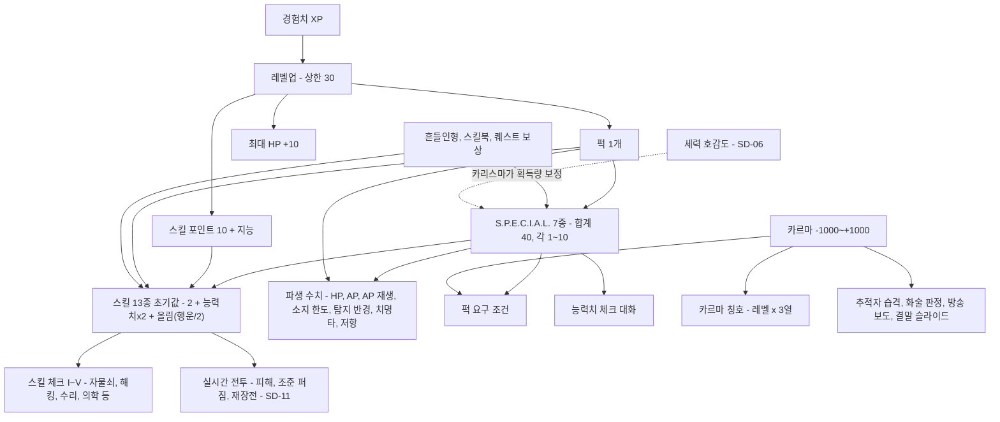
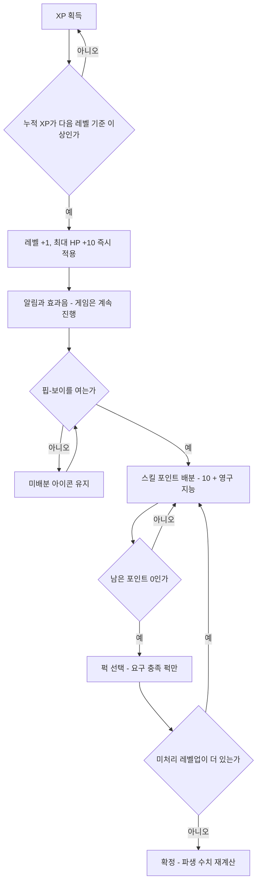
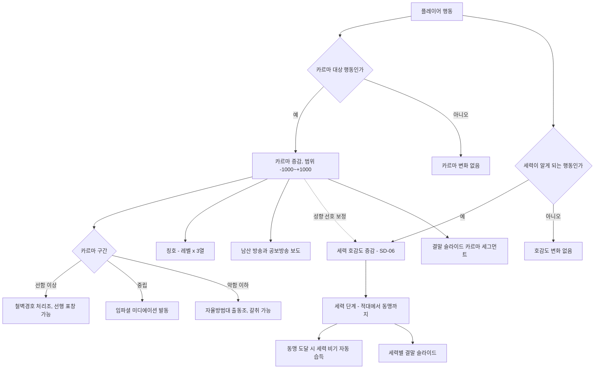
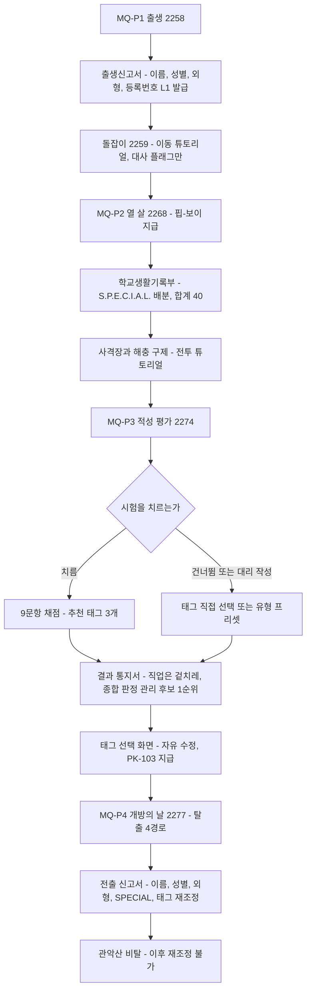

# SD-10. 캐릭터 시스템

> **서울 폴아웃 상세 기획서 세트** | 문서 ID: SD-10 | 버전: v1.0 | 작성일: 2026-10-12
> **범위**: S.P.E.C.I.A.L.(정의·효과·실시간 전투와 심리스 월드 기준 파생 수치 공식·생활기록부 배분 규칙), 스킬 13종(계승 결정·효과 공식·태그·스킬 체크 기준), 레벨과 경험치(상한 35 권장·XP 표·레벨업 지급 규칙·XP 원천과 예산), 퍽 전체 목록(PK-001~PK-119: 원작 계승·변형·삭제 검토, 서울판 신규 퍽 31종(세력 호감도 연동 7종 포함), 특별·퀘스트 퍽 9종, 세력 비기 8종), 카르마(범위·구간·서울판 칭호 105종·변화 행동·영향), 화술·물물교환의 세력 호감도 판정 쓰임, 영구 상승 수집품(입주 기념 흔들인형 20종, 스킬북 13종), 캐릭터 생성 UI 흐름(MQ-P1~P4)과 외형 커스터마이즈 범위 / **다루지 않음**: HP·방사능·중독·부위 손상·수면·과적 등 상태와 생존(SD-11), 피해 공식 전체·적 AI·집중 사격 연출(SD-11), 자물쇠·해킹 미니게임 규칙과 핍-보이 화면 구성(SD-12), 아이템 수치(SD-13), 세력 호감도 수치(SD-06), 수집품의 배치 좌표(SD-09)
> **관련 문서**: [SC-00 컨셉](00_concept.md), [SD-03a 메인 스토리 1부](03a_main-story-part1.md), [SD-03b 메인 스토리 2부](03b_main-story-part2.md), [SD-04a~d 사이드·세력 퀘스트](04d_faction-questlines.md), [SD-05 비표시·반복·인카운터](05_misc-quests-encounters.md), [SD-06 세력](06_factions.md), [SD-07a 주요 인물](07a_characters-major.md), [SD-08 월드·권역](08_world-regions.md), [SD-09a~f 장소 카탈로그](09a_locations-r01-r02.md), [SD-11 전투 시스템](11_combat-system.md), [SD-12 탐험·UI](12_exploration-ui.md), [SD-13 아이템](13_items.md), [SD-15 경제](15_economy.md), [SD-16 아트 디렉션](16_art-direction.md), [SD-18 용어·명명](18_naming-terms.md), 원작 [RD-14 캐릭터 시스템](../reverse-design/14_character-system.md), [RD-16 전투 시스템](../reverse-design/16_combat-system.md), [RD-23 수집 요소](../reverse-design/23_collectibles-achievements.md), [RD-27 이식 시사점](../reverse-design/27_adaptation-notes.md)

---

## 1. 개요

### 1.1 목적
- 서울판 주인공(볼트 S-07 출신, 등록 관리자 후보)의 성장 체계 전체를 **데이터 단위**로 확정한다. 제작자가 이 문서의 표를 데이터베이스와 공용 이벤트로 그대로 옮길 수 있게 한다.
- 원작 폴아웃 3의 캐릭터 시스템([RD-14](../reverse-design/14_character-system.md))을 기준으로 삼고, 확정 제작 전제(P6 심리스 월드, P7 실시간 맵 전투, P8 V.A.T.S. 1차 제외)에 맞지 않는 부분만 재해석한다.
- 퍽 ID(PK-001~)의 주관 문서다. 다른 문서는 퍽을 이 문서의 ID로 참조한다.

### 1.2 요약
1. **S.P.E.C.I.A.L. 7종은 그대로**다. 각 1~10, 기본 5 + 추가 5 = 합계 40. 배분은 MQ-P2의 **생활기록부** 화면에서 한다. V.A.T.S.가 빠지면서 AP는 **질주·회피·집중 사격·파워 공격**의 실시간 자원이 되고, 인지력은 **탐지 반경**, 카리스마는 **세력 호감도 획득량과 지원 병력**에도 작용하도록 보강했다(§2.3).
2. **스킬 13종을 통합하지 않고 계승**한다(§3.1). 무기 스킬은 피해·조준 퍼짐·재장전 시간 3곳에 작용한다(공식 정본 SD-11). 비무기 스킬 체크는 **I~V 5단계 고정 요구치**(자물쇠 0/25/50/75/100, 그 밖의 모든 스킬 15/25/50/75/100)로 통일하고, 화술만 원작 확률식을 유지한다. 화술·물물교환은 세력 호감도 판정에도 쓰인다.
3. **레벨 상한은 35를 권장**한다(원작 20 / 브로큰 스틸 30). 바이블 v0.3의 볼륨(메인 약 40, 사이드 60+, 세력 퀘스트 라인, 장소 250+)이면 획득 가능 XP가 약 11만으로 원작의 두 배를 넘는다. 필요 XP는 원작 공식 `50 + 150 × 현재 레벨` 그대로, 레벨업마다 HP +10, 스킬 포인트 `10 + 지능`, 퍽 1개(§4).
4. **퍽 119종**: 원작 일반 퍽 72종 중 71종을 계승·변형(V.A.T.S. 의존 9종은 SD-11의 집중 사격 기준으로 재해석), 동료 전제 퍽 1종(퍼피스!) 삭제. 서울판 신규 퍽 31종(2077년 한국 생활·제도 기반 24종 + **세력 호감도 연동 7종**, 설명문은 체감 효과). 특별·퀘스트 퍽 9종. **세력 비기 8종**은 호감도 '동맹'에 이르면 자동으로 배운다(퍽 선택이 진영 결정 장치가 되지 않게, 바이블 v0.4 §5.8).
5. **카르마는 -1,000~+1,000, 5구간**. 서울판 칭호 90종(Lv1~30 × 선·중립·악). 카르마는 '주인공이 어떤 사람인가'이고, 세력 호감도(SD-06)는 '세력이 주인공을 어떻게 보는가'다. 둘은 따로 움직인다.
6. **영구 상승 수집품**: 볼트-텍 보블헤드 → **한결이 입주 기념 흔들인형** 20종(능력치 +1 / 스킬 +10), 스킬북 → **2077년 한국 출판물** 13종 × 15권 + 특수 3권 = 198권(+1, 컴프리헨션 시 +2). 장소 250곳 이상에 맞춘 배치 수다(§7).
7. **캐릭터 생성**은 프롤로그 4단계에 나뉜다: MQ-P1 출생신고서(이름·성별·외형) → MQ-P2 생활기록부(S.P.E.C.I.A.L.) → MQ-P3 적성 평가(태그 스킬) → MQ-P4 **전출 신고서**(전 항목 마지막 재조정).

### 1.3 바이블 v0.3·v0.4 반영 사항
이 문서는 작성 중 갱신된 바이블 v0.3(§5.3~5.7, §6.2)과 v0.4(§5.8 '고르지 않고 기운다', §6.2 호감도 수치 비공개)를 따른다.

| 항목 | 바이블 v0.3 | 이 문서의 처리 |
|---|---|---|
| 메인 퀘스트 ID | `MQ-<막><순번>`(예: MQ-301), 프롤로그 MQ-P1~P4, 에필로그 MQ-E1 | 퀘스트 퍽·XP 예산을 이 형식으로 적는다 |
| 동료 | **동료 시스템 없음.** 일시 동행 NPC와 세력 지원 병력만 남는다 | 원작의 동료 관련 규칙(카르마 영입 조건)과 동료 전제 퍽(퍼피스!)을 삭제한다. 카리스마와 일부 퍽은 '일시 동행 NPC·지원 병력' 대상으로 바꾼다 |
| 세력 호감도 | 세력별 -100~+100, 6단계(SD-06) | 카르마와 분리한다. 카리스마가 호감도 **상승량**을 보정하고(§2.3), 화술·물물교환이 호감도 판정에 쓰인다(§3.7). 호감도 연동 퍽 7종(§5.3). 카르마 행동표에는 '호감도 연동 방향'만 적고 수치는 SD-06이 정한다(§6.3) |
| 자유도 | 프롤로그 뒤 월드 전부 개방, 순서 파괴 허용 | 스킬 체크 단계와 레벨 목표를 '막'이 아니라 '권역 위협도' 기준으로 배치한다(§3.6, §4.5) |
| 선택 원칙(v0.4) | 진영·결말은 선택지가 아니라 플레이 누적으로 기운다. 호감도 수치는 숨긴다 | 레벨업 퍽에 세력 전용 퍽·배타 택일을 두지 않는다. 세력 고유 능력은 '동맹' 도달 시 자동 습득(§5.5). 호감도 연동 퍽 설명은 체감 효과로 쓰고 수치는 데이터 열에만 둔다(§5.3) |
| 볼륨 | 메인 약 40, 사이드 60+, 세력 퀘스트 라인, 장소 250+ | 레벨 상한 35 권장(§4.1), 스킬북 198권·흔들인형 20종 배치(§7) |
| 주인공 계보(SD-03 설정) | 주인공은 한유리 박사의 동생 **한유정**의 후손(관리 계보 1). 관리 후보 순위는 계보와 출생 순서로 정해진다. 적성 평가는 겉치레다 | 출생신고서의 등록번호가 계보를 담는다(§8.2). 적성 평가는 겉치레지만 **태그 스킬은 정상적으로 정한다**(§8.5). 1세 돌잡이 장면은 이동 튜토리얼이며 능력치에 영향이 없다(§8.3) |

### 1.4 설계 원칙
숫자 체계는 원작 그대로 두고(C1), V.A.T.S. 의존 규칙만 SD-11 기준으로 재해석한다(C2). 원작 약점(후반 만능화·카리스마 약세·카르마 조작 루프)은 스킬북 수 축소·호감도 연동·중복 판정 금지로 보완한다(C3). 신규 요소는 2077년 한국의 제도·생활에서 가져오고 설화 소재는 쓰지 않는다(C4). 아이콘·수집품은 재사용 가능한 체계로 만든다(C5).

### 1.5 시스템 구조도



---

## 2. S.P.E.C.I.A.L.

### 2.1 기본 규칙
| 항목 | 규칙 | 원작 대비 |
|---|---|---|
| 종류 | 힘(ST)·인지력(PE)·지구력(EN)·카리스마(CH)·지능(IN)·민첩성(AG)·행운(LK) 7종 | 같음 |
| 범위 | 1~10. 장비·약물·상태 보정으로도 표시값은 이 범위를 넘지 않는다 | 같음 |
| 시작 배분 | 기본 5씩(합계 35) + 추가 5 = **합계 40**. 다른 능력치를 깎아 재배분 가능 | 같음 |
| 초과분 기록 | 영구 상승이 10을 넘으면 **내부값으로 계속 기록**한다. 감소 보정은 내부값에서 빼고, 표시는 1~10으로 자른다 | 같음(원작 '내부 기록' 규칙을 정식 사양으로 둔다) |
| 레벨업 | 레벨업으로 직접 오르지 않는다. 인텐스 트레이닝(PK-004) 등 퍽·흔들인형·퀘스트로만 영구 상승 | 같음 |
| 퍽 요구 판정 | **영구값(기저값)**으로만 판정한다. 장비·약물·상태의 일시 보정은 무시한다. 예외는 준영구 아이템 1종(§7.3 미수령 복권) | 같음(럭키 8볼 → 미수령 복권) |
| 능력치 체크 판정 | 대화·상호작용의 능력치 체크는 **현재값(일시 보정 포함)**으로 판정한다 | 원작과 같음(원작도 장비로 맞출 수 있음) |
| 레벨업 스킬 포인트 | 레벨업 순간의 **영구 지능**으로 계산한다. 소급하지 않는다 | 같음 |

### 2.2 능력치별 정의와 효과

| 능력치 | 약어 | 서울판 정의 | 연관 스킬(1점당 +2) | 파생 효과(§2.3) | 대화·상호작용 쓰임 | 요구 퍽(대표) |
|---|---|---|---|---|---|---|
| 힘 | ST | 근력. 짐을 지고, 문을 밀고, 둔기를 휘두르는 힘 | 근접 무기 | 소지 한도, 근접 피해 보너스, 투척 사거리 | 위협 선택지, 무거운 잔해·셔터 밀기, 승강기 수동 권양 | 체육 특기생, 아이언 피스트, 스트롱 백, 공구 달인, 배달 기사, 갈취 |
| 인지력 | PE | 오감과 상황 판단. 소리·냄새·흔적을 읽는 힘 | 에너지 무기, 폭발물, 자물쇠 따기 | **탐지 반경**, **함정 발견 반경** | 흔적 추적, 위장 간파, 무전·방송 잡음 판독 | 시프, 지하철 노선도, 눈치, 스나이퍼, 라이트 스텝, 베터 크리티컬스 |
| 지구력 | EN | 체력과 내성. 오래 버티고 덜 아픈 몸 | 중화기, 비무장 | HP, 독·방사능 저항 | 고된 노동·긴 잠수·참기 선택지 | 민방위 대원, 등산객, 찜질방, 터프니스, 라이프 기버, 솔라 파워드 |
| 카리스마 | CH | 첫인상과 신뢰. 사람을 움직이는 힘 | 물물교환, 화술 | 화술 판정의 카리스마 항, **세력 호감도 획득 보정**, **지원 병력·일시 동행 NPC 보정** | 협상 진입, 군중 연설(서울 회의 MQ-502) | 스카운드럴, 단골, 임파셜 미디에이션, 마스터 트레이더, 비상 연락망 |
| 지능 | IN | 지식과 학습력. 볼트 S-07 적성 평가 사회가 가장 높이 친 능력 | 의학, 수리, 과학 | 레벨업 스킬 포인트 `10 + 지능` | 기술 설명·문서 해독·저지능 전용 대사 | 컴프리헨션, 에듀케이티드, 선행 학습, 공문서 위조, 원자력 기사, 컴퓨터 위즈 |
| 민첩성 | AG | 몸놀림과 손재주 | 소형 화기, 은신 | **최대 AP** | 낙하물 피하기, 좁은 틈 통과 | 건 넛, 시프, 동원 훈련, 태권도, 액션 보이/걸, 너브스 오브 스틸 |
| 행운 | LK | 우연이 내 편일 확률 | 전 스킬 `+⌈행운/2⌉` | 기본 치명타 확률, 이로운 랜덤 인카운터 가중치 | 도박·추첨 선택지 | 포천 파인더, 스크라운저, 미스터리어스 스트레인저, 베터 크리티컬스 |

- 원작처럼 **무기에 최소 힘 요구치가 없다.** 힘 1로도 중화기를 쓴다.
- 힘은 비무장 피해에 영향을 주지 않는다(비무장 피해는 비무장 스킬에서 파생, §3.5).
- 지능 1~3 주인공에게는 저지능 전용 대사가 일부 열린다. 진행을 막지 않는다(원작 규칙). 서울판 예: 볼트 S-07 교사 NPC가 "보충반"으로 안내, 마영식(MQ-103)이 관리자 코드를 그림으로 설명.

### 2.3 파생 수치 공식 (실시간 전투·심리스 월드 기준)
원작 공식을 기본값으로 쓰고, V.A.T.S. 제외와 탑다운 실시간 전투 때문에 의미가 바뀐 항목만 재정의했다. **'신설'** 표시는 원작에 없던 수치다. 타일 단위는 SD-16의 타일 크기 결정 뒤 실제 픽셀로 환산한다.

| 파생 수치 | 근거 | 공식 | 능력치 5 기준값 | 구분 | 비고·연결 |
|---|---|---|---|---|---|
| 최대 HP | EN, Lv | `90 + 지구력×20 + 레벨×10` | 200 (Lv1) | 원작 | 절대 수치는 실시간 템포에 맞춰 SD-11이 배율을 정할 수 있다(RD-27 §7.5). 배율을 쓰면 이 식 전체에 곱한다 |
| 최대 AP | AG | `65 + 민첩성×2` | 75 | 원작 | V.A.T.S. 대신 실시간 행동 자원. 용도·회복은 SD-11 §5 확정안을 따른다(아래 요약) |
| AP 회복 | – | 초당 8, 마지막 소모 1.0초 뒤 시작 | 초당 8 | SD-11 확정 | 능력치와 무관. 퍽 너브스 오브 스틸(PK-098) 초당 +2 |
| 소지 한도 | ST | `150 + 힘×10` | 200 | 원작 | 단위는 원작 무게 수치를 그대로 쓴다(SD-13). 과적 규칙은 SD-11 |
| 근접 피해 보너스 | ST | `⌈힘/2⌉` (정수) | +3 | 원작(정수 올림 판본 채택) | 근접 무기 피해에 마지막에 더한다. 조준 강공격의 2배 계산 뒤에 더한다 |
| 투척 사거리 | ST | `6 + ⌊힘/2⌋` 타일 | 8타일 | 신설 | 수류탄·화염병. 착탄 오차는 폭발물 스킬(§3.5) |
| 비무장 피해 | 비무장 스킬 | `⌈(10 + 비무장)/20⌉` | 2 (스킬 15) | 원작 | 맨손은 이 값, 격투 무기는 무기 피해에 가산 |
| 치명타 확률 | LK | `(행운 + 퍽 보정) × 무기 치명타 배수 × 상태 계수` (%), 집중 사격이면 **+15%p** | 5% | 원작(V.A.T.S. 보정 → 집중 사격 보정) | 은신 상태 기습은 100%. 판정 단위는 발사체마다(원작 실시간 규칙) |
| 독 저항 | EN | `(지구력-1)×5%` | 20% | 원작 | SD-11 |
| 방사능 저항 | EN | `(지구력-1)×2%`, 상한 85% | 8% | 원작 | SD-11 |
| 탐지 반경 | PE | `8 + 인지력` 타일 | 13타일 | 신설(원작 나침반 거리 미공개를 확정) | 이 거리 안의 적대 대상이 HUD 나침반·미니맵에 빨간 점으로 표시된다. 화면 밖 적의 방향 표시도 이 반경 기준 |
| 함정 발견 반경 | PE | `1 + ⌊인지력/3⌋` 타일 | 2타일 | 신설 | 지뢰·철사 함정이 이 거리 안에 들어오면 외곽선 강조. 퍽 현장 안전 관리자 +2 |
| 소리 조사 반응 | PE | 플레이어가 적 소음을 인지하는 거리 `6 + 인지력×0.5` 타일 | 8.5타일 | 신설 | 화면 밖 총성·발소리에 방향 아이콘(SD-12) |
| 화술 카리스마 항 | CH | `(카리스마 - 무기 꺼냄(1/0) + 2) / 10` | 0.7 | 원작 | §3.5 화술 판정식 |
| 세력 호감도 획득 보정 | CH | 호감도 **상승**량 × `(1 + (카리스마-5) × 0.03)`, 결과 반올림 | ×1.00 | 신설 | 카리스마 10이면 ×1.15, 1이면 ×0.88. **하락량에는 적용하지 않는다.** 호감도 수치 체계는 SD-06 |
| 지원 병력 보정 | CH | 세력 지원 병력·일시 동행 NPC의 피해와 DR × `(1 + (카리스마-5) × 0.02)` | ×1.00 | 신설(원작 동료 대체) | 카리스마 10이면 ×1.10, 1이면 ×0.92. 바이블 v0.3 §6.2 지원 병력 호출 |
| 레벨업 스킬 포인트 | IN | `10 + 지능` (+에듀케이티드 3) | 15 | 원작 | 영구 지능 기준 |
| 이로운 인카운터 가중치 | LK | 랜덤 인카운터 표에서 '행운' 태그 항목의 가중치 × `(0.5 + 행운×0.1)` | ×1.0 | 원작(행운 영향)을 수치화 | 행운 1이면 ×0.6, 10이면 ×1.5. 인카운터 표는 SD-05 |
| 피해 저항(DR) | 방어구 | 초기 0%, 상한 85% | 0% | 원작 | SD-11·SD-13 |
| 폐활량 | – | 삭제 | – | 삭제 | 수중 이동 제외(RD-27 X13) |

**AP 용도 요약** (정본은 [SD-11 §5](11_combat-system.md). 이 문서는 퍽 재해석의 기준으로만 인용한다)

| AP 행동 | 소모 | 효과 요약 | 원작 대응 |
|---|---|---|---|
| 질주 | 초당 10 | 이동 속도 증가, 사격 불가 | 원작 달리기(무료) → 비용화 |
| 회피 구르기 | 20 | 짧은 이동 + 약 0.2초 무적 | 신설 |
| 집중 사격(원거리) | 무기별 AP 비용(원작 V.A.T.S. AP 표 기준, 수치 SD-13) | 0.3초 조준 뒤 발사. 조준 퍼짐 0(무기 최소 퍼짐만), 치명타 +15%p, 머리 가중치 `+2 × 인지력` | V.A.T.S. 예약 1회 |
| 파워 공격(근접·비무장) | 무기 AP 비용 × 0.5(최소 10) | 0.5초 차지 뒤 피해 ×2 | V.A.T.S. 근접·원작 파워 공격 |

- 일반 사격·일반 근접에는 AP를 쓰지 않는다(SD-11). 원작 V.A.T.S. 전용 퍽은 **집중 사격·파워 공격**을 기준으로 재해석한다(§5.6).
- AP 비용표를 원작 그대로 쓰므로 '손이 빠른 무기 / 한 방 무기'의 정체성이 유지된다(민첩성 5에서 경권총 집중 사격 4회, 저격소총 1회).

### 2.4 능력치 1~10 수치표
데이터 테이블에 그대로 옮길 수 있게 계산해 둔 값이다.

| 값 | 소지 한도(ST) | 근접 보너스(ST) | 투척 사거리(ST) | HP Lv1(EN) | 독 저항(EN) | 방사능 저항(EN) | 탐지 반경(PE) | 함정 발견(PE) | 호감도 상승 보정(CH) | 지원 병력(CH) | 스킬 포인트/Lv(IN) | 최대 AP(AG) | 기본 치명타(LK) | 연관 스킬(공통) | 행운 전 스킬(LK) |
|---|---|---|---|---|---|---|---|---|---|---|---|---|---|---|---|
| 1 | 160 | +1 | 6 | 120 | 0% | 0% | 9 | 1 | ×0.88 | ×0.92 | 11 | 67 | 1% | +2 | +1 |
| 2 | 170 | +1 | 7 | 140 | 5% | 2% | 10 | 1 | ×0.91 | ×0.94 | 12 | 69 | 2% | +4 | +1 |
| 3 | 180 | +2 | 7 | 160 | 10% | 4% | 11 | 2 | ×0.94 | ×0.96 | 13 | 71 | 3% | +6 | +2 |
| 4 | 190 | +2 | 8 | 180 | 15% | 6% | 12 | 2 | ×0.97 | ×0.98 | 14 | 73 | 4% | +8 | +2 |
| 5 | 200 | +3 | 8 | 200 | 20% | 8% | 13 | 2 | ×1.00 | ×1.00 | 15 | 75 | 5% | +10 | +3 |
| 6 | 210 | +3 | 9 | 220 | 25% | 10% | 14 | 3 | ×1.03 | ×1.02 | 16 | 77 | 6% | +12 | +3 |
| 7 | 220 | +4 | 9 | 240 | 30% | 12% | 15 | 3 | ×1.06 | ×1.04 | 17 | 79 | 7% | +14 | +4 |
| 8 | 230 | +4 | 10 | 260 | 35% | 14% | 16 | 3 | ×1.09 | ×1.06 | 18 | 81 | 8% | +16 | +4 |
| 9 | 240 | +5 | 10 | 280 | 40% | 16% | 17 | 4 | ×1.12 | ×1.08 | 19 | 83 | 9% | +18 | +5 |
| 10 | 250 | +5 | 11 | 300 | 45% | 18% | 18 | 4 | ×1.15 | ×1.10 | 20 | 85 | 10% | +20 | +5 |

- 탐지 반경·함정 발견·투척 사거리는 타일 단위다. 호감도 보정은 결과를 정수로 반올림한다(예: 호감도 +5 × 1.15 = +5.75 → +6).

### 2.5 능력치 체크 기준
대화·상호작용의 `[힘 6]` 같은 능력치 체크는 **확률이 아니라 고정 요구치**다. 충족하면 자동 성공, 미충족이면 선택지가 회색으로 표시된다(조건 표시). 현재값(일시 보정 포함)으로 판정한다.

| 단계 | 요구치 | 배치 기준 | 성공 XP |
|---|---|---|---|
| I | 4 | 시작 권역(R01)·생활형 선택지 | 10 |
| II | 5 | 위협도 낮은 권역 | 15 |
| III | 6 | 일반 | 20 |
| IV | 7 | 위협도 높은 권역, 대체 해법 | 30 |
| V | 8 | 특수 해법(메인 퀘스트 대체 경로 등) | 40 |

- 9·10 요구 체크는 쓰지 않는다. 일시 보정으로 8까지는 도달할 수 있어야 '장비로 길을 여는' 원작 설계가 산다.
- 같은 선택지는 성공 XP를 1회만 준다.

### 2.6 생활기록부 화면: S.P.E.C.I.A.L. 배분 규칙 (MQ-P2)
2268년, 열 살 생일에 핍-보이를 받는 날 담임 교사가 **'볼트 S-07 초등과정 학교생활기록부'**를 작성한다. 플레이어는 교사가 내민 기록부의 항목을 직접 채운다. 원작 그림책 '너는 스페셜해!'의 역할이다. 연출·대사는 SD-03이 정본이다.

**화면 구성**

| 영역 | 내용 |
|---|---|
| 머리 | 서식명 '학교생활기록부(초등과정)', 학생 성명(MQ-P1에서 정한 이름), 등록번호 `S07-2258-L1-xxxx`(MQ-P1에서 발급, `L1`은 관리 계보 1), 학년도 '2268' |
| 본문 7행 | 행마다 **기록부 항목명 + S.P.E.C.I.A.L. 이름** 병기, 1~10 눈금, 현재 값, 담임 의견 한 줄(값 구간별로 바뀜) |
| 오른쪽 패널 | 실시간 미리보기: 최대 HP, 최대 AP, 소지 한도, 탐지 반경, 레벨업 스킬 포인트, 스킬 13종 초기값(태그 전) |
| 아래 | 남은 포인트(시작 5), [되돌리기] [기본값] [확정] 버튼. 남은 포인트가 0이 아니면 [확정] 비활성 |
| 연출 | 확정하면 담임 도장이 찍히고 기록부가 핍-보이 화면으로 접혀 들어간다. 이후 핍-보이 STATS 탭에서 '생활기록부' 양식으로 다시 볼 수 있다(값 수정 불가) |

**항목명 대응**

| S.P.E.C.I.A.L. | 생활기록부 항목 | 근거(실제 생활기록부·학교 문화) |
|---|---|---|
| 힘 | 체력장 | 학생 체력 평가 등급 |
| 인지력 | 관찰·탐구 태도 | 행동특성 서술 관행 |
| 지구력 | 건강 기록 | 신체 발달·건강 기록 |
| 카리스마 | 교우 관계 | 행동특성 및 종합의견 |
| 지능 | 학업 성취 | 교과 학습 발달 상황 |
| 민첩성 | 운동 기능 | 체육 실기 |
| 행운 | 특기 사항 | '비고'란. 볼트 S-07 교사들은 이 칸을 '운'이라고 부른다 |

**담임 의견 문구** (값 구간별. 화면 오른쪽 아래 한 줄로 표시)

| 항목 | 1~2 | 3~4 | 5~6 | 7~8 | 9~10 |
|---|---|---|---|---|---|
| 체력장 | 급식판을 두 손으로 듭니다. | 체력장 4등급. 성실히 참여합니다. | 체력장 3등급. 무난합니다. | 체력장 2등급. 정비반에서 탐냅니다. | 체력장 1등급. 산소통 운반 당번으로 추천합니다. |
| 관찰·탐구 태도 | 계단을 자주 헛디딥니다. | 수업 중 창밖(벽)을 봅니다. | 주변을 잘 살핍니다. | 환기구 소리가 바뀐 것을 먼저 알아챘습니다. | 교사의 거짓말을 세 번 지적했습니다. 주의 요망. |
| 건강 기록 | 결석 일수가 많습니다. | 감기에 자주 걸립니다. | 건강합니다. | 방역 소독 날에도 기침하지 않았습니다. | 결석 0일. 진료소장이 표본 채취를 요청했습니다. |
| 교우 관계 | 혼자 지내는 시간이 깁니다. | 친구가 적지만 갈등은 없습니다. | 원만합니다. | 학급 회의를 이끕니다. | 반장 선거 만장일치. 오버시어실이 주목합니다. |
| 학업 성취 | 보충 학습이 필요합니다. | 노력하면 나아집니다. | 성취 기준에 도달했습니다. | 상위권. 적성 평가가 기대됩니다. | 전 과목 최상위. 기록 보관실 열람 권한을 신청했습니다. |
| 운동 기능 | 줄넘기를 아직 넘지 못합니다. | 달리기가 느린 편입니다. | 보통입니다. | 피구에서 공을 맞지 않습니다. | 승강기 점검구를 혼자 오르내립니다. 주의 요망. |
| 특기 사항 | 배급 추첨에서 늘 마지막 번호를 뽑습니다. | 특이 사항 없음. | 특이 사항 없음. | 분실물을 자주 줍습니다. | 배급 추첨 3회 연속 1번. 조사 중. |

**배분 규칙**

| 규칙 | 값 |
|---|---|
| 기본값 | 7개 모두 5 |
| 남은 포인트 | 5 |
| 최소·최대 | 1~10 |
| 재배분 | 능력치를 1 내리면 남은 포인트 +1 |
| 자유 배분량 | 33(하한 1 제외) |
| 확정 조건 | 남은 포인트 0 |
| 재수정 | MQ-P4 전출 신고서에서 1회 더(§8.6) |
| 확정 후 | 핍-보이 STATS에서 열람만 가능 |

- 원작처럼 배분 결과가 프롤로그 NPC 반응에 소소하게 반영된다(예: 지능 8 이상이면 하도윤이 주인공을 '전교 1등'이라고 부른다, 힘 8 이상이면 체육 교사가 정비반 이야기를 꺼낸다). 대사는 SD-03.

### 2.7 능력치 상승·하락 수단 종합

| 구분 | 수단 | 효과 | 횟수·조건 | 정본 |
|---|---|---|---|---|
| 영구 | 한결이 입주 기념 흔들인형(능력치 7종) | 해당 능력치 +1 | 각 1회. 10 초과분은 내부값으로 기록 | §7.1, 위치 SD-09 |
| 영구 | 인텐스 트레이닝(PK-004) | 원하는 능력치 +1 | Lv2부터, 최대 10랭크 | §5.2 |
| 영구 | 원자로 운전원·정전의 증명 등 퀘스트 퍽 | 퍽별 상이(능력치 직접 상승 퀘스트 퍽은 두지 않는다) | – | §5.4 |
| 영구 | 노 위크니스(PK-089) / 올모스트 퍼펙트(PK-096) | 5 미만 → 5 / 9 미만 → 9 | Lv24 / Lv30 | §5.2 |
| 준영구 | 미수령 복권(2077-10-23 추첨분) | 소지 중 행운 +1, 퍽 요구에도 반영 | 사이드 퀘스트 보상(SD-04) | §7.3 |
| 일시 | 의류·방어구 | ±1~2 | 착용 중 | SD-13 |
| 일시 | 약물·주류·음식 | ±1~5 | 지속 240초(케미스트 시 2배) | SD-13 |
| 일시 | 퍽 | 너드 레이지!(힘 → 10), 솔라 파워드(힘 +2), 나이트 퍼슨(지능·인지력 +2) | 조건부 | §5.2 |
| 하락 | 방사능 중독, 금단, 부위 손상, 장비 페널티 | -1~-4 | 상태 지속 중. 1 미만으로 내려가지 않는다 | SD-11, SD-13 |

**최대치 시나리오**: 인텐스 트레이닝을 쓰지 않아도 Lv30 올모스트 퍼펙트(전부 9) **뒤에** 흔들인형 7종을 모으면 전 능력치 10이 된다. 흔들인형을 먼저 먹으면 내부값 기록 규칙 때문에 손해가 없다(서울판은 올모스트 퍼펙트를 '9 미만을 9로 올림'이 아니라 **'기저값에 9 - 기저값만큼 더함, 단 이미 9 이상이면 변화 없음'**으로 구현해 원작의 순서 함정을 없앤다). 즉 흔들인형으로 이미 10이 된 능력치는 10을 유지하고, 흔들인형 +1이 반영된 8은 9가 된 뒤 남은 흔들인형이 없으면 9에 머문다.

---
## 3. 스킬

### 3.1 결정: 13종 계승 (통합하지 않는다)

| 안 | 구성 | 장점 | 단점 |
|---|---|---|---|
| **A. 원작 13종 계승 (권장)** | 물물교환·중화기·에너지 무기·폭발물·자물쇠 따기·의학·근접 무기·수리·과학·소형 화기·은신·화술·비무장 | 원작 퍽·장비·퀘스트 판정 패턴을 그대로 옮긴다. 무기 계열 8종(SD-11)과 스킬이 1:1에 가깝게 맞는다. 태그 3개 선택의 무게가 유지된다 | 후반 만능화(원작 약점)가 그대로 남는다 → 스킬북 수와 상한 운용으로 완화 |
| B. 10종 통합 | 소형 화기+에너지 무기 → 사격, 근접 무기+비무장 → 격투, 수리+과학 → 기술 | 스킬 수가 줄어 빌드가 단순하다 | 원작 퍽 다수(건 넛, 사이보그, 아이언 피스트, 닌자)의 의미가 무너진다. 무기 계열 정체성이 약해진다. 만능화가 더 빨리 온다 |
| C. 13종 + 생존 스킬 추가 | 원작 13종 + 생존(음식·물·제작) | 서바이벌 요소 강화 | 바이블은 생존 하드코어 모드를 다루지 않는다. 퍽(손맛·레드 벨리)으로 충분하다 |

**권장안 A의 근거**
1. 바이블 §2 원칙 1 "시스템은 폴아웃 3 그대로", RD-27 §4 핵심 경험 4 "S.P.E.C.I.A.L. + 스킬 13종 + 레벨당 퍽 1개".
2. 2077년 한국은 **민간 총기가 거의 없던 사회**다(SR-05 §5.9). 초반 무기가 공구·쇠파이프·맨손이므로 근접 무기와 비무장을 나눠 두는 편이 초반 빌드 선택지를 넓힌다.
3. 서울판의 핵심 장치(관제망 단말, 세진 로봇, 소형 원자로)는 과학과 수리의 쓰임을 분명히 나눈다: 과학 = 단말·프로그램·이론, 수리 = 기계·배선·원자로 하드웨어.
4. SD-11(무기 계열 8종)과 SD-13(무기마다 스킬 1개)이 이미 13종을 전제로 한다.

### 3.2 스킬 목록과 서울판 정의

| # | 스킬 | 연관 능력치 | 서울판 정의 | 대표 쓰임(서울판) |
|---|---|---|---|---|
| 1 | 물물교환 | CH | 흥정·거래·조건 협상 | 상점 가격, 통행세·용병료 협상, 세력 기부 효율 |
| 2 | 중화기 | EN | 거치·대형 화기 운용 | 기관포, 화염방사기, 로켓 발사기, 핵 투사기 |
| 3 | 에너지 무기 | PE | 레이저·플라스마 등 원자력 전지 무기 | 계엄군·연합단 에너지 무기 |
| 4 | 폭발물 | PE | 투척·설치 폭발물, 지뢰·폭발 함정 해체 | 수류탄, 지뢰, 공사장 발파 장약, 함정 해체 |
| 5 | 자물쇠 따기 | PE | 기계식 자물쇠 해제 | 현관문, 사물함, 금고, 볼트 출입 통제문 |
| 6 | 의학 | IN | 응급 처치·약품 사용 | 스팀팩·라드어웨이 효과량, 부상 진단, 정착지 의료 선택지 |
| 7 | 근접 무기 | ST | 둔기·날붙이·공구 전투 | 쇠파이프, 렌치, 골프채, 소방 도끼, 전기톱 |
| 8 | 수리 | IN | 기계·배선·원자로 하드웨어 정비 | 장비 상태 복구, 발전기·승강기·차단문 수리, 세진 로봇 하드웨어 |
| 9 | 과학 | IN | 진공관 컴퓨터·프로그램·이론 지식 | 단말 해킹, 관제망 장치 판독, 로봇 명령 재설정, 기술 대화 |
| 10 | 소형 화기 | AG | 권총·소총·산탄총 | 예비군 무기고 소총, 경찰 권총, 수제 산탄총 |
| 11 | 은신 | AG | 들키지 않고 움직이기, 소매치기 | 기습, 잠입 경로, 소매치기, 변장 유지 보조 |
| 12 | 화술 | CH | 설득·거짓말·협상 | 화술 판정, 세력 협상, 서울 회의 발언, 호감도 손실 완화 |
| 13 | 비무장 | EN | 맨손·격투 무기 | 맨손, 너클, 파워 피스트 계열 |

- 스킬 이름은 원작 표기(RD-26)를 그대로 쓴다.
- 무기 스킬 6종(중화기·에너지 무기·폭발물·근접 무기·소형 화기·비무장)과 비무기 스킬 7종으로 나뉜다.

### 3.3 초기값·상한·보정 규칙

| 규칙 | 내용 |
|---|---|
| 초기값 | `2 + 연관 능력치 × 2 + ⌈행운/2⌉`. 능력치가 바뀌면 즉시 같은 폭으로 바뀐다(기저값 연동) |
| 태그 | 태그 스킬은 +15(§3.4) |
| 최솟값·최댓값(시작 시) | 5 ~ 27, 태그 포함 최대 42 |
| 표시 상한 | 100 |
| 내부 기록 | 100을 넘는 영구 증가분(레벨업 포인트, 스킬북, 흔들인형, 퍽)은 내부값으로 계속 기록한다. 판정은 `min(내부값 - 일시 감소, ...)`가 아니라 **내부값 + 일시 보정**으로 한 뒤 100에서 자른다. 그래서 내부값 110이면 주류·방사능으로 -10을 받아도 100 판정을 유지한다 |
| 레벨업 투자 상한 | 한 스킬에 레벨업 포인트를 넣어 표시값 100을 넘길 수 없다(100에서 [+] 비활성) |
| 일시 보정 | 장비 +5~+15, 약물(능력치 경유) 등. 스킬 체크 판정에 반영한다. 퍽의 스킬 요구 판정에는 **반영하지 않는다**(원작 불명확 → 서울판 확정) |

**초기값 조견표** (행: 연관 능력치, 열: 행운. 원작과 같다)

| 연관 능력치 \ 행운 | 1~2 | 3~4 | 5~6 | 7~8 | 9~10 |
|---|---|---|---|---|---|
| 1 | 5 | 6 | 7 | 8 | 9 |
| 2 | 7 | 8 | 9 | 10 | 11 |
| 3 | 9 | 10 | 11 | 12 | 13 |
| 4 | 11 | 12 | 13 | 14 | 15 |
| 5 | 13 | 14 | 15 | 16 | 17 |
| 6 | 15 | 16 | 17 | 18 | 19 |
| 7 | 17 | 18 | 19 | 20 | 21 |
| 8 | 19 | 20 | 21 | 22 | 23 |
| 9 | 21 | 22 | 23 | 24 | 25 |
| 10 | 23 | 24 | 25 | 26 | 27 |

### 3.4 태그 스킬

| 규칙 | 내용 | 원작 대비 |
|---|---|---|
| 개수 | 3개 | 같음 |
| 보너스 | 즉시 +15(일회성) | 같음 |
| 선택 시점 | MQ-P3 적성 평가 결과 통지서(16세) → 태그 선택 화면. 평가 결과는 '추천'일 뿐이고 자유롭게 바꾼다 | 같음(G.O.A.T. → 적성 평가) |
| 재선택 | MQ-P4 전출 신고서에서 1회 더 | 같음(볼트 출구) |
| 이후 | 재선택 불가. 태그!(PK-079)로 4번째 태그 추가만 가능 | 같음 |
| 서울판 추가 | 선행 학습(PK-008)을 고르면 태그 스킬에 레벨업 포인트를 4점 넣을 때마다 +1 추가(1·2편의 '태그 스킬 성장 가속'을 퍽으로 복원) | 신설 |

### 3.5 스킬별 효과 공식

#### 3.5.1 무기 스킬 공통 (정본 SD-11 §3·§4)
무기 스킬은 **피해·조준 퍼짐·재장전 시간**에 작용한다. 공식 정본은 SD-11이고, 이 표는 스킬 쪽에서 본 요약이다.

| 효과 | 공식 | 스킬 0 | 25 | 50 | 75 | 100 |
|---|---|---|---|---|---|---|
| 피해 계수 | `(100 + 스킬) / 200` | ×0.50 | ×0.625 | ×0.75 | ×0.875 | ×1.00 |
| 조준 퍼짐 스킬 항(반각) | `24 × (0.5 - 0.005 × 스킬)` 도 | 12° | 9° | 6° | 3° | 0° |
| 재장전 시간 | 무기 기본 × `(1.2 - 0.004 × 스킬)` | ×1.20 | ×1.10 | ×1.00 | ×0.90 | ×0.80 |

- 스킬 0이어도 무기를 쓸 수 있다. 피해는 최소 50%다.
- 치명타 피해는 스킬과 상태의 영향을 받지 않는다(원작).
- 무기마다 사용 스킬은 1개다(SD-13). 기관단총·소드오프 산탄총의 건슬링어·코만도 판정은 §5.6 표를 따른다.

#### 3.5.2 무기 스킬별 추가 효과

| 스킬 | 추가 효과 | 수치 |
|---|---|---|
| 중화기 | 거치 사격 시 반동 누적 감소 | 반동 누적 최대치 × `(1 - 중화기/200)` (100이면 절반) |
| 에너지 무기 | 원자력 전지 무기의 과열 회복 | 과열 무기(SD-13 지정)만. 과열 해소 시간 × `(1.2 - 0.004 × 스킬)` |
| 폭발물 | ① 투척 착탄 오차 ② 적 지뢰가 나를 감지한 뒤 폭발까지 신관 시간 ③ 해체 요구치 판정 | ① 착탄 오차 반경 = `1.5 × (1 - 폭발물/125)` 타일(100이면 0.3) ② 신관 시간 = `0.5 + 폭발물/100` 초(100이면 1.5초) ③ §3.6 |
| 근접 무기 | 막기 | 근접 무기를 든 막기 자세에서 받는 근접 피해 감소 = `20% + 근접 무기 × 0.3%`(100이면 50%). 원거리 피해는 막지 못한다. 막기 중 AP 회복 정지(SD-11과 맞춘다) |
| 소형 화기 | 정조준 확대 | 스코프 무기 흔들림 = `1 - 소형 화기/100`(100이면 흔들림 없음, 팔 손상면 무시) |
| 비무장 | 비무장 피해 | `⌈(10 + 비무장)/20⌉`: 스킬 0~10 → 1, 11~30 → 2, 31~50 → 3, 51~70 → 4, 71~90 → 5, 91~100 → 6 |

#### 3.5.3 물물교환
- **가격 공식(원작 유지)**: `판매가 = 가치 × (0.45 + 물물교환/100 × 0.45) × 보정`, `구매가 = 가치 × (1.55 - 물물교환/100 × 0.45) × 보정`. 보정은 상점·퍽·세력 호감도 단계의 곱(정본 SD-15·SD-06).

| 물물교환 | 0 | 25 | 50 | 75 | 100 |
|---|---|---|---|---|---|
| 판매 비율 | 45% | 56% | 68% | 79% | 90% |
| 구매 비율 | 155% | 144% | 133% | 121% | 110% |

- **세력 기부·공물 효율**: 캡·물자를 바쳐 세력 호감도를 올릴 때 필요한 양 × `(1.25 - 물물교환/200)`(0이면 ×1.25, 50이면 ×1.0, 100이면 ×0.75). 기본 필요량과 하루 상한은 SD-06.
- **[물물교환] 고정 판정**: 통행세·용병료·현상금 흥정, 세력 간 물자 교환 조건(§3.6 단계).

#### 3.5.4 의학
- `효과 = 기본값 × (1 + 의학/50)`. 의학 50에서 2배, 100에서 3배(원작).

| 의료품 | 기본값 | 의학 0 | 25 | 50 | 75 | 100 |
|---|---|---|---|---|---|---|
| 스팀팩 | HP +30 | +30 | +45 | +60 | +75 | +90 |
| 라드어웨이 | 라드 -50 | -50 | -75 | -100 | -125 | -150 |
| 라드-X | 방사능 저항 +25% | +25% | +37.5% | +50% | +62.5% | +75% |

- 부위 지정 치료, 의사 NPC 치료, 손상 회복 규칙은 SD-11. 서울판 신규 의료품(SD-13)도 같은 식을 쓴다.
- **[의학] 고정 판정**: 부상자 진단·응급 처치(정착지 주민, 일시 동행 NPC), 시신 검안, 약물 성분 판별.

#### 3.5.5 수리
SD-13의 **5단계 상태**(S1 최상 ~ S5 최하, 0 = 파손)에 맞춘다.

| 수리 스킬 | 자가 수리로 올릴 수 있는 최고 단계 | 부품 1개당 상승 | 원작 대응(최대 내구도 `40 + 0.6 × 수리`) |
|---|---|---|---|
| 0~34 | S3 | +1단계 | 40~60% |
| 35~69 | S2 | +1단계 | 61~81% |
| 70~89 | S1 | +1단계 | 82~93% |
| 90~100 | S1 | +1단계, 50% 확률로 +2단계 | 94~100% |

- 같은 수리 계열 부품 1개를 소모한다(SD-13 §3.13). 수리 키트는 스킬과 무관하게 +1단계(SD-13).
- 제작 무기의 시작 상태: 수리 0~49 → S3, 50~89 → S2, 90 이상 → S1.
- **[수리] 고정 판정**: 발전기·승강기·차단문·배전반·정수 펌프 수리, 고장 로봇 재가동, 원자로 하드웨어, 함정(철사·압력판) 해체.

#### 3.5.6 과학
- **해킹 가능 등급**: 단말 등급 요구치 이상이면 해킹 미니게임에 진입한다(규칙은 SD-12: 한국어 음절 단어 맞히기). 스킬이 요구치를 넘을수록 후보 단어가 줄어든다: 후보 단어 수 = 기본 수 - `⌊(과학 - 요구치)/10⌋`(최소 기본의 절반).
- 기회 4번, 실패하면 잠김(컴퓨터 위즈 PK-081로 1회 재시도). 도중 이탈하면 초기화(원작).
- **관제망 장치**: 관리자 인증 상호작용은 스킬이 아니라 진행 단계로 열린다(SD-12). 관리자 인증이 없을 때 관제망 장치를 해킹하려면 과학 판정이 필요하다(등급은 장치마다 SD-09·SD-12).
- **[과학] 고정 판정**: 기술 대화, 로봇 명령 재설정(적대 로봇 정지·아군화의 전제), 원자로 제어반 해석, 2077년 기술 문서 해독.

#### 3.5.7 은신
- **탐지**: 웅크린 상태에서 적의 시각 탐지 거리 × `(1 - 은신/200)`, 이동 소리 반경 × `(1 - 은신/200)`(100이면 절반). 조명·장비 무게·소음 무기·탐지 상태 표시는 SD-11·SD-12.
- **기습**: 탐지되지 않은 대상에게 첫 공격은 치명타 확정, 원거리 ×2, 근접·비무장 ×5(원작, SD-11).
- **소매치기 성공률**(원작 유지): `⌊40 + 0.6 × 은신 - ⌈가치/2⌉ - 0.6 × 대상 은신⌋`, 최소 5%·최대 85%. 실패하면 대상이 적대하거나 경계하고 24게임 시간 동안 재시도 불가.
- **변장 보조**: 세력 복장 변장 중 은신 스킬이 간파 판정에 들어간다(변장 규칙 정본 SD-06, 퍽 변장의 달인 PK-044).

#### 3.5.8 화술
- **판정식(원작 유지, 서울판 대상 호감 항 확장)**

```text
카리스마 항 = (카리스마 - 무기 꺼냄(1/0) + 2) / 10
대상 호감   = NPC 기본 호감 + 소속 세력 호감도 × 0.25        ← 서울판 추가
카르마 항   = (대상 호감 + (대상 책임감 - 50) × 플레이어 카르마 / 500) / 100
성공 확률   = (카리스마 항 + 카르마 항) × 화술 × 난이도 배수
최종        = 성공 확률이 0.9 이상이면 100%, 아니면 그 값
```

| 난이도 | 난이도 배수 | 성공 XP | 권장 화술(카리스마 5, 대상 호감 50, 카르마 0, 소속 세력 중립) |
|---|---|---|---|
| 아주 쉬움 | 0.018 | 5 | 30 |
| 쉬움 | 0.012 | 10 | 50 |
| 보통 | 0.009 | 20 | 65 |
| 어려움 | 0.006 | 30 | 95 |
| 아주 어려움 | 0.004 | 50 | 화술 100으로도 70% 미만. 증거·호감도·퍽으로 보완 |

- **세력 호감도 연동**: 소속 세력 호감도가 +60이면 대상 호감 +15, -60이면 -15. '적대' 세력원은 대부분 대화하지 않는다(SD-06).
- 실패한 판정은 다시 시도할 수 없다(원작). 세이브·로드 남용을 줄이려고 **판정 난수를 판정 대상별로 게임 시작 시 고정**한다(옵션 '판정 고정' 기본 켬). 같은 조건에서 다시 시도하면 같은 결과가 나온다. 조건(화술·카리스마·호감도)이 바뀌면 확률이 바뀌므로 성공 여부도 바뀔 수 있다.
- 증거 아이템([증거] 선택지)은 난이도를 한 단계 낮추거나 자동 성공시킨다(SD-03a 표기 규칙).
- `[힘 6]`, `[카르마: 선]`, 퍽 이름 같은 비화술 태그는 조건 충족 시 자동 성공이다(§2.5).

### 3.6 스킬 체크 기준 (I~V 5단계)
모든 고정 요구치 판정을 5단계로 통일한다. **자물쇠만 I 단계가 0**이고 나머지는 15다. 화술은 §3.5.8의 확률식을 쓴다.

| 판정 종류 | I 아주 쉬움 | II 쉬움 | III 보통 | IV 어려움 | V 아주 어려움 | 성공 XP (I~V) | 정본·연결 |
|---|---|---|---|---|---|---|---|
| 자물쇠 따기(미니게임 진입) | 0 | 25 | 50 | 75 | 100 | 20/30/40/50/60 | 미니게임 SD-12 |
| 강제 개방 성공률 | `스킬 - 요구치 + 10`% | 〃 | 〃 | 〃 | 〃 | 같음 | 실패 시 영구 잠김(인필트레이터 1회 재시도) |
| 해킹(과학, 미니게임 진입) | 15 | 25 | 50 | 75 | 100 | 20/30/40/50/60 | SD-12 |
| 과학 고정 판정(대화·장치) | 15 | 25 | 50 | 75 | 100 | 10/20/30/40/50 | – |
| 수리 고정 판정 | 15 | 25 | 50 | 75 | 100 | 10/20/30/40/50 | – |
| 의학 고정 판정 | 15 | 25 | 50 | 75 | 100 | 10/20/30/40/50 | – |
| 폭발물 해체(설치형 함정·장약) | 15 | 25 | 50 | 75 | 100 | 10/20/30/40/50 | 지뢰는 접근 해체(아래) |
| 물물교환 고정 판정 | 15 | 25 | 50 | 75 | 100 | 10/20/30/40/50 | – |
| 무기 스킬 대화 판정(소형 화기·에너지 무기 등) | 15 | 25 | 50 | 75 | 100 | 10/20/30/40/50 | 사격 교육, 무기 설명 |
| 은신 고정 판정(소매치기 외 대화형) | 15 | 25 | 50 | 75 | 100 | 10/20/30/40/50 | 경로 설계가 우선(SD-03a) |
| 화술 | 확률식 | 〃 | 〃 | 〃 | 〃 | 5/10/20/30/50 | §3.5.8 |
| 능력치 체크 | 4 | 5 | 6 | 7 | 8 | 10/15/20/30/40 | §2.5 |

**지뢰·함정 해체** (정본 SD-11)

| 대상 | 해체 방식 | 요구 |
|---|---|---|
| 파편 지뢰·누름 지뢰 | 경보음이 울린 뒤 신관 시간(§3.5.2) 안에 접근해 상호작용 | 요구치 없음(신관 시간이 곧 난이도). XP 10 |
| 철사 함정·압력판 | 상호작용 | 수리 I(15) |
| 수류탄 묶음·폭발 우편함류 | 상호작용 | 폭발물 II~III |
| 공사장 발파 장약(서울판) | 상호작용 | 폭발물 III~IV |

**배치 원칙**
1. **위협도 기준 배치**: 단계는 막이 아니라 권역 위협도(SD-08)에 맞춘다. 월드가 처음부터 열려 있으므로, 같은 권역 안에서 단계 분포를 고정한다.

| 권역 위협도(SD-08) | 주 단계 | 상위 단계 비율 |
|---|---|---|
| 1 (R01 관악 등 시작 권역) | I~II | III 이하 10% |
| 2 | II~III | IV 10% |
| 3 | III | IV 20% |
| 4 | III~IV | V 10% |
| 5 (R05 도심, R10 서부 고위협 지역) | IV | V 30% |

2. **다중 해법**: 진행을 막는 판정(문·단말·설득)마다 **서로 다른 해법을 둘 이상** 둔다(예: 자물쇠 III 또는 해킹 II로 문 개방 또는 열쇠 아이템 또는 [힘 6]). 메인 퀘스트는 바이블 §5.3 원칙 4에 따라 판정 실패로 막히지 않는다.
3. **같은 대상 XP 1회**: 같은 문·단말·선택지는 성공 XP를 한 번만 준다.
4. **표시**: 선택지에 `[과학 50]`처럼 요구치를 보여 주고, 미충족이면 회색으로 표시한다(SD-12 U2 '숫자는 숨기지 않는다').

### 3.7 화술·물물교환과 세력 호감도
바이블 v0.3의 세력 호감도(-100~+100, 6단계)는 SD-06이 수치를 정한다. 이 절은 **스킬과 능력치가 호감도에 끼어드는 지점**만 정한다.

| 지점 | 사용 스킬·능력치 | 규칙 | 연결 |
|---|---|---|---|
| 호감도 상승량 | 카리스마 | 상승량 × `(1 + (카리스마-5) × 0.03)`. 하락량에는 미적용 | §2.3 |
| 협상 결과의 크기 | 화술 | 세력 협상 화술 판정의 성공 단계(쉬움 성공 / 어려움 성공)에 따라 호감도 상승을 다르게 준다. 권장: 성공 난이도 아주 쉬움 +1, 쉬움 +2, 보통 +3, 어려움 +5, 아주 어려움 +8 | SD-06, SD-03a(MQ-207 다섯 개의 제안) |
| 호감도 손실 완화 | 화술 | 범죄 적발·세력원 공격 직후 1회 `[화술] 해명` 선택지. 성공하면 그 사건의 호감도 하락을 절반으로 줄인다. 난이도는 사건 크기로 정한다(절도 쉬움, 폭행 보통, 살해 시도 아주 어려움, 살해는 해명 불가) | SD-06 적대 전환·복구 규칙 |
| 대화 성공률 | 화술 | 대상 소속 세력 호감도 × 0.25가 대상 호감에 더해진다(§3.5.8) | – |
| 기부·공물 효율 | 물물교환 | 필요량 × `(1.25 - 물물교환/200)` | §3.5.3, SD-06 |
| 세력 거래 조건 | 물물교환 | `[물물교환]` 고정 판정으로 세력 간 물자 거래·용병료·통행세 조건을 바꾼다. 성공 시 캡 이득 대신 호감도 +1~+3을 고를 수 있다(선택지 2개) | SD-15 |
| 세력 상점 가격 | 물물교환 + 호감도 단계 | 가격 공식의 '보정'에 호감도 단계 배수를 곱한다(권장: 경계 ×1.1, 우호 ×0.95, 신뢰 ×0.9, 동맹 ×0.85 — 구매가 기준) | SD-15, SD-06 |
| 서울 회의(MQ-502) | 화술 + 카리스마 | 발언 판정은 화술 확률식. 카리스마 7 이상이면 `[카리스마 7] 연설` 선택지가 추가로 열린다 | SD-03b |

### 3.8 스킬 상승 수단과 총량
- 스킬별 영구 상승 수단: 흔들인형 +10(13종), 스킬북 권당 +1(컴프리헨션 +2), 랭크형 퍽 +5×3(오버시어의 아이·건 넛·체육 특기생·시프·스카운드럴), 사이즈 매터스 +15×3, 사이보그·사일런트 러닝 +10, 태그! +15, 아이의 감사 편지(화술 +10), 생존 수첩(퀘스트), 연관 능력치 상승 1점당 +2.

**스킬 총량 검토** (지능 5·행운 5, 컴프리헨션 Lv4 선택, 상한 35 도달 기준)

| 항목 | 점수 |
|---|---|
| 시작 초기값 합(13종, 능력치 5 기준 15 × 13) + 태그 45 | 240 |
| 레벨업 포인트(34회 × 15) | 510 |
| 흔들인형 스킬 13종 | 130 |
| 스킬북 195권 × 2(컴프리헨션) | 390 |
| 합계 | **1,270** (전 스킬 100 = 1,300) |

- 완주 시점에는 원작처럼 거의 모든 스킬이 100에 다가간다. 다만 레벨 25 무렵(1회차 필수 경로 + 사이드 절반)에는 약 850~900점으로, 태그 외 스킬 5~6개가 50 아래에 머문다. 빌드 차이가 실제 플레이 구간 대부분에서 유지된다.

---
## 4. 레벨과 경험치

### 4.1 레벨 상한 검토 (권장: 35)
바이블 v0.3의 볼륨(메인 약 40, 사이드 60+, 세력 퀘스트 라인, 비표시 50+, 장소 250+)을 기준으로 획득 가능 XP를 추정하고 상한 30·35·40을 비교했다. 필요 XP 공식은 세 안 모두 원작 `50 + 150 × 현재 레벨`이다.

**획득 가능 XP 추정** (§4.4의 원천별 단가 기준)

| 원천 | 전부 소화 | 일반적인 1회차(필수 메인 + 사이드 절반 + 세력 라인 2개 + 탐험 60%) |
|---|---|---|
| 메인 퀘스트(약 40, 필수 약 22) | 약 21,000 | 약 12,000 |
| 사이드 퀘스트(60+) | 약 24,000 | 약 12,000 |
| 세력 퀘스트 라인(8대상 × 5~10) | 약 17,000 | 약 4,000 |
| 비표시·반복 퀘스트 | 약 8,000 | 약 4,000 |
| 처치 | 약 20,000 | 약 12,000 |
| 스킬·능력치 판정(자물쇠·해킹·화술·고정 판정) | 약 15,000 | 약 9,000 |
| 장소 발견(250+, 지하철역 40+) | 약 4,000 | 약 2,500 |
| **합계** | **약 109,000** | **약 55,500** |

| 상한 | 상한 누적 XP | 일반 1회차 도달 | 완주 시 | 퍽 수 | 장점 | 단점 |
|---|---|---|---|---|---|---|
| 30 (원작 [BS]) | 66,700 | Lv27 | 콘텐츠 약 60%에서 상한. 이후 XP 약 42,000 버림 | 29 | 원작과 같다. 밸런스 자료가 그대로 맞는다 | 넓어진 월드의 후반 탐험이 성장 없이 끝난다(원작 약점 '상한 조기 도달' 확대) |
| **35 (권장)** | 90,950 | Lv27 | 콘텐츠 약 83%에서 상한. 버리는 XP 약 18,000 | 34 | 탐험·세력 퀘스트를 많이 한 플레이어가 끝까지 성장한다. 원작 [BS] 퍽 구간(22~30) 뒤에 5레벨 여유가 생겨 신규 퍽 선택 폭이 넓다 | Lv31~35용 적 강도를 SD-14가 추가로 정해야 한다 |
| 40 | 118,950 | Lv27 | 완주해도 Lv38~39. 상한에 사실상 닿지 않는다 | 39 | 상한 도달 불안이 없다 | 후반 퍽·스킬 만능화가 심해진다(스킬 총량 1,300 초과). 상한 칭호·업적이 사문화된다 |

- **결정(권장)**: 상한 **35**. 일반 1회차는 원작 본편 상한(20)을 넘어 Lv27 안팎에서 끝나고, 완주형 플레이어만 35에 닿는다.
- 엔딩 뒤 계속 플레이(MQ-E1)에서도 상한은 35다. 엔딩 후 콘텐츠의 XP는 그대로 준다.
- 상한에 도달하면 XP가 더 쌓이지 않는다. 상한 도달 뒤 성장은 스킬북·흔들인형·특별 퍽·장비(수평 성장)뿐이다(원작).

### 4.2 레벨업 지급 규칙

| 순서 | 지급 | 규칙 |
|---|---|---|
| 1 | 최대 HP +10 | 레벨업 순간 적용. 현재 HP도 +10 |
| 2 | 스킬 포인트 `10 + 영구 지능`(+3 에듀케이티드) | 레벨업 화면에서 배분. **전부 배분해야 확정**(원작). 표시값 100인 스킬에는 넣을 수 없다 |
| 3 | 퍽 1개 | 요구 조건을 모두 충족한 퍽만 선택 가능. 미충족 퍽은 '조건 보기'로 회색 표시 |
| – | 능력치 | 레벨업으로 오르지 않는다(인텐스 트레이닝 PK-004로만) |

**실시간 월드에서의 처리**
- 레벨업은 전투 중에도 즉시 일어난다(HP +10만 즉시). 화면 위쪽에 '레벨 업' 알림과 효과음이 나오고 **게임은 멈추지 않는다.**
- 스킬 배분과 퍽 선택은 플레이어가 핍-보이를 열었을 때 한다(핍-보이를 열면 시간 정지, SD-12). 미배분 상태여도 플레이는 계속된다. 미배분 레벨업은 HUD 구석에 아이콘으로 남는다.
- 여러 레벨을 한 번에 올리면 레벨 순서대로 배분·선택 화면이 이어진다. 앞 레벨에서 고른 퍽(에듀케이티드 등)은 다음 레벨 배분부터 반영한다(원작).



### 4.3 레벨별 필요 XP 표
`다음 레벨까지 = 50 + 150 × 현재 레벨`, `레벨 L 도달 누적 = (L-1) × (50 + 75 × L)`.

| 레벨 | 누적 XP | 다음 레벨까지 | 최대 HP(지구력 5) | 비고 |
|---|---|---|---|---|
| 1 | 0 | 200 | 200 | 시작(MQ-P1) |
| 2 | 200 | 350 | 210 | 첫 퍽 |
| 3 | 550 | 500 | 220 | 프롤로그 종료 목표 |
| 4 | 1,050 | 650 | 230 |  |
| 5 | 1,700 | 800 | 240 |  |
| 6 | 2,500 | 950 | 250 | 고정 지점 추적자 습격 하한(§6.4) |
| 7 | 3,450 | 1,100 | 260 |  |
| 8 | 4,550 | 1,250 | 270 | 칭호 업적 1단계 |
| 9 | 5,800 | 1,400 | 280 |  |
| 10 | 7,200 | 1,550 | 290 |  |
| 11 | 8,750 | 1,700 | 300 |  |
| 12 | 10,450 | 1,850 | 310 |  |
| 13 | 12,300 | 2,000 | 320 |  |
| 14 | 14,300 | 2,150 | 330 | 칭호 업적 2단계 |
| 15 | 16,450 | 2,300 | 340 |  |
| 16 | 18,750 | 2,450 | 350 |  |
| 17 | 21,200 | 2,600 | 360 |  |
| 18 | 23,800 | 2,750 | 370 |  |
| 19 | 26,550 | 2,900 | 380 |  |
| 20 | 29,450 | 3,050 | 390 | 원작 본편 상한. 칭호 업적 3단계 |
| 21 | 32,500 | 3,200 | 400 |  |
| 22 | 35,700 | 3,350 | 410 | 원작 [BS] 퍽 구간 시작 |
| 23 | 39,050 | 3,500 | 420 |  |
| 24 | 42,550 | 3,650 | 430 |  |
| 25 | 46,200 | 3,800 | 440 |  |
| 26 | 50,000 | 3,950 | 450 |  |
| 27 | 53,950 | 4,100 | 460 |  |
| 28 | 58,050 | 4,250 | 470 |  |
| 29 | 62,300 | 4,400 | 480 |  |
| 30 | 66,700 | 4,550 | 490 | 원작 [BS] 상한. 칭호 업적 4단계 |
| 31 | 71,250 | 4,700 | 500 |  |
| 32 | 75,950 | 4,850 | 510 |  |
| 33 | 80,800 | 5,000 | 520 |  |
| 34 | 85,800 | 5,150 | 530 |  |
| 35 | 90,950 | – | 540 | 서울판 상한. 칭호 업적 5단계 |

- 최대 HP 열은 지구력 5, 퍽·장비 보정 없음 기준(`90 + 100 + 레벨×10`)이다. SD-11이 HP 배율을 쓰면 그 배율을 곱한다.

### 4.4 XP 원천

| 원천 | XP | 규칙 | 정본 |
|---|---|---|---|
| 메인 퀘스트 | 막별 기준(아래 예산표) | 경로 퀘스트(같은 목표의 다른 경로)도 각각 완료 XP를 준다. 단 같은 막의 경로 퀘스트는 두 번째부터 ×0.5 | SD-03a·03b |
| 사이드 퀘스트 | 권역 위협도별 150~800, 단계별 분할 지급 허용 | 위협도 1: 150~250, 2: 250~350, 3: 350~500, 4: 500~650, 5: 650~800 | SD-04a~c |
| 세력 퀘스트 라인 | 퀘스트당 200~600 | 라인의 마지막 퀘스트는 ×1.5 | SD-04d |
| 비표시 퀘스트 | 50~200 | – | SD-05 |
| 반복 퀘스트 | 회당 10~50 | 반복 XP는 퀘스트별 누적 상한(권장 500)을 둔다 | SD-05 |
| 처치 | 크리처·적별 고정값 × 난이도 배수 | 원작 처치 XP 단가 체계(방사능바퀴 대응 1 ~ 데스클로 대응 50 이상) | SD-14, SD-11 난이도 |
| 자물쇠·해킹 | 20/30/40/50/60 (I~V) | 대상별 1회 | §3.6 |
| 고정 스킬 판정 | 10/20/30/40/50 (I~V) | 선택지별 1회 | §3.6 |
| 화술 판정 성공 | 5/10/20/30/50 | 선택지별 1회 | §3.5.8 |
| 능력치 체크 | 10/15/20/30/40 | 선택지별 1회 | §2.5 |
| **장소 발견(서울판 신설)** | 일반 장소 10, 주요 장소(정착지·볼트·대형 던전·랜드마크) 25, 지하철역 5 | 지도 마커가 처음 '발견' 상태가 될 때 1회. NPC·노트로 마커만 생긴 경우(미방문)는 주지 않는다 | SD-12 미결 M-05에 대한 답 |
| 미스터 샌드맨 처치 | 50 고정 | 원작 | PK-048 |
| 히어 앤드 나우 | 즉시 1레벨 | 상한 레벨에서는 선택 불가 | PK-047 |

**XP 배수** (모두 곱연산, 원작)

| 배수 | 수치 | 대상 |
|---|---|---|
| 난이도 | SD-11 난이도 표(원작: 아주 쉬움 ×0.5 ~ 아주 어려움 ×1.5) | 처치 XP만 |
| 스위프트 러너(PK-006) | +10% / 랭크(최대 +30%) | 모든 XP |
| 숙면 효과 | +10%, 12게임 시간(딥 슬립 PK-090이면 어느 침대든) | 모든 XP. SD-11 |

**메인 퀘스트 XP 예산** (권장. SD-03a·03b가 퀘스트별로 확정한다)

| 막 | 퀘스트 수(바이블 §5.4) | 퀘스트당 | 막 합계(전부) | 막 끝 목표 레벨(일반 1회차) |
|---|---|---|---|---|
| 프롤로그 | 4 | P1 50 / P2 100 / P3 150 / P4 300 | 600 | 3 |
| 1막 미등록자 | 6 | 200~300 | 약 1,500 | 7 |
| 2막 강 | 7 | 300~400 | 약 2,450 | 10 |
| 3막 세 개의 열쇠 | 4 | 450~650 | 약 2,200 | 15 |
| 4막 개방의 대가 | 3 | 600~700 | 약 1,950 | 18 |
| 5막 서울 회의 | 8 | 700~800 | 약 6,000 | 21 |
| 6막 사대문 안 | 5 | 800~900 | 약 4,250 | 24 |
| 7막 종전 | 2 | 1,000 / 1,500 | 2,500 | 26~28 |
| 에필로그 | 1 | 300 | 300 | – |

- 목표 레벨은 '필수 경로 + 그 막에서 사이드·탐험을 절반쯤 한' 기준이다. 월드가 처음부터 열려 있으므로 막 진행과 레벨은 강하게 묶이지 않는다. 적 강도는 권역 위협도와 레벨 연동 스폰(SD-14)이 맞춘다.

### 4.5 성장 곡선 해설
- 행동별 XP는 고정이고 필요 XP는 레벨에 비례해 늘어난다. 레벨업 간격은 점점 길어지고, 레벨업 보상은 일정하다(원작 구조).
- 위협도 높은 권역의 사이드 퀘스트는 XP 단가가 높다(§4.4). 순서 파괴(고레벨 지역 선행)를 한 플레이어가 빨리 성장하는 보상이 된다.
- Lv22~30 구간에는 원작 [BS] 퍽이, Lv31~35에는 고레벨 신규 퍽이 없다. 대신 이 구간은 다랭크 퍽(인텐스 트레이닝 등)과 미선택 중레벨 퍽을 고르는 '빌드 마무리' 구간이다.

---
## 5. 퍽

### 5.1 퍽 규칙

| 규칙 | 내용 |
|---|---|
| 지급 | 레벨업마다 1개(Lv2부터). 상한 35까지 34개 |
| 종류 | **일반 퍽**(레벨업으로 고름, PK-001~PK-102), **특별·퀘스트 퍽**(행동·퀘스트 결과로 자동 획득, PK-103~PK-111), **세력 비기**(세력 호감도 '동맹'에 이르면 자동 획득, PK-112~PK-119) |
| 요구 조건 | 레벨 + (선택) 능력치 + (선택) 스킬 + (선택) 카르마 구간. 능력치·스킬 요구는 **영구값**으로만 판정(§2.1, §3.3) |
| 랭크 | 1~10. 다랭크 퍽은 같은 레벨업에 한 랭크씩만 고른다. 다음 랭크도 같은 요구 조건 |
| 성별 분기 | 액션 보이/액션 걸, 파티 보이/파티 걸은 이름만 다르고 효과가 같다(원작). 원작 블랙 위도/레이디 킬러는 성별 조건을 없앤 '호감형'으로 바꿨다 |
| 이름 규칙 | **계승** 퍽은 원작 음차명을 그대로 쓴다(RD-26 원칙). **변형** 퍽 중 원작 배경(미국 소재·원작 세력)에 묶인 것은 서울판 한국어 이름으로 바꾸고 원작명을 병기한다. **신규** 퍽은 한국어 이름 |
| 진영 중립 원칙(바이블 §5.8) | 레벨업 퍽 목록에는 **특정 세력 전용 퍽이 없다.** 퍽 선택이 진영 결정 장치가 되지 않게 한다. 세력 고유 능력은 행동 누적으로 '동맹'에 이른 세력에서만 자동으로 배운다(§5.5). 서로 배타적인 퍽 택일도 두지 않는다 |
| 호감도 표시 원칙(바이블 §5.8·§6.2) | 호감도 연동 퍽의 설명문은 **체감 효과**로 쓰고, 내부 수치는 데이터 열에만 둔다. 핍-보이 퍽 설명에는 숫자 대신 체감 문장이 뜬다(옵션 '숫자 표시'를 켜면 내부 수치를 함께 보여 준다) |
| 실시간 재해석 | V.A.T.S. 의존 퍽은 SD-11 §6.6의 '1차 처리'를 정본으로 한다. V.A.T.S. 축약형이 구현되면 '축약형 도입 시 추가' 효과를 덧붙인다(§5.7) |
| DR 상한 | 영구 DR을 주는 일반 퍽은 터프니스(+10)와 사이보그(+10)뿐이다. 합계 +20(SD-11 §4.6 요청 수용). 조건부 DR(너드 레이지!)은 여기에 포함하지 않는다 |

**구분 표기**: 계승 = 원작 효과 그대로(대상 명칭만 서울판으로) / 변형 = 원작 효과를 실시간·서울판 규칙으로 바꿈 / 신규 = 서울판 신설 / 신규·호감 = 세력 호감도 연동 신설.

### 5.2 일반 퍽 카탈로그 (PK-001~PK-102)
요구 조건 약어: ST 힘, PE 인지력, EN 지구력, CH 카리스마, IN 지능, AG 민첩성, LK 행운. 호감도 연동 신규 퍽 7종은 이 표에 요약만 적고 체감 효과·내부 수치는 §5.3에 따로 적는다.

**Lv2**

| ID | 퍽 | 원작 | 구분 | 능력치 | 스킬 | 랭크 | 효과 | 카르마 |
|---|---|---|---|---|---|---|---|---|
| PK-001 | 호감형 | 블랙 위도 / 레이디 킬러 (Black Widow / Lady Killer) | 변형 | – | – | 1 | 인간·구울 NPC 전용 `[호감형]` 대화 선택지(퀘스트 우회 경로, 배치 목표 20곳 이상, SD-03a·04). 각 NPC와의 **첫 화술 판정** 성공 확률 +10%p. 원작의 성별 조건과 이성 피해 +10%는 삭제 | – |
| PK-002 | 오버시어의 아이 | 대디스 보이 / 대디스 걸 (Daddy's Boy / Girl) | 변형 | IN 4 | – | 3 | 랭크당 과학 +5, 의학 +5. 어머니 윤정인 관련 전용 대사(MQ-P4, 4막) | – |
| PK-003 | 건 넛 | Gun Nut | 계승 | IN 4, AG 4 | – | 3 | 랭크당 소형 화기 +5, 수리 +5 | – |
| PK-004 | 인텐스 트레이닝 | Intense Training | 계승 | – | – | 10 | 원하는 능력치 +1(영구, 퍽 요구에 반영) | – |
| PK-005 | 체육 특기생 | 리틀 리거 (Little Leaguer) | 변형 | ST 4 | – | 3 | 랭크당 근접 무기 +5, 폭발물 +5. S-07 체육 대회 '피구·투포환' 특기생 설정 | – |
| PK-006 | 스위프트 러너 | Swift Learner | 계승 | IN 4 | – | 3 | 랭크당 모든 XP +10% | – |
| PK-007 | 시프 | Thief | 계승 | PE 4, AG 4 | – | 3 | 랭크당 은신 +5, 자물쇠 따기 +5 | – |
| PK-008 | 선행 학습 | – | 신규 | IN 5 | – | 1 | 태그 스킬에 레벨업 포인트를 4점 넣을 때마다 그 스킬 +1 추가(태그별 누적 계산). 볼트 S-07 적성 평가 사회의 '선행 학습' 습관 | – |
| PK-009 | 손맛 | – | 신규 | – | – | 1 | 음식 회복량 +30%, 조리한 음식의 방사능 -50%. 조리대에서 장기 보존 식품 레시피 3종 해금(김치·장아찌·건조 나물 계열, SD-13) | – |

**Lv4**

| ID | 퍽 | 원작 | 구분 | 능력치 | 스킬 | 랭크 | 효과 | 카르마 |
|---|---|---|---|---|---|---|---|---|
| PK-010 | 차일드 앳 하트 | Child at Heart | 계승 | CH 4 | – | 1 | 아이 NPC 전용 대화 선택지(봉천 계단마을·세이프빌 등 정착지 아이들, 퀘스트 우회 경로). 저출산 사회 설정상 아이는 공동체의 중심 인물이라 사용처가 많다 | – |
| PK-011 | 컴프리헨션 | Comprehension | 계승 | IN 4 | – | 1 | 스킬북 1권당 +1 추가(총 +2). 선택 전에 읽은 책은 소급하지 않는다 | – |
| PK-012 | 에듀케이티드 | Educated | 계승 | IN 4 | – | 1 | 레벨업당 스킬 포인트 +3 | – |
| PK-013 | 엔토몰로지스트 | Entomologist | 계승 | IN 4 | 과학 40 | 1 | 변이 곤충·절지동물(바퀴벌레·하루살이·러브버그·왕지네·장수말벌·붉은불개미 계열, SD-14) 대상 피해 +50% | – |
| PK-014 | 아이언 피스트 | Iron Fist | 계승 | ST 4 | – | 3 | 랭크당 비무장 피해 +5(스킬 수치는 그대로) | – |
| PK-015 | 스카운드럴 | Scoundrel | 계승 | CH 4 | – | 3 | 랭크당 화술 +5, 물물교환 +5 | – |
| PK-016 | 민방위 대원 | – | 신규 | EN 5 | – | 1 | 방독면·방호복 계열 착용 중 방사능 저항 +10%, 독 저항 +25%. 민방위 대피소 표지가 붙은 실내(지하철역·지하주차장·지하상가)에서 휴식하면 HP 전량 회복 | – |
| PK-017 | 눈치 | – | 신규 | PE 5, CH 4 | – | 1 | NPC의 거짓말·속셈을 짚는 `[눈치]` 대화 선택지(배치 목표 20곳 이상). 은신 상태로 4타일 안에 숨은 적대 인간이 있으면 HUD에 '기척' 경고 아이콘 | – |
| PK-018 | 공구 달인 | – | 신규 | ST 5 | 수리 30 | 1 | 공구 계열 근접 무기(렌치·스패너·해머·쇠지레·전동 공구, SD-13 '공구 계열' 태그) 피해 +25%, 그 무기의 상태 하락 속도 ×0.5 | – |
| PK-019 | 분리수거 | – | 신규 | IN 4 | – | 1 | 잡동사니 분해 시 재료 50% 확률로 +1. 쓰레기통·재활용 수거함 용기에 잡화 추가 목록(용기 생성 시 1회 굴림). 2077년 한국의 분리배출 습관 | – |

**Lv6**

| ID | 퍽 | 원작 | 구분 | 능력치 | 스킬 | 랭크 | 효과 | 카르마 |
|---|---|---|---|---|---|---|---|---|
| PK-020 | 블러디 메스 | Bloody Mess | 계승 | – | – | 1 | 모든 무기 피해 +5%. 처치 시 폭산 연출 확률 15%(표현 수위 옵션, SD-11) | – |
| PK-021 | 데몰리션 엑스퍼트 | Demolition Expert | 계승 | – | 폭발물 50 | 3 | 랭크당 폭발물(투척·설치) 피해 +20%. 중화기 발사 폭발에는 미적용(원작) | – |
| PK-022 | 포천 파인더 | Fortune Finder | 계승 | LK 5 | – | 1 | 용기에서 캡 추가 목록(일반 용기 20~80캡, 금고 110~190캡, 각 10% 확률) | – |
| PK-023 | 건슬링어 | Gunslinger | 변형 | – | – | 1 | 한손 원거리 무기 조준 퍼짐 ×0.75. 기관단총·소드오프 산탄총은 한손 판정(SD-13) | – |
| PK-024 | 레드 벨리 | Lead Belly | 계승 | EN 5 | – | 1 | 물을 마실 때 받는 방사능 -50%(한강·수돗물·물 아이템) | – |
| PK-025 | 터프니스 | Toughness | 계승 | EN 5 | – | 1 | DR +10%(영구, 상한 85%) | – |
| PK-026 | 단골 | – | 신규 | CH 5 | – | 1 | 같은 상인과 누적 거래액 500캡마다 그 상인 구매가 -5%·판매가 +5%, 최대 3단계(-15%/+15%). 상인 NPC가 주인공을 '단골'로 부르고 재고 1칸을 따로 빼 둔다 | – |
| PK-027 | 지하철 노선도 | – | 신규 | PE 5 | – | 1 | 지하철역·터널 실내 맵에 들어가면 그 맵 구조가 지역 지도에 전부 표시된다. 지하철 터널 안 이동 속도 +10%, 터널 함정 발견 반경 +2타일 | – |
| PK-028 | 배달 기사 | – | 신규 | ST 5, AG 5 | – | 1 | 소지 한도 +25, 과적 시 이동 속도 감소 절반, 질주 AP 소모 ×0.7. 2077년 배달 로봇과 경쟁하던 배달 기사들의 요령 | – |
| PK-029 | 등산객 | – | 신규 | EN 6 | – | 1 | 산지 지형(관악산·북한산·도봉산·청계산·남산·아차산, SD-08 '산지' 타일) 야외에서 이동 속도 +10%, 질주 AP 소모 ×0.5 | – |
| PK-030 | 마당발 | – | 신규·호감 | CH 6 | – | 1 | 세력과 더 빨리 가까워진다(§5.3) | – |

**Lv8**

| ID | 퍽 | 원작 | 구분 | 능력치 | 스킬 | 랭크 | 효과 | 카르마 |
|---|---|---|---|---|---|---|---|---|
| PK-031 | 코만도 | Commando | 변형 | – | – | 1 | 양손 소총·산탄총·에너지 소총 계열 조준 퍼짐 ×0.75 | – |
| PK-032 | 임파셜 미디에이션 | Impartial Mediation | 계승 | CH 5 | – | 1 | 카르마가 중립 구간일 때 화술 +30 | 효과 발동: 중립 |
| PK-033 | 라드 레지스턴스 | Rad Resistance | 계승 | EN 5 | – | 1 | 방사능 저항 +25% | – |
| PK-034 | 스크라운저 | Scrounger | 계승 | LK 5 | – | 1 | 용기에서 탄약 추가 목록(75% 확률, 최대 약 2배). 이미 생성된 용기는 제외 | – |
| PK-035 | 사이즈 매터스 | Size Matters | 계승 | EN 5 | – | 3 | 랭크당 중화기 +15 | – |
| PK-036 | 스트롱 백 | Strong Back | 계승 | ST 5, EN 5 | – | 1 | 소지 한도 +50 | – |
| PK-037 | 동원 훈련 | – | 신규 | AG 5 | 소형 화기 40 | 1 | 소형 화기 재장전 시간 ×0.75, 무기 교체 시간 ×0.5. 군·예비군 무기고 탄약 상자에서 탄 +50%. 2070년대 전 국민 동원 훈련 교본 | – |
| PK-038 | 태권도 | – | 신규 | AG 6 | 비무장 40 | 1 | 비무장 공격이 같은 대상에 3연속 명중하면 3타째가 발차기로 바뀌어 피해 ×2, 넉백 1타일. 파워 공격은 3연타 판정에 포함 | – |
| PK-039 | 무인 점포 | – | 신규 | – | 과학 40 | 1 | 번개24 무인 판매기·배달 로봇 보관함(신규 상호작용 대상, SD-12)을 해킹 II 등급으로 열 수 있다. 판매기마다 게임 1일 1회 캡 10~40 또는 음료 1~2개 | 소유 판매기면 절도 처리(카르마 -5) |
| PK-040 | 찜질방 | – | 신규 | EN 5 | – | 1 | 수면·대기 시 HP 회복 속도 ×2, 숙면 효과 지속 ×1.5 | – |
| PK-041 | 아마추어 무선사 | – | 신규 | PE 5 | 과학 30 | 1 | 핍-보이 라디오에서 숨은 주파수 3종 수신(구조 신호, 계엄군 순찰 무전, 중국군 잔존병 암호 무전). 수신하면 관련 장소 마커가 지도에 생기고(발견 XP는 방문 시), 계엄군 순찰 경로가 지도에 점선으로 표시된다. 주파수 내용은 SD-17·SD-12 | – |
| PK-042 | 선행 표창 | – | 신규 | – | – | 1 | 정착지 상인 구매가 -10%. 정착지 주민이 가끔(게임 3일에 1회 판정 25%) 선물(음식·탄약·스팀팩)을 준다. 철벽경호 처리조가 정착지 안에서 습격하면 주민 민병 2명이 함께 싸운다 | 요구: 선함 이상(+250). 악함 이하로 떨어지면 효과 정지 |
| PK-043 | 갈취 | – | 신규 | ST 6 | – | 1 | 인간 상인·주민에게 `[갈취]` 대화 선택지: 캡 50~200을 뜯는다(같은 NPC 게임 7일 1회, 카르마 -10, 그 NPC 소속 세력 호감도 하락). 인간 적의 도주 확률 ×1.5 | 요구: 악함 이하(-250). 선함 이상으로 오르면 효과 정지 |
| PK-044 | 변장의 달인 | – | 신규·호감 | PE 5 | 은신 40 | 1 | 세력 복장 변장이 잘 들키지 않는다(§5.3) | – |

**Lv10**

| ID | 퍽 | 원작 | 구분 | 능력치 | 스킬 | 랭크 | 효과 | 카르마 |
|---|---|---|---|---|---|---|---|---|
| PK-045 | 애니멀 프렌드 | Animal Friend | 계승 | CH 6 | – | 2 | 1랭크: 변이 들개·멧돼지·반달가슴곰·시궁쥐·두 머리 한우가 먼저 공격하지 않는다. 2랭크: 그 동물들이 근처 전투에서 주인공 편을 든다(동물끼리는 싸우지 않음) | – |
| PK-046 | 피네스 | Finesse | 계승 | – | – | 1 | 치명타 확률 +5(행운 +5 상당, 무기 배수가 곱해짐) | – |
| PK-047 | 히어 앤드 나우 | Here and Now | 계승 | – | – | 1 | 즉시 1레벨(레벨업 보상 전부). Lv34 이상이면 선택 불가 | – |
| PK-048 | 미스터 샌드맨 | Mister Sandman | 계승 | – | 은신 60 | 1 | 은신 중 잠든 인간·구울을 소리 없이 처치, 처치당 고정 50 XP. 어린이·필수 NPC 제외(원작 무한 XP 버그 차단) | 이 처치는 카르마 변화 없음(원작) |
| PK-049 | 미스터리어스 스트레인저 | Mysterious Stranger | 변형 | LK 6 | – | 1 | 플레이어 공격 직후 표적 남은 HP가 150 이하이면 10% 판정(같은 표적 1회, 발동 뒤 30초 대기). 성공하면 '낯선 이'가 나타나 확정 처치. 보스·필수 NPC 제외(SD-11 §6.6). 서울판 낯선 이: 바바리코트에 중절모, 2077년식 대구경 리볼버(SD-13에서 ID 부여). 정체는 끝까지 밝히지 않는다 | – |
| PK-050 | 너드 레이지! | Nerd Rage! | 계승 | IN 5 | 과학 50 | 1 | HP 20% 이하일 때 힘 10, DR +50% | – |
| PK-051 | 나이트 퍼슨 | Night Person | 계승 | – | – | 1 | 18:00~05:59 지능·인지력 +2(최대 10, 레벨업 포인트·퍽 요구 미반영) | – |
| PK-052 | 유해 조수 포획단 | – | 신규 | PE 6 | – | 1 | 변이 포유류(멧돼지·들개·시궁쥐·뉴트리아·수달·반달가슴곰 계열) 대상 피해 +30%, 그 사체에서 고기·가죽 +1. 실제 지자체 유해 야생동물 포획단 제도에서 따왔다 | – |
| PK-053 | 세진 A/S 기사 | – | 신규 | IN 6 | 수리 50 | 1 | 로봇 처치 시 부품(SD-13 로봇 부품) +1. 정지·고장 상태의 세진 로봇(비활성 배치물, SD-14)을 `[수리 50]`으로 재가동해 일시 아군으로 쓴다(게임 2시간 또는 권역 이탈까지, 동시에 1기) | – |
| PK-054 | 중국어 회화 | – | 신규 | IN 6 | – | 1 | 중국군 잔존병과 `[중국어]` 대화 선택지(MQ-303 비전투 해법 보조, 화술 판정 난이도 1단계 하향). 중국군 문서·단말 해독 | – |
| PK-055 | 영어 회화 | – | 신규 | IN 6 | – | 1 | 연합단·미군 계열 NPC와 `[영어]` 대화 선택지. 영문 단말(용산 요새·미군 시설) 해킹 요구치 1단계 하향 | – |
| PK-056 | 비상 연락망 | – | 신규·호감 | CH 6 | – | 1 | 지원 병력을 부르면 더 빨리, 더 많이 온다(§5.3) | – |

**Lv12**

| ID | 퍽 | 원작 | 구분 | 능력치 | 스킬 | 랭크 | 효과 | 카르마 |
|---|---|---|---|---|---|---|---|---|
| PK-057 | 캐니벌 | Cannibal | 계승 | – | – | 1 | 은신 중 인간·구울 시체를 먹어 HP +25(라드 +3). 목격되면 그 자리 모든 NPC가 적대(표현 수위 옵션으로 연출 생략 가능) | 사용 1회 카르마 -1 |
| PK-058 | 패스트 메타볼리즘 | Fast Metabolism | 계승 | – | – | 1 | 스팀팩 회복량 +20% | – |
| PK-059 | 라이프 기버 | Life Giver | 계승 | EN 6 | – | 1 | 최대 HP +30 | – |
| PK-060 | 파이로매니악 | Pyromaniac | 계승 | – | 폭발물 60 | 1 | 화염 무기(화염방사기·화염병·화염 근접 무기) 피해 +50%. 지속 화상 피해에도 적용(원작 버그 수정) | – |
| PK-061 | 로보틱스 엑스퍼트 | Robotics Expert | 계승 | – | 과학 50 | 1 | 로봇 대상 피해 +25%. 탐지되지 않은 상태로 로봇 뒤에서 상호작용하면 영구 정지. 관제망 경비 로봇·포탑 포함, 보스 로봇 제외 | – |
| PK-062 | 사일런트 러닝 | Silent Running | 변형 | AG 6 | 은신 50 | 1 | 은신 +10. 웅크린 이동 속도 감소 없음(SD-11 웅크림 이동 배수 무시), 질주·장비 무게가 은신 판정에 영향 없음 | – |
| PK-063 | 스나이퍼 | Sniper | 변형 | PE 6, AG 6 | – | 1 | 집중 사격 시 머리 부위 가중치 ×1.5(SD-11 §4.7) | – |
| PK-064 | 공문서 위조 | – | 신규 | IN 6 | 화술 50 | 1 | 계엄군 검문소에서 `[공문서]` 선택지로 통과(검문 1곳당 1회). 관제망 경비 로봇의 '신원 조회' 때 1기당 1회 비적대 판정. 새벽인력·계엄군 추적대의 추적 발생 빈도 ×0.75. 2075년 '비상 주민 분류 지침'의 서류 양식을 아는 사람의 기술 | 사용 시 카르마 변화 없음 |
| PK-065 | 원자력 기사 | – | 신규 | IN 7 | 과학 60 | 1 | 원자력 차량·소형 원자로·당인리 제어반에 `[원자력 기사]` 선택지(안전 정지·출력 조절·폭주 유도). 환경 핵폭발(차량·원자로) 피해 -75%. 원자력 전지 계열 탄약 습득량 +50% | – |
| PK-066 | 줄타기 외교 | – | 신규·호감 | CH 7 | 화술 60 | 1 | 서로 미워하는 세력 양쪽을 도와도 뒷말이 덜 난다(§5.3) | – |

**Lv14**

| ID | 퍽 | 원작 | 구분 | 능력치 | 스킬 | 랭크 | 효과 | 카르마 |
|---|---|---|---|---|---|---|---|---|
| PK-067 | 아다만티움 스켈레톤 | Adamantium Skeleton | 계승 | – | – | 1 | 부위가 받는 부위 피해 -50%(손상까지 두 배 버팀) | – |
| PK-068 | 케미스트 | Chemist | 계승 | – | 의학 60 | 1 | 약물·주류·각성 음료 지속시간 ×2 | – |
| PK-069 | 청부 계약 | 컨트랙트 킬러 (Contract Killer) | 변형 | – | – | 1 | 선한 인간·구울을 죽이면 시체에서 '증표'(표현 수위 기본: 귀, 순화 옵션: 신분 인식표)를 얻는다. 철벽경호 연락소 담당자(SD-07a에서 ID 부여)에게 개당 10캡, 판매 전 카르마 -750 이하면 15캡. 철벽경호 연락소 출입·전용 거래 해금. 선 카르마여도 철벽경호 **고정 지점** 처리조가 오지 않는다(무작위 습격은 유지) | 증표 판매 1개당 -10 |
| PK-070 | 사이보그 | Cyborg | 계승 | – | 의학 60, 과학 60 | 1 | DR +10%, 독 저항 +10%, 방사능 저항 +10%, 에너지 무기 +10 | – |
| PK-071 | 방범 포상 | 로브링어 (Lawbringer) | 변형 | – | – | 1 | 악한 인간을 죽이면 '증표'(기본: 손가락, 순화: 완장)를 얻는다. 자율방범대 초소(SD-09, 성수 방범 본부)에 개당 5캡, 판매 전 카르마 +750 이상이면 10캡. 자율방범대 초소 출입 해금(전용 보상 스킬북 1권, §7.2). 악 카르마여도 자율방범대 **고정 지점** 출동조가 오지 않는다 | 증표 판매 1개당 +10 |
| PK-072 | 라이트 스텝 | Light Step | 계승 | PE 6, AG 6 | – | 1 | 적 지뢰·바닥 함정(지뢰·철사·압력판·덫)을 밟아도 발동하지 않는다. 설치형 장약 본체는 예외 | – |
| PK-073 | 마스터 트레이더 | Master Trader | 계승 | CH 6 | 물물교환 60 | 1 | 모든 상인 구매가 -25%(가치 아래로는 내려가지 않음) | – |
| PK-074 | 현장 안전 관리자 | – | 신규 | PE 6 | 폭발물 50 | 1 | 환경 폭발·붕괴·낙하물 피해 -50%. 함정 발견 반경 +2타일. 공사 현장 비계·임시 계단(SD-08 '공사장' 지름길 타일)을 이용할 수 있다. 한결건설 공사 현장의 산업 안전 관리자 | – |
| PK-075 | 화해의 손 | – | 신규·호감 | CH 6 | 화술 50 | 1 | 틀어진 세력과도 다시 이야기할 틈이 남는다(§5.3) | – |

**Lv16**

| ID | 퍽 | 원작 | 구분 | 능력치 | 스킬 | 랭크 | 효과 | 카르마 |
|---|---|---|---|---|---|---|---|---|
| PK-076 | 액션 보이 / 액션 걸 | Action Boy / Action Girl | 계승 | AG 6 | – | 1 | 최대 AP +25 | – |
| PK-077 | 베터 크리티컬스 | Better Criticals | 계승 | PE 6, LK 6 | – | 1 | 치명타 피해 +50%(기습 치명타 포함) | – |
| PK-078 | 켐 레지스턴트 | Chem Resistant | 계승 | – | 의학 60 | 1 | 약물 중독 확률 -50%(SD-11) | – |
| PK-079 | 태그! | Tag! | 계승 | – | – | 1 | 4번째 태그 스킬 지정(+15). 선행 학습(PK-008)도 새 태그에 적용 | – |
| PK-080 | 정보 장사 | – | 신규·호감 | PE 6 | 화술 50 | 1 | 들은 소문과 문서가 관계가 된다(§5.3) | – |

**Lv18**

| ID | 퍽 | 원작 | 구분 | 능력치 | 스킬 | 랭크 | 효과 | 카르마 |
|---|---|---|---|---|---|---|---|---|
| PK-081 | 컴퓨터 위즈 | Computer Whiz | 계승 | IN 7 | 과학 70 | 1 | 잠긴 단말을 1회 더 해킹. 관제망 장치 포함 | – |
| PK-082 | 컨센트레이티드 파이어 | Concentrated Fire | 변형 | – | 소형 화기 60, 에너지 무기 60 | 1 | 같은 표적에 연속 명중하면 발마다 조준 퍼짐 -0.5°(최대 -3°). 표적이 바뀌면 초기화(SD-11 §6.6) | – |
| PK-083 | 인필트레이터 | Infiltrator | 계승 | PE 7 | 자물쇠 따기 70 | 1 | 강제 개방 실패로 망가진 자물쇠를 1회 더 시도 | – |
| PK-084 | 패럴라이징 팜 | Paralyzing Palm | 변형 | – | 비무장 70 | 1 | 맨손(무기 없음) 파워 공격 명중 시 30% 확률로 10초 마비. 보스·로봇 제외. 마비 중인 대상은 소매치기 성공률 최대치(85%) | – |
| PK-085 | 서울 회의 대변인 | – | 신규·호감 | CH 8 | 화술 75 | 1 | 여러 세력 앞에서 하는 말에 무게가 실린다(§5.3) | – |

**Lv20**

| ID | 퍽 | 원작 | 구분 | 능력치 | 스킬 | 랭크 | 효과 | 카르마 |
|---|---|---|---|---|---|---|---|---|
| PK-086 | 익스플로러 | Explorer | 계승 | – | – | 1 | 모든 지도 표시 장소를 지도에 표시(미발견 상태, 발견 XP는 방문 시). 빠른 이동은 직접 방문한 곳만. 도심 밀폐 구역 내부 장소는 6막 진입 전까지 제외 | – |
| PK-087 | 그림 리퍼스 스프린트 | Grim Reaper's Sprint | 변형 | – | – | 1 | 집중 사격 또는 파워 공격으로 처치하면 AP 전량 회복. 지속 피해·환경·낯선 이 처치는 제외(SD-11 §6.6) | – |
| PK-088 | 닌자 | Ninja | 계승 | – | 근접 무기 80, 은신 80 | 1 | 근접·비무장 치명타 확률 +15, 근접·비무장 기습 피해 ×1.25 | – |
| PK-089 | 솔라 파워드 | Solar Powered | 계승 | EN 7 | – | 1 | 06:00~18:00 야외에서 힘 +2, HP 초당 0.1 재생 | – |

**Lv22~30** (원작 [BS] 퍽 구간)

| ID | 퍽 | 원작 | 구분 | Lv | 능력치 | 스킬 | 랭크 | 효과 | 카르마 |
|---|---|---|---|---|---|---|---|---|---|
| PK-090 | 딥 슬립 | Deep Sleep | 계승 | 22 | – | – | 1 | 소유하지 않은 침대·매트·찜질방 평상 등 어느 잠자리에서 자도 숙면 효과(XP +10%) | – |
| PK-091 | 탄산 연구원 | 퀀텀 케미스트 (Quantum Chemist) | 변형 | 22 | – | 과학 70 | 1 | 번개사이다 10병을 얻을 때마다 1병을 AP 회복 고농축판(SD-13에서 ID 부여)으로 자동 변환 | – |
| PK-092 | 데빌스 하이웨이 | Devil's Highway | 계승 | 24 | – | – | 1 | 카르마를 즉시 -1,000으로 | 요구: 매우 악함이 아님 |
| PK-093 | 에스컬레이터 투 헤븐 | Escalator to Heaven | 계승 | 24 | – | – | 1 | 카르마를 즉시 +1,000으로 | 요구: 매우 선함이 아님 |
| PK-094 | 카르믹 리밸런스 | Karmic Rebalance | 계승 | 24 | – | – | 1 | 카르마를 즉시 0으로 | 요구: 중립이 아님 |
| PK-095 | 노 위크니스 | No Weaknesses | 계승 | 24 | – | – | 1 | 영구값 5 미만 능력치를 모두 5로 | – |
| PK-096 | 라드 톨러런스 | Rad Tolerance | 계승 | 26 | EN 7 | – | 1 | 1단계 방사능 중독 효과 무효(경고는 표시, SD-11) | – |
| PK-097 | 워멍거 | Warmonger | 계승 | 26 | IN 7 | – | 1 | 모든 제작 무기를 설계도 없이 제작(최고 품질 설계도 취급, SD-13). 원작 품질 버그 수정 | – |
| PK-098 | 너브스 오브 스틸 | Nerves of Steel | 변형 | 26 | AG 7 | – | 1 | AP 회복 초당 +2(8 → 10, SD-11 §6.6) | – |
| PK-099 | 파티 보이 / 파티 걸 | Party Boy / Party Girl | 계승 | 28 | – | – | 1 | 알코올 중독 금단 효과 없음 | – |
| PK-100 | 라드 앱소프션 | Rad Absorption | 계승 | 28 | EN 7 | – | 1 | 실시간 20초당 라드 1 자동 감소(대기·수면·빠른 이동 포함) | – |
| PK-101 | 뉴클리어 어노멀리 | Nuclear Anomaly | 계승 | 30 | – | – | 1 | HP 20 이하가 되면 핵폭발(반경 4타일, 피해 500, 주변 모든 대상). 주인공은 폭발 피해를 받지 않고 HP 20 이상·라드 0으로 회복. 재발동 대기 60초(원작 자폭 버그 수정) | – |
| PK-102 | 올모스트 퍼펙트 | Almost Perfect | 계승 | 30 | – | – | 1 | 영구값 9 미만 능력치를 9로 올린다(§2.7의 순서 무관 구현) | – |

- Lv31~35는 신규 퍽 구간을 두지 않는다. 다랭크 퍽과 아직 고르지 않은 퍽을 고른다(§4.5).

### 5.3 세력 호감도 연동 퍽 (신규 7종)
바이블 v0.4 §5.8·§6.2에 따라 **설명문은 체감 효과로**, 내부 수치는 데이터 열에 둔다. 7종 모두 **특정 세력을 지정하지 않는다.** 어느 세력과 가까워지든 같은 방식으로 작동하므로 퍽 선택이 진영 결정이 되지 않는다.

| ID | 퍽 | Lv | 요구 | 핍-보이 설명문(체감 효과) | 내부 수치(데이터 열) | 연결 |
|---|---|---|---|---|---|---|
| PK-030 | 마당발 | 6 | CH 6 | "처음 보는 세력원도 금방 당신 이름을 기억한다. 같은 일을 해도 관계가 더 빨리 가까워진다." | 모든 세력 호감도 **상승량** ×1.2(카리스마 보정과 곱, 하락량 미적용) | SD-06 |
| PK-044 | 변장의 달인 | 8 | PE 5, 은신 40 | "남의 옷을 입으면 그 사람이 된다. 경비가 고개를 갸웃해도 둘러댈 말이 먼저 나온다." | 세력 복장 변장의 간파 판정 확률 ×0.5. 간파 직후 1회 `[변장의 달인]` 해명 선택지(화술 쉬움 고정 판정). 변장 중 그 세력 경비와 `[변장]` 대화 선택지(정보·통행) | SD-06 변장 규칙 |
| PK-056 | 비상 연락망 | 10 | CH 6 | "부르면 온다. 더 빨리, 한 사람 더." | 지원 병력 호출 재사용 대기 ×0.5, 호출 인원 +1, 체류 시간 ×1.5 | SD-06 지원 병력, SD-11 |
| PK-066 | 줄타기 외교 | 12 | CH 7, 화술 60 | "서로 원수인 사람들 사이에서도 당신은 뒷말을 덜 듣는다." | 적대 세력 사이 호감도 **연동 감소** ×0.5(바이블 §6.2 '연동') | SD-06 연동 계수 |
| PK-075 | 화해의 손 | 14 | CH 6, 화술 50 | "등을 돌린 사람들도 문 하나는 열어 둔다." | 세력별 1회: 호감도가 '적대' 구간으로 떨어지는 순간 '경계' 하한(-59)에서 멈추고, 그 세력 연락원에게 `[화해]` 대화가 열린다(화해 퀘스트 연결은 SD-04d). 같은 세력에서 두 번째 하락은 막지 않는다 | SD-06 적대 전환·복구 |
| PK-080 | 정보 장사 | 16 | PE 6, 화술 50 | "엿들은 말 한마디, 주운 문서 한 장이 누군가에게는 선물이 된다. 그리고 출처는 묻지 않는다." | 세력 기밀 문서·정보 아이템(SD-13 '정보' 태그)을 다른 세력에 넘길 때 받는 세력 호감도 상승 ×1.5. 넘긴 사실이 원래 세력에 알려질 확률 ×0.5(바이블 §5.8 원칙 7의 소문 판정) | SD-06, SD-13 |
| PK-085 | 서울 회의 대변인 | 18 | CH 8, 화술 75 | "여러 세력이 한자리에 모이면, 사람들은 당신이 입을 열 때까지 기다린다." | 다자 협상(서울 회의 MQ-502, 세력 간 중재 사이드 퀘스트)의 화술 판정 난이도 1단계 하향. 지원 병력 호출 가능 단계 '신뢰' → '우호' | SD-03b, SD-06 |

- 이 7종은 '어떤 세력과 가까워질지'를 정하지 않는다. 가까워지는 **속도·방식·손실 완화**만 바꾼다.
- 단골(PK-026), 선행 표창(PK-042), 갈취(PK-043)는 개인·정착지 단위 효과라 세력 호감도에 직접 쓰지 않는다. 갈취의 호감도 하락은 행동 결과로 생긴다.

### 5.4 특별·퀘스트 퍽 (PK-103~PK-111)
레벨업 슬롯을 쓰지 않고 행동·퀘스트 결과로 자동 획득한다. 같은 퀘스트의 서로 다른 결말이 다른 퍽을 주는 경우(PK-108/109)도 **결말을 묻는 선택지가 아니라 현장에서 한 행동**으로 정해진다(바이블 §5.8 원칙 4).

| ID | 퍽 | 구분 | 획득 조건 | 효과 | 원작 대응 |
|---|---|---|---|---|---|
| PK-103 | 관리 후보 1순위 | 특별 | MQ-P3 적성 평가 결과 통지서를 받으면 자동(결과는 언제나 같다). 순위는 관리 계보와 출생 순서로 이미 정해져 있다(SD-03a) | 관제망 장치에서 `[관리자]` 상호작용이 열린다(단계는 SD-12의 관리자 인증 단계). 관제망 경비 로봇이 주인공을 '등록 대상'으로 인식해 첫 탐지 때 1.5초 정지 후 판단한다. 이 퍽은 진행에 따라 설명문이 바뀐다(1막: "뜻을 알 수 없는 순위", 1막 끝: "관제망의 열쇠") | G.O.A.T. 결과(효과 없음) → 서사 퍽 |
| PK-104 | 파워 아머 훈련 | 특별 | 다음 중 어느 하나(경로 여러 개, 택일 아님): ① 연합단 호감도 '신뢰' 이상에서 교관 훈련 ② 비상정부 호감도 '신뢰' 이상에서 계엄군 교육 ③ 태성 면허 정비소 '파워 아머 조종 교본'을 찾아 읽기(SD-04·SD-09) | 파워 아머 착용 가능 | Power Armor Training 계승 |
| PK-105 | 해독 노트 | 퀘스트 | MQ-103 지하시장 경로를 끝까지 진행해 마영식이 관리자 코드를 해독한 경우 | 세진전자 계열 단말 해킹 시 오답 후보 2개 자동 제거. 관리자 코드 관련 대화에 `[해독 노트]` 선택지 | 와이어드 리플렉시스 등 '퀘스트 결과 보정' 패턴 |
| PK-106 | 원자로 운전원 | 퀘스트 | MQ-301 당인리에서 주인공이 직접 제어반을 조작해 원자로를 재가동한 경우(협력 세력에게 맡겼으면 없음) | 방사능 저항 +15%. 원자력 전지 무기 피해 +10%. 당인리 제어반 재방문 시 `[운전원]` 선택지(출력 조절, SD-03a) | 라드 리제너레이션 등 '선택 목표 보상' 패턴 |
| PK-107 | 설계자의 노트 | 퀘스트 | MQ-304 한유리의 기록 8건을 모두 모음 | 세진 로봇 대상 피해 +15%. 관제망 장치 과학 판정 요구치 1단계 하향. 한유정 계보 관련 전용 대사(SD-03a) | 신규 |
| PK-108 | 정전의 증명 | 퀘스트 | MQ-303 끝나지 않은 명령을 멍쉐밍 상위 부대와 싸우지 않고 끝냄(전쟁이 끝났음을 증명) | 중국군 잔존병이 먼저 공격하지 않는다. 중국군 계열 복장 착용 시 은신 +10. `[중국군]` 대화 선택지 | 개미의 힘/개미의 예지력(결말별 퍽) 패턴 |
| PK-109 | 노획 교범 | 퀘스트 | MQ-303을 전투로 끝냄(멍쉐밍 상위 부대 격멸) | 중국군 계열 무기 피해 +15%, 그 무기 수리 시 부품 1개로 +2단계 | 같은 패턴(PK-108과 행동으로 갈림) |
| PK-110 | 생존 수첩 | 퀘스트 | 남산 방송 송미래의 '서울 생존 수첩' 집필 협력 사이드 퀘스트(SD-04c에서 ID 부여) 완료. 등급·유형은 아래 표 | 아래 표 | 서바이벌 엑스퍼트 계승(패턴) |
| PK-111 | 선유도 정수 기술 | 퀘스트 | 선유도 물 상인 조합의 정수 설비 복구 사이드 퀘스트(SD-04b에서 ID 부여) 완료 | 물을 마실 때 받는 방사능 0. 작업대에서 휴대 정수 키트(SD-13에서 ID 부여) 제작 가능 | 신규(물 경제 연동) |

**생존 수첩 등급표** (원작 서바이벌 엑스퍼트 구조 계승)
등급은 수첩 집필용 과제(관찰·채집·기록) 중 완수한 수, 유형은 송미래에게 가장 많이 고른 답변 유형으로 정한다. 답변 유형은 능력치 7 이상이면 열린다(일시 보정 가능).

| 등급 | 조건 | 기본 효과 | 기본형 | 지식형(IN/PE) | 체력형(ST/EN) | 수완형(AG/CH) | 냉소형(마지막 답) |
|---|---|---|---|---|---|---|---|
| 초보 생존자 | 과제 5개 미만 | 독·방사능 저항 +2% | HP +5 | 의학·과학 +2 | 독 저항 +4% | 은신·화술 +2 | 치명타 +1 |
| 생존 전문가 | 5~8개 | +4% | HP +10 | +4 | +8% | +4 | +2 |
| 서울 생존왕 | 전부(10개) | +6% | HP +15 | +6 | +12% | +6 | +3 |

- 원작 '터프' 유형의 DR +2/+4/+6%는 DR 상한 정책(§5.1) 때문에 독 저항으로 바꿨다.

### 5.5 세력 비기 (PK-112~PK-119)
세력 호감도가 **'동맹'에 이르면** 그 세력의 인물이 주인공에게 고유 기술을 가르치는 짧은 장면(SD-04d 세력 퀘스트 라인 끝 또는 동맹 도달 직후의 자동 이벤트)과 함께 자동으로 얻는다. 레벨업 슬롯을 쓰지 않는다.

| 규칙 | 내용 |
|---|---|
| 획득 | 행동 누적으로 '동맹' 도달 → 자동. 메뉴·대화에서 '이 세력의 비기를 배우겠는가'를 묻지 않는다 |
| 배타성 | 없다. 적대하지 않는 여러 세력과 동맹이면 비기를 모두 배운다 |
| 유지 | 한 번 배운 비기는 잃지 않는다. 다만 효과 중 **그 세력의 협조가 필요한 부분**(검문 통과, 세력 시설 이용)은 그 세력이 '경계' 이하가 되면 멈춘다 |
| 표시 | 핍-보이 퍽 목록에 '배운 것' 분류로 따로 표시. 설명문은 체감 효과 문장, 내부 수치는 데이터 열 |

| ID | 비기 | 세력 | 가르치는 인물(예시, SD-07a 확정) | 설명문(체감 효과) | 내부 수치 | 세력 협조 의존 부분 |
|---|---|---|---|---|---|---|
| PK-112 | 행정 우선권 | 비상정부 | 육지환 대령 휘하 교관 | "당신의 등록 정보는 계엄군 명부의 맨 위에 있다. 검문소 차단봉이 먼저 올라간다." | 계엄군 검문소 자동 통과. 관제망 경비 로봇·포탑이 탐지 시 비적대(관리자 인증 없는 구역 포함, 보스 제외). 계엄군 보급소 구매가 ×0.9 | 검문 통과·로봇 비적대·보급소 |
| PK-113 | 기지 정비 교리 | 연합단 | 제이슨 임(연합단 기사) | "기지를 지키는 사람은 장비부터 지킨다. 당신의 아머는 덜 상하고 덜 무겁다." | 파워 아머·에너지 무기 상태 하락 속도 ×0.5. 파워 아머 착용 중 질주 AP 소모 ×0.75 | 없음 |
| PK-114 | 회수 규정 | 원칙파 | 원칙파 회수조장(SD-07a에서 ID 부여) | "쓸 만한 기술은 반드시 회수한다. 잔해 속에서도 당신 눈에는 부품이 먼저 보인다." | 로봇·첨단 장비 잔해에서 부품 또는 원자력 전지 +1. 고급 무기(에너지·중화기) 수리 시 부품 1개로 +2단계 | 없음 |
| PK-115 | 지하 의술 | 지하시장 | 지하시장 구울 의사(SD-07a에서 ID 부여) | "구울들은 방사능과 200년을 함께 살았다. 그들의 처방은 당신 몸에도 듣는다." | 라드어웨이 효과 ×1.5. 라드 200 이상 상태에서 HP 초당 0.2 재생. 야생 구울이 먼저 공격할 확률 ×0.5 | 없음 |
| PK-116 | 수호자 응답 신호 | 각성회 | 류정(각성회 안내자) | "잠든 수호자들은 당신의 걸음을 조금 늦게 알아챈다." | 적대 세진 로봇·관제망 로봇의 탐지 속도 ×0.5. 로보틱스 엑스퍼트 정지 상호작용 거리 +1타일 | 없음 |
| PK-117 | 야간 침투 교범 | 중국군 잔존병 | 멍쉐밍 상위 | "어둠 속에서 움직이는 법은 200년 전 교범 그대로다." | 18:00~05:59 야외·조명 낮은 실내에서 적의 시각 탐지 거리 추가 ×0.8. 소음기 무기 기습 피해 ×1.25 | 없음 |
| PK-118 | 추심 요령 | 새벽인력 | 독사(새벽인력 추심원) | "말 몇 마디와 눈빛만으로 사람을 무릎 꿇린다." | 인간 적 항복 확률 ×2(HP 25% 이하 판정 시). 항복한 적에게 `[추심]`으로 소지 캡·탄약 일부 받기. `[힘]` 위협 선택지를 `[추심]`으로 대체(능력치 요구 없이 자동 성공, 인간 NPC만) | 없음 |
| PK-119 | 마을의 손님 | 정착지 연합 | 조만석(봉천 계단마을 이장) | "서울의 마을들이 당신에게 방 한 칸과 밥 한 그릇을 내준다." | 모든 정착지 상점 구매가 ×0.9. 정착지에서 수면 시 숙면 효과 지속 ×2. 정착지 방어 이벤트 때 민병 +2 | 상점 할인·민병 |

- 새벽인력 비기(PK-118)를 배우는 것 자체로는 카르마가 바뀌지 않는다. `[추심]`을 선한 인물에게 쓰면 갈취와 같은 카르마 처리(-10)를 한다.
- 철벽경호·자율방범대는 호감도 대상이 아니므로 비기가 없다(바이블 §6.2).

### 5.6 원작 퍽 검토 결과 종합

| 구분 | 원작 수 | 계승 | 변형 | 삭제 | 비고 |
|---|---|---|---|---|---|
| 본편 일반 | 58 | 45 | 13 | 0 | 변형: 블랙 위도/레이디 킬러, 대디스 보이/걸, 리틀 리거, 건슬링어, 코만도, 미스터리어스 스트레인저, 사일런트 러닝, 스나이퍼, 컨트랙트 킬러, 로브링어, 컨센트레이티드 파이어, 패럴라이징 팜, 그림 리퍼스 스프린트 |
| [BS] 일반 | 14 | 11 | 2 | 1 | 변형: 퀀텀 케미스트, 너브스 오브 스틸 / 삭제: 퍼피스! |
| 본편 퀘스트 | 6 | 0 | 0 | 6 | 원작 퀘스트에 묶여 있다. 패턴만 PK-105~111로 계승 |
| 본편 특별 | 3 | 1 | 0 | 2 | 파워 아머 훈련 계승 |
| DLC 퀘스트·특별 | 9 | 0 | 0 | 9 | DLC 콘텐츠를 옮기지 않는다 |
| 삭제·미사용 데이터 | 6 | 0 | 0 | 6 | – |

**삭제한 원작 퍽과 사유**

| 원작 퍽 | 영문 | 출처 | 결정 | 사유 | 서울판 대체 |
|---|---|---|---|---|---|
| 퍼피스! | Puppies! | [BS] | 삭제 | 동료 시스템 없음(바이블 v0.3). 원작 도그밋 사망 대비 퍽 | 없음(Lv22 슬롯은 탄산 연구원·딥 슬립만 남음) |
| 개미의 힘 / 개미의 예지력 | Ant Might / Ant Sight | 본편 퀘스트 | 삭제 | 원작 퀘스트 '그것들!' 전용 | 결말별 퍽 패턴 → PK-108/109 |
| 바크스킨 | Barkskin | 본편 퀘스트 | 삭제 | 원작 퀘스트 '오아시스' 전용, 영구 DR 상한 정책 | 없음 |
| 라드 리제너레이션 | Rad Regeneration | 본편 퀘스트 | 삭제 | 원작 '황무지 생존 가이드' 선택 목표 | 선택 목표 보상 패턴 → PK-106 |
| 서바이벌 엑스퍼트 계열 | Survival Expert | 본편 퀘스트 | 삭제(구조 계승) | 원작 퀘스트 전용 | PK-110 생존 수첩 |
| 와이어드 리플렉시스 | Wired Reflexes | 본편 퀘스트 | 삭제 | 원작 '복제된 인간' 전용. ※ SD-11 §6.6 표의 해당 행은 삭제 요청 | 없음 |
| 드림 크러셔 | Dream Crusher | 본편 특별 | 삭제 | 원작 인물(모이라) 전용 | 없음(생존 수첩 퀘스트의 '집필 포기' 결말은 SD-04c 판단) |
| 헤마토파지 | Hematophage | 본편 특별 | 삭제 | 원작 '피의 유대' 전용 | 없음 |
| 코버트 옵스 | Covert Ops | [OA] | 삭제 | DLC | 없음 |
| 오토 액스퍼트 | Auto Axpert | [TP] | 삭제 | DLC | 없음 |
| 부스터 샷 | Booster Shot | [TP] | 삭제 | DLC | 없음 |
| 피트 파이터 | Pitt Fighter | [TP] | 삭제 | DLC, 영구 DR | 없음 |
| 구울 이콜로지 | Ghoul Ecology | [PL] | 삭제 | DLC(버그성 전 대상 +5) | 없음 |
| 펑가 파워! | Punga Power! | [PL] | 삭제 | DLC 고유 식물 | 없음 |
| 슈피리어 디펜더 | Superior Defender | [PL] | 삭제 | DLC | 없음 |
| 제노테크 엑스퍼트 | Xenotech Expert | [MZ] | 삭제 | 외계 무기 없음 | 없음 |
| 마이얼럭 이콜로지·그레이 매터스·스윙 포 더 펜시스·가미카제·라이프 기버 2·3랭크·펑가 파워! 변형 | – | 삭제 데이터 | 삭제 | 원작에서도 미구현 | 없음 |

### 5.7 V.A.T.S. 의존 퍽 재해석
- 대상 9종: 건슬링어(PK-023), 코만도(PK-031), 미스터리어스 스트레인저(PK-049), 스나이퍼(PK-063), 액션 보이/걸(PK-076), 컨센트레이티드 파이어(PK-082), 패럴라이징 팜(PK-084), 그림 리퍼스 스프린트(PK-087), 너브스 오브 스틸(PK-098).
- 1차(실시간) 효과는 §5.2 표에 적었고 SD-11 §6.6 '1차 처리'와 같다. V.A.T.S. 축약형이 구현되면 SD-11 §6.6의 '축약형 도입 시 추가' 열을 덧붙인다(명중 배수 ×1.25 등 원작 효과 복원).

### 5.8 레벨 분포

| 레벨 | 2 | 4 | 6 | 8 | 10 | 12 | 14 | 16 | 18 | 20 | 22 | 24 | 26 | 28 | 30 | 계 |
|---|---|---|---|---|---|---|---|---|---|---|---|---|---|---|---|---|
| 계승·변형 | 7 | 6 | 6 | 6 | 7 | 7 | 7 | 4 | 4 | 4 | 2 | 4 | 3 | 2 | 2 | 71 |
| 신규 | 2 | 4 | 5 | 8 | 5 | 3 | 2 | 1 | 1 | 0 | 0 | 0 | 0 | 0 | 0 | 31 |
| 합 | 9 | 10 | 11 | 14 | 12 | 10 | 9 | 5 | 5 | 4 | 2 | 4 | 3 | 2 | 2 | 102 |

- 신규 퍽을 Lv2~12에 몰았다. 서울판 고유의 플레이(지하철, 산지, 정착지, 세력)는 초중반부터 체감돼야 하기 때문이다.

---
## 6. 카르마

### 6.1 범위와 구간
카르마는 '주인공이 어떤 사람인가'를 나타내는 숨은 수치다. 0에서 시작하고 **-1,000~+1,000**에서 멈춘다. 화면에는 구간과 칭호만 표시한다(원작). 세력 호감도(SD-06)와는 별개 변수다.

| 구간 | 수치 | 칭호 열 |
|---|---|---|
| 매우 선함 | +750 ~ +1,000 | 선 |
| 선함 | +250 ~ +749 | 선 |
| 중립 | -249 ~ +249 | 중립 |
| 악함 | -250 ~ -749 | 악 |
| 매우 악함 | -750 ~ -1,000 | 악 |

- 증감 시 효과음과 한결이 아이콘(웃는 얼굴 / 찡그린 얼굴)이 화면 구석에 짧게 뜬다. 수치는 표시하지 않는다(옵션 '숫자 표시'에서만).

### 6.2 서울판 카르마 칭호 (Lv1~35 × 3열 = 105종)
레벨 × 카르마 열(선·중립·악)로 정한다. 원작 칭호의 구조(레벨이 오를수록 무대가 볼트 → 동네 → 도시 → 시대로 넓어진다)를 따르고, 서울판 소재(볼트 S-07, 계단마을, 한강, 미등록자·적성 분자, 주민등록, 종전)를 넣었다. Lv8·14·20·30·35 칭호는 업적 이름이다(5단계 × 3 = 15개).

| Lv | 선 | 중립 | 악 | 업적 |
|---|---|---|---|---|
| 1 | 볼트 선도부 | 볼트 거주자 | 볼트 문제아 | – |
| 2 | 볼트 반장 | 볼트 이탈자 | 볼트 탈주범 | – |
| 3 | 산비탈 파수꾼 | 산비탈 나그네 | 산비탈 좀도둑 | – |
| 4 | 골목 지킴이 | 골목 떠돌이 | 골목 털이범 | – |
| 5 | 마을의 은인 | 마을의 손님 | 마을의 골칫거리 | – |
| 6 | 계단마을 수호자 | 장터 단골손님 | 장터 날강도 | – |
| 7 | 한강의 순찰자 | 한강의 뜨내기 | 한강의 해적 | – |
| 8 | 보호자 | 청부인 | 노략꾼 | 1단계 |
| 9 | 도시의 의인 | 도시의 관찰자 | 도시의 침략자 | – |
| 10 | 모범 시민 | 미등록 시민 | 적성 분자 | – |
| 11 | 수도의 수호자 | 수도의 중재자 | 수도의 암흑가 두목 | – |
| 12 | 서울의 방패 | 서울의 문지기 | 서울의 독버섯 | – |
| 13 | 볼트의 전설 | 볼트의 후예 | 볼트의 괴담 | – |
| 14 | 평화의 대사 | 생존의 정점 | 전쟁의 전령 | 2단계 |
| 15 | 도시의 전설 | 도시의 소문 | 도시의 공포 | – |
| 16 | 수도 황무지의 영웅 | 수도 황무지의 길잡이 | 수도 황무지의 악당 | – |
| 17 | 귀감 | 목격자 | 흉악범 | – |
| 18 | 한강의 구원자 | 한강의 감시자 | 한강의 파괴자 | – |
| 19 | 등불 | 초인 | 악의 화신 | – |
| 20 | 서울의 마지막 희망 | 서울의 표준형 인간 | 서울의 재앙 | 3단계 |
| 21 | 신뢰의 회복자 | 직업 군인 | 파멸의 설계자 | – |
| 22 | 무사(無私)의 본보기 | 모리배 | 슬픔을 부르는 자 | – |
| 23 | 길라잡이 | 자기중심주의자 | 사기꾼 | – |
| 24 | 민중의 벗 | 외톨이 | 불화의 씨앗 | – |
| 25 | 정의의 투사 | 고용된 영웅 | 악몽 그 자체 | – |
| 26 | 질서의 상징 | 무관심의 본보기 | 혼돈의 대리인 | – |
| 27 | 평온의 전령 | 교양인 | 파멸의 도구 | – |
| 28 | 빛을 가져오는 자 | 수전노 | 목숨을 거두는 자 | – |
| 29 | 사람 중의 사람 | 회색 이방인 | 피의 상속자 | – |
| 30 | 시대의 양심 | 필멸자 | 폭군 | 4단계 |
| 31 | 이웃의 이웃 | 떠도는 셈꾼 | 공포의 이름 | – |
| 32 | 재건의 기둥 | 저울질하는 자 | 잿더미의 주인 | – |
| 33 | 새 주민등록의 첫 장 | 아무도 아닌 자 | 계엄의 얼굴 | – |
| 34 | 도시가 기억할 이름 | 끝까지 혼자인 자 | 명령 그 자체 | – |
| 35 | 전쟁을 끝낸 자 | 명령 없는 자 | 끝나지 않는 전쟁 | 5단계 |

- Lv10 중립·악 칭호 '미등록 시민'·'적성 분자'와 Lv33 '계엄의 얼굴'은 2075년 '비상 주민 분류 지침'의 용어를 비꼰다. Lv35는 바이블 §5.1 주제 '끝나지 않은 명령'의 세 가지 답이다.
- 원작 Lv14·Lv21~28 칭호 중 서울판에 어울리는 것은 원작 번역안(RD-14 §7.2)을 그대로 썼다.
- 업적 판정은 해당 레벨에 도달하는 순간의 카르마 열로 한다(원작).

### 6.3 카르마 변화 행동
퀘스트별 정확한 수치는 SD-03a·03b·04a~d·05가 정본이다. 이 표는 **공통 행동의 기본값과 상한**이다. '호감도 연동' 열은 같은 행동이 세력 호감도를 어느 쪽으로 움직이는지만 적는다(수치는 SD-06). 카르마와 호감도는 각각 따로 계산한다.

**증가**

| 행동 | 카르마 | 반복·상한 | 호감도 연동(방향) |
|---|---|---|---|
| 정착지 공동 기금 기부(봉천 계단마을 배급소, 노들섬 구휼소 등) | 10캡당 +1 | 게임 1일 +30 상한 | 해당 정착지 ↑ |
| 각성회 헌금함 기부 | 10캡당 +1 | 게임 1일 +30 상한(정착지 기부와 합산) | 각성회 ↑ |
| 목마른 주민 NPC에게 정화수 나눔 | +25 | NPC당 게임 1일 1회 | 정착지 연합 ↑ |
| 정착지 수리소에 고철·부품 무상 기증 | 개당 +5 | 게임 1일 +25 상한 | 해당 정착지 ↑ |
| 부상자·병자 무료 치료(`[의학]` 판정 또는 스팀팩 제공) | +25 | 대상별 1회 | 해당 정착지 ↑ |
| 새벽인력에 붙잡힌 사람 해방 | +50(보상 거절 시 +75) | 사건별 | 새벽인력 ↓, 정착지 연합 ↑ |
| 매우 악한 인물 처치(SD-07a가 '매우 악함'으로 지정한 인물) | +100 | 인물별 | 소속 세력 ↓ |
| 방범 포상 증표 판매(PK-071) | 개당 +10 | – | – |
| 퀘스트의 선한 행동 | +50 ~ +300 | 퀘스트별 | 퀘스트별 |
| 메인 핵심 선행(예: 4막 볼트 S-07 주민을 모두 살려 낸 결말) | +200 ~ +300 | SD-03b | SD-03b |
| 7막 결정 E3 시민 등록 / E4 종전 선언 | +500 / +300 | 결정 직후, 결말 슬라이드 판정 전에 반영 | – |

**감소**

| 행동 | 카르마 | 반복·상한 | 호감도 연동(방향) |
|---|---|---|---|
| 악하지 않은 인물·세력의 물건 훔치기 | -5 | 같은 용기는 게임 1일 1회만 판정(원작 반복 루프 차단) | 적발 시 소유 세력 ↓ |
| 소유 단말 해킹·무단 접속 | -5 | 단말당 1회(원작 반복 루프 차단) | 적발 시 소유 세력 ↓ |
| 갈취(PK-043)·추심(PK-118)을 선한 인물에게 사용 | -10 | 회당 | 대상 소속 ↓ |
| 청부 계약 증표 판매(PK-069) | 개당 -10 | – | – |
| 캐니벌 시체 먹기 | -1 | 회당 | 목격 시 전원 적대 |
| 선한 동물(정착지 개, 가축) 살해 | -25 | 개체별 | 해당 정착지 ↓ |
| 약물 강매·중독 유도 | -50 | 대상별 | 해당 정착지 ↓ |
| 사람을 새벽인력에 '인력'으로 넘기기 | 1명당 -100 | 대상별 | 새벽인력 ↑, 정착지 연합 ↓ |
| 악하지 않은 인물 살해 | -100 | 대상별. 은신 처치·목격자 없음도 적용(원작의 동료 처치 우회 없음). 미스터 샌드맨 처치만 예외 | 소속 세력 크게 ↓ |
| 퀘스트의 악한 행동 | -50 ~ -600 | 퀘스트별 | 퀘스트별 |
| 정착지 하나를 통째로 무너뜨리는 행동(수원 오염, 방어 시설 폭파 등) | -1,000 | 사건별(SD-04) | 정착지 연합 크게 ↓ |
| 7막 결정 E1 계엄 프로토콜 가동 / E5 관리자 군림 | -1,000 / -300 | 결정 직후 반영 | – |

**기타**: 데빌스 하이웨이·에스컬레이터 투 헤븐·카르믹 리밸런스(PK-092~094)는 카르마를 즉시 끝값 또는 0으로 정한다.

### 6.4 카르마의 영향

| 영향 | 규칙 | 정본 |
|---|---|---|
| 추적자 습격 | 선함 이상: **철벽경호 처리조**, 악함 이하: **자율방범대 출동조**. 무작위 인카운터(반복) + 고정 지점(1회씩, Lv6 이상, 실내에서 외부로 나올 때). 청부 계약(PK-069)은 철벽경호 고정 지점, 방범 포상(PK-071)은 자율방범대 고정 지점을 막는다. 중립 구간에서는 새로 출동하지 않는다 | SD-05, SD-06, SD-09 |
| 대화·판정 | 화술 판정식의 카르마 항(§3.5.8). `[카르마: 선]`·`[카르마: 악]` 조건 선택지 | SD-03a 표기 규칙 |
| NPC 반응 | 정착지 주민의 인사·호칭(선함: 이름을 부르며 인사, 악함: 대화 첫 줄이 경계 문장). 매우 악함이면 일부 정착지 상인이 밤에 문을 닫는다 | SD-07b, SD-15 |
| 방송 | 남산 방송(송미래)이 카르마 구간이 바뀔 때마다 1회, 큰 선행·악행마다 1회 보도한다. 공보방송은 같은 사건을 반대로 해석해 보도한다(선행을 '미등록자 선동'으로, 악행을 '질서 회복'으로) | SD-17, SD-12 |
| 일시 동행 NPC | 동료 시스템은 없다. 일부 퀘스트의 일시 동행 NPC는 카르마 구간에 따라 동행 대사가 바뀌고, 선한 성향 NPC는 매우 악함 주인공과의 동행을 거절한다(그 퀘스트는 다른 해법으로 진행) | SD-03a, SD-04 |
| 세력 호감도 | 카르마는 호감도를 **직접 바꾸지 않는다.** 대신 세력마다 '성향 선호'가 있어 호감도 상승량에 작은 보정을 준다(권장: 성향 일치 ×1.1, 반대 ×0.9). 권장 성향: 정착지 연합·각성회 = 선, 연합단 = 중립·선, 새벽인력 = 악, 비상정부·원칙파·지하시장·중국군 잔존병 = 무관 | SD-06 확정 |
| 퍽 | 임파셜 미디에이션(중립), 선행 표창(선함 이상), 갈취(악함 이하), 카르마 퍽 3종 | §5.2 |
| 결말 | 7막 결말은 콘솔 앞 행동으로 정해진다(바이블 §5.5·§5.8). 카르마는 결말 슬라이드의 **카르마 세그먼트**(선·중립·악 3종)와 '종전' 방송 문안의 어조를 정한다. E1~E5의 '카르마 성향'(바이블 §5.5)은 슬라이드 조합 조건으로만 쓰고, 결정 자체를 막지 않는다 | SD-03b |
| 칭호·업적 | §6.2 | SD-12 |

### 6.5 카르마와 호감도의 흐름



---
## 7. 능력치·스킬 영구 상승 수집품
정확한 위치(L-ID·좌표)는 SD-09a~f가 정한다(**SD-09와 연동**). 이 장은 종류·효과·수량·권역 배분·배치 성격을 정한다. 아이템 ID는 SD-13 범주 밖의 수집품이므로 이 문서의 이름을 쓰고, 데이터 ID는 `CL-`(흔들인형)·`BK-`(스킬북) 접두어를 제안한다(미결 U6).

### 7.1 한결이 입주 기념 흔들인형 (볼트-텍 보블헤드 대응, 20종)

| 항목 | 내용 |
|---|---|
| 설정 | 2070년대 한결건설이 볼트-텍 면허로 서울 볼트를 지으면서 **입주 확정 세대**에 나눠 준 기념 피규어. 세이프빌 아파트 분양 행사 경품으로도 풀렸다. 마스코트 '한결이'(안전모를 쓴 둥근 얼굴의 소년)가 볼트 점프슈트를 입고 S.P.E.C.I.A.L.·스킬 동작을 한다. 받침에 '입주민 수칙' 한 줄이 새겨져 있다 |
| 효과 | 줍는 즉시 능력치 +1(7종) 또는 스킬 +10(13종), 영구. 상한 초과분은 내부값 기록(§2.1) |
| 무게·가치 | 0 / 0(판매 불가) |
| 진열 | 주인공 거처(SD-15)의 '입주 기념 진열장'에 올릴 수 있다(효과 무관). 원작처럼 받침 문구를 다시 읽는다 |
| 업적 | 10종 '입주 예정자', 20종 '입주 완료' |
| 놓칠 수 있는 것 | 3종(아래 표 ¹). 시간 제한이 있는 곳은 메인 진행 동선 위에 둔다 |

| # | 흔들인형 | 효과 | 받침 문구(입주민 수칙) | 권장 권역 | 배치 성격(SD-09 확정) |
|---|---|---|---|---|---|
| 1 | 한결이 - 힘 | 힘 +1 | "짐은 무겁게, 마음은 가볍게." | R03 마포 | 탱크마을 수리소 또는 석유비축기지 정비동 |
| 2 | 한결이 - 인지력 | 인지력 +1 | "관찰하는 입주민이 안전한 입주민입니다." | R06 남산 | 남산 송신탑 관측실 |
| 3 | 한결이 - 지구력 | 지구력 +1 | "대피 훈련은 끝까지 버틴 사람이 이깁니다." | R10 서부 평야 | 고피폭 지대의 민방위 대피소(위협도 높음) |
| 4 | 한결이 - 카리스마 | 카리스마 +1 | "웃으며 인사하면 층간 소음도 줄어듭니다." | R02 여의도 | 무너진 국회 귀빈 접견실 |
| 5 | 한결이 - 지능 | 지능 +1 | "공부에는 끝이 없습니다. 볼트 문에도 끝은 없습니다." | R09 노원 | 중계동 학원가 학원 건물 원장실 |
| 6 | 한결이 - 민첩성 | 민첩성 +1 | "엘리베이터가 멈추면 계단으로! 빨리!" | R08 동부 | 아차산 등산로 쉼터 또는 뚝섬 장터 옥상 |
| 7 | 한결이 - 행운 | 행운 +1 | "추첨은 공정합니다. 당신이 여기 있다는 것이 증거입니다." | R07 강남 | 세이프빌 분양 홍보관(모델하우스) 추첨함 |
| 8 | 한결이 - 물물교환 | 물물교환 +10 | "관리비는 정직하게, 흥정은 화끈하게." | R02 영등포 | 영등포 지하상가 지하시장의 옛 상가 관리사무소 |
| 9 | 한결이 - 중화기 | 중화기 +10 | "큰 문제에는 큰 해결책을." | R06 용산 | 용산 요새 무기고(연합단 영역, 호감도·잠입·전투로 접근) |
| 10 | 한결이 - 에너지 무기¹ | 에너지 무기 +10 | "원자력은 깨끗한 에너지! 적도 깨끗하게." | R11 청계산 | 청계산 벙커 장교 숙소. 4막에 벙커가 무너지는 결말이면 회수 불가 |
| 11 | 한결이 - 폭발물 | 폭발물 +10 | "재건축은 과감하게." | R10 서부 | 김포 방향 군 탄약고 |
| 12 | 한결이 - 자물쇠 따기 | 자물쇠 따기 +10 | "모든 현관에는 비밀번호가 있습니다. 모든 비밀번호에는 생일이 있습니다." | UG 지하 | 지하철 유실물 센터 금고 |
| 13 | 한결이 - 의학¹ | 의학 +10 | "아프면 참지 말고 진료소로. 진료소가 없으면 참으세요." | R01 관악 | 볼트 S-07 진료소. 프롤로그(MQ-P3~P4)와 4막(MQ-401) 방문 때만 회수 가능 |
| 14 | 한결이 - 근접 무기 | 근접 무기 +10 | "분쟁은 가까이서, 직접 해결합시다." | R09 북부 산악 | 북한산 등산로 입구 매점(변이 반달가슴곰 서식) |
| 15 | 한결이 - 수리 | 수리 +10 | "고장 신고는 접수 순서대로. 기다리기 싫으면 직접!" | R03 마포 | 당인리 지하 원자력 발전소 정비 사무실 |
| 16 | 한결이 - 과학 | 과학 +10 | "진공관이 따뜻하면 미래도 따뜻합니다." | R07 강남 | 세진전자 타워 연구층 |
| 17 | 한결이 - 소형 화기 | 소형 화기 +10 | "안전한 거리에서 용기를 냅시다." | R09 북부 | 예비군 훈련장 무기고 |
| 18 | 한결이 - 은신¹ | 은신 +10 | "택배는 조용히, 경비원은 모르게." | R05 도심 | 도심 밀폐 구역 안 옛 경찰 상황실. 6막 이전에는 지하철·침투 터널로만 닿는다. 7막 결말 E1이면 도심 봉쇄로 회수 불가 |
| 19 | 한결이 - 화술 | 화술 +10 | "말 한마디로 천 냥 빚을 갚습니다." | R06 남산 | 남산 방송 스튜디오(송미래와 대화 후 선물 또는 몰래 가져가기) |
| 20 | 한결이 - 비무장 | 비무장 +10 | "주먹은 마지막 민원 창구입니다." | R04 선유도 | 선유도 정착지 경비대 훈련장 |

- 권역 배분: R01 1, R02 2, R03 2, R04 1, R05 1, R06 3, R07 2, R08 1, R09 3, R10 2, R11 1, UG 1. 강을 건너야 닿는 것이 17종이라 '한강 횡단'이 수집 동선의 관문이 된다.
- '빌드 동선': 스킬 +10은 레벨업 1회분에 가깝다. 시작 권역(R01·R02)에 3종(의학·카리스마·물물교환)을 둬 초반 빌드 선택지를 준다.

### 7.2 스킬북 (2077년 한국 출판물, 13종 × 15권 + 특수 3권 = 198권)

| 항목 | 내용 |
|---|---|
| 효과 | 1권 읽으면 해당 스킬 +1, 컴프리헨션(PK-011)이면 +2. 100 초과분 내부 기록 |
| 무게·가치 | 2 / 50캡(특수 판본은 1캡, 판매 불가 표시) |
| 소유권 | 대부분 주인 없음. 정착지·세력 건물 안 사본은 '훔치기'(카르마 -5) |
| 수량 근거 | 원작은 장소 약 160곳에 약 320권(장소당 2권). 서울판은 장소 250곳 이상에 198권(장소당 약 0.8권)으로 줄였다. 레벨 상한 35에서 스킬 총량이 1,300을 넘지 않게 하려는 것이다(§3.8) |
| 표시 | 핍-보이 '모은 수집품' 통계에 종류별 읽은 수/15 |

| # | 스킬 | 도서명 | 2077년 발행처(가상) | 내용·톤 | 주 배치처(성격) |
|---|---|---|---|---|---|
| 1 | 물물교환 | 『번개24 점주 매뉴얼: 마진의 기술』 | 청솔 유통연수원 | 편의점 가맹점주 사내 교본. '유통기한 지난 삼각김밥 재판매 요령' 같은 장이 있다 | 편의점(번개24), 상가 관리실, 시장 |
| 2 | 중화기 | 『태성 중화기 정비 교범』 | 태성그룹 방산사업부 | 면허 생산 기관포·로켓 발사기 정비 교범 | 군 시설, 계엄군 거점, 태성 공장 |
| 3 | 에너지 무기 | 『광선총의 원리(청소년 과학 문고 17)』 | 새날교육 | 원자력 전지와 레이저를 설명하는 청소년 교양서 | 학교, 도서관, 학원가, 연구소 |
| 4 | 폭발물 | 『발파 기능사 실기』 | 푸른수험사 | 공사장 발파 자격증 수험서. 한결건설 현장 직원 필독 | 공사 현장, 한결건설 현장 사무소 |
| 5 | 자물쇠 따기 | 『열쇠 기능사 실기 대비』 | 푸른수험사 | 열쇠·자물쇠 자격증 수험서 | 열쇠 가게, 경비실, 관리사무소 |
| 6 | 의학 | 『응급 구조사 2급 문제집』 | 푸른수험사 | 응급 처치 수험서. 부록 '방사능 피폭 처치 요령(2076 개정)' | 병원, 보건소, 민방위 대피소, 구급차 |
| 7 | 근접 무기 | 『주간 만화 쇠파이프 반장』 | 국민만화사 | 학원 액션 만화 잡지. 폴아웃 원작의 '야만인 그로그낙' 자리 | 아이 방, 만화방, 분식집 |
| 8 | 수리 | 『세진 서비스 기사 교육 교재』 | 세진 기술교육원 | 세진전자 A/S 기사 연수 교재(로봇·진공관 단말) | 세진 서비스센터, 수리점, 세진전자 타워 |
| 9 | 과학 | 『어린이 원자력 과학 대백과』 | 새날교육 | 원자력 시대를 찬양하는 어린이 백과사전. 홍보 문구가 섞여 있다 | 학교, 도서관, 가정집 거실 |
| 10 | 소형 화기 | 『예비군 사격 교범』 | 국방 교육 출판부(가상) | 2070년대 전 국민 동원 시기의 소총·권총 사격 교범 | 예비군 무기고, 경찰 지구대, 동사무소 |
| 11 | 은신 | 『적성 분자 식별 요령(국민 배포판)』 | 국민계몽사 | 2075년 '비상 주민 분류 지침'과 함께 배포된 선전 책자. 적성 분자가 숨는 방법을 자세히 적어 놓아 오히려 숨는 법을 가르친다 | 주민센터, 지하철역 게시대, 계엄 검문소 |
| 12 | 화술 | 『면접의 정석: 합격하는 말하기』 | 새날교육 | 취업·볼트 입주 면접 대비서 | 고시원, 원룸, 학원가, 회사 사무실 |
| 13 | 비무장 | 『태권도 품새 교본』 | 국민체육사 | 태권도장 교본 | 태권도장, 학교 체육관, 주민 체육센터 |

**특수 판본 3권** (각 1권, 해당 스킬 +1/+2)

| 도서 | 스킬 | 획득 |
|---|---|---|
| 『남산 방송 원고집』 | 화술 | 송미래에게 무료로 받는다(MQ-205 이후 대화) |
| 『세진전자 신입 연수 교재 - 관제망 개론』 | 과학 | 세진전자 타워 교육장(MQ-302 경로상) |
| 『청솔식품 영업 비밀(대외비)』 | 물물교환 | 청솔식품 본사 금고(SD-09) |

**권역 배분(일반 195권)** — 권역별 장소 수(SD-09 목표)에 비례해 배분했다. 권역 안 세부 위치는 SD-09가 정한다.

| 권역 | R01 | R02 | R03 | R04 | R05 | R06 | R07 | R08 | R09 | R10 | R11 | UG 지하 | HR 한강 | 계 |
|---|---|---|---|---|---|---|---|---|---|---|---|---|---|---|
| 권수 | 12 | 18 | 16 | 10 | 22 | 18 | 22 | 14 | 16 | 12 | 8 | 20 | 7 | 195 |

**배치 규칙**
1. 종류별 15권을 최소 6개 권역에 나눈다. 한 장소에 같은 종류 2권 이상 두지 않는다.
2. 내용과 장소를 맞춘다(위 '주 배치처'). 예: 『예비군 사격 교범』은 학원가에 두지 않는다.
3. 놓칠 수 있는 사본(행동에 따라 갈리는 것)은 종류당 1권 이하로 둔다. 예: 볼트 S-07 학교 도서실의 『주간 만화 쇠파이프 반장』 1권(MQ-P2 생일에 하도윤이 준다, 프롤로그 이후에는 4막 귀향 때만), 자율방범대 초소 『예비군 사격 교범』 1권(방범 포상 PK-071 필요), 철벽경호 연락소 『면접의 정석』 1권(청부 계약 PK-069 필요).
4. 리스폰 사본은 두지 않는다(원작 무한 사본 익스플로잇 차단).

### 7.3 기타 영구·준영구 보정 아이템

| 아이템 | 효과 | 획득 | 규칙 | 원작 대응 |
|---|---|---|---|---|
| 미수령 복권(2077-10-23 추첨분) | 소지 중 행운 +1, **퍽 요구에도 반영** | 사이드 퀘스트 보상(SD-04a에서 ID 부여). 대전쟁 당일 1등에 당첨됐지만 수령하지 못한 복권 | 버리면 효과 사라짐. 상태 효과 목록에는 '행운의 복권'으로 표시(원작과 달리 보이게 함) | 럭키 8볼 |
| 아이의 감사 편지 | 화술 +10(영구, 즉시) | 정착지 아이를 구하는 사이드 퀘스트 보상(SD-04a~c에서 ID 부여). 크레용 글씨 편지 | 소지와 무관하게 유지 | 유의 곰 부적 |

### 7.4 일시 보정의 규칙
- 장착 슬롯(몸통·머리·눈)마다 1개씩 보정을 받고, 다른 슬롯 보정은 합산한다(SD-13).
- 약물·음식 보정 지속 240초, 케미스트 2배. 같은 종류 주류는 중첩하지 않는다(원작).
- 일시 능력치 변화는 연관 스킬·파생 수치에 즉시 반영하지만, **레벨업 스킬 포인트·퍽 요구에는 반영하지 않는다**(미수령 복권만 예외).

---
## 8. 캐릭터 생성 UI 흐름 (프롤로그 MQ-P1~P4)
연출·대사·장면 콘티는 SD-03a가 정본이다. 이 장은 **언제 무엇이 확정되는가와 화면 규격**만 정한다. 프롤로그의 서류(출생신고서 → 생활기록부 → 적성 평가지 → 전출 신고서)가 곧 캐릭터 생성 화면이다.

### 8.1 단계별 결정 요소

| 단계 | 연도·나이 | 퀘스트 | 서류·장면 | 확정 요소 | 함께 배우는 시스템 |
|---|---|---|---|---|---|
| 1 | 2258, 0세 | MQ-P1 출생신고 | 볼트 S-07 출생신고서(진공관 등록 단말) | **이름, 성별, 외형** | 대화창, 얼굴 그래픽 |
| 1-2 | 2259, 1세 | MQ-P1 후반 | 돌잡이 | 없음(대사 플래그만) | **이동 튜토리얼**(걷기·방향·상호작용) |
| 2 | 2268, 10세 | MQ-P2 열 살, 첫 배정 | 학교생활기록부 | **S.P.E.C.I.A.L.** | 핍-보이 지급, 사격장·해충 구제 실시간 전투 튜토리얼 |
| 3 | 2274, 16세 | MQ-P3 적성 평가 | 재건 행정 요원 적성 평가지 → 결과 통지서 | **태그 스킬 3개**(추천 → 자유 수정), 특별 퍽 관리 후보 1순위(PK-103) | 대화 분기, 화술 판정 |
| 4 | 2277, 19세 | MQ-P4 개방의 날 | 탈출(전투·은신·설득·하도윤의 도움) → 볼트 문 앞 **전출 신고서** | **이름·성별·외형·S.P.E.C.I.A.L.·태그 마지막 재조정** | 은신, 자물쇠·해킹, 카르마, 집중 사격 |
| 이후 | – | – | – | 외형 일부만 변경 가능(§8.8) | – |

### 8.2 출생신고서 (MQ-P1)

| 영역 | 내용 |
|---|---|
| 서식 | '볼트 S-07 출생신고서'. 신고인 칸에는 이미 '윤정인(오버시어)'이 적혀 있다 |
| 성명 | 한글 1~6자 자유 입력(금칙어 필터). 기본값 제시: 성별별 2077년식 이름 5개 중 무작위 |
| 성별 | 남 / 여. 맵 스프라이트 기본 몸과 성별 분기 퍽 이름(액션 보이/걸 등)에 쓴다 |
| 외형 | [성장 예측] 버튼 → '세진 성장 예측기' 화면에서 19세 모습을 꾸민다(§8.3). 화면 왼쪽에 맵 스프라이트(4방향 회전 미리보기), 오른쪽에 얼굴 그래픽 |
| 등록번호 | 자동 발급 `S07-2258-L1-xxxx`. `L1`은 관리 계보 1(한유리 박사의 동생 한유정의 후손 계보, SD-03a). 이 번호는 이후 어떤 서류에서도 바뀌지 않는다 |
| 확정 | [신고] 버튼 → 단말이 '등록 완료'를 출력하고 화면이 아기 침대로 넘어간다 |

### 8.3 외형 커스터마이즈 범위 (도트 페이퍼돌)
주인공 외형은 **맵 스프라이트(페이퍼돌 레이어, P9)**와 **얼굴 그래픽(대화창·핍-보이 상태 화면)** 두 가지다. 나이는 19세 고정이다. 도트 규격·프레임 수는 SD-16이 정한다.

| 요소 | 맵 스프라이트 | 얼굴 그래픽 | 선택지 수 | 제작 방식 |
|---|---|---|---|---|
| 성별(기본 몸) | 2 | 2 | 2 | 개별 작화. 모든 장비 레이어의 기준 몸 |
| 피부색 | 팔레트 6 | 팔레트 6(공유) | 6 | 팔레트 교체 |
| 머리 모양 | 16(성별 공용 선택) | 16(맵과 1:1 대응) | 16 | 개별 작화. 전 모션·전 방향. **제작량 최대 항목**이라 SD-16이 1차 8종으로 줄일 수 있다 |
| 머리색 | 팔레트 8 | 팔레트 8(공유) | 8 | 팔레트 교체(검정·짙은 갈색·갈색·밝은 갈색·회색·흰색·탈색 금발·붉은 갈색) |
| 얼굴형 | – | 4 | 4 | 파츠 레이어 |
| 눈 | – | 8 | 8 | 파츠 레이어(표정 차분 4종 포함) |
| 눈썹 | – | 6 | 6 | 파츠 레이어 |
| 코 | – | 4 | 4 | 파츠 레이어 |
| 입 | – | 5 | 5 | 파츠 레이어(표정 차분 4종 포함) |
| 특징 | – | 6 | 6 | 없음·점·주근깨·작은 흉터·볼 홍조·보조개 |

- 표정 차분 4종(기본·웃음·찡그림·놀람)은 눈·입 파츠만 바꿔 만든다. 주인공은 말하지 않으므로 표정은 핍-보이 상태 화면과 일부 연출 컷에 쓴다.
- 머리 장비(모자·헬멧)를 쓰면 머리 레이어를 '눌린 머리' 또는 숨김으로 바꾼다(장비별 지정, SD-13·SD-16). 전신 장비(파워 아머·방호복)는 머리 레이어를 가린다.
- 조합 수: 맵 2 × 6 × 16 × 8 = 1,536, 얼굴은 여기에 파츠 조합이 곱해진다. 에셋 수는 조합이 아니라 파츠 수로 늘어난다.
- [무작위] 버튼과 [기본값] 버튼을 둔다.

### 8.4 돌잡이 (MQ-P1 후반, 이동 튜토리얼)
- 1세 돌잔치 장면. 아기 주인공이 상 위의 물건 다섯 가지(연필·실타래·청진기·드라이버·병뚜껑) 중 하나에 기어가 닿으면 끝난다. 이동·방향 전환·상호작용 입력을 배운다.
- **능력치·스킬에 영향이 없다.** 고른 물건은 대사 플래그로만 남는다(윤정인의 일지 문구, MQ-P3 대리 작성의 기본 추천 유형 하이라이트).

| 물건 | 대리 작성 기본 추천(§8.5) |
|---|---|
| 연필 | 지식형 |
| 청진기 | 지식형 |
| 드라이버 | 손재주형 |
| 실타래 | 은밀형 |
| 병뚜껑 | 활동형 |

### 8.5 적성 평가 (MQ-P3)
- 정식 명칭 '재건 행정 요원 적성 평가'. 볼트 S-07 16세 전원이 치른다. **결과 직업은 겉치레**다. 관리 후보 순위는 계보와 출생 순서로 이미 정해져 있고, 통지서 맨 아래 '종합 판정: 관리 후보 1순위'는 누가 무엇을 답해도 같다(SD-03a). 다만 **추천 태그 3개는 답에 따라 정상적으로 계산**되고, 플레이어는 태그 선택 화면에서 자유롭게 바꾼다.
- **채점**: 1~9번 문항의 답이 지정 스킬에 1점(일부 답은 2개 스킬에 1점씩). 10번은 점수 없음. 점수 상위 3개 스킬이 추천 태그, 1위 스킬이 결과 직업. 동점이면 §3.2 스킬 목록 순서가 앞선 스킬이 이긴다.

| 문항(요지) | ① | ② | ③ | ④ |
|---|---|---|---|---|
| Q1 배급소 줄에서 누가 새치기를 한다 | 규정 조항을 들어 지적한다 — 화술 | 그 사람 배급표를 슬쩍한다 — 은신 | 어깨를 잡아 끌어낸다 — 비무장 | 배급 단말 기록을 고쳐 순서를 바꾼다 — 과학 |
| Q2 거주 구역 환기 장치가 시끄럽다 | 직접 뜯어 고친다 — 수리 | 관리실 문을 따고 들어가 끈다 — 자물쇠 따기 | 원인 부품을 터뜨려 없앤다 — 폭발물 | 기침하는 이웃부터 진료소로 데려간다 — 의학 |
| Q3 변이 바퀴벌레 떼가 나왔다 | 공기총으로 쏜다 — 소형 화기 | 밀대로 내리친다 — 근접 무기 | 전기 충격기로 지진다 — 에너지 무기 | 살충 가스를 배합한다 — 과학 + 폭발물 |
| Q4 볼트 벼룩시장에서 갖고 싶은 물건이 있다 | 값을 깎는다 — 물물교환 | 주인을 구슬린다 — 화술 | 몰래 가져온다 — 은신 | 고장 난 물건을 고쳐 바꾼다 — 수리 |
| Q5 체력장 자유 종목 | 소화기 들고 계단 오르기 — 중화기 | 태권도 겨루기 — 비무장 | 목검 베기 — 근접 무기 | 공기총 사격 — 소형 화기 |
| Q6 정전된 기록 보관실에 갇혔다 | 문을 딴다 — 자물쇠 따기 | 비상 단말로 우회한다 — 과학 | 어깨로 들이받는다 — 비무장 | 소화기로 부순다 — 중화기 |
| Q7 친구가 실험실 사고로 다쳤다 | 지혈한다 — 의학 + 수리(장비 차단) | 어른을 부른다 — 화술 | 진료소와 약을 거래한다 — 물물교환 | 사고 낸 녀석을 찾아간다 — 근접 무기 |
| Q8 볼트 밖에 나간다면 하나만 가져간다 | 권총 — 소형 화기 | 레이저 권총 — 에너지 무기 | 화염방사기 — 중화기 | 캡 주머니 — 물물교환 |
| Q9 오버시어실 금고가 궁금하다 | 직접 딴다 — 자물쇠 따기 | 날려 본다 — 폭발물 | 몰래 엿본다 — 은신 | 충전 단자로 전자 자물쇠를 태운다 — 에너지 무기 + 의학(화상 처치 준비) |
| Q10 당신은 볼트 S-07을 위해 무엇이 되겠습니까? | 네 답 모두 내용만 다르고 점수 없음. 고른 답은 변수로 저장되어 7막 콘솔에서 다시 불려 나온다(SD-03b) ||||

- 스킬별 출현 횟수: 모든 스킬 3회.

**결과 직업** (통지서 상단. 겉치레)

| 1위 스킬 | 직업 | 1위 스킬 | 직업 |
|---|---|---|---|
| 물물교환 | 배급소 출납 보조 | 수리 | 승강기 점검 기사 |
| 중화기 | 하수 펌프 조작원 | 과학 | 핍-보이 전산 보조 |
| 에너지 무기 | 조명 관리 기사 | 소형 화기 | 증명사진 촬영 기사 |
| 폭발물 | 폐기물 소각 담당 | 은신 | 야간 순찰 감독 |
| 자물쇠 따기 | 생활 지도 감찰관(사물함 검사) | 화술 | 층간 소음 분쟁 조정관 |
| 의학 | 신약 임상 지원자 | 비무장 | 체육 보조 교사 |
| 근접 무기 | 급식실 조리원 | – | – |

**시험 감독관 우회** (원작 브로치 선생 패턴, 인물은 SD-07a에서 ID 부여)
- "꼭 봐야 하나요?" → 시험을 건너뛰고 바로 태그 선택 화면. 통지서 직업 칸은 '미응시'로 찍히고 종합 판정은 같다.
- 대리 작성 부탁 → 관심사 4유형 중 하나를 고르면 태그 3개가 미리 선택된 화면으로 넘어간다. 돌잡이 물건에 맞는 유형이 맨 위에 하이라이트된다.

| 대리 작성 유형 | 미리 선택되는 태그 |
|---|---|
| 지식형: 단말과 진료소를 좋아한다 | 의학, 과학, 화술 |
| 손재주형: 공기총을 쏘고 뭐든 고친다 | 에너지 무기, 수리, 소형 화기 |
| 활동형: 몸 쓰고 터뜨리는 걸 좋아한다 | 중화기, 폭발물, 비무장 |
| 은밀형: 말하면 혼날 관심사다 | 자물쇠 따기, 근접 무기, 은신 |

### 8.6 전출 신고서 (MQ-P4, 마지막 재조정)
- 탈출 경로(전투·은신·설득·하도윤의 도움)와 상관없이 볼트 문 앞 출입 통제 단말에서 열린다. 하도윤 경로면 하도윤이 미리 열어 두고, 다른 경로면 주인공이 직접 연다(SD-03a).
- 서식 '전출 신고서'. 한국의 전출 신고를 본뜬 볼트 퇴거 서류다.

| 항목 | 수정 | 규칙 |
|---|---|---|
| 성명 | 가능 | 입력 규칙 §8.2 |
| 성별 | 가능 | – |
| 외형 | 가능 | §8.3 화면 그대로 |
| S.P.E.C.I.A.L. | 가능 | 생활기록부 화면을 다시 연다. 시작값은 현재 배분, 합계 40 유지. 프롤로그 중 얻은 영구 보정(흔들인형 의학 등)은 별도로 유지된다 |
| 태그 스킬 | 가능 | 태그 선택 화면을 다시 연다. 3개 |
| 등록번호 | **불가** | 화면에 "성명은 바꿀 수 있어도 등록번호는 바뀌지 않습니다"가 뜬다(서사 장치) |

- [변경 없음] 버튼으로 바로 넘길 수 있다. 확정하면 볼트 문이 열리고 관악산 비탈 장면으로 넘어간다. 이후에는 §8.8 외에는 바꿀 수 없다.
- 원작처럼 '탈출에 유리한 태그로 빠져나온 뒤 여기서 바꾸는' 요령이 가능하다. 의도된 설계로 둔다.

### 8.7 생성 흐름도



### 8.8 생성 이후 변경 가능성

| 요소 | 변경 | 수단 |
|---|---|---|
| 이름·성별 | 불가 | – |
| 머리 모양·머리색 | 가능 | 정착지 미용실(봉천 계단마을 등, 요금 SD-15) |
| 얼굴 파츠·피부색 | 가능 | 지하시장 구울 성형 의원(SD-07a·SD-09a). NPC는 주인공을 그대로 알아본다 |
| S.P.E.C.I.A.L. 재배분 | 불가 | 상승만(§2.7) |
| 태그 재선택 | 불가 | 태그!(PK-079)로 4번째 추가만 |
| 스킬 포인트 재분배 | 불가 | – |

---
## 9. 원작 대응

| 원작 요소(RD) | 처리 | 서울판 | 절 |
|---|---|---|---|
| S.P.E.C.I.A.L. 7종, 합계 40, 1~10, 내부 초과 기록(RD-14 §2) | 계승 | 같음. 내부 초과 기록을 정식 사양으로 | §2.1 |
| 파생치: HP·AP·소지 한도·근접·비무장·치명타·독·방사능(RD-14 §3) | 계승 | 같은 공식 | §2.3 |
| 나침반 거리·폐활량(미공개) | 변형 / 삭제 | 탐지 반경·함정 발견 반경 신설 / 폐활량 삭제 | §2.3 |
| AP와 V.A.T.S.(RD-16 §4) | 변형 | 질주·회피·집중 사격·파워 공격 자원(SD-11) | §2.3 |
| 카리스마의 약세(RD-14 §10.3) | 보완 | 호감도 상승 보정·지원 병력 보정 | §2.3, §3.7 |
| 그림책 '너는 스페셜해!' | 변형 | 학교생활기록부 | §2.6 |
| 스킬 13종·초기값 공식·태그 +15(RD-14 §4) | 계승 | 같음 | §3 |
| 스킬 판정 요구치(자물쇠·터미널 0/25/50/75/100, 퀘스트별 제각각) | 정리 | 5단계 I~V로 통일 | §3.6 |
| 화술 확률식 | 계승 + 확장 | 대상 호감에 세력 호감도 항 추가, 판정 난수 고정 옵션 | §3.5.8 |
| 레벨 상한 20 / [BS] 30, XP `50 + 150×레벨` | 변형 | 상한 35(권장), 공식 같음 | §4 |
| 장소 발견 XP 없음 | 변경 | 발견 XP 신설(10/25/5) | §4.4 |
| 일반 퍽 58 + [BS] 14 | 계승 56 / 변형 15 / 삭제 1 | PK-001~102(신규 31 포함) | §5.2, §5.6 |
| 퀘스트·특별·DLC 퍽 | 대부분 삭제, 패턴 계승 | PK-103~111 | §5.4 |
| (없음) | 신설 | 세력 비기 8종(동맹 도달 시 자동) | §5.5 |
| 카르마 ±1,000, 5구간, 칭호 90종 | 계승 + 확장 | 칭호 105종(Lv35), 서울판 소재 | §6 |
| 카르마 영향: 동료·암살대·화술·GNR·엔딩 | 변형 | 동료 삭제 → 일시 동행 NPC 반응, 철벽경호·자율방범대, 남산 방송·공보방송, 결말 카르마 세그먼트 | §6.4 |
| 카르마 조작 루프(소유 터미널 반복, 기부) | 차단 | 단말당 1회, 기부 일일 상한, 용기 1일 1회 | §6.3 |
| 볼트-텍 보블헤드 20 | 변형 | 한결이 입주 기념 흔들인형 20 | §7.1 |
| 스킬북 13종 약 320권(리스폰 포함) | 변형 | 2077년 한국 출판물 13종 198권, 리스폰 없음 | §7.2 |
| 럭키 8볼 / 유의 곰 부적 | 변형 | 미수령 복권 / 아이의 감사 편지 | §7.3 |
| 볼트 101 프롤로그 생성(유전자 투영기 → 그림책 → G.O.A.T. → 탈출 문) | 변형 | 출생신고서 → 돌잡이 → 생활기록부 → 적성 평가 → 전출 신고서 | §8 |
| G.O.A.T. 문항·직업·브로치 선생 우회 | 변형 | 적성 평가 9+1문항, 서울판 직업 13종, 감독관 우회 | §8.5 |
| 핑커톤 안면 재건 | 변형 | 미용실 + 지하시장 성형 의원 | §8.8 |

---

## 10. 쯔꾸르 제작 메모

### 10.1 그래픽 에셋

| 에셋 | 수량 | 규격·방식 | 비고 |
|---|---|---|---|
| S.P.E.C.I.A.L. 일러스트 | 7 | 한결이 포즈 일러스트(핍-보이 단색) | 생활기록부·핍-보이 STATS 공용 |
| 스킬 일러스트 | 13 | 같음 | – |
| 퍽 일러스트 | 119 | 같음. 한 포즈 체계(서기·앉기·달리기·도구 들기 등 기본 12포즈)에서 소품만 바꿔 제작 | 원작 볼트 보이 일러스트를 쓰지 않고 한결이로 새로 그린다(IP·통일성) |
| 카르마 아이콘 | 5 + 증감 연출 2 | 한결이 얼굴 | §6.1 |
| 흔들인형 | 20(월드 도트) + 20(진열장 클로즈업) | 공용 몸체 + 동작 소품 교체 | §7.1 |
| 스킬북 | 13 + 특수 3 | 표지 아이콘 1칸씩. 월드 배치는 공용 '책' 도트 3종(얇은 책·잡지·백과) | §7.2 |
| 주인공 외형 | 기본 몸 2, 머리 16(1차 8 가능), 얼굴 파츠 33 + 특징 6, 표정 차분 | 페이퍼돌 레이어 | §8.3, SD-16 |
| 서류 UI | 출생신고서, 생활기록부, 적성 평가지·결과 통지서, 전출 신고서 4종 | 진공관 단말 화면 또는 종이 서식 | §8 |
| 레벨업 UI | 스킬 배분 화면, 퍽 선택 화면(요구 조건 표시) | 핍-보이 스킨 | §4.2 |
| 아이 감사 편지·미수령 복권 | 아이템 아이콘 2 | – | §7.3 |

### 10.2 데이터베이스 구조 (엔진 중립)
엔진은 미정(RD-27 §8.3)이므로 데이터는 테이블(JSON 또는 스프레드시트)로 두고, 쯔꾸르 MZ를 쓰면 플러그인 파라미터·공용 이벤트로, 범용 엔진을 쓰면 리소스 파일로 읽는다.

**변수 배치 제안** (쯔꾸르 MZ 변수 번호 기준. 다른 엔진은 이름으로)

| 범위 | 내용 |
|---|---|
| V0001~0007 | S.P.E.C.I.A.L. 영구 기저값(상한 없이 저장) |
| V0011~0017 | S.P.E.C.I.A.L. 일시 보정 합(장비·약물·상태, 매 갱신 재계산) |
| V0021~0033 | 스킬 영구 가산(레벨업·스킬북·흔들인형·퍽·퀘스트, 상한 없이 저장) |
| V0041~0053 | 스킬 일시 보정 합 |
| V0060~0064 | 레벨, 누적 XP, 미배분 스킬 포인트, 미선택 퍽 수, 태그 4번째 사용 여부 |
| V0070 | 카르마(-1000~1000) |
| V0071~0075 | 판정 난수 시드, 단골 상인 누적 거래액 배열 포인터 등 보조 |
| S0001~0013 | 태그 스킬 스위치 |
| 배열 `perkRank[119]` | 퍽별 보유 랭크(플러그인 저장) |
| 배열 `collected[CL 20 + BK 198]` | 수집품 획득 플래그 |

**퍽 테이블 스키마**

```text
id          : "PK-001"
name        : "호감형"            nameOrig : "Black Widow / Lady Killer"
type        : 계승 | 변형 | 신규 | 신규·호감 | 특별 | 퀘스트 | 비기
level       : 2                   ranks    : 1
reqSpecial  : { CH: 0 }           reqSkill : { 화술: 0 }
reqKarma    : { min: -1000, max: 1000 }    reqFaction : { 세력ID: "동맹" }   (비기만)
grant       : levelup | event      (특별·퀘스트·비기 = event)
effects     : [ { kind, target, value, condition } ]
descFelt    : 체감 효과 설명문(호감도·비기)    descNum : 수치 설명문(옵션 '숫자 표시')
dialogTag   : "[호감형]"           icon : "perk_001"   rdSource : "RD-14 §6.2"
```

**효과 종류(kind) 목록**: `skill_add`, `special_add`, `derived_mul`(HP·AP·소지·탐지 등), `damage_mul`(대상 분류·무기 계열), `spread_mul`(무기 자세 계열), `ap_cost_mul`, `ap_regen_add`, `resist_add`, `xp_mul`, `price_mul`, `faction_gain_mul`, `faction_link_mul`, `support_mod`, `loot_add`, `flag`(규칙 예외: 라이트 스텝·인필트레이터 등), `dialog_tag`, `karma_set`, `on_kill`(그림 리퍼스 스프린트·청부 계약 등 이벤트형).

**재계산 시점**: 장비 변경, 상태 변화(약물·방사능·불구), 레벨업 확정, 퍽 획득, 수집품 획득, 시간대 변경(나이트 퍼슨·솔라 파워드), 위치 변경(등산객·지하철 노선도·민방위 대원의 지형·실내 조건). 실시간 전투 중 매 프레임 계산하지 않고 이 이벤트에서만 캐시를 갱신한다.

### 10.3 실시간 전투·심리스 월드와의 관계
- **판정은 영구값/현재값을 구분**한다: 퍽 요구·레벨업 포인트는 영구값, 능력치·스킬 체크와 전투 공식은 현재값(일시 보정 포함).
- **레벨업은 게임을 멈추지 않는다**(§4.2). 배분 UI는 핍-보이 안(시간 정지)에서만 연다.
- **지형 조건 퍽**(등산객·지하철 노선도·민방위 대원·찜질방)은 SD-08의 타일 속성(산지·지하철·대피소·휴식 시설)을 읽는다. 심리스 청크가 바뀔 때 조건을 다시 확인한다.
- **세력 호감도 연동**(마당발·줄타기 외교·비기)은 SD-06의 호감도 변경 함수 한 곳을 거치게 한다. 퍽 보정을 여러 곳에서 곱하지 않는다.
- **조건 검증 테스트**: 원작 퍽 버그(RD-14 §10.4) 교훈에 따라 퍽마다 '발동 조건 / 비발동 조건' 테스트 케이스 2개 이상을 데이터에 같이 둔다.

### 10.4 제작량 요약
| 항목 | 수량 |
|---|---|
| 데이터 행 | 퍽 119, 칭호 105, 스킬 13, 능력치 7, 수집품 218, 카르마 공통 행동 22, 적성 평가 문항 10×4 |
| 일러스트 | 한결이 일러스트 139(능력치 7 + 스킬 13 + 퍽 119) |
| UI 화면 | 서류 4종, 레벨업 2화면, 핍-보이 STATS 하위 탭(SD-12) |
| 텍스트 | 퍽 설명 119(호감도·비기 15개는 체감문 + 수치문 2벌), 담임 의견 35줄, 받침 문구 20줄, 문항 40답 |

---

## 11. 미결 사항

| # | 항목 | 내용 | 권장안 | 결정 주체 |
|---|---|---|---|---|
| U1 | 레벨 상한 | 30 / **35** / 40 | 35(§4.1). 사이드·세력 퀘스트 XP 단가가 확정되면 재검증 | 리드, SD-03a·04 |
| U2 | HP 절대 수치 배율 | 원작 HP 공식을 실시간 TTK에 맞출 배율 | SD-11이 정하면 §2.3·§4.3 HP 열에 반영 | SD-11 |
| U3 | 카리스마 호감도 보정 계수 | ±0.03/점, 지원 병력 ±0.02/점 | 기술 시험판에서 호감도 상승 속도를 본 뒤 조정 | SD-06 |
| U4 | 세력 성향 선호 보정 | 카르마 성향 일치 ×1.1 / 반대 ×0.9 | SD-06 확정 | SD-06 |
| U5 | 머리 모양 수 | 16 / 1차 8 | 1차 8, 확장 8 | SD-16 |
| U6 | 수집품 ID 접두어 | `CL-`(흔들인형)·`BK-`(스킬북) | 바이블 ID 표에 추가 요청 | 리드 |
| U7 | 판정 난수 고정 옵션 | 기본 켬 / 끔 | 기본 켬(세이브·로드 남용 방지) | SD-12 |
| U8 | 세력 비기 획득 연출 | 동맹 도달 즉시 자동 이벤트 / 세력 퀘스트 라인 끝 | 둘 중 먼저 오는 쪽 | SD-04d |
| U9 | 와이어드 리플렉시스 | SD-11 §6.6에 남아 있는 행 | SD-11에서 삭제 | SD-11 |
| U10 | 미스터리어스 스트레인저의 정체 | 끝까지 밝히지 않음 | 유지. 외형만 SD-07a·SD-16 | SD-07a |
| U11 | 퀘스트 퍽 연결 | PK-110·111의 사이드 퀘스트, PK-104 ③ 교본 위치 | SD-04b·04c·09가 ID 부여 | SD-04, SD-09 |
| U12 | 표현 수위 | 청부 계약·방범 포상 증표, 캐니벌 | 기본은 원작 수위, 순화 옵션 제공 | 리드 |

---

## 부록 A. 신규 고유명사

| 명칭 | 분류 | 한 줄 설명 | 처음 나온 절 |
|---|---|---|---|
| 한결이 | 마스코트 | 한결건설의 안전모 쓴 소년 마스코트. 흔들인형·핍-보이 일러스트·카르마 아이콘에 쓴다 | §6.1, §7.1 |
| 한결이 입주 기념 흔들인형 | 수집품 | 볼트-텍 보블헤드 대응 20종 | §7.1 |
| 입주 기념 진열장 | 주거 설비 | 흔들인형 진열장 | §7.1 |
| 입주 예정자 / 입주 완료 | 업적 | 흔들인형 10종 / 20종 | §7.1 |
| 학교생활기록부(초등과정) | 서식 | S.P.E.C.I.A.L. 배분 화면 | §2.6 |
| 출생신고서 / 전출 신고서 | 서식 | 생성 첫 단계 / 마지막 재조정 화면 | §8.2, §8.6 |
| 재건 행정 요원 적성 평가 | 시험 | MQ-P3 적성 평가의 정식 명칭 | §8.5 |
| 세진 성장 예측기 | 장치 | 출생신고 단말의 19세 외형 미리보기 기능 | §8.2 |
| 등록번호 `S07-2258-L1-xxxx` | 설정 | 관리 계보 1을 담은 주인공 등록번호 | §8.2 |
| 적성 평가 직업 13종 | 직업명 | 배급소 출납 보조 ~ 체육 보조 교사 | §8.5 |
| 시험 감독관 | 인물(미명명) | 적성 평가 우회 담당(SD-07a에서 ID 부여) | §8.5 |
| 낯선 이 | 인물 | 미스터리어스 스트레인저의 서울판 모습(바바리코트·중절모) | §5.2 |
| 철벽경호 연락소 / 담당자 | 장소·인물 | 청부 계약 증표 매입처 | §5.2 |
| 번개24 무인 판매기 / 배달 로봇 보관함 | 상호작용 대상 | 무인 점포 퍽의 해킹 대상 | §5.2 |
| 고농축 번개사이다(가칭) | 소모품 | 탄산 연구원 퍽 변환물(SD-13에서 ID 부여) | §5.2 |
| 서울 생존 수첩 | 퀘스트 소재 | 송미래의 생존 안내서 집필(PK-110) | §5.4 |
| 초보 생존자 / 생존 전문가 / 서울 생존왕 | 퍽 등급 | 생존 수첩 등급 | §5.4 |
| 파워 아머 조종 교본 | 아이템 | 태성 면허 정비소의 교본(PK-104 획득 경로 ③) | §5.4 |
| 미수령 복권(2077-10-23 추첨분) | 아이템 | 소지 중 행운 +1 | §7.3 |
| 아이의 감사 편지 | 아이템 | 화술 +10 영구 | §7.3 |
| 『번개24 점주 매뉴얼: 마진의 기술』 외 스킬북 13종 | 스킬북 | §7.2 표 | §7.2 |
| 『남산 방송 원고집』, 『세진전자 신입 연수 교재 - 관제망 개론』, 『청솔식품 영업 비밀(대외비)』 | 스킬북(특수) | 각 1권 | §7.2 |
| 청솔 유통연수원, 태성그룹 방산사업부, 세진 기술교육원 | 재벌 하위 조직 | 스킬북 발행처 | §7.2 |
| 새날교육, 푸른수험사, 국민만화사, 국민계몽사, 국민체육사, 국방 교육 출판부 | 가상 출판사 | 스킬북 발행처 | §7.2 |
| 서울판 신규 퍽 31종 | 퍽 | 선행 학습, 손맛, 민방위 대원, 눈치, 공구 달인, 분리수거, 단골, 지하철 노선도, 배달 기사, 등산객, 마당발, 동원 훈련, 태권도, 무인 점포, 찜질방, 아마추어 무선사, 선행 표창, 갈취, 변장의 달인, 유해 조수 포획단, 세진 A/S 기사, 중국어 회화, 영어 회화, 비상 연락망, 공문서 위조, 원자력 기사, 줄타기 외교, 현장 안전 관리자, 화해의 손, 정보 장사, 서울 회의 대변인 | §5.2 |
| 변형 퍽 서울판 이름 | 퍽 | 호감형, 오버시어의 아이, 체육 특기생, 청부 계약, 방범 포상, 탄산 연구원 | §5.2 |
| 특별·퀘스트 퍽 | 퍽 | 관리 후보 1순위, 해독 노트, 원자로 운전원, 설계자의 노트, 정전의 증명, 노획 교범, 생존 수첩, 선유도 정수 기술 | §5.4 |
| 세력 비기 8종 | 퍽 | 행정 우선권, 기지 정비 교리, 회수 규정, 지하 의술, 수호자 응답 신호, 야간 침투 교범, 추심 요령, 마을의 손님 | §5.5 |
| 카르마 칭호 105종 | 칭호 | §6.2 표 | §6.2 |
| 판정 고정(옵션) | 시스템 | 판정 대상별 난수 고정 | §3.5.8 |

## 부록 B. 참고 문서
- 바이블: [SC-00 컨셉 v0.4](00_concept.md) §5.3~5.8, §6.2, §11
- 원작 역기획: [RD-14 캐릭터 시스템](../reverse-design/14_character-system.md), [RD-16 전투 시스템](../reverse-design/16_combat-system.md), [RD-23 수집 요소·업적](../reverse-design/23_collectibles-achievements.md), [RD-26 용어집](../reverse-design/26_glossary.md), [RD-27 이식 시사점](../reverse-design/27_adaptation-notes.md)
- 조사: [SR-04 한국 생물](research/SR-04_korean-fauna.md)(유해 조수·변이 곤충), [SR-05 국가·사회](research/SR-05_korea-state-society.md)(민방위, 학원가, 배달, 아파트 단지, 총기 규제)
- 동시 작성 SD: [SD-11 전투](11_combat-system.md) §3·§4·§5·§6.6(AP 용도, 집중 사격, 퍽 1차 처리), [SD-12 탐험·UI](12_exploration-ui.md)(해킹, 발견 XP 미결 M-05), [SD-13 아이템](13_items.md)(상태 5단계, 수리 계열), [SD-06 세력](06_factions.md)(호감도·변장·추적자)
