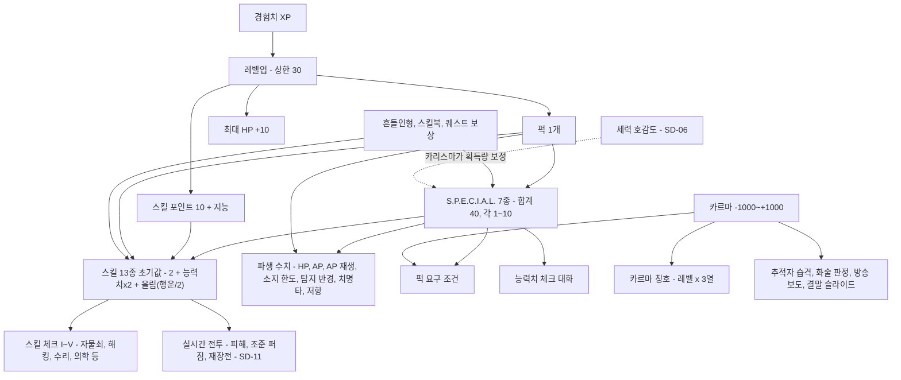

# SD-10. 캐릭터 시스템

> **서울 폴아웃 상세 기획서 세트** | 문서 ID: SD-10 | 버전: v1.0 | 작성일: 2026-10-12
> **범위**: S.P.E.C.I.A.L.(정의·효과·실시간 전투와 심리스 월드 기준 파생 수치 공식·생활기록부 배분 규칙), 스킬 13종(계승 결정·효과 공식·태그·스킬 체크 기준), 레벨과 경험치(상한 35 권장·XP 표·레벨업 지급 규칙·XP 원천과 예산), 퍽 전체 목록(PK-001~PK-112: 원작 계승·변형·삭제 검토, 서울판 신규 퍽 31종(세력 호감도 연동 7종 포함), 특별·퀘스트 퍽 10종), 카르마(범위·구간·서울판 칭호 105종·변화 행동·영향), 화술·물물교환의 세력 호감도 판정 쓰임, 영구 상승 수집품(입주 기념 흔들인형 20종, 스킬북 13종), 캐릭터 생성 UI 흐름(MQ-P1~P4)과 외형 커스터마이즈 범위 / **다루지 않음**: HP·방사능·중독·부위 불구·수면·과적 등 상태와 생존(SD-11), 피해 공식 전체·적 AI·집중 사격 연출(SD-11), 자물쇠·해킹 미니게임 규칙과 핍-보이 화면 구성(SD-12), 아이템 수치(SD-13), 세력 호감도 수치(SD-06), 수집품의 배치 좌표(SD-09)
> **관련 문서**: [SC-00 컨셉](00_concept.md), [SD-03a 메인 스토리 1부](03a_main-story-part1.md), [SD-03b 메인 스토리 2부](03b_main-story-part2.md), [SD-04a~d 사이드·세력 퀘스트](04d_faction-questlines.md), [SD-05 비표시·반복·인카운터](05_misc-quests-encounters.md), [SD-06 세력](06_factions.md), [SD-07a 주요 인물](07a_characters-major.md), [SD-08 월드·권역](08_world-regions.md), [SD-09a~f 장소 카탈로그](09a_locations-r01-r02.md), [SD-11 전투 시스템](11_combat-system.md), [SD-12 탐험·UI](12_exploration-ui.md), [SD-13 아이템](13_items.md), [SD-15 경제](15_economy.md), [SD-16 아트 디렉션](16_art-direction.md), [SD-18 용어·명명](18_naming-terms.md), 원작 [RD-14 캐릭터 시스템](../reverse-design/14_character-system.md), [RD-16 전투 시스템](../reverse-design/16_combat-system.md), [RD-23 수집 요소](../reverse-design/23_collectibles-achievements.md), [RD-27 이식 시사점](../reverse-design/27_adaptation-notes.md)

---

## 1. 개요

### 1.1 목적
- 서울판 주인공(볼트 S-07 출신, 등록 관리자 후보)의 성장 체계 전체를 **데이터 단위**로 확정한다. 제작자가 이 문서의 표를 데이터베이스와 공용 이벤트로 그대로 옮길 수 있게 한다.
- 원작 폴아웃 3의 캐릭터 시스템([RD-14](../reverse-design/14_character-system.md))을 기준으로 삼고, 확정 제작 전제(P6 심리스 월드, P7 실시간 맵 전투, P8 V.A.T.S. 1차 제외)에 맞지 않는 부분만 재해석한다.
- 퍽 ID(PK-001~)의 주관 문서다. 다른 문서는 퍽을 이 문서의 ID로 참조한다.

### 1.2 요약
1. **S.P.E.C.I.A.L. 7종은 그대로**다. 각 1~10, 기본 5 + 추가 5 = 합계 40. 배분은 MQ-P2의 **생활기록부** 화면에서 한다. V.A.T.S.가 빠지면서 AP는 **질주·회피·집중 사격·파워 공격**의 실시간 자원이 되고, 인지력은 **탐지 반경**, 카리스마는 **세력 호감도 획득량과 지원 병력**에도 작용하도록 보강했다(§2.3).
2. **스킬 13종을 통합하지 않고 계승**한다(§3.1). 무기 스킬은 피해·조준 퍼짐·재장전 시간 3곳에 작용한다(공식 정본 SD-11). 비무기 스킬 체크는 **I~V 5단계 고정 요구치**(자물쇠 0/25/50/75/100, 그 밖의 모든 스킬 15/25/50/75/100)로 통일하고, 화술만 원작 확률식을 유지한다. 화술·물물교환은 세력 호감도 판정에도 쓰인다.
3. **레벨 상한은 35를 권장**한다(원작 20 / 브로큰 스틸 30). 바이블 v0.3의 볼륨(메인 약 40, 사이드 60+, 세력 퀘스트 라인, 장소 250+)이면 획득 가능 XP가 약 11만으로 원작의 두 배를 넘는다. 필요 XP는 원작 공식 `50 + 150 × 현재 레벨` 그대로, 레벨업마다 HP +10, 스킬 포인트 `10 + 지능`, 퍽 1개(§4).
4. **퍽 112종**: 원작 일반 퍽 72종 중 71종을 계승·변형(V.A.T.S. 의존 9종은 SD-11의 집중 사격 기준으로 재해석), 동료 전제 퍽 1종(퍼피스!) 삭제. 서울판 신규 퍽 31종(2077년 한국 생활·제도 기반 24종 + **세력 호감도 연동 7종**). 특별·퀘스트 퍽 10종.
5. **카르마는 -1,000~+1,000, 5구간**. 서울판 칭호 90종(Lv1~30 × 선·중립·악). 카르마는 '주인공이 어떤 사람인가'이고, 세력 호감도(SD-06)는 '세력이 주인공을 어떻게 보는가'다. 둘은 따로 움직인다.
6. **영구 상승 수집품**: 볼트-텍 보블헤드 → **한결이 입주 기념 흔들인형** 20종(능력치 +1 / 스킬 +10), 스킬북 → **2077년 한국 출판물** 13종 × 15권 + 특수 3권 = 198권(+1, 컴프리헨션 시 +2). 장소 250곳 이상에 맞춘 배치 수다(§7).
7. **캐릭터 생성**은 프롤로그 4단계에 나뉜다: MQ-P1 출생신고서(이름·성별·외형) → MQ-P2 생활기록부(S.P.E.C.I.A.L.) → MQ-P3 적성 평가(태그 스킬) → MQ-P4 **전출 신고서**(전 항목 마지막 재조정).

### 1.3 바이블 v0.3 반영 사항
이 문서는 작성 중 갱신된 바이블 v0.3(§5.3~5.7, §6.2)을 따른다.

| 항목 | 바이블 v0.3 | 이 문서의 처리 |
|---|---|---|
| 메인 퀘스트 ID | `MQ-<막><순번>`(예: MQ-301), 프롤로그 MQ-P1~P4, 에필로그 MQ-E1 | 퀘스트 퍽·XP 예산을 이 형식으로 적는다 |
| 동료 | **동료 시스템 없음.** 일시 동행 NPC와 세력 지원 병력만 남는다 | 원작의 동료 관련 규칙(카르마 영입 조건)과 동료 전제 퍽(퍼피스!)을 삭제한다. 카리스마와 일부 퍽은 '일시 동행 NPC·지원 병력' 대상으로 바꾼다 |
| 세력 호감도 | 세력별 -100~+100, 6단계(SD-06) | 카르마와 분리한다. 카리스마가 호감도 **상승량**을 보정하고(§2.3), 화술·물물교환이 호감도 판정에 쓰인다(§3.7). 호감도 연동 퍽 7종(§5.3). 카르마 행동표에는 '호감도 연동 방향'만 적고 수치는 SD-06이 정한다(§6.3) |
| 자유도 | 프롤로그 뒤 월드 전부 개방, 순서 파괴 허용 | 스킬 체크 단계와 레벨 목표를 '막'이 아니라 '권역 위협도' 기준으로 배치한다(§3.6, §4.5) |
| 볼륨 | 메인 약 40, 사이드 60+, 세력 퀘스트 라인, 장소 250+ | 레벨 상한 35 권장(§4.1), 스킬북 198권·흔들인형 20종 배치(§7) |
| 주인공 계보(SD-03 설정) | 주인공은 한유리 박사의 동생 **한유정**의 후손(관리 계보 1). 관리 후보 순위는 계보와 출생 순서로 정해진다. 적성 평가는 겉치레다 | 출생신고서의 등록번호가 계보를 담는다(§8.2). 적성 평가는 겉치레지만 **태그 스킬은 정상적으로 정한다**(§8.5). 1세 돌잡이 장면은 이동 튜토리얼이며 능력치에 영향이 없다(§8.3) |

### 1.4 설계 원칙
| # | 원칙 | 적용 |
|---|---|---|
| C1 | 숫자 체계는 원작 그대로 | S.P.E.C.I.A.L. 1~10·합계 40, 스킬 13종·초기값 공식, 태그 +15, `10 + 지능`, 매 레벨 퍽, XP 공식, 카르마 ±1,000을 바꾸지 않는다 |
| C2 | V.A.T.S. 의존 규칙만 재해석 | AP·명중·치명타 보정 퍽은 '집중 사격·파워 공격(SD-11)'과 '조준 퍼짐' 기준으로 옮긴다. V.A.T.S. 축약형이 구현되면 원작 효과로 되돌린다(§5.6) |
| C3 | 원작 약점 보완 | 후반 만능화(스킬북 수 축소), 카리스마 약세(호감도·지원 병력 연동), 지능 편중(유지하되 선행 학습 퍽으로 태그 가치 보강), 카르마 조작 루프(기부 상한·중복 판정 금지) |
| C4 | 현실 기반 서울 | 신규 퍽·수집품·칭호는 2077년 한국의 제도·생활(민방위, 아파트 단지, 학원가, 수험서, 배달, 지하철)에서 나온다. 설화·요괴·신화 소재는 쓰지 않는다 |
| C5 | 제작량 통제 | 퍽 아이콘은 한 포즈 체계 안에서 변형(§11). 수집품은 원작보다 적은 수(스킬북 130권)로 탐험 밀도를 유지한다 |

### 1.5 시스템 구조도

---

## 2. S.P.E.C.I.A.L.

### 2.1 기본 규칙
| 항목 | 규칙 | 원작 대비 |
|---|---|---|
| 종류 | 힘(ST)·인지력(PE)·지구력(EN)·카리스마(CH)·지능(IN)·민첩성(AG)·행운(LK) 7종 | 같음 |
| 범위 | 1~10. 장비·약물·상태 보정으로도 표시값은 이 범위를 넘지 않는다 | 같음 |
| 시작 배분 | 기본 5씩(합계 35) + 추가 5 = **합계 40**. 다른 능력치를 깎아 재배분 가능 | 같음 |
| 초과분 기록 | 영구 상승이 10을 넘으면 **내부값으로 계속 기록**한다. 감소 보정은 내부값에서 빼고, 표시는 1~10으로 자른다 | 같음(원작 '내부 기록' 규칙을 정식 사양으로 둔다) |
| 레벨업 | 레벨업으로 직접 오르지 않는다. 인텐스 트레이닝(PK-004) 등 퍽·흔들인형·퀘스트로만 영구 상승 | 같음 |
| 퍽 요구 판정 | **영구값(기저값)**으로만 판정한다. 장비·약물·상태의 일시 보정은 무시한다. 예외는 준영구 아이템 1종(§7.3 미수령 복권) | 같음(럭키 8볼 → 미수령 복권) |
| 능력치 체크 판정 | 대화·상호작용의 능력치 체크는 **현재값(일시 보정 포함)**으로 판정한다 | 원작과 같음(원작도 장비로 맞출 수 있음) |
| 레벨업 스킬 포인트 | 레벨업 순간의 **영구 지능**으로 계산한다. 소급하지 않는다 | 같음 |

### 2.2 능력치별 정의와 효과

| 능력치 | 약어 | 서울판 정의 | 연관 스킬(1점당 +2) | 파생 효과(§2.3) | 대화·상호작용 쓰임 | 요구 퍽(대표) |
|---|---|---|---|---|---|---|
| 힘 | ST | 근력. 짐을 지고, 문을 밀고, 둔기를 휘두르는 힘 | 근접 무기 | 소지 한도, 근접 피해 보너스, 투척 사거리 | 위협 선택지, 무거운 잔해·셔터 밀기, 승강기 수동 권양 | 체육 특기생, 아이언 피스트, 스트롱 백, 공구 달인, 배달 기사, 갈취 |
| 인지력 | PE | 오감과 상황 판단. 소리·냄새·흔적을 읽는 힘 | 에너지 무기, 폭발물, 자물쇠 따기 | **탐지 반경**, **함정 발견 반경** | 흔적 추적, 위장 간파, 무전·방송 잡음 판독 | 시프, 지하철 노선도, 눈치, 스나이퍼, 라이트 스텝, 베터 크리티컬스 |
| 지구력 | EN | 체력과 내성. 오래 버티고 덜 아픈 몸 | 중화기, 비무장 | HP, 독·방사능 저항 | 고된 노동·긴 잠수·참기 선택지 | 민방위 대원, 등산객, 찜질방, 터프니스, 라이프 기버, 솔라 파워드 |
| 카리스마 | CH | 첫인상과 신뢰. 사람을 움직이는 힘 | 물물교환, 화술 | 화술 판정의 카리스마 항, **세력 호감도 획득 보정**, **지원 병력·일시 동행 NPC 보정** | 협상 진입, 군중 연설(서울 회의 MQ-502) | 스카운드럴, 단골, 임파셜 미디에이션, 마스터 트레이더, 비상 연락망 |
| 지능 | IN | 지식과 학습력. 볼트 S-07 적성 평가 사회가 가장 높이 친 능력 | 의학, 수리, 과학 | 레벨업 스킬 포인트 `10 + 지능` | 기술 설명·문서 해독·저지능 전용 대사 | 컴프리헨션, 에듀케이티드, 선행 학습, 공문서 위조, 원자력 기사, 컴퓨터 위즈 |
| 민첩성 | AG | 몸놀림과 손재주 | 소형 화기, 은신 | **최대 AP** | 낙하물 피하기, 좁은 틈 통과 | 건 넛, 시프, 동원 훈련, 태권도, 액션 보이/걸, 너브스 오브 스틸 |
| 행운 | LK | 우연이 내 편일 확률 | 전 스킬 `+⌈행운/2⌉` | 기본 치명타 확률, 이로운 랜덤 인카운터 가중치 | 도박·추첨 선택지 | 포천 파인더, 스크라운저, 미스터리어스 스트레인저, 베터 크리티컬스 |

- 원작처럼 **무기에 최소 힘 요구치가 없다.** 힘 1로도 중화기를 쓴다.
- 힘은 비무장 피해에 영향을 주지 않는다(비무장 피해는 비무장 스킬에서 파생, §3.5).
- 지능 1~3 주인공에게는 저지능 전용 대사가 일부 열린다. 진행을 막지 않는다(원작 규칙). 서울판 예: 볼트 S-07 교사 NPC가 "보충반"으로 안내, 마영식(MQ-103)이 관리자 코드를 그림으로 설명.

### 2.3 파생 수치 공식 (실시간 전투·심리스 월드 기준)
원작 공식을 기본값으로 쓰고, V.A.T.S. 제외와 탑다운 실시간 전투 때문에 의미가 바뀐 항목만 재정의했다. **'신설'** 표시는 원작에 없던 수치다. 타일 단위는 SD-16의 타일 크기 결정 뒤 실제 픽셀로 환산한다.

| 파생 수치 | 근거 | 공식 | 능력치 5 기준값 | 구분 | 비고·연결 |
|---|---|---|---|---|---|
| 최대 HP | EN, Lv | `90 + 지구력×20 + 레벨×10` | 200 (Lv1) | 원작 | 절대 수치는 실시간 템포에 맞춰 SD-11이 배율을 정할 수 있다(RD-27 §7.5). 배율을 쓰면 이 식 전체에 곱한다 |
| 최대 AP | AG | `65 + 민첩성×2` | 75 | 원작 | V.A.T.S. 대신 실시간 행동 자원. 용도·회복은 SD-11 §5 확정안을 따른다(아래 요약) |
| AP 회복 | – | 초당 8, 마지막 소모 1.0초 뒤 시작 | 초당 8 | SD-11 확정 | 능력치와 무관. 퍽 너브스 오브 스틸(PK-098) 초당 +2 |
| 소지 한도 | ST | `150 + 힘×10` | 200 | 원작 | 단위는 원작 무게 수치를 그대로 쓴다(SD-13). 과적 규칙은 SD-11 |
| 근접 피해 보너스 | ST | `⌈힘/2⌉` (정수) | +3 | 원작(정수 올림 판본 채택) | 근접 무기 피해에 마지막에 더한다. 조준 강공격의 2배 계산 뒤에 더한다 |
| 투척 사거리 | ST | `6 + ⌊힘/2⌋` 타일 | 8타일 | 신설 | 수류탄·화염병. 착탄 오차는 폭발물 스킬(§3.5) |
| 비무장 피해 | 비무장 스킬 | `⌈(10 + 비무장)/20⌉` | 2 (스킬 15) | 원작 | 맨손은 이 값, 격투 무기는 무기 피해에 가산 |
| 치명타 확률 | LK | `(행운 + 퍽 보정) × 무기 치명타 배수 × 상태 계수` (%), 집중 사격이면 **+15%p** | 5% | 원작(V.A.T.S. 보정 → 집중 사격 보정) | 은신 상태 기습은 100%. 판정 단위는 발사체마다(원작 실시간 규칙) |
| 독 저항 | EN | `(지구력-1)×5%` | 20% | 원작 | SD-11 |
| 방사능 저항 | EN | `(지구력-1)×2%`, 상한 85% | 8% | 원작 | SD-11 |
| 탐지 반경 | PE | `8 + 인지력` 타일 | 13타일 | 신설(원작 나침반 거리 미공개를 확정) | 이 거리 안의 적대 대상이 HUD 나침반·미니맵에 빨간 점으로 표시된다. 화면 밖 적의 방향 표시도 이 반경 기준 |
| 함정 발견 반경 | PE | `1 + ⌊인지력/3⌋` 타일 | 2타일 | 신설 | 지뢰·철사 함정이 이 거리 안에 들어오면 외곽선 강조. 퍽 현장 안전 관리자 +2 |
| 소리 조사 반응 | PE | 플레이어가 적 소음을 인지하는 거리 `6 + 인지력×0.5` 타일 | 8.5타일 | 신설 | 화면 밖 총성·발소리에 방향 아이콘(SD-12) |
| 화술 카리스마 항 | CH | `(카리스마 - 무기 꺼냄(1/0) + 2) / 10` | 0.7 | 원작 | §3.5 화술 판정식 |
| 세력 호감도 획득 보정 | CH | 호감도 **상승**량 × `(1 + (카리스마-5) × 0.03)`, 결과 반올림 | ×1.00 | 신설 | 카리스마 10이면 ×1.15, 1이면 ×0.88. **하락량에는 적용하지 않는다.** 호감도 수치 체계는 SD-06 |
| 지원 병력 보정 | CH | 세력 지원 병력·일시 동행 NPC의 피해와 DR × `(1 + (카리스마-5) × 0.02)` | ×1.00 | 신설(원작 동료 대체) | 카리스마 10이면 ×1.10, 1이면 ×0.92. 바이블 v0.3 §6.2 지원 병력 호출 |
| 레벨업 스킬 포인트 | IN | `10 + 지능` (+에듀케이티드 3) | 15 | 원작 | 영구 지능 기준 |
| 이로운 인카운터 가중치 | LK | 랜덤 인카운터 표에서 '행운' 태그 항목의 가중치 × `(0.5 + 행운×0.1)` | ×1.0 | 원작(행운 영향)을 수치화 | 행운 1이면 ×0.6, 10이면 ×1.5. 인카운터 표는 SD-05 |
| 피해 저항(DR) | 방어구 | 초기 0%, 상한 85% | 0% | 원작 | SD-11·SD-13 |
| 폐활량 | – | 삭제 | – | 삭제 | 수중 이동 제외(RD-27 X13) |

**AP 용도 요약** (정본은 [SD-11 §5](11_combat-system.md). 이 문서는 퍽 재해석의 기준으로만 인용한다)

| AP 행동 | 소모 | 효과 요약 | 원작 대응 |
|---|---|---|---|
| 질주 | 초당 10 | 이동 속도 증가, 사격 불가 | 원작 달리기(무료) → 비용화 |
| 회피 구르기 | 20 | 짧은 이동 + 약 0.2초 무적 | 신설 |
| 집중 사격(원거리) | 무기별 AP 비용(원작 V.A.T.S. AP 표 기준, 수치 SD-13) | 0.3초 조준 뒤 발사. 조준 퍼짐 0(무기 최소 퍼짐만), 치명타 +15%p, 머리 가중치 `+2 × 인지력` | V.A.T.S. 예약 1회 |
| 파워 공격(근접·비무장) | 무기 AP 비용 × 0.5(최소 10) | 0.5초 차지 뒤 피해 ×2 | V.A.T.S. 근접·원작 파워 공격 |

- 일반 사격·일반 근접에는 AP를 쓰지 않는다(SD-11). 원작 V.A.T.S. 전용 퍽은 **집중 사격·파워 공격**을 기준으로 재해석한다(§5.6).
- AP 비용표를 원작 그대로 쓰므로 '손이 빠른 무기 / 한 방 무기'의 정체성이 유지된다(민첩성 5에서 경권총 집중 사격 4회, 저격소총 1회).

### 2.4 능력치 1~10 수치표
데이터 테이블에 그대로 옮길 수 있게 계산해 둔 값이다.

| 값 | 소지 한도(ST) | 근접 보너스(ST) | 투척 사거리(ST) | HP Lv1(EN) | 독 저항(EN) | 방사능 저항(EN) | 탐지 반경(PE) | 함정 발견(PE) | 호감도 상승 보정(CH) | 지원 병력(CH) | 스킬 포인트/Lv(IN) | 최대 AP(AG) | 기본 치명타(LK) | 연관 스킬(공통) | 행운 전 스킬(LK) |
|---|---|---|---|---|---|---|---|---|---|---|---|---|---|---|---|
| 1 | 160 | +1 | 6 | 120 | 0% | 0% | 9 | 1 | ×0.88 | ×0.92 | 11 | 67 | 1% | +2 | +1 |
| 2 | 170 | +1 | 7 | 140 | 5% | 2% | 10 | 1 | ×0.91 | ×0.94 | 12 | 69 | 2% | +4 | +1 |
| 3 | 180 | +2 | 7 | 160 | 10% | 4% | 11 | 2 | ×0.94 | ×0.96 | 13 | 71 | 3% | +6 | +2 |
| 4 | 190 | +2 | 8 | 180 | 15% | 6% | 12 | 2 | ×0.97 | ×0.98 | 14 | 73 | 4% | +8 | +2 |
| 5 | 200 | +3 | 8 | 200 | 20% | 8% | 13 | 2 | ×1.00 | ×1.00 | 15 | 75 | 5% | +10 | +3 |
| 6 | 210 | +3 | 9 | 220 | 25% | 10% | 14 | 3 | ×1.03 | ×1.02 | 16 | 77 | 6% | +12 | +3 |
| 7 | 220 | +4 | 9 | 240 | 30% | 12% | 15 | 3 | ×1.06 | ×1.04 | 17 | 79 | 7% | +14 | +4 |
| 8 | 230 | +4 | 10 | 260 | 35% | 14% | 16 | 3 | ×1.09 | ×1.06 | 18 | 81 | 8% | +16 | +4 |
| 9 | 240 | +5 | 10 | 280 | 40% | 16% | 17 | 4 | ×1.12 | ×1.08 | 19 | 83 | 9% | +18 | +5 |
| 10 | 250 | +5 | 11 | 300 | 45% | 18% | 18 | 4 | ×1.15 | ×1.10 | 20 | 85 | 10% | +20 | +5 |

- 탐지 반경·함정 발견·투척 사거리는 타일 단위다. 호감도 보정은 결과를 정수로 반올림한다(예: 호감도 +5 × 1.15 = +5.75 → +6).

### 2.5 능력치별 상세

| 능력치 | 낮을 때(1~3) | 높을 때(8~10) | 서울판 능력치 체크 예 | 영구 상승 수단 | 일시 상승·하락(대표) |
|---|---|---|---|---|---|
| 힘 | 소지 한도 160~180, 근접 빌드 불리 | 소지 250, 근접 +5 | [힘 6] 탱크마을 탱크 해치 수동 개방, [힘 7] 무너진 지하철 셔터 들어 올리기, [힘 5] 새벽인력 추심원 위협 | 흔들인형(힘), 인텐스 트레이닝, 노 위크니스, 올모스트 퍼펙트 | 파워 아머 +1~2, 주류 +1, 각성제류(SD-13) / 방사능 중독 단계(SD-11) |
| 인지력 | 탐지 9~11타일, 기습당하기 쉬움 | 탐지 16~18타일, 함정 3~4타일 전 발견 | [인지력 6] 계엄군 위장 순찰 간파, [인지력 7] 남산 방송 잡음 속 좌표 해독, [인지력 5] 관악산 등산로 흔적 추적 | 흔들인형(인지력), 인텐스 트레이닝 등 | 모자·안경류 +1, 나이트 퍼슨(야간 +2) / 머리 불구 -4(SD-11) |
| 지구력 | HP 120~160, 독·방사능에 약함 | HP 260~300, 독·방사능에 강함 | [지구력 6] 당인리 침수 구간 숨 참고 통과(대화 선택지형), [지구력 7] 새벽인력 '인력 검사' 버티기 | 흔들인형(지구력), 인텐스 트레이닝 등 | 작업복류 +1, 버프아웃 대응 약물(SD-13) / 방사능·금단(SD-11) |
| 카리스마 | 화술 판정 크게 불리, 호감도 획득 ×0.88~0.94 | 호감도 ×1.09~1.15, 지원 병력 강화 | [카리스마 7] 서울 회의(MQ-502) 연설 성공 조건 중 하나, [카리스마 6] 노들섬 통행세 면제 협상 | 흔들인형(카리스마), 인텐스 트레이닝 등 | 정장·코트류 +1, 주류 +1 / 무기 꺼냄 시 화술 항 -1 |
| 지능 | 레벨업 11~13점, 저지능 대사 | 레벨업 18~20점 | [지능 7] 관제망 설계 문서 요약 이해(MQ-304), [지능 6] 원자로 제어반 경고문 해석 | 흔들인형(지능), 인텐스 트레이닝 등 | 안경류·두뇌 약물 +1~5 / 주류 -1 |
| 민첩성 | AP 67~71, 집중 사격 횟수 적음 | AP 81~85, 집중 사격 1회 추가 | [민첩성 6] 세진전자 타워 끊긴 계단 뛰어 건너기, [민첩성 7] 경비 로봇 감시 틈 통과 | 흔들인형(민첩성), 인텐스 트레이닝 등 | 가벼운 옷 +1 / 파워 아머 -1~2 |
| 행운 | 치명타 1~3%, 전 스킬 +1~2 | 치명타 8~10%, 전 스킬 +4~5 | [행운 6] 뚝섬 장터 도박판, [행운 8] 2077년 배급 추첨 단말에서 당첨 처리 | 흔들인형(행운), 인텐스 트레이닝, 미수령 복권(소지 +1) | 행운 관련 의류 +1 |

### 2.6 능력치 체크 기준
대화·상호작용의 `[힘 6]` 같은 능력치 체크는 **확률이 아니라 고정 요구치**다. 충족하면 자동 성공, 미충족이면 선택지가 회색으로 표시된다(조건 표시). 현재값(일시 보정 포함)으로 판정한다.

| 단계 | 요구치 | 배치 기준 | 성공 XP |
|---|---|---|---|
| I | 4 | 시작 권역(R01)·생활형 선택지 | 10 |
| II | 5 | 위협도 낮은 권역 | 15 |
| III | 6 | 일반 | 20 |
| IV | 7 | 위협도 높은 권역, 대체 해법 | 30 |
| V | 8 | 특수 해법(메인 퀘스트 대체 경로 등) | 40 |

- 9·10 요구 체크는 쓰지 않는다. 일시 보정으로 8까지는 도달할 수 있어야 '장비로 길을 여는' 원작 설계가 산다.
- 같은 선택지는 성공 XP를 1회만 준다.

### 2.7 생활기록부 화면: S.P.E.C.I.A.L. 배분 규칙 (MQ-P2)
2268년, 열 살 생일에 핍-보이를 받는 날 담임 교사가 **'볼트 S-07 초등과정 학교생활기록부'**를 작성한다. 플레이어는 교사가 내민 기록부의 항목을 직접 채운다. 원작 그림책 '너는 스페셜해!'의 역할이다. 연출·대사는 SD-03이 정본이다.

**화면 구성**

| 영역 | 내용 |
|---|---|
| 머리 | 서식명 '학교생활기록부(초등과정)', 학생 성명(MQ-P1에서 정한 이름), 등록번호 `S07-2258-L1-xxxx`(MQ-P1에서 발급, `L1`은 관리 계보 1), 학년도 '2268' |
| 본문 7행 | 행마다 **기록부 항목명 + S.P.E.C.I.A.L. 이름** 병기, 1~10 눈금, 현재 값, 담임 의견 한 줄(값 구간별로 바뀜) |
| 오른쪽 패널 | 실시간 미리보기: 최대 HP, 최대 AP, 소지 한도, 탐지 반경, 레벨업 스킬 포인트, 스킬 13종 초기값(태그 전) |
| 아래 | 남은 포인트(시작 5), [되돌리기] [기본값] [확정] 버튼. 남은 포인트가 0이 아니면 [확정] 비활성 |
| 연출 | 확정하면 담임 도장이 찍히고 기록부가 핍-보이 화면으로 접혀 들어간다. 이후 핍-보이 STATS 탭에서 '생활기록부' 양식으로 다시 볼 수 있다(값 수정 불가) |

**항목명 대응**

| S.P.E.C.I.A.L. | 생활기록부 항목 | 근거(실제 생활기록부·학교 문화) |
|---|---|---|
| 힘 | 체력장 | 학생 체력 평가 등급 |
| 인지력 | 관찰·탐구 태도 | 행동특성 서술 관행 |
| 지구력 | 건강 기록 | 신체 발달·건강 기록 |
| 카리스마 | 교우 관계 | 행동특성 및 종합의견 |
| 지능 | 학업 성취 | 교과 학습 발달 상황 |
| 민첩성 | 운동 기능 | 체육 실기 |
| 행운 | 특기 사항 | '비고'란. 볼트 S-07 교사들은 이 칸을 '운'이라고 부른다 |

**담임 의견 문구** (값 구간별. 화면 오른쪽 아래 한 줄로 표시)

| 항목 | 1~2 | 3~4 | 5~6 | 7~8 | 9~10 |
|---|---|---|---|---|---|
| 체력장 | 급식판을 두 손으로 듭니다. | 체력장 4등급. 성실히 참여합니다. | 체력장 3등급. 무난합니다. | 체력장 2등급. 정비반에서 탐냅니다. | 체력장 1등급. 산소통 운반 당번으로 추천합니다. |
| 관찰·탐구 태도 | 계단을 자주 헛디딥니다. | 수업 중 창밖(벽)을 봅니다. | 주변을 잘 살핍니다. | 환기구 소리가 바뀐 것을 먼저 알아챘습니다. | 교사의 거짓말을 세 번 지적했습니다. 주의 요망. |
| 건강 기록 | 결석 일수가 많습니다. | 감기에 자주 걸립니다. | 건강합니다. | 방역 소독 날에도 기침하지 않았습니다. | 결석 0일. 진료소장이 표본 채취를 요청했습니다. |
| 교우 관계 | 혼자 지내는 시간이 깁니다. | 친구가 적지만 갈등은 없습니다. | 원만합니다. | 학급 회의를 이끕니다. | 반장 선거 만장일치. 오버시어실이 주목합니다. |
| 학업 성취 | 보충 학습이 필요합니다. | 노력하면 나아집니다. | 성취 기준에 도달했습니다. | 상위권. 적성 평가가 기대됩니다. | 전 과목 최상위. 기록 보관실 열람 권한을 신청했습니다. |
| 운동 기능 | 줄넘기를 아직 넘지 못합니다. | 달리기가 느린 편입니다. | 보통입니다. | 피구에서 공을 맞지 않습니다. | 승강기 점검구를 혼자 오르내립니다. 주의 요망. |
| 특기 사항 | 배급 추첨에서 늘 마지막 번호를 뽑습니다. | 특이 사항 없음. | 특이 사항 없음. | 분실물을 자주 줍습니다. | 배급 추첨 3회 연속 1번. 조사 중. |

**배분 규칙**

| 규칙 | 값 |
|---|---|
| 기본값 | 7개 모두 5 |
| 남은 포인트 | 5 |
| 최소·최대 | 1~10 |
| 재배분 | 능력치를 1 내리면 남은 포인트 +1 |
| 자유 배분량 | 33(하한 1 제외) |
| 확정 조건 | 남은 포인트 0 |
| 재수정 | MQ-P4 전출 신고서에서 1회 더(§8.6) |
| 확정 후 | 핍-보이 STATS에서 열람만 가능 |

- 원작처럼 배분 결과가 프롤로그 NPC 반응에 소소하게 반영된다(예: 지능 8 이상이면 하도윤이 주인공을 '전교 1등'이라고 부른다, 힘 8 이상이면 체육 교사가 정비반 이야기를 꺼낸다). 대사는 SD-03.

### 2.8 능력치 상승·하락 수단 종합

| 구분 | 수단 | 효과 | 횟수·조건 | 정본 |
|---|---|---|---|---|
| 영구 | 한결이 입주 기념 흔들인형(능력치 7종) | 해당 능력치 +1 | 각 1회. 10 초과분은 내부값으로 기록 | §7.1, 위치 SD-09 |
| 영구 | 인텐스 트레이닝(PK-004) | 원하는 능력치 +1 | Lv2부터, 최대 10랭크 | §5.2 |
| 영구 | 원자로 운전원·정전의 증명 등 퀘스트 퍽 | 퍽별 상이(능력치 직접 상승 퀘스트 퍽은 두지 않는다) | – | §5.4 |
| 영구 | 노 위크니스(PK-089) / 올모스트 퍼펙트(PK-096) | 5 미만 → 5 / 9 미만 → 9 | Lv24 / Lv30 | §5.2 |
| 준영구 | 미수령 복권(2077-10-23 추첨분) | 소지 중 행운 +1, 퍽 요구에도 반영 | 사이드 퀘스트 보상(SD-04) | §7.3 |
| 일시 | 의류·방어구 | ±1~2 | 착용 중 | SD-13 |
| 일시 | 약물·주류·음식 | ±1~5 | 지속 240초(케미스트 시 2배) | SD-13 |
| 일시 | 퍽 | 너드 레이지!(힘 → 10), 솔라 파워드(힘 +2), 나이트 퍼슨(지능·인지력 +2) | 조건부 | §5.2 |
| 하락 | 방사능 중독, 금단, 부위 불구, 장비 페널티 | -1~-4 | 상태 지속 중. 1 미만으로 내려가지 않는다 | SD-11, SD-13 |

**최대치 시나리오**: 인텐스 트레이닝을 쓰지 않아도 Lv30 올모스트 퍼펙트(전부 9) **뒤에** 흔들인형 7종을 모으면 전 능력치 10이 된다. 흔들인형을 먼저 먹으면 내부값 기록 규칙 때문에 손해가 없다(서울판은 올모스트 퍼펙트를 '9 미만을 9로 올림'이 아니라 **'기저값에 9 - 기저값만큼 더함, 단 이미 9 이상이면 변화 없음'**으로 구현해 원작의 순서 함정을 없앤다). 즉 흔들인형으로 이미 10이 된 능력치는 10을 유지하고, 흔들인형 +1이 반영된 8은 9가 된 뒤 남은 흔들인형이 없으면 9에 머문다.

---
