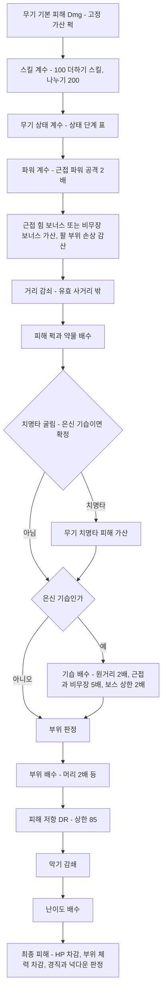
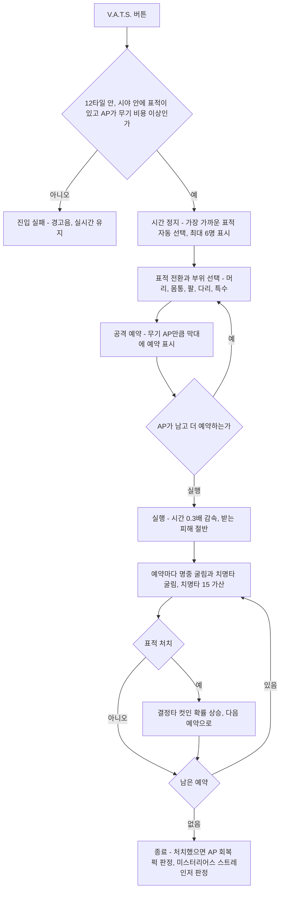
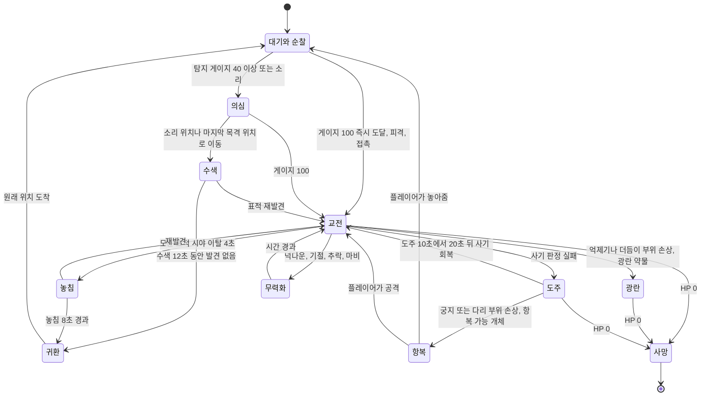
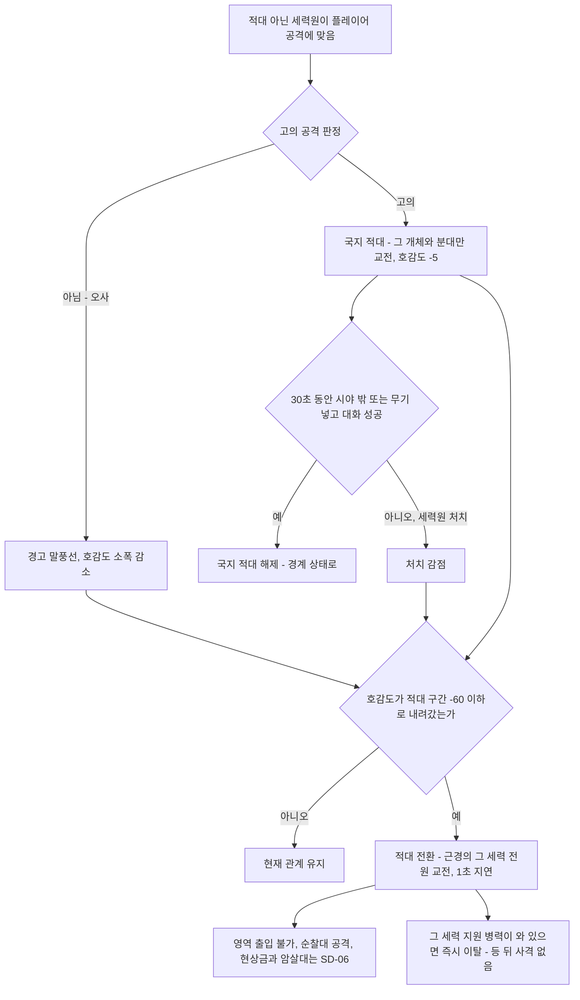

# SD-11. 전투·상태 시스템

> **서울 폴아웃 상세 기획서 세트** | 문서 ID: SD-11 | 버전: v1.2 | 작성일: 2026-10-12
> **범위**: 맵 위 실시간 전투의 조작·카메라·전투 진입과 이탈, 무기 계열 8종의 공격 자세와 사격 규격, 명중·피해·치명타·기습·DR·부위 판정·부위 손상·넉다운·사망 연출, AP 용도와 수치(확정), V.A.T.S. 축약형(선택 과제) 설계안, 적 AI(상태 머신·인지·엄폐·도주·무리·세력 간 교전·계열별 패턴), 일시 동행 NPC와 세력 지원 병력의 전투 AI, 5~7막 대규모 교전, 세력 호감도와 전투의 연동(오사·적대 전환·변장), 은신 전투·폭발물·지뢰·함정·환경 폭발·파워 아머·에너지 무기, 난이도·TTK·레벨 스케일링, 상태·생존(HP·방사능·중독·부위 손상·수면·음식과 물·소지 무게·내구도), 피격 피드백과 전투 HUD, 모바일 터치 전투(조작 체계·조준 보조·모바일 성능 예산) / **다루지 않음**: S.P.E.C.I.A.L.·스킬·퍽의 정본과 퍽 ID(SD-10), 무기·방어구·소모품 개별 수치와 ID(SD-13), 크리처·적 개체 수치와 ID(SD-14), 핍-보이 메뉴와 HUD의 화면 디자인(SD-12), 도트 규격과 모션 그림(SD-16), 효과음 제작(SD-17), 의사·수리 요금(SD-15)
> **관련 문서**: [SC-00 컨셉](00_concept.md), [SD-01 게임 개요](01_game-overview.md), [SD-06 세력](06_factions.md), [SD-03a 메인 스토리 1부](03a_main-story-part1.md), [SD-03b 메인 스토리 2부](03b_main-story-part2.md), [SD-04d 세력 퀘스트 라인](04d_faction-questlines.md), [SD-05 비표시·반복·인카운터](05_misc-quests-encounters.md), [SD-07a 주요 인물](07a_characters-major.md), [SD-08 월드·권역](08_world-regions.md), [SD-09a~f 장소 카탈로그](09a_locations-r01-r02.md), [SD-10 캐릭터 시스템](10_character-system.md), [SD-12 탐험·UI](12_exploration-ui.md), [SD-13 아이템](13_items.md), [SD-14 크리처·적](14_creatures-enemies.md), [SD-15 경제](15_economy.md), [SD-16 아트 디렉션](16_art-direction.md), [SD-17 사운드](17_sound.md), 원작 [RD-14 캐릭터 시스템](../reverse-design/14_character-system.md), [RD-15 상태·생존](../reverse-design/15_status-survival.md), [RD-16 전투 시스템](../reverse-design/16_combat-system.md), [RD-19 무기·탄약](../reverse-design/19_weapons-ammo.md), [RD-20 방어구·의복](../reverse-design/20_armor-apparel.md), [RD-27 쯔꾸르 이식 시사점](../reverse-design/27_adaptation-notes.md)

---

## 목차

1. [문서 개요](#1-문서-개요)
2. [전투 개요: 맵 위 실시간 전투](#2-전투-개요-맵-위-실시간-전투)
3. [무기 계열과 공격 자세](#3-무기-계열과-공격-자세)
4. [명중·피해 공식](#4-명중피해-공식)
5. [AP(행동력): 용도 확정](#5-ap행동력-용도-확정)
6. [V.A.T.S. 축약형 (선택 과제)](#6-vats-축약형-선택-과제)
7. [적 AI](#7-적-ai)
8. [아군 NPC·대규모 교전·호감도 연동](#8-아군-npc대규모-교전호감도-연동)
9. [은신 전투, 폭발물·함정, 파워 아머, 에너지 무기](#9-은신-전투-폭발물함정-파워-아머-에너지-무기)
10. [난이도·밸런스·레벨 스케일링](#10-난이도밸런스레벨-스케일링)
11. [상태·생존 시스템](#11-상태생존-시스템)
12. [피격 피드백과 전투 HUD](#12-피격-피드백과-전투-hud)
13. [원작 대응](#13-원작-대응)
14. [제작 메모 (엔진: 범용 2D, Godot 4 기준)](#14-제작-메모-엔진-범용-2d-godot-4-기준)
15. [모바일 터치 전투](#15-모바일-터치-전투)
16. [미결 사항](#16-미결-사항)
- [부록 A. 신규 고유명사](#부록-a-신규-고유명사)
- [부록 B. 전역 상수표](#부록-b-전역-상수표)
- [부록 C. 데이터 필드 정의 (SD-13·SD-14 접점)](#부록-c-데이터-필드-정의-sd-13sd-14-접점)
- [부록 D. 참고 문서](#부록-d-참고-문서)

---

## 1. 문서 개요

### 1.1 목적
- 확정 전제 P7(맵 위 실시간 전투)과 P8(V.A.T.S. 1차 제외)을 수치까지 설계해, 프로그래머가 전투 코어를 만들고 SD-13·SD-14가 무기·적 데이터를 채울 수 있게 한다.
- 원작 [RD-27 §14.2](../reverse-design/27_adaptation-notes.md)의 남은 결정 4·5·6번(AP 용도, 부위 손상 판정, 내구도 시스템)을 이 문서에서 확정한다.
- 원작 폴아웃 3의 전투 정체성(스킬이 결과를 좌우하는 RPG 전투, 치명타와 행운, 부위 손상, 은신 기습, 결정타 연출, 탄약·내구도 관리)을 탑다운 2D 실시간 전투 안에서 지킨다([RD-16 §14](../reverse-design/16_combat-system.md)).

### 1.2 요약
1. **별도 전투 화면이 없다.** 이동·조준·사격·근접·투척·재장전이 모두 심리스 월드 맵 위에서 실시간으로 일어난다. 조준은 마우스(또는 오른쪽 스틱)로 360도 자유 각도이고, 캐릭터 몸은 8방향으로 스냅한다. 이동 중에는 하체가 이동 방향, 상체가 조준 방향으로 따로 스냅한다(SD-16 §3.6.5·§5.10).
2. **조준 실력보다 캐릭터가 결과를 정한다.** 탄 퍼짐 각도, 피해, 재장전 속도, 치명타, 부위 판정에 스킬·능력치·무기 상태가 들어간다. 원작 피해식 `Dmg × (100 + 스킬)/200 × 상태 계수`를 그대로 쓴다.
3. **AP는 실시간 행동 자원으로 확정한다.** 질주(초당 10), 회피 구르기(20), 집중 사격(무기별 AP 비용), 근접 파워 공격(무기 AP의 절반)에 쓴다. 최대치는 원작 공식 `65 + 2 × 민첩성`을 유지한다.
4. **부위 손상은 '무작위 부위 판정 + 무기 특성'으로 확정한다.** 명중할 때마다 가중치 표로 부위를 고르고, 부위 체력이 바닥나면 부위 손상이 된다. 인간형 부위는 머리·몸통·팔·다리 4개에 특수 부위(전투 억제기, 더듬이 등)를 더한다.
5. **내구도는 5단계 상태로 확정한다.** 새것·양호·낡음·위태·파손(사용 불가). 단계 이름은 SD-13과 같다. 단계마다 피해·치명타·탄 걸림·DR이 정해진 값으로 바뀐다.
6. **방어는 원작과 같은 DR(%)을 쓴다.** DT(고정 감산)는 도입하지 않는다. 상한 85%.
7. **V.A.T.S.는 1차 범위에서 뺀다.** 그 감성은 '집중 사격', 치명타 강조, 은신 기습, 결정타 히트스톱으로 살린다. 축약형(시간 정지 → 부위 선택 → AP 예약 → 감속 실행)은 6장의 설계안으로 남긴다.
8. **상태·생존은 원작 3편 수준을 유지한다.** HP 자연 회복 없음, 방사능 5단계와 1,000 즉사, 영구 중독, 부위 손상, 수면 완전 회복이다. 배고픔·갈증·수면 수치는 넣지 않고, 하드코어 모드는 2차 선택 과제로 둔다.
9. **동료 시스템은 없다(바이블 v0.3 K7).** 아군 AI는 퀘스트 중 일시 동행 NPC와 호감도 '신뢰' 이상 세력의 지원 병력 두 종류뿐이다. 5~7막의 다세력 **대규모 교전**(동시 전투 인원 상한 40, 세력 간 피아 식별, 깨어난 관제망 로봇 무리)과 **세력 호감도·전투 연동**(오사 감점, 적대 단계 진입 즉시 적대 전환, 변장 중 공격)을 §8에서 정한다.
10. **모바일(Android·iOS)에서도 터치만으로 같은 전투를 한다(바이블 K10).** 기본은 트윈 스틱(왼쪽 이동 + 오른쪽 조준·사격 스틱)에 탭 사격·표적 고정을 더한 방식이고, 탭 조준 '간편 조작'은 옵션이다. 조준 보조는 방향만 고치고 명중 공식은 바꾸지 않는다. 동시 교전 인원은 모바일 28명(PC 40명)이며 총 인원은 증원 대기열로 맞춘다(§15).

### 1.3 이 문서에서 확정하는 결정

| # | 결정 항목 | 확정안 | 원작 근거 | 근거 절 |
|---|---|---|---|---|
| D11-01 | 전투 형식 | 맵 위 실시간 탑다운 액션. 전투 화면 전환 없음 | P7 | §2 |
| D11-02 | 조준 방식 | 360도 자유 조준 + 스킬 기반 탄 퍼짐. 몸 방향은 8방향 스냅(이동 중 상·하체 분리) | RD-16 §3.2 | §2.3, §4.1 |
| D11-03 | AP 용도 (RD-27 결정 4) | 질주·회피 구르기·집중 사격·파워 공격의 공용 자원 | RD-16 §4.4, RD-27 §7.3 | §5 |
| D11-04 | 부위 손상 판정 (RD-27 결정 5) | 무작위 부위 판정(가중치 표) + 무기 특성. 부위 체력 방식 | RD-16 §6, RD-27 §7.3 | §4.7~4.8 |
| D11-05 | 내구도 (RD-27 결정 6) | 5단계(새것·양호·낡음·위태·파손). 단계별 고정 효과 | RD-16 §5.4, RD-27 §7.3 | §11.8 |
| D11-06 | 방어 공식 | DR(%) 유지, 상한 85. DT 미도입 | RD-16 §5.8 | §4.6 |
| D11-07 | V.A.T.S. | 1차 제외. 축약형은 선택 과제(6장 설계안) | P8 | §6 |
| D11-08 | 핍-보이 일시 정지 회복 | 메뉴를 열면 시간이 멈춘다(원작 유지). 대신 회복품은 '회복 대기열'로 수 초에 걸쳐 들어간다 | RD-16 §2.1, RD-27 §7.3 | §2.7 |
| D11-09 | 표현 수위 | 3단계 옵션(순화·표준·원작). 기본값 표준 | RD-27 §14.2 결정 10 | §4.10 |
| D11-10 | 생존 수치 | 원작 3편 수준(배고픔·갈증·수면 수치 없음). 하드코어는 2차 선택 과제 | RD-15 §6.4 | §11.6, §11.9 |
| D11-11 | 아군 오사 | 플레이어의 원거리 탄은 일시 동행 NPC·지원 병력을 통과한다. 폭발·화염은 50%. 중립·우호 세력원은 통과하지 않고, 맞히면 호감도가 깎인다 | RD-16 §9.7 | §8.4, §8.7 |
| D11-12 | 아군 AI의 범위 (바이블 v0.3) | 동료 시스템 없음. 일시 동행 NPC(퀘스트 단위)와 세력 지원 병력(신뢰 이상, 호출식)만 둔다 | 바이블 §6.2 | §8.1~8.4 |
| D11-13 | 대규모 교전 | 활성 전투 인원 상한 40(플레이어 측 아군 포함), 투사체 128, 원경 교전은 추상 시뮬레이션 | — | §8.5~8.6 |
| D11-15 | 모바일 터치 전투 (v1.2) | 트윈 스틱 + 탭 사격·표적 고정(기본), 탭 조준 간편 조작(옵션). 터치 조준 = 정조준 취급. 조준 보조 반각 15°·끌어당김 60%. 모바일 동시 교전 28명 | 바이블 K10 | §15 |
| D11-14 | 호감도·전투 연동 | 세력원에게 준 피해·오사·처치가 호감도를 깎는다. '적대' 구간에 들어서는 순간 그 세력 전원이 즉시 적대 전환. 변장 중 공격은 변장 해제 + 목격 판정 | 바이블 §6.2 | §8.7 |

### 1.4 표기와 단위
- **거리 단위는 타일(t)이다.** 1t는 타일 한 칸이다. 타일 크기는 [SD-16](16_art-direction.md)이 32×32px로 확정했다. 내부 해상도 640×360에서 화면에 가로 20t × 세로 약 11t가 보인다(와이드 휴대폰·태블릿은 최대 약 27t × 15t, §15.6). 이 문서의 모든 사거리·반경·속도는 타일 기준이라 타일 크기가 바뀌어도 그대로 쓴다.
- 사람 한 명의 충돌 원 지름은 약 0.6t다. 한 타일 ≈ 실제 1m로 본다.
- 시간은 실시간 초(s) 또는 밀리초(ms)다. 게임 시간은 '게임 시간'이라고 쓴다. 시간 배율은 원작과 같이 실시간 1초 = 게임 시간 30초로 둔다(SD-12 확정).
- 수식에서 `스킬`은 무기 지배 스킬(0~100), `⌈x⌉`는 올림, `clamp(a, x, b)`는 x를 a~b로 자른 값이다.
- 퍽 이름은 원작 퍽 이름으로 적는다. 서울판 퍽 이름과 PK-ID는 [SD-10](10_character-system.md)이 정한다. 이 문서는 '그 퍽이 전투에서 어떻게 작동하는가'만 정한다.
- 무기·방어구·적은 계열과 대표 원형(예: '경권총 원형 = 원작 10mm 권총')으로 적는다. 개별 제품명과 W-·A-·CR- ID는 SD-13·SD-14가 정한다.
- 원작 용어 표기는 [RD-26 용어집](../reverse-design/26_glossary.md)을 따른다. 행동력(AP), 피해 저항(DR), 라드, 스팀팩, 라드어웨이, 라드-X.

---

## 2. 전투 개요: 맵 위 실시간 전투

### 2.1 기본 구조
- 전투는 탐험과 같은 맵에서, 같은 시간 흐름으로 벌어진다. 적과 마주치는 순간 화면이 바뀌지 않는다. 외부 심리스 월드(P6)에서는 청크 경계를 넘어 추격전이 이어지고, 실내(P10)에서는 문 전환까지 추격한다(§2.5).
- 원작의 '1·3인칭 실시간 + 스킬 기반 명중'을 탑다운으로 옮긴다. 플레이어는 조준점을 적에게 맞추지만, **탄이 조준점에 얼마나 모이는지는 스킬이 정한다**(§4.1). 스킬 0 캐릭터는 조준을 잘 해도 자주 빗나가고, 스킬 100 캐릭터는 조준한 곳으로 정확히 날아간다.
- 원작 전투 리듬(발견 → 접근 판단 → 결정타 → 버티기 → 정리, [RD-16 §15.2](../reverse-design/16_combat-system.md))을 그대로 지킨다. V.A.T.S.가 맡던 '결정타'는 집중 사격(§5.3)과 은신 기습(§9.1)이, '버티기'는 엄폐(§4.2)와 회피 구르기(§5.3)가 맡는다.

- 원작 대비 차이 전체는 §13 원작 대응 표에 모았다.

### 2.2 전투 흐름


### 2.3 입력

네 가지 조작 방식을 지원한다. 기본값은 PC에서 키보드+마우스, 게임패드를 연결하면 패드, 모바일(Android·iOS)에서는 터치다. '고전 조작'은 쯔꾸르풍 RPG에 익숙한 플레이어와 접근성을 위한 키보드 단독 방식이다. 터치 조작의 상세 규칙은 §15, 버튼 배치는 SD-12 §17.

| 행동 | 키보드+마우스 | 게임패드 | 고전 조작(키보드 단독) |
|---|---|---|---|
| 이동 | WASD | 왼쪽 스틱 | 방향키 |
| 조준 | 마우스 커서 | 오른쪽 스틱 | 이동 방향 = 조준 방향, 자동 조준 원뿔 30° |
| 공격(사격·휘두르기) | 왼쪽 클릭(누르고 있으면 자동화기 연사) | RT | Z |
| 정조준 / 막기(근접 무기) | 오른쪽 클릭 유지 | LT 유지 | X 유지(이동 정지, 방향 고정) |
| 집중 사격 / 파워 공격 | Q (근접 무기는 공격 버튼 길게) | RB (근접은 RT 길게) | A |
| 회피 구르기 | Space | A | C |
| 질주 | Shift 유지 | 왼쪽 스틱 누름(토글) | Shift 유지 |
| 웅크리기(은신) | Ctrl 토글 | B | S 토글 |
| 재장전 | R | X | R |
| 투척(누르는 시간 = 거리) | G 유지 후 놓기 | LB 유지 후 놓기 | D 유지 후 놓기 |
| 상호작용(대화·줍기·해체) | E | X 길게 | 엔터 |
| 무기 넣기/꺼내기 | F | Y | F |
| 단축키 1~8 | 숫자 1~8 | 십자키 4방향 + 길게 4 | 숫자 1~8 |
| 지원 병력 호출·지시 휠(§8.3) | C 유지 | Y 길게 | V |
| 핍-보이(시간 정지) | Tab | Start | Esc |
| V.A.T.S. 축약형(선택 과제) | V | LB+RB 동시 | W |

- **조준 보정**(게임패드·고전 조작·터치만): 조준 방향 기준 반각 12°(패드) 또는 15°(고전·터치) 안에 적이 있으면 가장 가까운 적의 충돌 원 중심으로 조준 각을 끌어당긴다. 세기는 옵션(끔·약·강, 기본 약. 터치는 끔·약·보통·강, 기본 보통, §15.4). 키보드+마우스에는 보정이 없다.
- **조준 커서**는 탄 퍼짐 원뿔을 시각화한다. 커서를 둘러싼 원의 반지름 = 현재 퍼짐 반각으로 커서 거리에서 생기는 흩어짐 폭이다(§12.4). 스킬이 오를수록 원이 작아지는 것을 눈으로 보게 하는 장치다.
- **고전 조작**은 8방향 이동과 8방향 사격만 쓴다. 자동 조준 원뿔(30°) 안의 가장 가까운 적을 조준한다. 정조준은 '서서 방향 고정'으로 대신한다.

### 2.4 이동과 자세

| 자세·이동 | 속도(t/s) | 탄 퍼짐 배수 | 소음 반경 | 제약 |
|---|---|---|---|---|
| 정지 | 0 | ×1.0 | 0 | — |
| 달리기(기본 이동) | 4.5 | ×1.25 | 2.0t | 원작의 기본 달리기 |
| 걷기 / 정조준 이동 | 3.0 | ×1.25 (정조준이면 ×0.5도 곱함) | 1.5t | 걷기 토글 또는 정조준 중 |
| 질주 | 6.5 | 사격 불가 | 5.0t | AP 10/초 소모(§5) |
| 웅크림 정지 | 0 | ×0.7 | 0 | 은신 모드 |
| 웅크림 이동 | 1.5 | ×0.7 × 1.25 | 0.5t | 은신 모드 |
| 웅크림 + 정조준(정지) | 0 | ×0.35 | 0 | 은신 저격 기본 자세 |
| 무기 넣고 달리기 | 5.0 | — | 2.0t | 원작처럼 무기를 넣으면 약 10% 빠르다 |
| 과적 | 2.25 | 정상 | 3.0t | 질주·회피 불가, 빠른 이동 불가(§11.7) |

- 원작은 이동해도 퍼짐 페널티가 없었다([RD-16 §3.3](../reverse-design/16_combat-system.md)). 탑다운 실시간에서는 '멈춰서 쏠지, 움직이며 쏠지'가 유일한 위치 선택이 되므로 **이동 중 ×1.25의 약한 페널티를 새로 둔다.** 회피 중심 플레이를 막지 않을 정도로만 준다.
- 속도 기준은 SD-14 §2.4(걷기 3.0, 달리기 4.5, 웅크려 걷기 1.5)와 같다. 적의 속도 등급(S1~S5)은 이 값을 기준으로 읽는다.
- **이동 감각(미끄러짐 금지, 확정)**: 이동은 픽셀 단위 자유 이동이지만 캐릭터가 미끄러지듯 움직이는 순간은 없다. 정본은 SD-16 §3.6.5이고, 판정·조작 쪽 규칙은 다음과 같다.
  - 관성이 없다. 입력 첫 틱에 해당 자세 속도 100%이고, 입력을 놓으면 그 자리에서 선다(감속 미끄러짐 없음).
  - 걸음 재생은 실제 이동 거리로 넘긴다. 위 표의 속도와 아래 감속(무게·다리 손상·계단·얕은 물)은 보폭이 아니라 걸음 빈도를 바꾼다.
  - 이동 방향은 **8방향으로 스냅**한다. 아날로그 스틱(패드·터치)도 가장 가까운 8방향으로 맞춘다. 다리 그림이 8방향뿐이라 그 사이 각도로 움직이면 디딤발이 옆으로 밀리기 때문이다. 위치는 픽셀 단위 자유 이동 그대로다(격자 이동이 아니다). 스틱을 기울인 정도는 속도에만 쓰고(걷기·달리기 경계는 터치 §15.5, 패드는 같은 비율), 걸음 빈도가 그 속도를 따라간다. 조준은 이와 별개로 360°이고 탄도도 360°다.
  - 벽에 막혀 실제 이동이 0이면 대기 자세다(제자리걸음 없음).
  - 조준 방향과 이동 방향이 90°를 넘게 벌어지면 뒷걸음(걷기·달리기 역재생)이다. 뒷걸음 속도는 해당 자세의 85%로 둔다.
  - 넉백·밀림은 발이 땅에서 떨어진 프레임(피격·날아감·넉다운·구르기) 동안에만 위치를 옮긴다.
- 장비 무게에 따른 속도 감소: 착용 장비(몸통·머리·든 무기) 총무게가 30을 넘으면 넘는 10마다 이동 속도 −3%, 최대 −15%. 파워 아머는 별도 규칙(§9.4)을 따른다.
- 높낮이 지형(층 타일)은 원작 X19처럼 수치로 흡수한다. 높은 층(고가도로, 옥상 테라스)에서 낮은 층을 쏘면 탄 퍼짐 ×0.85, 낮은 쪽에서 높은 쪽을 쏘면 높은 쪽 대상이 '낮은 엄폐' 판정을 받는다(§4.2).

### 2.5 전투 진입과 이탈

**전투 상태(플레이어 기준)** 는 '플레이어나 아군 NPC(일시 동행·지원 병력)를 표적으로 삼은 교전 상태의 적이 1명 이상 있는 동안'이다.

| 단계 | 조건 | 처리 |
|---|---|---|
| 진입 | 적 하나가 교전 상태(§7.2)로 들어가 플레이어·아군 NPC를 표적으로 잡음 | 전투 BGM으로 1.5초 교차 전환(SD-17). HUD 전투 요소 표시(§12.5). 대기·수면·빠른 이동 금지. 문 전환은 허용 |
| 유지 | 교전 중인 적이 1명 이상 | 나침반에 붉은 표시. 저장은 원작처럼 허용(SD-12에서 전투 중 저장 제한 여부 확정) |
| 이탈(처치) | 교전 중인 적이 모두 죽거나 무력화 | 즉시 종료 판정 → 3초 뒤 BGM 복귀 |
| 이탈(도주) | 모든 적이 플레이어를 '놓침'(§7.2) 상태로 8초 경과 | 종료. 적은 수색 후 귀환 |
| 이탈(항복·용서) | 플레이어가 무기를 넣고, 적의 '용서 가능' 플래그가 켜져 있음 | 인간형 일부(SD-14 플래그)는 4초 동안 공격받지 않으면 적대를 푼다(원작 로딩 화면 팁 계승). 세력 적대·현상금 사냥꾼은 용서하지 않는다 |
| 문 전환 추격 | 교전 중인 적이 문에서 4t 이내 + 시야 유지 | 그 적은 플레이어를 따라 문을 넘는다(최대 3명). 나머지는 문 앞에서 '놓침'. 원작 암살대처럼 추격이 끊기는 버그는 만들지 않는다 |
| 청크 경계 | 심리스 월드에서 교전 중 청크 전환 | 교전 중인 적은 청크가 내려가도 활성 목록에 남는다(§14.4). 25t 넘게 떨어지고 시야가 끊기면 '놓침' |

- **전투 종료 처리**: 일시 동행 NPC HP 전량 회복(원작 동료 규칙 계승, §8.2), 아군 NPC가 떨군 무기 자동 회수, 전리품 하이라이트 표시, 결정타 연출(§12.3).
- **비전투 상태에서 공격받으면**(위치를 모르는 적의 저격 등) 플레이어는 곧바로 전투 상태가 되고, 피격 방향 표시(§12.5)로 위치를 알려 준다.

### 2.6 카메라
- **기본**: 플레이어 중심 고정. 조준 방향으로 커서 거리의 30%만큼, 최대 2t까지 앞당긴다(카메라 리드). 게임패드는 오른쪽 스틱 기울기에 비례해 최대 2t.
- **정조준**: 정조준 중 카메라 리드 상한은 4t다(SD-16 §3.1과 같은 값). 저격 계열은 '스코프 안정'(§3.4) 상태에서 6t까지 민다. **저격 스코프 조준 중에만 6t 예외**(RECON_SPEC N-50 확정, SD-16 카메라 규칙에 반영).
- **줌 없음**: 쯔꾸르 스타일 도트의 품질(P5)을 지키려고 화면 확대·축소를 쓰지 않는다. 결정타 컷인(§12.3)도 화면 확대가 아니라 따로 그린 컷인 그림을 띄운다.
- **화면 밖 적**: 교전 중인 적이 화면 밖에 있으면 화면 가장자리에 붉은 화살표를 띄운다. 원작의 나침반 붉은 표시도 함께 둔다(§12.5).
- **흔들림·히트스톱**은 §12.2. 옵션으로 흔들림 세기(0·50·100%)를 고른다.
- **교전 거리 기준**: SD-16 규격(32px 타일, 내부 해상도 640×360)에서 화면에 보이는 범위는 가로 반폭 10t, 세로 반높이 약 5.6t다. 정조준 카메라 리드 4t를 더하면 조준 방향으로 가로 14t, 세로 약 9.6t까지 보인다. 무기 유효 사거리는 이 범위에 맞춘다(§3.2, SD-13 사거리 7~16t). 위아래 방향 교전이 짧은 점은 맵 설계에서 남북 방향의 긴 직선 사선을 줄여 보완한다(SD-08·SD-09 접점).

### 2.7 핍-보이 일시 정지와 회복 대기열
- **원작 유지**: 핍-보이를 열면 게임 시간이 멈춘다. 그 상태에서 무기·방어구 교체, 스팀팩 사용, 부위 지정 치료가 가능하다(원작 감성 E21).
- **남용 방지책(확정)**: 회복품의 효과는 즉시가 아니라 **회복 대기열**에 들어가 시간이 흐르면서 들어간다.

| 회복품 | 대기열 처리 | 비고 |
|---|---|---|
| 스팀팩 | 회복량을 2.0초에 걸쳐 균등하게 넣는다 | 회복량 `30 × (1 + 의학/50)`은 원작 그대로 |
| 스팀팩 여러 개 | 회복 속도는 합산하지 않는다. 남은 대기 시간에 2.0초씩 이어 붙인다 | 메뉴 안에서 5개를 써도 10초에 걸쳐 들어간다 |
| 부위 지정 스팀팩 | 지정 부위 체력은 즉시 50% 회복, HP 회복분은 대기열 | 부위 손상을 즉시 풀 수 있게 해 '위기에서 숨 돌리기'를 남긴다 |
| 음식·물 | 회복량을 5.0초에 걸쳐 넣는다. 스팀팩 대기열과 별도로 병행 | 라드는 즉시 가산 |
| 라드어웨이 | 제거량을 3.0초에 걸쳐 뺀다 | — |
| 단축키 사용(실시간) | 0.4초 투여 모션. 그동안 이동 50%, 사격 불가 | 메뉴를 열지 않고 쓰는 경우 |

- 매우 쉬움·쉬움 난이도에는 '즉시 회복(원작식)' 옵션을 켤 수 있다(§10.2).
- 이 규칙으로 '핍-보이를 열면 멈춘다'는 원작 감각은 지키되, 집중 포화를 받는 중에 멈춤 상태에서 HP를 가득 채우는 운용을 막는다.

---

## 3. 무기 계열과 공격 자세

### 3.1 원칙
- 원작 무기 139종을 각각 다른 모션으로 그리지 않는다. [RD-27 §7.2](../reverse-design/27_adaptation-notes.md)의 **공격 자세 계열 8종**으로 묶어 모션을 공유하고, 무기마다 다른 것은 무기 외형 레이어·총구 화염·투사체·효과음·아이콘으로 구분한다.
- 계열은 **모션 단위**이고 스킬은 **수치 단위**다. 같은 권총 계열이라도 경권총은 소형 화기, 레이저 권총은 에너지 무기 스킬을 쓴다.
- 무기 개별 수치(피해, 치명타 배수, AP, 탄창, 무게, 단계당 사용 횟수)와 W-ID는 [SD-13](13_items.md)이 정한다. 이 장은 계열별 규격과 수치 범위를 정한다.

### 3.2 계열 총괄표

| # | 계열 | 원작 스킬 | 대표 원형(원작 무기) | 공격 방식 | 유효 / 최대 사거리 | 발사·공격 속도 | 무기 최소 퍼짐(반각) | 재장전 |
|---|---|---|---|---|---|---|---|---|
| 1 | 권총 | 소형 화기, 에너지 무기 | 경권총(10mm 권총), 소구경 리볼버(.32 권총), 대구경 리볼버(.44 매그넘), 소음 권총, 기관권총(10mm SMG), 레이저 권총, 플라스마 권총, 다트 건 | 한손 조준 사격. 반자동은 클릭당 1발, 기관권총은 누르고 있으면 연사 | 8t / 14t | 반자동 2.2~6발/초, 기관권총 10발/초 | 0°(레이저)~3°(기관권총) | 1.0~1.8초 |
| 2 | 소총 | 소형 화기, 에너지 무기 | 사냥 소총, 돌격소총, 저격소총, 레이저 소총, 플라스마 소총, 못 소총(레일웨이 라이플) | 양손 견착 사격. 돌격소총은 연사 | 11t / 18t (저격 14t / 24t) | 단발 0.75~2발/초, 돌격 8발/초 | 0°(저격·레이저)~3°(돌격) | 2.0~3.0초 |
| 3 | 산탄총 | 소형 화기 | 펌프 산탄총, 전투 산탄총, 소드오프 산탄총 | 양손 사격, 펠릿 9발을 원뿔로 뿌림 | 5t / 9t | 1.5~2.2발/초 | 펠릿 원뿔 6°~12° (조준 퍼짐과 별도) | 2.5~3.3초 (전투 산탄총은 탄창식) |
| 4 | 중화기 | 중화기 | 회전 기관포(미니건), 개틀링 레이저, 화염방사기, 미사일 발사기, 소형 핵 투사기(팻맨) | 허리 높이 거치 사격. 기관포는 회전 예열 0.4초 뒤 연사 | 기관포 10t / 15t, 화염 5t, 미사일 16t, 핵 투사기 6~18t(곡사) | 기관포 15~20발/초, 화염 10틱/초, 발사기 0.5발/초 | 기관포 4°, 화염 원뿔 25°, 발사기 1° | 3.0~4.0초 |
| 5 | 한손 근접 | 근접 무기 | 나이프, 전투용 나이프, 경찰봉, 마체테, 충격봉, 회전날(리퍼), 화염검(시시케밥) | 찌르기·베기 호(弧) 판정. 길게 누르면 파워 공격 | 1.1t, 호 90° | 1.5~3회/초 | — | — |
| 6 | 양손 근접 | 근접 무기 | 야구 방망이, 쇠파이프, 슬레지해머, 소방 도끼, 슈퍼 슬레지 | 크게 휘두르기 호 판정. 길게 누르면 파워 공격 | 1.4t, 호 140° | 0.9~1.6회/초 | — | — |
| 7 | 비무장 | 비무장 | 맨주먹, 너클, 파워 피스트, 생물병기 손톱 건틀릿(데스클로 건틀릿) | 주먹 연타 호 판정. 길게 누르면 파워 공격 | 0.9t, 호 70° | 2~3회/초 | — | — |
| 8 | 투척·설치 | 폭발물 | 파편 수류탄, 플라스마 수류탄, 펄스 수류탄, 지뢰류, 병뚜껑 지뢰 | 누른 시간만큼 멀리 던지는 포물선 투척 / 발밑 설치 | 투척 `6 + ⌊힘/2⌋` t (6~11t, SD-10) | 투척 0.65회/초, 설치 0.5회/초 | 착지 산포 반경 `1.5 − 폭발물/100` t | — |

- **'유효 사거리'** 안에서는 피해가 100%다. 유효~최대 사이에서는 선형으로 줄어 최대 사거리에서 원거리 무기 70%, 산탄총 40%가 된다. 최대 사거리를 넘은 투사체는 사라진다. 원작에는 거리 감쇠가 없었으나, 탑다운 화면에서 '먼 적은 권총보다 소총'이라는 선택을 보이게 하려고 넣는다.
- **화면 반폭과의 관계**: 권총·산탄총·근접은 화면 안에서 끝나고, 소총은 화면 가장자리까지, 저격은 정조준 카메라 리드(최대 6t, §2.6)로 화면 밖까지 닿는다.
- **기본 탄약은 무기당 1종, 무게 0**(원작 계승, [RD-16 §5.10](../reverse-design/16_combat-system.md)). 탄종 변형(철갑탄 등)은 넣지 않는다.

### 3.3 투사체 유형

| 유형 | 사용 계열 | 속도 | 충돌 판정 반지름 | 규칙 |
|---|---|---|---|---|
| 실탄 | 권총·소총 | 40t/초 | 0.05t | 첫 충돌 대상에서 소멸. 낮은 엄폐 판정(§4.2) |
| 산탄 펠릿 | 산탄총 | 35t/초 | 0.05t | 펠릿 9발이 각각 판정. 치명타도 펠릿마다(원작 실시간 규칙) |
| 레이저 빔 | 레이저 권총·소총, 개틀링 레이저 | 즉시(히트스캔) | 0.05t | 빔 그림 80ms. 낮은 엄폐는 실탄과 같게 판정. 가스 누출 점화 |
| 플라스마 탄 | 플라스마 권총·소총 | 14t/초 | 0.15t | 느리고 크다. 눈으로 보고 피할 수 있다. 가스 누출 점화 |
| 다트 | 다트 건 | 25t/초 | 0.05t | 명중 시 다리 부위 피해 고정(§4.8) |
| 철도 못 | 못 소총 | 30t/초 | 0.08t | 부위 피해 ×3. 처치 시 못 박힘 사망 연출 |
| 화염 | 화염방사기, 화염검 | 6t/초 입자 | 원뿔 | 0.1초마다 피해 틱 + 화상(§9.6). 엄폐를 넘지 못한다 |
| 미사일 | 미사일 발사기 | 10t/초에서 18t/초로 가속 | 0.2t | 로봇·파워 아머 대상에 약한 유도(초당 30° 선회). 충돌 시 폭발 |
| 곡사탄 | 핵 투사기, 수류탄 | 비행 0.6~1.2초 | 착지점 | 가짜 높이(그림자 + 스프라이트 위로 띄움)로 포물선을 그린다. 벽에 한 번 튕긴다 |

- **실탄을 히트스캔으로 만들지 않는 이유**: 탄이 날아가는 그림이 있어야 탑다운에서 '빗나감'이 보이고, 적의 탄도 눈으로 읽을 수 있다. 40t/초면 10t 거리를 0.25초에 지나 실질적으로 피할 수 없으므로, 회피는 투사체가 아니라 적의 **조준 지연**(§7.4)으로 만든다.
- 투사체 동시 활성 상한은 128개(§14.4). 넘으면 가장 오래된 아군 쪽 투사체부터 지운다.

### 3.4 계열별 조작과 규칙

**권총 계열**
- 한손 무기다. 반자동 무기는 클릭마다 1발이고, 버튼을 누르고 있으면 무기의 최대 연사 속도로 쏜다(원작의 '최대 클릭 속도'를 자동으로 맞춘다).
- 질주 끝에서 곧바로 쏠 수 있다(무기 들기 0.15초). 집중 사격 AP가 낮아(17~32) 결정타를 자주 낸다. 원작 '권총 = AP 효율' 정체성을 이어 간다.
- 다트 건은 권총 계열이다. 피해는 작지만 명중하면 다리 부위 손상을 확정한다(§4.8).

**소총 계열**
- 양손 무기다. 정조준 효과가 크다(퍼짐 ×0.5, 카메라 리드 4t).
- 저격소총은 정조준 0.6초 유지 후 '스코프 안정' 상태가 되어 퍼짐 ×0.5가 한 번 더 곱해진다. 팔이 부위 손상이면 안정 상태가 되지 않는다(원작 스코프 흔들림 계승).
- 돌격소총은 연사 시 퍼짐이 발마다 +0.5°씩 늘어 최대 +4°까지 커지고, 쏘지 않으면 0.3초마다 1°씩 돌아온다(반동 누적). 원작에는 없던 규칙이지만 탑다운 연사가 레이저 포인터처럼 정확해지는 것을 막는다.

**산탄총 계열**
- 펠릿 9발을 무기 원뿔(6°~12°) 안에 고르게 뿌리고, 거기에 조준 퍼짐이 더해진다. 가까운 적에게는 대부분 맞고 먼 적에게는 일부만 맞는다.
- 실시간 펠릿별 치명타가 유지되므로 은신 기습 산탄총이 원작처럼 강하다. 보스 대상 기습 배수 상한(§9.1)으로 억제한다.
- 펠릿 넉백: 3t 이내에서 펠릿 6발 이상이 같은 대상에 맞으면 0.5t 밀어낸다(대형 적 제외).

**중화기 계열**
- 허리 높이 거치 자세라 정조준 퍼짐 효과가 작다(×0.75). 이동 속도가 정조준 이동과 같은 3.0t/초로 떨어진다(사격 중).
- 회전 기관포는 사격 버튼을 누르면 0.4초 예열 뒤 연사한다. 예열 중에도 회전음이 나고 소음 판정이 생긴다.
- 화염방사기는 길이 5t, 반각 25° 원뿔 안에 0.1초마다 피해 틱을 준다. 엄폐 타일과 벽을 넘지 못한다. 연료 1틱 = 1발.
- 미사일 발사기·핵 투사기는 장전 1발이다. 핵 투사기는 커서 위치가 착탄점이 되는 곡사이며, 최소 사거리 6t 안쪽에서는 발사할 수 없다(자폭 방지). 원작의 '직선으로 겨눠 자폭'은 재현하지 않는다.

**한손 근접 계열**
- 공격 버튼을 누르면 조준 방향 호 90°, 거리 1.1t 안의 모든 대상에 판정한다(최대 3명). 원작처럼 근접은 명중 굴림이 없다.
- 길게 누르면 0.5초 차지 후 **파워 공격**(피해 ×2, AP 소모, 0.6t 전진)이다(§5.3).
- 회전날(리퍼) 계열은 누르고 있는 동안 0.1초마다 피해 틱을 준다(원작 '초당 약 30틱'을 10틱으로 묶는다. 틱당 피해 = 표기 피해 ÷ 10).

**양손 근접 계열**
- 호 140°, 거리 1.4t, 최대 4명. 공격 예비 동작이 길어(0.25~0.35초) 적에게 읽히지만 넉백이 크다(일반 공격 0.3t, 파워 공격 1.0t + 경직).
- 슈퍼 슬레지급 둔기 파워 공격은 인간형 대상에게 25% 확률로 넉다운(§4.9).

**비무장 계열**
- 호 70°, 거리 0.9t. 연타 속도가 가장 빠르다. 머리에 맞으면(부위 판정 §4.7) 15% 확률로 1.5초 기절(원작 녹아웃 계승, 맨주먹이면 30%).
- 비무장 보너스 피해 `⌈(10 + 비무장 스킬)/20⌉`은 원작 그대로다.
- 파워 피스트류는 로봇에게 EMP 추가 피해 +25(원작 계승).

**투척·설치 계열**
- 투척 버튼을 누르고 있으면 조준선이 포물선 착지점까지 늘어난다. 1.2초에 최대 거리에 닿는다. 놓으면 던진다. 미리 신관을 당기는 '쿠킹'은 없다(원작 계승).
- 모든 수류탄은 **시간 신관 2.5초**다. 착지점은 산포 반경 안에서 무작위로 흩어진다. 벽에 한 번 튕긴다.
- 지뢰는 발밑 0.8t 앞에 설치한다. 설치자와 아군 NPC는 발동시키지 않는다(원작 계승). 상세는 §9.2.

**구현 정합(단계 1-9a 무기 계열, `game/systems/combat/arms.gd` · `projectiles.gd` · `interior_combat.gd`, 기록 `game/STAGE_1.md` 1-9a)**
- 계열 = SD-13 레이어 첫 글자(P 권총 · R 소총 · S 산탄 · H 중화기 · M 한손 · T 양손 · U 비무장 · X 투척). 투사체 유형은 무기 이름과 계열로 고른다(실탄 · 펠릿 · 레이저 · 플라스마 · 화염 · 미사일 · 곡사(유탄 · 핵) · 못 · 다트 · 충격 · 그물 · 신호탄 · 방전 · 잡동사니). 명중·피해·재장전 스킬은 무기 자료의 스킬 칸 — 에너지 무기·중화기·비무장이 이제 각자 스킬로 계산된다(예전엔 원거리 = 소형 화기).
- 산탄: 펠릿 수 = SD-13 '합계 (탄당×수)'의 수(파이프 8, 그 밖 9), 탄당 피해 = 합계 ÷ 수. 원뿔 반각은 SD-13에 열이 없어 짧을수록 넓게 정했다 — 소드오프 12° · 파이프 10° · 쌍열 8° · 경찰 7° · 전투 6°. 거리 감쇠 하한 0.4. 펠릿 넉백: 3t 안 같은 대상 6발째에 0.5t.
- 레이저는 히트스캔(쏜 프레임에 첫 대상이나 엄폐까지). 빔은 0.1초 유지 + 4컷(반투명 대신 굵기·색 단계). 플라스마 14t/초 · 반지름 0.15t.
- 중화기: 정조준 = 허리 거치 ×0.75, 쏘는 동안(쏜 뒤 1초) 걷기 속도. 회전 예열은 SD-13 비고 0.5초(무기 개별 수치가 우선 — §3.1). 화염: 입자 6t/초 · 원뿔 25° · 사거리 = SD-13 무기 사거리(4t), 입자 하나는 대상마다 한 틱(16), 화상 2/초 5초, 낮은 엄폐에도 막힌다. 판정 없는 그림 입자 셋을 틱 사이에 더해 줄기로 보이게 했다.
- 미사일 10 → 18t/초(0.8초에 가속), 사거리 끝에서도 터진다. 약한 유도(로봇·파워 아머)는 1-9e. 유탄·핵 투사기는 곡사(비행 0.6~1.2초, 거리 비례, 가짜 높이 28px, 엄폐를 넘는다), 핵은 6t 안 발사 거부. 벽에 한 번 튕기기는 1-9b(수류탄과 함께).
- §9.2 표에 없는 폭발 반경: 40mm 유탄 = 파편 수류탄 0.8/2.5t, 미사일 1.0/3.0t, 방전포 0.8/2.0t. 폭발 피해 식·DR 절반·엄폐(낮음 ×0.5 · 높음 0)는 §9.2 그대로, 내부 반경 안은 1.5초 넘어짐 + 넉백. 주인공의 폭발은 아군을, 적의 폭발은 주민을 비켜 간다(§8.4 오사 없음과 같은 판). 주인공은 자기 폭발에 맞는다.
- 상태 이상(§9.6): 지속 피해 0.5초 틱 · 같은 종류는 큰 세기와 긴 시간만 남는다 · 전기는 DR 절반. 행동 제한 stun(기절·마비) · root(그물) · down(넘어짐)은 끝난 뒤 1초 같은 종류 면역, 대형은 넘어짐·그물 무효. 무기 특성(SD-13 비고): '명중 시 n% 넘어뜨림'(경찰 산탄총은 3t 안) · 'n% 마비 1초'(로봇 무효) · 못총 다리 손상 · 그물 3초 · 로봇 피해 ×1.5 · 소드오프 치명타 불가 · 쌍열 2발.
- 근접: 한손 호 90° · 3명, 양손 140° · 4명, 비무장 70° · 2명(사거리는 무기 자료). 0.5초 누르면 파워 공격 — 피해 ×2 · AP = 무기 AP ÷ 2(최소 10, SD-13에 AP 열이 없어 10) · 0.6t 전진(앞 상대 몸 앞에서 멈춘다) · 넉백(양손 1.0t + 경직 0.6초, 한손·비무장 0.3t) · 슈퍼 슬레지 25% 넘어뜨림. 양손 일반 공격 넉백 0.3t. 리퍼는 누르는 동안 0.1초 틱(틱당 ÷ 10). 비무장 머리 명중 15%(맨주먹 30%) 1.5초 기절. 맨주먹은 빈손에서 무기 넣기 키(F)로 쥔다(SD-12 키 표에 따로 칸이 없다).
- 넉백은 발이 뜬 이동(SD-16 §5.4 ⑦) — 벽·엄폐에 닿으면 거기서 끝난다(벽 비비기 없음).
- **프롤로그(볼트 평시)의 근접은 비살상(기절) 그대로, 1막부터 근접은 실제 피해**다 — 0-9의 '근접 = 비살상'이 1막에도 남아 있던 것을 바로잡았다. 그물총 W-066은 늘 비살상.
- AP 풀(65 + 2 × 민첩성, 초당 8 회복)을 전투 모듈에 두고 HUD AP 막대가 실제 값을 보인다. 질주·구르기의 AP 소모는 이동 정리 때(1-9e).
- 적도 같은 발사 함수를 쓴다(지금 적 무기는 권총·진압봉 — 다양화는 1-9e). 돌격소총(R04~R06) 반동 누적(발마다 +0.5°, 최대 +4°, 0.3초마다 −1°)은 넣었다. 저격 스코프 안정 · 집중 사격 점사 · 다트 건 다리 확정은 1-9e.

### 3.5 재장전, 탄 걸림, 무기 교체

| 항목 | 규칙 |
|---|---|
| 재장전 시간 | `무기 기본 재장전 시간 × (1.2 − 0.004 × 스킬)` → 스킬 0 ×1.2, 50 ×1.0, 100 ×0.8 |
| 재장전 중 | 이동 가능(속도 ×0.8), 사격 불가, 질주하면 재장전이 취소된다 |
| 자동 재장전 | 탄창이 비면 자동으로 재장전한다(옵션으로 끔 가능) |
| 부분 재장전 | 원작처럼 언제든 R로 재장전한다. 남은 탄은 버리지 않는다 |
| 탄 걸림 | 무기 상태가 '낡음' 이하일 때 재장전마다 확률 판정(§11.8). 걸리면 재장전 시간 +1.5초, 전용 모션과 효과음 |
| 무기 교체 | 한손 0.5초, 양손 0.8초, 중화기 1.2초. 단축키 교체 중에도 이동 가능 |
| 무기 넣기 | 0.4초. 무기를 넣으면 이동 +10%, 일부 인간형 적의 '용서' 판정 조건(§2.5) |

### 3.6 모션 규격 (SD-16 접점)

모든 전투 캐릭터(주인공, 인간형 NPC, 아군 NPC)는 같은 모션 체계를 쓴다. 아래는 이 문서가 요구하는 **기능 규격**이다. 실제 프레임 수와 그림은 [SD-16](16_art-direction.md)이 확정한다.

**방향과 프레임**: SD-16이 8방향(직접 그리는 5방향 + 좌우 반전 3방향), 전투 프레임 64×64px, 인간형 방향당 135프레임(공통 8종 32 + 공격 자세 8계열 103)으로 확정했다. 아래 표의 '권장 프레임'은 기능 요구 최소치이고, 실제 프레임 배분은 SD-16 §3.6을 따른다. 이 문서가 정하는 것은 **판정 프레임과 길이**다.

| 모션 | 쓰는 계열 | 길이(초) | 판정 프레임 | 비고 |
|---|---|---|---|---|
| 사격 | 1~4 | 0.12~0.2 | 1번째(총구 화염 1프레임) | 연사는 사격 2프레임 루프, 매 프레임 판정 |
| 재장전 | 1~4 | 무기 재장전 시간에 맞춰 늘림 | — | 계열당 1벌. 산탄총은 한 발씩 넣기 루프 |
| 탄 걸림 | 1~4 | 1.5 | — | 계열 공용 1벌 |
| 근접 일반 공격 | 5~7 | 0.3~0.6 | 타격 프레임(예비 → 타격 → 회수) | 휘두름 궤적 이펙트 계열당 1종 |
| 근접 파워 공격 | 5~7 | 차지 0.5 + 0.4 | 타격 첫 프레임 | 차지 루프 중 몸 발광 이펙트 |
| 투척 / 설치 | 8 | 0.5 / 0.6 | 놓는 프레임 | — |
| 회피 구르기 | 공용 | 0.35 | 2~4번째 무적 | 무기 레이어 숨김 |
| 피격 / 경직 | 공용 | 0.15 / 0.25 | — | 흰색 점멸 동반 |
| 넉다운 + 일어서기 | 공용 | 1.0~4.0 | — | 쓰러진 동안 충돌 반지름 ×1.3 |
| 사망 | 공용 + 연출 변형 | 0.6 | — | 변형은 §4.10 |

- **제작량 기준**: 주인공 기준 '계열 모션 4자세(한손·양손 견착·허리 거치·투척) + 근접 3계열 + 공용 모션' × 8방향이 한 벌이다. 장비 레이어(P9)는 이 프레임 체계를 그대로 따른다.
- **크리처**는 이 체계를 쓰지 않고 종별로 이동·공격(1~2종)·피격·사망만 그린다(SD-14·SD-16).
- **무기 레이어 기준점**: 각 방향·프레임에 손 위치와 총구 위치 두 점을 정의한다. 총구 위치에서 투사체가 나간다. 이 좌표표는 SD-16 산출물이다.

---

## 4. 명중·피해 공식

### 4.1 조준과 탄 퍼짐
원작의 탄 퍼짐 구조(`max(조준 퍼짐, 무기 최소 퍼짐)`, [RD-16 §3.2](../reverse-design/16_combat-system.md))를 유지하고, 탑다운 화면에 맞게 각도 크기만 키운다. 원작 각도(0.5~3°)는 1인칭에서 먼 표적을 쏘는 기준이라, 10t 안쪽에서 싸우는 탑다운에서는 스킬 차이가 드러나지 않는다.

```text
총 퍼짐(반각, 도) = max(조준 퍼짐, 무기 최소 퍼짐)

조준 퍼짐 = 24 × (0.5 − 0.005 × 스킬) × 자세 배수 × 이동 배수 × 상태 퍼짐 배수 × 퍽 배수 + 부위 손상 가산 + 반동 누적
  스킬 항      : 스킬 0 → 12°, 25 → 9°, 50 → 6°, 75 → 3°, 100 → 0°
  자세 배수    : 서기 1.0 / 웅크림 0.7 / 정조준 0.5 / 웅크림 + 정조준 0.35 / 중화기 정조준 0.75 / 저격 안정 추가 ×0.5
  이동 배수    : 정지 1.0 / 이동 1.25
  상태 퍼짐 배수 : 새것 1.0 / 양호 1.0 / 낡음 1.2 / 위태 1.5 (§11.8)
  퍽 배수      : 건슬링어(한손)·코만도(양손) 0.75 등. 정본은 SD-10
  부위 손상 가산    : 팔 부위 손상 +6°(양손) / +8°(한손), 머리 부위 손상(뇌진탕) +3°
  반동 누적    : 연사 무기만. 발당 +0.5°, 최대 +4°, 0.3초마다 1° 회복

발사 각도 = 조준 각도 + (u1 + u2 − 1) × 총 퍼짐      (u1, u2는 0~1 균등 난수 → 가운데가 몰리는 삼각 분포)
```

**명중 기대치 참고표** (인간형 표적, 충돌 반지름 0.3t, 정지 표적, 무기 최소 퍼짐 1°, 삼각 분포로 계산)

| 스킬 | 서서 4t | 서서 8t | 정조준 8t | 웅크림+정조준 8t | 정조준 12t |
|---|---|---|---|---|---|
| 0 | 12.0° / 58% | 12.0° / 32% | 6.0° / 59% | 4.2° / 76% | 6.0° / 42% |
| 15 (비태그 초기) | 10.2° / 66% | 10.2° / 37% | 5.1° / 66% | 3.6° / 84% | 5.1° / 48% |
| 30 (태그 초기) | 8.4° / 76% | 8.4° / 44% | 4.2° / 76% | 2.9° / 93% | 4.2° / 56% |
| 50 | 6.0° / 92% | 6.0° / 59% | 3.0° / 92% | 2.1° / 100% | 3.0° / 73% |
| 75 | 3.0° / 100% | 3.0° / 92% | 1.5° / 100% | 1.0° / 100% | 1.5° / 100% |
| 100 | 1.0° / 100% | 1.0° / 100% | 1.0° / 100% | 1.0° / 100% | 1.0° / 100% |

- 해석: 시작 캐릭터(태그 30)도 정조준하면 8t에서 4발 중 3발을 맞힌다. 서서 막 쏘면 절반도 못 맞힌다. 스킬 75부터는 거리 12t 안에서 조준 실력만 남는다. 원작의 '초반 실시간 사격은 답답하다'는 약점([RD-16 §13.5](../reverse-design/16_combat-system.md))은 정조준·웅크림으로 풀 길을 열어 두고, '스킬이 결과를 정한다'는 원칙은 지킨다.
- 움직이는 표적은 플레이어의 조준 실력이 더해진다. 그래서 같은 스킬이라도 숙련 플레이어가 조금 더 잘 맞힌다. 이 차이는 원작 실시간 사격에도 있던 것이다.

### 4.2 엄폐
엄폐는 '엄폐 스냅' 같은 별도 시스템 없이 **타일 속성**으로 처리한다. 맵 제작자가 엄폐 타일을 칠하면 플레이어와 AI가 같은 규칙으로 쓴다.

| 엄폐 등급 | 예시 타일·오브젝트 | 탄 차단 | 시야 차단 | 이동 |
|---|---|---|---|---|
| 없음 | 바닥, 풀숲(시야만 −) | 0% | 풀숲은 웅크린 대상의 탐지 속도 −30% | 통과 |
| 낮은 엄폐 | 모래주머니, 중앙분리대, 승용차 차체, 편의점 진열대, 화단 턱, 낮은 담 | 표적이 웅크림: 85% / 표적이 서 있음: 40% | 웅크린 대상은 시야 차단 | 통과 불가 |
| 높은 엄폐 | 벽, 기둥, 버스, 콘크리트 방벽, 컨테이너 | 100% | 100% | 통과 불가 |
| 파괴 엄폐 | 나무 상자, 판자 담, 자판기 | 낮은·높은 엄폐와 같음 | 같음 | 내구 50~200. 다 깎이면 잔해(낮은 엄폐 또는 없음)로 바뀜 |
| 폭발 엄폐 | 원자력 차량, 가스통, 연료 드럼 | 높은 엄폐 | 높은 엄폐 | 피해 누적 시 폭발(§9.3) |

- **판정**: 투사체가 낮은 엄폐 타일을 지나갈 때 위 확률로 막힌다. 막힌 탄은 엄폐 타일에 탄흔 이펙트를 남긴다.
- **내 엄폐는 나를 막지 않는다**: 쏘는 쪽이 낮은 엄폐에서 1t 안에 있으면 그 엄폐 타일은 자기 탄에 판정하지 않는다. 그래서 '엄폐물에 붙어서 쏘기'가 성립한다.
- **산탄·화염**: 산탄 펠릿은 실탄과 같다. 화염과 폭발은 낮은 엄폐를 넘지 못한다(폭발은 높이 차가 없는 낮은 엄폐 뒤 대상에게 피해 ×0.5).
- **높은 층**: 높은 층에 있는 대상은 낮은 층에서 쏘는 탄에 대해 '낮은 엄폐(서 있음)' 판정을 항상 받는다.

### 4.3 명중 판정
- **충돌체**: 모든 전투 대상은 원형 충돌체를 가진다. 인간형 반지름 0.3t, 소형 크리처(바퀴·시궁쥐) 0.2t, 중형(들개·멧돼지) 0.35t, 대형(곰·변종·군용 로봇) 0.5t, 초대형(생물병기·보스) 0.7t 이상. 값은 SD-14 데이터 필드다.
- **원거리**: 투사체가 충돌체와 겹치면 명중이다. 원작처럼 명중 굴림을 따로 하지 않는다. 명중률은 퍼짐과 엄폐로만 정해진다.
- **근접**: 공격 판정 프레임에 호(거리·각도) 안에 충돌체 중심이 들어오면 명중이다. 굴림 없음.
- **폭발**: 반경 안 충돌체 중심까지의 거리로 피해 비율을 정한다(§9.2). 높은 엄폐로 가려진 대상은 피해 없음.
- **아군 판정**: 플레이어의 원거리 탄은 일시 동행 NPC와 지원 병력을 통과한다(§8.4). 중립·우호 세력원은 통과하지 않는다(맞히면 호감도 감소, §8.7). 적끼리도 같은 세력이면 통과한다. 적대 세력끼리는 맞는다(§7.7).
- **넘어진 대상**: 넉다운 중인 대상은 충돌 반지름 ×1.3, 부위 판정 시 다리 가중치 0(눕혀진 상태라 몸통으로 몰림).

### 4.4 피해 처리 순서



### 4.5 기본 피해, 치명타

**기본 피해(Dam)**: 원작 식을 유지하고, 내구도 계수만 상태 단계 표로 바꾼다.

```text
Dam = Dmg × (100 + 스킬) / 200 × 상태 피해 계수 × Power + Bonus − 팔 부위 손상 감산
      × 거리 감쇠

  Dmg          : 무기 기본 피해(SD-13)
  상태 피해 계수 : 원거리 새것 1.00 / 양호 0.87 / 낡음 0.79 / 위태 0.70, 근접·비무장 1.00 / 0.82 / 0.69 / 0.57 (§11.8)
  Power        : 근접·비무장 파워 공격 2, 그 외 1
  Bonus        : 근접 ⌈힘 / 2⌉, 비무장 ⌈(10 + 비무장 스킬) / 20⌉, 그 외 0. Power를 곱하지 않는다
  팔 부위 손상 감산  : 한손 근접·비무장 + 팔 부위 손상 → Dmg 항의 −30%, 양손 근접 + 팔 부위 손상 → −20%
                  (원작 문서 간 상충 −40%/−20%와 −10%/−5% 사이에서 실시간 템포에 맞는 값으로 확정)
  거리 감쇠     : 유효 사거리 안 1.0, 최대 사거리에서 원거리 0.7 / 산탄 0.4 (선형)
```

**치명타**: 원작 공식을 유지한다. V.A.T.S.의 +15%p는 집중 사격과 V.A.T.S. 축약형에 준다.

```text
치명타 확률(%) = (행운 + 퍽 가산) × 무기 치명타 배수 × 상태 치명 계수
               + (집중 사격 또는 V.A.T.S. 축약형이면 15)
  퍽 가산       : 피네스 +5, 서바이벌 계열 +1~3, [근접·비무장] 닌자 +15 (정본 SD-10)
  상태 치명 계수 : 새것 1.0 / 양호 0.65 / 낡음 0.4 / 위태 0.15 (§11.8)
  자동화기의 무기 치명타 배수 = 원래 배수 ÷ 연사력 (원작 계승)
  은신 기습 = 100 (확정)

치명타 피해 = Dam(퍽 반영) + 무기 치명타 피해 × (베터 크리티컬스면 1.5)
판정 단위   = 발사체마다(산탄 펠릿마다). 근접은 타격마다
```

- 원작처럼 **무기 치명타 피해는 스킬·상태의 영향을 받지 않는다.** 상태는 확률만 깎는다.
- 치명타가 나면 흰색 섬광 + 전용 효과음 + '치명타' 글자(옵션)로 강조한다(§12.1).

### 4.6 DR 결정: DR(%)을 유지하고 DT는 도입하지 않는다

| 기준 | DR(피해 저항, %) — 원작 3편 | DT(피해 문턱, 고정 감산) — 뉴 베가스 방식 |
|---|---|---|
| 원작 충실도 | 원작 그대로. 방어구 데이터([RD-20](../reverse-design/20_armor-apparel.md))를 그대로 옮길 수 있다 | 3편에 없는 규칙. 모든 방어구 수치를 새로 정해야 한다 |
| 실시간 연사와의 궁합 | 연사 무기도 비율로 깎여 무기 계열 간 균형이 유지된다 | 발당 피해가 작은 기관권총·돌격소총·기관포가 고 DT 적에게 거의 무력해진다. 실시간 연사가 많은 서울판에서 계열 하나가 죽는다 |
| 고정 가산 퍽(+5/발) | 효과가 완만하다 | 효과가 폭증한다 |
| 계산 부하 | 곱셈 1회 | 뺄셈 + 최소 피해 하한 처리 |
| 후반 긴장 | 85% 상한에 쉽게 닿는다(원작 약점) | 상한 문제는 적다 |

- **결정(D11-06)**: DR(%)을 유지한다. `받는 피해 = 피해 × (1 − DR/100)`, **상한 85**. 방어구 DR = 기본 DR × 상태 DR 계수(§11.8).
- **후반 긴장 대책**은 DT 대신 다음 세 가지로 처리한다.
  1. 영구 DR 퍽 합계 상한 +20을 SD-10에 요구한다(원작 최대 +34).
  2. DR 무시·감쇄 무기 특성을 고레벨 적에게 준다: 생물병기 손톱(DR 무시), 계엄군 에너지 무기(DR −15 관통, §9.5), 핵 투사기(폭발은 DR 절반만 적용).
  3. 폭발 피해에는 DR을 절반만 적용한다(파워 아머도 폭발은 아프다).
- 적에게도 같은 식을 쓴다. 적 DR은 SD-14 데이터다.

### 4.7 부위 판정 (확정: 무작위 판정 + 무기 특성)
- 원거리·근접 공격이 명중하면 **부위 가중치 표**로 맞은 부위를 하나 뽑는다. 플레이어가 부위를 직접 고르지는 않는다(V.A.T.S. 축약형에서만 고른다).
- 폭발은 부위를 뽑지 않고 모든 부위에 부위 피해를 나눠 준다(§4.8).

**기본 가중치 (인간형)**

| 부위 | 가중치 | 부위 피해 배수(HP 피해) | 비고 |
|---|---|---|---|
| 머리 | 12 | ×2.0 | 헤드샷 |
| 몸통 | 48 | ×1.0 | — |
| 팔 | 20 | ×1.0 | 좌우를 하나로 묶는다 |
| 다리 | 20 | ×1.0 | 좌우를 하나로 묶는다 |
| 들고 있는 무기 | 집중 사격에만 5 | ×0 | 맞으면 무장 해제 판정(§4.8) |

**가중치 보정**

| 조건 | 보정 | 의도 |
|---|---|---|
| 집중 사격(§5.3) | 머리 + 2 × 인지력 | 인지력 빌드가 헤드샷을 낸다(인지력 5 → 머리 확률 약 20%) |
| 스나이퍼 퍽 | 머리 가중치 ×1.5 (정본 SD-10) | 원작 '머리 명중률 ×1.25'의 재해석 |
| 대상의 뒤쪽 90°에서 명중 | 머리 +10, 특수 부위 '등'(억제기 등) 활성 | 뒤를 잡으면 약점이 열린다 |
| 대상이 웅크림 또는 낮은 엄폐 뒤 | 다리 0 (몸통으로 옮김) | 숨은 적은 다리를 못 맞힌다 |
| 근접 공격, 공격자가 서 있음 | 머리 +8 | 원작 '서서 근접하면 머리' |
| 근접 공격, 공격자가 웅크림 | 다리 +15, 머리 −8 | 원작 '웅크린 근접은 팔·아래' |
| 넉다운 중인 대상 | 다리 0, 머리 +5 | 쓰러진 적 마무리 |
| 비행 대상 | 다리 대신 추진기(로봇) 또는 날개(곤충) | — |

**크리처·로봇 가중치 예** (정본은 SD-14. 이 표는 형식 예시다)

| 원형 | 머리 | 몸통 | 팔·앞다리 | 다리 | 특수 부위 |
|---|---|---|---|---|---|
| 들개 무리(변이 들개) | 15 (×2) | 55 | — | 30 | — |
| 변이 외래 거북·참게(SD-14 PW-D) | 얼굴 10 (×2) | 껍질 70 (×0.5) | 집게·목 10 | 10 | 뒤쪽 90° 명중 시 껍질 70 중 40 → 배·꼬리 이음 (×1.0) |
| 변이 왕지네·장수말벌 | 15 | 60 | — | 15 | 더듬이 10 (부위 손상 → 광란) |
| 보안 로봇(프로텍트론 원형) | 15 | 55 | 15 | 15 | 전투 억제기 15 (뒤쪽 명중만) |
| 비행 로봇(미스터 거스티 원형) | — | 60 | 무기팔 25 | — | 추진기 15 (부위 손상 → 3초 추락), 억제기 10 (뒤쪽만) |
| 군용 로봇(센트리 봇 원형) | 10 (×1) | 70 | 무기 20 | — | 억제기 10 (뒤쪽만). 약점 없음(원작 계승) |
| 미군 생물병기(데스클로 원형) | 12 (×2) | 50 | 20 | 18 | — |
| 포탑 | — | 80 | — | — | 조준 칩 20 (부위 손상 → 광란) |

### 4.8 부위 체력과 부위 손상

```text
부위 체력 = 최대 HP × 부위 계수        머리 0.25 / 몸통 0.5 / 팔 0.3 / 다리 0.3
부위 피해 = (DR·난이도 적용 후 HP 피해) × 2.0 × 무기 부위 피해 배수
폭발 부위 피해 = 폭발 HP 피해 × 0.5 를 모든 부위에 동시에
부위 체력이 0 → 부위 손상. 1이라도 회복하면 부위 손상 해제 (원작 계승)
```

- **부위 피해 기본 배수 2.0의 이유**: 부위 체력이 낮아야 무작위 판정으로도 '적이 죽기 전에' 부위 손상이 일어난다. 이 값이면 인간형 적에게 HP의 약 60%를 깎는 동안 어느 한 부위가 부위 손상이 될 확률이 대략 절반이다(기술 시험판에서 확인, §14.2).
- **무기 부위 피해 배수**(SD-13 필드): 기본 1.0, 못 소총 3.0, 회전날 1.5, 다트 건 '다리 고정'(맞은 부위와 무관하게 다리에 부위 피해 1,000 → 즉시 다리 부위 손상 + 독), 펄스 무기 '로봇 억제기 0.5'.
- 부위 손상이 되는 순간 대상은 0.6초 동안 행동을 멈추고 상처를 붙잡는 모션(피격 모션 재사용)을 한다. 진행 중이던 공격 예비 동작이 끊긴다. 원작의 '원거리에서 적을 멈추는 유일한 수단'을 그대로 살린다.

**부위 손상 효과 (적)**

| 부위 | 효과 | 전술 의미 |
|---|---|---|
| 다리 | 이동 속도 −50%. 질주·돌진·덮치기 불가. 도주 상태면 '절뚝 도주'(30% 속도) | 돌진형 근접 적(곰, 멧돼지, 생물병기, 야생 구울) 저지. 도주 방지 |
| 팔 | 원거리 퍼짐 +8°, 근접 피해 −30%. 원거리 무기는 25% 확률로 떨어뜨림(기본 무기 제외) | 사수 무력화. 떨어진 무기는 줍기 가능 |
| 머리 | 시야 거리 −40%, 탐지 속도 −40%, 퍼짐 +3°, 1.5초 휘청 | 은신 재진입. 원작 '인지력 −4' 재해석 |
| 몸통 | 모든 피격에 50% 확률로 0.25초 경직 | 연사 무기로 공격을 계속 끊는다 |
| 무기(집중 사격) | 대상의 손 무기를 떨어뜨림. 수류탄을 들고 있었으면 그 자리에서 폭발 | 원작 무장 해제 계승 |
| 전투 억제기 | 광란: 피아 구분 없이 가장 가까운 대상 공격. 회복 없음 | 로봇 무리끼리 싸우게 한다 |
| 더듬이 | 광란(같은 종도 공격). 광란 개체가 죽인 적의 XP는 플레이어 몫 | 곤충 무리 |
| 추진기 | 3초 추락(이동 불가, 받는 피해 ×1.25) 후 다시 뜬다 | 비행 로봇 마무리 기회 |
| 조준 칩 | 포탑 광란 | 포탑을 아군 화력으로 |

**부위 손상 효과 (플레이어)**: §11.4.

**구현 정합(단계 1-9e1 적 부위 손상, `game/systems/combat/combatant.gd` · `game/systems/ai/enemy.gd`)**: 적(`track_limbs`)만 부위 체력을 센다 — 처음 맞을 때 최대 HP × 계수로 채우고, 부위 피해 = HP 피해 × 2 × 무기 배수(`CombatRules.resolve`의 limb). 바닥나면 부위 손상 + 0.6초 멈춤(flinch). 효과: 다리 이동 ×0.5(걸음 규칙 `speed_mul` — 거리 구동이라 미끄러지지 않는다, 도주 중이면 ×0.3 절뚝 + 궁지 판정) · 팔 퍼짐 +8° · 근접 ×0.7 · 머리 인지 ×0.6 · 퍼짐 +3° · 몸통 맞을 때마다 50% 0.25초 경직. 이월: 팔 손상 무기 떨어뜨림 25% · 무기(집중 사격) · 억제기 · 더듬이 · 추진기(해당 적이 들어올 때) · 주인공 부위 손상(§11.4 단계).

### 4.9 경직·넉백·넉다운

| 반응 | 발생 조건 | 효과 | 면역 |
|---|---|---|---|
| 경직 | 한 번에 최대 HP의 10% 이상 피해(적만). 몸통 부위 손상이면 50% 확률로 모든 피격 | 0.25초 행동 정지, 공격 예비 동작 취소 | 대형·초대형, 보스, 파워 아머 착용자, 로봇. 플레이어는 피해로 경직되지 않는다(원작 계승) |
| 넉백 | 무기 특성(산탄 근거리, 양손 근접, 파워 공격, 폭발) | 맞은 방향으로 0.3~1.0t 밀림. 벽에 부딪히면 멈춤 | 대형 이상은 거리 ×0.5, 보스 면역 |
| 넉다운 | ① 폭발 내부 반경 안 ② 넉다운 특성 무기의 치명타(원작 가우스 소총·빅토리 라이플 계승, SD-13 필드) ③ 양손 둔기 파워 공격 25%(인간형) ④ 가스 누출 폭발 ⑤ 넉다운 공격을 가진 적(곰 돌진, 생물병기, 슈퍼 슬레지 든 변종) | 쓰러짐 1.5~4초(원인별). 쓰러진 동안 무방비, 받는 근접 피해 ×1.25 | 초대형·보스·로봇(비행 로봇은 '추락'으로 대체). 파워 아머 착용 플레이어는 ⑤만 받고 시간 절반 |
| 기절(녹아웃) | 비무장 머리 명중 15%(맨주먹 30%) | 1.5초 넉다운과 같음 | 로봇·대형 이상 |

- 플레이어가 넉다운되면 일어서기 직전 0.3초 무적을 준다(연속 넉다운 방지).

### 4.10 사망 연출과 표현 수위
래그돌·사지 절단 물리는 쓰지 않는다(원작 X5). **사망 모션 1벌 + 연출 변형 스프라이트**로 처리한다.

| 사망 연출 | 발생 조건 | 그림 | 수위 0 순화 | 수위 1 표준(기본) | 수위 2 원작 |
|---|---|---|---|---|---|
| 일반 쓰러짐 | 기본 | 체형별 사망 5~6프레임 | ○ (피 없음, 2초 뒤 시체 반투명) | ○ (피 웅덩이) | ○ |
| 날아가 쓰러짐 | 넉백 특성 처치, 폭발 처치 | 0.5~1t 공중으로 날아간 뒤 떨어져 쓰러짐(이동은 공중 프레임 동안만, 착지 뒤 미끄러짐 없음) | ○ | ○ | ○ |
| 머리 없음 | 머리 부위 치명타 처치 | 머리 잘린 시체 + 피 분수 이펙트 | × (일반으로) | × (일반으로) | ○ |
| 사지 절단 | 팔·다리 부위 처치 일격(블러디 메스면 확률 증가) | 팔 또는 다리 없는 시체 + 떨어진 조각 1개 | × | × | ○ |
| 폭산 | 폭발 처치 50%, 블러디 메스 처치 15% | 살점 조각 이펙트 + 잔해 더미 | × (먼지 구름으로) | △ (붉은 연기와 잔해, 살점 없음) | ○ |
| 재(분해) | 레이저 계열 치명타 처치 | 붉은 빛 → 잿더미 | ○ (잿더미는 위생적이다) | ○ | ○ |
| 점액(용해) | 플라스마 계열 치명타 처치 | 녹색 빛 → 점액 더미 | ○ | ○ | ○ |
| 불탄 시체 | 화염 처치 | 검게 탄 시체 | ○ (연기만) | ○ | ○ |
| 못 박힘 | 못 소총 처치 | 시체가 벽 쪽으로 밀려 고정 | × (일반으로) | ○ | ○ |
| 로봇 정지·폭발 | 로봇 처치 | 스파크 → 정지, 30% 소형 폭발(피해 있음, §9.3) | ○ | ○ | ○ |

- **루팅**: 재·점액·잔해 더미에는 장비가 그대로 남는다(원작 계승). 절단 조각은 루팅 대상이 아니다(원작 '조각 루팅'은 삭제).
- **어린이**: 서울판도 어린이는 전투 대상이 아니다(원작 규칙). 공격 판정에서 제외한다.
- **수위 옵션**은 언제든 바꿀 수 있다. 약물 표현 수위는 SD-13·SD-12 소관이다.

### 4.11 예시 계산
> 조건은 계산용 가정이다. 적 수치는 SD-14 확정 전의 원작 대응값이다.

**예시 A. 초반 실시간 사격** — 경권총(Dmg 9, 원작 10mm 권총), 소형 화기 30, 무기 상태 '양호'. 대상: 약탈자 랭크 1(HP 25, DR 16)

| 단계 | 계산 | 값 |
|---|---|---|
| Dam | 9 × 0.65 × 0.87 | 5.09 |
| DR 16 | 5.09 × 0.84 | 4.28 |
| 몸통 처치 타수 | ⌈25 ÷ 4.28⌉ | 6발 |
| 명중 기대(정조준 6t, 스킬 30) | 4.2° → 약 88% | 약 7발 발사 |
| 처치 시간(연사 3발/초) | 7 ÷ 3 | 약 2.3초 + 이동·조준 |

**예시 C. 후반 은신 저격** — 저격소총(Dmg 40, 치명 40), 소형 화기 100, 상태 새것, 베터 크리티컬스, 기습, 헤드샷. 대상: 계엄군 개수형 파워 아머(DR 54, §9.4) 착용 계엄군 정예(일반 등급)

| 단계 | 계산 | 값 |
|---|---|---|
| 기습 치명 헤드샷 | (40 + 40 × 1.5) × 2 × 2 | 400 |
| DR 54 | 400 × 0.46 | 184 |
| 같은 대상이 보스 등급이면 | 기습 배수 상한 ×2는 같음, 대신 보스 DR·HP가 높다 | — |

**예시 D. 근접 기습** — 전투용 나이프(Dmg 7, 치명 13), 근접 무기 60, 힘 5, 상태 새것, DR 0

| 단계 | 계산 | 값 |
|---|---|---|
| Dam | 7 × 0.80 × 1.0 + ⌈5/2⌉ | 8.6 |
| 치명타 확정 | 8.6 + 13 | 21.6 |
| 기습 ×5 | 21.6 × 5 | 108 (보스면 ×2 → 43.2) |

---

## 5. AP(행동력): 용도 확정

### 5.1 결정 (RD-27 남은 결정 4)
- **확정안**: AP를 **실시간 행동 자원**으로 쓴다. 용도는 질주, 회피 구르기, 집중 사격, 근접 파워 공격(파워 아머 착용 시 돌진) 네 가지다.
- **기각안**
  - '삭제'는 민첩성의 전투 가치(원작 AP 65 + 2 × 민첩성)를 없애고, AP 계열 퍽·약물(액션 보이, 제트, 뉴카-콜라 퀀텀 등)을 무의미하게 만든다.
  - '조준 사격 전용'은 원작 V.A.T.S.의 맛은 살리지만, 실시간 전투의 방어 수단(회피)이 생기지 않는다.
  - '달리기·회피 전용'은 무기별 AP 비용이 만들던 무기 정체성(손 빠른 권총 / 한 방 저격)을 버린다.
- 두 안을 합친 이유: 원작에서 AP는 '공격 기회'이자 'V.A.T.S. 피해 감소를 통한 방어'였다. 서울판에서는 집중 사격이 공격 쪽을, 회피 구르기와 질주가 방어 쪽을 맡는다.
- 원작 개발 기록([RD-16 §2.4](../reverse-design/16_combat-system.md))의 '실시간 행동에 AP를 쓰게 했더니 아무도 실시간으로 쏘지 않았다'는 문제는 **일반 사격과 일반 근접에는 AP를 쓰지 않는 것**으로 피한다.

### 5.2 수치

```text
최대 AP = 65 + 2 × 민첩성 + 보너스            (민첩성 1 → 67, 5 → 75, 10 → 85, 원작 그대로)
AP 회복 = 초당 8, 마지막 AP 소모 뒤 1.0초가 지나야 회복 시작
          질주 중 회복 없음 / 막기 유지 중 회복 ×0.5 / 몸통 부위 손상(플레이어) 회복 ×0.7
AP 0     = 질주 자동 종료, 회피·집중 사격·파워 공격 불가, '숨참' 표시
```

- 회복 속도 근거: 원작은 만충까지 20초 남짓이었다. 서울판은 AP를 이동에도 쓰므로 회복을 두 배쯤 빠르게 해 75 AP가 약 10초(지연 1초 + 9.4초)에 찬다.

### 5.3 용도별 비용

| 용도 | AP 비용 | 효과 | 세부 규칙 |
|---|---|---|---|
| 질주 | 초당 10 | 이동 6.5t/초(달리기 4.5의 약 1.45배) | 사격·재장전 불가. 소음 5t. 민첩성 5면 7.5초 |
| 회피 구르기 | 20 | 0.35초에 2.5t 이동. 2~4번째 프레임(약 0.2초) 무적 | 연속 사용 간격 0.5초. 무적은 투사체·근접·폭발 모두. 과적·다리 부위 손상이면 AP ×2·거리 ×0.6 |
| 집중 사격 | 무기 AP 비용(SD-13, 원작 표 기준 12~65) | 0.3초 조준 뒤 발사. 조준 퍼짐 0(무기 최소 퍼짐만), 치명타 +15%p, 머리 가중치 + 2 × 인지력, 무기 부위 활성 | 조준 0.3초 동안 이동 50%. 자동화기는 원작 V.A.T.S. 점사 발수 `max(1, ⌊연사력 ÷ 2.33⌋)`(돌격소총 3발, 기관권총 4발, 기관포 8발). 산탄총은 1회. 무기 열화 ×2 |
| 파워 공격(근접·비무장) | 무기 AP 비용 × 0.5 (최소 10) | 0.5초 차지 뒤 피해 ×2, 0.6t 전진, 넉백 증가 | 차지 중 피격되어도 끊기지 않는다(넉다운은 끊김) |
| 돌진(파워 아머 착용 시 회피 대신) | 25 | 0.3초에 3t 돌진, 부딪힌 인간형 넉다운 50% | 무적 없음. 파워 아머는 구르지 않는다(§9.4) |
| 투척 | 0 | — | 원작 V.A.T.S. 투척 24 AP는 실시간에서 쓰지 않는다 |

**AP 예산표** (한 번 가득 찬 AP로 할 수 있는 양)

| 조건 | 최대 AP | 회피 구르기 | 질주(초) | 경권총 집중 사격(17) | 사냥 소총(25) | 저격소총(38) | 핵 투사기(65) |
|---|---|---|---|---|---|---|---|
| 민첩성 1 | 67 | 3 | 6.7 | 3 | 2 | 1 | 1 |
| 민첩성 5 | 75 | 3 | 7.5 | 4 | 3 | 1 | 1 |
| 민첩성 10 | 85 | 4 | 8.5 | 5 | 3 | 2 | 1 |
| 민첩성 10 + 액션 보이 | 110 | 5 | 11.0 | 6 | 4 | 2 | 1 |
| 위 + 제트급 약물(+30) | 140 | 7 | 14.0 | 8 | 5 | 3 | 2 |

- 원작 V.A.T.S. 예산표([RD-16 §4.4](../reverse-design/16_combat-system.md))의 '권총은 3~4발, 저격·중화기는 1발' 구조가 그대로 남는다.

### 5.4 AP 보너스와 감소
- 원작의 AP 보너스(액션 보이/액션 걸 +25, 장비 +5~+25, 약물 +20~+40, 너브스 오브 스틸 회복 증가)는 서울판 대응물로 그대로 옮긴다. 명칭·ID는 SD-10(퍽)·SD-13(장비·약물)이 정한다.
- 너브스 오브 스틸 원작 효과(10초당 +1)는 체감이 없었다. 서울판에서는 **회복 +2/초**(8 → 10)로 재해석한다.
- 감소: 방사능 '심화' −2, '위험'·'치명적' −4(원작 계승, §11.2). 금단 증상의 민첩성 감소는 최대 AP에 반영된다.

---

## 6. V.A.T.S. 축약형 (선택 과제)

### 6.1 전제와 범위
- **1차 범위에서 제외한다**(P8, D11-07). 1차 출시본의 전투 감성은 집중 사격(§5.3), 치명타 강조(§12.1), 은신 기습(§9.1), 부위 손상(§4.8), 결정타 연출(§12.3)이 맡는다.
- 실시간 전투가 기술 시험판과 버티컬 슬라이스에서 완성된 뒤, **2차 선택 과제**로 아래 설계안을 구현할지 정한다. 이 설계안은 1차 데이터를 바꾸지 않고 얹을 수 있게 만들었다. 부위 체력, 부위 가중치, AP 비용, 치명타 +15%p가 이미 1차에 있기 때문이다.
- 구현하지 않기로 하면 §5의 집중 사격이 최종안이다.

### 6.2 처리 흐름



### 6.3 규칙

| 항목 | 규칙 | 원작과의 차이 |
|---|---|---|
| 진입 | 사거리 12t, 시야 안 표적 1명 이상, AP ≥ 현재 무기 AP 비용 | 원작은 사거리가 무기에 묶였다. 서울판은 화면 안으로 고정 |
| 시간 | 선택 단계 정지, 실행 단계 0.3배 감속 | 같음 |
| 부위 | 머리·몸통·팔·다리 + 특수 부위 1칸(억제기, 더듬이, 추진기, 조준 칩, 얼굴, 무기). 특수 부위는 존재할 때만 | 원작 인간형 7부위를 5칸으로 줄인다 |
| 명중 | 예약마다 굴림. 실제 투사체는 자동 조준해 날아가며, 굴림 결과대로 맞거나 빗나간다(빗나간 탄은 표적 옆으로 날아간다) | 원작과 같은 '확률 결정, 연출은 투사체' |
| 받는 피해 | 실행 중 ×0.5 | 원작 ×0.1은 V.A.T.S.를 무적 수단으로 만들었다([RD-16 §13.4](../reverse-design/16_combat-system.md)). 뉴 베가스(×0.75) 쪽으로 낮춘다 |
| 치명타 | +15%p (집중 사격과 같은 값) | 같음 |
| 무기 열화 | ×2 | 원작 ×4를 낮춘다 |
| 근접·비무장 | 부위 선택 없이 몸 전체. 표적 앞까지 0.2초 고속 이동(순간이동 대신, 경로가 막히면 예약 불가). 비은신이면 기본 피해 ×1.5 | 원작 순간이동·×2를 실시간 템포에 맞게 낮춘다 |
| 투척 | 표적 발밑 착탄, 명중 굴림 1회 | 같음 |
| 은신 | 큐의 첫 예약만 기습 판정 | 같음 |
| 아군 NPC | 일시 동행 NPC·지원 병력은 실행 중에도 정상 속도로 움직인다(원작 동료 규칙 계승). 오사 규칙은 §8.4 | 원작은 동료 |
| 금지 대상 | 어린이, 지뢰 | 같음 |

### 6.4 명중률 공식 (새로 정함)
원작 V.A.T.S. 기본 명중률 식은 공개 자료로 확인되지 않는다([RD-16 §4.5](../reverse-design/16_combat-system.md)). 서울판은 다음 식을 쓴다.

```text
표시 명중률 = clamp(5, (기본 + 부위 보정 − 거리 보정 − 엄폐 보정 − 상태 보정) × 퍽 배수 + 콘센트레이티드 파이어 가산, 95)

  기본        = 35 + 0.6 × 스킬                     (스킬 0 → 35, 50 → 65, 100 → 95)
  부위 보정   = 몸통 +15 / 다리 0 / 팔 −5 / 특수 −15 / 머리 −25 / 무기 −20
                대형 표적은 머리·특수 +10, 소형 표적은 모든 부위 −10
  거리 보정   = max(0, 거리 − 무기 유효 사거리) × 6    (t 단위)
  엄폐 보정   = 표적이 낮은 엄폐 뒤 20, 웅크림이면 다리 선택 불가
  상태 보정   = 플레이어 팔 부위 손상 15, 뇌진탕 10, 표적이 질주·돌진 중 10
  퍽 배수     = 건슬링어(한손)·코만도(양손) ×1.25, 스나이퍼(머리) ×1.25 (원작 계승, 정본 SD-10. 와이어드 리플렉시스는 SD-10에서 삭제, RECON_SPEC N-51)
  콘센트레이티드 파이어 = 같은 부위 두 번째 예약부터 +5씩
```

- 예: 소형 화기 50, 경권총(유효 8t), 6t 거리 약탈자의 머리 → 65 − 25 = 40%. 건슬링어가 있으면 50%. 몸통은 80%.
- '95%는 사실상 100%'라는 원작 주석은 따르지 않는다. 95%는 95%다.

### 6.5 UI와 제작 부담
- 시간 정지 오버레이: 화면에 핍-보이 녹색 반투명 막을 씌우고, 표적마다 머리 위에 부위 5칸(이름, 명중률, 부위 체력 막대)을 띄운다. 하단에 AP 막대와 예약 칸.
- **그래픽 추가 부담은 오버레이 UI 1세트뿐이다.** 부위는 스프라이트 위 좌표가 아니라 추상 칸이라 적 스프라이트에 부위 영역을 그릴 필요가 없다. RD-27 §7.4가 우려한 '적 스프라이트 부위 영역 정의'가 필요 없어진다.
- 구현 부담: 시간 정지·감속 상태 관리, 예약 큐, 자동 조준 투사체, 표적 선택 입력. 실시간 전투 코어가 투사체·부위·AP를 이미 갖고 있으므로 추가 코드는 상태 머신 1개와 UI다.

### 6.6 연동 퍽 처리
V.A.T.S. 계열 퍽을 1차(V.A.T.S. 없음)와 축약형 도입 후로 나눠 처리한다. 서울판 명칭·PK-ID·요구 조건은 [SD-10](10_character-system.md)이 정한다.

| 원작 퍽 | 원작 효과 | 1차 처리 (실시간) | 축약형 도입 시 추가 |
|---|---|---|---|
| 액션 보이 / 액션 걸 | AP +25 | 같음 | 같음 |
| 그림 리퍼스 스프린트 | V.A.T.S. 처치 시 AP 전량 회복 | 집중 사격 또는 파워 공격으로 처치하면 AP 전량 회복. 화상·독 등 지속 피해 처치, 아군 NPC 처치는 제외(원작 계승) | V.A.T.S. 처치도 포함 |
| 미스터리어스 스트레인저 | V.A.T.S. 종료 시 표적 HP 150 이하면 10% 확률로 인물이 나타나 처치 | 플레이어 공격 직후 표적의 남은 HP가 150 이하이면 10% 판정(같은 표적 1회, 발동 뒤 30초 재사용 대기). 성공하면 전용 등장 효과음 + 인물 컷인 + 표적 확정 처치. 보스·필수 NPC 제외. 인물의 서울판 정체는 SD-10·SD-07 | V.A.T.S. 종료 시에도 판정 |
| 콘센트레이티드 파이어 | 같은 부위 예약마다 명중 +5 | 같은 표적에 연속 명중하면 발마다 조준 퍼짐 −0.5°(최대 −3°). 표적이 바뀌면 초기화 | 원작 그대로 |
| 건슬링어 | 한손 원거리 V.A.T.S. 명중 ×1.25 | 한손 원거리 무기 조준 퍼짐 ×0.75 | 명중 ×1.25 추가 |
| 코만도 | 양손 소총류 V.A.T.S. 명중 ×1.25 | 양손 소총·에너지 소총 조준 퍼짐 ×0.75 | 명중 ×1.25 추가 |
| 스나이퍼 | 머리 명중 ×1.25 | 머리 부위 가중치 ×1.5 | 머리 명중 ×1.25 추가 |
| 패럴라이징 팜 | 맨손 V.A.T.S. 30% 마비 30초 | 맨손 파워 공격 명중 시 30% 확률 10초 마비(보스 제외) | V.A.T.S. 맨손 공격도 포함 |
| 너브스 오브 스틸 | AP 회복 +1/10초 | AP 회복 초당 +2 | 같음 |
| 베터 크리티컬스 | 치명타 피해 +50% | 같음 | 같음 |
| 피네스 | 치명타 확률 +5 | 같음 | 같음 |
| 닌자 | 근접 치명 +15, 근접 기습 +25% | 같음. 기습 +25%는 곱(×1.25)으로 확정 | 같음 |
| 블러디 메스 | 피해 +5%, 폭산 연출 | 같음. 폭산 연출 확률 15%(수위 옵션 2에서만 살점) | 같음 |

---

## 7. 적 AI

### 7.1 구조
적 AI는 네 층으로 나눈다. 원작의 3D 엄폐·측면 AI는 탑다운 규칙형 AI로 단순화한다(원작 X7). 대신 '살아 있는 적'(도주, 항복, 광란, 무리, 세력 간 싸움, [RD-16 §14.1 E19](../reverse-design/16_combat-system.md))은 지킨다.

| 층 | 하는 일 | 갱신 주기 |
|---|---|---|
| 인지 | 시야·소리·피격으로 탐지 게이지 갱신 | 0.1초 (활성 반경 밖은 0.5초, §14.4) |
| 상태 | 대기·의심·수색·교전·놓침·도주 등 상태 전환(§7.2) | 0.1초 |
| 전술 | 교전 중 위치 선택(거리 유지, 엄폐, 측면), 무기 선택, 투척 판단, 공격 토큰 요청 | 0.5초, 또는 사건 발생 시 즉시 |
| 행동 | 경로 이동, 조준, 사격, 근접, 재장전, 모션 재생 | 매 프레임 |

**AI 속성** (원작 3종 + 서울판 추가, 값은 SD-14 데이터)

| 속성 | 값 | 뜻 |
|---|---|---|
| 공격성 | 0 비공격 / 1 공격적 / 2 매우 공격적 / 3 광분 | 누구를 언제 공격하는가(원작) |
| 자신감 | 0 겁쟁이 / 1 신중 / 2 보통 / 3 용감 / 4 무모 | 언제 도주하는가(원작, §7.5) |
| 지원성 | 0 돕지 않음 / 1 동맹만 / 2 친구와 동맹 | 경보에 반응하는가(원작) |
| 인지력 | 1~10 | 시야 거리와 탐지 속도(§7.3) |
| 전투 성향 | 돌격 / 사수 / 저격 / 지원 / 매복 / 떼 | 전술 층의 위치 선택 규칙(§7.4) |
| 반응 지연 | 0.15~0.6초 | 조준이 표적을 따라오는 지연. 낮을수록 정확하다(§7.4) |
| 용서 가능 | 예/아니오 | 무기를 넣으면 적대를 푸는가(§2.5) |
| 항복 가능 | 예/아니오 | 궁지에서 항복하는가(§7.5) |

### 7.2 상태 머신



| 상태 | HUD·연출 | 행동 |
|---|---|---|
| 대기·순찰 | 없음 | 정해진 일과(경비 지점, 순찰 경로, 배회 반경 4t) |
| 의심 | 머리 위 노란 '?' | 무기를 꺼낸다. 소리 위치나 의심 위치를 바라본다. 인지 ×1.5 |
| 수색 | 노란 '?' 깜빡임 | 의심 위치로 걸어가 반경 3t를 12초 동안 훑는다. 텍스트 말풍선("뭐야, 누구 있어?") |
| 교전 | 머리 위 붉은 '!' 0.8초, 이후 체력 막대 | 전술 층 가동(§7.4). 주변 아군에게 경보(§7.6) |
| 놓침 | 붉은 '?' | 마지막 목격 위치로 달려가 반경 5t 수색. 놓침 중 플레이어를 다시 보면 즉시 교전 |
| 귀환 | 없음 | 원래 위치로 걸어간다. 피해는 회복하지 않는다(원작 리스폰 주기 전까지) |
| 도주 | 말풍선 "살려 줘!" | 플레이어에게서 먼 방향으로 질주. 공격하지 않는다. 대화 불가 |
| 항복 | 무기를 내린 모션 + 말풍선 | 이동 정지. 플레이어가 놓아주면 대기로(그 개체는 이후 적대하지 않는다), 공격하면 교전 |
| 광란 | 붉은 눈 이펙트 | 피아 구분 없이 가장 가까운 대상 공격. 도주하지 않는다 |
| 무력화 | 쓰러짐·추락 모션 | 행동 불가. 받는 근접 피해 ×1.25 |

### 7.3 인지: 시야·소리·탐지 게이지

**시야**

```text
시야 거리(t) = 8 + 0.6 × 인지력          (인지력 3 → 9.8t, 5 → 11t, 8 → 12.8t, 10 → 14t)
시야각       = 인간형 120°, 개·곰 160°, 곤충 240°, 로봇 90°(초당 45°로 좌우 훑기), 포탑 360°
주변 감지    = 시야각 밖이라도 3t 안이면 탐지 속도 ×0.3
접촉        = 1.2t 안에서 몸이 닿거나 웅크린 채 부딪히면 즉시 발각 (원작 계승)
시선 차단    = 높은 엄폐, 벽, 닫힌 문. 낮은 엄폐는 웅크린 대상만 가린다
```

**탐지 게이지** (관찰자마다, 표적마다 0~100)

```text
초당 증가 = 120 × 거리 계수 × 자세 계수 × 조명 계수 × 움직임 계수 × 은신 계수 × 인지 계수 × 상태 계수

  거리 계수  = max(0.1, 1 − (거리 ÷ 시야 거리)^1.5)
  자세 계수  = 서기 1.0 / 웅크림 0.5
  조명 계수  = 밝음 1.0 / 어두움(실내 소등, 야간 외부) 0.6 / 칠흑 0.35. 핍-보이 조명을 켜면 1.0 고정
  움직임 계수 = 정지 0.5 / 웅크림 이동 0.8 / 이동 1.0 / 질주 1.5 / 사격 직후 1초 2.0
  은신 계수  = 웅크림일 때만 1 − 은신 스킬 ÷ 150 (은신 100 → 0.33). 스텔스 보이류 0.1
  인지 계수  = 0.6 + 0.08 × 관찰자 인지력 (인지력 5 → 1.0)
  상태 계수  = 의심·수색 중 1.5 / 머리 부위 손상 0.6

시야 밖이면 초당 −10 (의심 중에는 −5). 게이지 40 → 의심, 100 → 발각(교전)
```

- 예: 은신 50인 플레이어가 웅크려 천천히 움직이며, 인지력 5 약탈자에게서 6t 떨어진 밝은 곳에 있다. 거리 계수 1 − (6/11)^1.5 = 0.60 → 초당 120 × 0.60 × 0.5 × 1.0 × 0.8 × 0.67 × 1.0 = 19.3. 의심까지 약 2초, 발각까지 약 5초. 어두운 곳이면 의심까지 3.5초다.

**소리** (탐지 사건. 반경 안의 관찰자에게 즉시 게이지 가산)

| 소리 | 반경 | 게이지 가산 | 비고 |
|---|---|---|---|
| 웅크림 이동 | 0.5t | +10 | 장비 무게 30 초과 시 반경 +0.5t(사일런트 러닝이면 없음) |
| 이동 | 2.0t | +20 | — |
| 질주 | 5.0t | +35 | — |
| 근접 타격 | 3.0t | +40 | 무음 무기 취급(원작). 맞은 대상이 살아남으면 그 대상은 즉시 교전 |
| 소음 무기 사격 | 2.0t | +30 | 소음 권총, 다트 건, 공기총류 |
| 권총 사격 | 12t | +60 | — |
| 소총·산탄총 사격 | 16t | +60 | — |
| 중화기 사격 | 20t | +80 | — |
| 착탄 | 착탄점 3t | +35 | 착탄 위치로 수색하러 온다(유인 수단, 원작 계승) |
| 폭발 | 18t | +100 | 폭발 지점만. 투척 자체는 소리가 없다(원작 계승) |
| 문 열기·지뢰 경보음 | 3t | +30 | — |

- 벽 1장을 사이에 두면 반경 ×0.5, 2장이면 ×0.25.
- 소리를 들은 관찰자는 '의심'으로 바뀌고 소리 위치 ±1t로 수색하러 간다.
- **시체 발견**: 같은 세력 시체를 시야에 넣으면 즉시 의심 + 수색. 서울판은 시체를 끌어 옮기는 기능이 없다(물리 제외 X15). 대신 시체가 어두운 곳·풀숲에 있으면 발견 판정 시야 거리 ×0.5.

### 7.4 교전 행동

**조준과 사격 (NPC)**
- NPC의 탄 퍼짐은 플레이어와 같은 식(§4.1)에 NPC 스킬을 넣는다. 랭크별 스킬은 SD-14.
- **조준 지연**: NPC의 조준 방향은 표적의 '반응 지연 초 전' 위치를 향한다(약탈자 0.45초, 계엄군 0.3초, 저격형 0.2초, 로봇 0.25초). 그래서 횡으로 움직이는 플레이어는 지연에 비례해 덜 맞는다. 이것이 탑다운에서 '움직이며 싸우기'의 근거다.
- 조준 방향과 표적 방향의 차이가 5° 이내이고 공격 토큰(아래)이 있을 때만 쏜다.
- 사격 리듬: 반자동은 무기 최대 연사의 60%, 연사 무기는 0.6~1.2초 점사 후 0.5~1.0초 쉰다.
- 탄약: 원작처럼 NPC는 맞는 탄이 1발이라도 있으면 사실상 무한히 쏜다. 재장전 모션은 탄창 단위로 한다.

**공격 토큰** (동시 공격 수 제한)
- 플레이어를 동시에 공격할 수 있는 적 수를 제한한다. 토큰이 없는 적은 위치를 바꾸거나 엄폐하거나 재장전한다.

| 난이도 | 원거리 토큰 | 근접 토큰 | 아군 NPC 대상 토큰 |
|---|---|---|---|
| 매우 쉬움 | 2 | 1 | 1 / 1 |
| 쉬움 | 2 | 2 | 2 / 1 |
| 보통 | 3 | 2 | 2 / 1 |
| 어려움 | 4 | 3 | 2 / 2 |
| 매우 어려움 | 5 | 3 | 3 / 2 |

- '떼' 성향(야생 구울, 시궁쥐, 바퀴 무리)은 근접 토큰을 쓰지 않고 최대 4마리가 둘러싼다. 대신 개체가 약하다.
- 토큰은 1.5초마다 다시 나눈다. 표적에게 가깝고, 시야가 트였고, 토큰을 오래 못 받은 적이 먼저 받는다.

**위치 선택 (전투 성향별)**

| 성향 | 선호 거리 | 규칙 |
|---|---|---|
| 돌격 | 0~1t | 최단 경로로 붙는다. 표적이 높은 엄폐 뒤면 돌아서 간다. 근접 토큰이 없으면 2~3t에서 맴돈다 |
| 사수 | 무기 유효 사거리의 60~90% | 엄폐 후보를 고른다(아래). 재장전은 엄폐 뒤에서 |
| 저격 | 12~18t | 높은 곳·먼 엄폐 선호. 표적이 6t 안으로 오면 물러나거나 보조 무기로 바꾼다 |
| 지원 | 사수와 같음 | 다친 아군에게 스팀팩(인간형), 수리(로봇 정비형), 치유 오라(빛나는 구울). 수류탄 담당 |
| 매복 | 0~2t | 시체처럼 누워 있거나(야생 구울), 은폐 상태(중국군 잔존병)로 대기하다 표적이 3t 안에 오면 기습 |
| 떼 | 0~1t | 둘러싸기 칸(표적 주위 1t, 각도 균등)을 나눠 갖는다 |

**엄폐 후보 점수** (사수·지원·저격 성향, 2초마다 또는 측면을 잡혔을 때 재평가)

```text
점수 = 50 (후보와 표적 사이에 엄폐가 있어 표적의 탄을 막음)
     + 30 (후보에서 표적을 쏠 수 있음 — 자기 엄폐 무시 규칙 적용)
     − 5 × |표적까지 거리 − 선호 거리|
     − 3 × 후보까지 이동 거리
     − 100 (다른 AI가 이미 점유)
     − 40 (반경 2t 안에 폭발 엄폐물·불·방사능 웅덩이)
후보 범위: 현재 위치에서 6t 안의 낮은·높은 엄폐 인접 칸 (맵 제작 시 엄폐 노드를 미리 굽는다, §14.4)
```

**측면**: 3명 이상 분대에서 1명이 '측면' 역할을 받아 표적의 정면 방향에서 60~90° 벗어난 선호 거리 지점으로 돈다. 플레이어가 그 측면을 상대하면 나머지가 전진한다.

**수류탄 투척** (수류탄을 가진 인간형)
- 표적이 엄폐 뒤에서 3초 넘게 버티거나, 표적 2명 이상이 2t 안에 모여 있으면 던진다.
- 개체 재사용 대기 8초, 분대 전체 4초. 근접 무기를 든 약탈자·변종은 근접 거리 밖에서 던진다(원작 계승).
- 던지는 순간 말풍선 "수류탄!"과 HUD 붉은 착지 경고 원(반경 표시)을 띄운다(§12.5).

**무기 전환**: NPC는 표적 거리에 맞춰 무기를 바꾼다(원작 계승). 화염방사기 든 로봇은 사거리에 들어오면 항상 화염으로 바꾼다. 경계에서 들락날락하면 전환을 반복시켜 공격을 끊을 수 있다(원작 공략 요소 유지).

**구현 정합(단계 1-9e2 적 무기, `game/systems/combat/interior_combat.gd` ENEMY_ARMS · `enemy.gd` · `projectiles.gd`)**
- 무기: SD-14 주무기 글을 SD-13 ID로 — 약탈자 1 W-005·W-001 / 2 W-014·W-025·W-017 / 근접 W-047·W-040·W-046(+ W-060 1) · 보병 계엄병 W-018 75%·W-023 25%(+ 수류탄 1) · 지하시장 경비 W-017·W-028 · 계약 경호 구울 W-029 + 소방 도끼 W-049. 개체 자리로 시드(같은 자리 같은 무기). **길 위 조우 · 생성 건물 적만** — 진행기가 세운 1막 이야기 전투(MQ-P4 · MQ-105 · MQ-106 · 생포조 · 보스급)는 다듬어 둔 장비 그대로(밸런스 보존). 계엄 '기절탄'은 자료가 없어 W-058 최루탄으로 대신.
- 사격 리듬: 반자동 60%(예전 그대로) · 연사(연사율 5 이상, W-002 호환 장비 제외) 최대 연사로 0.6~1.2초 점사 → 0.5~1.0초 쉼.
- 무기 전환: 1.6t 안이면 근접 무기, 2.6t 밖이면 총(바꾸는 0.6초 공격 없음 — 경계 들락날락 공략 유지).
- 수류탄: 표적이 시선 밖이거나 웅크려 엄폐 곁에서 3초 넘게 버티면 3~9t에서 던진다 · 근접형은 붙기 전 3~9t에서 · 개체 8초 · 같은 편 분대 4초 · 말풍선 '수류탄!' + 붉은 경고 원. 2명 이상 2t 밀집 조건은 동료 시스템이 없어 생략.
- 미사일 약한 유도(§3.3): 앞쪽 ±60° · 12t 안 로봇 · 대형(파워 아머)을 초당 30°까지 쫓는다. 사람은 쫓지 않는다.

### 7.5 사기·도주·항복·광란

| 자신감 | 도주 조건 | 비고 |
|---|---|---|
| 0 겁쟁이 | 적을 보면 도주 | 비전투 NPC, 가축 |
| 1 신중 | HP 70% 이하, 또는 아군 사망을 목격 | 새벽인력 하급 인력, 일반 정착민 |
| 2 보통 | HP 35% 이하 | 약탈자 대부분, 철벽경호 하급 |
| 3 용감 | HP 15% 이하 | 계엄군, 연합단, 철벽경호 정예 |
| 4 무모 | 도주하지 않음 | 크리처 대부분, 로봇, 야생 구울, 변종, 중국군 잔존병 |

- **사기 감소 사건**: 분대장 사망(자신감 −1 취급), 3:1 이상 열세, 몸에 불이 붙음(인간형만, 2초 동안 −1), 분대원 전원 사망.
- **도주**: 10~20초 뒤 HP가 회복되지 않았어도 다시 교전으로 돌아올 수 있다(원작 '용기를 되찾아 다시 공격'). 다리 부위 손상이면 '절뚝 도주'.
- **항복**: '항복 가능' 개체가 도주 중 궁지(이동 가능 칸 없음)에 몰리거나 다리 부위 손상 상태가 되면 항복한다. 놓아주기·처치·(일부) 대화 선택. 항복한 적을 죽이는 카르마 변동은 SD-10이 정한다.
- **광란**: 특수 부위 손상(억제기, 더듬이, 조준 칩), 광란 유발 무기, 광란 약물(약탈자 사이코급). 광란 개체가 죽인 적의 XP는 플레이어가 받는다(원작 계승).

**구현 정합(단계 1-9e1 사기, `game/systems/ai/enemy_traits.gd` · `enemy.gd` · `core/rules/ai_brain.gd`, 기록 `game/STAGE_1.md` 1-9e1)**
- 상태 층에 도주 · 항복 · 광란을 더했다(번호는 기존 뒤에). 도주 · 광란 중엔 맞아도 상태가 그대로, 항복 중에 맞으면 다시 교전.
- 속성: SD-14 개체 표에 AI 유형 열이 없어 `EnemyTraits`가 계열 절과 §7.8 표로 묶는다 — 약탈자 2(항복 50% · 약물), 새벽인력 1~2(항복 100%), 계엄군 3(항복 없음), 크리처 · 구울 · 로봇 4. 분대장(CR-403 · CR-438)이 12t 안에 살아 있으면 +1, 몸에 불이 붙으면 −1(인간형).
- 판정(인지 틱마다, 교전 · 놓침 중): 자신감별 HP 문턱(0 보자마자 · 1 70% · 2 35% · 3 15% · 4 안 함) → 도주 10~20초('살려 줘!' 말풍선) → 다시 교전. 되찾은 뒤엔 HP가 15%p 더 깎여야 다시 달아난다(곧장 되돌아 도망치는 깜빡임 방지).
- 사건: 같은 편 12t 안 사망 목격 — 분대장이면 자신감 −1, 신중(1) 이하는 바로 도주. 들개 우두머리 사망 → 20t 안 무리 50% 함께 흩어짐(20~30초). 약탈자 HP 50% 이하 한 번 30% 약물(1.5초 정지 → 광란: 도주 없음 · 피해 ×1.25 · 붙어서 쏨 · 붉은 맥동).
- 궁지(도주 길 없음 · 1초 못 걸음 · 도주 중 다리 손상): 항복 가능 개체는 확률대로 항복(흰 천 · 말풍선 · 쏘지 않음), 아니면 돌아서서 끝까지 싸운다(자신감 +4). 항복한 적 1.5t 안 상호작용 '놓아준다' → 편 gone · 떠남 · 경험치 없음. 항복한 적을 쏘아 죽이면 카르마 −10(SD-10에 값이 없어 1-9e 임시값 — SD-10 확정 시 고친다).
- **서사 안전(SD-20 P10)**: 사기는 길 위 조우(인카운터 엔진, 생포조 제외)와 생성 건물(G-*) 적에게만 켠다. 진행기가 세운 적 · 손 맵 이야기 적 · 이름 있는 적 · 못 이기는 적 · 프롤로그 보안요원은 도주 · 항복하지 않는다 — '분대 전원 쓰러짐'을 기다리는 진행기가 멈추지 않게.

### 7.6 경보와 무리 행동
- **경보 전파**: 교전에 들어간 개체는 반경 10t 안의 같은 세력 개체 중 지원성 1 이상인 개체를 '의심'으로 바꾸고 자기 위치를 알린다. 인간형은 말풍선("저기다!"), 동물은 짖음·울음 효과음, 로봇은 경보 사이렌.
- **분대**: 인간형 적은 2~5명 분대로 묶는다. 분대장(랭크 +1, 장비가 좋다)이 있고, 분대장이 살아 있으면 사기 +1. 분대장이 죽으면 남은 인원이 사기 판정을 한 번 더 한다.
- **들개 무리(동물형 무리)**: 우두머리 1 + 2~5마리. 표적 주위 2t에 둘러싸기 칸을 나눠 갖고, 한 번에 1~2마리만 물어뜯기로 뛰어든다(근접 토큰). 우두머리가 죽으면 50% 확률로 무리 전체가 도주한다.
- **떼(야생 구울, 시궁쥐, 바퀴)**: 토큰 없이 최대 4마리가 둘러싸고 나머지는 뒤에서 대기한다. 6마리 이상 떼는 매복 성향 개체를 섞는다.
- **비행 곤충 무리(하루살이·러브버그, 장수말벌)**: 표적 주위를 원 궤도로 돌며 2~3초마다 한 마리씩 돌진하거나 원거리 분사.

### 7.7 세력 간 교전
- 세력 관계는 [SD-06](06_factions.md)의 관계표(적대/중립/우호)를 쓴다. AI는 플레이어와 같은 인지 규칙으로 적대 세력 개체를 탐지하고 교전한다.
- 적대 세력끼리 교전 중이면 각자 상대 세력을 우선 표적으로 삼는다. 플레이어가 끼어들어 한쪽을 공격하면 그쪽은 플레이어도 표적 목록에 넣는다.
- **XP 규칙**: 다른 세력이 죽인 적의 XP는 받지 못한다. 단, 플레이어가 그 적에게 필요한 피해의 30% 이상을 줬다면 XP를 모두 받는다(원작 동료 XP 규칙을 세력 간 교전과 아군 NPC 처치에 적용).
- 세력 관계표(F-01~F-16)는 SD-06 정본을 그대로 읽는다. 전투 코드는 관계값만 참조하고 세력 이름을 하드코딩하지 않는다.
- 야생 구울은 구울 NPC(지하시장, 중국군 잔존병)를 공격하지 않는 것으로 둔다(SD-06·SD-14 확인).
- 관제망 로봇과 계엄군의 관계, 관제망 로봇이 주인공을 어떻게 분류하는지는 메인 스토리 플래그다(SD-03a·03b). 5막 MQ-501 계엄 선포 이후 깨어난 관제망 로봇 무리의 교전 패턴은 §8.6. 전투 쪽은 '세력 관계를 진행 플래그로 바꾸는 기능'만 제공한다.

### 7.8 계열별 행동 패턴
> 개체별 수치와 CR-ID는 [SD-14](14_creatures-enemies.md)가 정한다. 이 표는 AI 구현에 필요한 행동 패턴의 기준이다.

**인간형**

| 세력 | 전투 성향 구성 | 고유 패턴 | 자신감 | 항복 |
|---|---|---|---|---|
| 약탈자 | 돌격 50%, 사수 40%, 중화기 10%(랭크 2부터) | HP 50% 이하에서 30% 확률로 약물 투여(1.5초 정지 → 피해 +25%, 광란형 돌격). 근접형은 수류탄을 던진 뒤 돌격 | 2 | 일부 |
| 새벽인력 | 사수 50%, 돌격(충격봉) 30%, 지원 20% | 생포 우선: 주인공의 HP가 25% 아래면 비살상 공격(충격봉·마취 다트)으로 바꾼다. 쓰러뜨린 결과는 '생포 이벤트'(SD-03a §6.7 정본: 비살상 무력화 → 연행, 소지 캡 30% 압수, RECON_SPEC N-47) | 1~2 | 예 |
| 철벽경호 | 사수 60%, 저격 20%, 돌격 20% | 선한 카르마 암살대. 3~5인 분대, 매복 진입(플레이어 진행 방향 앞 12t에 출현), 분대장 사망 시에도 사기 유지(용병 계약) | 3 | 아니오 |
| 자율방범대 | 사수 60%, 돌격 40% | 악한 카르마 암살대. 정착지 근처에서 경고 말풍선 후 교전 | 3 | 아니오 |
| 계엄군 | 사수 50%, 측면 20%, 지원 15%, 파워 아머 분대장 15% | 4인 분대 + 파워 아머 분대장. 진압 방송 말풍선("미등록자는 그 자리에 엎드린다"). 엄폐 이동을 엄격히 하고 수류탄을 잘 쓴다. 버티버드 강하(연출 이벤트로 분대 투입) | 3 | 아니오 |
| 연합단 | 사수 60%, 파워 아머 돌격 40% | 기사급은 파워 아머로 정면 전진(경직 면역). 에너지 무기 비율 높음 | 3 | 아니오 |
| 원칙파 | 연합단과 같음 | 기술 회수 우선: 플레이어가 고급 장비를 들고 있으면 적대 판정 문턱이 낮다(SD-06) | 3 | 아니오 |
| 중국군 잔존병 | 매복 40%, 사수 40%, 저격 20% | 구울 특수부대. 스텔스 장비(은폐 상태: 시각 탐지 불가에 가까움, 공격하거나 3t 안에 들어오면 해제), 부비트랩 설치, 명령에 묶여 도주하지 않음. 방사능 면역 | 4 | 아니오 |

**구울·변종**

| 원형 | 고유 패턴 |
|---|---|
| 야생 구울 | 떼·매복. 시체처럼 누워 있다가 3t 안에서 일어난다. 빠른 돌진, 방사능 웅덩이에서 회복 |
| 빛나는 야생 구울(원작 글로잉 원 대응, 명칭 SD-14) | 8초마다 방사능 방출(반경 4t, 피해 5 + 초당 5라드 2초). 주변 야생 구울 HP 회복(원작 계승) |
| 변종 | 돌격·사수 혼합. 고통 내성(부위 손상 시 정지 0.3초), 근접 거리 밖에서 수류탄, 상위형은 중화기. 2~5마리 무리 |

**동물** (바이블 §7의 현실 생물 변이)

| 원형 | 원작 대응 | 패턴 |
|---|---|---|
| 변이 바퀴벌레 | 방사능바퀴 | 떼. 매우 약함. 튜토리얼용 공격성 변형 필요(원작 계승) |
| 변이 하루살이·러브버그 | 블로트플라이 | 비행 원 궤도, 원거리 산성 분사(초당 1발, 사거리 6t). 다리 부위 없음 |
| 변이 시궁쥐 | 땅두더지 | 떼. 땅굴에서 튀어나옴(매복 진입) |
| 변이 들개 무리 | 들개 | 둘러싸기, 번갈아 물기, 우두머리 사망 시 도주. 물기 10%로 플레이어 다리 부위 피해 ×2 |
| 변이 반달가슴곰 | 야오과이 | 돌진(직선 6t, 0.8초 예비 동작) → 덮치기(넉다운). 뒷다리 부위 손상이면 덮치기 불가(원작 계승). 단독 |
| 변이 외래 거북·참게 | 마이얼럭 | 갑각 부위 판정(§4.7 부위 판정 위의 SD-14 PW-D: 껍질 ×0.5, 뒤쪽 90° 명중 시 껍질 일부가 배 ×1.0으로 바뀐다, RECON_SPEC N-52). 정면으로 돌진하고, 공격 직후 0.5~1.0초 '약점 창'에 얼굴이 드러난다(SD-14). 옆·뒤로 돌아 쏘는 것이 원작의 '얼굴 노리기'다. 물가에서 주변 개체를 불러 모은다 |
| 변이 왕지네·장수말벌 | 방사능전갈 | 왕지네: 정면 돌진 후 측면으로 회전, 독(초당 3 × 5초). 장수말벌: 비행 무리, 독침 돌진. 더듬이 부위 손상 → 광란 |
| 변이 붉은불개미 | 화염개미 | 무리, 화염 분사(원뿔 3t), 더듬이 광란 |
| 두 머리 한우 | 브라민 | 중립 가축. 두 머리가 한 부위(원작 계승). 맞으면 도주 |
| 변이 멧돼지 | (신규) | 직선 돌진 8t. 벽·높은 엄폐에 부딪히면 2초 기절(공략 포인트). 다리 부위 손상이면 돌진 불가 |
| 변이 수달·뉴트리아 | (신규) | 물가 매복, 물속으로 빠졌다가 다른 지점에서 기습. 물에 있는 동안 피격 불가 |
| 미군 생물병기 | 데스클로 | 고속 측면 회전, 돌진 넉다운, 손톱 DR 무시. 다리 부위 손상 시 속도 −50%(공략의 핵심). 인지력 높음(은신 위협) |

**로봇** (세진전자 제품군과 관제망 경비 로봇)

| 원형 | 원작 대응 | 패턴 |
|---|---|---|
| 세진 가정용 로봇 | 미스터 핸디 | 비행, 근접 톱날 + 단거리 화염. 추진기 부위 손상 → 추락 |
| 세진 보안 로봇 | 프로텍트론 | 느림(2.5t/초), 경고 방송 2초 뒤 레이저 사격. 억제기(뒤쪽) 부위 손상 → 광란 |
| 세진 비행 경비 로봇 | 미스터 거스티 | 비행, 기관총 + 화염 전환(사거리 경계 공략 가능), 추진기 추락 |
| 세진 군용 로봇 | 센트리 봇 | 대형, 회전 기관포 + 미사일. 약점 없음. 억제기만 노릴 가치. 파괴 시 대형 폭발(반경 3t) |
| 관제망 경비 로봇 | (신규) | 분류 스캔: 표적을 0.8초 비추고 등록 여부를 판정한다. 판정 전 경고 방송 3초("주민 분류 확인 중"). 그동안 시야를 끊거나 문 밖으로 나가면 교전을 피할 수 있다. 판정 규칙과 주인공 취급은 메인 스토리 플래그(SD-03a·03b) |
| 포탑 | 자동 터렛 | 360° 시야, 반응 지연 0.2초. 조준 칩 부위 손상 → 광란. 터미널 해킹으로 아군화(SD-12) |

- 로봇 공통: 독·방사능·화상 면역, 넉다운 면역(비행형은 추락), EMP(펄스) 약점 ×2 + 3초 정지, 은신 기습은 유효. 로보틱스 엑스퍼트 퍽의 '등 뒤 정지'는 웅크려 뒤에서 상호작용하면 즉시 정지(원작 계승, 정본 SD-10).

---

## 8. 아군 NPC·대규모 교전·호감도 연동

### 8.1 원칙 (바이블 v0.3 K7)
- **동료 시스템은 없다.** 영입, 동료 인벤토리, 동료 명령, 동료 퍽, 동료 결말 슬라이드를 만들지 않는다.
- 플레이어 곁에서 싸우는 아군 AI는 세 종류뿐이다. 셋 다 같은 전투 AI(§7)에 '아군' 플래그를 붙여 쓴다.

| 종류 | 누가 | 언제 | 플레이어가 하는 일 | 절 |
|---|---|---|---|---|
| 일시 동행 NPC | 이름 있는 NPC(하도윤, 백구, 큰돌, 제이슨 임, 박춘삼, 파수-3, 진세라, 독사 등. 바이블 §11) | 퀘스트가 붙여 줄 때만. 퀘스트가 끝나면 돌아간다 | 대화로 '따라와/기다려'만 바꾼다. 장비·명령 없음 | §8.2 |
| 세력 지원 병력 | 호감도 '신뢰' 이상 세력의 일반 병력 분대 | 플레이어가 무전으로 호출한다 | 호출, 집결 지점 지정, 해산 | §8.3 |
| 전장 아군 | 5~7막 대규모 교전에 참여한 협력 세력 병력 | 메인 퀘스트 이벤트가 배치한다 | 직접 지시하지 않는다. 같은 전선에서 싸운다 | §8.5 |

### 8.2 일시 동행 NPC
**행동 모드** (퀘스트 데이터가 기본값을 정하고, 플레이어는 대화로 '추종/대기'만 바꾼다)

| 모드 | 행동 | 비고 |
|---|---|---|
| 추종 | 플레이어 뒤 2~4t를 따라간다. 문 전환을 함께 넘는다. 화면 밖 15t 넘게 떨어지고 플레이어 시야 밖이면 플레이어 뒤 3t로 옮겨 놓는다 | 기본값 |
| 엄호 | 추종하면서, 플레이어가 공격한 적 → 플레이어를 공격 중인 적 → 가장 가까운 적 순서로 표적을 잡는다. 사수 성향은 엄폐를 쓰고(§7.4), 돌격 성향(백구, 큰돌)은 붙는다 | 교전이 시작되면 추종에서 자동 전환 |
| 은신 동조 | 플레이어가 웅크리면 함께 웅크리고 먼저 쏘지 않는다. 동행 NPC가 내는 소리는 플레이어 소음의 50%. 플레이어가 공격하거나 발각되면 엄호로 | 백구는 은신 동조 중 3t 안의 숨은 적을 짖지 않고 노려본다(위치 표시) |
| 대기 | 그 자리에서 지킨다. 6t 안의 적만 공격 | 대화로 전환 |
| 호위 대상 | 싸우지 않는다. 플레이어 뒤를 따르고 교전이 시작되면 가장 가까운 엄폐로 숨는다. 피격되면 도주 | 구출 퀘스트(예: 4막 S-07 주민) |
| 지점 방어 | 퀘스트가 지정한 지점 반경 5t를 지킨다 | 방어 퀘스트 |

**전투 수치와 장비**
- 장비는 퀘스트 데이터에 고정한다(인벤토리를 열 수 없다). 기본 무기는 탄약 무한(원작 동료 규칙), 장비 열화 없음.
- HP·피해는 플레이어 레벨에 맞춰 늘어난다: `HP = 기본 HP × (1 + 0.06 × (플레이어 레벨 − 1))`. 카리스마 보정 `피해·DR × (1 + (카리스마 − 5) × 0.02)`는 SD-10 정본.
- 자기 회복: 전투마다 스팀팩 1회(HP 35% 이하에서, 엄폐 뒤에서 사용). 플레이어의 스팀팩을 주는 기능은 없다.
- 동시 동행 상한 2명(퀘스트 설계 상한). 대부분의 퀘스트는 1명이다.

**사망·기절 규칙**

| 퀘스트 데이터 플래그 | HP 0이 되면 | 회복 | 비고 |
|---|---|---|---|
| 기절 (기본값) | 쓰러진다. 적의 표적에서 빠진다 | 전투가 끝나면 HP 30%로 일어난다. 전투 중에는 플레이어가 다가가 상호작용을 2초 유지하면 HP 30%로 일으킨다(스팀팩 1개 소모) | 원작 필수(essential) NPC 규칙 계승 |
| 사망 허용 | 죽는다 | — | 퀘스트가 사망 분기를 가진 경우만(SD-03a·03b·04). 결말 슬라이드는 퀘스트 결과로만 반영 |
| 플레이어가 고의로 죽임 | 기절 플래그여도 플레이어의 피해로 HP 0이 되면 '기절' 처리 후 그 NPC 소속 세력 호감도 −20, 동행 종료 | — | 이름 있는 NPC 살해는 퀘스트·대화로만 연다 |

- 전투가 끝나면 동행 NPC의 HP는 전량 회복한다(원작 동료 규칙 계승).
- 동행 NPC가 죽인 적의 XP는 플레이어가 그 적에게 필요한 피해의 30% 이상을 줬을 때만 받는다(원작 규칙).

### 8.3 세력 지원 병력 호출

**호출 조건과 수치** (호출 비용·재사용 대기의 정본은 SD-06. 아래는 전투 구현 기준 제안값이며 SD-06과 맞춘다)

| 항목 | 신뢰(+50~+79) | 동맹(+80~+100) |
|---|---|---|
| 인원 | 2명(사수 1 + 해당 세력 기본 성향 1) | 4명(분대장 1 + 3) |
| 도착 시간 | 호출 후 실시간 20초. 그 세력 판도가 약한 권역이면 40초 | 15초 / 30초 |
| 지속 | 실시간 180초, 또는 전투 종료 후 30초 중 늦은 쪽 | 300초 / 전투 종료 후 30초 |
| 재사용 대기 | 게임 시간 24시간 | 게임 시간 12시간 |
| 비용 | 캡·물자 비용 없음. 대신 지원 병력이 죽으면 1명당 재사용 대기 +6시간 | 같음 |
| 동시 호출 | 한 번에 한 세력만 | 같음 |

- **호출 수단**: 핍-보이 무전(입력은 §2.3 '지원 병력 호출·지시 휠'). 호감도 신뢰 이상인 세력 목록에서 고른다.
- **호출 불가**: 실내 깊은 층(지하 2층 이하, 관제 본부, 볼트 내부 등 장소 데이터의 '무전 불가' 플래그), 그 세력에 적대인 세력의 거점 안, 7막 관제 본부(대신 전장 아군이 함께 온다, §8.5), 이미 같은 세력 분대가 와 있을 때.
- **도착 연출**: 가장 가까운 맵 가장자리나 문에서 걸어 들어온다. 비상정부는 버티버드 강하 연출(외부, 하늘이 트인 곳만). 중국군 잔존병은 은폐 상태로 도착해 첫 공격 때 드러난다.
- **분대 AI**: §7의 분대 AI를 아군 플래그로 쓴다. 분대장이 플레이어 4~6t 뒤를 따르고, 플레이어의 적과 그 세력의 적을 공격한다. 공격 토큰 제한을 받지 않는다(적에게 거는 제한이다).
- **지시** (휠): 집결(플레이어 추종) / 지점 사수(커서 위치 반경 5t) / 해산(즉시 이탈). 개별 표적 지정은 없다.
- **이탈**: 지속 시간 만료, 해산, 빠른 이동, 플레이어가 무전 불가 실내로 들어감(입구 밖에서 60초 기다린 뒤 이탈), 분대 인원 50% 이상 사망(도주 이탈), 그 세력 호감도가 신뢰 아래로 떨어짐(즉시 이탈, 적대하지 않는다).
- **전리품**: 지원 병력 시체는 루팅할 수 없다(세력이 장비를 회수한다). 지원 병력은 시체와 상자를 뒤지지 않는다.
- **세력별 분대 구성** (병력 개체와 수치는 SD-14, 세력 성격은 SD-06)

| 세력 | 신뢰 분대 | 동맹 분대 | 전투 특징 |
|---|---|---|---|
| 비상정부(계엄군) | 계엄군 병사 2 | 파워 아머 분대장 1 + 병사 3 | 엄폐 이동, 수류탄, 버티버드 강하 |
| 연합단 | 견습 기사 2 | 기사(파워 아머) 1 + 견습 3 | 에너지 무기, 정면 전진 |
| 원칙파 | 회수조 2 | 원칙파 기사 1 + 회수조 3 | 연합단과 같음. 전투 뒤 근처 고급 장비를 먼저 회수하려 한다(연출) |
| 지하시장 | 구울 경호원 2 | 경호 반장 1 + 경호원 3 | 방사능 지대에서 회복, 근거리 산탄 |
| 각성회 | 신도 경비 1 + 수리된 세진 보안 로봇 1 | 신도 경비 2 + 보안 로봇 2 | 로봇 포함. 관제망 로봇에 대한 공격을 망설인다(관제망 로봇 표적 우선순위 최하) |
| 중국군 잔존병 | 침투조 2 | 침투조 3 + 저격수 1 | 은폐 도착, 매복, 도주하지 않음 |
| 새벽인력 | 추심원 2 | 추심 반장 1 + 추심원 3 | 비살상 무기 선호(적 인간형을 생포 상태로 만듦, 연출) |
| 정착지 연합 | 민병 2 | 민병 4 | 장비가 약하다. 대신 재사용 대기 절반 |

### 8.4 아군 오사 규칙

| 피해원 | 일시 동행 NPC | 세력 지원 병력·전장 아군 | 플레이어(아군이 낸 피해) |
|---|---|---|---|
| 플레이어 원거리 탄(실탄·펠릿·레이저·플라스마) | 통과(충돌 제외) | 통과 | — |
| 플레이어 근접 공격 | 맞는다. 피해 ×0.25 | 맞는다. 피해 ×0.25 | — |
| 플레이어 폭발·화염·지뢰 | 피해 ×0.5 | 피해 ×0.5 | — |
| 아군의 원거리 탄 | 통과 | 통과 | 통과 |
| 아군의 폭발·화염 | 피해 ×0.5 | 피해 ×0.5 | 피해 ×0.25 |

- **고의 공격 판정**: 같은 아군에게 10초 안에 근접 4회 이상, 또는 폭발로 한 번에 최대 HP의 50% 이상을 주면 고의로 본다. 일시 동행 NPC는 동행을 끝내고 소속 세력 호감도 −10, 지원 병력은 즉시 이탈하고 호감도 −10(대규모 교전 중이면 −5). 원작의 '동료를 4번 연속 공격하면 적대'를 잇되, 적대로 바꾸지는 않는다(아군 AI가 등 뒤에서 플레이어를 쏘는 사고를 막는다).
- 원거리 탄이 아군을 통과하므로 아군 뒤의 적도 맞힐 수 있다. 원작보다 관대하지만, 탑다운에서 아군이 사선에 끼어드는 빈도가 훨씬 높아 이 쪽을 택한다.

### 8.5 대규모 교전 (5~7막)

**대상 장면** (퀘스트 상세는 SD-03b, 거점·판도는 SD-06·SD-08)

| 장면 | 막 | 참여 세력(예) | 형식 |
|---|---|---|---|
| MQ-501 계엄 선포 | 5막 | 계엄군, 깨어난 관제망 로봇, 정착지 민병, 약탈자(혼란 틈타기) | 거리 시가전. 로봇 편대가 거리로 나온다 |
| MQ-503~507 세력 위기 | 5막 | 위기 세력과 그 적(연합단 대 원칙파, 새벽인력 인력시장 전쟁, 각성회가 깨운 로봇, 지하시장 봉쇄, 계엄군 총공세) | 거점 방어·탈환. MQ-507은 정착지 방어 웨이브전 |
| MQ-601~605 도심 진입 | 6막 | 집결한 협력 세력(MQ-508), 변종, 관제망 로봇, 계엄군 | 진입로별 돌파전. 지상 탐사(MQ-605) 중 국지전 |
| MQ-701 관제 본부 | 7막 | 협력 세력, 관제망 방어 체계, (적대 시) 비상정부 | 실내 던전 공동 작전. 층마다 전장 아군 분대가 따라온다 |
| 판도 전투 | 5막 이후 상시 | 판도를 다투는 세력들 | 권역 거점의 세력 간 교전(SD-06 판도 규칙) |

**동시 인원 상한과 성능 예산**

| 항목 | 상한 | 넘을 때 처리 |
|---|---|---|
| 활성 전투 인원(완전 AI) | 40명 (플레이어 측 아군 14 + 적·제3세력 26) | 증원은 대기열에 넣고, 사망자가 생기면 스폰 지점에서 투입 |
| 화면 안 동시 표시 | 24명 | 화면 밖 인원은 중경·원경 처리 |
| 투사체 | 128개 | 가장 오래된 아군 측 투사체부터 제거 |
| 폭발·화염 이펙트 | 동시 12개 | 작은 이펙트부터 생략 |
| 시체 | 30구 | 오래된 시체부터 페이드. 루팅할 것이 있는 시체는 '전리품 상자'로 바꿔 남긴다 |
| 말풍선 | 동시 4개 | 우선순위: 수류탄 경고 > 적대 전환 > 퀘스트 대사 > 일반 |
| 경로 탐색 | 프레임당 4건 | 나머지는 다음 프레임. 분대원은 분대장 경로를 따라 오프셋 이동 |
| 효과음 동시 발음 | 16 | 거리순 컷. 총성은 계열당 3개까지(SD-17) |

- 위 상한은 PC 기준이다. 모바일 상한(활성 28명·화면 18명·투사체 96 등)과 시간차 투입 규칙은 §15.7.

**처리 층** (플레이어 위치 기준)

| 층 | 범위 | AI 갱신 | 투사체 | 사용 |
|---|---|---|---|---|
| 근경 | 16t 안 | 0.1초, 완전 AI | 실체 투사체 | 플레이어가 보고 싸우는 곳 |
| 중경 | 16~32t | 0.5초, 위치·표적만 | 투사체 없이 0.5초마다 명중 굴림(퍼짐 식으로 확률 환산) | 화면 밖 근처 교전. 총성·섬광만 들린다 |
| 원경 | 32t 밖, 다른 청크 | 2초 | 없음 | **분대 단위 추상 전투**: 분대 전력값 `Σ(DPS × 생존 인원) ÷ Σ(HP)`을 맞대 2초마다 사상자를 정한다 |

- 원경에서 결정된 사상자는 플레이어가 다가가면 시체와 부상병으로 배치된다. 승패와 남은 인원은 판도 값(SD-06)에 들어간다.
- **전선**: 대규모 교전 맵에는 '거점 깃발'(2~5개)을 둔다. 깃발 반경 4t 안의 세력 인원 비율로 점령이 오간다. 웨이브·증원은 각 세력이 가진 깃발 뒤쪽 스폰 지점에서 나온다. 승리·패배 조건은 퀘스트가 정한다(깃발 수, 지휘관 처치, 시간 버티기).

**피아 식별**
- 대규모 교전이 시작될 때 참여 세력의 관계를 스냅숏으로 고정한다. MQ-508로 집결한 협력 세력끼리는 '전장 동맹' 플래그를 받아, 평소 관계가 경계여도 이 교전 동안은 아군으로 처리한다. 서로 적대(−60 이하)인 세력은 같은 편으로 집결하지 않는다(SD-03b의 집결 판정).
- 표시: 전장 아군은 발밑에 초록 원과 세력 휘장 아이콘(SD-16), 적은 붉은 체력 막대, 플레이어와 무관하게 싸우는 제3세력은 주황 체력 막대. 나침반·화면 밖 화살표도 같은 색을 쓴다(§12.5).
- 조준 보정(§2.3)은 아군을 표적으로 잡지 않는다. 아군 위에 커서를 올리면 커서가 초록으로 바뀌고, 그 상태에서는 집중 사격이 나가지 않는다.
- **표적 우선순위(전장 AI)**: ① 지금 나를 공격 중인 적 ② 깃발·호위 대상을 공격 중인 적 ③ 가장 가까운 적. 적 AI는 플레이어 토큰 제한(§7.4)을 지키고, 토큰이 없는 적은 전장 아군과 싸운다. 그래서 대규모 교전에서도 플레이어 한 명에게 화력이 몰리지 않는다.

### 8.6 깨어난 관제망 로봇 무리의 전투 패턴
5막 MQ-501(계엄 선포) 이후 전원이 들어온 관제망 로봇은 개별 로봇이 아니라 **편대**로 움직인다. 로봇 개체 수치는 SD-14, 관제망이 주인공과 각 세력을 어떻게 분류하는지는 SD-03a·03b가 정한다.

| 요소 | 규칙 |
|---|---|
| 편대 구성 | 관제 중계기 1(이동형 로봇 또는 고정 기둥 오브젝트) + 보안 로봇 전열 3~6 + 비행 경비 로봇 측면 2~4 + 군용 로봇 후열 0~1 + 차단벽·포탑(지역 고정) |
| 공유 탐지 | 중계기 반경 12t 안의 로봇은 탐지 정보를 공유한다. 한 대가 보면 편대 전체가 그 표적을 안다(은신 플레이의 가장 큰 위협) |
| 집중 사격 | 중계기가 2초마다 '집행 대상' 1명을 지정하고, 편대 화력의 60%가 그 대상에게 간다. 지정 대상 머리 위에 붉은 조준 표지가 뜬다(플레이어가 피할 수 있게) |
| 진압 대형 | 전열은 낮은 엄폐 없이 일렬로 천천히 전진(2.5t/초), 비행 로봇은 측면 60°로 돌아 엄폐 뒤를 노린다, 군용 로봇은 12t 뒤에서 미사일 |
| 집행 순서 | 경고 방송 3초("비상 주민 분류 지침에 따라 정지하라") → 분류 스캔 0.8초 → 집행. 분류 결과 '보호 대상'은 공격하지 않는다(대상 판정은 메인 스토리 플래그) |
| 중계기 파괴 | 편대가 흩어진다. 공유 탐지 해제, 반응 지연 +0.2초, 집중 사격 해제. 30% 확률로 개체가 '대기 모드'로 정지(10초) |
| 약점 | 펄스(EMP)는 반경 안 로봇 전부에 피해 ×2 + 3초 정지, 중계기에 맞으면 정지 10초. 억제기 부위 손상 개체는 편대 안에서 광란해 아군 로봇을 쏜다 |
| 각성회 | 각성회 신도는 관제망 로봇을 공격하지 않는다. 각성회 지원 병력도 관제망 로봇을 표적 최하순위로 둔다 |
| 대규모 교전 상한 | 관제망 편대는 활성 인원 40명 상한 안에서 최대 2편대(로봇 20대)까지 근경에 둔다. 나머지 편대는 원경 추상 전투로 처리한다 |

### 8.7 세력 호감도와 전투의 연동
호감도 수치 체계와 단계 경계(적대 −100~−60, 경계 −59~−20, 중립 −19~+19, 우호 +20~+49, 신뢰 +50~+79, 동맹 +80~+100)는 바이블 §6.2와 [SD-06](06_factions.md)이 정본이다. 이 절은 **전투 행동이 호감도를 바꾸는 규칙과 적대 전환 처리**를 정한다. 수치는 제안값이며 SD-06과 맞춘다.

**전투 행동별 호감도 변화** (적대가 아닌 세력의 세력원에게 한 행동)

| 행동 | 호감도 변화 | 조건 |
|---|---|---|
| 오사(원거리 탄이 맞음, 폭발 휘말림) | 누적 피해 20마다 −1, 한 사건당 최대 −5 | 목격자(그 세력원 본인 포함)가 있을 때 |
| 고의 공격(같은 대상에게 10초 안 3회 이상, 또는 한 번에 최대 HP의 25% 이상) | −5, 그리고 '국지 적대' | — |
| 세력원 처치 | 일반 −10, 분대장 −15, 이름 있는 NPC −20~−40(SD-06) | 목격자가 있으면 전액. 없으면 0, 대신 '실종' 기록(이후 증거·소문으로 반영될 수 있다, SD-06) |
| 대규모 교전 중 전장 아군 오사 | 위 값 ×0.5 | 전장 감면 |
| 세력의 적을 처치 | SD-06 연동 계수(예: 그 세력의 적대 세력원 처치 +1~+3) | 그 세력원이 보고 있거나 그 세력 영역 안 |
| 세력 거점·호위 대상 방어 성공 | 퀘스트 보상(SD-04d) | — |

**국지 적대와 적대 전환**



- **국지 적대**: 그 개체와 같은 분대만 플레이어와 교전한다. 같은 세력 다른 분대는 '의심' 상태로 다가와 지켜보다가, 플레이어가 그 앞에서 세력원을 또 공격하면 합류한다. 시야 밖 30초 또는 무기를 넣고 대화(화술 체크 II, SD-10)로 풀린다. 원작의 '무기를 넣으면 용서'를 잇는다.
- **적대 전환**: 호감도가 적대 구간에 들어서는 순간 처리한다. 근경·중경의 그 세력 전원이 1초 안에 교전 상태가 되고, 화면 위쪽에 서술형 알림을 띄운다(예: "연합단이 당신을 적으로 규정했다"). 숫자 표시는 하지 않는다(바이블 §6.2 표시 원칙). 이미 진행 중인 대화·거래는 닫는다.
- **경계 단계의 영역 규칙**: 경계 세력의 영역 안에서 무기를 꺼내 6초 넘게 들고 있으면 경고 말풍선, 3번 경고 뒤에도 꺼내 들면 국지 적대.
- **세력 복장 변장**(SD-06·SD-13의 '세력 복장' 태그, 몸통+머리 한 벌)

| 상황 | 처리 |
|---|---|
| 변장 중 이동 | 그 세력원은 플레이어를 소속원으로 본다. 4t 안에서 '의심 게이지'가 쌓인다: 탐지 게이지 식(§7.3) × 0.25. 질주, 그 세력이 쓰지 않는 무기를 든 상태, 이름 있는 NPC(플레이어 얼굴을 앎)는 ×4. 100이면 정체 발각 → 국지 적대, 호감도 −10 |
| 변장한 세력의 세력원을 공격 | 즉시 변장 해제. 목격자가 있으면 처치 감점 ×1.5(배신), 없으면 '실종' 기록. 첫 공격은 '아군으로 인식된 상태의 공격'이므로 은신 기습 판정(§9.1)을 받는다 |
| 변장한 채로 다른 세력을 공격 | 변장 유지. 공격받은 세력은 목격자가 플레이어 정체를 알아보지 못하면 감점을 플레이어가 아니라 **변장한 세력에 50% 전가**한다(세력 간 관계 변화는 SD-06). 이름 있는 NPC가 목격하면 플레이어에게 그대로 감점 |
| 변장 중 피격 | 변장한 세력의 적은 플레이어를 그 세력원으로 보고 공격한다 |

---

## 9. 은신 전투, 폭발물·함정, 파워 아머, 에너지 무기

### 9.1 은신 전투
- **은신 기습 조건**: 공격 순간 대상의 탐지 게이지가 100 미만이고 대상이 플레이어를 표적으로 잡고 있지 않다(평상·의심·수색 상태). HUD가 [숨음]이 아니어도 그 대상이 플레이어를 모르면 인정한다(원작 계승). 변장으로 아군 인식 중인 대상도 인정한다(§8.7).
- **효과**: 치명타 확정 + 총 피해 원거리 ×2, 근접·비무장 ×5(원작). 닌자는 근접 기습 ×1.25 곱.
- **보스·정예 상한**: SD-14의 '보스'·'유일' 등급은 기습 배수 상한 ×2(근접 포함). 원작 [RD-16 §16](../reverse-design/16_combat-system.md)의 '한 방' 문제 대책이다.
- **광역 무기**는 기습 배수가 없다(원작). 투척 자체는 소리가 없어 은신을 깨지 않는다.
- **기습 뒤**: 맞은 대상이 살아남으면 즉시 교전. 주변은 소리 규칙(§7.3)으로 판정한다. 기습 일격으로 죽이고 무음 무기면 주변 게이지 가산은 시체 발견 때까지 없다.
- **기습 표시**: '기습 치명타' 글자 + 전용 효과음 + 히트스톱 120ms(§12.2).
- **은신 퍽·장비**(정본 SD-10·SD-13): 미스터 샌드맨(잠든 인간·구울 즉사, 웅크려 상호작용), 로보틱스 엑스퍼트(로봇 등 뒤 정지), 사일런트 러닝(소음 페널티 제거), 라이트 스텝(지뢰·바닥 함정 미발동). 스텔스 보이류는 은신 계수 0.1, 지속 실시간 120초, 시끄러운 공격을 하면 즉시 해제(원작).
- **역소매치기 폭발물**(원작 확정 사망)은 유지하되 보스·이름 있는 NPC·필수 NPC에는 작동하지 않는다. 소매치기 규칙은 SD-12.

### 9.2 폭발물과 지뢰

```text
폭발 피해 = 폭발 기본 피해 × (100 + 스킬)/200 × 거리 비율 × (데몰리션 엑스퍼트 등 퍽 배수)
거리 비율 = 내부 반경 안 1.0, 내부~외부 반경 선형으로 0.25까지
DR 적용  = 폭발 피해에는 대상 DR의 절반만 적용 (§4.6)
낮은 엄폐 뒤 = ×0.5, 높은 엄폐 뒤 = 0
```

| 원형 | 내부 / 외부 반경 | 신관 | 특수 |
|---|---|---|---|
| 파편 수류탄 | 0.8t / 2.5t | 시간 2.5초 | 부위 피해 전 부위 분배, 내부 반경 넉다운 |
| 플라스마 수류탄 | 0.8t / 2.5t | 2.5초 | 치명 처치 시 점액 |
| 펄스 수류탄 | 1.0t / 3.0t | 2.5초 | 로봇 +200, 로봇·파워 아머 3초 정지 |
| 최루탄(SD-13 신규) | — / 3t 지대 8초 | 착탄 | 지대 안 인간형 명중 −30%, 인지력 −2(SD-13 W-058) |
| 파편 지뢰 | 0.6t / 1.8t | 감지 1.2t → 경보 0.8초 | 해체 요구 폭발물 I(15) |
| 플라스마 지뢰 | 0.6t / 1.8t | 같음 | 계엄군 배치형 |
| 펄스 지뢰 | 1.0t / 3.0t | 같음 | 관제망 로봇 대응 |
| 병뚜껑 지뢰(제작) | 0.8t / 2.2t | 같음 | 폭발 500 |
| 핵 투사기 탄 | 2.0t / 5.0t | 착탄 | 폭심 4t에 방사능 지대 20초(초당 8라드) |

- **지뢰 경보 시간**: 플레이어 설치 지뢰는 `0.8 × (1 − 폭발물/200)`초(빨리 터짐), 적 지뢰는 `0.8 × (1 + 폭발물/200)`초(늦게 터짐). 원작 '스킬이 높을수록 내 지뢰는 빨리, 적 지뢰는 늦게'를 잇는다.
- **해체**: 웅크려 1t 안에서 상호작용 1.0초 유지. 요구 스킬 미달이면 해체 불가 표시. 해체 중 경보가 울리면 남은 경보 시간 안에 끝내야 한다. 해체한 지뢰는 회수된다. 고저차 규칙은 쓰지 않는다(층 구조 단순화).
- **연쇄 폭발**: 폭발 외부 반경 안의 지뢰·수류탄·폭발 엄폐물은 0.2초 뒤 유폭한다.
- **적 수류탄 경고**: 착지 예정 지점에 붉은 원(외부 반경)을 그린다. 원작 HUD 붉은 화살표의 탑다운판이다.

**함정** (원작 함정 체계를 서울 공간으로 옮긴다. 위치는 SD-09, 해체 요구치는 SD-10 스킬 단계 I~V)

| 함정 | 원작 대응 | 발동 | 효과 | 해체 |
|---|---|---|---|---|
| 인계철선 + 수류탄 다발 | 같음 | 통과 | 파편 수류탄 3개 | 수리 II(25) / 폭발물 II(25) |
| 압력판 | 같음 | 밟음 | 연결된 함정 | 수리 II(25) |
| 덫(멧돼지 사냥용 올무·덫) | 곰덫 | 밟음 | 다리 부위 피해 1,000(즉시 부위 손상), 2초 묶임 | 수리 II(25) |
| 함정 산탄총 | 같음 | 압력판·철선 | 산탄 1발 | 수리 III(50) |
| 폭탄 택배함 | 폭탄 우편함 | 2t 접근 | 폭발 | 폭발물 III(50) |
| 부비트랩 자판기 | 폭탄 유모차 | 접근, 경보음 | 폭발 + 파편 지뢰 | 폭발물 IV(75) |
| 폭탄 단말기 | 같음 | 사용 시도 | 감전 + 폭발 | 폭발물 III(50) |
| 도시가스 누출 | 가스 누출 | 불씨(사격·레이저·화염·폭발) | 소량 피해 + 점화 + 넉다운 2초 | 해체 불가. 멀리서 점화 |
| 방사능 함정(차폐 해제 장치) | 방사능 함정 | 수동 장치 | 지대 초당 20라드 | 수리 IV(75) |
| 중국군 부비트랩(지향성 파편) | (신규) | 철선, 은폐 | 부채꼴 4t 파편 | 폭발물 IV(75). 인지력 7 이상이면 발견 반경 +1t |

**구현 정합(단계 1-9b 투척·설치, `game/systems/combat/ordnance.gd`, 기록 `game/STAGE_1.md` 1-9b)**
- 투척: 누르는 동안 점선 포물선 조준선 + 외부 반경 원(1.2초에 최대 `6 + ⌊힘/2⌋`t), 놓으면 던진다. 비행 0.4~0.6초(가짜 높이 22px), 착지 산포 `1.5 − 폭발물/100`t, 벽·높은 엄폐에 한 번 튕겨 남은 길의 절반만 되돌아온다. 신관 2.5초는 던진 순간부터. 적 수류탄은 떨어질 자리에 붉은 원.
- 지대(SD-13 §3.8.4): 화염병 = 불 2t·5초(위에 선 대상은 화상 5/초를 계속 갱신) · 최루 3t·8초(안의 인간형 적 명중 퍼짐 ×1.3 ≈ −30%, 로봇·대형 무효 — 인지력 −2는 1-9e) · 연막 4t·10초(안팎으로 서로 보지 못하고 쏘지 못한다). 불 지대·지뢰는 인물 아래 바닥층, 최루·연막 구름은 인물 위.
- 지뢰: 발밑 0.8t 앞 설치, 1초 뒤 활성, 감지 1.2t(설치자 편 · 아군 · 주민은 밟아도 안 터짐), 경보 주인공 `0.8 × (1 − 폭발물/200)` · 적 `0.8 × (1 + 폭발물/200)`초, 경보 중 감지 원. 해체 = 웅크려 1t 안 1초 · 폭발물 15 이상 · 회수(봇·호스트 상호작용이 부른다 — 키 연결은 1-9c 함정과 함께). 맵 자료 `mines`(적 지뢰 배치)를 읽는다.
- 반경(§9.2 표): 지뢰 0.6/1.8t · 병뚜껑 지뢰 0.8/2.2t · 펄스 1.0/3.0t · 수류탄 0.8/2.5t. 연쇄: 외부 반경 안 지뢰·수류탄 0.2초 뒤 유폭. 펄스 = 로봇 +200 · 정지(수류탄 2초 SD-13 비고 · 지뢰 3초 §9.2), 사람은 피해 ×0.1. 번개 수류탄(제작) = 폭발 400 + 불 지대 5초.
- 그림: 던진 물체 7종 4컷(구른다) · 지뢰 3종 2컷(경보등) · 지대 3종 32px 3컷 · 플라스마(녹)·펄스(청) 폭발은 불덩이 색 교체.

### 9.3 환경 폭발
- **원자력 차량**(바이블의 2077년 원자력 차량. 승용차·택시·버스·배달 화물차): 누적 피해 50(버스 120)이면 불붙음 → 4초 뒤 폭발(내부 1.5t / 외부 4t, 피해 300, DR 절반 적용) → 폭심 3t에 방사능 지대 15초(초당 5라드). 불붙은 차를 쏘면 폭발을 앞당긴다. 연쇄 폭발한다(주차장·버스 차고지).
- 차량 폭발 피해는 플레이어가 낸 피해로 처리한다(원작). 중립 세력원이 휘말리면 호감도 규칙(§8.7)이 그대로 적용된다. 차량 폭발로 죽은 적의 XP는 받지 못한다(원작).
- **배달 로봇·원자 전지**: 처치된 로봇의 30%가 소형 폭발(내부 0.5t / 외부 1.5t, 피해 40).
- **연료 드럼·가스통**: 피해 30에 폭발(내부 0.8t / 외부 2.5t, 피해 120, 화상).
- NPC는 불붙은 차량에서 벗어나려 하지만 1.5초 늦게 반응한다(원작의 '대개 늦다'를 수치화). 아군 NPC도 같다.

**구현 정합(단계 1-9c 함정 · 환경 폭발, `game/systems/combat/hazards.gd`, 기록 `game/STAGE_1.md` 1-9c)**
- 함정 9종(방사능 함정은 1-9d 방사능 구역과 함께): 숨긴 함정(인계철선 · 압력판 · 덫 · 지향성 지뢰)은 맵 자료 `trap 종류 x y [dir] [len] [id] [link]`로 놓고 3t 안에 들어와야 보인다(가장 가까운 칸 기준, 지향성 지뢰는 인지력 7 이상이면 +1t, 한 번 보면 계속 보인다). 함정 산탄총 · 폭탄 단말기는 늘 보이고, 폭탄 택배함 · 부비트랩 자판기 · 가스 누출 배관은 소품(`trap_parcel` · `trap_vending` · `gas_pipe`).
  - 철선 = 건드리면 말뚝 자리에 수류탄 셋(1초 신관) · 압력판 = 연결된 함정(`link` → `id`) 발동 · 덫 = 피해 25 + 다리 손상 + 2초 묶임 · 함정 산탄총 = 경찰 산탄총(W-028) 한 발 · 택배함 = 2t 접근 → 파편 100 · 자판기 = 1.5t 접근 → 경보 1.5초 → 폭발 120 + 파편 지뢰 · 폭탄 단말기 = 켜면 감전 20 + 1초 기절 + 폭발 60(단말은 열리지 않는다) · 가스 누출 = 1.5t 안으로 탄 · 빔이 지나가거나 폭발이 닿으면 점화(폭발 30 + 화상 + 2t 안 넘어짐 2초, 해체 불가) · 지향성 지뢰 = 철선 → 부채꼴 4t 파편(펠릿 9 · 합계 135 · 원뿔 30°).
  - 함정은 적 편(적은 밟아도 안 터진다), 주민·대형은 무시. 들개 함정 회피(SD-14)는 1-9e.
- 해체: 웅크려 1t 안에서 상호작용 키를 누르고 있으면 1초(진행 고리). 요구는 표 그대로(철선 수리 또는 폭발물 25 · 압력판 · 덫 수리 25 · 함정 산탄총 수리 50 · 택배함 · 단말 폭발물 50 · 자판기 · 지향성 지뢰 폭발물 75), 모자라면 요구를 알린다. 회수: 철선 → 파편 수류탄 2 · 함정 산탄총 → 12게이지 산탄 3 · 택배함 → 파편 수류탄 1 · 자판기 · 지향성 지뢰 → 파편 지뢰 1. 지뢰(1-9b) 해체도 같은 키.
- 환경 폭발(§9.3): 차량 잔해(승용차 둘 · 버스 · 화물차) = 원자력 차량, 탄이 막힌 칸이 차 칸이면 무기 피해만큼 쌓인다(50 · 버스·화물차 120) → 불붙음(불길이 점점 커진다) 4초 → 폭발 1.5/4t · 300 · DR 절반 · 방사능 지대 3t 15초(초당 5라드, 1-9d가 읽는다), 불붙은 차를 맞히면 1초씩 앞당긴다. 연료 드럼 · 가스통 = 30 → 폭발 0.8/2.5t · 120 · 화상. 폭발에 휘말린 위험물은 거리에 따라 최대 120 피해(연쇄). 처치 XP 없음(편 env). 터진 차 · 드럼은 '그을린' 상태 그림.
- 로봇(CR-3xx) 처치 30% = 소형 폭발 0.5/1.5t · 40. 파워 아머(CR-405) = 대형(넘어짐 · 그물 · 넉백 면역).
- 기억: `st.hazards["맵:x,y"]` = done(터짐 · 발동) · off(해체) · seen(발견), 저장에 남는다. 월드 청크의 차 · 드럼도 청크가 올라오면 위험물로 잡힌다.

### 9.4 파워 아머
**착용 조건**: '파워 아머 훈련' 특별 퍽(원작 그대로, PK-ID는 SD-10). 획득 경로는 원작 3경로를 서울판 세력으로 바꾼다(SD-13 §2.4). 전투 쪽 제안: ① 연합단 호감도 우호 이상 + 용산 요새 훈련(MQ-206 이후) ② 비상정부 호감도 우호 이상 + 청계산 벙커 훈련 ③ 태성 정비창 교육 기록 + 과학 IV(75)(사이드 퀘스트, SD-04). 인간·구울 NPC(지원 병력 포함)는 퍽 없이 입는다(원작).

**모델** (서울판 명칭·A-ID·수치 정본은 SD-13. 아래는 전투 규칙 기준값)

| 모델 | 근거 | DR(몸통/헬멧) | 능력치 | 방사능 저항 | 전투 특성 |
|---|---|---|---|---|---|
| T-45d 계열(주한미군 반입품, 태성 면허 정비) | 원작 T-45d | 40 / 8 | 힘 +2, 민첩성 −2 | +13 | 기본형. 연합단 기사, 계엄군 분대장 일부 |
| T-51b 계열(주한미군 반입품) | 원작 T-51b | 50 / 10 | 카리스마 +1(헬멧) | +33 | 민첩성 페널티 없음. 희소. 수리는 NPC 정비만 |
| A-052 계엄 개수형 파워 아머 | 원작 엔클레이브 PA 대응 | 45 / 9 | 힘 +1, 민첩성 −1 | +20 | 비상정부가 청계산 벙커에서 200년간 유지·개수한 T-51 프레임. 국가 문장 도색. 확성기 내장(진압 방송) |
| 중국군 공산 파워 아머 (1차 미채택) | 공산 파워 아머(SR-01 C6) | 45 / — | 힘 +1, 민첩성 −1 | +15 | **1차 미채택**(RECON_SPEC N-46). ID A-116 예약만 유지. 북한산 고정 배치 없음. 은폐 장치 없음 |

**파워 아머 공통 전투 규칙**

| 항목 | 규칙 |
|---|---|
| 이동 | 달리기 4.0t/초(−11%), 질주 AP ×1.5 |
| 회피 | 구르기 불가 → 돌진(AP 25, 3t, 인간형 넉다운 50%, §5.3) |
| 경직·넉다운 | 경직 면역. 넉다운은 '넉다운 공격을 가진 적'과 핵 투사기 폭발만, 시간 절반 |
| 은신 | 발소리 반경 ×1.5. 웅크림 은신 계수에 ×1.5(불리) |
| 무게 | 원작 무게 그대로(몸통 40~45). 착용 중에는 장비 무게 속도 감소(§2.4)를 적용하지 않는다(파워 아머 자체 감속으로 대체) |
| 연료 | 없음. 원작 3편처럼 퓨전 코어를 쓰지 않는다 |
| EMP | 펄스 피해를 받으면 1.5초 동안 이동 −50%(원작에 없던 약점. 관제망·계엄군 상대 펄스 무기의 의미를 만든다) |
| 외형 | 전신 레이어(별도 리그, SD-16). 머리·눈 장비 레이어를 가린다 |

### 9.5 에너지 무기

| 항목 | 규칙 |
|---|---|
| 스킬·탄약 | 에너지 무기 스킬. 에너지 전지(권총)·마이크로퓨전 전지(소총)·전자 충전 팩(중화기). 명칭은 SD-13 |
| 레이저 | 히트스캔 빔(§3.3). 최소 퍼짐 0. 치명 배수 ×1.5. 치명타 처치 → 재(분해) |
| 플라스마 | 느린 대형 탄(14t/초, 반지름 0.15t). 피해 높음, 치명 배수 ×2. 치명타 처치 → 점액(용해). 탄이 보이므로 적도 피할 수 있다(AI는 반응 지연 0.4초 이상이면 회피 굴림 없음) |
| 점화 | 레이저·플라스마는 도시가스 누출을 점화한다(원작) |
| 로봇 상대 | 세진 계열 에너지 무기(SD-13 W-022 등)와 관제망 대응 고유 무기는 '관제망 로봇 피해 +50%' 같은 특성을 가진다(SD-13 필드) |
| 계엄군 에너지 무기 | DR 관통 −15(표적 DR을 15 낮춰 계산). 후반 적의 화력이 고 DR 플레이어에게도 통하게 한다(§4.6 대책 2) |
| 열화 | 원작 비율(소형 화기보다 빠름)을 SD-13 내구 등급에 반영 |

### 9.6 특수 피해와 상태 이상 처리
적이 거는 상태 이상의 목록과 수치는 [SD-14 §2.5](14_creatures-enemies.md)가 정본이다. 엔진 처리 규칙은 다음과 같다.

| 규칙 | 내용 |
|---|---|
| 지속 피해(독·화상·전기) | 0.5초 틱. 같은 종류는 중첩하지 않고 **지속 시간만 갱신**한다. 세기가 다르면 큰 쪽. 독은 독 저항, 화상은 화염 저항, 전기는 DR 절반 적용 |
| 행동 제한(넘어짐·붙잡힘·그물·기절·마비) | 같은 종류 재적용 시 남은 시간 갱신. 한 제한이 끝난 뒤 1.0초 동안 같은 종류 면역(연속 제어 방지) |
| 감각 방해(시야 가림·이명·기침) | 중첩 없음. HUD 아이콘 1개 + 화면 효과 1개 |
| 장기 질병(열병·옴·SFTS 열병, SD-14) | 게임 시간 단위 상태. 핍-보이 EFF에 표시. 치료는 SD-13 소모품·의사(SD-15) |
| 아이콘 | 상태 아이콘 줄(§12.5)에 최대 8개. 우선순위: 행동 제한 > 지속 피해 > 부위 손상 > 방사능 단계 > 질병 > 버프 |
| 적에게 거는 효과 | 마비(패럴라이징 팜 10초), 넘어뜨리기, 광란, EMP 정지, 독·화상은 같은 규칙. 보스는 행동 제한 시간 절반 |

- **SD-14와 맞출 점**: SD-14의 '열병: HP 자연 회복 −50%'는 서울판에 HP 자연 회복이 없으므로(§11.1) '스팀팩·음식 회복량 −50%'로 바꾸기를 요청한다.

---

## 10. 난이도·밸런스·레벨 스케일링

### 10.1 밸런스 원칙
1. **상대 강도는 원작, 절대 템포는 실시간.** 원작의 등장 레벨과 상대 강도는 지키고, 교전 시간은 아래 TTK 표에 맞춘다(RD-27 §7.5).
2. **HP 압축은 SD-14 규칙을 쓴다.** 원작 HP 500 초과 단계는 `500 + (원작 HP − 500) ÷ 2`. 플레이어 HP 식은 원작 그대로(`90 + 지구력 × 20 + 레벨 × 10`, SD-10).
3. **무기 밸런스는 DPS와 탄약 효율**로 본다(SD-13의 DPS 칼럼).
4. **위험은 장소가 정한다.** 월드가 프롤로그 직후 전부 열리므로(바이블 §5.3), 권역 위협도와 장소 위협도가 레벨 잠금을 대신한다. 막 진행은 위협을 약간 올릴 뿐 잠그지 않는다.
5. **빠져나갈 길을 준다**(원작 개발 원칙): 회피 구르기 무적, 엄폐, 핍-보이 정지, 언제든 바꾸는 난이도.

### 10.2 난이도

| 난이도 | 가하는 피해 | 받는 피해 | 처치 XP | 공격 토큰(원거리/근접) | 추가 |
|---|---|---|---|---|---|
| 매우 쉬움 | 200% | 50% | ×0.5 | 2 / 1 | 즉시 회복 옵션, 적 반응 지연 +0.15초 |
| 쉬움 | 150% | 75% | ×0.75 | 2 / 2 | 즉시 회복 옵션 |
| 보통 | 100% | 100% | ×1 | 3 / 2 | — |
| 어려움 | 75% | 150% | ×1.25 | 4 / 3 | — |
| 매우 어려움 | 50% | 200% | ×1.5 | 5 / 3 | 적 반응 지연 −0.1초 |

- 원작처럼 일시 정지 메뉴에서 언제든 바꾼다. 원작에서 미확인이던 쉬움·어려움 XP 배수는 ×0.75·×1.25로 정한다.
- 방사능·독·화상 같은 상태 피해에도 받는 피해 배수를 적용한다(원작 미확인 → 적용으로 확정). 라드 누적량에는 적용하지 않는다.
- **하드코어 모드는 별도 토글**이고 2차 선택 과제다(§11.9).

### 10.3 TTK (목표 교전 시간)
**적 처치 시간** (해당 레벨대 표준 무기, 스킬 50, 보통 난이도. SD-14 §2.4와 같은 값)

| 등급 | 처치 시간 | 서울판 예 | 원작 대응 예 |
|---|---|---|---|
| 약 | 1~2초 | 변이 바퀴, 들개, 야생 구울, 약탈자 랭크 1 | 방사능바퀴, 레이더 랭크 1 |
| 중 | 3~6초 | 변이 참게, 멧돼지, 계엄군 병사, 변종 | 슈퍼 뮤턴트, 탈론 컴퍼니 |
| 강 | 7~15초 | 변이 반달가슴곰, 생물병기, 파워 아머 분대장, 세진 군용 로봇 | 야오과이, 데스클로, 센트리 봇 |
| 전설 | 20~35초 | 전설 개체(SD-14) | [BS] 상위 변종 |
| 보스(유일) | 45~120초 | 거인 변종, 관제 본부 방어 체계 | 베히모스 |

**플레이어 생존 시간** (회복 없이 버티는 시간, 보통 난이도, 해당 레벨대 표준 방어구)

| 상황 | 목표 | 조정 수단 |
|---|---|---|
| 같은 레벨 '약' 적 1명에게 노출 | 25초 이상 | 적 무기 피해(SD-13·14), 반응 지연 |
| '중' 적 3명(토큰 3) | 8~15초 | 공격 토큰, 사격 리듬 |
| '강' 적 1명 근접 | 6~10초 | 예비 동작 길이(회피 가능 시간) |
| 대규모 교전 근경 | 12~20초 | 토큰 + 전장 아군이 적 화력을 나눠 받음(§8.5) |
| 보스 | 패턴 2~3회를 견딤(20~40초) | 보스 패턴 설계(SD-14) |

- **검증 계산 예**: 플레이어 레벨 1, HP 200, DR 10. 약탈자 랭크 1 사수(경권총, 스킬 30, 무기 상태 낡음): 발당 `9 × 0.65 × 0.79 × 0.9 = 4.2`, 사격 리듬 1.8발/초 × 명중 55% → 초당 4.1 → **약 49초**. 사수 2 + 근접 1(납 파이프급, 접촉 50%) 동시면 초당 약 13 → **약 15초**. 위 표 범위 안이다.

### 10.4 레벨 스케일링 (7막·장소 250+ 기준)
- **레벨 상한 35**(SD-10 §4.1 확정, RECON_SPEC N-04).
- **적 레벨 결정**: `적 레벨 = clamp(장소 최소, 플레이어 레벨 + 장소 보정, 장소 최대)`. 장소 보정은 −2~+3. 레벨 연동 목록은 플레이어 레벨 1·5·9·13·18·23·28에서 상위 변종·랭크를 연다(원작 6·9·12 계단을 35레벨에 맞게 늘림).
- **막 보정**: 5막 MQ-501(계엄 선포) 이후 전 권역 장소 최소 레벨 +2, 계엄군 순찰 빈도 증가. 6·7막 도심은 진입 시점 플레이어 레벨과 무관하게 최소 18.
- **권역 위협도와 레벨 범위** (권역 정의 SD-08, 장소별 위협도는 SD-09a~f 필드)

| 권역 | 위협도 | 장소 레벨 범위 | 주된 막 | 비고 |
|---|---|---|---|---|
| R01 관악 | 1 | 1~6 | 프롤로그·1·4막 | 4막 S-07 귀향은 레벨 연동(최소 10) |
| R02 여의도·영등포 | 1~2 | 3~9 | 1막 | 지하시장 주변은 2 |
| R04 서강·선유도 | 2 | 4~10 | 2막 | — |
| R08 동부 | 2~3 | 5~12 | 2막 이후 | 뚝섬 장터 주변 2 |
| R03 마포·상암 | 3 | 7~15 | 3막 | 당인리 내부 4 |
| R06 용산·남산 | 3 | 7~15 | 2·3막 | 용산 요새 주변은 연합단 순찰로 안전 |
| R07 강남 | 3~4 | 9~18 | 3막 | 세진전자 타워 상층 4~5 |
| R09 북부 산악 | 4 | 10~20 | 3막 | 중국군 잔존병 영역 |
| R11 청계산 | 4 | 14~24 | 4막 | 비상정부 벙커 |
| R10 서부 평야 | 5 | 16~28 | 자유 | 고피폭, 고레벨 사냥터 |
| R05 도심(밀폐) | 5 | 18~32 | 6·7막 | 관제 본부 22~35 |
| UG 지하철망·지하 | 장소별 | 3~30 | 전 막 | 깊이와 노선 구간별(SD-09f) |
| HR 한강·섬·다리 | 2~4 | 5~18 | 2막 | 밤섬 등 접근 금지 섬 4 |

- **장소 위협도 5단계** (장소 250+에 공통 필드로 붙인다)

| 위협도 | 장소 레벨 범위 | 대표 편성 | 장소 비율 목표 |
|---|---|---|---|
| 1 안전 | 1~6 | 약 등급 단독·소수 | 20% (정착지 포함) |
| 2 낮음 | 4~12 | 약 무리, 중 1~2 | 25% |
| 3 보통 | 8~18 | 중 분대, 강 1 | 25% |
| 4 높음 | 14~26 | 강 다수, 전설 1 | 20% |
| 5 극한 | 20~35 | 강 분대, 전설·보스 | 10% |

- **순서 파괴에 대한 안전판**: 저레벨 플레이어가 위협도 4~5 장소에 들어가면 입구 근처에 경고 연출(시체 더미, 경고 낙서, 남산 방송의 위험 보도)을 둔다. 적은 줄이지 않는다(원작 고정 배치 강적의 '위험 지대' 감각 유지).
- **인원수 스케일**: 랜덤 인카운터의 인원은 플레이어 레벨 구간마다 1명씩 늘린다(원작 탈론 컴퍼니 2→5명 방식, 인카운터 표는 SD-05).
- **탄약 경제**: 원작처럼 탄약 무게 0, 무기당 탄 1종. 컨테이너 탄약 출현은 장소 위협도 연동(SD-13·SD-15). NPC는 탄 1발이면 무한 사격(원작). 탄약 압박이 '초반에 실재하고 후반에 약해지는' 원작 곡선을 유지하되, 고급 탄(마이크로퓨전 전지, 미사일, 소형 핵탄)은 위협도 4~5 장소와 세력 상인(신뢰 이상)으로만 공급한다.

---

## 11. 상태·생존 시스템
원작 3편 수준을 유지한다([RD-15](../reverse-design/15_status-survival.md)). 생존 압박은 **HP와 방사능 두 축**이고, 배고픔·갈증·수면 수치는 없다(D11-10).

### 11.1 HP
- `최대 HP = 90 + 지구력 × 20 + 레벨 × 10`(원작, SD-10). 지구력 5·레벨 1 = 200, 레벨 35 = 540.
- **자연 회복 없음**(원작). 회복은 스팀팩(`30 × (1 + 의학/50)`, 회복 대기열 §2.7), 음식·물(대부분 라드 동반), 수면, 의사(SD-15), 정착지 의료 시설, 퍽.
- HP 20% 이하: 심장 박동 효과음(가까울수록 빠름) + 화면 가장자리 붉은 맥동(§12.2).
- HP 0: 사망 → 마지막 저장 지점으로(원작, 저장 규칙 SD-12). 부활·벌칙 체계 없음.
- **예외 — 생포**: 계엄군 인도 분대·새벽인력 추심조·관제망 확보조(G3)의 비살상 공격으로 쓰러지면 사망 대신 **생포 이벤트**로 넘어간다(정본 SD-03a §6.7, RECON_SPEC N-47). 소지 캡 30% 압수(물 교환증·거처 보관함·조합 창고 제외). 하루 1회만, 같은 날 다시 쓰러지면 일반 사망.

### 11.2 방사능
- 라드 누적, 자연 감소 없음, **HP를 직접 깎지 않는다**(원작). 단계는 원작 그대로다.

| 라드 | 단계 | 효과 |
|---|---|---|
| 0~199 | 없음 | — |
| 200~399 | 경미한 방사능 중독 | 지구력 −1 |
| 400~599 | 심화된 방사능 중독 | 지구력 −2, 민첩성 −1 (AP −2) |
| 600~799 | 위험한 방사능 중독 | 지구력 −3, 민첩성 −2, 힘 −1 (AP −4, 소지 한도 −10) |
| 800~999 | 치명적 방사능 중독 | 지구력 −3, 민첩성 −2, 힘 −2 (AP −4, 소지 한도 −20) |
| 1,000 | 치사 | 사망 |

- 방사능 저항 `(지구력 − 1) × 2%`, 상한 85%(SD-10). 라드-X `25 × (1 + 의학/50)`%(4분, 비중첩·지속 연장), 라드어웨이 `50 × (1 + 의학/50)` 제거(대기열 3초).
- 일시적 지구력 감소는 최대 HP를 깎지 않는다(원작 문서 간 상충을 '깎지 않음'으로 확정).
- **피폭 처리**: 방사능 지대 타일(리전) 안에 있는 동안 0.5초마다 `구역 등급 선량 × 0.5 × (1 − 저항)`을 더한다. 저항이 85%여도 최소 0.1/틱이 남는다(원작 '최소 +1' 계승).
- **서울판 방사능 구역 등급** (구역 배치 SD-08·SD-09. 아래는 후보)

| 등급 | 선량(초당 라드) | 서울판 후보 지점 | 비고 |
|---|---|---|---|
| Z1 약 | 1 | 하천 웅덩이, 하저 터널 고인 물, 난지도 쓰레기 산 침출수, 용산 기지 오염 토양 구역 | 대부분의 물웅덩이 |
| Z2 중 | 3 | 밤섬, 신월 빗물터널 침수 구간, 도심 밀폐 구역 지상 일부 | 라드-X 권장 |
| Z3 강 | 8 | 공릉동 연구용 원자로 내부, 당인리 지하 원자력 발전소 침수 구간 | 방호복 권장 |
| Z4 매우 강 | 25 | 김포 방향 공항 폭심지 외곽(R10), 당인리 노심 근처 | 짧은 통과만 |
| Z5 치명 | 80 이상 | 공항 폭심지 중심(R10), 당인리 노심 격실 | 원작 볼트 87 입구급. 메인 진행 필수 구간에는 두지 않는다 |

- 원자력 차량 폭발 잔류(§9.3), 핵 투사기 폭심(§9.2), 빛나는 야생 구울 방출(§7.8)은 임시 지대로 만든다.
- 핍-보이 선량계: 피폭 중에만 HUD 오른쪽 위에 뜬다(§12.5). 실제 효과음(딸깍거림)은 SD-17.
- 대기·수면은 피폭 중 불가(원작).

**구현 정합(단계 1-9d 방사능, `game/core/rules/radiation.gd` · `game/systems/combat/rad_field.gd`, 기록 `game/STAGE_1.md` 1-9d)**
- 단계·효과는 표 그대로(200 · 400 · 600 · 800 · 1,000 사망). 감소는 `StoryState.stat()`에 걸어 기술·최대 AP·소지 한도가 따라 내려가고, 최대 HP는 바탕 지구력(`stat_base`)으로 계산해 깎지 않는다. 라드를 빼면 바로 돌아온다.
- 저항 = `(바탕 지구력 − 1) × 2%` + 입은 옷의 '방사능 저항 +N'(자료 bonus 글에서 읽음) + 약, 상한 85%. 약: 라드-X I-003 `25 × (1 + 의학/50)`% 240초 · 갑상선 방호정 I-005 15% 120초 · 노래하는 알약 I-093 50% 240초(선량계를 끈다). 겹쳐 먹으면 저항은 큰 쪽, 시간은 더한다. 약 시간은 실시간 초(대기·수면·생포처럼 한꺼번에 보내는 1시간 이상은 게임 1분 = 2초로 깎는다).
- 피폭: 자유 행동 중(대화·연출·핍-보이는 멈춤) 0.5초마다 `선량 × 0.5 × (1 − 저항)`, 최소 0.1. 소수는 `st.rad_acc`에 모았다가 정수만 `PC_RADS`로(저장). 라드어웨이 · 의사는 소수도 지운다. 1,000이면 주인공 사망(쓰러짐 신호 → 진행기 처리).
- 지대 근원(가장 센 값 하나): 맵 `rad Z x y w h` 줄 · 월드 고리(`data/world/rad.json`, SD-08 §8.5 표 → `tools/pipeline/rad_zones.py`) · 소품(방사능 웅덩이 Z1 1.2t · 폐기물 드럼 Z2 2.2t) · 원자력 차량 잔류 5라드/초 3t 15초 · 핵 투사기 폭심 8라드/초 4t 20초(`Projectiles.nuked`) · 열린 차폐 용기 20라드/초 2.5t.
- 방사능 함정(§9.2 '차폐 해제 장치'): 차폐 용기 소품 + 함정 줄 `trap radcask`. 압력판 · 철선 연결(`link`)이 뚜껑을 연다 → 봉인(수리 IV 75, 웅크려 1초)까지 지대가 남는다. 상태 open · off를 `st.hazards`에 남겨 다시 들어와도 그대로. 봉인하면 선원(M-018 핵분열 배터리)을 회수.
- 단계가 오르면 알림('경미한 방사능 중독 — 지구력 −1') + 선량계 바늘 1초 흔들림(§12 표 '라드 단계 상승'). 지대 안에서는 대기·수면 불가(SD-12 §7.6).
- 이월: 야생 구울의 방사능 웅덩이 회복 · 빛나는 야생 구울 방출(§7.8)은 1-9e 적 AI · 폭우 빗물 피폭(§11.10)은 날씨 단계 · 도심 지상 Rad-1(R05)은 2막 배치 때 웅덩이·건물 단위로.

### 11.3 중독
- 원작 규칙 유지: 중독성 소모품 사용마다 판정(기본 위험 + 최근 사용 누적), **중독은 영구**, 약효가 없을 때 금단(능력치 −1~−2), 치료는 의사·정착지 시설(SD-15). 원작 사용량 모니터(UMON)는 '최근 30게임시간 사용 횟수 × 아이템별 가산'으로 단순화한다.
- 약효 지속 실시간 240초(케미스트 2배). 서울판 약물 명칭·위험도는 SD-13.
- 약탈자 NPC의 약물 투여(§7.8)는 같은 효과를 적에게 준다.

### 11.4 부위 손상과 치료 (플레이어)
플레이어도 §4.8의 부위 체력 규칙을 받는다(4부위: 머리·몸통·팔·다리).

| 부위 | 효과 | 핍-보이 표시 |
|---|---|---|
| 머리 (뇌진탕) | 화면이 6초마다 1초 흐려짐, 이명 효과음, 인지력 −4(탐지 반경 −4t, SD-10), 퍼짐 +3° | 머리 붉음 |
| 몸통 | 피격 시 0.15초 조준 흔들림(사격 지연), AP 회복 ×0.7 | 몸통 붉음 |
| 팔 | 퍼짐 +6°(양손)·+8°(한손), 스코프 안정 불가, 근접 −30%(양손 −20%), 재장전 +30% | 팔 붉음 |
| 다리 | 이동 −35%, 질주 불가, 구르기 AP ×2·거리 ×0.6 | 다리 붉음 |

- **치료**: 부위 지정 스팀팩(핍-보이 CND, 즉시 부위 50% + HP 대기열), 단축키 스팀팩은 손상 부위가 있으면 가장 심한 부위를 우선 회복, 수면(전 부위), 의사·의료 시설(SD-15). 음식·물은 부위를 고치지 않는다(원작).
- 플레이어 부위 손상의 주원인은 폭발, 낙하(층 이동 사고), 덫, 생물병기·곰 공격, 들개 물기다.

### 11.5 수면과 대기
- 원작 유지: 침대 수면은 시간 길이와 무관하게 HP·부위 전량 회복, 라드·중독은 그대로. 소유·임대 침대(정착지 숙소, 세력 안전 가옥)에서 자면 숙면 효과(XP +10%, 12게임시간). 딥 슬립 퍽은 SD-10.
- 대기·수면 불가: 근처 교전 상태 적, 무단 침입, 피폭 중, 대화 중. 세력 '경계' 이하 영역의 침대는 쓸 수 없다.

### 11.6 음식과 물
- 원작 수준: 음식·물은 HP 회복(대기열 5초)과 라드를 함께 주는 '회복하면 오염된다' 구조다. 배고픔·갈증 수치는 없다.
- 서울판 대표 범주(정본 SD-13): 오염된 한강물·지하수(HP +10, 라드 +5), 선유도 정수(HP +20, 라드 0. 물 상인 조합 보증), 전쟁 전 포장 식품·번개사이다(HP +5~10, 라드 +2~3), 정착지 신선 작물(HP +10, 라드 0), 변이 동물 고기(HP +15~20, 라드 +3).
- 수원(세면대·소화전·약수터·웅덩이)에서 바로 마시기: 상호작용 유지로 반복, 회당 HP +20, 라드 +3~5(원작 계승). 수원별 수치는 SD-09.

### 11.7 소지 무게와 과적
- `소지 한도 = 150 + 힘 × 10`(SD-10). 탄약·스팀팩류·퀘스트 아이템은 무게 0(원작).
- 과적(무게 > 한도): 이동 2.25t/초, 질주·회피·돌진 불가, 빠른 이동 불가, 발소리 반경 3t. 전투는 정상 가능. 한도와 같으면 페널티 없음(원작).
- 일시적 힘 변화(파워 아머, 약물, 버프 종료)는 즉시 한도에 반영된다.

### 11.8 내구도 5단계 (확정, RD-27 남은 결정 6)
원작의 개체별 내구도(0~100%)를 4개 사용 단계 + 파손으로 바꾼다. 단계 이름은 SD-13과 같다. 각 단계는 원작 내구도 구간의 중앙값으로 효과를 정했다.

| 단계 | 원작 구간 | 원거리 피해 | 근접 피해 | 치명 확률 계수 | 조준 퍼짐 | 탄 걸림(재장전당) | 자동화기 연사 | 방어구 DR | 가치 |
|---|---|---|---|---|---|---|---|---|---|
| 새것 | 76~100% | ×1.00 | ×1.00 | ×1.0 | ×1.0 | 0% | ×1.00 | ×1.00 | ×1.00 |
| 양호 | 51~75% | ×0.87 | ×0.82 | ×0.65 | ×1.0 | 0% | ×0.92 | ×0.86 | ×0.50 |
| 낡음 | 26~50% | ×0.79 | ×0.69 | ×0.4 | ×1.2 | 25% | ×0.88 | ×0.76 | ×0.23 |
| 위태 | 1~25% | ×0.70 | ×0.57 | ×0.15 | ×1.5 | 80% | ×0.82 | ×0.67 | ×0.05 |
| 파손 | 0% | 사용 불가 | 사용 불가 | — | — | — | — | 착용 중이면 '위태' 값 유지, 벗으면 다시 입을 수 없음(원작) | 고철 가치 |

- **열화**: 무기는 공격 1회(연사는 발마다, 근접은 타격마다)에 사용 카운터 1. **단계당 사용 횟수 = 내구 등급 총횟수 ÷ 4**. 집중 사격·V.A.T.S. 축약형은 카운터 2. 내구 등급 총횟수(새것→파손): S 2,000 / A 1,200 / B 600 / C 300 / D 150 / E 80(정본 SD-13 §8.2. 원작 예: 미니건 3,333 = S, 돌격소총 1,250 = A, 10mm 권총 556 = B, 전투 산탄총 145 = D, 저격소총 83 = E).
- **방어구 열화**: DR 적용 후 피해가 5 이상인 피격마다 카운터 1. 단계당 피격 횟수는 SD-13 §8.2 방어구 내구 등급으로 정한다(경장갑 40, 중장갑 60, 파워 아머 120).
- **수리**(원작 '같은 무기 소모' + SD-13 수리 계열 태그): 같은 수리 계열 부품 1개 = +1단계. 수리 스킬이 올릴 수 있는 최고 단계는 원작 상한 `40 + 0.6 × 수리`(%)를 단계로 옮겨 **수리 0~17 → 낡음, 18~59 → 양호, 60 이상 → 새것**. 수리 키트(SD-13)는 부품 없이 +1단계(같은 상한). NPC 정비는 상한 없이 새것까지(가격 SD-15).
- 아군 NPC 장비는 닳지 않는다(원작 동료 규칙).
- 상태 표시: HUD 무기 칸 옆 4칸 막대(§12.5), 핍-보이 목록의 단계 이름.

### 11.9 하드코어 모드 (2차 선택 과제)
1차 출시본에는 넣지 않는다. 넣는다면 다음 규칙을 묶음으로 켠다(원작 3편에는 없고, 후속작 하드코어 모드를 참고한 범위).

| 규칙 | 내용 |
|---|---|
| 생존 수치 | 허기·갈증·피로 3수치(0~1,000), 단계별 능력치 감소. 음식·물·수면의 의미가 회복에서 생존으로 바뀐다 |
| 탄약 무게 | 탄약 1발 무게 0.01~0.5 |
| 회복 | 스팀팩 대기열 4초, 즉시 회복 옵션 없음 |
| 부위 손상 | 수면으로 낫지 않음. 의사·의료 키트 필요 |
| 아군 NPC | 일시 동행 NPC의 기절 플래그를 사망 허용으로 바꾼다(필수 퀘스트 NPC 제외) |

### 11.10 국지 상태 효과와 날씨 피폭 (RECON_SPEC N-64·N-65)
사이드 퀘스트·장소 문서가 요청한 상태 효과를 여기서 확정한다. 같은 이름의 효과는 중첩하지 않고 지속 시간만 새로 고친다. 핍-보이 상태 효과 목록(SD-12)에 이름·남은 시간을 띄운다.

| 상태 효과 | 종류 | 효과 | 지속 | 생기는 곳 | 해소 | 요청 문서 |
|---|---|---|---|---|---|---|
| 밤섬 열 | 질병 | 지구력 −1. 걸리는 순간 라드 +40(1회) | 12게임시간 | 밤섬 물을 섞은 밀수 물을 마심(SD-04b SQ-W14 〈물개의 밀수 노선〉, 노들섬 교각 아래 마을) | 시간 경과, 의사·정착지 의료 시설, 항생제(I-092) | SD-04b U10 |
| 할당 미달 환기 감소 | 환경 | AP 회복 −50% | 볼트 S-10 안에 있는 동안 | S-10 생산 할당 미달 판정(SD-04b, 감독-1 방송) | S-10을 나오거나 할당을 채우면 즉시 해제 | SD-04b U22 |
| 막간 | 강화 | 카리스마 +1 | 4게임시간 | 대학로 극단 공연 관람(SD-09c, 1회 30캡) | 시간 경과 | SD-09c |
| 커튼콜 | 강화 | 카리스마 +1, 화술 +5 | 8게임시간 | SQ-N03 완료 뒤 대학로 특별 공연 관람(SD-04c) | 시간 경과. '막간'의 상위판이라 막간을 덮어쓴다(둘을 함께 받지 않는다) | SD-04c N-15 |

- **폭우 빗물 피폭**: SD-08 §16.4의 '폭우·뇌우' 날씨 동안 지붕 없는 실외 타일에 있으면 0.5초마다 `0.5 × 0.5 × (1 − 저항)` 라드(Z1의 절반 선량)를 더한다. 실내·지하·차양 타일에서는 0이다.
- **2077년 우산**(SD-04c SQ-N23 보상. SD-13 M-093 우산의 판매 불가 판본): 손에 들고 있는(무기 집어넣음 상태) 동안 폭우 빗물 피폭 −50%. 폭우가 아니면 효과 없음(잡동사니).

---

## 12. 피격 피드백과 전투 HUD
HUD의 화면 디자인과 배치는 [SD-12](12_exploration-ui.md), 그림은 SD-16, 효과음은 [SD-17](17_sound.md)이 만든다. 이 장은 전투가 요구하는 피드백의 종류·세기·시간을 정한다.

### 12.1 사건별 피드백

| 사건 | 시각 | 효과음(SD-17) | 히트스톱 | 화면 흔들림 |
|---|---|---|---|---|
| 내 탄이 적에게 명중 | 적 스프라이트 흰색 점멸 2프레임, 피 또는 스파크(로봇) 입자 | 계열별 명중음 | 없음(원거리) / 40ms(근접) | 없음 / 1px 60ms(근접) |
| 치명타 | 노란 섬광 + '치명타'(옵션) | 치명타 전용음 | 60ms | 2px 100ms |
| 은신 기습 | 섬광 + '기습 치명타' | 기습 전용음 | 120ms | 3px 150ms |
| 헤드샷 | 머리 위치 작은 파편 | 헤드샷음 | 50ms | — |
| 부위 손상(적) | 부러진 부위 아이콘이 적 머리 위 1초 | 부위 손상음 | 50ms | — |
| 처치 | 사망 모션 + 연출 변형(§4.10) | 계열·체형별 사망음 | 80ms | 2px 100ms |
| 전투의 마지막 적 처치 | 위 + 결정타 컷인(§12.3) | — | 150ms | — |
| 내가 쏨 | 총구 화염 1프레임, 탄피 입자 | 총성 | — | 권총 1px / 소총 2px / 산탄 4px 120ms / 중화기 연사 2px 지속 |
| 내가 피격 | 플레이어 붉은 점멸, 화면 가장자리 붉은 테두리 0.3초, 피격 방향 표시 | 피격음 | 큰 피해(최대 HP 10% 이상)만 50ms | 3px 100ms |
| 내 부위 손상 | 핍-보이 인형 아이콘 깜빡임, 해당 화면 효과 | 뼈 소리 | 80ms | 4px 150ms |
| 폭발 | 섬광 + 충격파 원 + 연기 | 폭발음(거리 감쇠) | 근접(외부 반경 안) 100ms | 거리별 4~12px 300ms |
| 회피 구르기 무적으로 피함 | 잔상 1프레임 | 회피음 | — | — |
| 탄 걸림 | 무기 아이콘 붉게, '걸림!' | 걸림음 | — | — |

- 피해 숫자는 원작처럼 기본으로 띄우지 않는다. 옵션으로 켤 수 있다.
- 히트스톱은 게임 전체를 멈추는 것이 아니라 관련 개체(공격자와 피격자)의 애니메이션만 멈춘다. 플레이어 입력은 받아 둔다.
- 흔들림·섬광 세기 옵션(0·50·100%)과 '광과민 보호' 옵션(섬광 끔)을 둔다.

### 12.2 저체력·위기 연출
- HP 20% 이하: 심장 박동음 + 화면 가장자리 붉은 맥동(박동과 같은 박자).
- AP 0: AP 막대 깜빡임 + 숨참 효과음.
- 라드 단계 상승: 선량계 바늘 흔들림 + 단계 알림 글자.

### 12.3 결정타 연출 (킬캠 대체)
- 원작 킬캠(X4)은 짧은 히트스톱 + 흔들림 + **결정타 컷인**으로 바꾼다.
- 컷인: 화면 중앙 띠에 따로 그린 그림(적 계열별 공용 6~8종: 인간형, 구울·변종, 소형 동물, 대형 동물, 로봇, 비행체)을 0.6초 띄운다. 게임 시간은 0.3배로 느려진다.
- 발생: 전투의 마지막 적 처치 100%, 그 밖의 치명타 처치 10%, 집중 사격 처치 20%. 옵션으로 끔·마지막만·기본.

### 12.4 조준 커서
- 커서 중심 + 퍼짐 원(현재 퍼짐 반각이 커서 거리에서 만드는 폭). 사거리 밖이면 원이 점선, 아군 위면 초록, 장전 중이면 회색 원호가 재장전 진행을 보여 준다.
- 집중 사격 조준 0.3초 동안 원이 무기 최소 퍼짐 크기로 좁아지는 애니메이션.
- 투척 중에는 포물선 궤적과 착지 산포 원.

### 12.5 전투 HUD 요구 요소

| 위치(제안) | 요소 | 규칙 |
|---|---|---|
| 왼쪽 아래 | HP 막대, AP 막대, 부위 인형(손상 부위만 붉게) | AP 막대에 집중 사격 비용 눈금 표시 |
| 오른쪽 아래 | 무기 아이콘, 탄창/예비탄, 내구 4칸 막대, 투척물 수 | 탄 10% 이하 노랑 |
| 위 가운데 | 나침반(탐지 반경 `8 + 인지력` 타일 안 적대 대상 붉은 점, SD-10) | 전장 아군 초록, 제3세력 주황 |
| 나침반 아래 | 은신 표시 [숨음] / [주의] / [위험] | 웅크렸을 때만. 주변 관찰자 중 가장 나쁜 상태(원작 4단계 중 [노출]은 [주의]에 합침) |
| 오른쪽 위 | 선량계 | 피폭 중에만 |
| 왼쪽 위 | 아군 NPC·지원 병력 HP(최대 6명), 지원 병력 남은 시간 | 동행·호출 중일 때만 |
| HP 막대 위 | 상태 아이콘 줄(최대 8, §9.6) | — |
| 화면 가장자리 | 화면 밖 교전 적 화살표, 피격 방향 표시, 수류탄 착지 경고 원 | — |
| 적 머리 위 | '?'·'!' 탐지 표시, 피격 후 5초 동안 작은 체력 막대 | 보스는 화면 위 큰 막대 |
| 화면 위 | 서술형 알림(적대 전환, 세력 반응) | 숫자 없이 문장(§8.7) |

- 비전투 중에는 HP·AP·무기 칸을 3초 뒤 반투명으로 줄인다(탐험 화면 보호).

---

## 13. 원작 대응

| 원작 요소 (RD 문서) | 처리 | 서울판 |
|---|---|---|
| 1·3인칭 실시간 사격, 탄 퍼짐 공식 (RD-16 §3.2) | 변형 | 탑다운 360° 조준. `max(조준 퍼짐, 최소 퍼짐)` 구조 유지, 각도 크기만 탑다운용(24°×스킬 항)으로 재조정, 이동 페널티 신설 |
| V.A.T.S. (RD-16 §4) | 1차 삭제, 축약형은 선택 과제 | 집중 사격(AP), 축약형 설계안(§6). 받는 피해 ×0.1 → ×0.5, 열화 ×4 → ×2 |
| AP 65 + 2 × 민첩성 (RD-16 §4.4) | 계승·용도 변경 | 질주·회피·집중 사격·파워 공격 자원(D11-03) |
| 피해식 Dmg × 스킬 계수 × 내구도 계수 (RD-16 §5.2) | 계승 | 내구도 계수만 상태 단계 표 |
| 치명타·기습 (RD-16 §5.6~5.7) | 계승 | VATS +15%p → 집중 사격 +15%p. 보스 기습 상한 ×2 신설 |
| DR % 상한 85 (RD-16 §5.8) | 계승 | DT 미도입. 영구 DR 퍽 합계 +20 상한 요청, 폭발 DR 절반 |
| 부위 체력·부위 손상, 특수 부위 광란 (RD-16 §6) | 변형 | 직접 조준 대신 무작위 가중치 판정 + 무기 특성. 인간형 7부위 → 4부위 + 특수 |
| 킬캠·사지 절단·분해·용해 (RD-16 §4.8, §6.5, §8) | 변형 | 히트스톱 + 결정타 컷인, 사망 연출 변형 스프라이트, 표현 수위 3단계 |
| 폭발물·지뢰·함정·차량 폭발 (RD-16 §7) | 계승·현지화 | 반경을 타일로, 함정을 서울 공간으로(폭탄 택배함, 부비트랩 자판기, 도시가스 누출, 원자력 차량) |
| 탐지 4상태, HUD 은신 표시 (RD-16 §9.1~9.2) | 변형 | 탐지 게이지 + 상태 머신, HUD 3단계 + 머리 위 '?'·'!' |
| AI 속성 공격성·자신감·지원성 (RD-16 §9.5) | 계승 | + 전투 성향·반응 지연·용서·항복 필드 |
| 엄폐 AI (RD-16 §9.6, 코퍼스 미확인) | 신설 | 타일 엄폐 등급 + 엄폐 후보 점수 |
| 동료 전투 (RD-16 §9.7) | **삭제(바이블 v0.3)** | 일시 동행 NPC + 세력 지원 병력 + 전장 아군(§8). 원작의 무한 탄약, 전투 후 회복, 30% XP 규칙만 옮김 |
| 레벨 연동 목록·인카운터 존 (RD-16 §10) | 계승·확장 | 권역 위협도 + 장소 위협도 5단계, 레벨 상한 35, 막 보정 |
| 난이도 단일 축 (RD-16 §11) | 계승 | + 공격 토큰, 반응 지연. 쉬움·어려움 XP 확정 |
| HP·방사능·중독·부위 손상·수면·과적 (RD-15) | 계승 | 회복 대기열 신설, 방사능 구역 등급 Z1~Z5, 부위 손상 4부위 |
| 핍-보이 일시 정지 회복 (RD-16 §2.1) | 계승·제약 | 정지는 유지, 회복은 대기열로 |
| 무기 139종 개별 모션 (RD-27 §7.2) | 변형 | 공격 자세 8계열 공유(§3) |
| 파워 아머·훈련 퍽 (RD-20 §2.6) | 계승·현지화 | T-45d·T-51b(주한미군 반입), 계엄 개수형(A-052), 훈련 경로 서울판 세력. 연료 없음(원작) |
| 세력 평판 (원작은 카르마 중심) | 신설(바이블 v0.3) | 호감도와 전투 연동, 적대 전환, 변장 중 공격(§8.7) |
| 대규모 교전 (원작은 [BS] 등 일부 이벤트) | 신설 | 활성 40명 상한, 3층 처리, 관제망 편대(§8.5~8.6) |
| 플랫폼: PC·콘솔, 마우스·패드 (원작) | 변형 | PC + 모바일(Android·iOS). 터치 트윈 스틱과 조준 보조(§15) |

---

## 14. 제작 메모 (엔진: 범용 2D, Godot 4 기준)

> v1.2: 엔진은 **범용 2D 엔진, 기본값 Godot 4.x**로 정해졌다(바이블 K9). 쯔꾸르 MZ와 그 플러그인을 전제로 한 v1.1의 판단 기준표는 아래 시험판 성능 기준으로 바꿨다. 쯔꾸르 RPG **스타일**(3/4 탑다운 시점·도트 그림체)은 그대로다.

### 14.1 엔진에 요구하는 기능
| 기능 | 이 문서의 근거 | Godot 4 구현(기본안) | 비고 |
|---|---|---|---|
| 실시간 이동·충돌(원형 충돌체, 픽셀 단위) | §4.3 | 플레이어는 CharacterBody2D + 원형 충돌. 다수 NPC·적은 공간 격자 기반 자체 원 충돌(물리 노드 수를 줄인다) | 모바일 예산(§15.7) |
| 투사체 시스템(속도·반지름·관통·풀링 128) | §3.3 | 노드 대신 배열 + 일괄 그리기(MultiMeshInstance2D 또는 `_draw`)로 풀링 | 투사체마다 노드를 만들지 않는다 |
| 360° 조준 + 8방향 몸 스냅 + 레이어 합성 + 미끄러짐 금지 | §2.3, §2.4, §3.6 | 레이어별 Sprite2D 겹치기(PC) / 외형 코드별 합성 캐시 텍스처(모바일, §15.7). 상체·하체 시트 분리(SD-16 §5.10), 거리 누적값으로 프레임 선택, 스프라이트는 프레임 경계 위치에 그리고 카메라는 논리 위치를 따른다(SD-16 §3.6.5 ②) | 페이퍼돌(P9) |
| 근접 호 판정, 폭발 반경 판정 | §3.4, §9.2 | 자체 기하 판정(호·원) | — |
| AI 상태 머신·탐지 게이지·경로 탐색(A*) | §7 | AStarGrid2D(타일 격자 A*) + 흐름장 자체 구현, 상태 머신은 데이터 주도 스크립트 | 가장 큰 구현 항목 |
| 엄폐 노드 굽기 | §7.4 | 에디터 도구 스크립트(@tool)가 맵 저장 시 계산 | — |
| 시간 정지(핍-보이), 시간 감속(V.A.T.S. 축약형·컷인) | §2.7, §6 | 일시 정지 트리 + 노드별 처리 모드, 감속은 Engine.time_scale 또는 전투 전용 델타 배율 | — |
| 상태 이상(필드 지속, 전투 종료로 해제 안 됨) | §9.6, §11 | 자체 데이터(리소스 파일) | — |
| 청크 스트리밍과 전투 개체 유지 | §2.5, §14.4 | 청크별 TileMapLayer 씬 + 백그라운드 로드(ResourceLoader 스레드 요청) | 심리스(P6) |
| 대규모 교전 3층 처리 | §8.5 | 자체 스크립트(원경은 수치 계산만) | — |
| 터치 입력(가상 스틱 2개, 동시 3점) | §15 | InputEventScreenTouch·ScreenDrag 직접 처리, 입력 동작 맵에 같은 동작 이름으로 연결 | PC 입력과 같은 동작 이름을 쓴다 |
| 내보내기 | — | Windows·macOS·Linux·Android·iOS(·웹 시험판). 렌더러는 2D 전용이므로 호환성(Compatibility) 렌더러를 기본으로 해 저사양 모바일까지 맞춘다 | SD-16 §3.3 |

### 14.2 기술 시험판 성능 기준 (RD-27 §8.3 단계 T에서 측정)
엔진 선택 시험이 아니라 **구현 방식과 모바일 예산을 정하는 측정**이다. 불합격 항목은 해당 기능을 노드 기반에서 서버 직접 호출·C#·GDExtension(C++)으로 옮기는 순서로 해결한다.

| 측정 항목 | PC 합격 기준 | 모바일 합격 기준(§15.7 기준 기기) | 불합격이면 |
|---|---|---|---|
| 화면 안 인원 + 투사체 + 폭발 동시 | 24명 + 128 + 4, 60fps 유지(최저 50) | 18명 + 96 + 3, 60fps 유지(최저 45) | 투사체 일괄 그리기, 합성 캐시 |
| AI 상태 갱신 | 40명(근경 16 + 중경 24) 3ms/프레임 이하 | 28명 4ms 이하 | AI 층 갱신 주기 늘리기 → C#·GDExtension |
| 경로 탐색 | 64×64 타일 구역에서 1건 0.5ms 이하 | 1건 1ms 이하 | 내비게이션 격자 축소, 흐름장 |
| 페이퍼돌 합성 | 6슬롯 × 24명 프레임당 2ms 이하 | 합성 캐시 적중 시 0.5ms 이하, 새 외형 굽기 1회 30ms 이하(로드 중) | 방향·프레임별 캐시 |
| 청크 경계 추격 | 교전 중 청크 전환 끊김 0.1초 이하 | 같음 | 미리 읽기 스레드, 청크 크기 재검토 |
| 시스템 통합 시험(v1.1의 '플러그인 충돌' 대체) | 전투·심리스·페이퍼돌·저장 모듈을 함께 켜고 수정 없이 시험 구역 완주 | 같음(Android·iOS 실기) | 모듈 경계 재설계 |
| 터치 입력 지연 | — | 터치 → 발사 표시 80ms 이하 | 입력 처리 순서 조정 |
| 발열·배터리 | — | §15.8 | 프레임 상한·이펙트 절감 |

- **판단 원칙**: 전투 코어(투사체·AI·부위·AP)는 엔진에 묶이지 않게 데이터 주도로 설계한다(부록 B·C의 상수·필드를 외부 데이터로). Godot의 텍스트 기반 씬·리소스(.tscn·.tres) 덕분에 무기·적·스폰 데이터를 스크립트로 일괄 생성할 수 있다.

### 14.3 투사체·충돌 부하 처리
- 충돌은 공간 격자(4×4 타일 버킷)로 후보를 줄인다. 투사체 대 캐릭터는 원 대 선분(이번 프레임 이동 구간) 판정으로 터널링을 막는다(실탄 40t/초 = 프레임당 0.67t).
- 시선 판정(LOS)은 타일 충돌 격자 위 브레젠험 선으로 하고, 같은 관찰자-표적 쌍은 0.2초 캐시한다.
- 히트스캔(레이저)은 같은 선 판정을 한 번만 한다.
- 화염 원뿔은 입자 대신 0.1초마다 원뿔-원 교차 판정 1회 + 장식 입자.

### 14.4 심리스 월드와 실시간 전투
- 활성 반경: 플레이어 중심 32t 안의 전투 개체만 AI를 돌린다. 32~48t는 0.5초 주기의 저부하 갱신, 그 밖은 정지(원경 추상 전투만 예외).
- 교전 중인 개체는 청크가 내려가도 '전투 고정' 목록에 남겨 위치와 HP를 보존한다. 놓침 상태로 60초가 지나면 원래 청크로 돌려보낸다.
- 리스폰: 장소·인카운터 리스폰 주기는 게임 시간 72시간(원작 추정값, SD-05). 판도 전투 결과는 리스폰 편성에 반영(SD-06).

### 14.5 제작량 (전투 관련 그래픽·데이터)
| 항목 | 수량 | 담당 |
|---|---|---|
| 인간형 모션 세트 | 방향당 135프레임 × 8방향(직접 그리는 5방향) | SD-16 |
| 사망 연출 변형 | 체형 6종 × 연출 7종(머리 없음·절단·폭산·재·점액·불탄·못 박힘) | SD-16 |
| 결정타 컷인 | 6~8장 | SD-16 |
| 전투 이펙트 | 총구 화염 8계열, 투사체 9종, 폭발 4종, 피격 입자 4종(피·스파크·점액·먼지), 휘두름 궤적 3종, 상태 이상 표시 12종 | SD-16 |
| HUD·커서·지원 병력 휠·V.A.T.S. 오버레이(선택) | 1세트 | SD-12·SD-16 |
| 전투 데이터 | 무기 약 100종(SD-13), 적 개체(SD-14), 함정 10종, 방사능 구역 Z1~Z5 | 각 문서 |

### 14.6 구현 순서
1. 기술 시험판(RD-27 단계 T): 픽셀 이동, 권총·한손 근접, 투사체, 엄폐 타일, 적 2종(변이 바퀴, 약탈자), AI 상태 머신, AP(질주·회피·집중 사격), 피해식, 부위 판정, **터치 조작 시제품(§15.3~15.5)과 모바일 기준 기기 측정(§15.8)**. 세부 일정은 [SD-19 개발 로드맵](19_dev-roadmap.md).
2. 버티컬 슬라이스(프롤로그 S-07): 전투 튜토리얼(MQ-P2 사격장·해충 구제), 은신 탈출(MQ-P4), 핍-보이 회복 대기열, HUD.
3. 1막~2막: 8계열 전부, 폭발물·함정, 방사능 구역, 일시 동행 NPC, 세력 호감도 연동.
4. 3~4막: 파워 아머, 에너지 무기, 로봇 계열, 지원 병력 호출.
5. 5~7막: 대규모 교전 3층 처리, 관제망 편대.
6. 선택 과제: V.A.T.S. 축약형, 하드코어 모드.

---

## 15. 모바일 터치 전투

> v1.2 신설. 바이블 K10(PC + Android·iOS 모두 플레이 가능)에 따라 터치만으로 전투 전체를 할 수 있게 한다. 화면 좌표와 버튼 그림은 [SD-12 §17](12_exploration-ui.md)이 정본이고, 이 장은 입력 규칙·조준 보조·성능 예산을 정한다. 모바일에서도 **전투 규칙과 수치는 PC와 같다.** 터치의 불리함은 조준 보조(§15.4)와 동시 인원 예산(§15.7)으로만 메운다.

### 15.1 전제
| 항목 | 내용 |
|---|---|
| 화면 방향 | 가로 고정. 세로 화면은 지원하지 않는다 |
| 입력 | 두 엄지. 왼손 = 이동, 오른손 = 조준·사격·행동 버튼. 동시 터치 최대 3점(이동 + 조준 + 버튼 1) |
| 외부 입력 | 모바일에 게임패드(블루투스)를 연결하면 §2.3 게임패드 조작으로 바뀌고 터치 버튼은 숨긴다. 키보드+마우스는 태블릿에서도 지원한다 |
| 화면 | 논리 해상도는 640×360 기준, 화면 비율에 따라 최대 854×480까지 넓어진다(SD-16 §3.3). 터치 버튼은 화면 아래 양쪽 모서리를 차지한다 |

### 15.2 조작 체계 2안 비교

| 항목 | A안: 트윈 스틱 (왼쪽 이동 스틱 + 오른쪽 조준·사격 스틱) | B안: 탭 조준 (왼쪽 이동 스틱 + 적을 탭해 표적 고정 + 사격 버튼) |
|---|---|---|
| 조준 정밀도 | 360° 자유 조준. 퍼짐 원(§12.4)을 보며 각도를 고른다 | 표적 단위. 각도를 고를 수 없어 엄폐 가장자리 사격·폭발물 겨냥이 어렵다 |
| 원작 정체성 | '조준은 플레이어, 결과는 스킬'(§2.1)을 지킨다 | 조준을 시스템이 대신해 스킬 표시(퍼짐 원)가 의미를 잃는다 |
| 손가락 가림 | 오른손이 화면 오른쪽 아래에 머물러 화면 중앙이 열린다 | 적을 직접 누르므로 엄지가 표적과 주변을 가린다 |
| 학습 | 트윈 스틱 슈팅에 익숙하지 않으면 처음 10분이 어렵다 | 바로 쓸 수 있다 |
| 은신·저격 | 정조준·스코프 안정(§3.4)을 그대로 쓴다 | 표적 고정 뒤 버튼을 누르고 있는 방식으로만 가능 |
| 집중 사격 연결 | 조준 중 버튼 하나로 이어진다 | 표적 고정과 자연스럽게 맞는다(부위 가중 그대로) |
| 근접 | 스틱 방향 휘두르기 + 근접 보정 | 탭한 적에게 자동 접근(경로 이동)이 필요 → 실시간 회피와 충돌 |
| 구현 부담 | 가상 스틱 2개 + 조준 보조 | 화면 탭 → 월드 좌표 → 표적 판정, 자동 접근, 오조작 방지 |
| 대규모 교전(§8.5) | 아군·제3세력 사이에서 각도를 고를 수 있다 | 탭 오인(아군·시체·전리품)이 잦다 |

**권장안: A안(트윈 스틱)을 기본으로 하고, B안의 장점 두 가지를 끼워 넣는다.**
1. **탭 사격**: 조준 스틱을 끌지 않고 짧게 탭하면(0.2초 이내) 조준 보조 표적에게 1발(자동화기는 짧은 점사 3발)을 쏜다.
2. **표적 고정**: 화면의 적을 직접 탭하면 그 적이 '고정 표적'이 된다. 고정 중에는 조준 스틱의 자석 조준이 그 적을 먼저 잡는다.
3. B안 전체는 옵션 **'간편 조작'**으로 둔다(접근성·저사양 기기·한 손 플레이). 간편 조작에서는 조준 스틱 자리에 큰 사격 버튼이 나오고, 표적이 없으면 가장 가까운 적을 자동 고정한다. 조준 보조 강도는 '강'으로 고정된다.

### 15.3 조준·사격 스틱 규칙 (권장안 A)
| 상태 | 입력 | 효과 |
|---|---|---|
| 대기 | 손 떼고 있음 | 몸은 이동 방향을 본다 |
| 조준 | 스틱을 반경 25% 이상 끌어 유지 | 조준 방향 = 스틱 방향. **터치 조준은 정조준으로 취급**한다(퍼짐 ×0.5, 이동 3.0t/초, 카메라 리드 4t). PC의 '오른쪽 클릭 유지'를 엄지 하나로 합친 것 |
| 사격 | 스틱을 바깥 링(반경 85% 이상)까지 민다 | 링 밖에 있는 동안 사격(반자동은 무기 최대 연사 속도, 자동화기 연사). 링 안으로 돌아오면 멈추고 조준만 유지 |
| 탭 사격 | 0.2초 안에 누르고 뗌 | 보조 표적(§15.4)에게 1발. 표적이 없으면 몸 방향으로 1발 |
| 저격 스코프 | 저격소총 장착 + 조준 0.6초 유지 | 스코프 안정(§3.4)과 카메라 리드 6t. 링 밖으로 밀면 1발 |
| 데드존 | 반경 0~25% | 입력 무시(엄지 떨림 방지) |
| 스틱 위치 | 오른쪽 아래 활성 영역 안 어디서 눌러도 그 자리가 중심이 되는 떠다니는 스틱(기본) / 고정 스틱(옵션) | 활성 영역과 기본 위치는 SD-12 §17.2 |
| 감도 | 스틱 각도 → 조준 각도 1:1(절대 방향). 옵션 '정밀 조준'은 링 안에서 회전 감도 ×0.6 | — |

### 15.4 조준 보조 수치
PC 게임패드의 조준 보정(§2.3, 반각 12°)을 터치용으로 넓힌다. 키보드+마우스에는 여전히 보조가 없다.

| 항목 | 터치 기본값(보통) | 약 / 강 | 비고 |
|---|---|---|---|
| 자석 조준 원뿔 | 조준 방향 기준 반각 15° | 10° / 22° | 무기 유효 사거리 × 1.0 안의 적만 |
| 끌어당김 세기 | 원뿔 안 가장 우선순위 높은 적의 충돌 원 중심 쪽으로 각도 차의 60% 보정 | 35% / 85% | 프레임마다 다시 계산 |
| 감속(마찰) | 조준선이 적의 충돌 원 위를 지나는 동안 스틱 회전 반영 ×0.5 | ×0.7 / ×0.35 | 미세 조준 도움 |
| 보조 표적 우선순위 | ① 고정 표적 ② 지금 나를 공격 중인 적 ③ 원뿔 안 가장 가까운 적 ④ 원뿔 안 HP 비율 가장 낮은 적 | 같음 | 아군·중립·제3세력은 제외(§8.5 피아 식별) |
| 표적 고정 해제 | 고정 표적이 사망, 시야 상실 1.5초, 화면 밖 이동, 다른 적 탭, 빈 땅 탭 | 같음 | 적 직접 탭은 두 스틱의 활성 영역 밖(화면 가운데·위쪽, SD-12 §17.2)에서만 받는다 |
| 탭 판정 반경 | 적 충돌 원 + 0.6t(약 19px) | 같음 | 엄지 크기 보정 |
| 근접 보정 | 공격 방향 ±30° 안 가장 가까운 적 쪽으로 몸 방향 보정, 0.5t 안이면 한두 걸음 내디뎌 다가감(달리기 프레임 거리 구동, SD-16 §3.6.5) | ±20° / ±40° | 원작 근접 '빨려 들어감' 감각 |
| 투척 보정 | 착지점이 적 반경 1t 안이면 적 위치로 붙임 | 끔 / 1.5t | 산포(§3.4)는 그대로 |
| 집중 사격 | 보조 표적이 있으면 그 표적으로 자동 정렬 | 같음 | 부위 가중(머리 + 2 × 인지력)은 그대로 |
| 은신 상태 | 끌어당김 세기 절반 | 같음 | 기습은 플레이어가 고른 각도의 결과로 남긴다 |
- **보조가 결과를 바꾸지 않는 선**: 보조는 조준 방향만 고친다. 탄 퍼짐·명중·치명타·부위 판정은 §4 공식 그대로다.
- 옵션: 조준 보조 끔 / 약 / 보통(모바일 기본) / 강. '간편 조작'은 강 고정.

### 15.5 행동별 터치 입력
| 행동 | 터치 입력 | 세부 |
|---|---|---|
| 이동 | 왼쪽 아래 떠다니는 이동 스틱 | 반경 25~85% = 달리기(4.5t/초), 25% 안쪽 = 걷기 |
| 질주 | 이동 스틱을 바깥 링 밖(질주 링)까지 0.3초 밀기 | 질주 링이 노랗게 바뀐다. 손을 떼거나 링 안으로 돌아오면 끝. 옵션 '질주 고정'(한 번 밀면 멈출 때까지 유지) |
| 집중 사격 / 파워 공격 | **집중 버튼**. 탭 = 현재 조준 방향(조준 중이 아니면 보조 표적)으로 집중 사격. 버튼에서 끌기 = 버튼이 조준 스틱으로 바뀌고 놓는 순간 발사 | 근접 무기는 같은 버튼이 파워 공격(누르는 0.5초가 차지). AP 부족이면 버튼이 회색 + AP 눈금 |
| 회피 구르기 | **구르기 버튼** 탭 | 방향 = 이동 스틱 방향, 이동 입력이 없으면 몸 방향의 반대(뒤로). 옵션: 이동 스틱 빠르게 두 번 튕기기 |
| 재장전 | **재장전 버튼** 탭(탄약 수가 버튼 위에 표시) | 자동 재장전(§3.5)은 모바일 기본 켬 |
| 무기 교체 | **무기 아이콘** 탭 = 직전 무기와 교체. 길게(0.4초) = 단축 휠 8칸(원형), 끌어서 고르고 놓으면 장착 | 단축 휠이 열린 동안 시간 25%(반모달, SD-12 §2.1). 휠 가운데 = 무기 넣기 |
| 투척 | **투척 버튼**에서 끌기 = 포물선 조준(끈 거리 = 던질 거리, 최대 거리는 바깥 링), 놓으면 던짐. 끌기 중 버튼 쪽으로 되돌리면 취소 | 탭 = 보조 표적 위치로 던지기(옵션, 기본 끔: 실수 투척 방지) |
| 웅크리기(은신) | **웅크리기 버튼** 탭(토글) | 은신 표시(SD-12 §4.5)가 버튼 위에 작게 함께 뜬다 |
| 막기(근접 무기) | 근접 무기 장착 시 **상황 버튼**이 '막기'로 바뀐다. 누르고 있는 동안 막기 | 상호작용 대상이 앞에 있으면 상호작용이 우선 |
| 상호작용 | **상황 버튼**(대상이 있을 때만 나타남. 글자: 열기·말하기·줍기·해체) 또는 3t 안의 대상을 직접 탭 | 전투 중 직접 탭은 적이 아닌 대상에만 반응 |
| 빠른 회복 | **회복 버튼** 탭 = 스팀팩 1개(회복 대기열 §2.7), 길게 = 소모품 단축 목록 | 0.4초 투여 모션은 PC와 같다 |
| 지원 병력 호출·지시 | HUD 동행·지원 상태 칸 탭 = 명령 휠 | 시간 25% |
| 핍-보이 | 오른쪽 위 핍-보이 버튼 | 시간 정지(§2.7) |
| V.A.T.S. 축약형(선택 과제) | 집중 버튼 길게(0.6초) | 구현 시에만 |
| 진동 | 피격(약), 치명타(짧게 2회), 폭발(거리 비례), 탄 걸림(1회) | 옵션 끔·약·강. iOS는 햅틱, Android는 진동 세기 |

### 15.6 화면·카메라 보정
- **보이는 범위**: 기준 640×360에서 가로 20t × 세로 약 11t. 와이드 휴대폰(20:9)은 가로 25t, 태블릿(4:3)은 세로 15t까지 보인다(SD-12 §17.3). **최대 약 27t × 15t**(854×480)로 자른다. 사거리(§2.6)는 기준 화면 기준이므로, 넓은 화면이 주는 시야 이득은 이 상한으로 묶는다.
- **엄지 가림 보정**: 터치 조작 중에는 플레이어 기준점을 화면 중앙보다 0.5t 위에 둔다(아래 양쪽 모서리를 엄지가 가리므로).
- **화면 밖 적 표시**(§12.5)는 터치 버튼과 겹치지 않게 안전 영역 안쪽 가장자리에 띄운다.
- **확대·축소**: 월드 화면은 PC와 같이 줌이 없다(§2.6). 지도 화면만 두 손가락 확대를 허용한다(SD-12 §17).

### 15.7 모바일 성능 예산 (동시 교전 인원)
기준 기기: 2022년 이후 출시된 중급 기기(Android RAM 4GB 이상, iOS는 iPhone 11 이상). 목표 60fps, 최저 45fps. '배터리 절약' 모드는 30fps 고정.

| 항목 | PC(§8.5) | 모바일 | 넘칠 때 |
|---|---|---|---|
| 활성 전투 인원(완전 AI) | 40 (아군 14 + 적 26) | **28 (아군 10 + 적 18)** | 증원 대기열. 퀘스트가 정한 **총 인원은 같고 동시 인원만 줄인다**(시간차 투입) |
| 화면 안 동시 표시 | 24 | 18 | 화면 밖은 중경 처리 |
| 투사체 | 128 | 96 | 오래된 아군 측 투사체부터 제거 |
| 폭발·화염 이펙트 | 12 | 8 | 작은 이펙트부터 생략 |
| 시체 | 30 | 20 | 전리품 있는 시체는 상자로 |
| 경로 탐색 | 프레임당 4건 | 프레임당 2건 | 다음 프레임으로 미룸 |
| 효과음 동시 발음 | 16(전투) / 전체 32 | 12 / 전체 24(SD-17 §7.8) | 거리순 컷 |
| 근경 / 중경 반경 | 16t / 32t | 14t / 28t | 근경 밖은 0.5초 갱신 |
| AI 예산 | 3ms/프레임 | 4ms/프레임(60fps 기준 프레임 16.6ms 중) | 갱신 주기 늘림 |
| 페이퍼돌 합성 | 실시간 합성 허용 | 외형 코드별 **합성 캐시**(첫 등장 때 굽고 재사용) | 캐시 상한 넘으면 오래된 것부터 해제 |
| 메모리 | — | 앱 전체 1.5GB 이하, 텍스처 600MB 이하, 오디오 64MB 이하 | 권역 단위 텍스처 교체 |
- **청크 스트리밍**: 활성 청크 3×3(120×120t)은 PC와 같다. 보이는 범위 상한 약 27×15t가 한 청크(40t) 안이므로 늘리지 않는다. 다음 청크 미리 읽기는 백그라운드 스레드로 하고, 교전 중에는 미리 읽기를 1청크로 제한한다.
- **발열·배터리**: 기기 발열 경고(Android 열 상태, iOS thermalState)가 '심각' 이상이면 자동으로 30fps + 이펙트 절반 + 화면 흔들림 끔. 핍-보이·대화·메뉴 등 시간이 멈춘 화면은 30fps로 낮춘다.
- **5~7막 대규모 교전**은 SD-03b의 편성을 40명 기준으로 쓰되, 모바일에서는 위 대기열 규칙으로 같은 장면을 재현한다. 시나리오 문서는 모바일 때문에 바꾸지 않는다.

### 15.8 검증 (단계 T 모바일 측정)
| 측정 | 합격 기준(기준 기기) |
|---|---|
| 화면 안 18명 + 투사체 96 + 폭발 3 | 60fps 유지(최저 45) |
| 터치 → 발사 표시 지연 | 80ms 이하 |
| 30분 연속 전투 뒤 | 발열 단계 '보통' 이하, 45fps 이상 |
| 1시간 플레이 배터리 소모 | 25% 이하(화면 밝기 50%) |
| 처음 플레이어 10명 조작 시험 | 프롤로그 사격장(MQ-P2)을 설명 없이 통과 8명 이상, 간편 조작 전환 비율 기록 |

---

## 16. 미결 사항

| # | 항목 | 현재안 | 결정 주체 |
|---|---|---|---|
| 1 | 레벨 상한 | 해소: RECON_SPEC N-04 — 35 확정(SD-14도 35) | — |
| 2 | 지원 병력 호출 비용·재사용 대기 | 해소: RECON_SPEC N-02 — 신뢰 2명·24시간 / 동맹 4명·12시간, 캡 비용 없음(난지 고철단은 신뢰 2명까지) | — |
| 3 | 호감도 감점 수치(오사·처치·변장 배신) | 해소: SD-06 채택값을 따른다(§8.7 값은 SD-06과 다르면 SD-06이 정본, RECON_SPEC §5.20) | — |
| 4 | 저격 스코프 카메라 리드 6t | 해소: RECON_SPEC N-50 — 저격 스코프 조준 중에만 6t 예외 | — |
| 5 | 내구 등급 총횟수 S~E | 해소: SD-13 §8.2 값 | — |
| 6 | 파워 아머 서울판 명칭과 훈련 퍽 획득 경로 | 해소: A-052 계엄 개수형 파워 아머(가칭 삭제). 훈련 퍽 경로는 SD-04d 그대로(SD-10 PK-104) | — |
| 7 | 관제망 로봇의 주인공·세력 분류 규칙(보호 대상 판정) | 해소: SD-03a §4.9 정본 | — |
| 8 | 새벽인력 '생포 이벤트'(HP 0 대신 생포) | 해소: RECON_SPEC N-47 — SD-03a §6.7 정본(비살상 무력화 → 연행, 소지 캡 30% 압수). §11.1 예외 | — |
| 9 | 영구 DR 퍽 합계 상한 +20 | 해소: RECON_SPEC N-49 — SD-10 §5.1 반영 | — |
| 10 | 열병 '자연 회복 −50%' 문구 | 해소: RECON_SPEC N-53 — SD-14가 '회복량 −50%'로 고친다 | — |
| 11 | 공산 파워 아머 고정 배치 여부 | 해소: RECON_SPEC N-46 — 1차 미채택, A-116 예약 유지 | — |
| 12 | V.A.T.S. 축약형 구현 여부 | 1차 이후 시험판 평가로 결정. 1차 제작 범위 결정 대기(RECON_SPEC §6 H-06) | 리드 |
| 13 | 하드코어 모드 구현 여부 | 2차 선택 과제. 1차 제작 범위 결정 대기(RECON_SPEC §6 H-06) | 리드 |
| 14 | 대규모 교전 상한(40명)과 3층 처리의 실측 | 기술 시험판(§14.2). 엔진은 범용 2D(Godot 4 기본값)로 확정(바이블 K9, RECON_SPEC H-04 결정). 모바일 상한 28명은 §15.7 | 프로그래머 |
| 15 | 전투 중 저장 허용 여부 | 해소: 원작처럼 허용(RECON_SPEC §5.20 승인) | — |
| 16 | 터치 기본 조작안 | A안 트윈 스틱 + 탭 사격·표적 고정(권장, §15.2). 단계 T 조작 시험(§15.8)으로 확정 | 리드 |
| 17 | 터치 조준 보조 기본 세기 | 보통(반각 15°, 끌어당김 60%). 조작 시험 결과로 조정 | 프로그래머 |
| 18 | 모바일 기준 기기와 최저 사양 | 2022년 이후 중급 기기(Android RAM 4GB, iPhone 11 이상) 제안 | 리드 |
---

## 부록 A. 신규 고유명사

| 명칭 | 분류 | 한 줄 설명 | 처음 나온 절 |
|---|---|---|---|
| 집중 사격 | 시스템 용어 | AP를 써서 퍼짐 0·치명 +15%p·헤드샷 가중으로 쏘는 1회 공격. 1차 출시본의 V.A.T.S. 대체 | §1.2 |
| 회복 대기열 | 시스템 용어 | 회복품 효과를 수 초에 걸쳐 넣는 규칙. 핍-보이 정지 회복 남용 방지 | §2.7 |
| 공격 토큰 | 시스템 용어 | 플레이어를 동시에 공격할 수 있는 적 수 제한 | §7.4 |
| 탐지 게이지 | 시스템 용어 | 관찰자·표적별 0~100 탐지 값. 40 의심, 100 발각 | §7.3 |
| 국지 적대 | 시스템 용어 | 세력 전체가 아니라 공격받은 개체·분대만 적대하는 상태 | §8.7 |
| 전장 동맹 | 시스템 용어 | 대규모 교전 동안 협력 세력끼리 아군으로 묶는 플래그 | §8.5 |
| 전장 아군 | 시스템 용어 | 5~7막 대규모 교전에 이벤트로 배치되는 협력 세력 병력 | §8.1 |
| 관제 중계기 | 적·오브젝트 | 관제망 로봇 편대의 지휘 노드. 파괴하면 편대가 흩어진다(SD-14에서 ID 부여) | §8.6 |
| 계엄 개수형 파워 아머 | 방어구 | 비상정부가 200년간 유지·개수한 T-51 프레임 파워 아머(A-052, SD-13) | §9.4 |
| 방사능 구역 등급 Z1~Z5 | 시스템 용어 | 서울판 방사능 지대 선량 등급 | §11.2 |
| 폭탄 택배함 | 함정 | 무인 택배함에 폭약을 넣은 근접 발동 함정(원작 폭탄 우편함 대응) | §9.2 |
| 부비트랩 자판기 | 함정 | 경보음을 내다 터지는 자판기 함정(원작 폭탄 유모차 대응) | §9.2 |
| 중국군 부비트랩(지향성 파편) | 함정 | 중국군 잔존병의 철선 연결 부채꼴 파편 함정 | §9.2 |
| 결정타 컷인 | 연출 용어 | 킬캠을 대신하는 0.6초 컷인 그림 | §12.3 |
| 장소 위협도 1~5 | 시스템 용어 | 장소 250+에 붙이는 위험 등급과 레벨 범위 | §10.4 |
| 탭 사격 / 표적 고정 / 간편 조작 | 시스템 용어 | 모바일 터치 전투의 보조 입력과 탭 조준 옵션 | §15.2 |

## 부록 B. 전역 상수표

| 상수 | 값 | 절 |
|---|---|---|
| 조준 퍼짐 계수 | 24° × (0.5 − 0.005 × 스킬) | §4.1 |
| 이동 퍼짐 배수 | 1.25 | §2.4 |
| 낮은 엄폐 차단율 | 웅크림 85% / 서 있음 40% | §4.2 |
| 부위 계수 | 머리 0.25, 몸통 0.5, 팔 0.3, 다리 0.3 | §4.8 |
| 부위 피해 기본 배수 | 2.0 | §4.8 |
| DR 상한 | 85 (폭발은 DR 절반) | §4.6 |
| 기습 배수 | 원거리 ×2, 근접 ×5, 보스 상한 ×2 | §9.1 |
| AP 회복 | 초당 8, 지연 1.0초 | §5.2 |
| AP 비용 | 질주 10/초, 구르기 20, 파워 공격 무기 AP × 0.5, 돌진 25 | §5.3 |
| 회피 무적 | 0.2초 | §5.3 |
| 시야 거리 | 8 + 0.6 × 인지력 (t) | §7.3 |
| 탐지 게이지 기준 속도 | 초당 120 | §7.3 |
| 활성 전투 인원 상한 | 40 (아군 14 + 적 26), 모바일 28 (아군 10 + 적 18) | §8.5, §15.7 |
| 터치 조준 보조 | 반각 15°, 끌어당김 60%, 감속 ×0.5 | §15.4 |
| 투사체 상한 | 128 (모바일 96) | §3.3, §15.7 |
| 회복 대기열 | 스팀팩 2초, 음식 5초, 라드어웨이 3초 | §2.7 |
| 내구 단계 효과 | §11.8 표 | §11.8 |

## 부록 C. 데이터 필드 정의 (SD-13·SD-14 접점)

| 대상 | 필드 | 쓰는 절 |
|---|---|---|
| 무기(SD-13) | 계열(1~8), 스킬, 피해, 치명 배수, 치명 피해, 연사, 유효 사거리, 최대 사거리(기본 유효 × 1.75), 최소 퍼짐, 탄창, 재장전 시간, AP 비용, 투사체 유형, 부위 피해 배수, 특성(넉백·넉다운·DR 관통·DR 무시·로봇 추가 피해·독·화상·EMP·소음), 내구 등급, 레이어 코드 | §3, §4 |
| 방어구(SD-13) | DR, 내구 등급, 능력치 보정, 방사능·화염·독 저항, 세력 복장 태그(변장), 파워 아머 여부 | §4.6, §8.7, §9.4 |
| 적(SD-14) | 레벨, HP, DR(방향 DR 정면/측후면), 충돌 반지름, 속도 등급, 부위 가중치 표, 특수 부위, 공격성·자신감·지원성·인지력, 전투 성향, 반응 지연, 용서·항복 가능, 등급(약~보스), 넉다운·경직 면역, 무리 규칙 | §4, §7 |
| 장소(SD-09) | 위협도 1~5, 레벨 범위, 방사능 구역, 엄폐 노드, 무전 불가 플래그, 대규모 교전 깃발·스폰 지점 | §8.3, §8.5, §10.4, §11.2 |

## 부록 D. 참고 문서
- 바이블: [SC-00 컨셉 v1.1](00_concept.md) §5.3~5.8, §6.2, §7, §10(K9·K10), §11
- 원작: [RD-14](../reverse-design/14_character-system.md), [RD-15](../reverse-design/15_status-survival.md), [RD-16](../reverse-design/16_combat-system.md), [RD-19](../reverse-design/19_weapons-ammo.md), [RD-20](../reverse-design/20_armor-apparel.md), [RD-24](../reverse-design/24_bestiary.md), [RD-26](../reverse-design/26_glossary.md), [RD-27](../reverse-design/27_adaptation-notes.md)
- 조사: [SR-01 공식 설정](research/SR-01_fallout-canon.md)(C6·C8 파워 아머), [SR-03 인프라·군사](research/SR-03_seoul-infrastructure.md)(용산 오염 토양, 하저 터널), [SR-04 생물](research/SR-04_korean-fauna.md)
- 세트 내 접점: [SD-06](06_factions.md)(호감도·관계·지원 병력), [SD-10](10_character-system.md)(파생 수치·퍽), [SD-13](13_items.md)(무기·내구 단계), [SD-14](14_creatures-enemies.md)(TTK·HP 압축·방향 DR·상태 이상), [SD-16](16_art-direction.md)(타일 32px·8방향·모션 135프레임·카메라 리드)

## 버전 이력

| 버전 | 날짜 | 내용 |
|---|---|---|
| v1.0 | 2026-10-12 | 최초 작성 |
| v1.1 | 2026-10-12 | 세트 정합 반영(RECON_SPEC) |
| v1.2 | 2026-10-12 | 엔진(범용 2D, Godot 4 권장)·모바일 지원·범위 조정(K9~K11) 반영: §14를 Godot 4 기준 제작 메모와 PC·모바일 시험판 성능 기준으로 개편, §15 모바일 터치 전투 신설(조작 2안 비교·권장안, 조준 보조 수치, 행동별 터치 입력, 화면 보정, 모바일 동시 교전 28명 예산, 모바일 측정), 미결 §16으로 이동·16~18 신설, D11-15 추가 |
