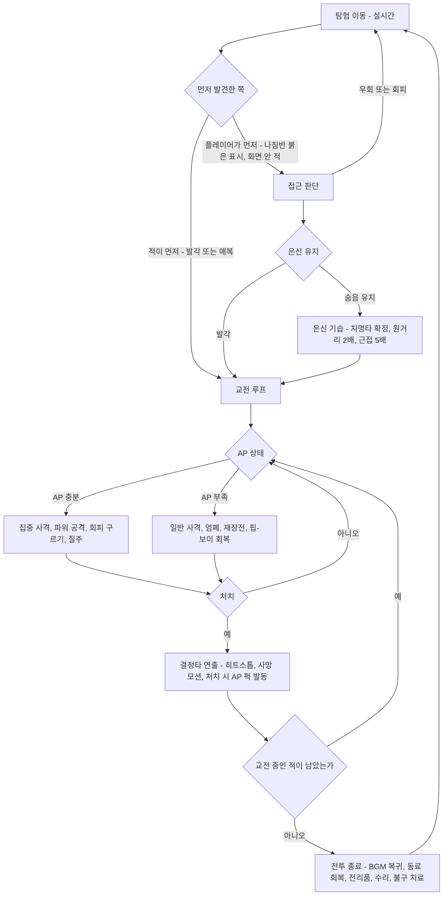
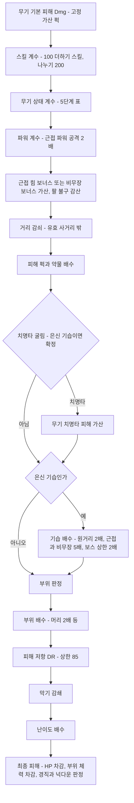
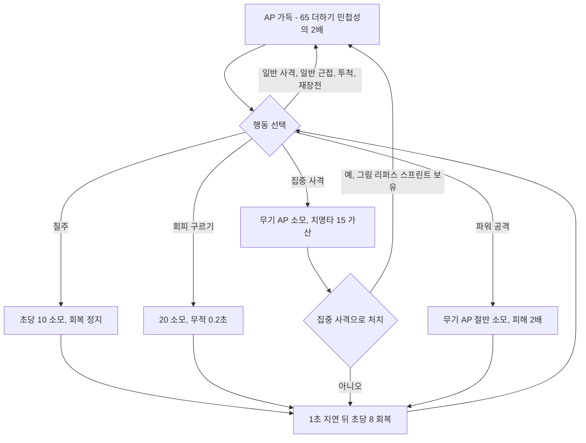
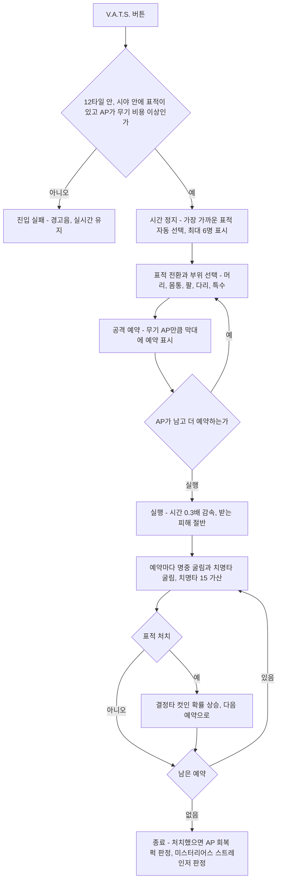

# SD-11. 전투·상태 시스템

> **서울 폴아웃 상세 기획서 세트** | 문서 ID: SD-11 | 버전: v1.0 | 작성일: 2026-10-12
> **범위**: 맵 위 실시간 전투의 조작·카메라·전투 진입과 이탈, 무기 계열 8종의 공격 자세와 사격 규격, 명중·피해·치명타·기습·DR·부위 판정·부위 불구·넉다운·사망 연출, AP 용도와 수치(확정), V.A.T.S. 축약형(선택 과제) 설계안, 적 AI(상태 머신·인지·엄폐·도주·무리·세력 간 교전·계열별 패턴), 동료 전투 AI와 명령, 은신 전투·폭발물·지뢰·함정·환경 폭발·파워 아머·에너지 무기, 난이도·TTK·레벨 스케일링, 상태·생존(HP·방사능·중독·불구·수면·음식과 물·소지 무게·내구도), 피격 피드백과 전투 HUD / **다루지 않음**: S.P.E.C.I.A.L.·스킬·퍽의 정본과 퍽 ID(SD-10), 무기·방어구·소모품 개별 수치와 ID(SD-13), 크리처·적 개체 수치와 ID(SD-14), 핍-보이 메뉴와 HUD의 화면 디자인(SD-12), 도트 규격과 모션 그림(SD-16), 효과음 제작(SD-17), 의사·수리 요금(SD-15)
> **관련 문서**: [SC-00 컨셉](00_concept.md), [SD-01 게임 개요](01_game-overview.md), [SD-06 세력](06_factions.md), [SD-07 인물](07_characters.md), [SD-08 월드·권역](08_world-regions.md), [SD-09 장소 카탈로그](09_location-catalog.md), [SD-10 캐릭터 시스템](10_character-system.md), [SD-12 탐험·UI](12_exploration-ui.md), [SD-13 아이템](13_items.md), [SD-14 크리처·적](14_creatures-enemies.md), [SD-15 경제](15_economy.md), [SD-16 아트 디렉션](16_art-direction.md), [SD-17 사운드](17_sound.md), 원작 [RD-14 캐릭터 시스템](../reverse-design/14_character-system.md), [RD-15 상태·생존](../reverse-design/15_status-survival.md), [RD-16 전투 시스템](../reverse-design/16_combat-system.md), [RD-19 무기·탄약](../reverse-design/19_weapons-ammo.md), [RD-20 방어구·의복](../reverse-design/20_armor-apparel.md), [RD-27 쯔꾸르 이식 시사점](../reverse-design/27_adaptation-notes.md)

---

## 목차

1. [문서 개요](#1-문서-개요)
2. [전투 개요: 맵 위 실시간 전투](#2-전투-개요-맵-위-실시간-전투)
3. [무기 계열과 공격 자세](#3-무기-계열과-공격-자세)
4. [명중·피해 공식](#4-명중피해-공식)
5. [AP(행동력): 용도 확정](#5-ap행동력-용도-확정)
6. [V.A.T.S. 축약형 (선택 과제)](#6-vats-축약형-선택-과제)
7. [적 AI](#7-적-ai)
8. [동료 전투 AI와 명령](#8-동료-전투-ai와-명령)
9. [은신 전투, 폭발물·함정, 파워 아머, 에너지 무기](#9-은신-전투-폭발물함정-파워-아머-에너지-무기)
10. [난이도·밸런스·레벨 스케일링](#10-난이도밸런스레벨-스케일링)
11. [상태·생존 시스템](#11-상태생존-시스템)
12. [피격 피드백과 전투 HUD](#12-피격-피드백과-전투-hud)
13. [원작 대응](#13-원작-대응)
14. [쯔꾸르 제작 메모](#14-쯔꾸르-제작-메모)
15. [미결 사항](#15-미결-사항)
- [부록 A. 신규 고유명사](#부록-a-신규-고유명사)
- [부록 B. 전역 상수표](#부록-b-전역-상수표)
- [부록 C. 데이터 필드 정의 (SD-13·SD-14 접점)](#부록-c-데이터-필드-정의-sd-13sd-14-접점)
- [부록 D. 참고 문서](#부록-d-참고-문서)

---

## 1. 문서 개요

### 1.1 목적
- 확정 전제 P7(맵 위 실시간 전투)과 P8(V.A.T.S. 1차 제외)을 수치까지 설계해, 프로그래머가 전투 코어를 만들고 SD-13·SD-14가 무기·적 데이터를 채울 수 있게 한다.
- 원작 [RD-27 §14.2](../reverse-design/27_adaptation-notes.md)의 남은 결정 4·5·6번(AP 용도, 부위 불구 판정, 내구도 시스템)을 이 문서에서 확정한다.
- 원작 폴아웃 3의 전투 정체성(스킬이 결과를 좌우하는 RPG 전투, 치명타와 행운, 부위 불구, 은신 기습, 결정타 연출, 탄약·내구도 관리)을 탑다운 2D 실시간 전투 안에서 지킨다([RD-16 §14](../reverse-design/16_combat-system.md)).

### 1.2 요약
1. **별도 전투 화면이 없다.** 이동·조준·사격·근접·투척·재장전이 모두 심리스 월드 맵 위에서 실시간으로 일어난다. 조준은 마우스(또는 오른쪽 스틱)로 360도 자유 각도이고, 캐릭터 몸은 8방향으로 스냅한다.
2. **조준 실력보다 캐릭터가 결과를 정한다.** 탄 퍼짐 각도, 피해, 재장전 속도, 치명타, 부위 판정에 스킬·능력치·무기 상태가 들어간다. 원작 피해식 `Dmg × (100 + 스킬)/200 × 상태 계수`를 그대로 쓴다.
3. **AP는 실시간 행동 자원으로 확정한다.** 질주(초당 10), 회피 구르기(20), 집중 사격(무기별 AP 비용), 근접 파워 공격(무기 AP의 절반)에 쓴다. 최대치는 원작 공식 `65 + 2 × 민첩성`을 유지한다.
4. **부위 불구는 '무작위 부위 판정 + 무기 특성'으로 확정한다.** 명중할 때마다 가중치 표로 부위를 고르고, 부위 체력이 바닥나면 불구가 된다. 인간형 부위는 머리·몸통·팔·다리 4개에 특수 부위(전투 억제기, 더듬이 등)를 더한다.
5. **내구도는 5단계 상태로 확정한다.** 최상·양호·마모·손상·고장 직전 + 파손(사용 불가). 단계마다 피해·치명타·탄 걸림·DR이 정해진 값으로 바뀐다.
6. **방어는 원작과 같은 DR(%)을 쓴다.** DT(고정 감산)는 도입하지 않는다. 상한 85%.
7. **V.A.T.S.는 1차 범위에서 뺀다.** 그 감성은 '집중 사격', 치명타 강조, 은신 기습, 결정타 히트스톱으로 살린다. 축약형(시간 정지 → 부위 선택 → AP 예약 → 감속 실행)은 6장의 설계안으로 남긴다.
8. **상태·생존은 원작 3편 수준을 유지한다.** HP 자연 회복 없음, 방사능 5단계와 1,000 즉사, 영구 중독, 부위 불구, 수면 완전 회복이다. 배고픔·갈증·수면 수치는 넣지 않고, 하드코어 모드는 2차 선택 과제로 둔다.

### 1.3 이 문서에서 확정하는 결정

| # | 결정 항목 | 확정안 | 원작 근거 | 근거 절 |
|---|---|---|---|---|
| D11-01 | 전투 형식 | 맵 위 실시간 탑다운 액션. 전투 화면 전환 없음 | P7 | §2 |
| D11-02 | 조준 방식 | 360도 자유 조준 + 스킬 기반 탄 퍼짐. 몸 방향은 8방향 스냅 | RD-16 §3.2 | §2.3, §4.1 |
| D11-03 | AP 용도 (RD-27 결정 4) | 질주·회피 구르기·집중 사격·파워 공격의 공용 자원 | RD-16 §4.4, RD-27 §7.3 | §5 |
| D11-04 | 부위 불구 판정 (RD-27 결정 5) | 무작위 부위 판정(가중치 표) + 무기 특성. 부위 체력 방식 | RD-16 §6, RD-27 §7.3 | §4.7~4.8 |
| D11-05 | 내구도 (RD-27 결정 6) | 5단계 상태 + 파손. 단계별 고정 효과 | RD-16 §5.4, RD-27 §7.3 | §11.8 |
| D11-06 | 방어 공식 | DR(%) 유지, 상한 85. DT 미도입 | RD-16 §5.8 | §4.6 |
| D11-07 | V.A.T.S. | 1차 제외. 축약형은 선택 과제(6장 설계안) | P8 | §6 |
| D11-08 | 핍-보이 일시 정지 회복 | 메뉴를 열면 시간이 멈춘다(원작 유지). 대신 회복품은 '회복 대기열'로 수 초에 걸쳐 들어간다 | RD-16 §2.1, RD-27 §7.3 | §2.7 |
| D11-09 | 표현 수위 | 3단계 옵션(순화·표준·원작). 기본값 표준 | RD-27 §14.2 결정 10 | §4.10 |
| D11-10 | 생존 수치 | 원작 3편 수준(배고픔·갈증·수면 수치 없음). 하드코어는 2차 선택 과제 | RD-15 §6.4 | §11.6, §11.9 |
| D11-11 | 동료 오사 | 원거리 탄은 동료를 통과한다. 폭발·화염은 동료에게 50% | RD-16 §9.7 | §8.5 |

### 1.4 표기와 단위
- **거리 단위는 타일(t)이다.** 1t는 타일 한 칸이다. 타일 크기(48px 또는 32px)는 [SD-16](16_art-direction.md)이 정한다. 이 문서의 모든 사거리·반경·속도는 타일 기준이라 타일 크기가 바뀌어도 그대로 쓴다.
- 사람 한 명의 충돌 원 지름은 약 0.6t다. 한 타일 ≈ 실제 1m로 본다.
- 시간은 실시간 초(s) 또는 밀리초(ms)다. 게임 시간은 '게임 시간'이라고 쓴다. 시간 배율은 원작과 같이 실시간 1초 = 게임 시간 30초로 둔다(SD-12 확정).
- 수식에서 `스킬`은 무기 지배 스킬(0~100), `⌈x⌉`는 올림, `clamp(a, x, b)`는 x를 a~b로 자른 값이다.
- 퍽 이름은 원작 퍽 이름으로 적는다. 서울판 퍽 이름과 PK-ID는 [SD-10](10_character-system.md)이 정한다. 이 문서는 '그 퍽이 전투에서 어떻게 작동하는가'만 정한다.
- 무기·방어구·적은 계열과 대표 원형(예: '경권총 원형 = 원작 10mm 권총')으로 적는다. 개별 제품명과 W-·A-·CR- ID는 SD-13·SD-14가 정한다.
- 원작 용어 표기는 [RD-26 용어집](../reverse-design/26_glossary.md)을 따른다. 행동력(AP), 피해 저항(DR), 라드, 스팀팩, 라드어웨이, 라드-X.

---

## 2. 전투 개요: 맵 위 실시간 전투

### 2.1 기본 구조
- 전투는 탐험과 같은 맵에서, 같은 시간 흐름으로 벌어진다. 적과 마주치는 순간 화면이 바뀌지 않는다. 외부 심리스 월드(P6)에서는 청크 경계를 넘어 추격전이 이어지고, 실내(P10)에서는 문 전환까지 추격한다(§2.5).
- 원작의 '1·3인칭 실시간 + 스킬 기반 명중'을 탑다운으로 옮긴다. 플레이어는 조준점을 적에게 맞추지만, **탄이 조준점에 얼마나 모이는지는 스킬이 정한다**(§4.1). 스킬 0 캐릭터는 조준을 잘 해도 자주 빗나가고, 스킬 100 캐릭터는 조준한 곳으로 정확히 날아간다.
- 원작 전투 리듬(발견 → 접근 판단 → 결정타 → 버티기 → 정리, [RD-16 §15.2](../reverse-design/16_combat-system.md))을 그대로 지킨다. V.A.T.S.가 맡던 '결정타'는 집중 사격(§5.3)과 은신 기습(§9.1)이, '버티기'는 엄폐(§4.2)와 회피 구르기(§5.3)가 맡는다.

| 항목 | 원작 폴아웃 3 | 서울판 |
|---|---|---|
| 시점 | 1·3인칭 3D | 탑다운 2D (쯔꾸르 스타일) |
| 전투 공간 | 탐험 공간과 같다 | 같다. 전투 화면 없음 |
| 조준 | 조준점 + 탄 퍼짐(도) | 360도 조준 + 탄 퍼짐 원뿔(도, 탑다운용으로 재조정) |
| 결정타 수단 | V.A.T.S. | 집중 사격(AP), 은신 기습, (선택) V.A.T.S. 축약형 |
| 방어 수단 | V.A.T.S. 중 받는 피해 10%, 엄폐, 핍-보이 정지 | 회피 구르기(무적 프레임), 타일 엄폐, 핍-보이 정지 + 회복 대기열 |
| 부위 | 직접 조준 / V.A.T.S. 부위 선택 | 무작위 부위 판정 + 무기 특성 |
| 피해식 | Dam = Dmg × 스킬 계수 × 내구도 계수 … | 같다. 내구도 계수만 5단계 표로 바꾼다 |

### 2.2 전투 흐름



### 2.3 입력

세 가지 조작 방식을 지원한다. 기본값은 PC에서 키보드+마우스, 게임패드를 연결하면 패드다. '고전 조작'은 쯔꾸르 게임에 익숙한 플레이어와 접근성을 위한 키보드 단독 방식이다.

| 행동 | 키보드+마우스 | 게임패드 | 고전 조작(키보드 단독) |
|---|---|---|---|
| 이동 | WASD | 왼쪽 스틱 | 방향키 |
| 조준 | 마우스 커서 | 오른쪽 스틱 | 이동 방향 = 조준 방향, 자동 조준 원뿔 30° |
| 공격(사격·휘두르기) | 왼쪽 클릭(누르고 있으면 자동화기 연사) | RT | Z |
| 정조준 / 막기(근접 무기) | 오른쪽 클릭 유지 | LT 유지 | X 유지(이동 정지, 방향 고정) |
| 집중 사격 / 파워 공격 | Q (근접 무기는 공격 버튼 길게) | RB (근접은 RT 길게) | A |
| 회피 구르기 | Space | A | C |
| 질주 | Shift 유지 | 왼쪽 스틱 누름(토글) | Shift 유지 |
| 웅크리기(은신) | Ctrl 토글 | B | S 토글 |
| 재장전 | R | X | R |
| 투척(누르는 시간 = 거리) | G 유지 후 놓기 | LB 유지 후 놓기 | D 유지 후 놓기 |
| 상호작용(대화·줍기·해체) | E | X 길게 | 엔터 |
| 무기 넣기/꺼내기 | F | Y | F |
| 단축키 1~8 | 숫자 1~8 | 십자키 4방향 + 길게 4 | 숫자 1~8 |
| 동료 명령 휠 | C 유지 | Y 길게 | V |
| 핍-보이(시간 정지) | Tab | Start | Esc |
| V.A.T.S. 축약형(선택 과제) | V | LB+RB 동시 | W |

- **조준 보정**(게임패드·고전 조작만): 조준 방향 기준 반각 12°(패드) 또는 15°(고전) 안에 적이 있으면 가장 가까운 적의 충돌 원 중심으로 조준 각을 끌어당긴다. 세기는 옵션(끔·약·강, 기본 약). 키보드+마우스에는 보정이 없다.
- **조준 커서**는 탄 퍼짐 원뿔을 시각화한다. 커서를 둘러싼 원의 반지름 = 현재 퍼짐 반각으로 커서 거리에서 생기는 흩어짐 폭이다(§12.4). 스킬이 오를수록 원이 작아지는 것을 눈으로 보게 하는 장치다.
- **고전 조작**은 8방향 이동과 8방향 사격만 쓴다. 자동 조준 원뿔(30°) 안의 가장 가까운 적을 조준한다. 정조준은 '서서 방향 고정'으로 대신한다.

### 2.4 이동과 자세

| 자세·이동 | 속도(t/s) | 탄 퍼짐 배수 | 소음 반경 | 제약 |
|---|---|---|---|---|
| 정지 | 0 | ×1.0 | 0 | — |
| 기본 이동(원작의 달리기) | 4.0 | ×1.25 | 2.0t | — |
| 정조준 이동 | 2.0 | ×0.5(정조준) × 1.25 | 1.5t | 정조준 중 |
| 질주 | 6.0 | 사격 불가 | 5.0t | AP 10/초 소모(§5) |
| 웅크림 정지 | 0 | ×0.7 | 0 | 은신 모드 |
| 웅크림 이동 | 2.0 | ×0.7 × 1.25 | 0.5t | 은신 모드 |
| 웅크림 + 정조준(정지) | 0 | ×0.35 | 0 | 은신 저격 기본 자세 |
| 무기 넣고 이동 | 4.4 | — | 2.0t | 원작처럼 무기를 넣으면 10% 빠르다 |
| 과적 | 2.4 | 정상 | 3.0t | 질주·회피 불가, 빠른 이동 불가(§11.7) |

- 원작은 이동해도 퍼짐 페널티가 없었다([RD-16 §3.3](../reverse-design/16_combat-system.md)). 탑다운 실시간에서는 '멈춰서 쏠지, 움직이며 쏠지'가 유일한 위치 선택이 되므로 **이동 중 ×1.25의 약한 페널티를 새로 둔다.** 회피 중심 플레이를 막지 않을 정도로만 준다.
- 장비 무게에 따른 속도 감소: 착용 장비(몸통·머리·든 무기) 총무게가 30을 넘으면 넘는 10마다 이동 속도 −3%, 최대 −15%. 파워 아머는 별도 규칙(§9.4)을 따른다.
- 높낮이 지형(층 타일)은 원작 X19처럼 수치로 흡수한다. 높은 층(고가도로, 옥상 테라스)에서 낮은 층을 쏘면 탄 퍼짐 ×0.85, 낮은 쪽에서 높은 쪽을 쏘면 높은 쪽 대상이 '낮은 엄폐' 판정을 받는다(§4.2).

### 2.5 전투 진입과 이탈

**전투 상태(플레이어 기준)** 는 '플레이어나 동료를 표적으로 삼은 교전 상태의 적이 1명 이상 있는 동안'이다.

| 단계 | 조건 | 처리 |
|---|---|---|
| 진입 | 적 하나가 교전 상태(§7.2)로 들어가 플레이어·동료를 표적으로 잡음 | 전투 BGM으로 1.5초 교차 전환(SD-17). HUD 전투 요소 표시(§12.5). 대기·수면·빠른 이동 금지. 문 전환은 허용 |
| 유지 | 교전 중인 적이 1명 이상 | 나침반에 붉은 표시. 저장은 원작처럼 허용(SD-12에서 전투 중 저장 제한 여부 확정) |
| 이탈(처치) | 교전 중인 적이 모두 죽거나 무력화 | 즉시 종료 판정 → 3초 뒤 BGM 복귀 |
| 이탈(도주) | 모든 적이 플레이어를 '놓침'(§7.2) 상태로 8초 경과 | 종료. 적은 수색 후 귀환 |
| 이탈(항복·용서) | 플레이어가 무기를 넣고, 적의 '용서 가능' 플래그가 켜져 있음 | 인간형 일부(SD-14 플래그)는 4초 동안 공격받지 않으면 적대를 푼다(원작 로딩 화면 팁 계승). 세력 적대·현상금 사냥꾼은 용서하지 않는다 |
| 문 전환 추격 | 교전 중인 적이 문에서 4t 이내 + 시야 유지 | 그 적은 플레이어를 따라 문을 넘는다(최대 3명). 나머지는 문 앞에서 '놓침'. 원작 암살대처럼 추격이 끊기는 버그는 만들지 않는다 |
| 청크 경계 | 심리스 월드에서 교전 중 청크 전환 | 교전 중인 적은 청크가 내려가도 활성 목록에 남는다(§14.4). 25t 넘게 떨어지고 시야가 끊기면 '놓침' |

- **전투 종료 처리**: 동료 HP 전량 회복(원작 계승), 동료가 떨군 무기 자동 회수, 전리품 하이라이트 표시, 결정타 연출(§12.3).
- **비전투 상태에서 공격받으면**(위치를 모르는 적의 저격 등) 플레이어는 곧바로 전투 상태가 되고, 피격 방향 표시(§12.5)로 위치를 알려 준다.

### 2.6 카메라
- **기본**: 플레이어 중심 고정. 조준 방향으로 커서 거리의 30%만큼, 최대 3t까지 앞당긴다(룩어헤드). 게임패드는 오른쪽 스틱 기울기에 비례해 최대 3t.
- **정조준**: 소총·저격·중화기 계열은 정조준 중 룩어헤드 상한이 늘어난다. 소총 5t, 스코프 무기 8t(스코프 화면 없이 카메라만 민다). 권총·산탄총은 3t 그대로다.
- **줌 없음**: 쯔꾸르 스타일 도트의 품질(P5)을 지키려고 화면 확대·축소를 쓰지 않는다. 결정타 컷인(§12.3)도 화면 확대가 아니라 따로 그린 컷인 그림을 띄운다.
- **화면 밖 적**: 교전 중인 적이 화면 밖에 있으면 화면 가장자리에 붉은 화살표를 띄운다. 원작의 나침반 붉은 표시도 함께 둔다(§12.5).
- **흔들림·히트스톱**은 §12.2. 옵션으로 흔들림 세기(0·50·100%)를 고른다.
- **교전 거리 기준**: 화면에 보이는 가로 반폭을 기준 교전 거리로 잡는다. 1280×720 해상도에 48px 타일이면 가로 반폭은 약 13t, 32px 타일 2배 확대면 약 10t다. 무기의 '유효 사거리'는 이 반폭 안에 들어오게 정하고(§3.3), 저격 계열만 정조준 룩어헤드로 화면 밖 사거리를 쓴다.

### 2.7 핍-보이 일시 정지와 회복 대기열
- **원작 유지**: 핍-보이를 열면 게임 시간이 멈춘다. 그 상태에서 무기·방어구 교체, 스팀팩 사용, 부위 지정 치료가 가능하다(원작 감성 E21).
- **남용 방지책(확정)**: 회복품의 효과는 즉시가 아니라 **회복 대기열**에 들어가 시간이 흐르면서 들어간다.

| 회복품 | 대기열 처리 | 비고 |
|---|---|---|
| 스팀팩 | 회복량을 2.0초에 걸쳐 균등하게 넣는다 | 회복량 `30 × (1 + 의학/50)`은 원작 그대로 |
| 스팀팩 여러 개 | 회복 속도는 합산하지 않는다. 남은 대기 시간에 2.0초씩 이어 붙인다 | 메뉴 안에서 5개를 써도 10초에 걸쳐 들어간다 |
| 부위 지정 스팀팩 | 지정 부위 체력은 즉시 50% 회복, HP 회복분은 대기열 | 불구를 즉시 풀 수 있게 해 '위기에서 숨 돌리기'를 남긴다 |
| 음식·물 | 회복량을 5.0초에 걸쳐 넣는다. 스팀팩 대기열과 별도로 병행 | 라드는 즉시 가산 |
| 라드어웨이 | 제거량을 3.0초에 걸쳐 뺀다 | — |
| 단축키 사용(실시간) | 0.4초 투여 모션. 그동안 이동 50%, 사격 불가 | 메뉴를 열지 않고 쓰는 경우 |

- 매우 쉬움·쉬움 난이도에는 '즉시 회복(원작식)' 옵션을 켤 수 있다(§10.2).
- 이 규칙으로 '핍-보이를 열면 멈춘다'는 원작 감각은 지키되, 집중 포화를 받는 중에 멈춤 상태에서 HP를 가득 채우는 운용을 막는다.

---

## 3. 무기 계열과 공격 자세

### 3.1 원칙
- 원작 무기 139종을 각각 다른 모션으로 그리지 않는다. [RD-27 §7.2](../reverse-design/27_adaptation-notes.md)의 **공격 자세 계열 8종**으로 묶어 모션을 공유하고, 무기마다 다른 것은 무기 외형 레이어·총구 화염·투사체·효과음·아이콘으로 구분한다.
- 계열은 **모션 단위**이고 스킬은 **수치 단위**다. 같은 권총 계열이라도 경권총은 소형 화기, 레이저 권총은 에너지 무기 스킬을 쓴다.
- 무기 개별 수치(피해, 치명타 배수, AP, 탄창, 무게, 단계당 사용 횟수)와 W-ID는 [SD-13](13_items.md)이 정한다. 이 장은 계열별 규격과 수치 범위를 정한다.

### 3.2 계열 총괄표

| # | 계열 | 원작 스킬 | 대표 원형(원작 무기) | 공격 방식 | 유효 / 최대 사거리 | 발사·공격 속도 | 무기 최소 퍼짐(반각) | 재장전 |
|---|---|---|---|---|---|---|---|---|
| 1 | 권총 | 소형 화기, 에너지 무기 | 경권총(10mm 권총), 소구경 리볼버(.32 권총), 대구경 리볼버(.44 매그넘), 소음 권총, 기관권총(10mm SMG), 레이저 권총, 플라스마 권총, 다트 건 | 한손 조준 사격. 반자동은 클릭당 1발, 기관권총은 누르고 있으면 연사 | 8t / 14t | 반자동 2.2~6발/초, 기관권총 10발/초 | 0°(레이저)~3°(기관권총) | 1.0~1.8초 |
| 2 | 소총 | 소형 화기, 에너지 무기 | 사냥 소총, 돌격소총, 저격소총, 레이저 소총, 플라스마 소총, 못 소총(레일웨이 라이플) | 양손 견착 사격. 돌격소총은 연사 | 11t / 18t (저격 14t / 24t) | 단발 0.75~2발/초, 돌격 8발/초 | 0°(저격·레이저)~3°(돌격) | 2.0~3.0초 |
| 3 | 산탄총 | 소형 화기 | 펌프 산탄총, 전투 산탄총, 소드오프 산탄총 | 양손 사격, 펠릿 9발을 원뿔로 뿌림 | 5t / 9t | 1.5~2.2발/초 | 펠릿 원뿔 6°~12° (조준 퍼짐과 별도) | 2.5~3.3초 (전투 산탄총은 탄창식) |
| 4 | 중화기 | 중화기 | 회전 기관포(미니건), 개틀링 레이저, 화염방사기, 미사일 발사기, 소형 핵 투사기(팻맨) | 허리 높이 거치 사격. 기관포는 회전 예열 0.4초 뒤 연사 | 기관포 10t / 15t, 화염 5t, 미사일 16t, 핵 투사기 6~18t(곡사) | 기관포 15~20발/초, 화염 10틱/초, 발사기 0.5발/초 | 기관포 4°, 화염 원뿔 25°, 발사기 1° | 3.0~4.0초 |
| 5 | 한손 근접 | 근접 무기 | 나이프, 전투용 나이프, 경찰봉, 마체테, 충격봉, 회전날(리퍼), 화염검(시시케밥) | 찌르기·베기 호(弧) 판정. 길게 누르면 파워 공격 | 1.1t, 호 90° | 1.5~3회/초 | — | — |
| 6 | 양손 근접 | 근접 무기 | 야구 방망이, 쇠파이프, 슬레지해머, 소방 도끼, 슈퍼 슬레지 | 크게 휘두르기 호 판정. 길게 누르면 파워 공격 | 1.4t, 호 140° | 0.9~1.6회/초 | — | — |
| 7 | 비무장 | 비무장 | 맨주먹, 너클, 파워 피스트, 생물병기 손톱 건틀릿(데스클로 건틀릿) | 주먹 연타 호 판정. 길게 누르면 파워 공격 | 0.9t, 호 70° | 2~3회/초 | — | — |
| 8 | 투척·설치 | 폭발물 | 파편 수류탄, 플라스마 수류탄, 펄스 수류탄, 지뢰류, 병뚜껑 지뢰 | 누른 시간만큼 멀리 던지는 포물선 투척 / 발밑 설치 | 투척 `6 + 폭발물/20` t (6~11t) | 투척 0.65회/초, 설치 0.5회/초 | 착지 산포 반경 `1.5 − 폭발물/100` t | — |

- **'유효 사거리'** 안에서는 피해가 100%다. 유효~최대 사이에서는 선형으로 줄어 최대 사거리에서 원거리 무기 70%, 산탄총 40%가 된다. 최대 사거리를 넘은 투사체는 사라진다. 원작에는 거리 감쇠가 없었으나, 탑다운 화면에서 '먼 적은 권총보다 소총'이라는 선택을 보이게 하려고 넣는다.
- **화면 반폭과의 관계**: 권총·산탄총·근접은 화면 안에서 끝나고, 소총은 화면 가장자리까지, 저격은 정조준 룩어헤드(8t, §2.6)로 화면 밖까지 닿는다.
- **기본 탄약은 무기당 1종, 무게 0**(원작 계승, [RD-16 §5.10](../reverse-design/16_combat-system.md)). 탄종 변형(철갑탄 등)은 넣지 않는다.

### 3.3 투사체 유형

| 유형 | 사용 계열 | 속도 | 충돌 판정 반지름 | 규칙 |
|---|---|---|---|---|
| 실탄 | 권총·소총 | 40t/초 | 0.05t | 첫 충돌 대상에서 소멸. 낮은 엄폐 판정(§4.2) |
| 산탄 펠릿 | 산탄총 | 35t/초 | 0.05t | 펠릿 9발이 각각 판정. 치명타도 펠릿마다(원작 실시간 규칙) |
| 레이저 빔 | 레이저 권총·소총, 개틀링 레이저 | 즉시(히트스캔) | 0.05t | 빔 그림 80ms. 낮은 엄폐는 실탄과 같게 판정. 가스 누출 점화 |
| 플라스마 탄 | 플라스마 권총·소총 | 14t/초 | 0.15t | 느리고 크다. 눈으로 보고 피할 수 있다. 가스 누출 점화 |
| 다트 | 다트 건 | 25t/초 | 0.05t | 명중 시 다리 부위 피해 고정(§4.8) |
| 철도 못 | 못 소총 | 30t/초 | 0.08t | 부위 피해 ×3. 처치 시 못 박힘 사망 연출 |
| 화염 | 화염방사기, 화염검 | 6t/초 입자 | 원뿔 | 0.1초마다 피해 틱 + 화상(§9.6). 엄폐를 넘지 못한다 |
| 미사일 | 미사일 발사기 | 10t/초에서 18t/초로 가속 | 0.2t | 로봇·파워 아머 대상에 약한 유도(초당 30° 선회). 충돌 시 폭발 |
| 곡사탄 | 핵 투사기, 수류탄 | 비행 0.6~1.2초 | 착지점 | 가짜 높이(그림자 + 스프라이트 위로 띄움)로 포물선을 그린다. 벽에 한 번 튕긴다 |

- **실탄을 히트스캔으로 만들지 않는 이유**: 탄이 날아가는 그림이 있어야 탑다운에서 '빗나감'이 보이고, 적의 탄도 눈으로 읽을 수 있다. 40t/초면 10t 거리를 0.25초에 지나 실질적으로 피할 수 없으므로, 회피는 투사체가 아니라 적의 **조준 지연**(§7.4)으로 만든다.
- 투사체 동시 활성 상한은 128개(§14.4). 넘으면 가장 오래된 아군 쪽 투사체부터 지운다.

### 3.4 계열별 조작과 규칙

**권총 계열**
- 한손 무기다. 반자동 무기는 클릭마다 1발이고, 버튼을 누르고 있으면 무기의 최대 연사 속도로 쏜다(원작의 '최대 클릭 속도'를 자동으로 맞춘다).
- 질주 끝에서 곧바로 쏠 수 있다(무기 들기 0.15초). 집중 사격 AP가 낮아(17~32) 결정타를 자주 낸다. 원작 '권총 = AP 효율' 정체성을 이어 간다.
- 다트 건은 권총 계열이다. 피해는 작지만 명중하면 다리 불구를 확정한다(§4.8).

**소총 계열**
- 양손 무기다. 정조준 효과가 크다(퍼짐 ×0.5, 룩어헤드 5t).
- 저격소총은 정조준 0.6초 유지 후 '스코프 안정' 상태가 되어 퍼짐 ×0.5가 한 번 더 곱해진다. 팔이 불구면 안정 상태가 되지 않는다(원작 스코프 흔들림 계승).
- 돌격소총은 연사 시 퍼짐이 발마다 +0.5°씩 늘어 최대 +4°까지 커지고, 쏘지 않으면 0.3초마다 1°씩 돌아온다(반동 누적). 원작에는 없던 규칙이지만 탑다운 연사가 레이저 포인터처럼 정확해지는 것을 막는다.

**산탄총 계열**
- 펠릿 9발을 무기 원뿔(6°~12°) 안에 고르게 뿌리고, 거기에 조준 퍼짐이 더해진다. 가까운 적에게는 대부분 맞고 먼 적에게는 일부만 맞는다.
- 실시간 펠릿별 치명타가 유지되므로 은신 기습 산탄총이 원작처럼 강하다. 보스 대상 기습 배수 상한(§9.1)으로 억제한다.
- 펠릿 넉백: 3t 이내에서 펠릿 6발 이상이 같은 대상에 맞으면 0.5t 밀어낸다(대형 적 제외).

**중화기 계열**
- 허리 높이 거치 자세라 정조준 퍼짐 효과가 작다(×0.75). 이동 속도가 정조준 이동과 같은 2.0t/초로 떨어진다(사격 중).
- 회전 기관포는 사격 버튼을 누르면 0.4초 예열 뒤 연사한다. 예열 중에도 회전음이 나고 소음 판정이 생긴다.
- 화염방사기는 길이 5t, 반각 25° 원뿔 안에 0.1초마다 피해 틱을 준다. 엄폐 타일과 벽을 넘지 못한다. 연료 1틱 = 1발.
- 미사일 발사기·핵 투사기는 장전 1발이다. 핵 투사기는 커서 위치가 착탄점이 되는 곡사이며, 최소 사거리 6t 안쪽에서는 발사할 수 없다(자폭 방지). 원작의 '직선으로 겨눠 자폭'은 재현하지 않는다.

**한손 근접 계열**
- 공격 버튼을 누르면 조준 방향 호 90°, 거리 1.1t 안의 모든 대상에 판정한다(최대 3명). 원작처럼 근접은 명중 굴림이 없다.
- 길게 누르면 0.5초 차지 후 **파워 공격**(피해 ×2, AP 소모, 0.6t 전진)이다(§5.3).
- 회전날(리퍼) 계열은 누르고 있는 동안 0.1초마다 피해 틱을 준다(원작 '초당 약 30틱'을 10틱으로 묶는다. 틱당 피해 = 표기 피해 ÷ 10).

**양손 근접 계열**
- 호 140°, 거리 1.4t, 최대 4명. 공격 예비 동작이 길어(0.25~0.35초) 적에게 읽히지만 넉백이 크다(일반 공격 0.3t, 파워 공격 1.0t + 경직).
- 슈퍼 슬레지급 둔기 파워 공격은 인간형 대상에게 25% 확률로 넉다운(§4.9).

**비무장 계열**
- 호 70°, 거리 0.9t. 연타 속도가 가장 빠르다. 머리에 맞으면(부위 판정 §4.7) 15% 확률로 1.5초 기절(원작 녹아웃 계승, 맨주먹이면 30%).
- 비무장 보너스 피해 `⌈(10 + 비무장 스킬)/20⌉`은 원작 그대로다.
- 파워 피스트류는 로봇에게 EMP 추가 피해 +25(원작 계승).

**투척·설치 계열**
- 투척 버튼을 누르고 있으면 조준선이 포물선 착지점까지 늘어난다. 1.2초에 최대 거리에 닿는다. 놓으면 던진다. 미리 신관을 당기는 '쿠킹'은 없다(원작 계승).
- 모든 수류탄은 **시간 신관 2.5초**다. 착지점은 산포 반경 안에서 무작위로 흩어진다. 벽에 한 번 튕긴다.
- 지뢰는 발밑 0.8t 앞에 설치한다. 설치자와 동료는 발동시키지 않는다(원작 계승). 상세는 §9.2.

### 3.5 재장전, 탄 걸림, 무기 교체

| 항목 | 규칙 |
|---|---|
| 재장전 시간 | `무기 기본 재장전 시간 × (1.2 − 0.004 × 스킬)` → 스킬 0 ×1.2, 50 ×1.0, 100 ×0.8 |
| 재장전 중 | 이동 가능(속도 ×0.8), 사격 불가, 질주하면 재장전이 취소된다 |
| 자동 재장전 | 탄창이 비면 자동으로 재장전한다(옵션으로 끔 가능) |
| 부분 재장전 | 원작처럼 언제든 R로 재장전한다. 남은 탄은 버리지 않는다 |
| 탄 걸림 | 무기 상태가 '마모' 이하일 때 재장전마다 확률 판정(§11.8). 걸리면 재장전 시간 +1.5초, 전용 모션과 효과음 |
| 무기 교체 | 한손 0.5초, 양손 0.8초, 중화기 1.2초. 단축키 교체 중에도 이동 가능 |
| 무기 넣기 | 0.4초. 무기를 넣으면 이동 +10%, 일부 인간형 적의 '용서' 판정 조건(§2.5) |

### 3.6 모션 규격 (SD-16 접점)

모든 전투 캐릭터(주인공, 인간형 NPC, 동료)는 같은 모션 체계를 쓴다. 아래는 이 문서가 요구하는 **기능 규격**이다. 실제 프레임 수와 그림은 [SD-16](16_art-direction.md)이 확정한다.

**방향**: 몸 스프라이트 8방향 스냅을 요구한다. SD-16이 4방향을 고르면 사격 방향은 360도 그대로 두고 몸은 4방향으로 스냅하되, 총구 위치를 8방향 기준점으로 보간한다.

| 모션 | 쓰는 계열 | 권장 프레임 | 길이(초) | 판정 프레임 | 비고 |
|---|---|---|---|---|---|
| 조준 대기 | 1~4, 8 | 2 (호흡) | 루프 | — | 계열별 자세 4종: 한손 / 양손 견착 / 허리 거치 / 투척 들기 |
| 사격 | 1~4 | 3 | 0.12~0.2 | 1번째 | 총구 화염은 무기 레이어 쪽 1프레임. 반동은 몸 1px 뒤로 |
| 연사 | 1(기관권총), 2(돌격), 4(기관포) | 2 루프 | 루프 | 매 프레임 | 사격 2프레임을 반복 |
| 재장전 | 1~4 | 6 | 무기 재장전 시간에 맞춰 늘림 | — | 계열당 1벌. 산탄총은 '한 발씩 넣기' 2프레임 루프 |
| 탄 걸림 | 1~4 | 4 | 1.5 | — | 무기를 두드리는 동작. 계열 공용 1벌로 충분 |
| 근접 일반 공격 | 5~7 | 4 (예비 1, 타격 1, 회수 2) | 0.3~0.6 | 타격 프레임 | 휘두름 궤적 이펙트는 공용(계열당 1종) |
| 근접 파워 공격 | 5~7 | 차지 2(루프) + 타격 3 | 차지 0.5 + 0.4 | 타격 1번째 | 차지 중 몸이 빛나는 이펙트 |
| 막기 | 5~7 | 1 | 유지 | — | — |
| 투척 | 8 | 4 | 0.5 | 3번째에서 놓음 | — |
| 설치 | 8 | 3 | 0.6 | 3번째 | 웅크려 놓기 |
| 회피 구르기 | 공용 | 5 | 0.35 | 2~4번째 무적 | 무기 레이어는 숨긴다(프레임 절감) |
| 피격 | 공용 | 2 | 0.15 | — | 흰색 점멸과 함께 |
| 경직 | 공용 | 2 | 0.25 | — | 피격 프레임 재사용 가능 |
| 넉다운 | 공용 | 4 + 일어서기 3 | 1.0~4.0 | — | 쓰러진 동안 피격 판정 반지름 ×1.3 |
| 사망 | 공용 + 연출 변형 | 5~6 | 0.6 | — | 변형은 §4.10 |
| 웅크림 이동 | 공용 | 4 | 루프 | — | 은신 모드 |

- **제작량 기준**: 주인공 기준 '계열 모션 4자세(한손·양손 견착·허리 거치·투척) + 근접 3계열 + 공용 모션' × 8방향이 한 벌이다. 장비 레이어(P9)는 이 프레임 체계를 그대로 따른다.
- **크리처**는 이 체계를 쓰지 않고 종별로 이동·공격(1~2종)·피격·사망만 그린다(SD-14·SD-16).
- **무기 레이어 기준점**: 각 방향·프레임에 손 위치와 총구 위치 두 점을 정의한다. 총구 위치에서 투사체가 나간다. 이 좌표표는 SD-16 산출물이다.

---

## 4. 명중·피해 공식

### 4.1 조준과 탄 퍼짐
원작의 탄 퍼짐 구조(`max(조준 퍼짐, 무기 최소 퍼짐)`, [RD-16 §3.2](../reverse-design/16_combat-system.md))를 유지하고, 탑다운 화면에 맞게 각도 크기만 키운다. 원작 각도(0.5~3°)는 1인칭에서 먼 표적을 쏘는 기준이라, 10t 안쪽에서 싸우는 탑다운에서는 스킬 차이가 드러나지 않는다.

```text
총 퍼짐(반각, 도) = max(조준 퍼짐, 무기 최소 퍼짐)

조준 퍼짐 = 24 × (0.5 − 0.005 × 스킬) × 자세 배수 × 이동 배수 × 상태 퍼짐 배수 × 퍽 배수 + 불구 가산 + 반동 누적
  스킬 항      : 스킬 0 → 12°, 25 → 9°, 50 → 6°, 75 → 3°, 100 → 0°
  자세 배수    : 서기 1.0 / 웅크림 0.7 / 정조준 0.5 / 웅크림 + 정조준 0.35 / 중화기 정조준 0.75 / 저격 안정 추가 ×0.5
  이동 배수    : 정지 1.0 / 이동 1.25
  상태 퍼짐 배수 : 무기 상태 5단계 1.0 / 1.0 / 1.1 / 1.25 / 1.5 (§11.8)
  퍽 배수      : 건슬링어(한손)·코만도(양손) 0.75 등. 정본은 SD-10
  불구 가산    : 팔 불구 +6°(양손) / +8°(한손), 머리 불구(뇌진탕) +3°
  반동 누적    : 연사 무기만. 발당 +0.5°, 최대 +4°, 0.3초마다 1° 회복

발사 각도 = 조준 각도 + (u1 + u2 − 1) × 총 퍼짐      (u1, u2는 0~1 균등 난수 → 가운데가 몰리는 삼각 분포)
```

**명중 기대치 참고표** (인간형 표적, 충돌 반지름 0.3t, 정지 표적, 무기 최소 퍼짐 1°, 삼각 분포로 계산)

| 스킬 | 서서 4t | 서서 8t | 정조준 8t | 웅크림+정조준 8t | 정조준 12t |
|---|---|---|---|---|---|
| 0 | 12.0° / 58% | 12.0° / 32% | 6.0° / 59% | 4.2° / 76% | 6.0° / 42% |
| 15 (비태그 초기) | 10.2° / 66% | 10.2° / 37% | 5.1° / 66% | 3.6° / 84% | 5.1° / 48% |
| 30 (태그 초기) | 8.4° / 76% | 8.4° / 44% | 4.2° / 76% | 2.9° / 93% | 4.2° / 56% |
| 50 | 6.0° / 92% | 6.0° / 59% | 3.0° / 92% | 2.1° / 100% | 3.0° / 73% |
| 75 | 3.0° / 100% | 3.0° / 92% | 1.5° / 100% | 1.0° / 100% | 1.5° / 100% |
| 100 | 1.0° / 100% | 1.0° / 100% | 1.0° / 100% | 1.0° / 100% | 1.0° / 100% |

- 해석: 시작 캐릭터(태그 30)도 정조준하면 8t에서 4발 중 3발을 맞힌다. 서서 막 쏘면 절반도 못 맞힌다. 스킬 75부터는 거리 12t 안에서 조준 실력만 남는다. 원작의 '초반 실시간 사격은 답답하다'는 약점([RD-16 §13.5](../reverse-design/16_combat-system.md))은 정조준·웅크림으로 풀 길을 열어 두고, '스킬이 결과를 정한다'는 원칙은 지킨다.
- 움직이는 표적은 플레이어의 조준 실력이 더해진다. 그래서 같은 스킬이라도 숙련 플레이어가 조금 더 잘 맞힌다. 이 차이는 원작 실시간 사격에도 있던 것이다.

### 4.2 엄폐
엄폐는 '엄폐 스냅' 같은 별도 시스템 없이 **타일 속성**으로 처리한다. 맵 제작자가 엄폐 타일을 칠하면 플레이어와 AI가 같은 규칙으로 쓴다.

| 엄폐 등급 | 예시 타일·오브젝트 | 탄 차단 | 시야 차단 | 이동 |
|---|---|---|---|---|
| 없음 | 바닥, 풀숲(시야만 −) | 0% | 풀숲은 웅크린 대상의 탐지 속도 −30% | 통과 |
| 낮은 엄폐 | 모래주머니, 중앙분리대, 승용차 차체, 편의점 진열대, 화단 턱, 낮은 담 | 표적이 웅크림: 85% / 표적이 서 있음: 40% | 웅크린 대상은 시야 차단 | 통과 불가 |
| 높은 엄폐 | 벽, 기둥, 버스, 콘크리트 방벽, 컨테이너 | 100% | 100% | 통과 불가 |
| 파괴 엄폐 | 나무 상자, 판자 담, 자판기 | 낮은·높은 엄폐와 같음 | 같음 | 내구 50~200. 다 깎이면 잔해(낮은 엄폐 또는 없음)로 바뀜 |
| 폭발 엄폐 | 원자력 차량, 가스통, 연료 드럼 | 높은 엄폐 | 높은 엄폐 | 피해 누적 시 폭발(§9.3) |

- **판정**: 투사체가 낮은 엄폐 타일을 지나갈 때 위 확률로 막힌다. 막힌 탄은 엄폐 타일에 탄흔 이펙트를 남긴다.
- **내 엄폐는 나를 막지 않는다**: 쏘는 쪽이 낮은 엄폐에서 1t 안에 있으면 그 엄폐 타일은 자기 탄에 판정하지 않는다. 그래서 '엄폐물에 붙어서 쏘기'가 성립한다.
- **산탄·화염**: 산탄 펠릿은 실탄과 같다. 화염과 폭발은 낮은 엄폐를 넘지 못한다(폭발은 높이 차가 없는 낮은 엄폐 뒤 대상에게 피해 ×0.5).
- **높은 층**: 높은 층에 있는 대상은 낮은 층에서 쏘는 탄에 대해 '낮은 엄폐(서 있음)' 판정을 항상 받는다.

### 4.3 명중 판정
- **충돌체**: 모든 전투 대상은 원형 충돌체를 가진다. 인간형 반지름 0.3t, 소형 크리처(바퀴·시궁쥐) 0.2t, 중형(들개·멧돼지) 0.35t, 대형(곰·변종·군용 로봇) 0.5t, 초대형(생물병기·보스) 0.7t 이상. 값은 SD-14 데이터 필드다.
- **원거리**: 투사체가 충돌체와 겹치면 명중이다. 원작처럼 명중 굴림을 따로 하지 않는다. 명중률은 퍼짐과 엄폐로만 정해진다.
- **근접**: 공격 판정 프레임에 호(거리·각도) 안에 충돌체 중심이 들어오면 명중이다. 굴림 없음.
- **폭발**: 반경 안 충돌체 중심까지의 거리로 피해 비율을 정한다(§9.2). 높은 엄폐로 가려진 대상은 피해 없음.
- **아군 판정**: 플레이어의 원거리 탄은 동료를 통과한다(§8.5). 적끼리도 같은 세력이면 통과한다. 적대 세력끼리는 맞는다(§7.8).
- **넘어진 대상**: 넉다운 중인 대상은 충돌 반지름 ×1.3, 부위 판정 시 다리 가중치 0(눕혀진 상태라 몸통으로 몰림).

### 4.4 피해 처리 순서



### 4.5 기본 피해, 치명타

**기본 피해(Dam)**: 원작 식을 유지하고, 내구도 계수만 5단계 표로 바꾼다.

```text
Dam = Dmg × (100 + 스킬) / 200 × 상태 피해 계수 × Power + Bonus − 팔 불구 감산
      × 거리 감쇠

  Dmg          : 무기 기본 피해(SD-13)
  상태 피해 계수 : 원거리 1.00 / 0.90 / 0.83 / 0.76 / 0.69, 근접·비무장 1.00 / 0.85 / 0.75 / 0.65 / 0.55 (§11.8)
  Power        : 근접·비무장 파워 공격 2, 그 외 1
  Bonus        : 근접 ⌈힘 / 2⌉, 비무장 ⌈(10 + 비무장 스킬) / 20⌉, 그 외 0. Power를 곱하지 않는다
  팔 불구 감산  : 한손 근접·비무장 + 팔 불구 → Dmg 항의 −30%, 양손 근접 + 팔 불구 → −20%
                  (원작 문서 간 상충 −40%/−20%와 −10%/−5% 사이에서 실시간 템포에 맞는 값으로 확정)
  거리 감쇠     : 유효 사거리 안 1.0, 최대 사거리에서 원거리 0.7 / 산탄 0.4 (선형)
```

**치명타**: 원작 공식을 유지한다. V.A.T.S.의 +15%p는 집중 사격과 V.A.T.S. 축약형에 준다.

```text
치명타 확률(%) = (행운 + 퍽 가산) × 무기 치명타 배수 × 상태 치명 계수
               + (집중 사격 또는 V.A.T.S. 축약형이면 15)
  퍽 가산       : 피네스 +5, 서바이벌 계열 +1~3, [근접·비무장] 닌자 +15 (정본 SD-10)
  상태 치명 계수 : 1.0 / 0.7 / 0.5 / 0.3 / 0.1 (§11.8)
  자동화기의 무기 치명타 배수 = 원래 배수 ÷ 연사력 (원작 계승)
  은신 기습 = 100 (확정)

치명타 피해 = Dam(퍽 반영) + 무기 치명타 피해 × (베터 크리티컬스면 1.5)
판정 단위   = 발사체마다(산탄 펠릿마다). 근접은 타격마다
```

- 원작처럼 **무기 치명타 피해는 스킬·상태의 영향을 받지 않는다.** 상태는 확률만 깎는다.
- 치명타가 나면 흰색 섬광 + 전용 효과음 + '치명타' 글자(옵션)로 강조한다(§12.1).

### 4.6 DR 결정: DR(%)을 유지하고 DT는 도입하지 않는다

| 기준 | DR(피해 저항, %) — 원작 3편 | DT(피해 문턱, 고정 감산) — 뉴 베가스 방식 |
|---|---|---|
| 원작 충실도 | 원작 그대로. 방어구 데이터([RD-20](../reverse-design/20_armor-apparel.md))를 그대로 옮길 수 있다 | 3편에 없는 규칙. 모든 방어구 수치를 새로 정해야 한다 |
| 실시간 연사와의 궁합 | 연사 무기도 비율로 깎여 무기 계열 간 균형이 유지된다 | 발당 피해가 작은 기관권총·돌격소총·기관포가 고 DT 적에게 거의 무력해진다. 실시간 연사가 많은 서울판에서 계열 하나가 죽는다 |
| 고정 가산 퍽(+5/발) | 효과가 완만하다 | 효과가 폭증한다 |
| 계산 부하 | 곱셈 1회 | 뺄셈 + 최소 피해 하한 처리 |
| 후반 긴장 | 85% 상한에 쉽게 닿는다(원작 약점) | 상한 문제는 적다 |

- **결정(D11-06)**: DR(%)을 유지한다. `받는 피해 = 피해 × (1 − DR/100)`, **상한 85**. 방어구 DR = 기본 DR × 상태 DR 계수(§11.8).
- **후반 긴장 대책**은 DT 대신 다음 세 가지로 처리한다.
  1. 영구 DR 퍽 합계 상한 +20을 SD-10에 요구한다(원작 최대 +34).
  2. DR 무시·감쇄 무기 특성을 고레벨 적에게 준다: 생물병기 손톱(DR 무시), 계엄군 에너지 무기(DR −15 관통, §9.5), 핵 투사기(폭발은 DR 절반만 적용).
  3. 폭발 피해에는 DR을 절반만 적용한다(파워 아머도 폭발은 아프다).
- 적에게도 같은 식을 쓴다. 적 DR은 SD-14 데이터다.

### 4.7 부위 판정 (확정: 무작위 판정 + 무기 특성)
- 원거리·근접 공격이 명중하면 **부위 가중치 표**로 맞은 부위를 하나 뽑는다. 플레이어가 부위를 직접 고르지는 않는다(V.A.T.S. 축약형에서만 고른다).
- 폭발은 부위를 뽑지 않고 모든 부위에 부위 피해를 나눠 준다(§4.8).

**기본 가중치 (인간형)**

| 부위 | 가중치 | 부위 피해 배수(HP 피해) | 비고 |
|---|---|---|---|
| 머리 | 12 | ×2.0 | 헤드샷 |
| 몸통 | 48 | ×1.0 | — |
| 팔 | 20 | ×1.0 | 좌우를 하나로 묶는다 |
| 다리 | 20 | ×1.0 | 좌우를 하나로 묶는다 |
| 들고 있는 무기 | 집중 사격에만 5 | ×0 | 맞으면 무장 해제 판정(§4.8) |

**가중치 보정**

| 조건 | 보정 | 의도 |
|---|---|---|
| 집중 사격(§5.3) | 머리 + 2 × 인지력 | 인지력 빌드가 헤드샷을 낸다(인지력 5 → 머리 확률 약 20%) |
| 스나이퍼 퍽 | 머리 가중치 ×1.5 (정본 SD-10) | 원작 '머리 명중률 ×1.25'의 재해석 |
| 대상의 뒤쪽 90°에서 명중 | 머리 +10, 특수 부위 '등'(억제기 등) 활성 | 뒤를 잡으면 약점이 열린다 |
| 대상이 웅크림 또는 낮은 엄폐 뒤 | 다리 0 (몸통으로 옮김) | 숨은 적은 다리를 못 맞힌다 |
| 근접 공격, 공격자가 서 있음 | 머리 +8 | 원작 '서서 근접하면 머리' |
| 근접 공격, 공격자가 웅크림 | 다리 +15, 머리 −8 | 원작 '웅크린 근접은 팔·아래' |
| 넉다운 중인 대상 | 다리 0, 머리 +5 | 쓰러진 적 마무리 |
| 비행 대상 | 다리 대신 추진기(로봇) 또는 날개(곤충) | — |

**크리처·로봇 가중치 예** (정본은 SD-14. 이 표는 형식 예시다)

| 원형 | 머리 | 몸통 | 팔·앞다리 | 다리 | 특수 부위 |
|---|---|---|---|---|---|
| 들개 무리(변이 들개) | 15 (×2) | 55 | — | 30 | — |
| 변이 외래 거북·참게 | 얼굴 10 (×2, 유일한 비갑각) | 껍질 70 (×0.5) | 집게 10 | 10 | — |
| 변이 왕지네·장수말벌 | 15 | 60 | — | 15 | 더듬이 10 (불구 → 광란) |
| 보안 로봇(프로텍트론 원형) | 15 | 55 | 15 | 15 | 전투 억제기 15 (뒤쪽 명중만) |
| 비행 로봇(미스터 거스티 원형) | — | 60 | 무기팔 25 | — | 추진기 15 (불구 → 3초 추락), 억제기 10 (뒤쪽만) |
| 군용 로봇(센트리 봇 원형) | 10 (×1) | 70 | 무기 20 | — | 억제기 10 (뒤쪽만). 약점 없음(원작 계승) |
| 미군 생물병기(데스클로 원형) | 12 (×2) | 50 | 20 | 18 | — |
| 포탑 | — | 80 | — | — | 조준 칩 20 (불구 → 광란) |

### 4.8 부위 체력과 불구

```text
부위 체력 = 최대 HP × 부위 계수        머리 0.25 / 몸통 0.5 / 팔 0.3 / 다리 0.3
부위 피해 = (DR·난이도 적용 후 HP 피해) × 2.0 × 무기 부위 피해 배수
폭발 부위 피해 = 폭발 HP 피해 × 0.5 를 모든 부위에 동시에
부위 체력이 0 → 불구. 1이라도 회복하면 불구 해제 (원작 계승)
```

- **부위 피해 기본 배수 2.0의 이유**: 부위 체력이 낮아야 무작위 판정으로도 '적이 죽기 전에' 불구가 일어난다. 이 값이면 인간형 적에게 HP의 약 60%를 깎는 동안 어느 한 부위가 불구가 될 확률이 대략 절반이다(기술 시험판에서 확인, §10.5).
- **무기 부위 피해 배수**(SD-13 필드): 기본 1.0, 못 소총 3.0, 회전날 1.5, 다트 건 '다리 고정'(맞은 부위와 무관하게 다리에 부위 피해 1,000 → 즉시 다리 불구 + 독), 펄스 무기 '로봇 억제기 0.5'.
- 불구가 되는 순간 대상은 0.6초 동안 행동을 멈추고 상처를 붙잡는 모션(피격 모션 재사용)을 한다. 진행 중이던 공격 예비 동작이 끊긴다. 원작의 '원거리에서 적을 멈추는 유일한 수단'을 그대로 살린다.

**불구 효과 (적)**

| 부위 | 효과 | 전술 의미 |
|---|---|---|
| 다리 | 이동 속도 −50%. 질주·돌진·덮치기 불가. 도주 상태면 '절뚝 도주'(30% 속도) | 돌진형 근접 적(곰, 멧돼지, 생물병기, 야생 구울) 저지. 도주 방지 |
| 팔 | 원거리 퍼짐 +8°, 근접 피해 −30%. 원거리 무기는 25% 확률로 떨어뜨림(기본 무기 제외) | 사수 무력화. 떨어진 무기는 줍기 가능 |
| 머리 | 시야 거리 −40%, 탐지 속도 −40%, 퍼짐 +3°, 1.5초 휘청 | 은신 재진입. 원작 '인지력 −4' 재해석 |
| 몸통 | 모든 피격에 50% 확률로 0.25초 경직 | 연사 무기로 공격을 계속 끊는다 |
| 무기(집중 사격) | 대상의 손 무기를 떨어뜨림. 수류탄을 들고 있었으면 그 자리에서 폭발 | 원작 무장 해제 계승 |
| 전투 억제기 | 광란: 피아 구분 없이 가장 가까운 대상 공격. 회복 없음 | 로봇 무리끼리 싸우게 한다 |
| 더듬이 | 광란(같은 종도 공격). 광란 개체가 죽인 적의 XP는 플레이어 몫 | 곤충 무리 |
| 추진기 | 3초 추락(이동 불가, 받는 피해 ×1.25) 후 다시 뜬다 | 비행 로봇 마무리 기회 |
| 조준 칩 | 포탑 광란 | 포탑을 아군 화력으로 |

**불구 효과 (플레이어)**: §11.4.

### 4.9 경직·넉백·넉다운

| 반응 | 발생 조건 | 효과 | 면역 |
|---|---|---|---|
| 경직 | 한 번에 최대 HP의 10% 이상 피해(적만). 몸통 불구면 50% 확률로 모든 피격 | 0.25초 행동 정지, 공격 예비 동작 취소 | 대형·초대형, 보스, 파워 아머 착용자, 로봇. 플레이어는 피해로 경직되지 않는다(원작 계승) |
| 넉백 | 무기 특성(산탄 근거리, 양손 근접, 파워 공격, 폭발) | 맞은 방향으로 0.3~1.0t 밀림. 벽에 부딪히면 멈춤 | 대형 이상은 거리 ×0.5, 보스 면역 |
| 넉다운 | ① 폭발 내부 반경 안 ② 넉다운 특성 무기의 치명타(원작 가우스 소총·빅토리 라이플 계승, SD-13 필드) ③ 양손 둔기 파워 공격 25%(인간형) ④ 가스 누출 폭발 ⑤ 넉다운 공격을 가진 적(곰 돌진, 생물병기, 슈퍼 슬레지 든 변종) | 쓰러짐 1.5~4초(원인별). 쓰러진 동안 무방비, 받는 근접 피해 ×1.25 | 초대형·보스·로봇(비행 로봇은 '추락'으로 대체). 파워 아머 착용 플레이어는 ⑤만 받고 시간 절반 |
| 기절(녹아웃) | 비무장 머리 명중 15%(맨주먹 30%) | 1.5초 넉다운과 같음 | 로봇·대형 이상 |

- 플레이어가 넉다운되면 일어서기 직전 0.3초 무적을 준다(연속 넉다운 방지).

### 4.10 사망 연출과 표현 수위
래그돌·사지 절단 물리는 쓰지 않는다(원작 X5). **사망 모션 1벌 + 연출 변형 스프라이트**로 처리한다.

| 사망 연출 | 발생 조건 | 그림 | 수위 0 순화 | 수위 1 표준(기본) | 수위 2 원작 |
|---|---|---|---|---|---|
| 일반 쓰러짐 | 기본 | 체형별 사망 5~6프레임 | ○ (피 없음, 2초 뒤 시체 반투명) | ○ (피 웅덩이) | ○ |
| 날아가 쓰러짐 | 넉백 특성 처치, 폭발 처치 | 일반 쓰러짐 + 0.5~1t 미끄러짐 | ○ | ○ | ○ |
| 머리 없음 | 머리 부위 치명타 처치 | 머리 잘린 시체 + 피 분수 이펙트 | × (일반으로) | × (일반으로) | ○ |
| 사지 절단 | 팔·다리 부위 처치 일격(블러디 메스면 확률 증가) | 팔 또는 다리 없는 시체 + 떨어진 조각 1개 | × | × | ○ |
| 폭산 | 폭발 처치 50%, 블러디 메스 처치 15% | 살점 조각 이펙트 + 잔해 더미 | × (먼지 구름으로) | △ (붉은 연기와 잔해, 살점 없음) | ○ |
| 재(분해) | 레이저 계열 치명타 처치 | 붉은 빛 → 잿더미 | ○ (잿더미는 위생적이다) | ○ | ○ |
| 점액(용해) | 플라스마 계열 치명타 처치 | 녹색 빛 → 점액 더미 | ○ | ○ | ○ |
| 불탄 시체 | 화염 처치 | 검게 탄 시체 | ○ (연기만) | ○ | ○ |
| 못 박힘 | 못 소총 처치 | 시체가 벽 쪽으로 밀려 고정 | × (일반으로) | ○ | ○ |
| 로봇 정지·폭발 | 로봇 처치 | 스파크 → 정지, 30% 소형 폭발(피해 있음, §9.3) | ○ | ○ | ○ |

- **루팅**: 재·점액·잔해 더미에는 장비가 그대로 남는다(원작 계승). 절단 조각은 루팅 대상이 아니다(원작 '조각 루팅'은 삭제).
- **어린이**: 서울판도 어린이는 전투 대상이 아니다(원작 규칙). 공격 판정에서 제외한다.
- **수위 옵션**은 언제든 바꿀 수 있다. 약물 표현 수위는 SD-13·SD-12 소관이다.

### 4.11 예시 계산
> 조건은 계산용 가정이다. 적 수치는 SD-14 확정 전의 원작 대응값이다.

**예시 A. 초반 실시간 사격** — 경권총(Dmg 9, 원작 10mm 권총), 소형 화기 30, 무기 상태 '마모'. 대상: 약탈자 랭크 1(HP 25, DR 16)

| 단계 | 계산 | 값 |
|---|---|---|
| Dam | 9 × 0.65 × 0.83 | 4.86 |
| DR 16 | 4.86 × 0.84 | 4.08 |
| 몸통 처치 타수 | ⌈25 ÷ 4.08⌉ | 7발 |
| 명중 기대(정조준 6t, 스킬 30) | 4.2° → 약 88% | 약 8발 발사 |
| 처치 시간(연사 3발/초) | 8 ÷ 3 | 약 2.7초 + 이동·조준 |

**예시 B. 같은 조건의 집중 사격** — AP 17 소모, 퍼짐은 무기 최소값(1°)만

| 단계 | 계산 | 값 |
|---|---|---|
| 치명타 확률 | 행운 5 × 1 × 0.5 + 15 | 17.5% |
| 머리 확률(인지력 5) | (12 + 10) ÷ 110 | 20% |
| 치명타 헤드샷 피해 | (4.86 + 9) × 0.84 × 2 | 23.3 → 랭크 1 약탈자 거의 일격 |

**예시 C. 후반 은신 저격** — 저격소총(Dmg 40, 치명 40), 소형 화기 100, 상태 최상, 베터 크리티컬스, 기습, 헤드샷. 대상: 계엄군 개수형 파워 아머(DR 54, §9.4) 착용 계엄군 정예(일반 등급)

| 단계 | 계산 | 값 |
|---|---|---|
| 기습 치명 헤드샷 | (40 + 40 × 1.5) × 2 × 2 | 400 |
| DR 54 | 400 × 0.46 | 184 |
| 같은 대상이 보스 등급이면 | 기습 배수 상한 ×2는 같음, 대신 보스 DR·HP가 높다 | — |

**예시 D. 근접 기습** — 전투용 나이프(Dmg 7, 치명 13), 근접 무기 60, 힘 5, 상태 최상, DR 0

| 단계 | 계산 | 값 |
|---|---|---|
| Dam | 7 × 0.80 × 1.0 + ⌈5/2⌉ | 8.6 |
| 치명타 확정 | 8.6 + 13 | 21.6 |
| 기습 ×5 | 21.6 × 5 | 108 (보스면 ×2 → 43.2) |

**예시 E. 산탄총 근거리** — 전투 산탄총(Dmg 55 = 6.1 × 9, 치명 27/펠릿), 소형 화기 70, 상태 양호, 4t에서 펠릿 7발 명중. 대상: 계엄군 병사(DR 22)

| 단계 | 계산 | 값 |
|---|---|---|
| 펠릿당 Dam | 6.1 × 0.85 × 0.90 | 4.67 |
| 7발 합 | 4.67 × 7 | 32.7 |
| DR 22 | 32.7 × 0.78 | 25.5 |
| 펠릿 1발 치명타(행운 6, 확률 6 × 1 × 0.7 = 4.2%/펠릿) | + 27 × 0.78 | 46.6 |

---

## 5. AP(행동력): 용도 확정

### 5.1 결정 (RD-27 남은 결정 4)
- **확정안**: AP를 **실시간 행동 자원**으로 쓴다. 용도는 질주, 회피 구르기, 집중 사격, 근접 파워 공격(파워 아머 착용 시 돌진) 네 가지다.
- **기각안**
  - '삭제'는 민첩성의 전투 가치(원작 AP 65 + 2 × 민첩성)를 없애고, AP 계열 퍽·약물(액션 보이, 제트, 뉴카-콜라 퀀텀 등)을 무의미하게 만든다.
  - '조준 사격 전용'은 원작 V.A.T.S.의 맛은 살리지만, 실시간 전투의 방어 수단(회피)이 생기지 않는다.
  - '달리기·회피 전용'은 무기별 AP 비용이 만들던 무기 정체성(손 빠른 권총 / 한 방 저격)을 버린다.
- 두 안을 합친 이유: 원작에서 AP는 '공격 기회'이자 'V.A.T.S. 피해 감소를 통한 방어'였다. 서울판에서는 집중 사격이 공격 쪽을, 회피 구르기와 질주가 방어 쪽을 맡는다.
- 원작 개발 기록([RD-16 §2.4](../reverse-design/16_combat-system.md))의 '실시간 행동에 AP를 쓰게 했더니 아무도 실시간으로 쏘지 않았다'는 문제는 **일반 사격과 일반 근접에는 AP를 쓰지 않는 것**으로 피한다.

### 5.2 수치

```text
최대 AP = 65 + 2 × 민첩성 + 보너스            (민첩성 1 → 67, 5 → 75, 10 → 85, 원작 그대로)
AP 회복 = 초당 8, 마지막 AP 소모 뒤 1.0초가 지나야 회복 시작
          질주 중 회복 없음 / 막기 유지 중 회복 ×0.5 / 몸통 불구(플레이어) 회복 ×0.7
AP 0     = 질주 자동 종료, 회피·집중 사격·파워 공격 불가, '숨참' 표시
```

- 회복 속도 근거: 원작은 만충까지 20초 남짓이었다. 서울판은 AP를 이동에도 쓰므로 회복을 두 배쯤 빠르게 해 75 AP가 약 10초(지연 1초 + 9.4초)에 찬다.

### 5.3 용도별 비용

| 용도 | AP 비용 | 효과 | 세부 규칙 |
|---|---|---|---|
| 질주 | 초당 10 | 이동 6.0t/초(기본 4.0의 1.5배) | 사격·재장전 불가. 소음 5t. 민첩성 5면 7.5초 |
| 회피 구르기 | 20 | 0.35초에 2.5t 이동. 2~4번째 프레임(약 0.2초) 무적 | 연속 사용 간격 0.5초. 무적은 투사체·근접·폭발 모두. 과적·다리 불구면 AP ×2·거리 ×0.6 |
| 집중 사격 | 무기 AP 비용(SD-13, 원작 표 기준 12~65) | 0.3초 조준 뒤 발사. 조준 퍼짐 0(무기 최소 퍼짐만), 치명타 +15%p, 머리 가중치 + 2 × 인지력, 무기 부위 활성 | 조준 0.3초 동안 이동 50%. 자동화기는 원작 V.A.T.S. 점사 발수 `max(1, ⌊연사력 ÷ 2.33⌋)`(돌격소총 3발, 기관권총 4발, 기관포 8발). 산탄총은 1회. 무기 열화 ×2 |
| 파워 공격(근접·비무장) | 무기 AP 비용 × 0.5 (최소 10) | 0.5초 차지 뒤 피해 ×2, 0.6t 전진, 넉백 증가 | 차지 중 피격되어도 끊기지 않는다(넉다운은 끊김) |
| 돌진(파워 아머 착용 시 회피 대신) | 25 | 0.3초에 3t 돌진, 부딪힌 인간형 넉다운 50% | 무적 없음. 파워 아머는 구르지 않는다(§9.4) |
| 투척 | 0 | — | 원작 V.A.T.S. 투척 24 AP는 실시간에서 쓰지 않는다 |

**AP 예산표** (한 번 가득 찬 AP로 할 수 있는 양)

| 조건 | 최대 AP | 회피 구르기 | 질주(초) | 경권총 집중 사격(17) | 사냥 소총(25) | 저격소총(38) | 핵 투사기(65) |
|---|---|---|---|---|---|---|---|
| 민첩성 1 | 67 | 3 | 6.7 | 3 | 2 | 1 | 1 |
| 민첩성 5 | 75 | 3 | 7.5 | 4 | 3 | 1 | 1 |
| 민첩성 10 | 85 | 4 | 8.5 | 5 | 3 | 2 | 1 |
| 민첩성 10 + 액션 보이 | 110 | 5 | 11.0 | 6 | 4 | 2 | 1 |
| 위 + 제트급 약물(+30) | 140 | 7 | 14.0 | 8 | 5 | 3 | 2 |

- 원작 V.A.T.S. 예산표([RD-16 §4.4](../reverse-design/16_combat-system.md))의 '권총은 3~4발, 저격·중화기는 1발' 구조가 그대로 남는다.

### 5.4 AP 보너스와 감소
- 원작의 AP 보너스(액션 보이/액션 걸 +25, 장비 +5~+25, 약물 +20~+40, 너브스 오브 스틸 회복 증가)는 서울판 대응물로 그대로 옮긴다. 명칭·ID는 SD-10(퍽)·SD-13(장비·약물)이 정한다.
- 너브스 오브 스틸 원작 효과(10초당 +1)는 체감이 없었다. 서울판에서는 **회복 +2/초**(8 → 10)로 재해석한다.
- 감소: 방사능 '심화' −2, '위험'·'치명적' −4(원작 계승, §11.2). 금단 증상의 민첩성 감소는 최대 AP에 반영된다.

### 5.5 AP 흐름



---

## 6. V.A.T.S. 축약형 (선택 과제)

### 6.1 전제와 범위
- **1차 범위에서 제외한다**(P8, D11-07). 1차 출시본의 전투 감성은 집중 사격(§5.3), 치명타 강조(§12.1), 은신 기습(§9.1), 부위 불구(§4.8), 결정타 연출(§12.3)이 맡는다.
- 실시간 전투가 기술 시험판과 버티컬 슬라이스에서 완성된 뒤, **2차 선택 과제**로 아래 설계안을 구현할지 정한다. 이 설계안은 1차 데이터를 바꾸지 않고 얹을 수 있게 만들었다. 부위 체력, 부위 가중치, AP 비용, 치명타 +15%p가 이미 1차에 있기 때문이다.
- 구현하지 않기로 하면 §5의 집중 사격이 최종안이다.

### 6.2 처리 흐름



### 6.3 규칙

| 항목 | 규칙 | 원작과의 차이 |
|---|---|---|
| 진입 | 사거리 12t, 시야 안 표적 1명 이상, AP ≥ 현재 무기 AP 비용 | 원작은 사거리가 무기에 묶였다. 서울판은 화면 안으로 고정 |
| 시간 | 선택 단계 정지, 실행 단계 0.3배 감속 | 같음 |
| 부위 | 머리·몸통·팔·다리 + 특수 부위 1칸(억제기, 더듬이, 추진기, 조준 칩, 얼굴, 무기). 특수 부위는 존재할 때만 | 원작 인간형 7부위를 5칸으로 줄인다 |
| 명중 | 예약마다 굴림. 실제 투사체는 자동 조준해 날아가며, 굴림 결과대로 맞거나 빗나간다(빗나간 탄은 표적 옆으로 날아간다) | 원작과 같은 '확률 결정, 연출은 투사체' |
| 받는 피해 | 실행 중 ×0.5 | 원작 ×0.1은 V.A.T.S.를 무적 수단으로 만들었다([RD-16 §13.4](../reverse-design/16_combat-system.md)). 뉴 베가스(×0.75) 쪽으로 낮춘다 |
| 치명타 | +15%p (집중 사격과 같은 값) | 같음 |
| 무기 열화 | ×2 | 원작 ×4를 낮춘다 |
| 근접·비무장 | 부위 선택 없이 몸 전체. 표적 앞까지 0.2초 고속 이동(순간이동 대신, 경로가 막히면 예약 불가). 비은신이면 기본 피해 ×1.5 | 원작 순간이동·×2를 실시간 템포에 맞게 낮춘다 |
| 투척 | 표적 발밑 착탄, 명중 굴림 1회 | 같음 |
| 은신 | 큐의 첫 예약만 기습 판정 | 같음 |
| 동료 | 실행 중에도 정상 속도로 움직인다(원작 계승). 동료 오사 규칙은 §8.5 | 같음 |
| 금지 대상 | 어린이, 지뢰 | 같음 |

### 6.4 명중률 공식 (새로 정함)
원작 V.A.T.S. 기본 명중률 식은 공개 자료로 확인되지 않는다([RD-16 §4.5](../reverse-design/16_combat-system.md)). 서울판은 다음 식을 쓴다.

```text
표시 명중률 = clamp(5, (기본 + 부위 보정 − 거리 보정 − 엄폐 보정 − 상태 보정) × 퍽 배수 + 콘센트레이티드 파이어 가산, 95)

  기본        = 35 + 0.6 × 스킬                     (스킬 0 → 35, 50 → 65, 100 → 95)
  부위 보정   = 몸통 +15 / 다리 0 / 팔 −5 / 특수 −15 / 머리 −25 / 무기 −20
                대형 표적은 머리·특수 +10, 소형 표적은 모든 부위 −10
  거리 보정   = max(0, 거리 − 무기 유효 사거리) × 6    (t 단위)
  엄폐 보정   = 표적이 낮은 엄폐 뒤 20, 웅크림이면 다리 선택 불가
  상태 보정   = 플레이어 팔 불구 15, 뇌진탕 10, 표적이 질주·돌진 중 10
  퍽 배수     = 건슬링어(한손)·코만도(양손) ×1.25, 스나이퍼(머리) ×1.25, 와이어드 리플렉시스 ×1.1 (원작 계승, 정본 SD-10)
  콘센트레이티드 파이어 = 같은 부위 두 번째 예약부터 +5씩
```

- 예: 소형 화기 50, 경권총(유효 8t), 6t 거리 약탈자의 머리 → 65 − 25 = 40%. 건슬링어가 있으면 50%. 몸통은 80%.
- '95%는 사실상 100%'라는 원작 주석은 따르지 않는다. 95%는 95%다.

### 6.5 UI와 제작 부담
- 시간 정지 오버레이: 화면에 핍-보이 녹색 반투명 막을 씌우고, 표적마다 머리 위에 부위 5칸(이름, 명중률, 부위 체력 막대)을 띄운다. 하단에 AP 막대와 예약 칸.
- **그래픽 추가 부담은 오버레이 UI 1세트뿐이다.** 부위는 스프라이트 위 좌표가 아니라 추상 칸이라 적 스프라이트에 부위 영역을 그릴 필요가 없다. RD-27 §7.4가 우려한 '적 스프라이트 부위 영역 정의'가 필요 없어진다.
- 구현 부담: 시간 정지·감속 상태 관리, 예약 큐, 자동 조준 투사체, 표적 선택 입력. 실시간 전투 코어가 투사체·부위·AP를 이미 갖고 있으므로 추가 코드는 상태 머신 1개와 UI다.

### 6.6 연동 퍽 처리
V.A.T.S. 계열 퍽을 1차(V.A.T.S. 없음)와 축약형 도입 후로 나눠 처리한다. 서울판 명칭·PK-ID·요구 조건은 [SD-10](10_character-system.md)이 정한다.

| 원작 퍽 | 원작 효과 | 1차 처리 (실시간) | 축약형 도입 시 추가 |
|---|---|---|---|
| 액션 보이 / 액션 걸 | AP +25 | 같음 | 같음 |
| 그림 리퍼스 스프린트 | V.A.T.S. 처치 시 AP 전량 회복 | 집중 사격 또는 파워 공격으로 처치하면 AP 전량 회복. 화상·독 등 지속 피해 처치, 동료 처치는 제외(원작 계승) | V.A.T.S. 처치도 포함 |
| 미스터리어스 스트레인저 | V.A.T.S. 종료 시 표적 HP 150 이하면 10% 확률로 인물이 나타나 처치 | 플레이어 공격 직후 표적의 남은 HP가 150 이하이면 10% 판정(같은 표적 1회, 발동 뒤 30초 재사용 대기). 성공하면 전용 등장 효과음 + 인물 컷인 + 표적 확정 처치. 보스·필수 NPC 제외. 인물의 서울판 정체는 SD-10·SD-07 | V.A.T.S. 종료 시에도 판정 |
| 콘센트레이티드 파이어 | 같은 부위 예약마다 명중 +5 | 같은 표적에 연속 명중하면 발마다 조준 퍼짐 −0.5°(최대 −3°). 표적이 바뀌면 초기화 | 원작 그대로 |
| 건슬링어 | 한손 원거리 V.A.T.S. 명중 ×1.25 | 한손 원거리 무기 조준 퍼짐 ×0.75 | 명중 ×1.25 추가 |
| 코만도 | 양손 소총류 V.A.T.S. 명중 ×1.25 | 양손 소총·에너지 소총 조준 퍼짐 ×0.75 | 명중 ×1.25 추가 |
| 스나이퍼 | 머리 명중 ×1.25 | 머리 부위 가중치 ×1.5 | 머리 명중 ×1.25 추가 |
| 와이어드 리플렉시스(퀘스트 퍽) | V.A.T.S. 명중 ×1.1 | 조준 퍼짐 ×0.9 | 명중 ×1.1 추가 |
| 패럴라이징 팜 | 맨손 V.A.T.S. 30% 마비 30초 | 맨손 파워 공격 명중 시 30% 확률 10초 마비(보스 제외) | V.A.T.S. 맨손 공격도 포함 |
| 너브스 오브 스틸 | AP 회복 +1/10초 | AP 회복 초당 +2 | 같음 |
| 베터 크리티컬스 | 치명타 피해 +50% | 같음 | 같음 |
| 피네스 | 치명타 확률 +5 | 같음 | 같음 |
| 닌자 | 근접 치명 +15, 근접 기습 +25% | 같음. 기습 +25%는 곱(×1.25)으로 확정 | 같음 |
| 블러디 메스 | 피해 +5%, 폭산 연출 | 같음. 폭산 연출 확률 15%(수위 옵션 2에서만 살점) | 같음 |
