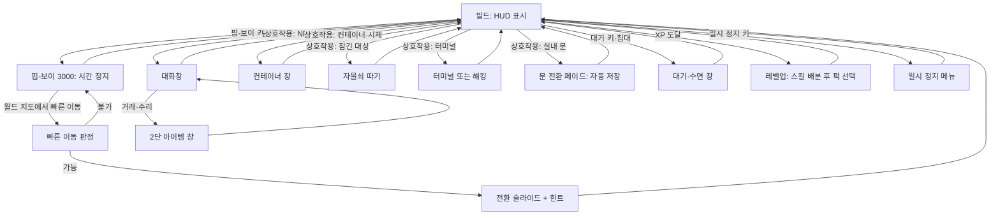
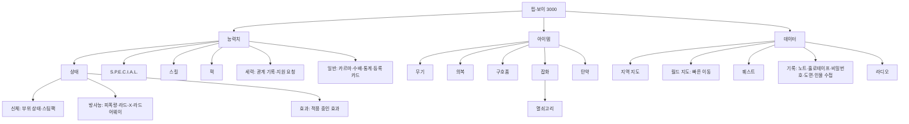
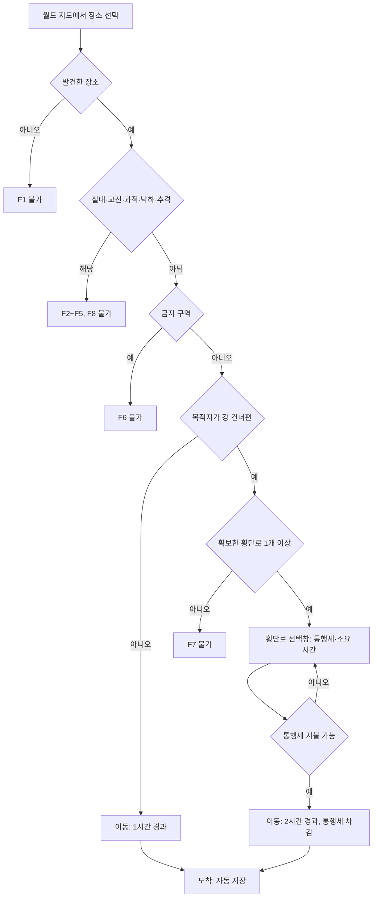
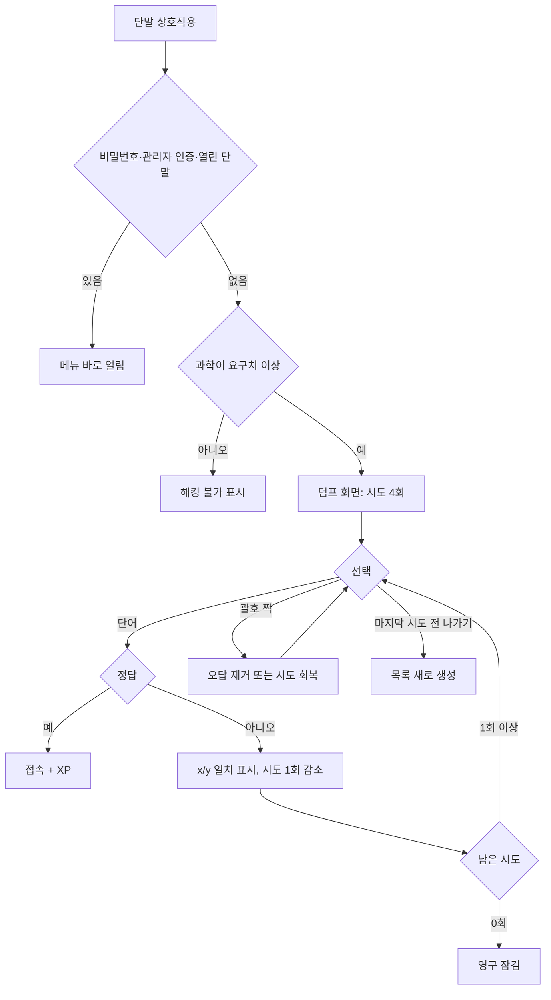
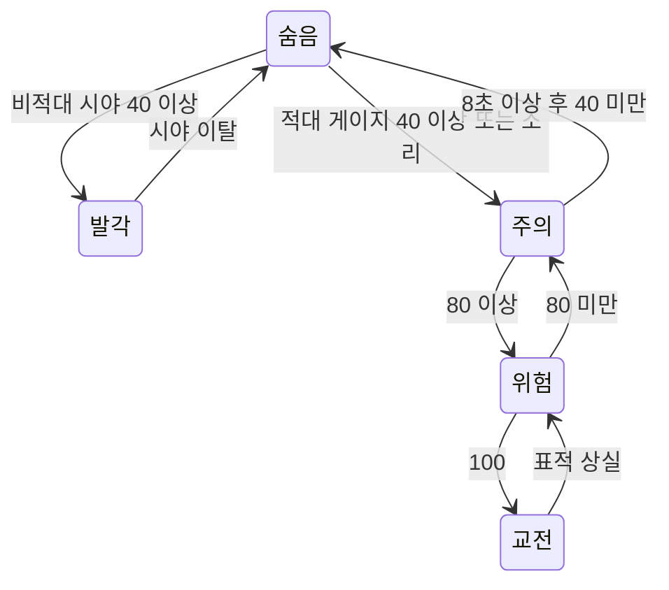

# SD-12. 탐험·상호작용·UI

> **서울 폴아웃 상세 기획서 세트** | 문서 ID: SD-12 | 버전: v1.0 | 작성일: 2026-10-12
> **범위**: 핍-보이 3000(메뉴 구조·화면 배치·관리자 코드 표시·세력 호감도 화면·인물 수첩·다중 경로 퀘스트 기록), HUD(체력·AP·방사능·방위 링·탐지 표시·퀘스트 마커), 월드 지도·장소 발견·빠른 이동(한강 횡단 제한), 대화창(얼굴 그래픽·판정 태그·대화 기록·말씨), 상호작용 대상(문·컨테이너·터미널·노트·홀로테이프·침대·작업대·정수기·관제망 장치), 미니게임(자물쇠 따기·해킹), 은신·범죄·현상금, 라디오, 거래·수리·제작 UI, 세력 지원 병력 호출·일시 동행 NPC 표시, 함정·환경 위험·지형과 층 이동, 저장·옵션·접근성·조작, 한국어 텍스트 규칙(조사 자동 처리·줄바꿈·도트 한글 폰트).
> **다루지 않는 것**: 전투 판정·AP 용도·피해 수치(→ SD-11), 능력치·스킬·퍽·카르마 수치(→ SD-10), 아이템 데이터(→ SD-13), 가격·상인(→ SD-15), 권역·다리·지하철 노선 배치(→ SD-08), 장소 목록(→ SD-09a~f), 도트 규격·팔레트(→ SD-16), BGM·효과음 목록(→ SD-17), 명명 표기 원칙(→ SD-18).
> **관련 문서**: [SC-00 컨셉](00_concept.md), [SD-01 게임 개요](01_game-overview.md), [SD-03a 메인 스토리 1부](03a_main-story-part1.md), [SD-03b 메인 스토리 2부](03b_main-story-part2.md), [SD-04a~04c 사이드 퀘스트](04a_side-quests-south.md), [SD-04d 세력 퀘스트 라인](04d_faction-questlines.md), [SD-05 비표시·반복·인카운터](05_misc-quests-encounters.md), [SD-06 세력](06_factions.md), [SD-07a 주요 인물](07a_characters-major.md), [SD-07b NPC 디렉터리](07b_npc-directory.md), [SD-08 월드·권역](08_world-regions.md), [SD-09a~09f 장소](09a_locations-r01-r02.md), [SD-10 캐릭터 시스템](10_character-system.md), [SD-11 전투](11_combat-system.md), [SD-13 아이템](13_items.md), [SD-15 경제](15_economy.md), [SD-16 아트](16_art-direction.md), [SD-17 사운드](17_sound.md), [SD-18 용어·명명](18_naming-terms.md), 원작 [RD-17 탐험·상호작용](../reverse-design/17_exploration-interaction.md), [RD-18 UI/UX](../reverse-design/18_ui-ux.md), [RD-27 이식 시사점](../reverse-design/27_adaptation-notes.md)

---

## 1. 개요

### 1.1 목적
- 원작 폴아웃 3의 탐험·상호작용 규칙(RD-17)과 화면 체계(RD-18)를 **탑다운 2D·심리스 외부·실시간 맵 전투·음성 없음**(RD-27 P1·P3·P6·P7·P10) 조건으로 다시 설계한다.
- 서울판 고유 요소를 UI에 넣는다. 관리자 코드와 관제망 상태 표시, 한강 횡단과 빠른 이동, 주인공 현상금, 한국어 공문체 터미널, 한국어 단어 해킹, 조사 자동 처리.
- 제작자가 바로 화면을 그리고 이벤트를 짤 수 있도록 좌표·수치·상태표를 준다.

### 1.2 요약
1. **핍-보이 3000**은 원작의 3탭 구조를 그대로 쓰고, 능력치 탭에 **세력** 하위 탭 1칸을 더한다(3탭 × 5~6하위 탭). 볼트 S-07 지급품은 세진전자가 면허 조립하면서 **등록 단말 모듈**을 덧단 판본이다. 이 모듈이 메인 스토리의 '관리자 코드'를 띄운다(3.8절).
2. **세력 기록**은 호감도를 숫자가 아니라 **관계 한 줄 서술 + 최근 사건 기록**으로 보여 준다. 숫자는 옵션에서만 켠다. 관계 변화는 먼저 세계의 반응(NPC 호칭·바크, 방송, 가격, 순찰)으로 알리고, 기본 설정에서는 숫자 토스트를 띄우지 않는다(3.10절, 4.6절, 바이블 §5.8).
3. **퀘스트 기록**은 '막 목표 + 경로 퀘스트' 묶음으로 보여 준다. 목표 문구는 '무엇을 고르라'가 아니라 **상황과 사실**로 쓴다(예: `당인리 제어실 열쇠는 아직 당신 손에 있다`). 다른 경로나 순서 파괴로 목표를 먼저 이루면 기록이 세계 상태 플래그를 따라 갱신된다(3.12절). 진영 가입·동맹·결말을 고르는 UI는 만들지 않는다.
4. **HUD**는 탑다운 북쪽 고정 화면에 맞춰 원작의 나침반 막대를 **원형 방위 링**으로 바꾼다. 지형을 그리는 미니맵은 두지 않는다(4.1절).
5. **월드 지도**는 장소 250곳 이상을 권역·유형·상태(발견·표시·소문) 필터와 **지상·지하(UG)·한강(HR)·서울의 판도 레이어**로 보여 주고, SD-08 좌표를 커서에 표시한다. 빠른 이동은 지도와 **이동 목록**(초성 검색·즐겨찾기) 두 방식이다. 강을 건너는 빠른 이동은 **확보한 횡단로가 1개 이상**일 때만 열린다(5장).
6. **대화**는 텍스트와 얼굴 그래픽(96×96)으로 한다. 판정 태그는 `[화술 45%]`, `[과학 60]`, `[카르마]`, `[관리자 인증]` 형식이다. 선택지에 호감도 영향은 **미리 표시하지 않는다**(6.3절). 주인공 말씨는 NPC 데이터가 정한다(6.5절).
7. **해킹은 한국어 음절 단어 맞히기**를 기본으로 한다. 원작의 위치 일치 피드백(`x/y`)과 괄호 짝 규칙을 그대로 쓴다(8.3절).
8. **범죄**는 원작처럼 집단 단위 응징이다. 여기에 **수배도(주인공 현상금)** 변수를 따로 두고, 비상정부·새벽인력 호감도와 연동한다(9.9절).
9. **결말은 메뉴가 아니라 관제 본부 콘솔 앞의 오브젝트 상호작용**(생체 인증 판, 테이프 슬롯, 진공관 코어, 지휘 열쇠)으로 정해진다(7.9절). **동료 시스템은 없다**(바이블 K7). 그 자리를 **세력 지원 병력 호출**(신뢰 이상)과 **일시 동행 NPC 표시**가 맡는다(11.4절). 이름 있는 NPC 500명 이상에 대응해 **이름표·서비스 아이콘·인물 수첩**을 둔다(4.9절, 3.11절).
10. **라디오**는 채널 음악 + 자막 띠 방송이다. 한국어 텍스트는 **조사 제어 코드 `\J[...]`**, 어절 단위 줄바꿈, 12px·16px 도트 한글 폰트를 기준으로 한다(10장, 14장).

### 1.3 설계 원칙
| # | 원칙 | 적용 |
|---|---|---|
| U1 | 단말 문법 유지 | 대괄호는 '시스템이 말하는 부분'이다. HUD `[숨음]`, 대화 `[화술 45%]`, 터미널 `[1] 일지 열람`, 상호작용 `[잠김: 보통]`이 같은 규칙을 쓴다(RD-18 §16.3) |
| U2 | 숫자는 숨기지 않는다 | 화술 확률, 잠금 등급, 아이템 수치, 수배 등급을 직접 보여 준다 |
| U3 | 색만으로 정보를 주지 않는다 | 소유물(붉은색)·적·아군 표시에 반드시 글자 태그나 모양을 함께 붙인다(13.7절) |
| U4 | 탑다운에서 읽히게 | 원작의 1인칭 전제 UI(나침반 막대, 조준점, 자물쇠 클로즈업)는 위에서 내려다보는 화면에 맞게 바꾼다 |
| U5 | 한국어가 먼저 | 메뉴·태그·약어를 한국어로 쓴다. 원작 영문 약어(CND·DR 등)는 괄호 병기만 한다 |
| U6 | 공문 문화는 꾸밈이자 정보 | 터미널·안내 방송·수배 공고를 2077년 한국 공문체로 써서 '명령' 주제를 화면에서 드러낸다(바이블 §5.1, §8) |

### 1.4 다른 문서와의 경계
| 대상 | 이 문서가 정하는 것 | 다른 문서가 정하는 것 |
|---|---|---|
| AP | AP 바의 위치와 표시 | AP의 용도(달리기·회피·조준 사격) → SD-11 |
| 화술 판정 | 태그 표기, 확률 표시, 1회성 처리 | 판정 공식과 NPC 호감도 값 → SD-10 |
| 탐지·은신 | 탐지 게이지 공식, 상태 표시, 소매치기·절도 | 적 AI 교전 행동, 기습 피해 배수 → SD-11 |
| 수배도 | 변수, 등급, UI, 방송 연동 | 단계 진입 시점 → SD-03a·03b, 추격 인카운터 내용 → SD-05, 현상금 금액 → SD-15 |
| 세력 호감도 | 세력 기록(서술), 판도 지도 레이어, 관계 변화 알림 규칙, 지원 병력 호출 창 | 수치 변동표·연동 계수·단계 혜택·지원 병력 구성 → SD-06 |
| 퀘스트 기록 | 막·경로 묶음 표시, 순서 파괴 갱신 규칙, 추적·마커 | 막 전환 플래그와 경로 목록 → SD-03a·03b |
| 지도 | 레이어·필터·마커 표시, 좌표 읽기, 이동 목록 | 좌표계 → SD-08, 장소별 좌표·유형 → SD-09a~f |
| NPC | 이름표, 서비스 아이콘, 인물 수첩 | 인물 목록과 서비스 → SD-07a·07b |
| 라디오 | 채널 구조, 자막 방식, 뉴스 트리거 규칙 | 곡 목록과 작곡 → SD-17, 진행자 말투 → SD-07a |
| 한강 횡단 | 빠른 이동 규칙, 횡단로 상태 변수 | 다리·터널의 수와 위치 → SD-08 |
| 폰트·UI 그림 | 크기, 배치, 글자 수 상한 | 팔레트, 도트 규칙, 외곽선 → SD-16 |

---

## 2. 화면 체계와 공통 규격

### 2.1 화면 계층
| 계층 | 화면 | 게임 시간 |
|---|---|---|
| 월드(HUD) | 방위 링, HP·AP 바, 탄약, 탐지 표시, 방사능 계기, 알림, 상호작용 문구, 라디오·홀로테이프 자막 띠, 바크 말풍선 | 흐름 |
| 다이제틱 장치 | 핍-보이 3000, 터미널, 자물쇠 클로즈업, 엘리베이터 층 패널 | 정지 |
| 모달 | 대화, 거래, 컨테이너, 소매치기, 레벨업·퍽 선택, 대기·수면 창, 메시지 상자, 지원 요청 창, 작업대, 일시 정지 메뉴 | 정지 |
| 반모달 | 지원 병력 명령 휠, 단축키 목록 | 25%로 느려짐 |
| 전환 | 실내 문 전환 페이드, 빠른 이동 슬라이드, 엔딩 슬라이드 | – |

### 2.2 화면 전환 흐름


### 2.3 화면별 시간·저장 규칙
| 화면 | 게임 시간 | 수동 저장 | 비고 |
|---|---|---|---|
| 필드 | 흐름 | 가능(일시 정지 메뉴) | 13.1절 제한 조건 적용 |
| 핍-보이 | 정지 | **불가** | 원작 규칙. 저장은 일시 정지 메뉴에서만 한다 |
| 대화·거래·컨테이너·소매치기 | 정지 | 불가 | 원작의 미확인 항목을 '정지'로 확정한다. 실시간 전투에서 창을 연 사이 피격당하는 일을 막는다 |
| 터미널·해킹·자물쇠 | 정지 | 불가 | 같은 이유 |
| 지원 병력 명령 휠 | 25% | 불가 | 전투 중 지시용(11.4절) |
| 대기·수면 | 빠르게 흐름 | 불가 | 13.4절의 불가 조건 |
| 문 전환 | – | 자동 저장 | 13.2절 |
| 일시 정지 메뉴 | 정지 | 가능 | 난이도·화면 색 변경도 여기서 한다 |

### 2.4 UI 기준 캔버스와 해상도
- **UI 가상 캔버스는 640×360(16:9)**이다. UI 레이어는 이 캔버스에 그리고 출력 해상도에 **정수 배율**로 키운다(1280×720 = ×2, 1920×1080 = ×3, 2560×1440 = ×4).
- **월드 타일 크기와 UI 캔버스는 분리**한다. 타일 크기(48·32·16px 후보)는 SD-16이 정한다. 월드 레이어가 어떤 크기를 쓰든 UI는 640×360 격자로 설계해 도트가 깨지지 않게 한다.
- 정수 배율이 맞지 않는 화면(예: 1366×768)은 ×2로 그린 뒤 남는 영역을 검은 띠로 둔다.
- **안전 영역**: 가장자리 8px 안쪽에만 UI를 둔다(TV 출력·화면 굴곡 대비).
- 쯔꾸르 MZ 기본 해상도(816×624)를 쓰지 않는 이유: 16:9 출력과 정수 배율을 함께 맞출 수 없고, 핍-보이처럼 정보가 많은 화면에서 12px 한글 기준 행 수가 부족하다(RD-18 §17.3).

### 2.5 공통 표기 문법
| 요소 | 규칙 | 예 |
|---|---|---|
| 시스템 태그 | 대괄호 `[ ]`. 상태·판정·조건 | `[숨음]`, `[화술 45%]`, `[잠김: 어려움]`, `[소유]` |
| 키 표시 | 꺾쇠 없는 키 그림 아이콘 + 동작 | `(E) 열기` — 실제 화면은 키 모양 아이콘 |
| 수치 | 천 단위 쉼표, 단위는 붙여 쓴다 | `1,240캡`, `무게 182/250`, `라드 340` |
| 날짜·시각 | 공문식 날짜 + 24시간제 | `2277. 08. 15. 14:32` |
| 약어 | 한국어 약칭 + 원작 약어 병기는 도움말에만 | 내구(CND), 피해(DAM), 저항(DR), 무게(WG), 가치(VAL) |
| 색 의미 | 색은 보조 수단이다. 모양·글자와 함께 쓴다 | 적 = 붉은 마름모, 아군 = 푸른 원, 소유물 = 붉은 이름 + `[소유]` |
| 부정·경고 | 공문 어미 | `출입 금지`, `사용 불가`, `전원 없음` |

---

## 3. 핍-보이 3000

### 3.1 서울판에서의 위치
| 항목 | 결정 |
|---|---|
| 기종 | **핍-보이 3000**. 볼트 S-07은 한결건설이 볼트-텍 면허로 지은 볼트이므로 볼트-텍 표준 지급품을 쓴다(바이블 §3.4) |
| 제조 표기 | 손목 명판: `PIP-BOY 3000 / 로브코 설계 · 세진전자 면허 조립 / 볼트-텍 서울 S-07 지급품`. 서울 볼트용 물량은 세진전자가 면허 조립했다는 설정이다 |
| 서울판 개조 | 세진전자는 S-07 지급분에 **등록 단말 모듈**을 덧달았다. 볼트 출생 등록 정보를 담고, 관제망의 등록 관리자 인증에 응답하는 부품이다. 주인공의 핍-보이가 관리자 코드를 띄우는 이유다(3.8절). 바이블 §5.2의 '출생 등록 체계를 관제망에 연결' 설정을 물건으로 구체화한 것이다 |
| 지급 시점 | MQ-P2 '열 살, 첫 배정'(2268). 오버시어 윤정인이 준다. 생활기록부 작성(S.P.E.C.I.A.L. 배분)이 핍-보이 첫 화면에서 이어진다 |
| 볼트 밖 인식 | 황무지에서 핍-보이는 '볼트 사람 표시'다. 대화에서 정착민이 알아보는 조건 태그로 쓴다. 비상정부 계엄군은 핍-보이를 '관리자 단말'이라 부르며 회수 대상으로 본다(SD-03a 연출 접점) |
| 벗기 | 벗을 수 없다(원작과 같다). 페이퍼돌 레이어에서 왼팔 손목 부품으로 항상 그린다(SD-16) |

### 3.2 기본 조작
| 항목 | 규칙 |
|---|---|
| 열기·닫기 | 키보드 `Tab`, 게임패드 `B`(원작 배치). 탭 바로 열기: `F1` 능력치, `F2` 아이템, `F3` 데이터, `M` 월드 지도, `J` 퀘스트 |
| 열 때 연출 | 장치 그림이 화면 아래에서 0.2초 동안 올라오고, 화면이 0.15초 동안 켜지는 연출(가로 주사선 확장). 옵션으로 끌 수 있다 |
| 시간·저장 | 열어 둔 동안 게임 시간 정지, 저장 불가 |
| 라이트 | 핍-보이 키를 0.6초 이상 누르면 켜고 끈다(원작). 별도 키 `F`도 둔다. 효과는 13장 조작표와 9.1절의 조명 규칙 |
| 사용 불가 상황 | 대화·연출·미니게임 중, 낙하 중, 스크립트가 막은 구간(예: 관제 본부 최종 콘솔 연출) |
| 전투 중 사용 | 원작처럼 허용한다. 시간이 멈춘 채 스팀팩을 쓸 수 있다. 남용 방지책(사용 후 짧은 경직 등)은 SD-11이 정한다 |

### 3.3 메뉴 트리

- 원작 영문 탭 이름의 대응: STATS = 능력치, ITEMS = 아이템, DATA = 데이터, Status = 상태(CND = 신체, RAD = 방사능, EFF = 효과), Apparel = 의복, Aid = 구호품, Misc = 잡화, Keyring = 열쇠고리, Local Map = 지역 지도, World Map = 월드 지도, Notes = 기록. 최종 표기는 SD-18이 확인한다.
- **서울판 추가 항목**: 능력치 탭의 **세력** 하위 탭(3.10절), 일반 화면의 **등록 카드**(3.8절)와 **수배** 칸(9.9절), 기록의 **인물 수첩**(3.11절). 주 탭은 3개 그대로다. 능력치 탭만 하위 탭이 6칸이 된다(하위 탭 폭 90px).

### 3.4 공통 화면 배치
- 핍-보이는 **전체 화면**으로 띄운다(RD-18 §17.3 권장). 테두리만 장치 모양이고 안쪽 화면이 캔버스 대부분을 쓴다.

**배치 좌표 (640×360 캔버스 기준, 단위 px)**
| 영역 | x | y | 폭 | 높이 | 내용 |
|---|---|---|---|---|---|
| 장치 테두리 | 0 | 0 | 640 | 360 | 고정 그림. 왼쪽 위 방사능 바늘 계기(48×32), 오른쪽 아래 명판, 지문 자국 |
| 화면 영역 | 40 | 28 | 560 | 304 | 곡면 CRT. 주사선·비네트 오버레이 |
| 주 탭 줄 | 48 | 32 | 544 | 16 | `능력치  아이템  데이터` + 오른쪽 끝 날짜·시각 |
| 정보 줄 | 48 | 50 | 544 | 14 | 탭별 요약 수치(아래 표) + 관제망 램프(3.8절) |
| 구분선 | 48 | 66 | 544 | 1 | |
| 목록 창 | 48 | 70 | 200 | 222 | 항목 목록. 12px 행 기준 15행 + 스크롤 표시 |
| 상세 창 | 256 | 70 | 336 | 222 | 볼트 보이 그림(96×96) + 수치 표 + 설명문 |
| 하위 탭 줄 | 48 | 296 | 544 | 16 | 하위 탭 5칸(능력치 탭은 6칸) |
| 조작 안내 줄 | 48 | 314 | 544 | 12 | 키 아이콘 + 동작(10px 글꼴) |

**와이어프레임 (텍스트)**
```
+--[ 볼트-텍 ]-----------------------------------------------------------+
| (방사능 바늘)                                                           |
|  +------------------------------------------------------------------+  |
|  | 능력치    아이템    데이터                      2277. 08. 15. 14:32|  |
|  | 레벨 7 | HP 145/160 | AP 72/80 | XP 1,240/1,450        [관제망 ●] |  |
|  |------------------------------------------------------------------|  |
|  | > 힘            6  |  +----------+  힘 (STRENGTH)                 |  |
|  |   인지력        5  |  | 볼트 보이 |  근력과 체격. 소지 한도와       |  |
|  |   지구력        5  |  |  그림     |  근접 무기 피해에 영향을 준다. |  |
|  |   카리스마      4  |  | 96 x 96  |                                |  |
|  |   지능          7  |  +----------+  관련: 근접 무기, 소지 한도    |  |
|  |   민첩성        6  |                                              |  |
|  |   행운          5  |  기본 6   장비 +0   약물 +0                   |  |
|  |------------------------------------------------------------------|  |
|  |  상태  S.P.E.C.I.A.L.  스킬  퍽  세력  일반                        |  |
|  |  (Q)(E) 탭   (위)(아래) 선택   (Enter) 사용   (Tab) 닫기          |  |
|  +------------------------------------------------------------------+  |
|                                     PIP-BOY 3000 / 세진전자 면허 조립   |
+------------------------------------------------------------------------+
```

**탭별 정보 줄**
| 탭 | 정보 줄 내용 |
|---|---|
| 능력치 | `레벨` / `HP 현재/최대` / `AP 현재/최대` / `XP 현재/다음` |
| 아이템 | `무게 현재/한도` / `HP` / `저항(DR)` / `캡` |
| 데이터 | `위치: 권역 · 장소명` / 날짜·시각(오른쪽 위 주 탭 줄에 이미 있음) / 현재 활성 퀘스트명 |

- 캡 표시 상한은 9,999,999캡으로 한다(원작의 1,000,000 표시 한계는 계승하지 않는다).
- 원작 개발 일지의 문법을 지킨다. 겹치는 창 없음, 장식 최소, 단색, 볼트 보이 그림이 유일한 도상이다(RD-18 §4.3).

### 3.5 능력치 탭
| 하위 화면 | 표시 | 조작 | 서울판 변경 |
|---|---|---|---|
| 상태 > 신체 | 볼트 보이 전신 그림에 부위 6곳(머리·몸통·왼팔·오른팔·왼다리·오른다리) 상태 막대, 보유 스팀팩 수 | 부위를 골라 스팀팩 사용(불구 부위 지정), '전신' 사용 | 불구 부위는 막대 옆에 `[불구]` 글자를 함께 표시 |
| 상태 > 방사능 | 누적 피폭량(라드), 방사능 저항, 현재 단계(SD-10·SD-11의 방사능 단계표) | 라드-X·라드어웨이 사용 | 단계 이름을 글자로 표시(예: `[경미한 방사능 중독]`) |
| 상태 > 효과 | 의복·약물·방사능·숙면 효과·중독·불구 효과 목록과 남은 시간 | 열람 | 남은 시간을 게임 시각 기준 `3시간 20분`으로 표시 |
| S.P.E.C.I.A.L. | 7개 능력치, 일시 증감을 `기본 / 장비 / 약물` 3칸으로 분리 | 열람 | 생활기록부(MQ-P2) 문구를 설명 하단에 인용 |
| 스킬 | 13개 스킬, 태그 스킬 표시 `[태그]`, 증감 | 열람 | 스킬 상세에 '이 스킬이 여는 것' 줄을 둔다(예: 자물쇠 따기 → `잠금 등급 보통까지`) |
| 퍽 | 보유 퍽 목록, 랭크 | 열람 | 퍽 수치는 SD-10 |
| 세력 | 세력별 관계 서술 한 줄, 정착지별 관계, 최근 사건 기록 | 열람, 지원 요청 | 3.10절 |
| 일반 | 카르마 칭호·카르마 막대, 수배 등급, 통계, **등록 카드** | 열람 | 3.8절, 9.9절 |

**일반 화면의 통계 항목** (원작 RD-18 §4.4.1 계승 + 서울판 추가)
| 통계 | 증가 조건 | 비고 |
|---|---|---|
| 완료한 퀘스트 | 메인·사이드 퀘스트 1개 완료 | 계승 |
| 발견한 장소 | 장소 1곳 발견. 볼트 S-07은 제외 | 계승 |
| 죽인 사람 / 죽인 크리처 | 원작 기준(야생 구울은 크리처) | 계승 |
| 딴 자물쇠 / 해킹한 단말 | 성공 1회 | 계승 |
| 사용한 스팀팩·라드-X·라드어웨이·약물 | 사용 1회 | 계승 |
| 중독 횟수 / 해제한 지뢰 / 화술 성공 / 소매치기 성공 | 원작 기준 | 계승 |
| 폭발한 바지 | 역소매치기로 폭발물 기폭 | 계승 |
| 읽은 책 / 모은 수집품 | 스킬북 1권 / 수집품 1개(보블헤드 대응물은 SD-13) | 수집품 명칭은 SD-13 |
| 만든 무기 | 작업대 제작 1회 | 계승 |
| **건넌 횡단로** | 한강 횡단로 1곳을 처음 통과 | 신규. 5.7절 |
| **관리자 인증 사용** | `[관리자 인증]` 선택 1회 | 신규. 3.8절 |
| **잠재운 관제망 로봇** | 관리자 인증·해킹으로 관제망 로봇 1대 정지 | 신규 |
| **들은 방송 소식** | 라디오 뉴스 1건 수신 | 신규. 10.4절 |
- 원작의 메스메트론·샌드맨·마비 펀치·계약·시체 먹기 등 특정 퍽·아이템 통계는 SD-10·SD-13에 같은 퍽·아이템이 생길 때만 넣는다.

### 3.6 아이템 탭
| 하위 화면 | 표시 | 조작 |
|---|---|---|
| 무기 | 소지 무기, 장착 표시 `[장착]`, 탄약 `탄창/보유` | 장착·해제, 수리(11.2절), 버리기, 단축키 지정 |
| 의복 | 몸통·머리·눈 슬롯별 장착 표시. 전신 장비는 `[머리·눈 가림]` 표시 | 장착·해제, 수리, 버리기, 단축키 지정. 장착하면 페이퍼돌 미리보기(상세 창에 주인공 정면 도트) |
| 구호품 | 음식·의료품·약물·물 | 사용, 버리기, 단축키 지정 |
| 잡화 | 맨 위에 열쇠고리, 그 아래 잡동사니·제작 재료·퀘스트 물품 `[퀘스트]` | 열쇠고리는 버리거나 팔 수 없음 |
| 탄약 | 탄 종류와 수량 | 열람 |

**상세 창 필드**
| 필드 | 표시 이름 | 의미 |
|---|---|---|
| CND | 내구 | 막대 + 단계 글자(새것·양호·낡음·위험·파손). 단계 수는 SD-13 결정에 맞춘다 |
| DAM | 피해 | 무기 피해 대략값 |
| DR | 저항 | 방어구 피해 저항 |
| WG | 무게 | |
| VAL | 가치 | 캡 |
| 효과 | 효과 | 장착 효과 |
| 장물 | `[장물]` | 훔친 물건 표시(9.5절). 훔친 상점에는 팔 수 없다 |

**단축키 8칸** (원작 계승)
| 항목 | 규칙 |
|---|---|
| 지정 | 키보드: 핍-보이에서 항목에 커서를 두고 숫자 `1~8`. 게임패드: 항목에서 `RB`를 누른 채 D-패드 8방향 |
| 사용 | 필드에서 `1~8` 또는 `RB` + D-패드 |
| 목록 보기 | 숫자 키나 `RB`를 길게 누르면 8칸 원형 목록이 뜨고 게임 시간이 25%로 느려진다 |
| 대상 | 무기, 의복, 구호품, 투척 무기 |

### 3.7 데이터 탭
| 하위 화면 | 표시 | 조작 | 상세 |
|---|---|---|---|
| 지역 지도 | 현재 실내·주변 외부 상세. 탐험한 영역만 드러남 | 사용자 마커, 확대 2단계 | 5.2절 |
| 월드 지도 | 서울 전도, 장소 마커(발견·표시·소문), 퀘스트·사용자·동행 마커, 횡단로 상태 | 빠른 이동, 이동 목록, 필터, 레이어 전환(지상·UG·HR), 사용자 마커, 확대 4단계 | 5.1~5.6절 |
| 퀘스트 | 막 목표와 경로 퀘스트 묶음, 세력 퀘스트 라인, 사이드 | 추적 퀘스트 지정(1개 + 고정 2개) | 3.12절 |
| 기록 | 노트·홀로테이프·비밀번호·도면·내려받은 단말 기록·인물 수첩·대화 기록 | 읽기, 재생, 검색 | 7.5절, 3.11절 |
| 라디오 | 수신 중인 방송국·신호 목록, 지난 소식 보기 | 켜기·끄기 | 10.6절 |

- 퀘스트 화면의 구성과 목표 문구 규칙은 3.12절에서 정한다.

### 3.8 등록 카드와 관리자 코드 (메인 스토리 연동)
- '일반' 화면 맨 위 항목이 **등록 카드**다. 볼트 S-07의 주민 등록 정보를 핍-보이가 보여 주는 화면이며, 메인 스토리가 진행될수록 내용이 바뀐다.
- 정보 줄 오른쪽 끝에는 **관제망 램프**가 있다. 등록 단말 모듈이 관제망 신호를 받는 상태를 보여 준다.

**등록 카드 배치 (상세 창 336×222)**
```
+--------------------------------------------------------------+
| 볼트-텍 서울 S-07 주민 등록 카드                               |
| 성명    : \P                    등록번호 : S07-2258-0413     |
| 출생    : 2258. 03. 02.         배정 구역: 제3 생활동         |
| 적성 평가: 관리 후보 1순위 (2274)                             |
| ------------------------------------------------------------ |
| 관리자 코드: ####-####-##   [판독 불가]                       |
| 관제망 응답: 대기                                            |
| 비고    : (진행에 따라 문장 추가)                             |
+--------------------------------------------------------------+
```
- 등록번호의 뒤 4자리는 새 게임마다 무작위로 정한다. 출생일은 MQ-P1에서 정한다(SD-03a).
- `####`은 실제 화면에서 깨진 글자 도트(문자 깨짐 그림 4종 순환)로 그린다.

**진행 단계별 표시 변화** (진입 시점은 SD-03a·03b가 정본, 아래는 화면 규격. 순서 파괴로 단계가 건너뛰어도 각 칸은 해당 플래그만 보고 갱신한다)
| 단계 | 시점 | 관리자 코드 칸 | 관제망 응답 칸 | 램프 | 알림 |
|---|---|---|---|---|---|
| 0 | MQ-P2 지급 ~ MQ-P3 전 | 칸 없음 | 칸 없음 | 없음 | – |
| 1 | MQ-P3 적성 평가 후 | 칸 없음 | 칸 없음 | 없음 | 적성 평가 줄에 `관리 후보 1순위` 추가 |
| 2 | MQ-P4 볼트 문 개방 | `####-####-## [판독 불가]` | `대기` | 회색 ○ | `알 수 없는 신호를 수신했습니다.` |
| 3 | 1막 진행 중(MQ-101~102) | 같음. 비고에 `읽을 수 있는 사람이 필요하다` | `대기` | 회색 ○ | – |
| 4 | 1막 목표 달성(MQ-103·104·105 중 어느 경로든) | `수도 관제망 등록 관리자 / 인증 등급: 후보` | `대기` | 호박색 ◐ 점멸 | `관리자 코드가 해독되었습니다.` 이후 관제망 단말·로봇에 `[관리자 인증]` 선택지가 열린다 |
| 5 | MQ-301 당인리 원자로 재가동 | `인증 등급: 관리자(제한)` | `부분 가동` | 호박색 ◐ 상시 | `관제망 응답: 부분 가동` |
| 5' | MQ-301에서 원자로를 켜지 않고 떠남 | 같음 | `대기(전원 없음)` | 회색 ○ | 이후 전원이 들어오는 시점(다른 세력이 켬, MQ-501 등)은 SD-03a·03b |
| 6 | MQ-302 프로토콜 테이프를 들고 나옴(또는 MQ-304 기록 8건 복원) | 비고에 `시민 보호 프로토콜 테이프 소지` / 남에게 맡기면 `프로토콜 테이프: (맡긴 곳)` | 변화 없음 | 변화 없음 | `시민 보호 프로토콜을 내려받았습니다.` |
| 7 | 6막 도심 진입(MQ-601~604 중 실제로 들어간 길) | `인증 등급: 관리자` | `가동` | 녹색 ● | – |
| 8 | MQ-702 콘솔 앞 행동 후(7.9절) | 결말에 따라 E1~E5 문구(아래) | 결정에 따라 | 결정에 따라 | – |

| 엔딩 | 관제망 응답 칸 | 램프 |
|---|---|---|
| E1 계엄 프로토콜 가동 | `가동: 비상 주민 분류 지침` | 붉은 ◆ |
| E2 연합단에 지휘권 이양 | `가동: 지휘권 이양됨` | 녹색 ● |
| E3 시민 등록 | `가동: 시민 보호 프로토콜` | 녹색 ● |
| E4 관제망 영구 정지 | `정지(종전)` | 꺼짐 |
| E5 관리자 군림 | `가동: 관리자 직할` | 녹색 ● 굵게 |

**관리자 인증 상호작용** (4단계 이후)
| 대상 | `[관리자 인증]`의 효과 | 대가 |
|---|---|---|
| 관제망 단말(호박색 화면) | 해킹 없이 접속. 단계 4는 '조회'만, 단계 5 이후 문·포탑·로봇 명령까지 | 사용 1회마다 수배도 +3(9.9절). 관제망 기록이 비상정부에 전해진다는 설정 |
| 관제망 경비 로봇(대기 중) | 단계 5 이후 '대기 유지' 명령으로 로봇을 깨우지 않고 지나감 | 같음 |
| 관제망 차단벽·대피소 문 | 단계 5 이후 개방 | 같음 |
| 각성회 신도 대화 | 인증 표시를 보이면 반응이 바뀜(SD-04d·SD-06) | 수배도 변화 없음 |
- 이 규칙은 '열쇠를 쓸수록 쫓긴다'는 메인 주제를 시스템으로 보여 주려는 제안이다. 수배도 상승폭과 4막 이후 처리는 SD-03a·03b가 확정한다.

### 3.9 화면 색과 CRT 효과
| 항목 | 규칙 |
|---|---|
| 화면 색 | **초록(기본)·호박·파랑·흰색** 4종 + 접근성용 **고대비**(검정 바탕 흰 글자, 효과 끔). 일시 정지 메뉴에서 바꾸며 HUD·터미널 기본색도 함께 바뀐다(원작 계승). 단 관제망 단말은 항상 호박색이다(7.4절) |
| 단색 규칙 | 핍-보이 안에서는 선택한 한 색의 밝기 4단계(배경·흐림·본문·강조)만 쓴다. 정확한 색값은 SD-16 |
| 주사선 | 2px 주기, 어두운 줄 불투명도 20%. 옵션 0~100% |
| 곡면 비네트 | 화면 가장자리 12px 어둡게 |
| 깜빡임 | 0.8~1.2초 무작위 간격의 미세 밝기 변화(±3%). 광과민 옵션에서 끈다 |
| 탭 전환 | 수직 동기 흔들림 2프레임 |
| 지문 자국 | 화면 오른쪽 아래 반투명 그림 1장 |

### 3.10 세력 기록 (호감도의 서술 표시)
- 바이블 §5.8·§6.2의 표시 원칙을 따른다. **호감도 수치는 내부 값**이고, 플레이어에게는 **관계를 말로** 보여 준다. 세력 가입·동맹·결말을 고르는 버튼은 이 화면에 없다.

**대상과 등록**
| 항목 | 규칙 |
|---|---|
| 대상 | 비상정부, 연합단, 원칙파, 지하시장, 각성회, 중국군 잔존병, 새벽인력, 정착지 연합(하위: 봉천 계단마을·탱크마을·노들섬·선유도·뚝섬 장터·세이프빌 등 정착지별). 목록은 SD-06이 정본 |
| 등록 시점 | 그 세력의 이름을 처음 듣거나 세력원을 처음 만난 순간. 그전에는 목록에 없다 |
| 제외 | 약탈자·변종(기본 적대), 철벽경호·자율방범대(카르마 추적자). 이들은 기록 대신 카르마 칭호·수배 칸에서 다룬다 |

**화면 배치** (목록 창 200px + 상세 창 336px)
```
+--------------------+------------------------------------------+
| (문장) 연합단    • |  연합단                                   |
| (문장) 비상정부  ! |  "용산 순찰대가 당신에게 먼저 경례한다."     |
| (문장) 지하시장    |  ----------------------------------------  |
| (문장) 각성회      |  용산 요새를 지키는 기술 군사 집단.          |
| (문장) 새벽인력  ! |  지금 당신이 받는 대우                      |
| (문장) 정착지 연합 |   - 용산 요새 상점이 장비를 판다.           |
|   봉천 계단마을    |   - 요새 안 숙소를 쓸 수 있다.             |
|   노들섬           |  들리는 말                                 |
|   탱크마을         |   "단장은 믿는 사람에게만 분대를 빌려준다." |
|                    |  최근 일                                   |
|                    |   08. 15. 노들섬에서 순찰대를 도왔다.       |
|                    |   08. 12. 원칙파 회수조를 그냥 보냈다.      |
|                    |  (지원 요청)  (판도 지도)                  |
+--------------------+------------------------------------------+
```
| 요소 | 규칙 |
|---|---|
| 목록 표지 | `•` = 읽지 않은 새 기록. `!` = 관계가 적대에 가까움(경계 단계 하단 또는 적대). 숫자·막대는 없다 |
| 관계 서술 | 세력마다 **단계별 문장 6줄 + 단계 경계 근처 문장 5줄 = 11줄**을 쓴다. 경계 근처 문장은 다음 단계로 넘어가기 직전(경계값 ±5)에 쓰여 '기울고 있음'을 말로 알린다. 예: 경계→적대 직전 `계엄군 검문소에 당신 인상착의가 붙었다.` 문장은 세계에서 보이는 사실로 쓴다(SD-06·SD-18 문체) |
| 지금 받는 대우 | 현재 단계의 혜택을 **사실 문장**으로 적는다(할인, 상점, 숙소, 출입, 지원 요청 가능). '다음 단계까지 N' 같은 표시는 하지 않는다 |
| 들리는 말 | 더 깊은 관계에서 열리는 것을 소문 형태로 1줄 암시한다(다음 단계 혜택의 서술형). 동맹 단계에서는 그 세력 지도자의 말 1줄로 바뀐다 |
| 최근 일 | 호감도를 움직인 사건을 날짜와 함께 최대 8줄. 주인공이 한 행동을 사실로 적고(`원칙파 회수조를 그냥 보냈다`), 좋고 나쁨을 평가하지 않는다. 오래된 것부터 지우되 전체 기록은 세력당 40줄까지 저장 |
| 정착지 연합 | 하위 정착지마다 같은 형식(관계 한 줄 + 최근 일). 연합 전체 문장은 하위 정착지들의 합산 단계로 고른다 |
| 버튼 | `지원 요청`(신뢰 이상에서만 보임, 11.4절), `판도 지도`(5.8절 레이어로 바로 이동) |

**관계 변화를 알리는 순서** (바이블 §5.8 '세계가 먼저 알려 준다')
| 순서 | 수단 | 규칙 |
|---|---|---|
| 1 | 세계의 반응 | 단계가 바뀌면 **게임 시간 24시간 안에 반응 이벤트 1개 이상**이 반드시 일어난다: 세력원 인사 바크·호칭 변화, 상점 가격 안내 대사, 순찰대·검문소 태도, 전령 쪽지, 남산 방송·국민방송 뉴스. 이벤트 목록은 SD-06 |
| 2 | 세력 기록 | 바뀌는 즉시 '최근 일'에 한 줄이 쌓이고 목록에 `•` 표시. 핍-보이 아이콘(HUD 오른쪽 아래)에 작은 점이 생긴다 |
| 3 | 토스트 | **기본 설정에서는 띄우지 않는다.** 옵션 '관계 변화 알림'으로 켠다(4.6절) |

**숫자 표시 옵션** (일시 정지 메뉴 > 게임 > '관계 수치 표시', 기본 꺼짐)
- 켜면 목록에 단계 이름과 수치(-100~+100), 상세 창에 막대와 경계값이 보이고, 관계 변화 토스트가 수치형으로 바뀐다. 끄면 다시 서술만 남는다. 세이브에 영향이 없다.

### 3.11 인물 수첩
- 이름 있는 NPC가 500명 이상이다(바이블 §5.7). 누가 어디에 있고 무엇을 해 주는지 기억을 돕는 기록이다. 핍-보이 데이터 > 기록 > `인물 수첩`.

| 항목 | 규칙 |
|---|---|
| 등록 | 이름 있는 NPC와 처음 대화하거나 이름을 소개받은 순간 자동 등록. 바크만 들은 인물은 등록하지 않는다 |
| 기록 항목 | 이름, 직함, 소속(세력 문장), 주로 있는 곳(장소명, 지도 연결), 서비스 아이콘(4.9절), 처음 만난 날, 한 줄 메모, 생사 |
| 얼굴 | 얼굴 그래픽이 있는 인물(6.2절 A·B 등급)은 48×48 축소 얼굴. 없는 인물은 맵 스프라이트 정면 그림 |
| 한 줄 메모 | 주인공과의 관계를 사실로 1줄 자동 기록. 퀘스트 단계가 정한 문장을 쓴다(예: `통행세를 반으로 깎아 주었다`, `당인리 제어실 열쇠를 맡겼다`). 개인 호감도 수치는 없다 |
| 생사 | 사망하면 이름이 흐려지고 `고인 (08. 21.)`. 주인공이 모르는 죽음은 표시하지 않는다(시체를 보거나 소식을 들었을 때 갱신) |
| 이동 인물 | 캐러밴·순찰대장처럼 움직이는 인물은 `마지막으로 본 곳`을 기록 |
| 정렬·필터 | 권역(R01~R11, UG, HR), 세력, 서비스, 퀘스트 관련, 생존 여부. 기본 정렬은 최근 만난 순 |
| 검색 | 이름 검색. 한글 **초성 검색** 지원(예: `ㅂㅇㅎ` → 백인하). 패드에서는 초성 원형 입력판(14.4절) |
| 지도 연결 | `지도에서 보기`: 주로 있는 곳에 임시 표식을 찍고 월드 지도로 이동 |
| 스포일러 방지 | 주인공이 아는 사실만 적는다. 소속이 숨겨진 인물은 정체가 드러난 뒤에 소속이 바뀐다 |

### 3.12 퀘스트 기록 (막·경로 묶음)
**구성**
| 묶음 | 내용 | 순서 |
|---|---|---|
| 메인 | 현재 막 1개를 맨 위에. 막 목표 + 그 막의 경로 퀘스트들 + 선택 퀘스트(예: MQ-304) | 현재 막 → 지난 막(접힘) |
| 단서 | 아직 시작하지 않은 막과 관련된 장소·물건을 먼저 만났을 때의 사실 기록 | 최근 순 |
| 세력의 일 | 세력 퀘스트 라인(FQ). 세력별 묶음. '부탁받은 일'로 표기한다 | 최근 순 |
| 사이드 | 권역별 묶음(R01~R11, UG, HR) | 진행 중 → 끝난 것 |
| 기타 | 반복 의뢰(RQ), 수집 기록 | – |
- 비표시 퀘스트(UQ)는 목록에 나오지 않는다(원작 계승, SD-05).

**메인 묶음 예** (3막)
```
[메인] 3막 「세 개의 열쇠」
 목표: 관제망을 켜는 세 조건 중 둘 이상을 손에 넣는다   (1/2)
 ├ 전원 · 당인리 지하 원자력 발전소            [진행 중]
 │   - 원자로는 다시 돌기 시작했다.
 │   - 당인리 제어실 열쇠는 아직 당신 손에 있다.
 ├ 프로토콜 · 세진전자 타워                    [이룸]
 │   - 프로토콜 테이프를 세이프빌 주민 대표에게 맡겼다.
 ├ 길 · 북한산                                [알려진 것 없음]
 │   - 북쪽 산에서 2077년의 무전이 아직 들린다는 말이 있다.
 └ 한유리의 기록                               3/8 [선택]
```
| 요소 | 표기 |
|---|---|
| 막 머리 | `[메인] N막 「제목」` + 목표 1줄 + 달성 수(필요한 경우만, 예: `(1/2)`) |
| 경로 상태 | `[알려진 것 없음]` `[진행 중]` `[이룸]` `[다른 길로 이룸]` `[끝남]` `[놓침]` `[선택]` |
| 사실 줄 | `-` + 현재 상황 문장. 진행에 따라 위에서 아래로 쌓이고, 오래된 줄은 흐리게 |
| 막 달성 | 막 머리에 `[이룸]`. 남은 경로는 닫지 않는다. 경로 머리 아래에 `목표는 이미 이뤘다. 이 길에는 아직 할 일이 남아 있다.` 1줄을 붙인다(바이블 §5.3 '나머지 경로는 정보·호감도·보상으로 남는다') |
| 실패 | 핵심 인물 사망 등으로 그 경로가 닫히면 `[놓침]`과 사실 1줄(`마영식이 죽었다.`). 바이블 §5.3-4에 따라 다른 경로가 남아 있음을 사실 줄로 알린다 |

**목표 문구 규칙** (바이블 §5.8)
| 금지 | 대신 |
|---|---|
| `연합단 또는 비상정부를 선택하라` | `다니엘 서와 강태오가 같은 날 당인리로 사람을 보냈다.` |
| `협력할 세력을 정하라` | `제어실 열쇠는 아직 당신 손에 있다.` |
| `○○에 합류하라` | `다니엘 서가 요새로 다시 와 달라고 했다.`(부탁은 사실로) |
| `결말을 고르라` | `관리자 콘솔은 당신의 손을 기다린다.` |
| `○○의 제안을 받아들일지 정하라` | `지하시장이 물자를 대 주겠다고 했다. 대가는 말하지 않았다.` |
- 목표는 **상황과 사실**로 쓴다. '무엇을 알아내라·확보하라'형 목표(바이블 §5.3-2)는 허용한다(`관리자 코드를 읽을 수 있는 사람을 찾는다`). 진영·결말을 고르게 하는 문장만 금지한다.
- 퀘스트 기록에는 결말 이름(E1~E5)이나 '이 행동이 어떤 결말로 이어진다'는 안내를 쓰지 않는다.

**순서 파괴와 기록 갱신**
- 기록 줄은 **퀘스트 단계가 아니라 세계 상태 플래그**에 묶는다. 같은 사실을 어느 경로로 이뤘든 같은 줄이 켜진다.
- 아직 시작하지 않은 막의 목표를 먼저 이루면(예: 1막 중에 세진전자 타워에서 프로토콜 테이프를 얻음) '단서' 묶음에 사실 줄을 남긴다(`세진전자 타워에서 테이프 하나를 가지고 나왔다. 라벨: 시민 보호.`). 그 막이 시작되면 해당 경로가 처음부터 `[이룸]` 상태로 나타나고, 단서 줄은 막 묶음으로 옮겨진다. 알림 1회: `이미 해 둔 일이 있다: 프로토콜`.
- 막 전환 판정은 SD-03a가 정한다. UI는 막 머리가 바뀌는 순간 큰 알림(4.6절) `3막 「세 개의 열쇠」`를 띄운다.

**추적과 마커**
| 항목 | 규칙 |
|---|---|
| 추적 퀘스트 | 1개(기본 마커) + 고정 2개. 퀘스트 목록에서 `추적`(Enter)·`고정`(F) |
| 막 단위 추적 | 막 머리를 추적하면 그 막의 모든 경로 마커를 동시에 띄운다. 경로 머리를 추적하면 그 경로만 |
| HUD 목표 줄 | 추적 1 + 고정 2 = 최대 3줄(4.2절). 각 줄은 가장 최근 사실 줄 또는 현재 목표 |
| 마커 모양 | 위치가 알려진 목표 `▼`, 경로 시작점 `◇`, 대략 위치(소문) `?` 원(반경 표시) |
| 다중 마커 | 지도에는 퀘스트당 최대 8개를 번호(①~⑧)와 함께 모두 표시. 방위 링·화면 가장자리에는 가장 가까운 1개만 굵게, 나머지는 작게. `순환` 키(`V`, 패드 D-패드 길게 위)로 굵은 마커를 바꾼다 |
| 위치를 모르는 목표 | 마커를 만들지 않는다. 사실 줄과 단서(노트·소문·방송)가 길을 안내한다. 바이블 §5.3-2의 목표 기반 진행을 지키기 위한 규칙이다 |

---

## 4. HUD

### 4.1 결정: 원형 방위 링, 지형 미니맵 없음
| 선택지 | 판단 |
|---|---|
| 원작식 나침반 막대(화면 위 가로 띠) | 원작은 1인칭이라 막대의 왼쪽·오른쪽이 '내가 보는 방향의 왼쪽·오른쪽'이다. 탑다운 북쪽 고정 화면에서는 막대 위치를 화면 방향으로 바꿔 읽어야 하고, 남쪽 표식이 막대 양 끝으로 갈라진다. **채택하지 않는다** |
| 지형 미니맵 | 탑다운 화면 자체가 이미 주변 지도다. 미니맵을 두면 '다음 언덕 너머'의 기대(RD-17 §15.2)와 지역 지도의 안개 걷기 의미가 줄어든다. **채택하지 않는다** |
| **원형 방위 링(채택)** | 지형을 그리지 않는 북쪽 고정 원형 레이더다. 원작 나침반이 보여 주던 것(장소 아이콘, 퀘스트·사용자 마커, 적 붉은 표식, 아군 표식)만 방위대로 찍는다. 링의 방향이 곧 화면 방향이라 바로 읽힌다. 설정상 핍-보이의 동작 감지기·나침반 기능이다(RD-18 §3.1) |

### 4.2 HUD 배치 (640×360 캔버스)
| 요소 | x | y | 폭 | 높이 | 표시 조건 |
|---|---|---|---|---|---|
| 알림 목록 | 8 | 8 | 220 | 최대 4행 × 14 | 사건 발생 시 |
| 현재 목표 줄 | 8 | 66 | 220 | 12 | 활성 퀘스트가 있을 때. 옵션으로 끔 |
| 탐지 표시 | 280 | 8 | 80 | 14 | 웅크렸을 때 또는 [위험] 이상 |
| 층·구역 표시 | 520 | 8 | 112 | 12 | 다층 실내(12.4절)에서만. 예: `세진전자 타워 47층` |
| 방사능 계기 | 584 | 24 | 48 | 32 | 피폭 중에만(바늘형) + 아래에 `+12 라드/초` |
| 라디오 표시 | 520 | 60 | 112 | 10 | 라디오를 켰을 때. 예: `♪ 남산 방송` |
| 동행·지원 상태 | 8 | 258 | 104 | 최대 3행 × 12 | 일시 동행 NPC·지원 병력이 있을 때. 이름(지원 병력은 부대명과 인원) + HP 막대(11.4절) |
| 방위 링 | 8 | 296 | 56 | 56 | 항상 |
| HP 막대 | 70 | 330 | 140 | 8 | 항상. 막대 위에 `HP` 글자, 오른쪽에 숫자(옵션) |
| 부위 불구 표시 | 70 | 316 | 140 | 10 | 불구 부위가 있을 때 사람 모양 6칸 아이콘 |
| 자막 띠 | 120 | 286 | 400 | 2행 × 13 | 라디오·홀로테이프·NPC 바크 자막 |
| 상호작용 문구 | 160 | 310 | 320 | 14 | 상호작용 가능한 대상이 앞에 있을 때 |
| 표적 정보 | 220 | 296 | 200 | 12 | 적을 조준 중일 때. 이름 + HP 막대 |
| AP 막대 | 430 | 330 | 140 | 8 | 항상. 용도는 SD-11 |
| 탄약 | 576 | 318 | 56 | 20 | 원거리 무기 장착 시 `12/48` |
| 수류탄 경고 | 화면 가장자리 | – | 16 | 16 | 날아오는 수류탄 방향의 붉은 화살표 |

```
(640 x 360)
+------------------------------------------------------------------------+
| [알림] 스팀팩 2개를 얻었습니다.        [숨음]          세진전자 타워 47층 |
| [알림] 장소 발견: 봉천 계단마을                             (방사능 계기) |
| ▶ 노들섬 선주 조합장을 만난다                                ♪ 남산 방송 |
|                                                                        |
|                          (월드 화면)                                   |
|                                                                        |
| [동행] 박춘삼 [=====]                                                   |
| [지원] 연합단 3 [===-] [남산 방송] 송미래: 관악 쪽 소식 하나 더 전합니다. |
|  .--.                 (E) 열기  사물함 [잠김: 보통] [소유]                |
| ( ◎ ) HP [===========-----] 145      AP [=========---] 72      12/48  |
|  '--'                                                                 |
+------------------------------------------------------------------------+
```

### 4.3 방위 링
| 항목 | 규칙 |
|---|---|
| 크기 | 지름 56px. 가장자리 4px 띠에 북쪽 표시 `북`(8px 글자) 고정 |
| 중심 | 주인공 위치 |
| 적 감지 거리 | 링 반지름 = **10 + 인지력 × 2 타일**(인지력 5 → 20타일). 원작의 '인지력이 레이더 거리' 규칙 계승 |
| 적 표식 | 감지 거리 안의 적대 대상을 거리 비례 위치에 **붉은 마름모(◆, 3×3px)**로 찍는다. 시야에 없어도 감지된다(원작과 같다) |
| 아군 표식 | 우호 NPC는 **푸른 원(●)**, 일시 동행 NPC·지원 병력은 **푸른 원 + 테두리** |
| 중립 표식 | 비적대 크리처·중립 NPC는 표시하지 않는다(화면이 붐비지 않게). 옵션으로 흰 점 표시 |
| 장소 아이콘 | 40타일 안의 장소 마커를 **링 가장자리 띠**에 방위대로 찍는다. 미발견은 빈 아이콘, 발견은 채운 아이콘(8×8) |
| 퀘스트 마커 | 활성 퀘스트 목표. 감지 거리 안이면 링 안 실제 위치에 **채운 역삼각형(▼)**, 밖이면 가장자리 띠에 **큰 채운 화살표** |
| 사용자 마커 | 1개. 가장자리 띠에 **큰 빈 화살표** |
| 실내 | 실내 맵마다 '북쪽 방향'을 데이터로 정의해 외부와 맞춘다(원작의 실내 방위 불일치 버그를 막는다, RD-18 §3.2) |
| 표식 겹침 | 우선순위: 퀘스트 > 적 > 사용자 > 동행·지원 > 장소 |

### 4.4 화면 가장자리 표시
- 활성 퀘스트 목표가 화면 밖 2화면 거리(대략 40타일) 안에 있으면 **화면 가장자리에 작은 역삼각형**을 띄운다. 옵션 '목표 방향 표시'로 끄고 켠다(기본 켜짐).
- 화면 밖에서 나를 공격하는 적은 피격 순간 가장자리에 **붉은 호(弧)**를 0.6초 띄운다.

### 4.5 탐지 표시
| 표시 | 색 + 모양 | 의미 | 원작 |
|---|---|---|---|
| `[숨음]` | 초록 글자 | 아무에게도 발견되지 않음. 기습 치명타, 소매치기, 안전한 절도 가능 | [HIDDEN] |
| `[발각]` | 붉은 글자 + 눈 아이콘 | 비적대 대상의 시야에 들어 있음. 절도·소매치기는 들킨다 | [DETECTED] |
| `[주의]` | 붉은 글자 | 적대 대상이 이상을 느끼고 수색 중 | [CAUTION] |
| `[위험]` | 붉은 글자. 교전 직전 0.3초 간격 점멸 | 적대 대상이 존재를 앎. 위치 수색 또는 교전 직전 | [DANGER] |
- 웅크렸을 때만 표시하는 원작 규칙을 따른다. 단 서 있을 때도 `[위험]` 점멸은 표시한다(실시간 탑다운에서 기습을 받기 직전 정보를 준다).
- 주변 대상 중 **가장 나쁜 상태 하나만** 표시한다(원작 계승). 판정 공식은 9.1절.

### 4.6 알림
| 항목 | 규칙 |
|---|---|
| 위치 | 왼쪽 위. 최대 4행, 새 알림은 아래에 쌓이고 위에서 사라진다 |
| 표시 시간 | 3.5초. 같은 종류가 연속이면 묶는다(`스팀팩 1개를 얻었습니다 ×3` → `스팀팩 3개를 얻었습니다`) |
| 우선순위 | 퀘스트 > 레벨업 > 카르마 > 장소 발견 > 신호 발견 > 아이템 |
| 큰 알림 | 퀘스트 시작·완료, 레벨업, 카르마 칭호 변경은 화면 가운데 위에 볼트 보이 그림(48×48) + 2행 문구로 2.5초 |
| 효과음 | 종류별 1종(SD-17). 카르마 증가·감소, 레벨업은 원작처럼 고유음 |
| 예문 | `장소 발견: 봉천 계단마을` / `퀘스트 갱신: 노들섬` / `신호 수신: 국민방송` / `카르마가 내려갔습니다.` / `수배 등급이 올라갔습니다: 수배 공고` |
| 관계 변화 | 옵션 '관계 변화 알림'(일시 정지 메뉴 > 게임): **끔(기본)** / 서술 / 수치. 끔이면 토스트 없음(3.10절의 세계 반응 + 세력 기록 `•`만). 서술이면 세계 시점 문장 1줄을 4초 띄운다. 수치이면 `연합단 +5`(관계 수치 표시 옵션과 함께 켜짐) |
| 서술 토스트 문구 규칙 | 3인칭·세계 시점, 수치·단계 이름·'호감도' 단어 금지, 25자 안팎. 예: `용산 쪽에 당신 이야기가 돌기 시작했다.` / `노들섬 사람들이 당신을 보는 눈이 달라졌다.` / `새벽인력 장부에 당신 이름 옆 숫자가 바뀌었다.` 세력마다 상승 3줄·하강 3줄을 쓴다(SD-06) |

### 4.7 상호작용 문구
- 형식: `(키) 동작  대상 이름 [상태 태그…]`
- 대상 위에는 0.5초 주기로 오르내리는 작은 ▼ 표식(4×4)을 띄워 '무엇이 선택되었는지'를 보여 준다.

| 대상 상태 | 태그 | 예 |
|---|---|---|
| 남의 소유 | 이름을 붉게 + `[소유]` | `(E) 열기  사물함 [소유]` |
| 잠김 | `[잠김: 등급]` | `(E) 따기  금고 [잠김: 어려움]` |
| 열쇠 필요 | `[열쇠 필요]` | |
| 열쇠 보유 | `[열쇠 있음]` | `(E) 열기  창고 문 [열쇠 있음]` |
| 빈 컨테이너 | `[빈 상자]` | |
| 단말 제어 | `[단말 제어]` | 연결된 터미널로만 열림 |
| 전원 없음 | `[전원 없음]` | 엘리베이터·전동문 |
| 관제망 봉쇄 | `[관제망 봉쇄]` | 관리자 인증 또는 해킹 필요 |
| 실내 문 | 행선지 이름 | `(E) 들어가기  번개24 봉천점` |
| 무단 침입 구역 문 | `[출입 금지]` | 들어가면 무단 침입 |
| 대화 가능 | 이름 + 직함 | `(E) 말하기  조만석 (봉천 계단마을 이장)` |
| 도주 중 | `[도주 중]` | 말을 걸 수 없음 |
- 문구가 겹치면 주인공이 바라보는 방향의 1타일 앞 대상이 우선이다(7.1절).

### 4.9 NPC 이름표와 서비스 아이콘
| 항목 | 규칙 |
|---|---|
| 이름표 | 이름 있는 NPC는 주인공과 3타일 안에 들어오거나 마우스 커서를 올리면 머리 위에 이름표(10px 글자, 반투명 바탕)를 띄운다. 인물 수첩에 등록되기 전에는 직함만 보인다(`선주 조합원`). 무명 NPC는 직함만(`정착민`, `계엄군 병사`) |
| 이름표 옵션 | 항상 / 가까이(기본) / 끔 |
| 서비스 아이콘 | 이름표 왼쪽 8×8 아이콘. 상인(캡 주머니), 의사(십자), 수리(렌치), 숙소(침대), 물 상인(물방울), 정보·소문(말풍선), 지원 병력 담당(세력 문장), 이동 상인(수레) |
| 퀘스트 표시 | 새 부탁이 있는 인물 `!`, 진행 중인 일과 관련된 인물 `…`. 원작에는 없는 표시라 옵션(기본 켜짐)으로 둔다 |
| 지도 연동 | 정착지 안 지역 지도에 서비스 아이콘을 찍는다(만난 인물만) |
| 관계 반영 | 세력원의 이름표 색은 바꾸지 않는다. 관계는 바크·행동으로 드러낸다(3.10절) |

### 4.8 상황별 HUD 변화
| 상황 | 변화 |
|---|---|
| 평상시 | 방위 링, HP, AP, (탄약), 목표 줄 |
| 웅크림 | 탐지 표시 추가 |
| 교전 | 방위 링에 붉은 표식 증가, 표적 정보, 수류탄 경고 |
| 피폭 | 방사능 계기 등장 + 가이거 계수기 소리. 방사능 구역에서는 화면 테두리에 녹색 색조(RD-27 X11) |
| 머리 불구 | 화면 가장자리가 3초 주기로 흐려짐 + 귀울림(원작) |
| 대화·연출 | HUD 전부 숨김(시네마틱) |
| 핍-보이·메뉴 | HUD 대신 해당 화면 |
| 다층 실내 | 층·구역 표시 추가 |
| 라디오·홀로테이프 재생 | 라디오 표시 + 자막 띠 |
| 수배 추격 중 | 방위 링 테두리가 붉게 1회 점멸하고 알림 `추격자가 다가옵니다`(9.9절, 인지력 판정 성공 시) |

---

## 5. 지도·장소 발견·빠른 이동

### 5.1 월드 지도
| 항목 | 규칙 |
|---|---|
| 그림 | 서울 전도 1장. 장소의 상대 위치와 방위는 실제 서울을 따른다(바이블 §4.1). 2077년 공무용 지도 느낌의 단색 선화에 한강만 짙게 칠한다 |
| 크기 | 원본 1600×1300px(가로 37km × 세로 30km 비율). 확대 단계는 아래 '확대' 행. 정밀 단계는 원본 그림 대신 SD-08 좌표 데이터로 그린 선화를 쓴다 |
| 격자 | 지도 가장자리에 **한글 자음 열(가~하, 14칸) × 숫자 행(1~12)**. 라디오 신호·노트가 `라7 구역`처럼 위치를 알려 줄 때 쓴다(원작 '7-B 구역' 힌트 방식) |
| 권역 경계 | 권역 R01~R11 이름과 점선 경계. 처음 들어간 권역만 이름이 진하게 보인다 |
| 한강 | 짙은 띠. 횡단로(다리·하저 터널)는 상태 아이콘으로 표시(5.7절) |
| 도심 밀폐 구역 | 한양도성 선을 굵은 톱니 선으로 두르고 안쪽을 빗금으로 가린다. 안에서 발견한 장소만 빗금 위에 드러난다 |
| 표시 마커 | 발견 장소(채운 아이콘), 표시만 된 장소(빈 아이콘), 소문(물음표 원), 퀘스트 마커, 사용자 마커 1개, 동행 NPC(작은 빈 삼각형), 주인공(화살표) |
| 커서 정보 | 마커에 커서를 두면 `장소명 / 권역 / 상태(발견·표시) / 빠른 이동 가능 여부와 예상 소요 시간` |
| 실내에서 | 열람 가능, 빠른 이동 불가(원작) |
| 레이어 | **지상**(기본) / **지하 UG**(지하철 노선·역·지하상가·지하 시설, 지하 장소 L-UG) / **한강 HR**(강·섬·다리·하저 터널·나루, L-HR) / **판도**(5.8절). `Q`·`E`(패드 `LB`·`RB`)로 전환. 지하·한강 레이어에서는 지상 장소를 흐리게 깔아 위치 관계를 유지한다 |
| 좌표 | 커서 아래 줄에 SD-08 월드 좌표(청크·타일)와 권역 ID를 표시(예: `R01 · 청크 (12, 31) · 타일 (7, 4)`). 실제 좌표 형식은 SD-08을 따른다. 위 한글 격자는 지도 읽기용 큰 칸이고, 좌표는 정밀 위치용이다 |
| 확대 | 4단계: 전도(서울 전체) / 권역 / 구역(장소 이름 전부 표시) / 정밀(청크 격자 선 표시) |
| 필터 | 권역(R01~R11·UG·HR), 유형(5.4절 아이콘), 상태(발견·표시·소문), 퀘스트 관련만, 서비스 있는 곳만. 필터 창은 `Tab`(패드 `Y`) |
| 이름 겹침 | 장소가 250곳 이상이라 전도·권역 단계에서는 이름을 숨기고 아이콘만 그린다. 같은 칸에 아이콘이 4개 이상 겹치면 숫자 묶음 표지(`+5`)로 바꾸고, 커서를 올리면 목록이 펼쳐진다 |

### 5.2 지역 지도
- 현재 실내 맵 또는 주인공 주변 외부(60×60타일)를 보여 준다. **밟은 곳과 시야에 들어온 곳만 드러난다**(안개 걷기). 저장 단위는 외부 청크·실내 맵별 탐험 비트맵이다(13.2절).
- 표시: 문·출입구(실내 전환 문은 문 아이콘, 지하 진입은 계단 아이콘), 퀘스트 마커, 사용자 마커, 층 이동 지점.
- 다층 실내는 지역 지도에서 층 탭(`B2 B1 1층 2층…`)을 고를 수 있다. 가 본 층만 열린다.

### 5.3 지하 레이어와 지하철 노선도
- 지하(UG) 레이어는 지하철 노선·역·지하상가·지하 시설(L-UG)을 보여 준다. 노선 번호와 노선 색은 실제 서울 노선 번호를 쓴다(브리프 §5 허용). 넣을 노선과 역(40곳 이상)은 SD-08·SD-09f가 정한다.
- 처음에는 **가 본 역과 지하 장소만** 보인다. 지하철역 관리 단말에서 **'2077 수도권 전철 노선도'**를 내려받으면 전 노선의 선과 역 이름이 열린다(원작 DCTA 지하철 노선도 대응, RD-17 §2.3). 내려받은 노선도는 기록 > 도면에도 저장된다.
- 역 위에는 '가 본 역' 표시와 역 이름표가 뜬다. 장소 마커로 지정된 역은 빠른 이동 대상이고, 그렇지 않은 역은 표시만 한다.
- 한강(HR) 레이어는 강·섬·다리·하저 터널·나루와 횡단로 상태(5.7절)를 크게 보여 준다.

### 5.4 장소 마커 아이콘
| # | 유형 | 서울판 예 | 비고 |
|---|---|---|---|
| 1 | 볼트 | 볼트 S-07 | 볼트-텍 톱니 |
| 2 | 대형 정착지 | 노들섬, 탱크마을 | |
| 3 | 소형 정착지 | 봉천 계단마을, 뚝섬 장터 | |
| 4 | 요새·세력 거점 | 용산 요새, 청계산 벙커 | |
| 5 | 아파트 단지 | 세이프빌, 폐허 단지 | 서울판 신규 |
| 6 | 지하철역 | 지하철 출입구 | 역명판 모양 |
| 7 | 지하상가·지하 시설 | 영등포 지하상가 | 서울판 신규 |
| 8 | 민방위 대피소 | 지정 대피소 | 가상 '민방위 피난처' 표지 모양(SR-03 §4.5) |
| 9 | 상업 시설 | 편의점, 학원가, 시장 | |
| 10 | 사무·관공서 | 정부 청사, 구청 | |
| 11 | 공장·산업 | 세진전자 공장 | |
| 12 | 발전·기반 시설 | 당인리 지하 원자력 발전소, 배수지 | |
| 13 | 군사 시설 | 옛 군 기지, 포대 | |
| 14 | 방송·송신 | 남산 방송 | |
| 15 | 다리·횡단로 | 노들섬 다리, 하저 터널 입구 | 상태 아이콘 겹침(5.7절) |
| 16 | 산·자연 | 관악산, 북한산 | |
| 17 | 강변·섬 | 선유도, 밤섬 | |
| 18 | 동굴·터널 | 빗물터널, 산악 터널 | |
| 19 | 폐허·마을 | 무너진 동네 | |
| 20 | 기념물·궁궐 | 궁궐, 기념탑 | |
| 21 | 초고층 | 세진전자 타워 | 서울판 신규 |
| 22 | 기타 | 분류가 없는 장소 | |
- 실제 배정은 SD-09a~f 장소 카탈로그가 장소마다 유형을 적는다. 아이콘은 8×8(방위 링용)과 12×12(지도용) 두 크기를 빈·채움으로 그린다.

### 5.5 장소 발견 규칙
| 상태 | 조건 | 지도 | 빠른 이동 | 방위 링 |
|---|---|---|---|---|
| 미상 | 아무 정보 없음 | 표시 안 함 | 불가 | 40타일 안에서 빈 아이콘 |
| 소문 | 대략적인 위치만 들음(방송, 소문, 흐릿한 노트) | 반경 원 + `?` 아이콘(원 반경은 데이터가 지정, 기본 8타일) | 불가 | 표시 안 함 |
| 표시 | 대화·노트·홀로테이프·단말·퍽·퀘스트로 정확한 위치를 앎 | 빈 아이콘 | 불가 | 빈 아이콘 |
| 발견 | 장소의 **발견 영역**(장소 중심 반경 4타일 또는 지정 트리거)에 직접 들어감 | 채운 아이콘 | 가능(5.6절 조건) | 채운 아이콘 |
- 발견 시 알림 `장소 발견: (이름)` + 통계 '발견한 장소' +1. 발견 자체의 XP는 원작처럼 없다(RD-17 §2.2). 장소 발견 보상을 XP로 줄지는 SD-10이 정한다(미결 M-05).
- 볼트 S-07은 통계에서 뺀다(원작의 볼트 101 규칙).
- 지도에 마커를 추가하는 경로: 직접 방문, NPC 대화, 노트·홀로테이프 열람 순간, 단말 내려받기, 퀘스트 단계, 퍽(익스플로러 대응 퍽은 SD-10). 원작 구조를 그대로 쓴다(RD-17 §2.3).

### 5.6 빠른 이동
**기본 규칙** (원작 계승)
- 월드 지도에서 **발견한** 장소 마커를 고르면 그 장소의 도착 지점으로 이동한다.
- 일시 동행 NPC와 호출한 지원 병력은 함께 도착한다. 퀘스트가 동행을 '현장 고정'으로 지정한 NPC는 남는다(11.4절).

**불가 조건**
| # | 조건 | 안내 문구 | 출처 |
|---|---|---|---|
| F1 | 목적지가 '표시' 상태 | `아직 가 보지 않은 장소입니다.` | 원작 |
| F2 | 실내에 있음 | `실내에서는 이동할 수 없습니다.` | 원작 |
| F3 | 적이 근처에 있음(방위 링에 적대 표식) 또는 교전 중 | `근처에 적이 있습니다.` | 원작 |
| F4 | 과적 | `짐이 너무 무겁습니다.` | 원작 |
| F5 | 낙하·특수 이동 중 | – (메뉴 비활성) | 원작 |
| F6 | 스크립트 금지 구역 | `지금은 이동할 수 없습니다.` | 원작. 아래 표 |
| F7 | **강 건너편 목적지인데 확보한 횡단로가 없음** | `건널 수 있는 길을 아직 확보하지 못했습니다.` | 서울판 |
| F8 | **수배 추격조가 추적 중** | `추격자를 따돌려야 합니다.` | 서울판(9.9절). F3의 특수형 |

**한강 횡단 규칙** (바이블 §4.1 '건널 수 있는 곳이 몇 개의 다리와 하저 터널뿐')
- 맵을 **남안(강남 쪽)**과 **북안(강북 쪽)** 두 구역으로 나눈다. 강 가운데 섬(노들섬 등)은 그 섬으로 이어지는 횡단로의 소속을 따른다. 여의도·선유도처럼 한쪽 강변에 붙은 섬의 소속은 SD-08이 정한다.
- 같은 강변 안의 빠른 이동은 원작처럼 **게임 시간 1시간**이다.
- 강을 건너는 빠른 이동은 **'확보' 상태의 횡단로가 1개 이상**일 때만 열린다. 이동은 그 횡단로를 지나간 것으로 처리한다.
  - 소요 시간: **2시간**(같은 강변 1시간 + 횡단 1시간).
  - 확보된 횡단로가 여러 개면, 이동 확인창에서 고른다(기본값: 비용이 없는 횡단로 → 가장 가까운 횡단로).
  - 통행세가 있는 횡단로를 고르면 확인창에 금액이 나오고 이동 때 자동으로 낸다. 캡이 모자라면 그 횡단로는 고를 수 없다.
  - 횡단로가 '봉쇄'로 바뀌면(예: 그 다리의 주인 세력과 적대) 그 횡단로로는 빠른 이동을 할 수 없다.
- 이렇게 하면 플레이어가 한 번은 직접 강을 건너야 하고(2막 횡단 경로 MQ-201~204가 그 첫 경험), 그 뒤에는 고른 횡단로의 정치(통행세·적대)가 빠른 이동에도 남는다.

**스크립트 금지 구역** (F6)
| 구역·구간 | 기간 | 이유 |
|---|---|---|
| 볼트 S-07 내부·프롤로그 | MQ-P1~MQ-P4 | 프롤로그 선형 진행 |
| 관제 본부(광화문 지하) | MQ-701 시작 ~ MQ-702 완료 | 최종 던전. 들어온 뒤에는 나갈 수 없다는 경고 메시지 후 진입 |
| 도심 밀폐 구역으로 들어오는 빠른 이동 | 밀폐 구역 안 장소를 지하철로 들어가 '발견'하기 전 | '지하철로만 드나든다'(바이블 §4.1)를 지킨다. 발견 뒤에는 원작 D.C. 도심처럼 빠른 이동을 허용한다 |
| 볼트 S-07(점령됨)·청계산 벙커 | MQ-401·402 진행 중 | 볼모 상황 연출 |
| 호송·추적 퀘스트 구간 | 퀘스트별 | SD-04a~d·SD-05가 지정 |



### 5.7 횡단로 상태
- 횡단로는 다리와 하저 터널이다. 개수·위치·주인은 SD-08이 정한다(바이블 §4.1 '다리마다 주인이 다르다'). 이 문서는 **상태 변수와 표시**만 정한다.

| 상태 | 뜻 | 지도 아이콘 | 빠른 이동 |
|---|---|---|---|
| 미상 | 존재를 모름 | 없음 | – |
| 알려짐 | 위치를 앎. 아직 지나가지 않음 | 빈 다리 아이콘 | 불가 |
| 확보 | 한 번 이상 끝까지 건넜고, 지금 지나갈 수 있음 | 채운 다리 아이콘 | 가능 |
| 확보(유료) | 확보 + 통행세가 있음 | 채운 아이콘 + `캡` 표시 | 가능(통행세) |
| 봉쇄 | 주인 세력과 적대, 붕괴, 침수, 퀘스트 봉쇄 | 붉은 × | 불가 |
| 붕괴 | 처음부터 건널 수 없는 무너진 다리 | 끊긴 다리 그림 | – |
- 상태가 바뀌면 알림을 띄운다. 예: `횡단로 확보: 노들섬 다리`, `횡단로 봉쇄: 하저 터널(침수)`.
- '확보' 판정은 그 횡단로의 남단 트리거와 북단 트리거를 모두 지난 경우다. 통행 허가·통행세 협상의 결과는 SD-03a(MQ-201~204)·SD-04b가 상태값으로 넘긴다.
- 원작 대응: 원작에는 횡단 제한이 없다. 서울판 신규 규칙이다.

### 5.8 서울의 판도 레이어
- 바이블 §6.2 '서울의 판도'를 핍-보이 월드 지도의 레이어로 보여 준다. 판도 값과 변동 규칙은 SD-06·SD-08이 정하고, 이 절은 표시만 정한다.

| 요소 | 규칙 |
|---|---|
| 단위 | 권역(R01~R11)과 그 안의 거점(정착지·요새·검문소·시설). 거점 목록은 SD-08·SD-09a~f |
| 권역 칠 | 권역을 **우세 세력 색 + 세력 무늬**로 옅게 칠한다(불투명도 35%). 색약 대응으로 세력마다 무늬를 다르게 둔다(가로줄, 세로줄, 점, 격자, 빗금 2종, 물결, 무지). 우세 세력이 없으면 무지 회색 |
| 거점 표지 | 거점마다 작은 깃발 아이콘(세력 문장). 다툼 중인 거점은 깃발 둘을 엇갈려 그린다 |
| 최근 변동 | 게임 시간 72시간 안에 주인이 바뀐 거점은 깃발 옆에 `↻` 표지와 바뀐 날짜. 권역 우세가 바뀌면 권역 이름 옆에 `↻` |
| 커서 정보 | 거점에 커서를 두면 사실 문장 2줄: `탱크마을 · 탱크마을 자치` / `08. 19. 계엄군 검문소가 철수했다.` 수치는 '관계 수치 표시' 옵션을 켰을 때만 |
| 범례 | 레이어 화면 아래 1줄. 처음 접촉한 세력만 범례에 나온다. 모르는 세력의 영역은 `알 수 없음`(회색 빗금) |
| 정보 범위 | 주인공이 가 봤거나 소식을 들은 거점만 갱신된다. 오래된 정보는 날짜가 흐리게 표시된다(지도는 주인공의 앎을 보여 준다) |
| 방송 연동 | 남산 방송·국민방송 뉴스가 판도 변화를 보도하면 그 거점 정보가 갱신된다(10.4절) |
| 세력 기록 연동 | 세력 기록의 `판도 지도` 버튼은 이 레이어를 열고 그 세력 거점만 강조한다 |

### 5.9 이동 목록 (빠른 이동 목록 UX)
- 발견 장소가 250곳 가까이 쌓이면 지도 커서만으로는 찾기 어렵다. 월드 지도 화면에서 `L`(패드 `X`)로 **이동 목록**을 연다.

| 기능 | 규칙 |
|---|---|
| 기본 정렬 | 권역별 묶음(현재 권역이 맨 위) → 묶음 안은 최근 방문 순 |
| 즐겨찾기 | 장소에 별표(최대 20). 목록 맨 위 `★ 즐겨찾기` 묶음 |
| 최근 | `최근 이동 5곳` 묶음 |
| 검색 | 이름 검색 + 한글 초성 검색(`ㄴㄷㅅ` → 노들섬). 패드는 초성 원형 입력판 |
| 필터 | 유형·서비스·강변(남안/북안)·통행세 없는 곳 |
| 항목 표시 | `장소명 · 권역 · 소요 시간(1시간/2시간) · 통행세` + 불가 사유(회색, 5.6절 F1~F8 문구) |
| 미리보기 | 고르면 지도가 그 위치로 이동해 확인한 뒤 결정 |

---

## 6. 대화

### 6.1 대화창 배치 (640×360)
| 영역 | x | y | 폭 | 높이 | 내용 |
|---|---|---|---|---|---|
| 상대 이름표 | 128 | 232 | 가변(최대 240) | 14 | `이름 (직함)`. 세력 문장(紋章) 8×8 아이콘 |
| 대사 창 | 16 | 248 | 608 | 104 | 반투명 검정(불투명도 85%) 바탕, 1px 테두리 |
| 얼굴 그래픽 | 24 | 252 | 96 | 96 | 상대 얼굴. 표정 교체 |
| 대사 글 영역 | 128 | 256 | 488 | 4행 × 16 | 12px 글꼴 기준 1행 최대 40자 |
| 넘김 표시 | 604 | 338 | 8 | 8 | `▼` 점멸 |
| 선택지 창 | 128 | 112 | 488 | 최대 6행 × 18 | 대사 창 위에 뜸. 7개 이상이면 스크롤 표시 |
| 기록 버튼 안내 | 16 | 236 | 100 | 10 | `(L) 기록` |

```
+------------------------------------------------------------------------+
|                         (월드 화면, HUD 숨김)                           |
|              +--------------------------------------------------+      |
|              | 1. [화술 45%] 통행세는 내려오는 길에 낼게요.       |      |
|              | 2. [물물교환 50] 이 고철이면 셈이 맞을 텐데요.     |      |
|              | 3. [캡 200] 여기 있어요.                         |      |
|              | 4. 다른 길을 찾아볼게요.                          |      |
|              +--------------------------------------------------+      |
| (L) 기록   백인하 (노들섬 선주 조합장)                                  |
| +--------+-----------------------------------------------------------+ |
| | 얼굴    | 노들섬 다리를 건너려면 통행세부터 내야지. 볼트에서        | |
| | 96x96  | 나왔다고 공짜는 없어.                                     | |
| |        |                                                     ▼     | |
| +--------+-----------------------------------------------------------+ |
+------------------------------------------------------------------------+
```
- 주인공 얼굴은 대화창에 그리지 않는다. 선택지 문장이 곧 주인공의 말이다(원작과 같다). 주인공이 고른 문장은 대사 창 위쪽에 0.8초 동안 흐린 글자로 남았다가 사라진다(무엇을 골랐는지 확인용).
- 대화 중에는 HUD를 숨기고 카메라를 두 인물의 중간 지점으로 0.3초 동안 옮긴다.

### 6.2 얼굴 그래픽 규격
| 항목 | 규격 |
|---|---|
| 크기 | **96×96**(UI 캔버스 기준). 정수 배율로 키운다. 얼굴 + 어깨까지 |
| 배경 | 투명. 대사 창 바탕 위에 그린다 |
| 표정 세트 | 원작의 감정 6종을 쓴다: **평상·기쁨·분노·슬픔·놀람·공포**(RD-17 §9.1 EMOTION) |
| 구울 | 같은 6종. 표정 차이는 눈·입 위주 |
| 로봇 | 표정 대신 **화면·센서 상태 3종**(대기·응답·경고). 관제망 로봇은 경고 상태에 호박색 |
| 변종(큰돌 등) | 6종. 얼굴 틀을 96×96 안에 크게 잘라 그린다 |
| 개(진돗개 백구 등) | 대화 없음. 짖음·꼬리 연출은 맵 스프라이트와 말풍선 아이콘으로만 |
| 일반 대사 NPC | 템플릿 조합(얼굴형 × 머리 × 의복 × 피부·머리 팔레트). 표정 2종(평상·분노 또는 평상·공포) |

**등급별 수량 목표** (인물 수는 SD-07a·07b가 정본. 이름 있는 NPC 500명 이상, 바이블 §5.7)
| 등급 | 대상 | 인원(목표) | 표정 | 얼굴 장수 |
|---|---|---|---|---|
| A | 고정 명칭 핵심·주요 인물(바이블 §11, 옛 동료 후보 NPC 포함) | 약 30명 | 6 | 약 180 |
| B | 세력 지도자·정착지 대표·퀘스트 핵심 NPC | 약 120명 | 3(평상·분노·놀람) | 약 360 |
| B' | 그 밖의 이름 있는 NPC | 약 350명 | 개별 얼굴 없음. 템플릿 조합 + 개별 머리·의복 1부품 | 부품 약 120 |
| C | 무명 NPC 템플릿 | 부품 조합 | 2 | 부품 약 60 |
| R | 로봇 기종 | 약 8종 | 3 | 24 |

### 6.3 선택지 표기
| 태그 | 판정 | 미충족 시 | 예 |
|---|---|---|---|
| `[화술 45%]` | 확률 판정. 숫자는 정수 반올림 | – | `[화술 45%] 그쪽도 계엄군이 싫잖아요.` |
| `[힘]` `[지능]` 등 능력치 + 요구치 | 충족 시 자동 성공 | 숨김(옵션: 회색 + 요구치) | `[지능 7] 이 회로, 거꾸로 꽂혀 있네요.` |
| `[과학 60]` 등 스킬 + 요구치 | 충족 시 자동 성공 | 숨김(옵션) | `[의학 50] 상처가 곪았어요. 지금 봐 드릴게요.` |
| `[퍽 이름]` | 퍽 보유 시 자동 성공 | 숨김 | 퍽 이름은 SD-10 |
| `[카르마]` | 카르마 구간에 따라 응답이 갈림 | – | |
| `[캡 200]` | 캡 지불. 모자라면 선택 불가(회색) | 회색 | |
| `[물건: 정화수 3]` | 아이템 건넴 | 회색 | |
| `[관리자 인증]` | 관리자 코드 단계 4 이상(3.8절) | 숨김 | 관제망 로봇·단말·각성회 |
| `[볼트 S-07]` | 볼트 출신 신분을 드러냄(핍-보이 착용) | 항상 충족 | 정착민 반응 분기 |
| `[거짓말]` | 화술 판정 문장에 붙는 연출 표지. 판정과 별개 | – | `[화술 30%] [거짓말] 저 계엄군 쪽 사람이에요.` |
- 원작은 능력치·스킬 태그에 숫자를 붙이지 않는다. 서울판은 **요구치를 붙인다**. 플레이어가 '어떤 빌드가 어떤 대화를 여는지'를 더 빨리 배우게 하려는 변경이다.
- 한 선택지에 태그는 최대 2개, 순서는 `판정 태그 → 연출 태그`.
- **호감도 영향은 선택지에 미리 표시하지 않는다**(바이블 §5.8). 대화는 개별 사안을 다루고, 그 결과는 세계의 반응과 세력 기록으로 나중에 드러난다. 세력 이름 태그(`[연합단]`)나 ▲▼ 표지도 붙이지 않는다.
- **진영 결정 질문을 만들지 않는다.** '어느 편에 서겠습니까?', '이 제안을 받아들이겠습니까?' 같은 선택지 묶음은 쓰지 않는다. 부탁에 대한 대답(`해 볼게요` / `생각해 볼게요`)은 허용하지만, 실제로 일을 해야 관계가 움직인다(대답만으로 호감도를 크게 바꾸지 않는다. 대화 1회의 변동 상한은 SD-06).
- 판정 태그 색: 화술 = 흰색, 능력치·스킬·퍽 = 하늘색, 카르마 = 노란색, 관리자 인증 = 호박색. 색은 보조 수단이며 태그 글자가 정보를 담는다.

### 6.4 화술 판정 처리
- 공식은 원작(RD-17 §9.3)을 따르며 정본은 SD-10이다. UI는 계산된 확률을 선택지에 그대로 넣는다.
- **1회성**: 실패한 판정 선택지는 그 NPC에게 다시 나오지 않는다. 실패 응답 뒤 선택지 목록에서 지운다(원작 계승).
- 결과 표시: 성공 시 태그 자리에 `[성공]`(초록) 0.6초, 실패 시 `[실패]`(붉은색) 0.6초 + 효과음. XP 획득은 왼쪽 위 알림.
- 같은 NPC에게 성공을 쌓으면 다음 판정이 쉬워지는 원작 규칙은 SD-10에서 수치로 정한다.

### 6.5 말씨·말투 규칙
| 항목 | 규칙 |
|---|---|
| 주인공 말씨 | 한국어는 상대에 따라 높임 수준이 바뀐다. 각 NPC 데이터에 **'주인공 말씨' 필드**를 둔다: `하십시오체`(비상정부 고위·의례), `해요체`(기본, 어른·초면), `해체`(또래·아이·친한 사이). 대사 작가는 그 NPC 앞에서의 모든 일반 선택지를 이 말씨로 쓴다 |
| 태도 선택지 | 위협·모욕 선택지는 말씨 필드와 무관하게 반말·낮춤말로 쓸 수 있다. 말씨 변화 자체가 태도 표현이다 |
| 관계 변화 | 세력 관계가 깊어지거나 퀘스트로 가까워지면 말씨 필드를 바꿀 수 있다(예: 하도윤은 처음부터 `해체`). 바뀌는 시점은 SD-07a |
| NPC 말투 | 출신별 말투 원칙(상세 문체는 SD-07a·SD-18): 2077년 출신 구울 = 2077년 표준어·공문 습관, 2277년 황무지 출신 = 짧은 구어·은어, 연합단 = 한국어 문장에 영어 계급·군사 용어 섞기, 비상정부 = 공문체·하십시오체, 각성회 = 관제망 안내 방송 문구를 경전처럼 인용 |
| 외국어 대사 | 화자가 외국어로 말하면 대사 앞에 `〔중국어〕` 같은 말머리를 붙이고 본문은 한국어 번역으로 쓴다. 주인공이 그 언어를 모르는 설정이면 번역 대신 `〔중국어〕 (알아들을 수 없다.)`를 쓰고, 통역하는 동행 NPC나 아이템이 있으면 번역을 보여 준다. 대상은 중국군 잔존병(SD-07a), 연합단 의례 영어 |
| 로봇 | 로봇 대사는 공문체 안내 방송투로 쓴다. 관제망 로봇은 문장 앞에 `[관제망]` 표지를 붙인다 |
| 사투리 | 지역 사투리를 희화화하지 않는다. 쓸 때는 인물 개성으로만 쓴다 |

### 6.6 대화 기록
| 항목 | 규칙 |
|---|---|
| 열기 | 대화 중 `L`(패드 `LB`)로 연다. 대화 밖에서는 핍-보이 데이터 > 기록 > '대화 기록' |
| 보존 범위 | 최근 대화 10회분, 최대 400줄. 오래된 것부터 지운다 |
| 표시 | `화자: 대사` 형식. 주인공 줄은 `▷ 선택 문장`, 판정 결과는 `[화술 45% → 성공]` |
| 퀘스트 연결 | 퀘스트 핵심 정보(비밀번호, 장소, 조건)는 대화 기록과 별도로 퀘스트 요약·기록에 남긴다. 대화 기록이 지워져도 진행에 필요한 정보는 잃지 않는다 |
| 저장 | 세이브 파일에 함께 저장(최근 100줄만) |

### 6.7 텍스트 출력
| 항목 | 규칙 |
|---|---|
| 출력 속도 | 기본 초당 40자. 옵션 5단계(20/30/40/60/즉시) |
| 넘기기 | 결정 키: 출력 중이면 즉시 완성, 완성 상태면 다음 쪽 |
| 자동 진행 | 옵션. 쪽당 `1.5초 + 글자 수 × 0.06초` |
| 읽은 대사 넘기기 | 옵션. 이미 본 대사는 `Ctrl` 길게 눌러 빠르게 넘김 |
| 쪽 나눔 | 4행이 넘으면 쪽을 나눈다. 대사 작가는 한 응답을 2쪽(약 160자) 안에 쓰는 것을 원칙으로 한다 |
| 효과음 | 글자 출력음은 쓰지 않는다(음성 없는 게임에서 반복음 피로). 쪽 넘김음만 둔다 |

### 6.8 바크(지나가는 대사)
- 대화창을 열지 않는 짧은 대사(인사, 탐지 상태 변화, 범죄 목격, 전투)는 **말하는 인물 머리 위 말풍선**(최대 2행 × 16자)으로 1.5~3초 띄운다. 동시에 자막 띠에도 `이름: 대사`로 남긴다(화면 밖 인물의 바크도 읽을 수 있게).
- 바크 토픽은 원작 구조를 그대로 쓴다: 인사, 평상→경계, 경계→교전, 교전→상실, 상실→평상, 절도·소매치기·무단 침입·폭행·살인 목격, 항복 수용, 도주(RD-17 §6.6, §9.1). 세력별 바크 대사는 SD-06·SD-07a·07b. 세력 관계 단계에 따라 인사 바크가 달라진다(3.10절의 '세계의 반응' 수단).

### 6.9 대화에서 이어지는 화면
| 선택지 | 화면 |
|---|---|
| 거래 | 거래 창(11.1절). 닫으면 상인 마무리 대사 |
| 치료 | 결과 메시지 상자(가격은 SD-15) |
| 수리 | 수리 창(11.2절) |
| 외모 변경 | 외모 편집 화면(캐릭터 생성 화면 재사용, SD-10) |
| 지도 정보 | 지도에 마커 추가 + 알림 |

---

## 7. 상호작용 대상

### 7.1 공통 규칙
| 항목 | 규칙 |
|---|---|
| 범위 | 주인공이 바라보는 방향의 **인접 1타일**. 큰 물체(차량·작업대)는 물체의 충돌 영역에 닿으면 된다 |
| 우선순위 | 같은 칸에 여럿이면: NPC > 문 > 터미널 > 컨테이너 > 바닥 아이템 > 장식 |
| 바닥 아이템 | 상호작용 키로 하나 줍는다. 3개 이상 겹쳐 있으면 '줍기 목록' 작은 창(시간 정지) |
| 붉은 표시 | 소유물은 이름이 붉고 `[소유]` 태그가 붙는다. 표시는 소유권만 뜻하고, 카르마·적대는 소유자 세력의 설정이 따로 정한다(RD-17 §16.5) |
| 집기(Grab) | 물리 집기는 없다. **밀기·끌기 가능 오브젝트**(상자, 시체, 수레)만 상호작용 키를 누른 채 이동해 옮긴다. 용도는 시체 숨기기, 발판 만들기, 압력판 누르기(RD-17 §16.4) |

### 7.2 문
- 외부는 심리스, 실내는 문 전환이다(RD-27 P10). 문은 아래 종류로 나눈다.

| 종류 | 동작 | 표시 |
|---|---|---|
| 일반 문 | 같은 맵 안에서 열고 닫힘. 열린 문은 시야와 소리를 통과시킨다 | – |
| **실내 전환 문** | 다른 맵(실내)으로 이동. 0.25초 페이드아웃 → 맵 로드 → 0.25초 페이드인 | 행선지 이름 |
| 지하 진입구 | 계단·맨홀·지하철 출입구. 실내 전환 문과 같고, 도착 맵이 지하층 | 계단 아이콘 |
| 볼트 문 | 톱니바퀴 문. 제어 장치로 여는 연출 이벤트 | – |
| 개찰구 | 지하철 개찰구. 승차권·통행증 또는 보안 로봇 확인 | `[통행증 필요]` |

**문 잠금 단계** (문·컨테이너·차단벽 공통)
| 단계 | 태그 | 여는 방법 |
|---|---|---|
| 0 열림 | – | 상호작용 |
| 1 닫힘 | – | 상호작용 |
| 2 잠김 | `[잠김: 매우 쉬움~매우 어려움]` | 열쇠, 자물쇠 따기(8.2절), 연결 터미널 |
| 3 열쇠 전용 | `[열쇠 필요]` | 열쇠, 연결 터미널 |
| 4 단말 제어 | `[단말 제어]` | 연결된 터미널 명령 |
| 5 전원 차단 | `[전원 없음]` | 비상 발전기 가동(수리 판정 또는 핵분열 배터리), 관제망 전원(MQ-301 재가동 이후) |
| 6 관제망 봉쇄 | `[관제망 봉쇄]` | `[관리자 인증]`(단계 5 이후) 또는 관제망 단말 해킹 |
| 7 반대편 차단 | `[반대편에서 막힘]` | 반대편으로 돌아가 빗장·스위치 해제 |
| 8 잔해 막힘 | `[잔해]` | 폭발물(폭발물 스킬 요구치) 또는 힘 판정으로 치움. 일부는 해결 불가 |
| 9 스토리 봉쇄 | `[출입 불가]` | 퀘스트 진행으로만 해제 |
- 한 문에 단계를 둘까지 겹칠 수 있다(예: `[전원 없음]` + `[잠김: 보통]`). 태그는 해결 순서대로 적는다.

**실내 전환 세부**
| 항목 | 규칙 |
|---|---|
| 도착 위치 | 문마다 짝이 되는 도착 지점(문 앞 1타일)을 둔다. 나가면 들어간 문 앞으로 돌아온다 |
| 동행·지원 | 일시 동행 NPC와 지원 병력은 주인공 뒤 1~2타일에 함께 나타난다(지원 병력은 실내 진입 여부를 호출 조건이 정한다, 11.4절) |
| 추격 | 교전 중인 적은 문을 따라 들어온다. 문 통과 2초 뒤 같은 문 앞에 나타나며 최대 3명. 로봇·대형 크리처는 문 크기 판정으로 못 들어올 수 있다 |
| 자동 저장 | 문 통과 직후(13.2절) |
| 로딩 표시 | 로드가 0.5초를 넘으면 화면 가운데에 작은 시계 문자판 애니메이션(원작 로딩 화면 상징) |

### 7.3 컨테이너
- 컨테이너 창은 '내 인벤토리 ↔ 컨테이너' 2단 창(11.1절 공용)이다. `모두 가져가기` 키(`Q`, 패드 `Y`)를 둔다. 시체도 컨테이너다.
- 소유 컨테이너에서 꺼내면 절도다. 카르마 감점은 **열 때마다 1회**(원작 계승, 9.5절). 열어 보기만 하면 범죄가 아니다.

**서울판 컨테이너 유형** (내용물 목록은 SD-13·SD-15)
| 유형 | 주요 내용물 | 보관 안전성 | 원작 대응 |
|---|---|---|---|
| 민방위 비상용품함 | 스팀팩, 라드-X, 라드어웨이, 정화수, 머리핀 | 리스폰(3~4일) | 구급상자 |
| 의약품 서랍 | 의료품·약물 | 리스폰 | 구급 상자 |
| 무인 택배 보관함 | 무작위 2077년 택배(의복·잡화·스킬북 드묾) | 리스폰 안 함. 칸마다 잠김 등급 | 우편함 |
| 배달 로봇 적재함 | 음식, 번개사이다, 잡화 | 리스폰 안 함 | 서울판 신규 |
| 아파트 우편함 | 잡동사니, 볼트-텍·한결건설 우편물(분양 안내) | 리스폰 | 우편함 |
| 신발장·옷장 | 의복 | 리스폰 | 옷장 |
| 냉장고·김치냉장고 | 음식, 술 | 리스폰 | 냉장고 |
| 계산대 | 영업 중: 캡 / 폐허: 전쟁 전 지폐, 머리핀 | 리스폰 | 계산대 |
| 편의점 진열대 | 음식, 번개사이다 | 리스폰 | 서울판 신규 |
| 학원 사물함 | 잡동사니, 문제집(스킬북 후보), 머리핀 | 리스폰 | 사물함 |
| 사무 서류함 | 서류, 비밀번호 노트 | 리스폰 | 서류 캐비닛 |
| 탄약 상자·군용 상자 | 탄약, 수류탄 | 리스폰 | 탄약 상자 |
| 무기 보관함 | 총기·탄약 | 리스폰 | 총기 진열장 |
| 금고 | 고급품, 캡 | **리스폰 안 함**. 넣은 물건 안전 | 금고 |
| 번개사이다·뉴카-콜라 자판기 | 음료, 캡 | 첫 방문 때 내용 확정 후 고정 | 뉴카-콜라 자판기 |
| 정착지 개인 보관함 | 플레이어 소유 | 안전 | 플레이어 하우스 |
| 소화전함 | 잡동사니 | 리스폰 | 소화전 상자 |
- 빈 컨테이너는 상호작용 문구에 `[빈 상자]`를 붙인다.
- 리스폰 규칙: 리스폰 컨테이너는 그 청크·실내를 **72시간** 동안 방문하지 않으면 다시 채워진다(원작 셀 초기화, RD-17 §13.1). 판정 단위는 13.2절.

### 7.4 터미널
**운영체계 스킨**
| # | 스킨 | 화면 색 | 머리글 | 쓰는 곳 |
|---|---|---|---|---|
| T1 | 세진전자 통합 운영체계 `SJ-OS 7.7` | 녹색 | `세진전자 통합 운영체계 SJ-OS 7.7` / `(c) 2075~2077 세진전자(주)` | 민간·기업·관공서 |
| T2 | 수도 관제망 단말 `관제-77` | **호박색 고정** | `수도 관제망 운용 체계 관제-77` / `국가 보안 등급: 2급 비밀` | 관제망 단말, 차단벽, 포탑, 대피소 문 |
| T3 | 볼트-텍 볼트 단말 | 녹색 | `볼트-텍 볼트 관리 체계` / `서울 S-07 · 시공 한결건설` | 서울 볼트 |
| T4 | 군용 단말 | 녹색 | 한영 병기 머리글(연합단), 비상정부 판본은 `비상정부 행정 전산망` | 용산 요새, 청계산 벙커, 옛 기지 |
| T5 | 중국군 휴대 단말 | 녹색 | 머리글만 중국어 글자 그림(한 줄), 본문은 한국어 번역 + 말머리 `〔중국어〕` | 북한산 잔존병 거점 |
- 녹색 화면은 **진공관 단말의 인광체 녹색**을 기준으로 한다. 배경·흐림·본문·강조의 4단계 밝기만 쓰고, 주사선과 글자 번짐(1px 블룸)을 넣는다. 핍-보이 화면 색 옵션을 바꾸면 T1·T3·T4·T5도 같은 색이 된다. T2는 바꾸지 않는다(관제망 표지).

**화면 규격**
| 항목 | 규격 |
|---|---|
| 화면 | 전체 화면. 단말 베젤 그림 + 안쪽 528×288 |
| 글자 | 12px 고정폭 격자. 1행 44칸(한글은 2칸), 18행 |
| 출력 | 한 글자씩 찍힘. 기본 초당 90칸, 키를 누르면 즉시 완성. 옵션 '즉시 출력' |
| 메뉴 | `[1]`~`[9]` 번호 항목. 방향키·마우스·숫자키로 고름 |
| 커서 | 줄 끝 `▮` 0.5초 점멸 |
| 내려받기 | `[핍-보이로 내려받기]` 항목. 받은 기록은 핍-보이 기록에 저장 |

**공문체 터미널 문법**
| 요소 | 규칙 | 예 |
|---|---|---|
| 일지 머리 | 공문식 날짜 + 시각 | `2077. 10. 23. 09:52` |
| 본문 | 번호 개조식, 명사형·`~함`·`~할 것` 종결 | `1. 경계경보 수신. 대피소 개방함.` |
| 지시 | `~하기 바람`, `~할 것`, `~금지` | `승강기 사용 금지. 계단 이용 바람.` |
| 서명 | `담당: 직급 성명` 또는 `발신: 기관명` | `발신: 관악구 민방위과` |
| 붙임 | `붙임 1.` 항목 | `붙임 1. 수용 명부 1부. 끝.` |
| 끝맺음 | 공문은 `끝.`으로 닫는다 | |
| 개인 기록 | 직원 개인 메모는 구어체로 쓴다. 공문과 사적인 글의 대비가 환경 서사가 된다 | |

**화면 예 (T1, 대피소 관리 단말)**
```
세진전자 통합 운영체계 SJ-OS 7.7
(c) 2075~2077 세진전자(주)
============================================
>> 봉천동 제3 민방위 대피소 관리 단말
>> 접속: 관리 담당 (권한 2급)

[1] 대피소 운영 일지
[2] 수용 인원 현황
[3] 비상 출입문 제어
[4] 핍-보이로 내려받기
[5] 접속 종료
>
```
```
[운영 일지] 2077. 10. 23. 09:52
1. 경계경보 수신. 대피소 개방함.
2. 수용 정원 420명. 현재 인원 611명.
3. 정원 초과로 출입문 폐쇄 명령 하달됨
   (수도 관제망 자동 명령).
4. 담당 의견: 문을 다시 열 것을 건의함.
   회신 없음.
끝.
```
- 위 예문의 장소·숫자는 문체 견본이다. 실제 배치는 SD-09a~f.

**터미널 기능 분류** (원작 RD-17 §5.1 계승)
| 기능 | 서울판 사례 | 메뉴 문구 예 |
|---|---|---|
| 정보 열람 | 업무 일지, 사내 메일, 학원 성적표, 분양 계약 | `[1] 업무 일지 열람` |
| 문·차단벽 개방 | 대피소 문, 관제망 차단벽 | `[3] 비상 출입문 개방` |
| 포탑 제어 | 관제망 포탑, 군용 포탑 | `[2] 표적 설정 초기화` / `[3] 포탑 정지` / `[4] 포탑 가동` |
| 금고 개방 | 은행·사무실 금고 | `[2] 보관함 잠금 해제` |
| 로봇 제어 | 세진 경비 로봇, 배달 로봇 | `[2] 경비 로봇 정지` / `[3] 순찰 경로 변경` |
| 방송·특수 | 대피소 안내 방송 재생, 관제망 진단 | 퀘스트별 |
- 포탑 '표적 설정 초기화'는 원작처럼 범위 안 모든 대상을 공격하게 만든다. 응답 문구: `표적 정보 삭제됨. 주의 바람.`
- 폭탄 터미널(함정)은 12.1절.

### 7.5 노트·홀로테이프·기록
| 종류 | 형식 | 보기 |
|---|---|---|
| 노트(쪽지) | 종이 텍스트. 손글씨 느낌은 글꼴이 아니라 종이 바탕 그림과 행 기울기 없이 줄 간격으로만 표현 | 핍-보이 기록 화면에서 읽기 |
| 홀로테이프 | 녹음 기록. 음성 대신 **자막 재생**: 재생하면 HUD 자막 띠에 `화자: 문장`이 녹음 시간 순서대로 흐른다. 필드를 걸으며 들을 수 있다(원작처럼). 재생 중 핍-보이 기록 화면에는 릴 회전 그림 + 전체 대본 | 재생·정지·처음부터 |
| 비밀번호 | `○○ 단말 비밀번호` 이름의 기록. 해당 터미널에서 자동 사용 | 터미널 접속 시 `[비밀번호 사용]` 항목 |
| 도면·사진 | 이미지 기록(지하철 노선도, 건물 평면도, 사진). 지도 레이어를 여는 것도 있다 | 이미지 보기(확대 2단계) |
| 내려받은 단말 기록 | 터미널에서 받은 문서 | 텍스트 |
| 대화 기록 | 6.6절 | – |
- 홀로테이프 자막은 화자별로 이름 앞에 작은 테이프 아이콘을 붙여 라디오·바크 자막과 구별한다.
- 기록의 트리거 기능은 원작과 같다: 퀘스트 시작, 지도 마커 추가, 비밀번호, 환경 서사(RD-17 §5.2.3).
- 수량 목표(본편): 원작(홀로테이프 139, 노트 126)보다 큰 규모다. 장소 250곳 이상(바이블 §5.7)에 맞춰 홀로테이프 약 180, 노트 약 220, 터미널 약 450대로 늘린다. 배치는 SD-04a~d·SD-09a~f.

### 7.6 침대·대기·수면
| 항목 | 규칙 |
|---|---|
| 대기 | `T`(패드 `Back`). 1~24시간 막대 선택 창 |
| 불가 조건 | 근처에 적, 무단 침입 중, 낙하 중, 피폭 중, 대화 중, 수배 추격 중(원작 + 서울판) |
| 침대 | 남의 소유가 아닌 침대에서 상호작용하면 수면 창. 수면은 HP 전부와 불구 회복(원작). 수치 정본은 SD-10·SD-11 |
| 숙면 효과 | 소유한 침대(정착지 집, 돈을 낸 숙소)에서 자면 원작의 숙면 효과(SD-10 수치) |
| 서울판 침대 종류 | 볼트 침대, 아파트 침대, 매트리스, 군용 간이침대, 찜질방 매트(바닥형), 2층 침대 |
| 소유 침대 | 붉은 표시 + `[소유]`. 잘 수 없다 |

### 7.7 그 밖의 상호작용 오브젝트
| 오브젝트 | 동작 | 수치 정본 |
|---|---|---|
| 작업대 | 제작 창(11.3절) | SD-13 |
| 정수기 | 물 마시기. 정수기는 오염도가 장소마다 다르다(선유도 물로 채운 정착지 정수기는 깨끗, 폐허 정수기는 오염) | SD-13·SD-15 |
| 수도꼭지·물탱크·변기 | 오염된 물 마시기(라드 증가) | SD-13 |
| 한강·하천 물가 | 마시기 가능. 피폭량 큼 | SD-08 |
| 번개사이다·뉴카-콜라 자판기 | 컨테이너로 열기 | 7.3절 |
| 의자·벤치 | 앉기(대기와 같음, 연출용) | – |
| 거울 | 외모 확인(장비 페이퍼돌 미리보기) | – |
| 비상 발전기 | `[수리 50]` 판정 또는 핵분열 배터리 투입으로 가동 → 주변 `[전원 없음]` 해제 | SD-13 |
| 스위치·레버 | 문·조명·함정 작동 | – |
| 게시판·현수막 | 읽기. 수배 전단(9.9절), 정착지 공지 | – |
| 라디오 송신기(햄 라디오) | 신호 끄기(10.5절) | – |

### 7.8 관제망 장치
| 장치 | 대기 상태 | 상호작용 |
|---|---|---|
| 관제망 경비 로봇 | 200년째 대기. 가까이 가면 센서가 깜빡인다. 공격하거나 3초 이상 시야 정면에 서면 깨어난다 | 해킹(T2 단말 경유), `[관리자 인증]`, 로봇 제어 스킬 판정(SD-10 퍽 대응) |
| 관제망 포탑 | 대기 | T2 단말 |
| 관제망 차단벽 | 내려간 상태 `[관제망 봉쇄]` | T2 단말, `[관리자 인증]` |
| 대피소 방폭문 | 닫힘 | T2 단말, 전원 |
| 관제망 안내 방송 스피커 | 전원이 들어오면 2077년 경보 문구를 반복(10.2절 관제망 경보 채널과 같은 문구) | 끄기(스위치) |
- 관제망 장치의 깨어남은 메인 진행 단계(전원 여부)에 따라 달라진다. 전원 단계별 배치와 적 데이터는 SD-03a·03b·SD-14.

### 7.9 관제 본부 콘솔 (결말 장면의 상호작용)
- 바이블 §5.5·§5.8에 따라 **결말은 메뉴에서 고르지 않는다.** MQ-702에서 주인공이 관리자 콘솔 앞에서 실제로 하는 행동이 결말이 된다. 이 절은 그 방의 오브젝트와 상호작용 규칙을 정한다. 연출 대사와 곁에 선 세력의 행동은 SD-03b가 정한다.

**방 구성** (관제 본부 최심부 '중앙 관제실', 실내 맵 1장)
| 오브젝트 | 위치 | 상호작용 | 관련 결말 |
|---|---|---|---|
| 생체 인증 판 | 콘솔 중앙, 손바닥 모양 금속판 | `(E 길게 2초) 손을 올린다`. 등록 관리자의 손이면 인증 진행. 곁의 NPC가 손을 올리게 둘 수도 있다(그 NPC가 판으로 다가갈 때 막지 않으면) | E1 기본, E2·E3·E5의 선행 |
| 테이프 슬롯 | 콘솔 왼쪽, 릴 테이프 투입구 | 소지한 테이프를 `(E) 테이프를 넣는다`. 시민 보호 프로토콜 테이프(또는 복원 사본)를 넣으면 콘솔의 기본 프로토콜 표시가 바뀐다. 다른 테이프(일반 홀로테이프)는 오류음과 함께 튀어나온다 | E3 |
| 프로토콜 표시창 | 콘솔 위 진공관 표시판 | 읽기 전용. 현재 적재된 프로토콜 이름을 공문체로 보여 준다: `적재 프로토콜: 비상 주민 분류 지침` → 테이프 투입 후 `적재 프로토콜: 시민 보호 (대체 적재)` | 정보 |
| 지휘 열쇠 | 인증이 끝나면 콘솔 오른쪽 투입구에서 올라오는 물리 열쇠 | `(E) 집는다` → 인벤토리 '퀘스트' 물품. 곁의 NPC에게 다가가 `(E) 건넨다`. 콘솔의 `관리자 고정 홈`에 `(E 길게 2초) 꽂고 돌린다` | E2(다니엘 서에게 건넴), E5(스스로 고정) |
| 중앙 진공관 코어 | 방 뒤쪽 유리 격벽 안 거대 진공관 탑 | 공격(무기 피해 누적), 폭발물 설치, `(E 길게 4초) [과학 70] 냉각 계통을 끊는다` | E4 |
| 당인리 전원선 분전반 | 방 옆 배전실 | `(E 길게 3초) 전원선을 끊는다`(수리·힘 판정 없음, 시간만 걸림) | E4 |
| 방송 송신 마이크 | 결정 뒤에만 켜짐 | `(E) 마이크 앞에 선다` → 남산 방송으로 나가는 '종전' 방송 장면(SD-03b) | 공통 |

**상호작용 규칙**
| 규칙 | 내용 |
|---|---|
| 메뉴 없음 | 결말 이름·결과를 미리 보여 주는 창, '정말 하시겠습니까?' 확인창을 띄우지 않는다. 대신 되돌릴 수 없는 행동은 **길게 누르기**(2~4초, 대상 위에 원형 진행 표시)로 실수를 막는다. 누르는 도중 손을 떼면 취소된다 |
| 사실만 적는 문구 | 상호작용 문구는 물건과 행동만 적는다: `(E 길게) 손을 올린다  생체 인증 판`. 결과를 암시하는 말(`계엄 프로토콜을 가동한다`)은 쓰지 않는다. 프로토콜 표시창의 공문체 글이 유일한 정보다 |
| 실시간 진행 | 이 방에서도 게임 시간은 흐른다. 곁에 선 세력 NPC는 주인공의 행동에 반응해 막거나 재촉한다(예: 코어 쪽으로 가면 비상정부 측이 총을 든다). 주인공은 대화·전투·은신으로 대응한다(바이블 §5.5) |
| 순서 | 인증 → (테이프) → 지휘 열쇠의 순서는 콘솔이 강제한다. 코어 파괴와 전원선 차단은 언제든 가능하다(E4는 '언제나 가능') |
| 확정 시점 | 결말은 다음 중 하나가 일어난 순간 확정된다: 인증 완료 후 30초 동안 지휘 열쇠를 집지 않음(E1 또는 E3: 적재 프로토콜에 따라), 지휘 열쇠를 다른 사람에게 건넴(E2), 관리자 고정 홈에 열쇠를 꽂고 돌림(E5), 코어 파괴 또는 전원선 차단(E4). 확정 순간 콘솔 표시창에 공문체 결과 1줄이 찍히고 장면 연출로 넘어간다 |
| 저장 | 방에 들어오기 직전 강제 저장 1회(13.3절). 방 안에서는 수동 저장 불가 |
| 등록 카드 | 확정 후 3.8절의 엔딩 행으로 바뀐다 |
| 접근성 | 길게 누르기는 옵션 '길게 누르기 → 두 번 누르기'로 바꿀 수 있다 |

---

## 8. 미니게임

### 8.1 공통 원칙
| 항목 | 규칙 |
|---|---|
| 난이도 | 자물쇠·단말 모두 5단계: 매우 쉬움 / 쉬움 / 보통 / 어려움 / 매우 어려움(원작 계승) |
| 요구치 | 자물쇠 따기 **0 / 25 / 50 / 75 / 100**, 해킹(과학) **15 / 25 / 50 / 75 / 100**. 보정 후 수치(장비·약물 포함)로 판정. **요구치 미달이면 시도할 수 없다**(원작 계승, RD-17 §16.1) |
| 미달 표시 | 상호작용 문구에 `[잠김: 어려움 · 자물쇠 따기 75 필요]`. 시도하면 메시지 상자 없이 문구만 0.8초 흔들린다 |
| XP | 성공 시 **20 / 30 / 40 / 50 / 60**. 배율(숙면 효과 등)은 SD-10 |
| 시간 | 미니게임 중 게임 시간 정지(2.3절) |
| 나가기 리셋 | 원작 그대로 둔다. 자물쇠는 나가면 핀이 회복되고 정답이 다시 정해진다. 해킹은 마지막 시도 전에 나가면 단어 목록이 새로 나온다. 원작 감성(긴장과 요령)을 지키는 쪽을 택한다 |
| 통계 | 딴 자물쇠, 해킹한 단말(3.5절) |

### 8.2 자물쇠 따기 (2D 정면 클로즈업)
- 원작의 '머리핀 각도 + 드라이버 회전'을 **자물쇠 정면도**로 옮긴다. 탑다운 화면에서 원작의 1인칭 클로즈업을 그대로 쓸 수 없어서, 실린더를 정면에서 본 원판 그림으로 바꾼다.

**화면 배치** (전체 화면, 배경은 필드 화면을 어둡게 흐림)
| 요소 | 위치·크기 | 내용 |
|---|---|---|
| 자물쇠 원판 | 가운데, 160×160 | 실린더 정면. 열쇠 구멍이 회전하면 원판 무늬가 같이 돈다 |
| 머리핀 | 원판 위쪽 반원 위, 길이 72px | 0~180° 각도로 움직인다(왼쪽 끝 0°, 오른쪽 끝 180°) |
| 드라이버 | 원판 아래, 길이 56px | 회전 키를 누르는 동안 시계 방향으로 돈다 |
| 정보 줄 | 화면 아래 | `등급: 보통  머리핀: 12개  (A/D) 각도  (Space 누름) 돌리기  (F) 강제 개방  (Esc) 나가기` |
| 핀 상태 | 머리핀 끝 | 손상이 쌓일수록 떨림 폭이 커지고, 부러지기 직전 0.2초 튕김 |

**판정**
| 항목 | 값 |
|---|---|
| 정답 각도 θ* | 10°~170° 무작위 |
| 허용 반폭 w | 매우 쉬움 30° / 쉬움 18° / 보통 10° / 어려움 6° / 매우 어려움 3°. 스킬이 요구치를 넘는 10점마다 +1°(최대 +5°). 원작에서 확인되지 않은 '스킬 보정'을 서울판에서 추가한다. 탑다운에서는 조작 손맛이 덜하므로 스킬 투자의 체감을 더한다 |
| 최대 회전량 | `90° × clamp(1 − (|θ − θ*| − w) ÷ 60°, 0, 1)`. 오차가 w 안이면 90°까지 돌아 **열림** |
| 핀 손상 | 최대 회전량에 닿은 뒤에도 돌리기를 누르고 있으면 초당 손상. 핀 내구 100, 손상 속도 25 / 30 / 35 / 45 / 55(등급순) |
| 핀 파손 | 내구 0이면 머리핀 1개 소모, 새 핀으로 바뀌고 θ*는 유지 |
| 강제 개방 | `F`. 성공률 = 자물쇠 따기 − 요구치 + 10(%), 최대 95%. 실패하면 자물쇠 영구 파손 → `[열쇠 필요]`로 바뀜(원작). 부서진 자물쇠 재시도 퍽(인필트레이터 대응)은 SD-10 |
| 머리핀 0개 | 미니게임 불가, 강제 개방만 가능 |
| 피드백 | 회전 소리(SD-17), 패드 진동(손상 시), 옵션 '자물쇠 보조'를 켜면 원판 둘레에 근접도 막대(오차가 줄수록 길어짐) |
- 마우스 조작: 마우스 가로 이동 = 각도, 왼쪽 버튼 누름 = 돌리기.
- 스킨 3종: 문 실린더, 금고 다이얼형(같은 판정, 그림만 다름), 사물함·택배함 소형 자물쇠.

### 8.3 해킹: 한국어 음절 단어 맞히기
**결정**
| 선택지 | 판단 |
|---|---|
| 영어 단어 그대로 | 원작 감성은 같지만 한국어 게임의 단말 화면에 영어 덤프만 뜨면 공문체 단말 문화(1.3절 U6)와 어긋난다. **옵션으로만 둔다**(설정 '해킹 단어: 한국어 / 영어') |
| 자모 단위 맞히기 | 위치 일치를 자모로 세면 정보가 너무 잘게 쪼개져 읽기 어렵다. 채택하지 않는다 |
| **한국어 음절 단위(채택)** | 원작의 `x/y correct`를 **음절 위치 일치**로 바꾼다. 한자어 공문·기술 어휘는 음절이 자주 겹쳐 추론이 성립한다(예: 대피명령·대피경보·비상명령) |

**설정상 장치**: 세진전자 단말의 접속 규약 `SJ-링크`의 정비 모드 허점을 이용해 계정 파일을 덤프시킨다는 원작 설정(RD-17 §4.1)을 옮긴다. 시작 화면:
```
세진전자 단말연결 규약 (SJ-링크)
비밀번호를 입력하십시오.

시도 가능 횟수: ■ ■ ■ ■
```

**난이도 표**
| 등급 | 요구 과학 | 단어 길이 | 기본 단어 수 | 원작 대응 |
|---|---|---|---|---|
| 매우 쉬움 | 15 | 3음절 | 8 | 4~5자 |
| 쉬움 | 25 | 4음절 | 10 | 6~8자 |
| 보통 | 50 | 5음절 | 12 | 9~10자 |
| 어려움 | 75 | 6음절 | 14 | 11~12자 |
| 매우 어려움 | 100 | 7음절 | 16 | 13~15자 |
- 실제 단어 수 = 기본 단어 수 − ⌊(과학 − 요구치) ÷ 7⌋, 최소 5. 과학 100으로 보통 단말을 열면 12 − 7 = 5개(원작 '약 5개'와 맞춤).

**덤프 화면**
```
세진전자 단말연결 규약 (SJ-링크)            시도: ■ ■ ■ □
0xF4A0 #$%대피경보;[.*   0xF560 ;{(@비상명령)}|
0xF4AC <>대기명령!?#$    0xF56C ?/주민등록:#[]!
0xF4B8 ..^경계경보&*(    0xF578 출입통제%$##*"'
0xF4C4 ;;'*대피시설<>    0xF584 #*!계엄선포:;.,
...(2단 × 16행)                       > 대기명령
                                      > 접속 거부
                                      > 3/4 일치
                                      > [ ]
                                      > 오답 제거
```
| 요소 | 규칙 |
|---|---|
| 배치 | 2단 × 16행, 행마다 주소(4자리 16진) + 12칸. 한글 음절은 2칸, 기호는 1칸 |
| 일치 피드백 | `x/y 일치`: 정답과 **같은 자리에 같은 음절**이 있는 개수 / 음절 수. 예: 정답 `대피명령`, 고른 단어 `대기명령` → 대·명·령 = `3/4 일치` |
| 괄호 짝 | 같은 행 안의 `()` `[]` `{}` `<>` 짝. 짝 사이에 완전한 단어가 끼면 무효. 고르면 **오답 1개 제거** 또는 **시도 4회 회복**(원작 계승, RD-17 §4.3) |
| 짝 없는 기호 | 시도 1회 잃음(원작). 옵션 '해킹 보조'에서는 잃지 않게 한다(폴아웃 4 방식) |
| 시도 | 4회. 모두 실패하면 **영구 잠김**: `단말기 잠김. 관리 담당자에게 문의 바람.` 비밀번호나 재시도 퍽(컴퓨터 위즈 대응, SD-10)이 필요 |
| 기록창 | 오른쪽에 선택과 결과가 쌓인다 |
| 커서 | 단어·괄호 짝 위에 놓으면 전체 강조 |
| 해킹 보조 옵션 | 결과와 맞지 않는 후보를 흐리게 표시(추론 보조). 기본 꺼짐 |

**단어 풀 규격**
| 항목 | 규칙 |
|---|---|
| 어휘 | 2077년 공문·기술·생활 어휘의 붙여 쓴 합성어. 3음절 약 600, 4음절 약 600, 5음절 약 400, 6음절 약 250, 7음절 약 150(합계 약 2,000) |
| 주제군 | 단말 스킨별로 어휘군을 고른다: 관제망·민방위(T2), 기업·생활(T1), 볼트·적성 평가(T3), 군사(T4) |
| 금칙 | 비속어, 실존 기업·브랜드·인명, 현실 정당·종교, 특정 국가·민족 비하어 |
| 생성 규칙 | 정답 1개를 뽑은 뒤, 후보의 절반 이상은 정답과 1자리 이상 일치하게 고르고, 0일치 후보는 최대 2개. 모든 후보는 정답과 다른 단어여야 하고, 두 후보가 정답과 같은 일치 패턴만 가지는 경우를 한 쌍 이하로 줄인다 |
| 예 (4음절, 관제망군) | 대피명령, 대피경보, 대기명령, 비상명령, 경계경보, 출입통제, 대피시설, 주민등록, 계엄선포, 차단해제 |



### 8.4 함정 해제 판정
- 함정은 미니게임 없이 **스킬 판정 메시지 상자**로 해제한다(원작과 같다). 요구치를 넘으면 상호작용 1회로 해제하고 XP를 1회만 준다. 미달이면 `수리 기술이 부족해 해제할 수 없습니다. (수리 45 필요)`.
- 함정 해제 XP는 자물쇠와 같은 5단계 경계로 등급을 매긴다(RD-17 §11.4). 함정 목록은 12.1절.

---

## 9. 은신·범죄·현상금

### 9.1 탐지 모델
- 원작의 시야·조명·소리·거리·움직임·장비 무게 요소(RD-17 §6.3)를 탑다운 타일 판정으로 옮긴다. 관찰자(NPC·크리처·로봇)마다 **탐지 게이지 0~100**을 둔다.

| 요소 | 규칙 |
|---|---|
| 시야 반경 R | `4 + 관찰자 인지력 × 0.6` 타일(인지력 5 → 7타일). 조명 계수를 곱한다: 밝음 1.0 / 보통 0.8 / 어둠 0.55. 주인공이 핍-보이 라이트를 켜면 주인공 주변은 '밝음' |
| 시야각 | 인간형 120°, 동물 150°, 로봇은 기종 데이터(예: 관제망 경비 로봇 90° 원뿔 + 3타일 360° 근접 감지). 벽·높은 엄폐물 타일은 시야를 막는다. 낮은 엄폐물(차량, 화단, 바리케이드)은 웅크린 주인공만 가린다 |
| 시각 탐지 증가(초당) | `60 × 거리 계수 × 동작 계수 × 은신 계수` |
| 거리 계수 | `1 − 0.75 × (거리 ÷ R)` |
| 동작 계수 | 정지 0.4 / 웅크려 이동 0.7 / 걷기 1.0 / 달리기 1.5 / 사격 2.0 |
| 은신 계수 | 서 있음 1.0. 웅크림 `max(0.1, 1 − 은신 ÷ 120)`(은신 60 → 0.5, 은신 100 → 0.17) |
| 은폐장 | 은폐 장치(원작 스텔스 보이 대응, 명칭은 SD-13) 사용 중 시각 증가 × 0.05. 소리는 막지 못한다(원작) |
| 감소 | 시야 밖이면 초당 −15 |
| 소리 | 행동마다 소음 반경(타일). 반경 안의 관찰자는 게이지를 최소 40으로 올리고 소리 난 곳을 조사한다 |
| 접촉 | 웅크린 채 관찰자와 부딪히면 즉시 100(원작) |
| 시체 발견 | 게이지 최소 50 + 수색 |

**소음 반경 (타일)**
| 행동 | 반경 |
|---|---|
| 정지 | 0 |
| 웅크려 걷기 | 1 |
| 걷기 | 3 |
| 웅크려 달리기 | 4 (사일런트 러닝 대응 퍽이면 1) |
| 달리기 | 7 |
| 문 여닫기·착지 | 2 |
| 무음 무기(근접·비무장·소음기 무기) | 0. 단 죽이지 못하면 맞은 대상이 [주의] |
| 권총 / 소총·산탄총 / 중화기 / 폭발 | 14 / 18 / 22 / 25 |
| 장착 무게 보정 | 걷기·달리기 반경 + ⌊장착 무게 ÷ 25⌋. 사일런트 러닝 대응 퍽이면 0 |

**상태 판정**
| 게이지(가장 높은 관찰자) | 표시 | 의미 |
|---|---|---|
| 모두 0~39 | `[숨음]` | 기습 치명타(배수는 SD-11), 소매치기 가능 |
| 비적대 관찰자 40 이상 | `[발각]` | 절도·소매치기가 목격된다 |
| 적대 관찰자 40~79 | `[주의]` | 수색. 기습 불가 |
| 적대 관찰자 80~99 | `[위험]` | 위치 수색 |
| 적대 관찰자 100 | `[위험]` 점멸 | 교전 |
- '주의'는 최소 8초 유지한다. 교전에서 표적을 놓치면 게이지 80에서 감소를 시작한다.



### 9.2 소유권과 절도
| 항목 | 규칙 |
|---|---|
| 표시 | 소유물·소유 컨테이너·소유 침대·소유 단말은 이름을 붉게 + `[소유]`(4.7절) |
| 절도 | 소유물을 줍거나 소유 컨테이너에서 꺼냄. 비악 소유자이면 카르마 −5, **컨테이너는 열 때마다 1회**(원작). 목격되면 소유자·세력이 반응(9.5절) |
| 장물 | 훔친 물건은 `[장물]` 태그. 그 물건을 훔친 상점(소유자)에는 팔 수 없다. 다른 상인에게는 팔 수 있다(원작) |
| 소유 단말 | 접근(해킹 시도 포함) 1회마다 카르마 −5(원작) |
| 열어 보기 | 소유 컨테이너·주머니를 열어 보기만 하면 범죄가 아니다 |
| 세력 관계 | 목격된 절도는 그 세력의 호감도를 움직인다(변동량 SD-06). 들키지 않은 절도는 카르마만 움직인다 |

### 9.3 소매치기·역소매치기
- 원작 공식을 그대로 쓴다(RD-17 §7.2): `성공률 = clamp(⌊40 + 0.6 × 내 은신 − ⌈현재 가치 ÷ 2⌉ − 0.6 × 대상 은신⌋, 5, 85)%`. 아이템 1개를 옮길 때마다 판정, 장착품은 훔칠 수 없다.
- 시작 조건: 웅크림 + `[숨음]` 상태에서 대상 뒤쪽 120° 범위의 인접 타일에서 상호작용. 예외: 도주 중·잠든 대상(원작).
- 화면: 2단 아이템 창(11.1절)에 항목마다 성공률을 표시한다(`스팀팩  47%`).
- 실패: 그 아이템을 되찾고 창이 닫힌다. 대상은 게임 시간 24시간 동안 다시 소매치기할 수 없다. 바크 + 세력 반응.
- 역소매치기: 넣는 것도 판정. 폭발물을 넣으면 창을 닫을 때 기폭('폭발한 바지', 원작). 인간형 대상이면 나쁜 카르마. 새벽인력 추심원에게 쓰면 목격 여부와 상관없이 새벽인력 관계가 크게 떨어진다(원작의 노예 사냥꾼 영구 적대 규칙 대응, 수치 SD-06).

### 9.4 무단 침입
| 항목 | 규칙 |
|---|---|
| 표시 | 문 이름 붉게 + `[출입 금지]`, 구역 경계는 바닥 표지(테이프·표지판) |
| 처리 | 들어가면 목격자가 경고 바크(`여긴 들어오면 안 됩니다.`) → 10초 뒤에도 남아 있으면 소유자 도주 또는 세력 적대 행동 |
| 제한 | 침입 중에는 대기·수면 불가, 그 구역 침대 사용 불가(원작) |

### 9.5 목격자와 집단 인지
- 원작처럼 **제도적인 범죄·처벌 체계는 없다**. 피해 집단이 직접 응징한다(RD-17 §8.1). 범죄는 **피해 세력·정착지 단위**로만 알려진다.
- 서울판 추가: **경비 체계가 있는 거점**(SD-09에서 플래그 지정. 예: 노들섬, 세이프빌, 용산 요새, 청계산 벙커)에서는 비무장 목격자가 범죄를 보면 **가장 가까운 경비에게 달려가 신고**한다. 신고 전(이동 시간)에 목격자를 막거나 시야에서 사라지면 신고되지 않는다. 다른 거점의 목격자는 원작처럼 직접 반응만 한다.

| 범죄 | 목격 시 반응 | 카르마 | 해소 |
|---|---|---|---|
| 절도·소매치기 | 물건 회수 요구, 거부하면 적대 | 비악 대상 −5 | 72시간 경과 또는 물건 반환 대화 |
| 무단 침입 | 경고 → 퇴거 요구 → 적대 | 없음 | 퇴거 |
| 폭행 | 피해자·세력 적대 | 상황별 | **10초 안에 무기를 집어넣으면 항복**(원작). 같은 대상은 10분 동안 다시 항복을 받지 않는다 |
| 살인 | 세력 적대 | 카르마 페널티가 지정된 세력만 −100(원작 구조, SD-10) | 시간 경과(세력별) 또는 영구 |
| 소유 단말 접근 | 세력 반응 | 시도당 −5 | 72시간 |
- 범죄로 생긴 적대와 세력 호감도의 '적대' 단계는 다르다. 범죄 적대는 시간이 지나면 풀리는 일시 상태이고, 호감도 적대는 관계 자체다. 범죄 목격은 일시 적대를 만들면서 호감도도 움직인다(변동량 SD-06).

### 9.6 기습과 시체
- `[숨음]`에서 첫 공격은 기습 치명타(배수 SD-11, RD-27 §7.3 권장 원격 ×2·근접 ×5).
- 시체는 밀기·끌기로 옮길 수 있다(7.1절). 수풀·어두운 곳·컨테이너 옆 '숨김 타일'에 두면 발견되지 않는다.

### 9.7 수배도 (주인공 현상금)
- 원작에는 현상금 제도가 없다. 서울판은 메인 스토리가 **'쫓기는 주인공'**이므로(바이블 §5.3) 주인공 한 사람에게 걸린 현상금을 별도 변수로 둔다. 일반 범죄 처리와 섞지 않는다.

| 항목 | 규칙 |
|---|---|
| 변수 | `수배도` 0~100 |
| 걸린 쪽 | 비상정부가 걸고(국민방송 공고), 새벽인력이 주로 쫓는다(바이블 §6.1). 철벽경호·자율방범대는 카르마 추적자로 별개다 |
| 표시 | 핍-보이 능력치 > 일반 '수배' 칸: 등급 이름 + 공고 문안 1줄 + 현상금(공고된 경우). 수치는 '관계 수치 표시' 옵션을 켰을 때만 |

**수배 등급**
| 등급 | 수배도 | 이름 | 기본 진입(SD-03a가 확정) | 세계의 변화 |
|---|---|---|---|---|
| 0 | 0 | 미등재 | 프롤로그 | 없음 |
| 1 | 1~29 | 소문 | MQ-101 | 정착지 바크에 '볼트에서 나온 애' 소문 |
| 2 | 30~59 | 수배 공고 | MQ-106 첫 번째 추적자 | 국민방송 공고, 게시판에 수배 전단, 새벽인력 추격조 인카운터 시작 |
| 3 | 60~79 | 지명 수배 | 2막 이후 비상정부 관계가 경계 이하 | 추격조 빈도 증가, 현상금 사냥꾼 NPC, 일부 상인이 밀고 |
| 4 | 80~100 | 총력 수배 | MQ-501 계엄 선포 이후 비상정부 관계가 경계 이하 | 계엄군 순찰이 즉시 교전, 검문소 통과 불가 |

| 변동 원인 | 변화 |
|---|---|
| 계엄군 사살(목격자 있음) | +2(하루 최대 +10) |
| 관리자 인증 사용 | +3(3.8절) |
| 남산 방송에서 주인공이 실명으로 보도됨(MQ-205의 결과) | +10(1회) |
| 지하시장에서 위조 등록증 구입 | −15(1회, SD-15 가격) |
| 새벽인력 장부 처리(MQ-105 결과 등) | −10~−30(SD-03a) |
| 비상정부 관계 '신뢰' 이상 | 공고 철회: 등급 0으로 고정(관계가 다시 떨어지면 해제) |
| 새벽인력 관계 '우호' 이상 | 새벽인력 추격조만 멈춤 |
- **하한**: 현재 막이 정한 최저 등급 아래로는 내려가지 않는다(예: 1막 진행 중 최저 1). 단 비상정부 관계 '신뢰' 이상의 공고 철회는 하한을 무시한다.
- **추격조**: 등급별 인카운터 지점 판정 확률 0 / 5 / 10 / 15 / 20%(SD-05). 추격조가 주인공을 추적하는 동안 빠른 이동·대기 불가(5.6절 F8). 인지력 판정에 성공하면 HUD 방위 링이 붉게 점멸하고 `추격자가 다가옵니다`.
- **인상착의**: 수배 전단과 국민방송 공고는 주인공의 **마지막으로 목격된 몸통 의복**을 문장으로 적는다(`볼트 S-07 작업복 차림, 19세가량`). 지금 입은 몸통 의복이 공고와 다르면 무명 NPC의 알아보기 확률이 절반이 된다(변장). 계엄군이 다시 목격하면 공고가 갱신된다. 페이퍼돌 장비 외형(RD-27 P9)을 플레이에 쓰는 장치다.
- **현상금 금액**: 등급 2·3·4에서 공고 금액을 정한다. 제안값 500 / 1,500 / 5,000캡, 확정은 SD-15.

---

## 10. 라디오

### 10.1 구현 방식 (음성 없음)
| 항목 | 규칙 |
|---|---|
| 음악 | 라디오를 켜면 그 채널의 음악이 **BGM을 대신**한다(RD-27 X9). 곡은 자작곡 또는 권리를 확인한 곡(SD-17) |
| 방송 | 진행자 멘트·뉴스·연설은 **자막 띠**(4.2절, 2행)에 `[방송국] 화자: 문장` 형식으로 흐른다. 한 줄 표시 시간 `1.5초 + 글자 수 × 0.08초` |
| 진행자 그림 | 자막 띠 왼쪽 24×24 소형 얼굴(송미래, 국민방송 아나운서, 남궁혁). 자막 띠만으로도 화자를 알 수 있게 이름을 함께 쓴다 |
| 전투·대화 중 | 전투 중에는 자막을 1행으로 줄이고, 대화·연출 중에는 멈췄다가 끝나면 이어서 내보낸다(놓친 뉴스는 '지난 소식'에 남는다) |
| 은신 | 라디오는 은신에 영향 없음(원작) |
| 수신 | 핍-보이를 받은 직후에는 볼트 S-07 구내 방송만. 볼트를 나오면 남산 방송·국민방송 수신. 나머지는 범위 진입·퀘스트로 |

### 10.2 방송국
| # | 방송국 | 운영 | 수신 범위 | 내용 | 원작 대응 |
|---|---|---|---|---|---|
| R-1 | **남산 방송** | 송미래(바이블 고정) | 서울 전역(남산 송신탑) | 음악, 생존 상식, **주인공 행적과 서울의 판도 뉴스** | 갤럭시 뉴스 라디오 |
| R-2 | **국민방송** | 비상정부 | 서울 전역 | 행진곡풍 음악, 권한대행 남궁혁 연설, 계엄 공고, **수배 공고** | 엔클레이브 라디오 |
| R-3 | 볼트 S-07 구내 방송 | 볼트 S-07 | 볼트 안과 입구 주변 | 볼트 표어, 적성 평가 안내, 배급 시간. 4막 점령 후에는 계엄군의 통제 방송으로 바뀐다 | 볼트 101 구내 방송 |
| R-4 | 관제망 경보 채널(후보) | 수도 관제망 자동 송출 | 관제망 전원이 들어온 권역 | 2077년 10월 23일의 민방위 경보 문구 반복. 전원 단계에 따라 '진단 중' 문구 추가, 결말에 따라 바뀜 | 서울판 신규 |
| R-5 | 각성회 낭송(후보) | 각성회 | 각성회 거점 주변 | 관제망 안내 방송 문구를 경전처럼 낭송, 신도 소식 | 서울판 신규 |
| R-6 | 번개24 매장 방송(후보) | 청솔식품 매장 자동 송출 장치 | 번개24 폐점포 주변(국지) | 2077년 매장 음악과 광고 반복(번개사이다, 세이프빌 분양). 블랙 유머용 | 서울판 신규 |
| R-7 | 북한산 단파 신호(후보) | 중국군 잔존병 | 북부 산악 | 2077년 작전 명령 반복(중국어, 자막은 `〔중국어〕` + 번역). MQ-303 결과에 따라 '작전 종료' 송신으로 바뀌거나 끊김. 선전이 아니라 '명령에 갇힌 병사'의 목소리로 쓴다 | 미국 인민 공화국 라디오 |
- R-4~R-7은 후보다. 채택 여부와 곡 수는 SD-17·SD-06과 맞춘다.

### 10.3 남산 방송 편성
| 순서 | 구간 | 길이 |
|---|---|---|
| 1 | 곡 3곡 | 곡 길이 |
| 2 | 진행 멘트(자막 3~6줄) | 약 20초 |
| 3 | 소식 1건(10.4절 대기열에서) | 자막 4~8줄 |
| 4 | 곡 2곡 | |
| 5 | '생존 상식' 또는 '서울 소식'(판도 변화) | 자막 3~5줄 |
- 소식은 대기열의 오래된 순서로 내보낸다. 같은 소식은 게임 시간 3일 동안 최대 3번 반복하고 내린다.

### 10.4 플레이어 행동을 반영하는 뉴스
| 트리거(세계 상태 플래그) | 남산 방송 | 국민방송 |
|---|---|---|
| MQ-P4 탈출 | `관악산 볼트 문이 열렸다는 제보` | `볼트 S-07 개방. 관리자 인도에 협조 바람` |
| MQ-106 결과 | 추적자와의 충돌 보도(싸움·도주·협상별 문장) | 수배 공고(9.7절 등급 2) |
| 2막 횡단 경로 | 건넌 방식별 1건(노들섬 통행세, 양화 나루, 하저 터널, 잠실) | – |
| MQ-205 남산의 목소리 | 실명 보도를 택하면 이후 소식이 실명으로, 숨기면 `관악에서 온 그 사람`으로 나간다 | 실명 보도 시 반박 연설 |
| MQ-301 당인리 | 원자로 재가동 여부, **제어실 열쇠를 누구 손에 두었는지** | 재가동을 '국가 전력 복구'로 치하하거나 비난 |
| MQ-302 타워 | 프로토콜 테이프 소문 | – |
| MQ-303 북한산 | 휴전·교전 결과 | 교전 결과를 '적성 분자 소탕'으로 보도 |
| 4막 결과 | 볼트 S-07과 윤정인 소식 | 담판 결과에 따른 공식 발표 |
| MQ-501~508 | 계엄 선포, 서울 회의, 세력 위기 결과 | 계엄 공고, 총공세 |
| 판도 변화 | 거점 주인이 바뀌면 `서울 소식` 1건(5.8절 갱신) | 비상정부 쪽 변화만 |
| 세력 관계 단계 변화 | 큰 변화(신뢰·동맹 진입, 적대 진입)만 1건. 3.10절의 '세계의 반응' 수단 | – |
| 카르마 칭호 | 호칭이 카르마 구간에 따라 바뀜(칭호 문구 SD-10) | – |
| 사이드·세력 퀘스트 | 정착지 운명 등 퀘스트별 지정(SD-04a~d) | 퀘스트별 |
| MQ-702 | 종전 방송(주인공 등장 장면, SD-03b) | 결말에 따라 방송 계속 또는 중단 |
- 소식 문장은 사실만 전한다. 판정을 내리지 않고 결과를 전하는 기자 화법이 기본이고, 송미래의 개인 평 1줄을 붙일 수 있다(문체 SD-07a).
- 소식 수량 목표: 남산 방송 약 160건, 국민방송 약 60건(연설 포함).

### 10.5 신호(비콘)
- 원작의 조난 신호·햄 라디오 비콘(RD-17 §10.3)을 계승한다. 마커 없이 **신호 세기**로 위치를 찾게 하는 탐험 장치다.
- 수신하면 라디오 목록에 `신호: (이름)`이 생기고, 켜면 자막 띠에 반복 문구, HUD 라디오 표시 옆에 **신호 세기 막대 5칸**이 뜬다. 출처에 가까울수록 칸이 찬다.
- 원작의 모스 부호 비콘은 **민방위 비상 주파수 호출** 형식으로 바꾼다: `여기는 ○○ 대피소. 생존자 있음. 응답 바람.` 반복. 끝에 시체·물자·쪽지가 있는 작은 이야기 공간으로 이어진다(배치 SD-09a~f, 인카운터 SD-05).
- 신호 위치 힌트에는 지도 격자(5.1절, `라7 칸`)를 쓴다.

### 10.6 라디오 화면 (핍-보이 데이터 > 라디오)
| 영역 | 내용 |
|---|---|
| 목록 | 수신 중인 방송국·신호. 범위 밖은 흐리게 `(수신 불가)` |
| 상세 | 방송국 로고(1비트 그림 48×48), 지금 나오는 곡 이름, 진행자 |
| 지난 소식 | 그 방송국의 최근 소식 20건을 날짜와 함께 다시 읽기 |
| 조작 | 켜기·끄기. 필드에서 빠르게 끄고 켜는 키 `R` 길게(재장전과 같은 키를 길게 누름, SD-11과 충돌 확인) |

---

## 11. 거래·수리·제작·지원 병력 UI

### 11.1 2단 아이템 창 (거래·컨테이너·소매치기 공용)
| 영역 | 내용 |
|---|---|
| 왼쪽 | 내 인벤토리(분류 탭: 전체·무기·의복·구호품·잡화·탄약) |
| 오른쪽 | 상대(상인·컨테이너·대상) 인벤토리 |
| 가운데 아래 | 거래: `내 캡 / 상인 캡 / 이번 거래 차액`. 컨테이너: `무게 182/250`. 소매치기: 항목별 성공률 |
| 상세 줄 | 고른 항목의 내구·피해·저항·무게·가치·효과 + `[장물]`·`[퀘스트]` 태그 |
| 조작 | 항목 옮기기(수량 선택 창), `모두 가져가기`, 거래 확정 |

### 11.2 거래
- 가격 공식은 원작(RD-18 §7.2)을 기본으로 하고 정본은 SD-15다: 판매가 = 가치 × (0.45 + 물물교환/100 × 0.45) × 보정, 구매가 = 가치 × (1.55 − 물물교환/100 × 0.45) × 보정.
- **세력 관계 보정**: 그 상인이 속한 세력의 관계 단계가 가격 보정에 들어간다(우호 이상 할인 등, 수치 SD-06·SD-15). 숫자로 보여 주지 않고, 거래 창을 열 때 상인의 인사 대사로 드러낸다(`요즘 용산 쪽에서 당신 칭찬이 많던데요. 값을 좀 쳐 드리죠.`).
- 상인 캡 한도, 장물 판매 제한은 원작 계승. 물 교환(선유도 물 상인 조합 보증)을 거래 창에서 어떻게 다룰지는 SD-15(미결 M-08).

### 11.3 수리·제작
| 화면 | 규칙 |
|---|---|
| 플레이어 수리 | 핍-보이 아이템 > 무기·의복에서 `수리`. 재료로 쓸 수 있는 같은 종류·호환 장비 목록 → 고르면 내구 상승 미리보기 → 확정. 상한 `40 + 3 × ⌊수리 ÷ 5⌋ %`(원작). 내구 단계 체계는 SD-13 |
| 상인 수리 | 대화 `수리` 선택지 → 같은 창 + 비용 표시. 상한은 상인의 수리 스킬 |
| 제작(작업대) | 작업대 상호작용 → 왼쪽 `설계도` 목록(보유한 것만) → 오른쪽 `필요 재료(보유/필요)`·`요구 스킬`·결과물 수치 → `만들기`(수량). 재료 부족은 붉은 숫자 + `[부족]` |
| 설계도 획득 | 알림 + 기록 > 도면에도 저장 |

### 11.4 세력 지원 병력과 일시 동행 NPC (동료 시스템 대체)
- **동료 시스템은 없다**(바이블 K7). 원작의 동료 명령 화면, 동료 장비 교환, 동료 대기 장소 지정은 만들지 않는다. 대신 아래 두 가지를 둔다.

**지원 병력 호출**
| 항목 | 규칙 |
|---|---|
| 조건 | 그 세력과의 관계가 **신뢰 이상**(바이블 §6.2) + 그 세력의 **호출 수단 아이템**을 가짐(예: 연합단 야전 무전기. 세력별 수단과 명칭은 SD-06·SD-13) |
| 여는 곳 | 핍-보이 능력치 > 세력 > `지원 요청`, 또는 호출 수단 아이템을 단축키에 지정해 사용 |
| 지원 요청 창 | 호출 가능한 세력 목록 → 고르면 `오는 병력(인원·종류)`, `도착까지(실시간 초)`, `머무는 시간`, `다시 부를 수 있는 때`, `비용`이 사실 문장으로 나온다. 확정 1번 |
| 불가 | 실내, 도심 밀폐 구역(6막 전), 그 세력과 적대하는 세력의 거점 안, 수배 등급 4에서 비상정부 외 세력의 일부(SD-06), 재사용 대기 중 |
| 도착 | 화면 가장자리 가장 가까운 길에서 걸어 들어온다(기본 20~40초). 방위 링에 푸른 원+테두리 |
| 머묾 | 교전이 끝난 뒤 60초 또는 게임 시간 2시간 중 먼저 오는 쪽까지. 그 뒤 스스로 돌아간다 |
| 재사용 | 게임 시간 24시간(세력별 SD-06) |
| 명령 | **지원 병력 명령 휠**(`C`, 패드 `Y` 길게, 시간 25%): `따라와` / `여기를 지켜` / `돌아가`. 3개뿐이다. 장비·대화 명령은 없다 |
| 결과 | 지원 병력이 죽으면 그 세력 기록에 사실 1줄이 남는다(관계 변동은 SD-06) |

**일시 동행 NPC**
| 항목 | 규칙 |
|---|---|
| 정의 | 퀘스트가 붙여 주는 NPC(예: 하도윤, 박춘삼, 백구처럼 바이블 §11의 이름 있는 NPC). 퀘스트가 끝나면 돌아간다 |
| 표시 | HUD 동행·지원 상태(4.2절)에 `[동행] 이름` + HP, 방위 링 푸른 원+테두리, 월드 지도 작은 빈 삼각형 |
| 조작 | 플레이어 명령 없음. 대화하면 퀘스트가 정한 선택지만 나온다(예: `잠깐 여기서 기다려 줘` 같은 퀘스트 지정 선택지) |
| 빠른 이동·문 | 함께 이동(5.6절, 7.2절). 퀘스트가 '현장 고정'으로 지정하면 남는다 |
| 사망 | 퀘스트 결과로 처리. 인물 수첩에 기록 |

---

## 12. 함정·환경 위험·지형과 층 이동

### 12.1 함정
- 구조는 원작과 같다: **발동 장치**(트립와이어·압력판·근접 신관·사용 시도) + **탄두**. 해제는 수리·폭발물 판정(8.4절). 위험은 **소리로 먼저 알리고** 결과는 시각으로 확인시킨다(RD-18 §14).

| 함정 | 발동 | 해제 | 경고 단서 | 원작 대응 |
|---|---|---|---|---|
| 파편 지뢰 | 근접 신관 | 폭발물 1 | 삐 소리 + 붉은 점멸 | 파편 지뢰 |
| 트립와이어 | 줄 | 수리 25 | 문 뒤 낮은 줄(1px 선) | 같음 |
| 압력판 | 밟기 | 수리 25 | 바닥 판 테두리 | 같음 |
| 곰덫 | 밟기 | 수리 25 | 톱니 모양 | 같음 |
| 수류탄 다발 | 줄·접촉·사격 | 폭발물 30 | 천장 그림자 + 딸랑 소리 | 수류탄 부케 |
| 산탄총 트랩 | 줄·압력판 | 수리 45 | 벽의 총구 | 같음 |
| 폭탄 택배 상자 | 근접 | 폭발물 45 | 상자 위 작은 안테나 | 폭탄 우편함 |
| **폭탄 배달 로봇** | 접근하면 따라오며 `배달 왔습니다` 말풍선 반복 후 폭발 | 폭발물 65(뒤에서 상호작용), 또는 사격 | 말풍선 + 배달 알림음 | 폭탄 유모차(아기 울음 단서를 2077년 배달 로봇으로 바꿈) |
| 폭탄 단말 | 사용 시도 | 뒷판 해제 폭발물 50 | 뒷면 회전 안테나 | 폭탄 터미널 |
| 감전 바닥 | 침수 + 끊어진 전선 | 전원 차단 스위치 또는 수리 40 | 물 위 불꽃 + 지지직 소리 | 변기 함정 확장 |
| 낙하 간판 | 접근·사격 | 없음(우회) | 흔들리는 간판, 삐걱 소리 | 진자 함정 |
| 원자력 차량 폭발 | 피해 누적 | 없음 | 불붙음 → 수 초 뒤 소형 핵폭발(원작 차량 폭발 계승, 바이블의 원자력 차량) | 차량 폭발 |
| 가스 누출 | 화염·폭발·사격 | 멀리서 점화 | 도시가스 배관 주변 공기 일렁임 | 가스 누출 |
| 관제망 포탑 | 감지 | T2 단말·관리자 인증 | 포탑 센서 점멸 | 터렛 |
- 라이트 스텝 대응 퍽(SD-10)은 바닥형 함정(지뢰·압력판·트립와이어·곰덫)을 밟아도 발동하지 않게 한다(원작).

### 12.2 환경 위험
| 위험 | 표현 | 규칙(수치 SD-11) |
|---|---|---|
| 방사능 구역 | 화면 가장자리 녹색 색조 + 가이거 소리 + 방사능 계기 | 초당 라드. 대기·수면 불가 |
| 한강 물 | 깊은 물 타일은 진입 불가(바이블 §4.1). 얕은 물가는 이동 속도 −40% + 라드 | 수영은 없다(RD-27 X13). 수중 통로는 연출 이벤트 |
| 지하 침수 | 무릎 물: 이동 −25%, 은신 소음 +2 | 하저 터널·빗물터널 |
| 화재 | 불 타일 | 접촉 피해 |
| 붕괴 바닥 | 금 간 타일, 밟으면 0.6초 뒤 아래층으로 떨어짐 | 낙하 피해 + 아래층 실내로 전환 |
| 유독 가스 | 녹색 안개 | 방독면 착용 시 무효(SD-13) |
| 어둠 | 실내 조명 태그 '어둠' | 시야 감소(9.1절). 핍-보이 라이트 |

### 12.3 지형 상호작용
| 대상 | 규칙 |
|---|---|
| 계단 | 같은 맵 안의 높이 층(옥상·고가도로) 전환. 탑다운에서는 층 레이어를 바꾼다(RD-27 X12) |
| 사다리 | `(E) 오르기`. 0.8초 이동 연출 후 위층 레이어. 사다리 위에서는 공격 불가 |
| 낮은 담·철조망 | 낮은 담은 `(E) 넘기`(1초, 소음 3). 철조망은 절단 도구 또는 우회 |
| 판자 다리 | 건물 옥상 사이. 무게 한도(과적이면 부서짐) |
| 맨홀·지하 출입구 | 실내 전환 문(7.2절) |
| 밀기·끌기 오브젝트 | 상자·수레·시체(7.1절). 압력판 누르기, 발판 |
| 잔해 | `[잔해]` 문 잠금 단계 8(7.2절) |
| 개구멍·환풍구 | 웅크린 상태에서만 지나감. 은신 경로 |

### 12.4 층 이동: 엘리베이터·초고층·지하
| 항목 | 규칙 |
|---|---|
| 층 단위 | 다층 건물은 층마다 실내 맵 1장. 층 이동은 계단실(짧은 연결 맵) 또는 엘리베이터 |
| 층 표시 | HUD 오른쪽 위 `세진전자 타워 47층`, 지하는 `B3`(4.2절). 지역 지도에 층 탭 |
| 엘리베이터 | `(E) 호출`. 층 패널 창(다이제틱): 버튼마다 상태 — 열림(밝음), 출입증 필요(`[출입증 2급]`), 파손(회색, 계단으로만), 미확인(`?`, 가 보지 않은 층). 이동 중 0.8초 페이드 + 층수 숫자 넘어가는 그림 |
| 전원 | 엘리베이터는 `[전원 없음]`일 수 있다. 건물 비상 발전기(7.7절) 또는 관제망 전원(3.8절 단계 5)으로 살아난다 |
| 초고층(세진전자 타워, MQ-302) | 실제 층수(100층 이상)를 다 만들지 않는다. **플레이 층 12~16장**(로비, 구간마다 대표 층, 꼭대기)을 두고, 사이 층은 계단실의 층 번호 표시와 짧은 이벤트로 압축한다. 층 구성은 SD-09d |
| 수직 이동 단축 | 한 번 연 엘리베이터 층은 다음부터 패널에서 바로 갈 수 있다. 계단실에는 10층마다 '층 표지판'이 있어 지나간 구간을 기록한다 |
| 지하 다층 | 지하철역은 B1 대합실 / B2 승강장 / B3 선로 아래 같은 구조. 하저 터널·빗물터널은 구간 맵을 이어 붙인다(SD-09f) |
| 저장 | 층 이동은 문 전환과 같아 자동 저장이 걸리지만, 최소 간격 90초를 둔다(13.2절) |

---

## 13. 저장·옵션·접근성·조작

### 13.1 저장 종류
| 종류 | 슬롯 | 규칙 |
|---|---|---|
| 수동 저장 | 60 | 일시 정지 메뉴. 불가: 핍-보이 열람·대화·미니게임·연출 중, 낙하 중, 관제 본부 중앙 관제실 안(7.9절) |
| 빠른 저장 | 1 | `F5` 저장, `F9` 불러오기. 수동 저장과 같은 불가 조건 |
| 자동 저장 | 3(순환) | 13.2절 조건 |
| 시스템 저장 | 1 | 볼트 S-07을 나서기 직전(원작 Vault101Exit 대응). 캐릭터 최종 수정 메시지 상자 앞 |
| 강제 저장 | 자동 저장 슬롯 사용 | 13.3절 |
- 슬롯 정보: 주인공 이름, 레벨, 현재 막, 장소, 게임 날짜, 플레이 시간, 화면 축소 그림(160×90).
- 원작 위키의 경고(자동 저장 슬롯 손상, RD-18 §12.3)에 따라 자동 저장을 3칸 순환으로 두고, 로딩 화면 힌트로 수동 저장을 권한다.

### 13.2 심리스 월드 저장 규칙
| 항목 | 규칙 |
|---|---|
| 자동 저장 시점 | 실내 문 통과 직후, 빠른 이동 도착 직후, 수면 뒤, 권역에 처음 들어갈 때, 퀘스트 강제 저장 지점, 설정 간격(5/10/20분/끔, 기본 10분) |
| 미루기 | 교전 중, 적 감지 중(방위 링 적대 표식), 낙하·특수 이동 중, 대화·연출 중이면 조건이 풀릴 때까지 미룬다 |
| 최소 간격 | 자동 저장끼리 90초 |
| 저장 단위 | **외부 월드 = 청크 단위 변경 기록**(SD-08 청크). 청크마다 고정 배치 적의 생사, 컨테이너 내용, 문·잠금 상태, 떨어뜨린 아이템(청크당 최대 50개, 넘으면 오래된 것부터 72시간 뒤 사라짐), 탐험 비트맵(지역 지도 안개), 마지막 방문 시각을 저장한다. 실내 맵도 같은 형식 |
| 동적 개체 | 주인공 반경 2청크 안의 인카운터·순찰 개체는 위치·HP·적대 여부를 저장한다. 불러오면 탐지 상태는 `[주의]` 이하로 낮춰 다시 시작한다 |
| 리스폰 | 청크·실내마다 '마지막 방문 시각'과 게임 시각을 비교해 72시간이 지났으면 리스폰 대상(적·리스폰 컨테이너)을 다시 채운다(원작 셀 초기화, RD-17 §13.1). 금고·고유 NPC·안전 컨테이너는 제외 |
| 세계 상태 | 퀘스트 플래그, 세력 호감도·판도, 수배도, 카르마, 횡단로 상태, 라디오 소식 대기열, 인물 수첩, 대화 기록(최근 100줄) |

### 13.3 강제 저장 지점
| 지점 | 시점 |
|---|---|
| 볼트 S-07 출구 | 시스템 저장(13.1절) |
| 2막 첫 횡단 직전 | 다리·터널 입구 트리거 첫 진입 |
| MQ-301·302·303 핵심 방 직전 | 원자로 제어실, 타워 최상층, 침투 터널 입구 |
| MQ-401·402 진입 | 점령된 S-07 입구, 청계산 벙커 입구 |
| MQ-502 서울 회의장 | 회의 시작 전 |
| 6막 도심 진입 순간 | 실제로 들어간 길의 입구 |
| MQ-702 중앙 관제실 입구 | 7.9절 |
- 정확한 트리거는 SD-03a·03b가 정한다.

### 13.4 전환·로딩 화면
| 상황 | 화면 |
|---|---|
| 실내 문 | 0.25초 페이드. 로드가 0.5초를 넘으면 시계 문자판 아이콘(7.2절). 힌트 없음 |
| 빠른 이동·불러오기 | **슬라이드 1장 + 힌트 1줄 + 통계 1줄 + 추적 퀘스트의 현재 사실 줄**(원작 로딩 화면 구성, RD-18 §11) |
| 슬라이드 그림 | 약 40장: 2077년 광고(세이프빌 분양, 번개사이다, 태성 원자력 차량, 세진 가정용 로봇, 입시 학원), 전시 선전·민방위 홍보물, 볼트 S-07 적성 평가 문항, 관제망 홍보물 |
| 힌트 문장 | 약 180줄: 규칙 교육(조작·전투·은신·한강 횡단·빠른 이동), 능력치·스킬, 퍽, 장소 소개, 세력(관계를 숫자 대신 사실로 소개), 크리처 약점 |
- 반중 선전 슬라이드는 원작처럼 '시대의 광기'를 풍자하는 그림으로만 쓰고, 특정 국가·민족을 비하하는 문구는 넣지 않는다(브리프 §5).

### 13.5 메인 메뉴·일시 정지 메뉴
| 메뉴 | 항목 |
|---|---|
| 메인 메뉴 | 이어하기 / 새 게임 / 불러오기 / 설정 / 만든 사람 / 종료. 배경은 볼트 S-07 문 앞 그림과 볼트-텍 로고 |
| 새 게임 | 인트로 슬라이드(서울 2077 → 2277, 내레이션 텍스트) → MQ-P1 출생신고(캐릭터 생성 UI는 SD-10) |
| 일시 정지 메뉴 | 계속 / 저장 / 불러오기 / 설정 / 조작 안내 / 메인 메뉴로. 난이도와 핍-보이 화면 색도 여기서 바꾼다(원작) |

### 13.6 설정 항목
| 분류 | 항목 | 기본값 |
|---|---|---|
| 게임 | 난이도 5단계(언제든 변경, 원작 배수 SD-11) | 보통 |
| 게임 | 관계 수치 표시(3.10절) | 끔 |
| 게임 | 관계 변화 알림: 끔 / 서술 / 수치 | 끔 |
| 게임 | 못 고르는 선택지 보기(회색 + 요구치) | 끔 |
| 게임 | 해킹 단어: 한국어 / 영어 | 한국어 |
| 게임 | 표현 수위(신체 훼손·약물 연출, RD-27 14.2 #10) | 원작 수준 |
| 게임 | 자동 저장 간격 | 10분 |
| 게임 | 퀘스트 표시(`!`·`…`), 목표 방향 표시, 현재 목표 줄 | 켬 |
| 화면 | 핍-보이 색(초록·호박·파랑·흰색·고대비) | 초록 |
| 화면 | 주사선 0~100%, 화면 깜빡임, 화면 흔들림 0~100% | 20% / 켬 / 100% |
| 화면 | HUD 크기 ×1 / ×1.25(정수 배율 유지를 위해 HUD만 별도 비트맵 세트) | ×1 |
| 화면 | 이름표: 항상 / 가까이 / 끔 | 가까이 |
| 텍스트 | 글자 크기: 보통(12px) / 크게(16px) | 보통 |
| 텍스트 | 대사 출력 속도 5단계, 자동 진행, 읽은 대사 넘기기 | 40자/초 / 끔 / 끔 |
| 텍스트 | 자막 띠 배경 불투명도 0~100% | 60% |
| 텍스트 | 라디오 자막 표시 | 켬 |
| 소리 | 전체, 음악, 효과음, 라디오, UI 음량 | – |
| 조작 | 키 재지정(모든 동작), 길게 누르기 → 두 번 누르기, 패드 진동 | – |
| 보조 | 자물쇠 보조, 해킹 보조, 조준 보조(SD-11) | 끔 |

### 13.7 접근성
| 항목 | 규칙 |
|---|---|
| 색약 | 색만으로 정보를 주지 않는다(1.3절 U3). 적 = 붉은 **마름모**, 아군 = 푸른 **원**, 동행·지원 = 원 + 테두리, 소유물 = 붉은 이름 + `[소유]`, 탐지 상태 = 글자, 판도 = 색 + 무늬. 색약 보정 모드 3종(적록·청황·흑백 고대비)은 색표만 바꾸고 모양은 그대로 |
| 글자 | 크게 모드에서 16px 글꼴. 대사 창은 행당 30자 × 3행으로 다시 흘린다(14.5절) |
| 광과민 | 깜빡임 끔 옵션이 CRT 깜빡임, 수배 점멸, `[위험]` 점멸, 폭발 섬광을 모두 정적 표시로 바꾼다 |
| 입력 | 모든 길게 누르기를 두 번 누르기로 바꿀 수 있다. 웅크리기·달리기는 누름/전환 선택 |
| 소리 정보 | 함정 경고음·가이거 소리·라디오 신호는 화면에도 표시한다(함정 근처 `!` 표식, 방사능 계기, 신호 막대) |
| 시간 | 미니게임·대화는 시간 제한이 없다. 시간 제한 퀘스트는 SD-04가 옵션으로 늘릴 수 있게 한다 |

### 13.8 조작 키 배치
- 전투 키(공격·조준·재장전·회피·달리기의 AP 사용)는 SD-11이 정본이다. 아래는 탐험·UI 키와 충돌하지 않게 잡은 초안이다.

| 기능 | 키보드·마우스 | 게임패드(Xbox 표기) |
|---|---|---|
| 이동 | W·A·S·D | 왼쪽 스틱 |
| 조준 방향 | 마우스 | 오른쪽 스틱 |
| 공격 / 정조준 | 마우스 왼쪽 / 오른쪽 | RT / LT |
| 상호작용(길게: 길게 누르기 동작) | E | A |
| 재장전(길게: 라디오 켜고 끄기) | R | X |
| 웅크리기(은신) | Ctrl | 왼쪽 스틱 누르기 |
| 달리기 | Shift | 왼쪽 스틱 앞 + LB |
| 투척 | G | LB 짧게 |
| 핍-보이(길게: 라이트) | Tab | B |
| 라이트 | F | 오른쪽 스틱 누르기 |
| 탭 바로 열기 | F1 능력치 / F2 아이템 / F3 데이터 / M 지도 / J 퀘스트 | – |
| 단축키 8칸 | 1~8(길게: 목록) | RB + D-패드 8방향 |
| 지원 병력 명령 휠 | C | Y 길게 |
| 마커 순환 | V | D-패드 위 길게 |
| 대기 | T | Back(보기) |
| 대화 기록 | L(대화 중) | LB(대화 중) |
| 모두 가져가기 | Q(컨테이너) | Y(컨테이너) |
| 빠른 저장 / 불러오기 | F5 / F9 | – |
| 일시 정지 | Esc | Start(메뉴) |
| 핍-보이 안 탭 이동 | Q·E / 하위 탭 ←·→ | LB·RB / D-패드 좌우 |
- 패드 `Y` 짧게는 SD-11 몫(예: 무기 넣기)으로 비워 둔다. `Y` 길게만 지원 병력 휠에 쓴다.

---

## 14. 한국어 텍스트 규칙

### 14.1 조사 자동 처리
- 이름·아이템·장소가 변수로 들어가는 문장(주인공 이름, 카르마 칭호, 아이템 이름, 수량)에서 조사를 자동으로 고른다. 대사 작가는 **조사 제어 코드 `\J[조사]`**를 쓴다. 코드는 **바로 앞에 출력된 글자**의 받침을 보고 짝 중 하나를 고른다.
  - 예: `\P\J[은] 관악에서 왔다.` → 주인공 이름이 `서윤`이면 `서윤은`, `하나`이면 `하나는`.
  - 예: `\I[12]\J[을] 얻었습니다.` → `스팀팩을`, `라드어웨이를`.

**지원하는 조사 짝**
| 코드(어느 쪽을 써도 됨) | 받침 있음 | 받침 없음 | ㄹ 받침 |
|---|---|---|---|
| `\J[은]` `\J[는]` | 은 | 는 | 은 |
| `\J[이]` `\J[가]` | 이 | 가 | 이 |
| `\J[을]` `\J[를]` | 을 | 를 | 을 |
| `\J[과]` `\J[와]` | 과 | 와 | 과 |
| `\J[으로]` `\J[로]` | 으로 | 로 | **로** |
| `\J[이나]` `\J[나]` | 이나 | 나 | 이나 |
| `\J[이랑]` `\J[랑]` | 이랑 | 랑 | 이랑 |
| `\J[아]` `\J[야]`(부름) | 아 | 야 | 아 |
| `\J[이다]` `\J[다]` | 이다 | 다 | 이다 |
| `\J[이에요]` `\J[예요]` | 이에요 | 예요 | 이에요 |
| `\J[이었]` `\J[였]` | 이었 | 였 | 이었 |
| `\J[이라]` `\J[라]` | 이라 | 라 | 이라 |
| `\J[이든]` `\J[든]` | 이든 | 든 | 이든 |

**받침 판정**
| 앞 글자 | 판정 |
|---|---|
| 완성형 한글(가~힣) | `(코드값 − 0xAC00) mod 28`. 0이면 받침 없음, 8이면 ㄹ 받침, 나머지는 받침 있음 |
| 숫자 | 읽는 소리 기준. 끝자리 0이 아니면 그 숫자: 1 일(ㄹ), 2 이, 3 삼, 4 사, 5 오, 6 육, 7 칠(ㄹ), 8 팔(ㄹ), 9 구. 끝이 0이면 가장 낮은 0이 아닌 자리의 단위: 10 십, 100 백, 1,000 천, 10,000 만. 0은 영. 예: `S-07` → 칠 → ㄹ(`S-07로`), `300캡` → 캡은 한글이라 한글 규칙 |
| 영문자 | 끝 글자의 알파벳 이름: L·R → ㄹ, M·N → 받침 있음, 그 밖 → 없음. 단어로 읽히는 이름(예: 영문 이름 `Daniel`)은 데이터의 '읽기' 필드를 우선한다 |
| 닫는 괄호·따옴표 | 괄호 안을 건너뛰고 그 앞 글자로 판정(`볼트(S-07)\J[은]` → `볼트는`) |
| 판정 불가 | 기본값 '받침 없음' 형태를 쓰지 않고 병기형 `은(는)`으로 출력한다(오류가 눈에 띄게) |
- **주인공 이름 입력**: 한글 1~6자 또는 영문 1~12자. 한글이 아닌 이름을 입력하면 입력 화면에 `받침 있음 / 없음` 선택과 미리보기(`○○은 / ○○이 / ○○을 / ○○으로`)를 띄워 플레이어가 확인한다.
- 이름 입력 화면: 키보드는 입력기(IME) 그대로, 패드는 자모 화면 자판(자음·모음 배열 + 조합). 초성 검색(3.11절, 5.9절)도 같은 자판을 쓴다.

**텍스트 제어 코드 목록**
| 코드 | 뜻 |
|---|---|
| `\P` | 주인공 이름 |
| `\K` | 현재 카르마 칭호(SD-10) |
| `\N[id]` | NPC 이름(C-/N- ID) |
| `\I[id]` | 아이템 이름 |
| `\L[id]` | 장소 이름 |
| `\V[변수]` | 숫자 변수(천 단위 쉼표 자동) |
| `\J[조사]` | 조사 자동 |
| `\C[n]` | 글자 색(단색 화면에서는 밝기 단계) |
| `\T[태그]` | 판정 태그 삽입(`\T[화술]` → `[화술 45%]` 계산) |
| `\W[n]` | n/10초 쉬기 |
| `\.` | 줄바꿈 금지 공백(14.2절) |

### 14.2 줄바꿈
| 규칙 | 내용 |
|---|---|
| 기본 | **어절(띄어쓰기) 단위** 줄바꿈. 한 어절이 한 줄보다 길 때만 글자 단위로 자른다 |
| 행두 금칙 | 줄 첫 글자에 오지 못함: `. , ! ? : ; ) ] } 」 』 … ~ %` 그리고 조사로 시작하는 조각 |
| 행말 금칙 | 줄 끝에 오지 못함: `( [ { 「 『` |
| 묶음 | 숫자 + 단위(`300캡`, `12/48`), 태그 전체(`[화술 45%]`), 이름 + 직함 괄호는 자르지 않는다. 작가는 `\.`로 붙일 수 있다 |
| 고정폭 화면 | 터미널·해킹 화면은 칸 단위(한글 2칸)로 자르고 금칙만 적용한다 |
| 균등 배분 | 쓰지 않는다(도트 글꼴의 글자 간격 고정) |

### 14.3 문장 부호·숫자·단위
| 항목 | 규칙 |
|---|---|
| 따옴표 | 대사 안 인용은 큰따옴표 `" "`, 강조·제목은 작은따옴표 `' '`, 작품·방송 이름은 낫표 대신 `「 」`(막 제목) |
| 줄임표 | `…`(한 글자). 두 번 이상 겹쳐 쓰지 않는다 |
| 물결 | 범위는 `~`(`3~5`). 말꼬리 물결은 쓰지 않는다 |
| 숫자 | 아라비아 숫자, 천 단위 쉼표. 캡·라드·무게는 붙여 쓴다(`1,240캡`) |
| 날짜 | 공문식 `2277. 08. 15.`, 짧게는 `08. 15.` |
| 시각 | 24시간제 `14:32` |
| 외래어 | 외래어 표기법. 원작 용어는 RD-26 표기(핍-보이, 스팀팩) |

### 14.4 폰트 규격 (도트 한글 폰트)
| 용도 | 크기(캔버스 px) | 후보 | 비고 |
|---|---|---|---|
| 본문(대사·메뉴·HUD) | 12px 격자 | 갈무리11 계열 | 현대 한글 11,172자 전부 포함 필수(이름 입력) |
| 큰 글자 모드·제목 | 16px 격자 | Neo둥근모 계열 | 같음 |
| 숫자·작은 라벨 | 8~10px | 갈무리9 계열 또는 자작 숫자 글꼴(숫자·영문·기호만) | 이름표·조작 안내·좌표 |
| 터미널 | 12px 고정폭(한글 2칸·영숫자 1칸) | 본문 글꼴의 고정폭 판본 또는 자작 | 해킹 덤프 정렬 |
- 후보 글꼴은 SIL OFL 1.1로 배포된다고 알려져 있다. 채택 전에 라이선스 원문과 글자 수를 확인한다(미결 M-10).
- 한 화면 최대 글자 수(12px 기준): 대사 창 40자 × 4행, 선택지 1개 최대 2행, 핍-보이 상세 창 28자 × 13행, 터미널 44칸 × 18행. 16px이면 대사 창 30자 × 3행.
- 외곽선: 월드 위에 뜨는 글자(이름표·바크·자막)는 1px 검은 외곽선. 창 안 글자는 외곽선 없음.

### 14.5 창별 글자 수 상한 (작가용)
| 창 | 12px 기준 | 16px 기준 | 작성 원칙 |
|---|---|---|---|
| NPC 응답 1쪽 | 160자(40 × 4) | 90자(30 × 3) | 응답 1개는 2쪽 안. 16px에서는 자동으로 쪽을 더 나눈다 |
| 선택지 1개 | 80자(2행) | 60자(2행) | 권장 40자 이내 |
| 바크 말풍선 | 32자(16 × 2) | 24자 | 짧게 |
| 알림 | 30자 | 22자 | |
| 퀘스트 사실 줄 | 40자 | 30자 | 1문장 |
| 세력 관계 서술 | 36자 | 27자 | 1문장 |
| 라디오 자막 1줄 | 33자 | 25자 | |

### 14.6 문체 구분
| 화면 | 문체 |
|---|---|
| 시스템 안내·알림 | 합쇼체 짧은 문장(`장소를 발견했습니다.` 대신 공간이 좁으면 `장소 발견: ○○`) |
| 퀘스트 사실 줄·세력 서술 | 평서문 '-다'체, 2인칭은 '당신' |
| 터미널 공문 | 개조식 명사형·`~함`·`~할 것`, 끝맺음 `끝.`(7.4절) |
| 국민방송 | 하십시오체 공문 방송투 |
| 남산 방송 | 해요체 방송 구어 |
| 간판 | 2~4글자 한글(SR-05 §6.4). 실제 상호·상표 금지 |

---

## 15. 원작 대응

| 원작 요소(RD 문서) | 처리 | 서울판 |
|---|---|---|
| 핍-보이 3000, 3탭 × 5하위 탭, 열면 시간 정지·저장 불가(RD-18 §4) | 계승 + 변형 | 전체 화면 핍-보이. 능력치 탭에 '세력' 하위 탭 추가. 등록 카드·관제망 램프 신설(3.8절) |
| 핍-보이 화면 색 4종, CRT 효과(RD-18 §4.1) | 계승 | + 고대비 모드. 관제망 단말은 호박색 고정 |
| HUD 나침반 막대(RD-18 §3) | 변형 | 원형 방위 링(4.1절). 인지력 = 감지 반경 규칙 계승 |
| 은신 표시 `[HIDDEN]` 등 4종(RD-17 §6.2) | 계승 | `[숨음] [발각] [주의] [위험]` |
| 방사능 바늘 계기, 왼쪽 위 알림(RD-18 §3.1) | 계승 | 위치 조정(오른쪽 위 계기) |
| V.A.T.S. 화면(RD-18 §5) | 삭제(1차) | 축약형 채택 시 SD-11이 화면을 정한다 |
| 대화: 음성 + 자막, `[Speech XX%]`, 태그 선택지(RD-17 §9) | 변형 | 텍스트 + 96×96 얼굴, `[화술 45%]`, 능력치·스킬 태그에 요구치 표기, 말씨 필드, 대화 기록 신설 |
| 원작의 진영 확정 대화(브라더후드 합류 등) | 삭제 | 진영 결정 질문 금지(6.3절, 바이블 §5.8) |
| 자물쇠 따기 1인칭 클로즈업(RD-17 §3) | 변형 | 2D 정면 원판. 등급·요구치·XP·강제 개방·나가기 리셋 계승, 스킬 보정 허용 폭 추가 |
| 해킹 영어 단어 덤프(RD-17 §4) | 변형 | 한국어 음절 단어(영어는 옵션). `x/y` 일치·괄호 짝·4회·잠김 계승 |
| 로브코 터미널(RD-17 §5) | 변형 | 세진전자 SJ-OS 등 5종 스킨, 공문체 문법 |
| 홀로테이프 음성 재생 | 변형 | 자막 띠 재생(걸으며 듣기 계승) |
| 장소 발견·표시 구분, 빠른 이동 1시간·불가 조건(RD-17 §2) | 계승 + 추가 | '소문' 상태, 한강 횡단 규칙(F7), 추격 중 불가(F8), 이동 목록 |
| 월드 맵·로컬 맵 | 계승 + 추가 | 지상·UG·HR·판도 레이어, SD-08 좌표 표시, 필터 |
| DCTA 지하철 노선도 다운로드 | 계승 | '2077 수도권 전철 노선도' |
| 퀘스트 목록(활성 1개) | 변형 | 막·경로 묶음, 사실 줄, 추적 1 + 고정 2, 다중 마커 |
| 소유권 붉은 표시, 절도 −5, 소매치기 공식, 항복 10초(RD-17 §7·§8) | 계승 | `[소유]` 글자 병기, 경비 거점의 신고형 목격자 추가 |
| 제도 없는 범죄 | 계승 | 단, 주인공 개인 현상금 '수배도' 신설(9.7절) |
| 카르마 암살대(탈론 컴퍼니·감시자) | 계승 | 철벽경호·자율방범대(SD-05·SD-06) |
| 라디오: GNR·엔클레이브 라디오·아가사·볼트 구내·중국군 방송(RD-17 §10) | 변형 | 남산 방송·국민방송·S-07 구내 방송 + 후보 4종. 음성 대신 자막 띠 |
| 쓰리독의 카르마 칭호 호명 | 계승 | 송미래의 호칭, MQ-205 실명 보도 분기 |
| 모스 부호 비콘 | 변형 | 민방위 비상 주파수 호출 + 신호 세기 막대 |
| 함정(지뢰·부케·폭탄 유모차·우편함·터미널 등, RD-17 §11) | 계승 + 변형 | 폭탄 유모차 → 폭탄 배달 로봇, 우편함 → 택배 상자, 낙하 간판·감전 바닥 추가 |
| 집기(Grab) 물리 | 축소 | 밀기·끌기 오브젝트만 |
| 동료 명령·장비 교환·동료 대기(RD-10, RD-18 §6.4) | **삭제** | 바이블 K7. 지원 병력 호출(명령 3개)과 일시 동행 NPC 표시로 대체(11.4절) |
| 거래·컨테이너·소매치기 2단 창, 수리 상한식(RD-18 §7·§9) | 계승 | 세력 관계 가격 보정을 대사로 표현 |
| 로딩 화면(슬라이드·힌트·통계·목표) | 변형 | 실내 문은 페이드만, 빠른 이동·불러오기에만 슬라이드 |
| 오토세이브(로드 문), 강제 저장(RD-18 §12) | 계승 + 변형 | 3칸 순환, 심리스 청크 변경 기록, 최소 간격 90초 |
| 3인칭 시점 전환, 1인칭 조준점 | 삭제 | 탑다운 고정 |
| 정화기 최종 선택 화면·결말 영상(RD-04) | 변형 | 관제 본부 콘솔의 오브젝트 상호작용(7.9절) + 결말 슬라이드 |

---

## 16. 쯔꾸르 제작 메모

### 16.1 구현 방식
| 대상 | 쯔꾸르 MZ + 플러그인 | 범용 2D 엔진 | 공통 주의 |
|---|---|---|---|
| UI 캔버스 640×360 | 화면 해상도 변경 + UI 전용 비트맵 레이어 정수 배율 | UI 뷰포트를 별도 렌더 타깃으로 | 월드 타일 크기와 독립(2.4절) |
| 핍-보이 | Scene_Menu 대체 전용 씬. 창 클래스를 3단(주 탭·하위 탭·목록/상세)으로 | 같은 구조의 UI 씬 | 세력 기록·인물 수첩은 데이터가 크므로 목록 창에 가상 스크롤 |
| HUD 방위 링 | 화면 고정 스프라이트 + 매 프레임 표식 위치 계산 | 같음 | 표식 계산은 월드 좌표(SD-08) 기준. 청크 밖 대상은 장소 테이블에서 조회 |
| 대화 | 메시지 창 확장 플러그인(얼굴 96px, 6개 초과 선택지, 태그 동적 삽입, `\J` 조사 코드) | 대화 데이터(CSV·JSON) + 해석기 | NPC 500명 이상이므로 대화는 이벤트 안이 아니라 **외부 데이터 표**로 관리(화자 ID·조건·말씨·태그·결과 플래그) |
| 조사 처리·줄바꿈 | 텍스트 출력 함수 교체 | 텍스트 레이아웃 모듈 | 14장 규칙을 한 곳에서 처리 |
| 미니게임 | 전용 씬 2개(자물쇠·해킹) | 같음 | 해킹 단어 풀은 외부 표, 생성 규칙은 8.3절 |
| 탐지 | 이벤트별 시야 판정은 MZ 기본으로 감당하기 어렵다. 실시간 전투(ABS) 플러그인의 적 AI와 같은 루프에 넣는다 | 적 AI 모듈과 통합 | 게이지 갱신은 0.1초 간격이면 충분 |
| 지도 | 지도 씬 + 장소 테이블(250+ 행, SD-09 좌표) + 레이어 비트맵 4장 + 판도 칠 마스크(권역 다각형) | 같음 | 판도 칠은 권역 마스크에 색·무늬를 곱해 그린다 |
| 저장 | 저장 데이터 확장(청크 변경 기록, 세계 상태) | 직렬화 모듈 | 13.2절. 저장 크기 목표 2MB 이하 |
| 라디오 | BGM 채널 교체 + 자막 띠 + 소식 대기열 공통 이벤트 | 같음 | 소식 트리거는 세계 상태 플래그 감시 |
| 콘솔(7.9절) | 일반 이벤트 + 길게 누르기 플러그인 | 같음 | 결말 확정 판정을 한 공통 이벤트에 모은다 |

### 16.2 실시간 전투·심리스 월드와의 관계
- 모달 창(대화·컨테이너·미니게임)은 시간을 멈추므로, 열 때 실시간 전투 루프와 적 AI 타이머를 함께 멈춰야 한다. 반모달(명령 휠·단축키 목록)은 전역 시간 배율 0.25를 쓴다.
- 방위 링·퀘스트 마커·판도 정보는 **청크가 로드되지 않은 곳**도 표시해야 하므로 장소·거점·퀘스트 목표 위치를 메모리에 상주하는 작은 표로 둔다.
- 탐지 게이지는 활성 청크(주인공 주변) 안의 관찰자만 계산한다.

### 16.3 UI 에셋 목록과 수량
| 분류 | 에셋 | 수량 |
|---|---|---|
| 핍-보이 | 장치 테두리 1, 화면 효과 오버레이(주사선·비네트·지문) 3, 방사능 바늘 계기(판 + 바늘) 2, 관제망 램프 4상태, 탭 전환 효과 1 | 11 + 팔레트 5종 |
| 볼트 보이 그림 | S.P.E.C.I.A.L. 7, 스킬 13, 신체 상태 인형 1 + 불구 변형 6, 큰 알림(레벨업·카르마 증감·퀘스트·막 전환) 6, 카르마 칭호 5, 퍽(SD-10 퍽 수만큼, 약 70 가정) | 약 108 |
| 세력 | 세력 문장 9(8 + 정착지 연합 하위는 정착지 문장 6) → 15, 문장 소형판(8×8) 15, 판도 무늬 8 | 38 |
| HUD | HP·AP 막대 틀 2, 방위 링 1, 링 표식 10종, 탐지 글자 판 4, 알림 틀 1, 큰 알림 틀 1, 상호작용 ▼ 1, 수류탄 경고 1, 피격 방향 호 1, 신호 세기 막대 1, 층 표시 틀 1, 부위 불구 아이콘 6 | 30 |
| 지도 | 서울 전도 1(1600×1300), UG 레이어 1, HR 레이어 1, 도심 밀폐 구역 빗금 1, 장소 아이콘 22종 × (빈·채움) × 2크기 = 88, 소문 원 1, 퀘스트·경로·사용자·동행·주인공 마커 6, 횡단로 상태 5, 판도 깃발 2(단일·다툼) + `↻` 1 | 약 108 |
| 대화 | 대화 창 틀 1, 이름표 틀 1, 선택지 창 1, 넘김 ▼ 1, 판정 결과 표지 2 | 6 |
| 얼굴 그래픽 | A 등급 약 30명 × 6 = 180, B 등급 약 120명 × 3 = 360, 템플릿 부품 약 120, 로봇 8 × 3 = 24, 라디오 소형 얼굴 3 | 약 690 |
| NPC 표시 | 서비스 아이콘 8, 퀘스트 표시 2, 이름표 틀 1 | 11 |
| 터미널 | OS 스킨 5(베젤 + 머리글 그림), 커서 1, 해킹 화면 틀 1, 중국어 머리글 그림 1 | 8 |
| 자물쇠 | 원판 3스킨 × 회전 8프레임, 머리핀 1, 드라이버 1, 핀 파손 효과 4프레임 | 30 |
| 콘솔 방(7.9절) | 생체 인증 판, 테이프 슬롯, 표시창(문구 상태 3), 지휘 열쇠(콘솔 위·인벤토리 아이콘), 진공관 코어(정상·손상·파괴), 분전반, 마이크 | 약 14 |
| 라디오 | 방송국 로고 7, 신호 아이콘 1, 자막 띠 틀 1 | 9 |
| 2단 창·제작·수리·지원 요청 | 창 틀 4, 명령 휠 1 + 명령 아이콘 3 | 8 |
| 엘리베이터 | 층 패널 1, 버튼 상태 4 | 5 |
| 전환·로딩 | 슬라이드 그림 약 40, 시계 문자판 애니메이션 8프레임 | 48 |
| 메뉴 | 메인 메뉴 배경 1, 로고 1, 일시 정지·설정 창 틀 2, 저장 슬롯 틀 1 | 5 |
| 입력 안내 | 키보드 키 그림 약 60, 패드 버튼 약 24 × 2종(Xbox·PlayStation 표기) | 약 108 |
| 폰트 | 12px·16px 한글 2종 + 숫자 소형 1 + 터미널 고정폭 1 | 4 |
- 합계 약 1,250점(아이템 아이콘 제외. 아이템 아이콘은 SD-13·SD-16). 얼굴 그래픽이 절반을 넘으므로 SD-16과 등급·표정 수를 함께 확정한다.

### 16.4 텍스트 제작량 (UI 쪽)
| 항목 | 수량 목표 |
|---|---|
| 세력 관계 서술 | 8세력 × 11줄 + 정착지 6 × 11줄 = 154줄 |
| 서술형 관계 토스트 | 8세력 × 6줄 = 48줄 |
| 라디오 소식 | 남산 약 160건, 국민방송 약 60건 |
| 로딩 힌트 | 약 180줄 |
| 해킹 단어 풀 | 약 2,000단어 |
| 터미널 | 약 450대(문서 수는 SD-09a~f) |
| 홀로테이프 / 노트 | 약 180 / 약 220 |
| 퀘스트 사실 줄 | 메인 약 40퀘스트 × 평균 8줄 = 약 320줄(사이드는 SD-04a~d) |

---

## 17. 미결 사항
| # | 항목 | 선택지 | 권장 | 관련 |
|---|---|---|---|---|
| M-01 | 월드 타일 크기 | 48 / 32 / 16px | UI는 640×360 독립 캔버스로 결정됨. 타일은 SD-16 | 2.4절 |
| M-02 | AP 용도와 AP 막대 표시 방식 | 달리기·회피 / 조준 사격 / 삭제 | SD-11 결정 후 HUD 반영 | 4.2절 |
| M-03 | 관리자 인증 사용 시 수배도 +3 | 채택 / 삭제 / 막별 차등 | 채택(주제 표현) | 3.8절, SD-03a |
| M-04 | 수배 등급 진입 시점과 하한 | 9.7절 초안 | SD-03a가 확정 | 9.7절 |
| M-05 | 장소 발견 XP | 원작대로 없음 / 소량 지급 | 원작대로 없음 | 5.5절, SD-10 |
| M-06 | 라디오 후보 R-4~R-7 채택 | 전부 / 일부 | R-4(관제망 경보)·R-7(북한산 신호) 우선 | 10.2절, SD-17 |
| M-07 | 퀘스트 표시(`!`·`…`)의 기본값 | 켬 / 끔 | 켬(500명 규모) | 4.9절 |
| M-08 | 물 교환을 거래 창에서 다루는 방식 | 캡과 같은 화폐 칸 / 별도 교환 탭 | SD-15 결정 | 11.2절 |
| M-09 | 지원 병력 호출 수단 아이템의 세력별 형태 | 무전기·전령·신호탄 등 | SD-06·SD-13 | 11.4절 |
| M-10 | 도트 한글 폰트 채택 | 갈무리·Neo둥근모 계열 / 자작 | 라이선스 원문 확인 후 기존 폰트 | 14.4절 |
| M-11 | 해킹 영어 모드 제작 여부 | 1차 포함 / 이후 | 이후(한국어 풀 우선) | 8.3절 |
| M-12 | 판도 정보의 갱신 범위 | 주인공이 아는 것만 / 항상 최신 | 아는 것만(5.8절) | SD-06·SD-08 |
| M-13 | 결말 확정 30초 규칙(인증 후 열쇠를 집지 않음) | 30초 / 방을 나감 / 마이크 앞에 섬 | SD-03b와 연출 합의 | 7.9절 |
| M-14 | 경비 거점의 신고형 목격자 | 채택 / 원작대로 직접 반응만 | 채택(경비 거점 한정) | 9.5절 |
| M-15 | 대화 1회의 호감도 변동 상한 | SD-06 수치 | 작게 둔다(행동이 선택이다) | 6.3절 |
| M-16 | 문서 분량 | 목표 80~120KB | v0.3·v0.4 추가 범위(세력 기록, 판도, 인물 수첩, 다중 경로 기록, 콘솔)로 초과. 리드 판단 | – |

---

## 부록 A. 신규 고유명사
| 명칭 | 분류 | 한 줄 설명 | 처음 나온 절 |
|---|---|---|---|
| 등록 단말 모듈 | 장치 | 세진전자가 S-07 지급용 핍-보이 3000에 덧단 부품. 출생 등록 정보와 관리자 인증 응답 | 3.1 |
| 등록 카드 | UI 화면 | 핍-보이 '일반' 화면의 S-07 주민 등록 정보와 관리자 코드 표시 | 3.8 |
| 관제망 램프 | UI 요소 | 핍-보이 정보 줄의 관제망 응답 상태 표시등 | 3.8 |
| 세력 기록 | UI 화면 | 호감도를 서술로 보여 주는 핍-보이 세력 하위 탭 | 3.10 |
| 인물 수첩 | UI 화면 | 만난 이름 있는 NPC의 기록 | 3.11 |
| 방위 링 | UI 요소 | 원작 나침반을 대체하는 북쪽 고정 원형 레이더 | 4.1 |
| 2077 수도권 전철 노선도 | 기록물 | 지하철 관리 단말에서 내려받는 노선도. 지하 레이어를 연다 | 5.3 |
| 서울의 판도 레이어 | UI 요소 | 권역·거점별 우세 세력을 칠하는 지도 레이어 | 5.8 |
| 이동 목록 | UI 화면 | 빠른 이동 장소 목록(초성 검색·즐겨찾기) | 5.9 |
| 횡단로 상태 | 시스템 | 다리·하저 터널의 미상·알려짐·확보·봉쇄·붕괴 상태 | 5.7 |
| 세진전자 통합 운영체계 SJ-OS 7.7 | 가상 제품 | 세진전자 민간·기업용 터미널 운영체계 | 7.4 |
| 수도 관제망 운용 체계 관제-77 | 가상 제품 | 관제망 단말 운영체계(호박색 화면) | 7.4 |
| 볼트-텍 볼트 관리 체계 | 가상 제품 | 서울 볼트 단말 운영체계 | 7.4 |
| 비상정부 행정 전산망 | 가상 제품 | 비상정부 단말 판본 | 7.4 |
| SJ-링크(세진전자 단말연결 규약) | 가상 제품 | 해킹 화면의 접속 규약. 원작 텀링크 대응 | 8.3 |
| 중앙 관제실 | 장소(실내) | 관제 본부 최심부, 관리자 콘솔이 있는 방 | 7.9 |
| 생체 인증 판 / 테이프 슬롯 / 지휘 열쇠 / 관리자 고정 홈 / 중앙 진공관 코어 | 오브젝트 | 결말을 정하는 콘솔 오브젝트 | 7.9 |
| 수배도 | 시스템 | 주인공 한 사람에게 걸린 현상금 변수와 등급(미등재·소문·수배 공고·지명 수배·총력 수배) | 9.7 |
| 인상착의 | 시스템 | 수배 공고에 적히는 마지막 목격 의복. 변장 판정 | 9.7 |
| 관제망 경보 채널 | 라디오(후보) | 관제망 자동 송출 경보 방송 | 10.2 |
| 각성회 낭송 | 라디오(후보) | 각성회의 관제망 문구 낭송 방송 | 10.2 |
| 번개24 매장 방송 | 라디오(후보) | 번개24 폐점포의 2077년 매장 방송 반복 | 10.2 |
| 북한산 단파 신호 | 라디오(후보) | 중국군 잔존병의 2077년 명령 반복 송신 | 10.2 |
| 폭탄 배달 로봇 | 함정 | 배달 로봇을 개조한 근접 폭탄. 원작 폭탄 유모차 대응 | 12.1 |
| 폭탄 택배 상자 | 함정 | 원작 폭탄 우편함 대응 | 12.1 |
| 지원 병력 명령 휠 | UI 요소 | 지원 병력에 따라와·지켜·돌아가 3명령을 주는 휠 | 11.4 |

## 부록 B. 참고 문서
- 바이블: [SC-00 컨셉 v0.4](00_concept.md) §4.1, §5.3~5.8, §6.2, §8, §11
- 원작: [RD-17 탐험·상호작용](../reverse-design/17_exploration-interaction.md), [RD-18 UI/UX](../reverse-design/18_ui-ux.md), [RD-27 이식 시사점](../reverse-design/27_adaptation-notes.md) §2·§5·§9, [RD-26 용어집](../reverse-design/26_glossary.md)
- 조사: [SR-02 서울 지리](research/SR-02_seoul-geography.md) §3(한강 다리·하저 터널), [SR-03 인프라](research/SR-03_seoul-infrastructure.md) §4.5·§7.3(대피소 표지, 남산 송신탑), [SR-05 국가·사회](research/SR-05_korea-state-society.md) §6(한국어 표기 관습, 공문 개조식)
