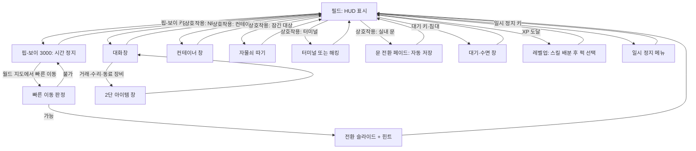
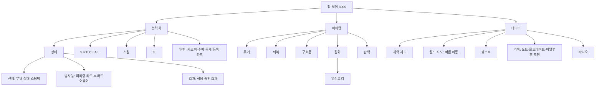
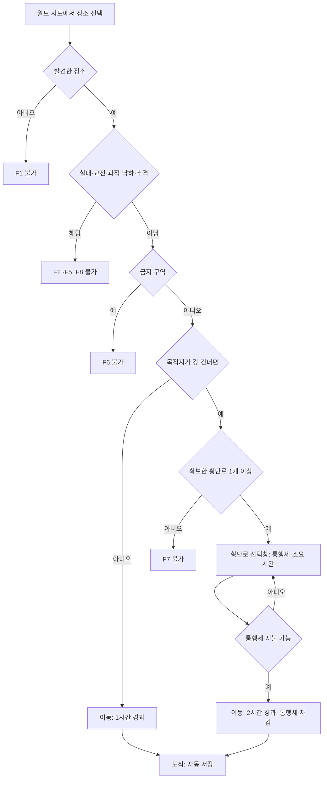

# SD-12. 탐험·상호작용·UI

> **서울 폴아웃 상세 기획서 세트** | 문서 ID: SD-12 | 버전: v1.0 | 작성일: 2026-10-12
> **범위**: 핍-보이 3000(메뉴 구조·화면 배치·관리자 코드 표시), HUD(체력·AP·방사능·방위 링·탐지 표시·퀘스트 마커), 월드 지도·장소 발견·빠른 이동(한강 횡단 제한), 대화창(얼굴 그래픽·판정 태그·대화 기록·말씨), 상호작용 대상(문·컨테이너·터미널·노트·홀로테이프·침대·작업대·정수기·관제망 장치), 미니게임(자물쇠 따기·해킹), 은신·범죄·현상금, 라디오, 거래·수리·제작·동료 명령 UI, 함정·환경 위험·지형과 층 이동, 저장·옵션·접근성·조작, 한국어 텍스트 규칙(조사 자동 처리·줄바꿈·도트 한글 폰트).
> **다루지 않는 것**: 전투 판정·AP 용도·피해 수치(→ SD-11), 능력치·스킬·퍽·카르마 수치(→ SD-10), 아이템 데이터(→ SD-13), 가격·상인(→ SD-15), 권역·다리·지하철 노선 배치(→ SD-08), 장소 목록(→ SD-09), 도트 규격·팔레트(→ SD-16), BGM·효과음 목록(→ SD-17), 명명 표기 원칙(→ SD-18).
> **관련 문서**: [SC-00 컨셉](00_concept.md), [SD-01 게임 개요](01_game-overview.md), [SD-03 메인 스토리](03_main-story.md), [SD-04 사이드 퀘스트](04_side-quests.md), [SD-05 비표시·반복·인카운터](05_misc-quests-encounters.md), [SD-06 세력](06_factions.md), [SD-07 인물](07_characters.md), [SD-08 월드·권역](08_world-regions.md), [SD-09 장소](09_location-catalog.md), [SD-10 캐릭터 시스템](10_character-system.md), [SD-11 전투](11_combat-system.md), [SD-13 아이템](13_items.md), [SD-15 경제](15_economy.md), [SD-16 아트](16_art-direction.md), [SD-17 사운드](17_sound.md), [SD-18 용어·명명](18_naming-terms.md), 원작 [RD-17 탐험·상호작용](../reverse-design/17_exploration-interaction.md), [RD-18 UI/UX](../reverse-design/18_ui-ux.md), [RD-27 이식 시사점](../reverse-design/27_adaptation-notes.md)

---

## 1. 개요

### 1.1 목적
- 원작 폴아웃 3의 탐험·상호작용 규칙(RD-17)과 화면 체계(RD-18)를 **탑다운 2D·심리스 외부·실시간 맵 전투·음성 없음**(RD-27 P1·P3·P6·P7·P10) 조건으로 다시 설계한다.
- 서울판 고유 요소를 UI에 넣는다. 관리자 코드와 관제망 상태 표시, 한강 횡단과 빠른 이동, 주인공 현상금, 한국어 공문체 터미널, 한국어 단어 해킹, 조사 자동 처리.
- 제작자가 바로 화면을 그리고 이벤트를 짤 수 있도록 좌표·수치·상태표를 준다.

### 1.2 요약
1. **핍-보이 3000**은 원작의 3탭 × 5하위 탭(15화면) 구조를 그대로 쓴다. 볼트 S-07 지급품은 세진전자가 면허 조립하면서 **등록 단말 모듈**을 덧단 판본이다. 이 모듈이 메인 스토리의 '관리자 코드'를 띄운다(3.8절).
2. **HUD**는 탑다운 북쪽 고정 화면에 맞춰 원작의 나침반 막대를 **원형 방위 링**으로 바꾼다. 지형을 그리는 미니맵은 두지 않는다(4.1절).
3. **빠른 이동**은 원작 규칙(발견한 장소, 실내·전투·과적 불가)을 따른다. 강을 건너는 빠른 이동은 **확보한 횡단로가 1개 이상**일 때만 열리고, 그 횡단로를 거쳐 가는 것으로 처리해 시간과 통행세가 붙는다(5.6절).
4. **대화**는 텍스트와 얼굴 그래픽(96×96)으로 한다. 판정 태그는 `[화술 45%]`, `[과학 60]`, `[카르마]`, `[관리자 인증]` 형식이다. 주인공 말씨(해요체·해체 등)는 NPC 데이터가 정한다(6.5절).
5. **해킹은 한국어 음절 단어 맞히기**를 기본으로 한다. 원작의 위치 일치 피드백(`x/y`)과 괄호 짝 규칙을 그대로 쓰고, 단어 길이는 3~7음절이다. 영어 단어 모드는 옵션으로 둔다(8.3절).
6. **범죄**는 원작처럼 제도 없는 집단 단위 응징이다. 여기에 메인 스토리용 **수배도(주인공 현상금)** 변수를 따로 둔다. 비상정부가 걸고 새벽인력이 쫓는다(9.9절).
7. **라디오**는 채널 음악이 BGM을 대신하고, 방송 대본은 화면 아래 자막 띠로 나온다. 남산 방송·국민방송에 더해 5개 채널 후보를 둔다(10장).
8. 한국어 텍스트는 **조사 제어 코드 `\J[...]`**, 어절 단위 줄바꿈, 12px·16px 도트 한글 폰트 2종을 기준으로 한다(14장).

### 1.3 설계 원칙
| # | 원칙 | 적용 |
|---|---|---|
| U1 | 단말 문법 유지 | 대괄호는 '시스템이 말하는 부분'이다. HUD `[숨음]`, 대화 `[화술 45%]`, 터미널 `[1] 일지 열람`, 상호작용 `[잠김: 보통]`이 같은 규칙을 쓴다(RD-18 §16.3) |
| U2 | 숫자는 숨기지 않는다 | 화술 확률, 잠금 등급, 아이템 수치, 수배 등급을 직접 보여 준다 |
| U3 | 색만으로 정보를 주지 않는다 | 소유물(붉은색)·적·아군 표시에 반드시 글자 태그나 모양을 함께 붙인다(13.7절) |
| U4 | 탑다운에서 읽히게 | 원작의 1인칭 전제 UI(나침반 막대, 조준점, 자물쇠 클로즈업)는 위에서 내려다보는 화면에 맞게 바꾼다 |
| U5 | 한국어가 먼저 | 메뉴·태그·약어를 한국어로 쓴다. 원작 영문 약어(CND·DR 등)는 괄호 병기만 한다 |
| U6 | 공문 문화는 꾸밈이자 정보 | 터미널·안내 방송·수배 공고를 2077년 한국 공문체로 써서 '명령' 주제를 화면에서 드러낸다(바이블 §5.1, §8) |

### 1.4 다른 문서와의 경계
| 대상 | 이 문서가 정하는 것 | 다른 문서가 정하는 것 |
|---|---|---|
| AP | AP 바의 위치와 표시 | AP의 용도(달리기·회피·조준 사격) → SD-11 |
| 화술 판정 | 태그 표기, 확률 표시, 1회성 처리 | 판정 공식과 NPC 호감도 값 → SD-10 |
| 탐지·은신 | 탐지 게이지 공식, 상태 표시, 소매치기·절도 | 적 AI 교전 행동, 기습 피해 배수 → SD-11 |
| 수배도 | 변수, 등급, UI, 방송 연동 | 단계 진입 시점 → SD-03, 추격 인카운터 내용 → SD-05, 현상금 금액 → SD-15 |
| 라디오 | 채널 구조, 자막 방식, 뉴스 트리거 규칙 | 곡 목록과 작곡 → SD-17, 진행자 말투 → SD-07 |
| 한강 횡단 | 빠른 이동 규칙, 횡단로 상태 변수 | 다리·터널의 수와 위치 → SD-08 |
| 폰트·UI 그림 | 크기, 배치, 글자 수 상한 | 팔레트, 도트 규칙, 외곽선 → SD-16 |

---

## 2. 화면 체계와 공통 규격

### 2.1 화면 계층
| 계층 | 화면 | 게임 시간 |
|---|---|---|
| 월드(HUD) | 방위 링, HP·AP 바, 탄약, 탐지 표시, 방사능 계기, 알림, 상호작용 문구, 라디오·홀로테이프 자막 띠, 바크 말풍선 | 흐름 |
| 다이제틱 장치 | 핍-보이 3000, 터미널, 자물쇠 클로즈업, 엘리베이터 층 패널 | 정지 |
| 모달 | 대화, 거래, 컨테이너, 소매치기, 레벨업·퍽 선택, 대기·수면 창, 메시지 상자, 동료 명령 목록, 작업대, 일시 정지 메뉴 | 정지 |
| 반모달 | 동료 빠른 명령 휠, 단축키 목록 | 25%로 느려짐 |
| 전환 | 실내 문 전환 페이드, 빠른 이동 슬라이드, 엔딩 슬라이드 | – |

### 2.2 화면 전환 흐름


### 2.3 화면별 시간·저장 규칙
| 화면 | 게임 시간 | 수동 저장 | 비고 |
|---|---|---|---|
| 필드 | 흐름 | 가능(일시 정지 메뉴) | 13.1절 제한 조건 적용 |
| 핍-보이 | 정지 | **불가** | 원작 규칙. 저장은 일시 정지 메뉴에서만 한다 |
| 대화·거래·컨테이너·소매치기 | 정지 | 불가 | 원작의 미확인 항목을 '정지'로 확정한다. 실시간 전투에서 창을 연 사이 피격당하는 일을 막는다 |
| 터미널·해킹·자물쇠 | 정지 | 불가 | 같은 이유 |
| 동료 빠른 명령 휠 | 25% | 불가 | 전투 중 지시용 |
| 대기·수면 | 빠르게 흐름 | 불가 | 13.4절의 불가 조건 |
| 문 전환 | – | 자동 저장 | 13.2절 |
| 일시 정지 메뉴 | 정지 | 가능 | 난이도·화면 색 변경도 여기서 한다 |

### 2.4 UI 기준 캔버스와 해상도
- **UI 가상 캔버스는 640×360(16:9)**이다. UI 레이어는 이 캔버스에 그리고 출력 해상도에 **정수 배율**로 키운다(1280×720 = ×2, 1920×1080 = ×3, 2560×1440 = ×4).
- **월드 타일 크기와 UI 캔버스는 분리**한다. 타일 크기(48·32·16px 후보)는 SD-16이 정한다. 월드 레이어가 어떤 크기를 쓰든 UI는 640×360 격자로 설계해 도트가 깨지지 않게 한다.
- 정수 배율이 맞지 않는 화면(예: 1366×768)은 ×2로 그린 뒤 남는 영역을 검은 띠로 둔다.
- **안전 영역**: 가장자리 8px 안쪽에만 UI를 둔다(TV 출력·화면 굴곡 대비).
- 쯔꾸르 MZ 기본 해상도(816×624)를 쓰지 않는 이유: 16:9 출력과 정수 배율을 함께 맞출 수 없고, 핍-보이처럼 정보가 많은 화면에서 12px 한글 기준 행 수가 부족하다(RD-18 §17.3).

### 2.5 공통 표기 문법
| 요소 | 규칙 | 예 |
|---|---|---|
| 시스템 태그 | 대괄호 `[ ]`. 상태·판정·조건 | `[숨음]`, `[화술 45%]`, `[잠김: 어려움]`, `[소유]` |
| 키 표시 | 꺾쇠 없는 키 그림 아이콘 + 동작 | `(E) 열기` — 실제 화면은 키 모양 아이콘 |
| 수치 | 천 단위 쉼표, 단위는 붙여 쓴다 | `1,240캡`, `무게 182/250`, `라드 340` |
| 날짜·시각 | 공문식 날짜 + 24시간제 | `2277. 08. 15. 14:32` |
| 약어 | 한국어 약칭 + 원작 약어 병기는 도움말에만 | 내구(CND), 피해(DAM), 저항(DR), 무게(WG), 가치(VAL) |
| 색 의미 | 색은 보조 수단이다. 모양·글자와 함께 쓴다 | 적 = 붉은 마름모, 아군 = 푸른 원, 소유물 = 붉은 이름 + `[소유]` |
| 부정·경고 | 공문 어미 | `출입 금지`, `사용 불가`, `전원 없음` |

---

## 3. 핍-보이 3000

### 3.1 서울판에서의 위치
| 항목 | 결정 |
|---|---|
| 기종 | **핍-보이 3000**. 볼트 S-07은 한결건설이 볼트-텍 면허로 지은 볼트이므로 볼트-텍 표준 지급품을 쓴다(바이블 §3.4) |
| 제조 표기 | 손목 명판: `PIP-BOY 3000 / 로브코 설계 · 세진전자 면허 조립 / 볼트-텍 서울 S-07 지급품`. 서울 볼트용 물량은 세진전자가 면허 조립했다는 설정이다 |
| 서울판 개조 | 세진전자는 S-07 지급분에 **등록 단말 모듈**을 덧달았다. 볼트 출생 등록 정보를 담고, 관제망의 등록 관리자 인증에 응답하는 부품이다. 주인공의 핍-보이가 관리자 코드를 띄우는 이유다(3.8절). 바이블 §5.2의 '출생 등록 체계를 관제망에 연결' 설정을 물건으로 구체화한 것이다 |
| 지급 시점 | MQ-P2 '열 살, 첫 배정'(2268). 오버시어 윤정인이 준다. 생활기록부 작성(S.P.E.C.I.A.L. 배분)이 핍-보이 첫 화면에서 이어진다 |
| 볼트 밖 인식 | 황무지에서 핍-보이는 '볼트 사람 표시'다. 대화에서 정착민이 알아보는 조건 태그로 쓴다. 비상정부 계엄군은 핍-보이를 '관리자 단말'이라 부르며 회수 대상으로 본다(SD-03 연출 접점) |
| 벗기 | 벗을 수 없다(원작과 같다). 페이퍼돌 레이어에서 왼팔 손목 부품으로 항상 그린다(SD-16) |

### 3.2 기본 조작
| 항목 | 규칙 |
|---|---|
| 열기·닫기 | 키보드 `Tab`, 게임패드 `B`(원작 배치). 탭 바로 열기: `F1` 능력치, `F2` 아이템, `F3` 데이터, `M` 월드 지도, `J` 퀘스트 |
| 열 때 연출 | 장치 그림이 화면 아래에서 0.2초 동안 올라오고, 화면이 0.15초 동안 켜지는 연출(가로 주사선 확장). 옵션으로 끌 수 있다 |
| 시간·저장 | 열어 둔 동안 게임 시간 정지, 저장 불가 |
| 라이트 | 핍-보이 키를 0.6초 이상 누르면 켜고 끈다(원작). 별도 키 `F`도 둔다. 효과는 13장 조작표와 9.1절의 조명 규칙 |
| 사용 불가 상황 | 대화·연출·미니게임 중, 낙하 중, 스크립트가 막은 구간(예: 관제 본부 최종 콘솔 연출) |
| 전투 중 사용 | 원작처럼 허용한다. 시간이 멈춘 채 스팀팩을 쓸 수 있다. 남용 방지책(사용 후 짧은 경직 등)은 SD-11이 정한다 |

### 3.3 메뉴 트리

- 원작 영문 탭 이름의 대응: STATS = 능력치, ITEMS = 아이템, DATA = 데이터, Status = 상태(CND = 신체, RAD = 방사능, EFF = 효과), Apparel = 의복, Aid = 구호품, Misc = 잡화, Keyring = 열쇠고리, Local Map = 지역 지도, World Map = 월드 지도, Notes = 기록. 최종 표기는 SD-18이 확인한다.
- **서울판 추가 항목은 '일반' 화면 안의 '등록 카드'와 '수배' 칸**뿐이다. 탭 수를 늘리지 않는다.

### 3.4 공통 화면 배치
- 핍-보이는 **전체 화면**으로 띄운다(RD-18 §17.3 권장). 테두리만 장치 모양이고 안쪽 화면이 캔버스 대부분을 쓴다.

**배치 좌표 (640×360 캔버스 기준, 단위 px)**
| 영역 | x | y | 폭 | 높이 | 내용 |
|---|---|---|---|---|---|
| 장치 테두리 | 0 | 0 | 640 | 360 | 고정 그림. 왼쪽 위 방사능 바늘 계기(48×32), 오른쪽 아래 명판, 지문 자국 |
| 화면 영역 | 40 | 28 | 560 | 304 | 곡면 CRT. 주사선·비네트 오버레이 |
| 주 탭 줄 | 48 | 32 | 544 | 16 | `능력치  아이템  데이터` + 오른쪽 끝 날짜·시각 |
| 정보 줄 | 48 | 50 | 544 | 14 | 탭별 요약 수치(아래 표) + 관제망 램프(3.8절) |
| 구분선 | 48 | 66 | 544 | 1 | |
| 목록 창 | 48 | 70 | 200 | 222 | 항목 목록. 12px 행 기준 15행 + 스크롤 표시 |
| 상세 창 | 256 | 70 | 336 | 222 | 볼트 보이 그림(96×96) + 수치 표 + 설명문 |
| 하위 탭 줄 | 48 | 296 | 544 | 16 | 하위 탭 5칸 |
| 조작 안내 줄 | 48 | 314 | 544 | 12 | 키 아이콘 + 동작(10px 글꼴) |

**와이어프레임 (텍스트)**
```
+--[ 볼트-텍 ]-----------------------------------------------------------+
| (방사능 바늘)                                                           |
|  +------------------------------------------------------------------+  |
|  | 능력치    아이템    데이터                      2277. 08. 15. 14:32|  |
|  | 레벨 7 | HP 145/160 | AP 72/80 | XP 1,240/1,450        [관제망 ●] |  |
|  |------------------------------------------------------------------|  |
|  | > 힘            6  |  +----------+  힘 (STRENGTH)                 |  |
|  |   인지력        5  |  | 볼트 보이 |  근력과 체격. 소지 한도와       |  |
|  |   지구력        5  |  |  그림     |  근접 무기 피해에 영향을 준다. |  |
|  |   카리스마      4  |  | 96 x 96  |                                |  |
|  |   지능          7  |  +----------+  관련: 근접 무기, 소지 한도    |  |
|  |   민첩성        6  |                                              |  |
|  |   행운          5  |  기본 6   장비 +0   약물 +0                   |  |
|  |------------------------------------------------------------------|  |
|  |  상태   S.P.E.C.I.A.L.   스킬   퍽   일반                         |  |
|  |  (Q)(E) 탭   (위)(아래) 선택   (Enter) 사용   (Tab) 닫기          |  |
|  +------------------------------------------------------------------+  |
|                                     PIP-BOY 3000 / 세진전자 면허 조립   |
+------------------------------------------------------------------------+
```

**탭별 정보 줄**
| 탭 | 정보 줄 내용 |
|---|---|
| 능력치 | `레벨` / `HP 현재/최대` / `AP 현재/최대` / `XP 현재/다음` |
| 아이템 | `무게 현재/한도` / `HP` / `저항(DR)` / `캡` |
| 데이터 | `위치: 권역 · 장소명` / 날짜·시각(오른쪽 위 주 탭 줄에 이미 있음) / 현재 활성 퀘스트명 |

- 캡 표시 상한은 9,999,999캡으로 한다(원작의 1,000,000 표시 한계는 계승하지 않는다).
- 원작 개발 일지의 문법을 지킨다. 겹치는 창 없음, 장식 최소, 단색, 볼트 보이 그림이 유일한 도상이다(RD-18 §4.3).

### 3.5 능력치 탭
| 하위 화면 | 표시 | 조작 | 서울판 변경 |
|---|---|---|---|
| 상태 > 신체 | 볼트 보이 전신 그림에 부위 6곳(머리·몸통·왼팔·오른팔·왼다리·오른다리) 상태 막대, 보유 스팀팩 수 | 부위를 골라 스팀팩 사용(불구 부위 지정), '전신' 사용 | 불구 부위는 막대 옆에 `[불구]` 글자를 함께 표시 |
| 상태 > 방사능 | 누적 피폭량(라드), 방사능 저항, 현재 단계(SD-10·SD-11의 방사능 단계표) | 라드-X·라드어웨이 사용 | 단계 이름을 글자로 표시(예: `[경미한 방사능 중독]`) |
| 상태 > 효과 | 의복·약물·방사능·숙면 효과·중독·불구 효과 목록과 남은 시간 | 열람 | 남은 시간을 게임 시각 기준 `3시간 20분`으로 표시 |
| S.P.E.C.I.A.L. | 7개 능력치, 일시 증감을 `기본 / 장비 / 약물` 3칸으로 분리 | 열람 | 생활기록부(MQ-P2) 문구를 설명 하단에 인용 |
| 스킬 | 13개 스킬, 태그 스킬 표시 `[태그]`, 증감 | 열람 | 스킬 상세에 '이 스킬이 여는 것' 줄을 둔다(예: 자물쇠 따기 → `잠금 등급 보통까지`) |
| 퍽 | 보유 퍽 목록, 랭크 | 열람 | 퍽 수치는 SD-10 |
| 일반 | 카르마 칭호·카르마 막대, 수배 등급, 통계, **등록 카드** | 열람 | 3.8절, 9.9절 |

**일반 화면의 통계 항목** (원작 RD-18 §4.4.1 계승 + 서울판 추가)
| 통계 | 증가 조건 | 비고 |
|---|---|---|
| 완료한 퀘스트 | 메인·사이드 퀘스트 1개 완료 | 계승 |
| 발견한 장소 | 장소 1곳 발견. 볼트 S-07은 제외 | 계승 |
| 죽인 사람 / 죽인 크리처 | 원작 기준(야생 구울은 크리처) | 계승 |
| 딴 자물쇠 / 해킹한 단말 | 성공 1회 | 계승 |
| 사용한 스팀팩·라드-X·라드어웨이·약물 | 사용 1회 | 계승 |
| 중독 횟수 / 해제한 지뢰 / 화술 성공 / 소매치기 성공 | 원작 기준 | 계승 |
| 폭발한 바지 | 역소매치기로 폭발물 기폭 | 계승 |
| 읽은 책 / 모은 수집품 | 스킬북 1권 / 수집품 1개(보블헤드 대응물은 SD-13) | 수집품 명칭은 SD-13 |
| 만든 무기 | 작업대 제작 1회 | 계승 |
| **건넌 횡단로** | 한강 횡단로 1곳을 처음 통과 | 신규. 5.7절 |
| **관리자 인증 사용** | `[관리자 인증]` 선택 1회 | 신규. 3.8절 |
| **잠재운 관제망 로봇** | 관리자 인증·해킹으로 관제망 로봇 1대 정지 | 신규 |
| **들은 방송 소식** | 라디오 뉴스 1건 수신 | 신규. 10.4절 |
- 원작의 메스메트론·샌드맨·마비 펀치·계약·시체 먹기 등 특정 퍽·아이템 통계는 SD-10·SD-13에 같은 퍽·아이템이 생길 때만 넣는다.

### 3.6 아이템 탭
| 하위 화면 | 표시 | 조작 |
|---|---|---|
| 무기 | 소지 무기, 장착 표시 `[장착]`, 탄약 `탄창/보유` | 장착·해제, 수리(11.2절), 버리기, 단축키 지정 |
| 의복 | 몸통·머리·눈 슬롯별 장착 표시. 전신 장비는 `[머리·눈 가림]` 표시 | 장착·해제, 수리, 버리기, 단축키 지정. 장착하면 페이퍼돌 미리보기(상세 창에 주인공 정면 도트) |
| 구호품 | 음식·의료품·약물·물 | 사용, 버리기, 단축키 지정 |
| 잡화 | 맨 위에 열쇠고리, 그 아래 잡동사니·제작 재료·퀘스트 물품 `[퀘스트]` | 열쇠고리는 버리거나 팔 수 없음 |
| 탄약 | 탄 종류와 수량 | 열람 |

**상세 창 필드**
| 필드 | 표시 이름 | 의미 |
|---|---|---|
| CND | 내구 | 막대 + 단계 글자(새것·양호·낡음·위험·파손). 단계 수는 SD-13 결정에 맞춘다 |
| DAM | 피해 | 무기 피해 대략값 |
| DR | 저항 | 방어구 피해 저항 |
| WG | 무게 | |
| VAL | 가치 | 캡 |
| 효과 | 효과 | 장착 효과 |
| 장물 | `[장물]` | 훔친 물건 표시(9.5절). 훔친 상점에는 팔 수 없다 |

**단축키 8칸** (원작 계승)
| 항목 | 규칙 |
|---|---|
| 지정 | 키보드: 핍-보이에서 항목에 커서를 두고 숫자 `1~8`. 게임패드: 항목에서 `RB`를 누른 채 D-패드 8방향 |
| 사용 | 필드에서 `1~8` 또는 `RB` + D-패드 |
| 목록 보기 | 숫자 키나 `RB`를 길게 누르면 8칸 원형 목록이 뜨고 게임 시간이 25%로 느려진다 |
| 대상 | 무기, 의복, 구호품, 투척 무기 |

### 3.7 데이터 탭
| 하위 화면 | 표시 | 조작 | 상세 |
|---|---|---|---|
| 지역 지도 | 현재 실내·주변 외부 상세. 탐험한 영역만 드러남 | 사용자 마커, 확대 2단계 | 5.2절 |
| 월드 지도 | 서울 전도, 발견·표시 장소, 퀘스트·사용자·동료 마커, 횡단로 상태 | 빠른 이동, 사용자 마커, 확대 3단계, 지하철 노선도 겹치기 | 5.1·5.3·5.6절 |
| 퀘스트 | 진행 중 / 완료 / 실패 3묶음. 메인·사이드·기타 표시 | 활성 퀘스트 1개 지정 | 아래 표 |
| 기록 | 노트·홀로테이프·비밀번호·도면·내려받은 단말 기록 | 읽기, 재생 | 7.5절 |
| 라디오 | 수신 중인 방송국·신호 목록, 지난 소식 보기 | 켜기·끄기 | 10.6절 |

**퀘스트 화면 표기**
| 요소 | 표기 | 예 |
|---|---|---|
| 퀘스트 이름 앞 | 분류 글자 `[메인]` `[사이드]` `[기타]` | `[메인] 강을 건너다` |
| 활성 퀘스트 | 이름 앞에 `▶`, 목록 맨 위 고정 | |
| 진행 목표 | `□` + 문장 | `□ 노들섬 선주 조합장을 만난다` |
| 완료 목표 | `■` + 문장 + 흐린 글자 + `[완료]` | |
| 선택 목표 | 문장 끝 `(선택)` | `□ 통행세를 깎는다 (선택)` |
| 실패 목표 | `×` + `[실패]` | |
| 퀘스트 요약 | 상세 창에 지금까지의 경위를 2~6줄로. 진행 단계마다 문장 추가 | 대화 기록을 보지 않아도 흐름을 알 수 있게 한다 |
- 활성 퀘스트의 목표 마커가 여러 곳이면(예: 세 갈래 허브) 모두 표시하고, 방위 링에는 가장 가까운 1곳만 굵게 표시한다.
- 비표시 퀘스트(UQ)는 목록에 나오지 않는다(원작 계승, SD-05).

### 3.8 등록 카드와 관리자 코드 (메인 스토리 연동)
- '일반' 화면 맨 위 항목이 **등록 카드**다. 볼트 S-07의 주민 등록 정보를 핍-보이가 보여 주는 화면이며, 메인 스토리가 진행될수록 내용이 바뀐다.
- 정보 줄 오른쪽 끝에는 **관제망 램프**가 있다. 등록 단말 모듈이 관제망 신호를 받는 상태를 보여 준다.

**등록 카드 배치 (상세 창 336×222)**
```
+--------------------------------------------------------------+
| 볼트-텍 서울 S-07 주민 등록 카드                               |
| 성명    : \P                    등록번호 : S07-2258-0413     |
| 출생    : 2258. 03. 02.         배정 구역: 제3 생활동         |
| 적성 평가: 관리 후보 1순위 (2274)                             |
| ------------------------------------------------------------ |
| 관리자 코드: ####-####-##   [판독 불가]                       |
| 관제망 응답: 대기                                            |
| 비고    : (진행에 따라 문장 추가)                             |
+--------------------------------------------------------------+
```
- 등록번호의 뒤 4자리는 새 게임마다 무작위로 정한다. 출생일은 MQ-P1에서 정한다(SD-03).
- `####`은 실제 화면에서 깨진 글자 도트(문자 깨짐 그림 4종 순환)로 그린다.

**진행 단계별 표시 변화** (진입 시점은 SD-03이 정본, 아래는 화면 규격)
| 단계 | 시점 | 관리자 코드 칸 | 관제망 응답 칸 | 램프 | 알림 |
|---|---|---|---|---|---|
| 0 | MQ-P2 지급 ~ MQ-P3 전 | 칸 없음 | 칸 없음 | 없음 | – |
| 1 | MQ-P3 적성 평가 후 | 칸 없음 | 칸 없음 | 없음 | 적성 평가 줄에 `관리 후보 1순위` 추가 |
| 2 | MQ-P4 볼트 문 개방 | `####-####-## [판독 불가]` | `대기` | 회색 ○ | `알 수 없는 신호를 수신했습니다.` |
| 3 | MQ-01 ~ MQ-02 | 같음. 비고에 `해독할 사람을 찾을 것` | `대기` | 회색 ○ | – |
| 4 | MQ-03 마영식 해독 | `수도 관제망 등록 관리자 / 인증 등급: 후보` | `대기` | 호박색 ◐ 점멸 | `관리자 코드가 해독되었습니다.` 이후 관제망 단말·로봇에 `[관리자 인증]` 선택지가 열린다 |
| 5 | MQ-06 당인리 재가동 | `인증 등급: 관리자(제한)` | `부분 가동` | 호박색 ◐ 상시 | `관제망 응답: 부분 가동` |
| 5' | MQ-06에서 봉인을 고름 | 같음 | `대기(전원 봉인)` | 회색 ○ | SD-03의 봉인 분기와 연결. 3막 전원 해결 방식은 SD-03 |
| 6 | MQ-07 프로토콜 확보 | 비고에 `시민 보호 프로토콜 사본 보유` | 변화 없음 | 변화 없음 | `시민 보호 프로토콜을 내려받았습니다.` |
| 7 | MQ-10 도심 진입 | `인증 등급: 관리자` | `가동` | 녹색 ● | – |
| 8 | MQ-11 결정 후 | 결정에 따라 E1~E5 문구(아래) | 결정에 따라 | 결정에 따라 | – |

| 엔딩 | 관제망 응답 칸 | 램프 |
|---|---|---|
| E1 계엄 프로토콜 가동 | `가동: 비상 주민 분류 지침` | 붉은 ◆ |
| E2 연합단에 지휘권 이양 | `가동: 지휘권 이양됨` | 녹색 ● |
| E3 시민 등록 | `가동: 시민 보호 프로토콜` | 녹색 ● |
| E4 관제망 영구 정지 | `정지(종전)` | 꺼짐 |
| E5 관리자 군림 | `가동: 관리자 직할` | 녹색 ● 굵게 |

**관리자 인증 상호작용** (4단계 이후)
| 대상 | `[관리자 인증]`의 효과 | 대가 |
|---|---|---|
| 관제망 단말(호박색 화면) | 해킹 없이 접속. 단계 4는 '조회'만, 단계 5 이후 문·포탑·로봇 명령까지 | 사용 1회마다 수배도 +3(9.9절). 관제망 기록이 비상정부에 전해진다는 설정 |
| 관제망 경비 로봇(대기 중) | 단계 5 이후 '대기 유지' 명령으로 로봇을 깨우지 않고 지나감 | 같음 |
| 관제망 차단벽·대피소 문 | 단계 5 이후 개방 | 같음 |
| 각성회 신도 대화 | 인증 표시를 보이면 반응이 바뀜(SD-04·SD-06) | 수배도 변화 없음 |
- 이 규칙은 '열쇠를 쓸수록 쫓긴다'는 메인 주제를 시스템으로 보여 주려는 제안이다. 수배도 상승폭과 MQ-09 이후 처리는 SD-03이 확정한다.

### 3.9 화면 색과 CRT 효과
| 항목 | 규칙 |
|---|---|
| 화면 색 | **초록(기본)·호박·파랑·흰색** 4종 + 접근성용 **고대비**(검정 바탕 흰 글자, 효과 끔). 일시 정지 메뉴에서 바꾸며 HUD·터미널 기본색도 함께 바뀐다(원작 계승). 단 관제망 단말은 항상 호박색이다(7.4절) |
| 단색 규칙 | 핍-보이 안에서는 선택한 한 색의 밝기 4단계(배경·흐림·본문·강조)만 쓴다. 정확한 색값은 SD-16 |
| 주사선 | 2px 주기, 어두운 줄 불투명도 20%. 옵션 0~100% |
| 곡면 비네트 | 화면 가장자리 12px 어둡게 |
| 깜빡임 | 0.8~1.2초 무작위 간격의 미세 밝기 변화(±3%). 광과민 옵션에서 끈다 |
| 탭 전환 | 수직 동기 흔들림 2프레임 |
| 지문 자국 | 화면 오른쪽 아래 반투명 그림 1장 |

---

## 4. HUD

### 4.1 결정: 원형 방위 링, 지형 미니맵 없음
| 선택지 | 판단 |
|---|---|
| 원작식 나침반 막대(화면 위 가로 띠) | 원작은 1인칭이라 막대의 왼쪽·오른쪽이 '내가 보는 방향의 왼쪽·오른쪽'이다. 탑다운 북쪽 고정 화면에서는 막대 위치를 화면 방향으로 바꿔 읽어야 하고, 남쪽 표식이 막대 양 끝으로 갈라진다. **채택하지 않는다** |
| 지형 미니맵 | 탑다운 화면 자체가 이미 주변 지도다. 미니맵을 두면 '다음 언덕 너머'의 기대(RD-17 §15.2)와 지역 지도의 안개 걷기 의미가 줄어든다. **채택하지 않는다** |
| **원형 방위 링(채택)** | 지형을 그리지 않는 북쪽 고정 원형 레이더다. 원작 나침반이 보여 주던 것(장소 아이콘, 퀘스트·사용자 마커, 적 붉은 표식, 아군 표식)만 방위대로 찍는다. 링의 방향이 곧 화면 방향이라 바로 읽힌다. 설정상 핍-보이의 동작 감지기·나침반 기능이다(RD-18 §3.1) |

### 4.2 HUD 배치 (640×360 캔버스)
| 요소 | x | y | 폭 | 높이 | 표시 조건 |
|---|---|---|---|---|---|
| 알림 목록 | 8 | 8 | 220 | 최대 4행 × 14 | 사건 발생 시 |
| 현재 목표 줄 | 8 | 66 | 220 | 12 | 활성 퀘스트가 있을 때. 옵션으로 끔 |
| 탐지 표시 | 280 | 8 | 80 | 14 | 웅크렸을 때 또는 [위험] 이상 |
| 층·구역 표시 | 520 | 8 | 112 | 12 | 다층 실내(12.4절)에서만. 예: `세진전자 타워 47층` |
| 방사능 계기 | 584 | 24 | 48 | 32 | 피폭 중에만(바늘형) + 아래에 `+12 라드/초` |
| 라디오 표시 | 520 | 60 | 112 | 10 | 라디오를 켰을 때. 예: `♪ 남산 방송` |
| 동료 상태 | 8 | 270 | 96 | 2명 × 12 | 동료 동행 시. 이름 + HP 막대 |
| 방위 링 | 8 | 296 | 56 | 56 | 항상 |
| HP 막대 | 70 | 330 | 140 | 8 | 항상. 막대 위에 `HP` 글자, 오른쪽에 숫자(옵션) |
| 부위 불구 표시 | 70 | 316 | 140 | 10 | 불구 부위가 있을 때 사람 모양 6칸 아이콘 |
| 자막 띠 | 120 | 286 | 400 | 2행 × 13 | 라디오·홀로테이프·NPC 바크 자막 |
| 상호작용 문구 | 160 | 310 | 320 | 14 | 상호작용 가능한 대상이 앞에 있을 때 |
| 표적 정보 | 220 | 296 | 200 | 12 | 적을 조준 중일 때. 이름 + HP 막대 |
| AP 막대 | 430 | 330 | 140 | 8 | 항상. 용도는 SD-11 |
| 탄약 | 576 | 318 | 56 | 20 | 원거리 무기 장착 시 `12/48` |
| 수류탄 경고 | 화면 가장자리 | – | 16 | 16 | 날아오는 수류탄 방향의 붉은 화살표 |

```
(640 x 360)
+------------------------------------------------------------------------+
| [알림] 스팀팩 2개를 얻었습니다.        [숨음]          세진전자 타워 47층 |
| [알림] 장소 발견: 봉천 계단마을                             (방사능 계기) |
| ▶ 노들섬 선주 조합장을 만난다                                ♪ 남산 방송 |
|                                                                        |
|                          (월드 화면)                                   |
|                                                                        |
| 하도윤 [=====]                                                          |
| 백구   [====-]       [남산 방송] 송미래: 관악 쪽 소식 하나 더 전합니다.    |
|  .--.                 (E) 열기  사물함 [잠김: 보통] [소유]                |
| ( ◎ ) HP [===========-----] 145      AP [=========---] 72      12/48  |
|  '--'                                                                 |
+------------------------------------------------------------------------+
```

### 4.3 방위 링
| 항목 | 규칙 |
|---|---|
| 크기 | 지름 56px. 가장자리 4px 띠에 북쪽 표시 `북`(8px 글자) 고정 |
| 중심 | 주인공 위치 |
| 적 감지 거리 | 링 반지름 = **10 + 인지력 × 2 타일**(인지력 5 → 20타일). 원작의 '인지력이 레이더 거리' 규칙 계승 |
| 적 표식 | 감지 거리 안의 적대 대상을 거리 비례 위치에 **붉은 마름모(◆, 3×3px)**로 찍는다. 시야에 없어도 감지된다(원작과 같다) |
| 아군 표식 | 우호 NPC는 **푸른 원(●)**, 동료는 **푸른 원 + 테두리** |
| 중립 표식 | 비적대 크리처·중립 NPC는 표시하지 않는다(화면이 붐비지 않게). 옵션으로 흰 점 표시 |
| 장소 아이콘 | 40타일 안의 장소 마커를 **링 가장자리 띠**에 방위대로 찍는다. 미발견은 빈 아이콘, 발견은 채운 아이콘(8×8) |
| 퀘스트 마커 | 활성 퀘스트 목표. 감지 거리 안이면 링 안 실제 위치에 **채운 역삼각형(▼)**, 밖이면 가장자리 띠에 **큰 채운 화살표** |
| 사용자 마커 | 1개. 가장자리 띠에 **큰 빈 화살표** |
| 실내 | 실내 맵마다 '북쪽 방향'을 데이터로 정의해 외부와 맞춘다(원작의 실내 방위 불일치 버그를 막는다, RD-18 §3.2) |
| 표식 겹침 | 우선순위: 퀘스트 > 적 > 사용자 > 동료 > 장소 |

### 4.4 화면 가장자리 표시
- 활성 퀘스트 목표가 화면 밖 2화면 거리(대략 40타일) 안에 있으면 **화면 가장자리에 작은 역삼각형**을 띄운다. 옵션 '목표 방향 표시'로 끄고 켠다(기본 켜짐).
- 화면 밖에서 나를 공격하는 적은 피격 순간 가장자리에 **붉은 호(弧)**를 0.6초 띄운다.

### 4.5 탐지 표시
| 표시 | 색 + 모양 | 의미 | 원작 |
|---|---|---|---|
| `[숨음]` | 초록 글자 | 아무에게도 발견되지 않음. 기습 치명타, 소매치기, 안전한 절도 가능 | [HIDDEN] |
| `[발각]` | 붉은 글자 + 눈 아이콘 | 비적대 대상의 시야에 들어 있음. 절도·소매치기는 들킨다 | [DETECTED] |
| `[주의]` | 붉은 글자 | 적대 대상이 이상을 느끼고 수색 중 | [CAUTION] |
| `[위험]` | 붉은 글자. 교전 직전 0.3초 간격 점멸 | 적대 대상이 존재를 앎. 위치 수색 또는 교전 직전 | [DANGER] |
- 웅크렸을 때만 표시하는 원작 규칙을 따른다. 단 서 있을 때도 `[위험]` 점멸은 표시한다(실시간 탑다운에서 기습을 받기 직전 정보를 준다).
- 주변 대상 중 **가장 나쁜 상태 하나만** 표시한다(원작 계승). 판정 공식은 9.1절.

### 4.6 알림
| 항목 | 규칙 |
|---|---|
| 위치 | 왼쪽 위. 최대 4행, 새 알림은 아래에 쌓이고 위에서 사라진다 |
| 표시 시간 | 3.5초. 같은 종류가 연속이면 묶는다(`스팀팩 1개를 얻었습니다 ×3` → `스팀팩 3개를 얻었습니다`) |
| 우선순위 | 퀘스트 > 레벨업 > 카르마 > 장소 발견 > 신호 발견 > 아이템 |
| 큰 알림 | 퀘스트 시작·완료, 레벨업, 카르마 칭호 변경은 화면 가운데 위에 볼트 보이 그림(48×48) + 2행 문구로 2.5초 |
| 효과음 | 종류별 1종(SD-17). 카르마 증가·감소, 레벨업은 원작처럼 고유음 |
| 예문 | `장소 발견: 봉천 계단마을` / `퀘스트 갱신: 강을 건너다` / `신호 수신: 국민방송` / `카르마가 내려갔습니다.` / `수배 등급이 올라갔습니다: 수배 공고` |

### 4.7 상호작용 문구
- 형식: `(키) 동작  대상 이름 [상태 태그…]`
- 대상 위에는 0.5초 주기로 오르내리는 작은 ▼ 표식(4×4)을 띄워 '무엇이 선택되었는지'를 보여 준다.

| 대상 상태 | 태그 | 예 |
|---|---|---|
| 남의 소유 | 이름을 붉게 + `[소유]` | `(E) 열기  사물함 [소유]` |
| 잠김 | `[잠김: 등급]` | `(E) 따기  금고 [잠김: 어려움]` |
| 열쇠 필요 | `[열쇠 필요]` | |
| 열쇠 보유 | `[열쇠 있음]` | `(E) 열기  창고 문 [열쇠 있음]` |
| 빈 컨테이너 | `[빈 상자]` | |
| 단말 제어 | `[단말 제어]` | 연결된 터미널로만 열림 |
| 전원 없음 | `[전원 없음]` | 엘리베이터·전동문 |
| 관제망 봉쇄 | `[관제망 봉쇄]` | 관리자 인증 또는 해킹 필요 |
| 실내 문 | 행선지 이름 | `(E) 들어가기  번개24 봉천점` |
| 무단 침입 구역 문 | `[출입 금지]` | 들어가면 무단 침입 |
| 대화 가능 | 이름 + 직함 | `(E) 말하기  조만석 (봉천 계단마을 이장)` |
| 도주 중 | `[도주 중]` | 말을 걸 수 없음 |
- 문구가 겹치면 주인공이 바라보는 방향의 1타일 앞 대상이 우선이다(7.1절).

### 4.8 상황별 HUD 변화
| 상황 | 변화 |
|---|---|
| 평상시 | 방위 링, HP, AP, (탄약), 목표 줄 |
| 웅크림 | 탐지 표시 추가 |
| 교전 | 방위 링에 붉은 표식 증가, 표적 정보, 수류탄 경고 |
| 피폭 | 방사능 계기 등장 + 가이거 계수기 소리. 방사능 구역에서는 화면 테두리에 녹색 색조(RD-27 X11) |
| 머리 불구 | 화면 가장자리가 3초 주기로 흐려짐 + 귀울림(원작) |
| 대화·연출 | HUD 전부 숨김(시네마틱) |
| 핍-보이·메뉴 | HUD 대신 해당 화면 |
| 다층 실내 | 층·구역 표시 추가 |
| 라디오·홀로테이프 재생 | 라디오 표시 + 자막 띠 |
| 수배 추격 중 | 방위 링 테두리가 붉게 1회 점멸하고 알림 `추격자가 다가옵니다`(9.9절, 인지력 판정 성공 시) |

---

## 5. 지도·장소 발견·빠른 이동

### 5.1 월드 지도
| 항목 | 규칙 |
|---|---|
| 그림 | 서울 전도 1장. 장소의 상대 위치와 방위는 실제 서울을 따른다(바이블 §4.1). 2077년 공무용 지도 느낌의 단색 선화에 한강만 짙게 칠한다 |
| 크기 | 원본 1600×1300px(가로 37km × 세로 30km 비율). 핍-보이 화면 안에서 3단계 확대(전도 / 권역 / 구역) |
| 격자 | 지도 가장자리에 **한글 자음 열(가~하, 14칸) × 숫자 행(1~12)**. 라디오 신호·노트가 `라7 구역`처럼 위치를 알려 줄 때 쓴다(원작 '7-B 구역' 힌트 방식) |
| 권역 경계 | 권역 R01~R11 이름과 점선 경계. 처음 들어간 권역만 이름이 진하게 보인다 |
| 한강 | 짙은 띠. 횡단로(다리·하저 터널)는 상태 아이콘으로 표시(5.7절) |
| 도심 밀폐 구역 | 한양도성 선을 굵은 톱니 선으로 두르고 안쪽을 빗금으로 가린다. 안에서 발견한 장소만 빗금 위에 드러난다 |
| 표시 마커 | 발견 장소(채운 아이콘), 표시만 된 장소(빈 아이콘), 퀘스트 마커, 사용자 마커 1개, 동료(작은 빈 삼각형), 주인공(화살표) |
| 커서 정보 | 마커에 커서를 두면 `장소명 / 권역 / 상태(발견·표시) / 빠른 이동 가능 여부와 예상 소요 시간` |
| 실내에서 | 열람 가능, 빠른 이동 불가(원작) |

### 5.2 지역 지도
- 현재 실내 맵 또는 주인공 주변 외부(60×60타일)를 보여 준다. **밟은 곳과 시야에 들어온 곳만 드러난다**(안개 걷기). 저장 단위는 외부 청크·실내 맵별 탐험 비트맵이다(13.2절).
- 표시: 문·출입구(실내 전환 문은 문 아이콘, 지하 진입은 계단 아이콘), 퀘스트 마커, 사용자 마커, 층 이동 지점.
- 다층 실내는 지역 지도에서 층 탭(`B2 B1 1층 2층…`)을 고를 수 있다. 가 본 층만 열린다.

### 5.3 지하철 노선도 겹치기
- 월드 지도 위에 지하철 노선을 겹쳐 보는 레이어다. 노선 번호와 노선 색은 실제 서울 노선 번호를 쓴다(브리프 §5 허용). 실제로 몇 개 노선을 게임에 넣을지는 SD-08이 정한다.
- 처음에는 꺼져 있다. 지하철역 관리 단말에서 **'2077 수도권 전철 노선도'**를 내려받으면 열린다(원작 DCTA 지하철 노선도 대응, RD-17 §2.3). 내려받은 노선도는 기록 > 도면에도 저장된다.
- 레이어를 켜면 역 위치에 역 이름표(작은 글자)와 '가 본 역' 표시가 뜬다. 역은 장소 마커가 아니므로 빠른 이동 대상이 아니다. 단 SD-09가 장소 마커로 지정한 역은 마커 규칙을 따른다.

### 5.4 장소 마커 아이콘
| # | 유형 | 서울판 예 | 비고 |
|---|---|---|---|
| 1 | 볼트 | 볼트 S-07 | 볼트-텍 톱니 |
| 2 | 대형 정착지 | 노들섬, 탱크마을 | |
| 3 | 소형 정착지 | 봉천 계단마을, 뚝섬 장터 | |
| 4 | 요새·세력 거점 | 용산 요새, 청계산 벙커 | |
| 5 | 아파트 단지 | 세이프빌, 폐허 단지 | 서울판 신규 |
| 6 | 지하철역 | 지하철 출입구 | 역명판 모양 |
| 7 | 지하상가·지하 시설 | 영등포 지하상가 | 서울판 신규 |
| 8 | 민방위 대피소 | 지정 대피소 | 가상 '민방위 피난처' 표지 모양(SR-03 §4.5) |
| 9 | 상업 시설 | 편의점, 학원가, 시장 | |
| 10 | 사무·관공서 | 정부 청사, 구청 | |
| 11 | 공장·산업 | 세진전자 공장 | |
| 12 | 발전·기반 시설 | 당인리 지하 원자력 발전소, 배수지 | |
| 13 | 군사 시설 | 옛 군 기지, 포대 | |
| 14 | 방송·송신 | 남산 방송 | |
| 15 | 다리·횡단로 | 노들섬 다리, 하저 터널 입구 | 상태 아이콘 겹침(5.7절) |
| 16 | 산·자연 | 관악산, 북한산 | |
| 17 | 강변·섬 | 선유도, 밤섬 | |
| 18 | 동굴·터널 | 빗물터널, 산악 터널 | |
| 19 | 폐허·마을 | 무너진 동네 | |
| 20 | 기념물·궁궐 | 궁궐, 기념탑 | |
| 21 | 초고층 | 세진전자 타워 | 서울판 신규 |
| 22 | 기타 | 분류가 없는 장소 | |
- 실제 배정은 SD-09 장소 카탈로그가 장소마다 유형을 적는다. 아이콘은 8×8(방위 링용)과 12×12(지도용) 두 크기를 빈·채움으로 그린다.

### 5.5 장소 발견 규칙
| 상태 | 조건 | 지도 | 빠른 이동 | 방위 링 |
|---|---|---|---|---|
| 미상 | 아무 정보 없음 | 표시 안 함 | 불가 | 40타일 안에서 빈 아이콘 |
| 표시 | 대화·노트·홀로테이프·단말·퍽·퀘스트로 위치를 앎 | 빈 아이콘 | 불가 | 빈 아이콘 |
| 발견 | 장소의 **발견 영역**(장소 중심 반경 4타일 또는 지정 트리거)에 직접 들어감 | 채운 아이콘 | 가능(5.6절 조건) | 채운 아이콘 |
- 발견 시 알림 `장소 발견: (이름)` + 통계 '발견한 장소' +1. 발견 자체의 XP는 원작처럼 없다(RD-17 §2.2). 장소 발견 보상을 XP로 줄지는 SD-10이 정한다(미결 M-05).
- 볼트 S-07은 통계에서 뺀다(원작의 볼트 101 규칙).
- 지도에 마커를 추가하는 경로: 직접 방문, NPC 대화, 노트·홀로테이프 열람 순간, 단말 내려받기, 퀘스트 단계, 퍽(익스플로러 대응 퍽은 SD-10). 원작 구조를 그대로 쓴다(RD-17 §2.3).

### 5.6 빠른 이동
**기본 규칙** (원작 계승)
- 월드 지도에서 **발견한** 장소 마커를 고르면 그 장소의 도착 지점으로 이동한다.
- 동행 중인 동료는 함께 도착한다. 대기 명령을 받은 동료는 남는다.

**불가 조건**
| # | 조건 | 안내 문구 | 출처 |
|---|---|---|---|
| F1 | 목적지가 '표시' 상태 | `아직 가 보지 않은 장소입니다.` | 원작 |
| F2 | 실내에 있음 | `실내에서는 이동할 수 없습니다.` | 원작 |
| F3 | 적이 근처에 있음(방위 링에 적대 표식) 또는 교전 중 | `근처에 적이 있습니다.` | 원작 |
| F4 | 과적 | `짐이 너무 무겁습니다.` | 원작 |
| F5 | 낙하·특수 이동 중 | – (메뉴 비활성) | 원작 |
| F6 | 스크립트 금지 구역 | `지금은 이동할 수 없습니다.` | 원작. 아래 표 |
| F7 | **강 건너편 목적지인데 확보한 횡단로가 없음** | `건널 수 있는 길을 아직 확보하지 못했습니다.` | 서울판 |
| F8 | **수배 추격조가 추적 중** | `추격자를 따돌려야 합니다.` | 서울판(9.9절). F3의 특수형 |

**한강 횡단 규칙** (바이블 §4.1 '건널 수 있는 곳이 몇 개의 다리와 하저 터널뿐')
- 맵을 **남안(강남 쪽)**과 **북안(강북 쪽)** 두 구역으로 나눈다. 강 가운데 섬(노들섬 등)은 그 섬으로 이어지는 횡단로의 소속을 따른다. 여의도·선유도처럼 한쪽 강변에 붙은 섬의 소속은 SD-08이 정한다.
- 같은 강변 안의 빠른 이동은 원작처럼 **게임 시간 1시간**이다.
- 강을 건너는 빠른 이동은 **'확보' 상태의 횡단로가 1개 이상**일 때만 열린다. 이동은 그 횡단로를 지나간 것으로 처리한다.
  - 소요 시간: **2시간**(같은 강변 1시간 + 횡단 1시간).
  - 확보된 횡단로가 여러 개면, 이동 확인창에서 고른다(기본값: 비용이 없는 횡단로 → 가장 가까운 횡단로).
  - 통행세가 있는 횡단로를 고르면 확인창에 금액이 나오고 이동 때 자동으로 낸다. 캡이 모자라면 그 횡단로는 고를 수 없다.
  - 횡단로가 '봉쇄'로 바뀌면(예: 그 다리의 주인 세력과 적대) 그 횡단로로는 빠른 이동을 할 수 없다.
- 이렇게 하면 플레이어가 한 번은 직접 강을 건너야 하고(MQ-04가 그 첫 경험), 그 뒤에는 고른 횡단로의 정치(통행세·적대)가 빠른 이동에도 남는다.

**스크립트 금지 구역** (F6)
| 구역·구간 | 기간 | 이유 |
|---|---|---|
| 볼트 S-07 내부·프롤로그 | MQ-P1~MQ-P4 | 프롤로그 선형 진행 |
| 도심 밀폐 구역 전체 | MQ-10 시작 ~ MQ-11 완료 | 관제망 로봇이 깨어난 3막 돌파 구간 |
| 도심 밀폐 구역으로 들어오는 빠른 이동 | 밀폐 구역 안 장소를 지하철로 들어가 '발견'하기 전 | '지하철로만 드나든다'(바이블 §4.1)를 지킨다. 발견 뒤에는 원작 D.C. 도심처럼 빠른 이동을 허용한다 |
| 청계산 벙커 | MQ-09 진행 중 | 볼모 구출 연출 |
| 호송·추적 퀘스트 구간 | 퀘스트별 | SD-04·SD-05가 지정 |



### 5.7 횡단로 상태
- 횡단로는 다리와 하저 터널이다. 개수·위치·주인은 SD-08이 정한다(바이블 §4.1 '다리마다 주인이 다르다'). 이 문서는 **상태 변수와 표시**만 정한다.

| 상태 | 뜻 | 지도 아이콘 | 빠른 이동 |
|---|---|---|---|
| 미상 | 존재를 모름 | 없음 | – |
| 알려짐 | 위치를 앎. 아직 지나가지 않음 | 빈 다리 아이콘 | 불가 |
| 확보 | 한 번 이상 끝까지 건넜고, 지금 지나갈 수 있음 | 채운 다리 아이콘 | 가능 |
| 확보(유료) | 확보 + 통행세가 있음 | 채운 아이콘 + `캡` 표시 | 가능(통행세) |
| 봉쇄 | 주인 세력과 적대, 붕괴, 침수, 퀘스트 봉쇄 | 붉은 × | 불가 |
| 붕괴 | 처음부터 건널 수 없는 무너진 다리 | 끊긴 다리 그림 | – |
- 상태가 바뀌면 알림을 띄운다. 예: `횡단로 확보: 노들섬 다리`, `횡단로 봉쇄: 하저 터널(침수)`.
- '확보' 판정은 그 횡단로의 남단 트리거와 북단 트리거를 모두 지난 경우다. 통행 허가·통행세 협상의 결과는 SD-03(MQ-04)·SD-04가 상태값으로 넘긴다.
- 원작 대응: 원작에는 횡단 제한이 없다. 서울판 신규 규칙이다.
