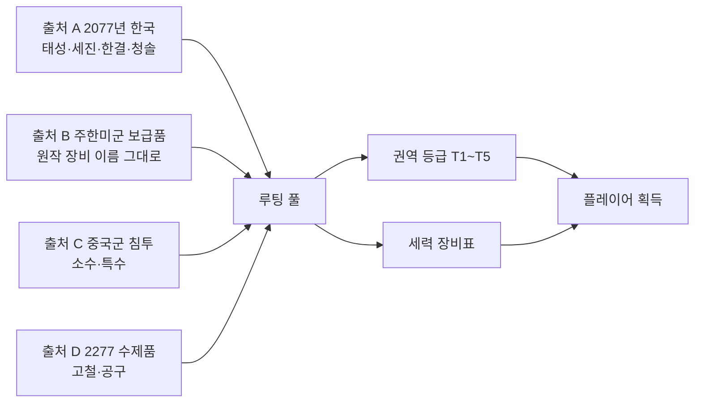
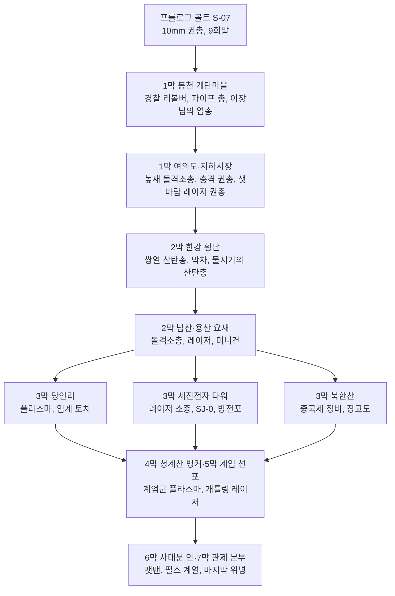
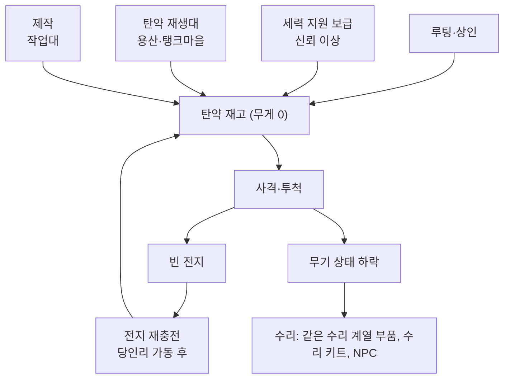
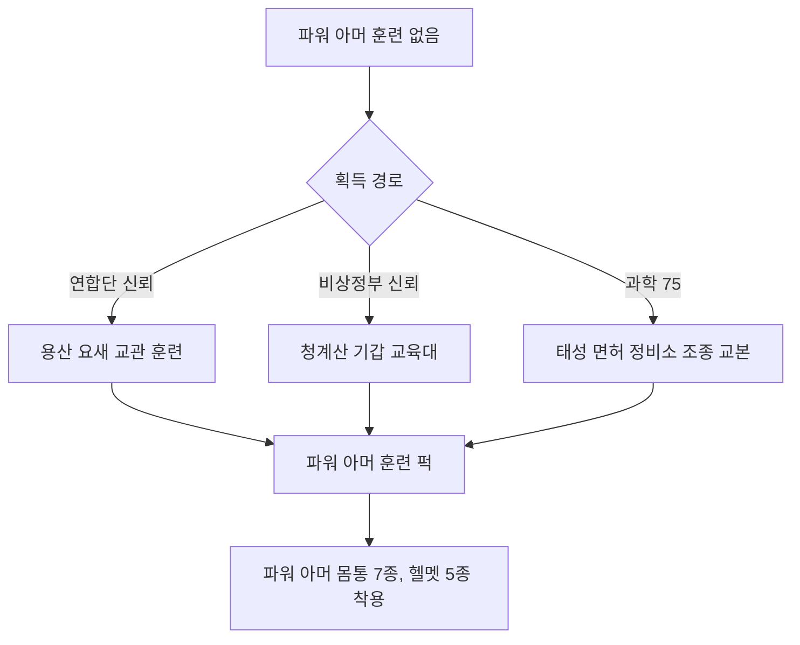
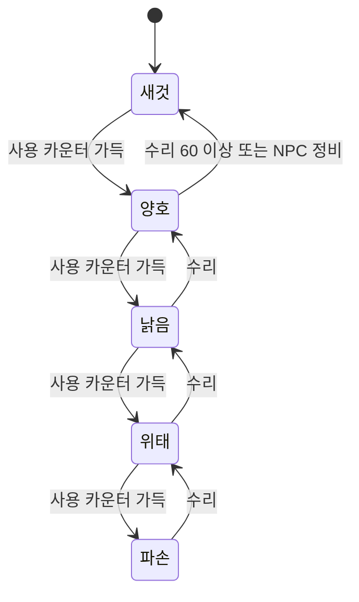

# SD-13. 아이템

> **서울 폴아웃 상세 기획서 세트** | 문서 ID: SD-13 | 버전: v1.2 | 작성일: 2026-10-12
> **범위**: 플레이어가 얻고 쓰는 아이템 전체의 설계 원칙과 카탈로그. 무기(W-), 탄약, 방어구·의복(A-), 소모품(I-), 잡화·제작 재료·퀘스트 아이템(M-), 제작 시스템(작업대·설계도·레시피), 아이템 상태(내구도) 5단계와 수리, 루팅 테이블 원칙, 페이퍼돌 레이어 분류와 그래픽 제작량. **다루지 않는 것**: 스킬북·보블헤드 대응 수집품([SD-10](10_character-system.md)), 피해·명중·치명타·중독·방사능 공식의 세부([SD-11](11_combat-system.md)), 상인 재고·매입 배율·수리 서비스 가격([SD-15](15_economy.md)), 크리처 개체별 드롭 수치([SD-14](14_creatures-enemies.md)), 도트 규격·프레임 수의 확정([SD-16](16_art-direction.md))
> **관련 문서**: [SC-00 컨셉](00_concept.md), [SD-03a 메인 스토리 1](03a_main-story-part1.md), [SD-03b 메인 스토리 2](03b_main-story-part2.md), [SD-04a~d 사이드·세력 퀘스트](04d_faction-questlines.md), [SD-05 비표시·반복·인카운터](05_misc-quests-encounters.md), [SD-06 세력](06_factions.md), [SD-07a 주요 인물](07a_characters-major.md), [SD-08 월드·권역](08_world-regions.md), [SD-09a~f 장소 카탈로그](09a_locations-r01-r02.md), [SD-10 캐릭터 시스템](10_character-system.md), [SD-11 전투 시스템](11_combat-system.md), [SD-12 탐험·UI](12_exploration-ui.md), [SD-14 크리처·적](14_creatures-enemies.md), [SD-15 경제](15_economy.md), [SD-16 아트 디렉션](16_art-direction.md), [SD-18 용어·명명](18_naming-terms.md)
> **원작 근거**: [RD-19 무기·탄약](../reverse-design/19_weapons-ammo.md), [RD-20 방어구·의복](../reverse-design/20_armor-apparel.md), [RD-21 소모품·잡화·제작](../reverse-design/21_consumables-misc-crafting.md), [RD-27 쯔꾸르 이식 시사점](../reverse-design/27_adaptation-notes.md) §7.2·§9.3·§14.2, [RD-26 용어집](../reverse-design/26_glossary.md)
> **조사 근거**: [SR-01 공식 설정](research/SR-01_fallout-canon.md)(C7·C8 기술·파워 아머 계보), [SR-04 생물](research/SR-04_korean-fauna.md), [SR-05 국가·사회](research/SR-05_korea-state-society.md)(§2.6 방위산업, §4.6 유통, §7.2 산업 투영)

---

## 1. 문서 개요

### 1.1 목적
- 서울판 아이템 데이터베이스의 **정본 카탈로그**를 만든다. 기획자는 이 표로 루팅·보상·상점 재고를 짜고, 제작자는 이 표로 아이콘·페이퍼돌 레이어·데이터베이스 항목을 만든다.
- 원작 폴아웃 3의 아이템 **시스템**(6계열 무기 스킬, 탄약 경제, 몸통·머리·눈 슬롯, 파워 아머 훈련 게이트, 의학 배율, 중독, 설계도 품질, 반복 거래)은 그대로 계승한다. 바꾸는 것은 **카탈로그(무엇이 있는가)와 출처(누가 만들었는가)**다.

### 1.2 요약

| 분류 | ID 범위 | 수량 | 구성 |
|---|---|---|---|
| 무기 | W-001~W-068 (일반), W-101~W-131 (고유), W-151~W-157 (제작) | **106종** | 일반 68(0-7 W-067 대걸레 자루 · 1-D3 W-068 미끼) / 고유 31 / 제작 7. 공격 자세 8계열(v1.1: W-066·W-131 추가) |
| 탄약 | (무기 표 안에서 이름으로 참조) | 19종 + 잡동사니 | 원작 19종을 서울판 출처에 맞게 재편(v1.1: 그물탄 추가) |
| 방어구·의복 | A-001~A-089 (일반), A-101~A-115·A-117 (고유, A-116 예약) | **105종** | 몸통 65(파워 아머 7 포함) / 전신 6 / 머리 19 / 머리+눈 9(파워 헬멧 5 포함) / 눈 6 (v1.1: A-084~A-089·A-117 추가) |
| 소모품 | I-001~I-068, I-085~I-098 (I-069~I-084 예약) | **82종** | 의약품 12 / 약물 13 / 음식 33 / 음료 13 / 주류 4 / 기타 7 (v1.1: I-085~I-098 추가) |
| 잡화 | M-001~M-161, M-162~M-199 (일반·재료·거래·설계도·호출·증표·부산물·장식), M-201~M-250 (메인 퀘스트), M-301~M-399 (사이드·세력·비표시 퀘스트) | **284칸** | 기존 188칸 + v1.1 신규 96종(일반·증표·장식 31: M-162~M-194, 결번 M-186·M-187 / 퀘스트 65: M-301~M-391, 결번 M-354·M-357·M-365) |

- **무기 수 권장안: 102종**(§3.1). RD-27 §14.2 7번의 '통합 100~110종'은 원작 카탈로그를 줄이는 안이었다. 서울판은 새 카탈로그이므로 기능 중복을 처음부터 만들지 않고, 바이블 v0.3의 볼륨 확장(메인 약 40, 사이드 60+, 장소 250+)에 맞춰 80~110종 범위에서 102종으로 정한다.
- **고유 장비 47종**: 고유 무기 31 + 고유 방어구 16(v1.1에서 W-131 대련 장갑·A-117 고철단 맞춤 갑옷 추가). 7막 메인 무대마다 1개 이상, 호감도 대상 10개 세력(SD-06 §3.2)마다 '우호·신뢰·동맹' 보상 장비·증표를 둔다(§5.10).
- **동료 장비는 없다**(바이블 K7). 대신 '신뢰' 이상 세력의 **지원 병력 호출 장비**를 둔다(§7.4).
- **상태(내구도)는 5단계**(새것·양호·낡음·위태·파손)로 단순화한다(§8). 원작의 개체별 HP는 쓰지 않는다.
- **장비 외형**은 몸통·머리·눈·무기 4종 레이어 전부를 걷기·전투 스프라이트에 반영한다(P9). 분량은 '외형 계열' 통합으로 줄인다: 무기 외형 53개(스탬프 1,060장), 몸통 실루엣 15계열 + 파워 아머 리그 2(SD-16 §5.9), 머리 외형 18, 눈 외형 6(§11).

### 1.3 표기 메모
- 원작 용어는 [RD-26](../reverse-design/26_glossary.md)의 한글 패치 표기를 쓴다(스팀팩, 라드어웨이, 라드-X, 메드-X, 버프아웃, 멘타츠, 사이코, 제트, 뉴카-콜라, 미니 누크, 팻맨, 미니건, 돌격소총, 레이저 소총 등).
- 수치는 원작 기본값(스킬 100, 상태 '새것')에 비례한 **서울판 기준값**이다. 실시간 탑다운 전투 템포에 맞춘 전역 배율은 SD-11이 정한다([RD-27 §7.5](../reverse-design/27_adaptation-notes.md)). 이 문서의 값끼리의 **상대 관계**가 정본이다.
- `(SD-xx에서 ID 부여)`: 다른 문서 소관이라 번호를 붙이지 않은 대상이다.
- `[신규]`: 서울판이 원작에 없는 규칙이나 품목을 새로 넣은 곳이다.
- 장소는 바이블 §4의 장소명과 권역 번호(R01~R11)로 적는다. 장소 ID는 SD-09가 부여한다.

---

## 2. 아이템 설계 원칙

### 2.1 네 개의 출처
서울 수도 황무지의 모든 아이템은 아래 네 출처 가운데 하나에서 왔다. 출처가 곧 **외형 언어, 탄약 계통, 등장 권역, 들고 나오는 세력**을 정한다.

| 출처 | 시점 | 성격 | 대표 제조사·공급자 | 외형 언어 (SD-16과 맞출 것) | 주 등장처 |
|---|---|---|---|---|---|
| **A. 2077년 한국** | 전쟁 전 | 국가-재벌 연합 체제의 군수·치안·생활 장비. 한국은 민간 총기가 금지된 사회라 총기는 **경찰·군·예비군 무기고**에 몰려 있다(SR-05 §7.4) | 태성그룹 군수(화기·에너지 무기·탄약·파워 아머 면허 정비), 세진전자(비살상 보안 장비·진공관·로봇), 한결건설 공구 부문(공구·건설 장비), 청솔식품(식품·음료), 태성제약(의약품) | 회녹색·회색 도장, 명판의 형식 번호 'TS-' 'SJ-'(스프라이트 안에는 글자를 넣지 않는다, SD-16 §3.5), 둥근 진공관 표시창, 원자력 마크 | 파출소, 예비군 무기고, 구청 지하 비상 지휘소, 편의점, 약국, 아파트 |
| **B. 주한미군 보급품** | 전쟁 전 | 중국 본토 진격 전진기지의 미군 장비. **원작 장비를 원작 이름 그대로** 쓴다(10mm 권총, 돌격소총, 레이저 소총, 미니건, 팻맨, 전투 아머, T-45d·T-51b 파워 아머 등) | 미 육군 보급(원작 제조사는 언급하지 않는다), 일부는 태성그룹의 **면허 생산판** | 원작 외형 그대로. 13개 별 성조기 표식(C12) | 용산 기지, 김포·서부 평야 화물 터미널, 남산 대피 터널, 연합단·계엄군 무기고 |
| **C. 중국군 침투** | 2077년 침투 | 관제 본부 파괴 임무로 들어온 특수부대 장비. 수량은 적고 성능은 특수하다(은폐 기술 우위, C6) | 중국 인민해방군(원작 '중국제' 계열) | 원작 중국제 무기 외형, 짙은 녹색·흑색, 한자 각인 | 북한산(R09), 침투 터널, 도심 지하 |
| **D. 2277년 황무지 수제품** | 전후 | 고철·공구·생활용품으로 만든 무기와 방어구. 원작 설계도 무기와 약탈자 아머의 계보 | 정착지 대장간, 약탈자, 지하시장 기술자 | 덧댄 고철판, 노끈, 테이프, 녹, 재활용 표시가 남은 부품 | 전 권역, 정착지 상인 |

### 2.2 명명 규칙
- 명명은 [SD-18 §5·§7.1](18_naming-terms.md)을 따른다. **실제 무기 제식명·애칭·브랜드는 쓰지 않는다**(SD-18 §2.3 X6·X12).
- **태성그룹 화기**: `애칭 + 일반명`. 애칭은 **바람 이름**이다. 형식 번호는 `TS-[분류][제식 연도 2자리]`이고 설명창 끝·명판에만 쓴다(SD-18 §5.6). 이 문서가 확정한 배정:

| 애칭 | 뜻 | 배정 무기 | 형식 번호 |
|---|---|---|---|
| 실바람 | 가장 약한 바람 | 경찰 리볼버(W-001) | TS-P32 |
| 하늬 | 서풍 | 군용 권총(W-004) | TS-P66 |
| 높바람 | 높이 부는 바람 | 신호탄 권총(W-012) | TS-P70 |
| 마파람 | 남풍 | 기관단총(W-016) | TS-S63 |
| 높새 | 늦봄 북동풍 | 돌격소총(W-017), 대검(W-038, 부속) | TS-R61 |
| 삭풍 | 겨울 북풍 | 지정사수소총(W-020) | TS-M72 |
| 된바람 | 센 북풍 | 경찰 산탄총(W-028) | TS-R68 |
| 회오리 | 회오리바람 | 유탄 발사기(W-031) | TS-H73 |
| 샛바람 | 동풍 | 레이저 권총(W-009) | TS-E74 |
| 갈마 | 서남풍(갈마바람) | 레이저 카빈(W-022) | TS-E75 |
| 돌개 | 돌개바람 | 방전포(W-035) | TS-E77 |

  - SD-18 제안표와 다른 점: '돌개'를 화염방사기 대신 방전포에 준다(서울판 화염방사기는 주한미군 원작 장비라 애칭이 없다). '회오리'를 미사일 발사기 대신 유탄 발사기에 준다(같은 이유). 산탄총 분류 문자는 소총 분류 `R`을 쓴다. 실바람·높바람·갈마 추가, 돌개·회오리 배정 변경, 산탄총 `R`은 **SD-18 등록 완료**(RECON_SPEC N-96).
- **세진전자 보안 장비**: 비살상 전기 장비만 만든다. `세진 + 패밀리 브랜드 '제압' + 일반명`(세진 제압 충격 권총). 형식 번호는 `SJ-S` + 연도(보안 장비 분류 `S`, **SD-18 §5.6 등록 완료**, RECON_SPEC N-96).
- **한결건설 공구**: `한결 + 일반명`(한결 공업용 못총). 형식 번호를 붙이지 않는다.
- **2077 생활용품·관급품**은 기관명 + 일반명(민방위 방독면, 경찰 진압봉, 태성 전투식량)으로 짓는다. 형식 연도식 이름(예: 'OO식')은 쓰지 않는다. 실재 외국 제식명과 겹친다.
- **주한미군 장비**는 원작 이름을 그대로 쓴다. 태성이 면허 생산한 판본은 `(태성 면허)`를 덧붙여 구분하되 수치는 같다.
- **중국군 장비**는 원작 표기 '중국제 ○○', '중국군 ○○'를 쓴다.
- **수제품**은 재료를 드러내는 이름을 쓴다(파이프 소총, 못 박힌 각목, 철근 몽둥이).
- **고유(유니크)** 는 사연을 담은 이름을 쓴다. 인명이 들어가면 바이블 §11 표기를 그대로 쓴다.
- **식품·음료**: SD-18 §5.5의 접두 규칙(음료 '번개', 가공식품 '청솔', 편의점 자체 상품 '번개24')에 한글 2~4음절 애칭을 붙인다(번개사이다, 청솔 즉석밥 '한그릇', 번개24 도시락 '푸짐'). 실제 상품명과 같은 이름은 피한다(예: 실제 초코 과자·런천미트 상표).
- 표현 원칙: 반중 선전 문구가 새겨진 장비(예: 계엄군 탄약 상자의 표어)는 원작처럼 시대의 광기로 보이게 쓴다. 중국군 장비 설명은 '명령에 갇힌 병사'의 물건으로 쓴다(브리프 §5).

### 2.3 출처별 설계 규칙

| 규칙 | 출처 A (한국) | 출처 B (미군) | 출처 C (중국군) | 출처 D (수제) |
|---|---|---|---|---|
| 성능 위치 | 원작 동급보다 **피해 약간 낮고 내구 높음**. 경찰 장비는 비살상 효과(넘어뜨림·마비) | 원작 수치 기준 | 피해 낮고 **내구 매우 높음**(원작 중국제 권총 패턴), 은신 보정 | 피해 중간, **내구 낮음**, 값쌈 |
| 탄약 | 한미 공용 탄(10mm, 5.56mm, .308, 12게이지) + 한국 고유(신호탄, 40mm 유탄, 건설용 대못) | 원작 탄 전부 | 10mm, 5.56mm(노획 호환) | .32 구경탄, 12게이지, 건설용 대못, 잡동사니 |
| 수리 계열 | 'TS 계열', 'SJ 계열', '공구 계열' | 원작 수리 그룹 | '중국제 계열' | '수제 계열'(같은 자세의 수제품끼리 서로 수리) |
| 진행 단계 | 초반~중반 | 중반~후반 | 중반 특수 | 초반 |
| 세력 | 계엄군(TS 계열 + 개량), 자율방범대(경찰 장비), 새벽인력(진압 장비) | 연합단·원칙파(복원 미군 장비), 철벽경호(구입한 미군 장비), 변종(노획) | 중국군 잔존병 | 약탈자, 정착민 |

### 2.4 계승하는 원작 시스템
- 6계열 무기 스킬, 탄약 무게 0, 부품 수리, 몸통·머리·눈 슬롯, DR 상한 85%, 파워 아머 훈련 게이트, 의학 배율, 음식의 회복·라드 맞교환, 약물 중독, 설계도 품질, 반복 거래, 잡동사니 탄환을 계승한다. 계승·변형·삭제의 전체 대응은 §10에 있다.

### 2.5 서울판에서 새로 넣는 것 [신규]

| 항목 | 내용 | 이유 |
|---|---|---|
| 비살상 효과 무기 | 경찰·새벽인력 장비에 '넘어뜨림', '마비' 효과 | 새벽인력(인신매매단)의 포획 전술과 경찰 장비의 성격. 원작 메스메트론·충격봉 계보 |
| 로봇 대응 장비 계열 | 펄스 계열 + 세진 충격 장비 + 관제망 관련 고유 무기 | 메인 스토리의 적이 관제망 로봇이다. 로봇 대응 수단이 진행의 축이 된다 |
| 부위 치료 소모품 | 구급 부목 세트(부위 손상 1부위 치료) | 실시간 전투에서 부위 손상가 무작위로 걸린다(RD-27 §7.3). 의사 방문 외의 치료 수단 필요 |
| 수리 키트 | 부품 없이 상태 +1단계 | 5단계 상태에서 부품이 없는 고유 장비의 유지 수단(원작 외계인 에폭시 계보) |
| 전지 재충전 | 당인리 재가동 뒤 '빈 전지 → 전지' 충전 서비스 | 메인 퀘스트(MQ-301) 결과가 탄약 경제를 바꾼다 |
| 간이 조리 | 버너·작업대에서 식품 2~3개를 합쳐 회복량을 올린다 | 2077년 한국 가공식품(컵라면, 즉석밥)의 성격을 살림. 우선순위 낮음(§7.9.5) |
| 제한적 변장 | 세력 복장 풀세트가 일부 세력의 원거리 적대를 늦춘다 | 바이블 §6.2 '변장 중 행동'. SD-06과 함께 확정(§5.8) |

---

## 3. 무기

### 3.1 무기 수 권장안: 102종 (v1.1 세트 정합 뒤 104종)

| 안 | 구성 | 수량 | 판단 |
|---|---|---|---|
| A. 대표만 | 자세 계열마다 5~7종 + 고유 20종 | 약 80 | 도트 부담이 가장 작다. 탐험 보상 밀도가 낮아 원작의 '고유 무기 찾기' 동선이 약해진다 |
| **B. 권장** | **일반 65 + 고유 30 + 제작 7** | **102** | 4개 출처가 각 계열에 최소 1종씩 들어간다. 고유 무기 30종은 7막 메인 무대와 세력 호감도 보상에 고르게 붙는다. 단독 고유 1종을 빼고 모두 기반 무기의 레이어를 재사용하므로 그래픽 부담이 작다 |
| C. 원작 규모 | 일반 75 + 고유 40 + 제작 7 | 약 122 | 범위(80~110)를 넘는다. 기능 중복(원작 나이프·스위치블레이드·전투 나이프 같은)이 다시 생긴다 |

- **권장 근거**
  - 원작 139종 가운데 실제로 쓰이지 않거나 기능이 겹친 무기(밀대, 당구 큐, 스위치블레이드, 타이어 렌치 등, RD-19 §8.5)를 처음부터 만들지 않는다.
  - 고유 무기 비율은 원작 49%에서 **30%**로 줄인다. 대신 고유 무기마다 서울판 이야기(7막 메인 무대, 세력 수장, 정착지)를 하나씩 붙이고 세력 호감도 보상과 묶어 '이름 붙은 보상'의 밀도를 지킨다.
  - 그래픽 제작량은 무기 수가 아니라 **무기 레이어 수**가 정한다. 102종을 53개의 무기 외형(손 앵커 스탬프 세트)으로 그린다(§3.11).

### 3.2 공격 자세 8계열 배분

| 자세 계열 | 공유 모션 (RD-27 §7.2) | 일반 | 고유 | 제작 | 합계 | 스킬 분포 | 무기 레이어 |
|---|---|---|---|---|---|---|---|
| 권총 | 한손 조준·사격·재장전 | 12 | 9 | 1 | 22 | 소형 화기 14, 에너지 무기 8 | P01~P11 (11) |
| 소총 | 양손 조준·사격·재장전 | 13 | 7 | 1 | 21 | 소형 화기 16, 에너지 무기 5 | R01~R11 (11) |
| 산탄총 | 양손 사격(펌프·꺾기) | 5 | 4 | 0 | 9 | 소형 화기 9 | S01~S05 (5) |
| 중화기 | 허리 높이 거치 사격 | 7 | 4 | 1 | 12 | 중화기 12 | H01~H08 (8) |
| 한손 근접 | 찌르기·베기 | 9 | 2 | 1 | 12 | 근접 무기 12 | M01~M07 (7) |
| 양손 근접 | 크게 휘두르기 | 6 | 4 | 0 | 10 | 근접 무기 10 | T01~T05 (5) |
| 비무장 | 주먹 연타 | 5 | 0 | 1 | 6 | 비무장 6 | U01~U04 (4) |
| 투척·설치 | 던지기·설치 | 8 | 0 | 2 | 10 | 폭발물 10 | X01~X02 (2) |
| **합계** | | **65** | **30** | **7** | **102** | | **53** |

- 스킬과 자세는 별개의 축이다. 레이저 권총은 '에너지 무기 스킬 + 권총 자세', 유탄 발사기는 '중화기 스킬 + 중화기 자세'다.
- 기관단총(W-015·W-016)은 원작에서 한 손 판정(건슬링어)이지만, 그림은 두 손으로 쥐는 **소총 자세**를 쓴다. 판정 규칙은 SD-10의 건슬링어·코만도 정의를 따른다.
- 투척·설치 계열은 손에 든 무기 레이어 대신 공용 '투척 손' 레이어(X01)와 '설치' 레이어(X02)만 쓰고, 날아가는 물체는 투사체 스프라이트(아이콘 축소판)로 그린다.

### 3.3 수치 칼럼 정의

| 칼럼 | 정의 | 비고 |
|---|---|---|
| 출처·제조사 | §2.1의 출처 기호(A·B·C·D) + 제조사·공급자 | |
| 스킬 | 피해·명중에 쓰는 무기 스킬(SD-10) | |
| 피해 | 1회 공격의 기본 피해. 스킬 100·상태 '새것' 기준. 산탄은 `합계 (탄당×수)`, 지속 피해는 `화염 2/초(5초)` 식 | 원작 표기 규칙(RD-19 §1.4) |
| 연사 | 초당 최대 공격 횟수(재장전 제외). 실시간 전투의 기준값 | 원작 발사 속도를 탑다운 템포에 맞춰 일부 낮췄다(10mm 권총 6→4 등) |
| DPS | `피해 × 연사`. 폭발 무기는 폭발 피해를 더한 값. 지속 피해·투척물은 넣지 않았다 | 밸런스 기준(RD-27 §7.5) |
| 사거리 | 유효 사거리(타일, 32px). 최대 사거리는 유효 × 1.75이고, 그 사이에서 피해가 줄어든다(SD-11 §3.2). 근접은 공격 판정 거리 | 계열별 범위는 SD-11 §3.2 |
| 탄창 | 1회 장전 탄수. `2 (1)`은 1회에 2발을 쓴다는 뜻 | |
| 무게 / 가격 | 소지 무게와 기본 가치(캡) | 매매 배율은 SD-15 |
| 내구 | 상태가 '새것'에서 '파손'까지 떨어지는 데 걸리는 공격 횟수의 등급(§8.2) | S·A·B·C·D·E |
| 레이어 | 페이퍼돌 무기 레이어 코드(§3.11) | |

### 3.4 일반 무기: 권총 자세 (W-001~W-012)

| ID | 이름 | 출처·제조사 | 스킬 | 탄약 | 피해 | 연사(/초) | DPS | 사거리(타일) | 탄창 | 무게 | 가격 | 내구 | 레이어 | 입수처(대표) | 비고 |
|---|---|---|---|---|---|---|---|---|---|---|---|---|---|---|---|
| W-001 | 실바람 경찰 리볼버 | A 태성그룹 군수 TS-P32 (경찰청 지급) | 소형 화기 | .32 구경탄 | 7 | 2.5 | 17.5 | 7 | 6 | 2 | 120 | B | P01 | 파출소 무기 보관함, 경찰 로봇 잔해, 봉천 계단마을 상인 | 초반 권총. 원작 .32 권총 대응 |
| W-002 | 10mm 권총 | B 주한미군 (태성 면허판 공존) | 소형 화기 | 10mm 탄 | 9 | 4 | 36 | 8 | 12 | 3 | 225 | B | P03 | 볼트 S-07 보안부(MQ-P4 전투 경로 보상 '보안부 권총'이 이 무기), 약탈자, 정착지 상인 | 게임 최초의 실총. 원작 그대로 |
| W-003 | 소음 10mm 권총 | B 주한미군 특수전 | 소형 화기 | 10mm 탄 | 8 | 4 | 32 | 8 | 12 | 3 | 250 | C | P04 | 용산 기지 특수전 창고, 철벽경호 저격조, 지하시장 상인 | 소음: 사격해도 탐지가 오르지 않는다 |
| W-004 | 하늬 군용 권총 | A 태성그룹 군수 TS-P66 (한국군 제식) | 소형 화기 | 10mm 탄 | 10 | 3.5 | 35 | 8 | 15 | 3 | 260 | A | P03 | 예비군 무기고, 계엄군 장교, 구청 지하 비상 지휘소 | 계엄군 표준 권총. 장탄 15 |
| W-005 | 중국제 권총 | C 중국군 침투 장비 | 소형 화기 | 10mm 탄 | 5 | 4 | 20 | 7 | 10 | 2 | 190 | A | P03 | 중국군 잔존병, 북한산 침투 거점 | 피해 최저, 내구 최고. 원작 그대로 |
| W-006 | .44 매그넘 리볼버 | B 미군 PX 수입 민수품 | 소형 화기 | .44 매그넘탄 | 35 | 1.5 | 52.5 | 9 | 6 | 4 | 300 | D | P02 | 용산 장교 숙소, 철벽경호 간부, 노들섬 무기상 | 원작 조준경 .44 매그넘에서 조준경을 뺀 판본 |
| W-007 | 한결 공업용 못총 | A 한결건설 공구 부문 | 소형 화기 | 건설용 대못 | 12 | 2 | 24 | 5 | 20 | 3 | 90 | C | P05 | 공사장, 한결건설 현장 사무소, 아파트 리모델링 현장 | 명중 시 15% 확률로 다리 부위 손상 |
| W-008 | 레이저 권총 | B 주한미군 | 에너지 무기 | 에너지 전지 | 12 | 3 | 36 | 9 | 30 | 3 | 320 | B | P06 | 연합단 상인, 용산 기지, 계엄군 장교 | 치명타 처치 시 분해(재) |
| W-009 | 샛바람 레이저 권총 | A 태성그룹 군수 TS-E74 (관공서·경비업체 지급) | 에너지 무기 | 에너지 전지 | 10 | 3 | 30 | 8 | 24 | 2 | 260 | A | P07 | 세이프빌 경비실, 세진전자 타워 저층, 관공서 경비실 | 초반 에너지 무기. 관공서·아파트 경비원 지급품 |
| W-010 | 세진 제압 충격 권총 | A 세진전자 보안 SJ-S70 (경찰 비살상 장비) | 에너지 무기 | 에너지 전지 | 6 + 전기 2/초(3초) | 2 | 12 | 6 | 10 | 2 | 200 | B | P07 | 파출소, 새벽인력 추심원, 지하시장 | [신규] 인간형 명중 시 25% 마비 1초. 로봇 피해 +50% |
| W-011 | 플라스마 권총 | B 주한미군 | 에너지 무기 | 에너지 전지 | 25 | 2 | 50 | 9 | 16 | 3 | 360 | B | P08 | 용산 무기고, 계엄군 장교, 세진전자 타워 상층 | 치명타 처치 시 젤리화 |
| W-012 | 높바람 신호탄 권총 | A 태성그룹 군수 TS-P70 (민방위·구조용) | 소형 화기 | 신호탄 | 8 + 화염 3/초(4초) | 0.8 | 6.4 | 8 | 1 | 2 | 80 | B | P09 | 민방위 대피소 비상함, 한강 구조대 초소, 노들섬 | [신규] 착탄 지점 반경 3타일을 5초간 밝혀 어둠 속 적을 드러낸다 |

- **설계 의도**: 출처 A의 국산 소형 에너지 권총 2종(샛바람 레이저 권총 W-009, 세진 제압 충격 권총 W-010)이 **초반 에너지 무기 빌드**를 연다. 원작은 에너지 무기가 후반에 몰려 있었다(RD-19 §8.5). 충격 권총은 관제망 로봇 대응 수단이기도 하다.
- 경찰 리볼버(W-001)와 하늬 군용 권총(W-004)은 2077년 한국의 '민간 총기 없는 사회'를 보여 준다. 총은 경찰과 군의 것이었고, 200년 뒤 황무지 사람들은 파출소와 예비군 무기고를 털어 무장한다.

### 3.5 일반 무기: 소총 자세 (W-013~W-024, W-065, W-066)

| ID | 이름 | 출처·제조사 | 스킬 | 탄약 | 피해 | 연사(/초) | DPS | 사거리(타일) | 탄창 | 무게 | 가격 | 내구 | 레이어 | 입수처(대표) | 비고 |
|---|---|---|---|---|---|---|---|---|---|---|---|---|---|---|---|
| W-013 | 파이프 소총 | D 2277 수제 | 소형 화기 | .32 구경탄 | 14 | 0.8 | 11.2 | 9 | 5 | 5 | 60 | E | R01 | 약탈자, 봉천 계단마을 대장간 | 수제 계열. 싸고 빨리 닳는다 |
| W-014 | 사냥용 소총 | A 수입 엽총 (구청 유해조수 포획단 지급) | 소형 화기 | .32 구경탄 | 25 | 0.75 | 18.8 | 12 | 5 | 6 | 150 | B | R02 | 구청 유해조수 포획단 창고, 관악산 사냥꾼 오두막, 정착지 상인 | 변이 멧돼지 사냥의 기본 총. 원작 그대로 |
| W-015 | 10mm 기관단총 | B 주한미군 | 소형 화기 | 10mm 탄 | 7 | 10 | 70 | 8 | 30 | 5 | 330 | A | R03 | 새벽인력 간부, 철벽경호, 용산 | 자동 |
| W-016 | 마파람 기관단총 | A 태성그룹 군수 TS-S63 (경찰 특공대) | 소형 화기 | 10mm 탄 | 6 | 9 | 54 | 8 | 25 | 4 | 280 | A | R03 | 경찰 특공대 무기고(여의도·도심), 자율방범대 간부 | 자동. 산포가 가장 작은 자동화기 |
| W-017 | 높새 돌격소총 | A 태성그룹 군수 TS-R61 (한국군 제식) | 소형 화기 | 5.56mm 탄 | 10 | 6 | 60 | 11 | 30 | 7 | 320 | A | R04 | 예비군 무기고, 계엄군 병사, 여의도 지하 벙커 | 자동. 계엄군 표준 소총 |
| W-018 | 돌격소총 | B 주한미군 | 소형 화기 | 5.56mm 탄 | 8 | 8 | 64 | 11 | 24 | 7 | 300 | A | R05 | 연합단, 철벽경호, 변종 | 자동. 원작 그대로 |
| W-019 | 중국제 돌격소총 | C 중국군 침투 장비 | 소형 화기 | 5.56mm 탄 | 11 | 8 | 88 | 11 | 24 | 7 | 500 | A | R06 | 중국군 잔존병, 북한산 침투 거점 | 자동. 자동화기 중 1발 피해 최고 |
| W-020 | 삭풍 지정사수소총 | A 태성그룹 군수 TS-M72 (한국군 제식) | 소형 화기 | .308 구경탄 | 30 | 1.5 | 45 | 14 | 10 | 9 | 380 | C | R07 | 계엄군 저격조, 남산 대공 진지, 예비군 무기고(잠금 어려움) | 반자동. 치명 배수 x3 |
| W-021 | 저격소총 | B 주한미군 | 소형 화기 | .308 구경탄 | 40 | 1 | 40 | 16 | 5 | 10 | 300 | E | R07 | 철벽경호 저격수, 용산, 남산 송신탑 | 치명 배수 x5. 내구 최저급 |
| W-022 | 갈마 레이저 카빈 | A 태성그룹 군수 TS-E75 (한국군·경찰 특공대) | 에너지 무기 | 에너지 전지 | 15 | 3 | 45 | 11 | 30 | 5 | 450 | A | R08 | 계엄군, 세진전자 타워, 관제망 경비 거점 | 레이저 권총과 레이저 소총 사이의 중간 단계 |
| W-023 | 레이저 소총 | B 주한미군 | 에너지 무기 | 마이크로퓨전 전지 | 23 | 2.5 | 57.5 | 13 | 24 | 8 | 1000 | A | R09 | 연합단 기사, 원칙파, 계엄군 장교 | 원작 그대로 |
| W-024 | 플라스마 소총 | B 주한미군 | 에너지 무기 | 마이크로퓨전 전지 | 45 | 1.5 | 67.5 | 13 | 12 | 8 | 1800 | B | R10 | 계엄군 정예, 청계산 벙커, 용산 무기고 | 원작 그대로 |
| W-065 | BB총 | A 수입 레저용품 (볼트 S-07 사격장 비품) | 소형 화기 | BB탄 | 4 | 1 | 4 | 7 | 50 | 2 | 36 | C | R02 | 볼트 S-07 사격장(MQ-P2 보상), 아파트 창고 | 튜토리얼 무기. 소음. 원작 BB건 대응(SD-03a MQ-P2 보상) |
| W-066 | 그물총 | D 새벽인력 공방 (구청 포획단 그물 발사기 개조) | 소형 화기 | 그물탄 | 0 + 속박 3초 | 0.5 | 0 | 6 | 1 | 5 | 250 | C | R02 | 새벽인력 본소 매점 V15(SB 신뢰, SD-15), 새벽인력 인솔조·생포 추적대(SD-06 §8, 처치) | [신규, RECON_SPEC §3.5] 비살상. 맞은 인간형·중형 이하 크리처를 3초 묶는다(SD-11 §10 '그물' 행동 제한, 끝난 뒤 1초 면역). 묶인 대상에게 넣는 비무장·근접 공격은 기절 판정 2배. 대형 이상·로봇·파워 아머 착용자 무효. 카르마 변화 없음 |

- 소총 자세는 4개 출처가 모두 들어간 유일한 계열이다. 같은 5.56mm 탄을 쓰는 세 소총(높새 돌격소총 / 돌격소총 / 중국제 돌격소총)은 **연사·피해·탄창이 서로 다르다**. 플레이어는 어느 세력에게서 노획하느냐로 성격을 고른다.
- 삭풍 지정사수소총(W-020)은 저격소총(W-021)보다 1발 피해가 낮지만 내구가 두 단계 높다. 원작의 '저격소총 내구 83회' 문제(RD-19 §2.3)에 대한 대안이다.

### 3.6 일반 무기: 산탄총 자세 (W-025~W-029)

| ID | 이름 | 출처·제조사 | 스킬 | 탄약 | 피해 | 연사(/초) | DPS | 사거리(타일) | 탄창 | 무게 | 가격 | 내구 | 레이어 | 입수처(대표) | 비고 |
|---|---|---|---|---|---|---|---|---|---|---|---|---|---|---|---|
| W-025 | 파이프 산탄총 | D 2277 수제 | 소형 화기 | 12게이지 산탄 | 40 (5×8) | 0.6 | 24 | 4 | 1 | 5 | 70 | E | S01 | 약탈자, 탱크마을 대장간 | 1발 장전 |
| W-026 | 소드오프 산탄총 | D 엽총 개조 | 소형 화기 | 12게이지 산탄 | 50 (5.6×9) | 2 | 100 | 4 | 2 | 6 | 190 | D | S02 | 약탈자, 새벽인력, 지하시장 | 치명타 불가. 한 손 판정(SD-10 건슬링어) |
| W-027 | 쌍열 산탄총 | A 수입 엽총 (실내 사격장·엽사) | 소형 화기 | 12게이지 산탄 | 85 (9.4×9) | 1 | 85 | 5 | 2 (1) | 6 | 175 | C | S03 | 정착지 상인, 실내 사격장, 관악산 사냥꾼 | 1회 사격에 탄 2발 소모 |
| W-028 | 된바람 경찰 산탄총 | A 태성그룹 군수 TS-R68 (경찰 기동대) | 소형 화기 | 12게이지 산탄 | 45 (5×9) | 1.2 | 54 | 5 | 7 | 7 | 220 | A | S04 | 파출소 무기고, 자율방범대, 계엄군 검문소 | [신규] 3타일 안 명중 시 20% 넘어뜨림 |
| W-029 | 전투 산탄총 | B 주한미군 | 소형 화기 | 12게이지 산탄 | 55 (6.1×9) | 1.5 | 82.5 | 5 | 12 | 7 | 200 | D | S05 | 철벽경호, 연합단, 변종 | 원작 그대로 |

### 3.7 일반 무기: 중화기 자세 (W-030~W-036)

| ID | 이름 | 출처·제조사 | 스킬 | 탄약 | 피해 | 연사(/초) | DPS | 사거리(타일) | 탄창 | 무게 | 가격 | 내구 | 레이어 | 입수처(대표) | 비고 |
|---|---|---|---|---|---|---|---|---|---|---|---|---|---|---|---|
| W-030 | 화염방사기 | B 주한미군 | 중화기 | 화염방사기 연료 | 16 + 화염 2/초(5초) | 8 | 128 | 4 | 60 | 15 | 500 | D | H01 | 약탈자 방화범, 탱크마을, 용산 | 지면 화염 없음(투사형) |
| W-031 | 회오리 유탄 발사기 | A 태성그룹 군수 TS-H73 (한국군 분대 지원) | 중화기 | 40mm 유탄 | 10 + 폭발 60 | 0.8 | 56 | 10 | 6 | 12 | 650 | B | H02 | 계엄군 분대 지원병, 예비군 무기고(잠금 어려움), 용산 | [신규] 포물선 탄도. 엄폐물 너머 공격 |
| W-032 | 미니건 | B 주한미군 | 중화기 | 5mm 탄 | 5 | 20 | 100 | 9 | 240 | 18 | 1000 | S | H03 | 변종 상위 개체, 연합단 중화기병, 용산 | 회전 예열 0.5초 |
| W-033 | 미사일 발사기 | B 주한미군 | 중화기 | 미사일 | 20 + 폭발 150 | 0.5 | 85 | 14 | 1 | 20 | 500 | E | H04 | 계엄군, 남산 대공 진지, 김포 화물 터미널 | 원작 그대로 |
| W-034 | 개틀링 레이저 | B 주한미군 | 중화기 | 전자 충전 팩 | 8 | 20 | 160 | 10 | 240 | 18 | 2000 | S | H05 | 연합단 중화기병, 계엄군 정예, 관제망 경비 거점 | 회전 예열 0.5초 |
| W-035 | 돌개 방전포 | A 태성그룹 군수 TS-E77 (세진전자 의뢰 대로봇 시제) | 중화기 | 전자 충전 팩 | 40 + 폭발 60 + 전기 15/초(2초) | 0.5 | 50 | 12 | 1 | 12 | 1800 | C | H06 | 세진전자 타워 상층 연구소, 관제 본부 외곽 무기고 | 로봇·파워 아머 상대 피해 +50%. 원작 테슬라 캐넌 대응 |
| W-036 | 팻맨 | B 주한미군 | 중화기 | 미니 누크 | 10 + 폭발 1600 | 0.25 | 402.5 | 14 | 1 | 30 | 1000 | E | H07 | 용산 기지 탄약고, 김포 화물 터미널, 계엄군 기갑 거점 | 포물선. 최고 화력. 탄약 고정 수량(§4) |

- 유탄 발사기(W-031)는 한국군 분대 지원 화기로 넣었다. 미사일 발사기보다 한 발이 약하고 연사가 빠르다. 계엄군이 이 무기로 엄폐한 플레이어를 몰아낸다.
- 방전포(W-035)는 세진전자가 '관제망 로봇이 반란을 일으킬 때'를 대비해 태성에 의뢰한 대로봇 시제 무기다. 메인 스토리 3막(관제망 로봇 각성)의 결정타 역할을 한다.

### 3.8 일반 무기: 근접·비무장·투척 (W-037~W-064)

#### 3.8.1 한손 근접 (W-037~W-045)

| ID | 이름 | 출처·제조사 | 스킬 | 탄약 | 피해 | 연사(/초) | DPS | 사거리(타일) | 탄창 | 무게 | 가격 | 내구 | 레이어 | 입수처(대표) | 비고 |
|---|---|---|---|---|---|---|---|---|---|---|---|---|---|---|---|
| W-037 | 주방 식칼 | A 생활용품 | 근접 무기 | — | 5 | 2 | 10 | 1 | — | 1 | 15 | C | M01 | 아파트 주방, 식당, 약탈자 | 원작 나이프 대응 |
| W-038 | 높새 대검 | A 태성그룹 군수 (높새 돌격소총 부속) | 근접 무기 | — | 8 | 2 | 16 | 1 | — | 1 | 50 | A | M01 | 예비군 무기고, 계엄군, 정착지 상인 | 원작 전투 나이프 대응 |
| W-039 | 중국군 장교도 | C 중국군 침투 장비 | 근접 무기 | — | 10 | 1.5 | 15 | 1.2 | — | 3 | 75 | A | M02 | 중국군 잔존병 장교 | 원작 그대로 |
| W-040 | 공사장 쇠파이프 | D 공사장 자재 | 근접 무기 | — | 9 | 1.4 | 12.6 | 1.2 | — | 3 | 30 | B | M03 | 공사장, 약탈자, 지하철 선로 | 원작 납 파이프 대응 |
| W-041 | 경찰 진압봉 | A 경찰청 지급 | 근접 무기 | — | 5 | 1.8 | 9 | 1 | — | 2 | 70 | A | M03 | 파출소, 자율방범대 | [신규] 명중 시 10% 넘어뜨림. 원작 경찰봉 대응 |
| W-042 | 세진 제압 전기 진압봉 | A 세진전자 보안 SJ-S71 | 근접 무기 | — | 18 + 전기 2/초(4초) | 1.3 | 23.4 | 1 | — | 2 | 90 | C | M03 | 새벽인력, 세진 경비원, 지하시장 | 로봇 피해 +50%. 원작 충격봉 대응 |
| W-043 | 야전삽 | A 한국군 보급 | 근접 무기 | — | 12 | 1.2 | 14.4 | 1.2 | — | 3 | 55 | B | M04 | 예비군 무기고, 군 막사, 정착지 | [신규] 장착 중 '흙 더미' 지점을 파서 묻힌 상자를 꺼낼 수 있다(SD-12) |
| W-044 | 벌초용 낫 | A 생활 농기구 | 근접 무기 | — | 14 | 1.3 | 18.2 | 1.2 | — | 2 | 45 | C | M05 | 선유도, 노들섬 텃밭, 동부 정착지 | 치명 배수 x1.5 |
| W-045 | 리퍼 | B 주한미군 | 근접 무기 | — | 30 | 1.5 | 45 | 1.2 | — | 6 | 100 | C | M06 | 연합단, 철벽경호, 용산 | 회전 톱날. 원작 그대로 |

#### 3.8.2 양손 근접 (W-046~W-051)

| ID | 이름 | 출처·제조사 | 스킬 | 탄약 | 피해 | 연사(/초) | DPS | 사거리(타일) | 탄창 | 무게 | 가격 | 내구 | 레이어 | 입수처(대표) | 비고 |
|---|---|---|---|---|---|---|---|---|---|---|---|---|---|---|---|
| W-046 | 못 박힌 각목 | D 2277 수제 | 근접 무기 | — | 8 | 1 | 8 | 1.5 | — | 4 | 30 | E | T01 | 약탈자, 정착지 | 원작 못 박힌 판자 대응 |
| W-047 | 알루미늄 야구 방망이 | A 생활용품 (사회인 야구) | 근접 무기 | — | 10 | 1 | 10 | 1.5 | — | 3 | 55 | B | T01 | 아파트 창고, 학교 체육관, 약탈자 | 원작 야구 방망이 대응 |
| W-048 | 철근 몽둥이 | D 2277 수제 (철근 + 콘크리트 덩어리) | 근접 무기 | — | 16 | 0.7 | 11.2 | 1.5 | — | 12 | 50 | C | T02 | 약탈자, 난지도, 무너진 아파트 | 명중 시 10% 넘어뜨림 |
| W-049 | 소방 도끼 | A 소방 장비 | 근접 무기 | — | 20 | 0.8 | 16 | 1.5 | — | 6 | 80 | B | T03 | 소방서, 지하철역 비상함, 아파트 소화전함 | 원작 도끼 대응 |
| W-050 | 공사용 대형 해머 | A 한결건설 공구 부문 | 근접 무기 | — | 20 | 0.6 | 12 | 1.5 | — | 12 | 130 | B | T04 | 공사장, 한결건설 자재 창고 | 원작 슬레지해머 대응 |
| W-051 | 슈퍼 슬레지 | B 주한미군 | 근접 무기 | — | 25 | 0.6 | 15 | 1.5 | — | 20 | 180 | B | T05 | 연합단, 원칙파, 변종 | 원작 그대로 |
| W-067 | 대걸레 자루 | A 볼트 S-07 청소 용구 | 근접 무기 | — | 4 | 1.2 | 4.8 | 1.4 | — | 1 | 3 | D | T01 | 볼트 S-07 청소 용구함(MQ-P2 해충 구제, 하도윤이 건넨다) | [신규, 단계 0-7 정합] 튜토리얼 근접 무기. 걸레를 뺀 나무 자루. 큰바퀴 두 대 |

#### 3.8.3 비무장 (W-052~W-056)

| ID | 이름 | 출처·제조사 | 스킬 | 탄약 | 피해 | 연사(/초) | DPS | 사거리(타일) | 탄창 | 무게 | 가격 | 내구 | 레이어 | 입수처(대표) | 비고 |
|---|---|---|---|---|---|---|---|---|---|---|---|---|---|---|---|
| W-052 | 맨주먹 | — | 비무장 | — | 1 + 비무장 피해 | 2 | 2 | 0.8 | — | 0 | 0 | ∞ | — | 기본 | 무기 레이어 없음 |
| W-053 | 쇠 너클 | D 수제 | 비무장 | — | 6 | 2 | 12 | 0.8 | — | 1 | 20 | B | U01 | 약탈자, 지하시장 | 원작 황동 너클 대응 |
| W-054 | 못 박힌 장갑 | D 수제 | 비무장 | — | 9 | 2 | 18 | 0.8 | — | 1 | 25 | C | U01 | 약탈자 | 원작 스파이크 너클 대응 |
| W-055 | 세진 제압 충격 장갑 | A 세진전자 보안 SJ-S72 | 비무장 | — | 12 + 전기 2/초(3초) | 1.6 | 19.2 | 0.8 | — | 2 | 120 | C | U02 | 세진 경비원, 세이프빌 경비실 | 로봇 피해 +50%, 15% 마비 1초 |
| W-056 | 파워 피스트 | B 주한미군 | 비무장 | — | 20 | 1.4 | 28 | 0.8 | — | 6 | 100 | B | U03 | 연합단, 철벽경호, 용산 | 원작 그대로 |

#### 3.8.4 투척·설치 (W-057~W-064, W-068)

| ID | 이름 | 출처·제조사 | 스킬 | 탄약 | 피해 | 연사(/초) | DPS | 사거리(타일) | 탄창 | 무게 | 가격 | 내구 | 레이어 | 입수처(대표) | 비고 |
|---|---|---|---|---|---|---|---|---|---|---|---|---|---|---|---|
| W-057 | 화염병 | D 2277 수제 | 폭발물 | — | 1 + 화염 5/초(5초) | — | — | 6 | — | 0.5 | 10 | — | X01 | 약탈자, 탱크마을 | [신규] 착탄 지점 2타일에 5초간 불 지대 |
| W-058 | 최루탄 | A 경찰청 지급 | 폭발물 | — | 1 + 최루 지대 3타일(8초) | — | — | 6 | — | 0.5 | 30 | — | X01 | 파출소, 자율방범대, 계엄군 검문소 | [신규] 지대 안 인간형 명중 −30%, 인지력 −2. 구울·로봇·파워 아머 착용자 무효 |
| W-059 | 연막탄 | A 태성그룹 군수 | 폭발물 | — | 0 (연막 4타일, 10초) | — | — | 6 | — | 0.5 | 25 | — | X01 | 예비군 무기고, 계엄군 | [신규] 연막 안의 대상은 시야 판정에서 보이지 않는다(은신 보조) |
| W-060 | 파편 수류탄 | B 주한미군 (태성 면허판 공존) | 폭발물 | — | 1 + 폭발 100 | — | — | 6 | — | 0.5 | 25 | — | X01 | 거의 모든 군 계열 적, 무기고 | 원작 그대로 |
| W-061 | 펄스 수류탄 | B 주한미군 | 폭발물 | — | 1 + EMP 10 | — | — | 6 | — | 0.5 | 40 | — | X01 | 연합단 상인, 용산, 세진전자 타워 | 로봇·파워 아머에 큰 피해, 로봇 2초 정지. 관제망 대응의 핵심 |
| W-062 | 플라스마 수류탄 | B 주한미군 | 폭발물 | — | 1 + 플라스마 150 | — | — | 6 | — | 0.5 | 50 | — | X01 | 계엄군 정예, 청계산 벙커 | 원작 그대로 |
| W-063 | 파편 지뢰 | B 주한미군 | 폭발물 | — | 1 + 폭발 100 | — | — | 설치 | — | 0.5 | 25 | — | X02 | 예비군 무기고, 약탈자 거점 입구 | 원작 그대로 |
| W-064 | 펄스 지뢰 | B 주한미군 | 폭발물 | — | 1 + EMP 10 | — | — | 설치 | — | 0.5 | 40 | — | X02 | 연합단 상인, 관제망 경비 거점 주변 | 원작 그대로 |
| W-068 | 썩은 고기(미끼) | D 2277 고물 | 폭발물 | — | 0 (미끼 냄새 3타일, 20초) | — | — | 6 | — | 1 | 0 | — | X01 | 독산 육가공 단지 가공 라인 · 썩은 칸 | [신규 1-D3] 못 먹는 고기(SD-09a '소모품 아님')를 던지는 미끼로. 냄새 지대 안으로 짐승(쥐 · 바퀴 · 개)이 먹으러 온다 — 교전 전 · 수색 · 놓침이면 10타일 안, 교전 중이면 표적이 6타일 넘게 떨어졌을 때. 먹는 동안 멈춰 감지 ×0.4. 흙 칸에 떨어지면 굴쥐가 땅 위로 나온다 |

- 투척 사거리는 최대 투척 거리다. 투척물은 착탄까지 0.6초가 걸리고, 지뢰는 설치 1초 뒤 활성화된다.
- 화염병·최루탄·연막탄은 원작 폴아웃 3에 없는 투척물이다. 지면에 일정 시간 남는 '지대(zone)' 효과로 실시간 전투의 위치 싸움을 만든다. 지대 효과의 판정 규칙은 SD-11이 정한다.

**구현 정합(단계 1-9b)**: 이 표는 `tools/pipeline/schemas/throwables.yaml` → `game/data/throwables.json`(kind 투척/설치 · blast · blast_kind frag/plasma/emp · zone fire/gas/smoke · zone_r · zone_s · dot · robot_stop · fuse 2.5 · arm_s 1.0). 제작 폭발물 W-151 · W-152도 같은 필드(`craft_export.py`). 전투 모듈이 무기 표에 넣어 단축키로 든다(투척 0.65회/초 · 설치 0.5회/초, SD-11 §3.2). 펄스 정지는 수류탄 2초(비고) · 지뢰 3초(SD-11 §9.2 표).

### 3.9 고유 무기 (W-101~W-131)

- **규칙**: 고유 무기는 세계에 하나뿐이다. 기반 무기의 레이어를 그대로 쓰고 **팔레트 교체와 작은 장식(각인·테이프·도장)만** 다르게 그린다(단독 고유 W-115만 전용 레이어). 기반 무기와 같은 수리 계열이지만 **부품으로는 쓸 수 없다**(원작의 비대칭 규칙, RD-19 §6.1).
- 수치 칼럼은 기반 무기 대비 바뀐 값만 `기반→고유`로 적는다. 언급하지 않은 수치는 기반 무기와 같다.
- **입수 경로는 언제나 둘 이상**이다(바이블 §5.3 '메인 진행은 막히지 않는다'의 아이템판). 퀘스트 경로를 놓쳐도 처치·탐색·호감도 중 하나로 얻을 수 있다. 분기 세부는 해당 퀘스트 문서가 정본이다.
- `보상 세력·단계`: 세력 호감도(바이블 §6.2) 단계에 도달하면 그 세력이 주는 경우다. `—`는 호감도와 무관한 보상이다. 단계별 혜택 전체는 SD-06과 맞춘다(§5.10에 세력별 보상 장비 총괄).

| ID | 이름 | 자세·레이어 | 기반 무기 | 기반 대비 변경 | 입수처·조건 | 보상 세력·단계 | 유래 (이야기 연결) |
|---|---|---|---|---|---|---|---|
| W-101 | 이장님의 엽총 | 소총·R02 | W-014 사냥용 소총 | 피해 25→30, 연사 0.75→1.0, 내구 B→A, 가격 150→280 | 봉천 계단마을(R01). MQ-101 중 조만석의 부탁을 들어주거나, 계단마을 호감도 '우호' 이상에서 조만석에게 받는다 | 정착지 연합(봉천 계단마을)·우호 | 조만석이 2250년대 변이 들개 무리로부터 계단마을을 지킬 때 쓴 총. 개머리판에 계단 수 '312'가 새겨져 있다 |
| W-102 | 9회말 | 양손 근접·T01 | W-047 알루미늄 야구 방망이 | 피해 10→14, 치명 배수 x1→x2, 치명타 시 넘어뜨림, 가격 55→150 | 볼트 S-07 체육 창고(MQ-P2~MQ-P4 중 탐색). MQ-P4에서 '하도윤의 도움' 탈출 경로를 고르면 그가 건넨다. 놓치면 MQ-401 귀향 때 같은 창고에서 얻는다 | — | S-07 야구부가 200년 동안 대물림한 마지막 방망이. 적성 평가 사회에서 유일하게 성적과 무관한 놀이였다 |
| W-103 | 집결지의 소총 | 소총·R04 | W-017 높새 돌격소총 | 피해 10→13, 탄창 30→40, 가격 320→520 | 여의도 지하 벙커(R02). MQ-104 중 집결지 경비 장교의 유해 곁. MQ-104를 건너뛰어도 벙커 탐색으로 얻는다 | — | 2077-10-23 '비상 집결' 명령을 받고 끝내 아무도 오지 않은 벙커를 지킨 장교의 총. 총열 덮개에 '23:25'(SD-02 시간표의 호송 출발 시각, RECON_SPEC N-27)가 긁혀 있다 |
| W-104 | 마영식의 개조 충격 권총 | 권총·P07 | W-010 세진 제압 충격 권총 | 피해 6→9, 3점사, 마비 확률 25→40%, 가격 200→450 | 영등포 지하시장(R02). MQ-103 경로 완료 시 마영식이 준다. 다른 경로로 1막을 넘겼다면 지하시장 '동맹'(FQ-JH-07 뒤)에서 받는다 | 지하시장·동맹 | 2077년 세진전자 하청 기술자였던 마영식이 경찰 납품 불량품을 200년 동안 손본 물건 |
| W-105 | 뱃사공의 쌍열총 | 산탄총·S03 | W-027 쌍열 산탄총 | 피해 85→100, 재장전 시간 −50%, 가격 175→400 | 노들섬(HR). MQ-201을 통행세 협상(화술) 또는 선주 조합 편으로 해결하면 백인하가 준다. 노들섬 호감도 '신뢰'에서도 받는다 | 정착지 연합(노들섬)·신뢰 | 노들섬 선주 조합이 밀수꾼을 막을 때 쓰는 배 위의 총 |
| W-106 | 용산 수호자 | 소총·R05 | W-018 돌격소총 | 피해 8→11, 탄창 24→36, 가격 300→700 | 용산 요새(R06). 연합단 '동맹' 도달 시 다니엘 서가 수여. 적대하면 요새 무기고(잠금 매우 어려움)에서만 얻는다 | 연합단·동맹 | 연합단 단장이 대대로 물려받은 소총. 13개 별 성조기와 태극 문양이 나란히 각인돼 있다. 개머리판에 '기지를 지켜라' |
| W-107 | 임계 토치 | 권총·P08 | W-011 플라스마 권총 | 피해 25→35, 연사 2→3, 사거리 9→5, 가격 360→650 | 당인리 지하 원자력 발전소(R03). MQ-301 원자로 정비 구역 공구 보관함. 어느 협력자 경로든 얻는다 | — | 원자로 정비조가 쓰던 플라스마 절단기를 개조한 것. 짧고 뜨겁다 |
| W-108 | SJ-0 시제 레이저 | 소총·R08 | W-022 갈마 레이저 카빈 | 피해 15→28, 관제망 로봇 상대 피해 +50%, 내구 A, 가격 450→1500 | 세진전자 타워(R07). MQ-302 한유리 박사 연구실 금고(과학 75 단말 또는 금고 열쇠 M-2xx) | — | 관제망 설계자 한유리 박사가 '내가 만든 로봇을 내가 멈출 수 있어야 한다'며 만든 개인 시제품 |
| W-109 | 멍쉐밍의 장교도 | 한손 근접·M02 | W-039 중국군 장교도 | 피해 10→16, 치명 배수 x1→x2, 가격 75→400 | 북한산(R09). MQ-303을 '전쟁이 끝났음을 증명'으로 끝내거나 중국군 잔존병 '동맹'(FQ-JG-07 뒤 '종전 전령' 대우)이면 멍쉐밍 상위가 건넨다. 전투 경로(CR-516 처치)는 유해에서 얻는다. 설명문이 다르다 | 중국군 잔존병·동맹 | 200년 동안 명령을 지킨 지휘관의 칼. 평화 판본의 설명: "그는 칼을 내려놓으며 처음으로 웃었다." |
| W-110 | 계엄사령관의 권총 | 권총·P03 | W-004 하늬 군용 권총 | 피해 10→15, 장탄 15→17, 내구 A→S, 가격 260→600 | 비상정부 '동맹'이면 육지환 대령이 수여한다. 또는 육지환 대령(CR-515) 처치(MQ-402, 적대 경로 MQ-701) | 비상정부·동맹 | 계엄사령관의 의전 권총. 손잡이에 비상정부 휘장 |
| W-111 | 권한대행의 경호 권총 | 권총·P07 | W-009 샛바람 레이저 권총 | 피해 10→16, 연사 3→4, 가격 260→800 | 청계산 벙커(R11). MQ-402 중 남궁혁 집무실 진열장(잠금 매우 어려움), 또는 남궁혁 처치 | — | 2077년 국무위원 경호용으로 태성이 납품한 금장 판본. 남궁혁은 200년 동안 한 번도 쏘지 않았다 |
| W-112 | 오버시어의 10mm 권총 | 권총·P03 | W-002 10mm 권총 | 피해 9→12, 내구 B→A, 입수 시 항상 '새것', 가격 225→350 | 볼트 S-07(R01). MQ-P4 '은신' 탈출 경로에서 오버시어 사무실 금고를 열거나, MQ-403에서 윤정인이 살아 있으면 직접 건넨다(분기 조건은 SD-03b) | — | S-07 오버시어에게 대대로 전해진 권총. 윤정인은 이 총을 계엄군에게 넘기지 않았다 |
| W-113 | 기름띠 | 중화기·H01 | W-030 화염방사기 | 연료 소모 1/2, 화염 지속 5→8초, 가격 500→900 | 탱크마을(R03). 민경자의 사이드 퀘스트 보상(SD-04b에서 ID 부여) 또는 탱크마을 '신뢰' | 정착지 연합(탱크마을)·신뢰 | 탱크마을이 비축 탱크 바닥의 묵은 기름을 정제해 쓰는 개조 화염방사기 |
| W-114 | 출근 | 한손 근접·M03 | W-042 세진 제압 전기 진압봉 | 피해 18→20, 인간형 마비 확률 50%(3초). 마비된 인간형을 처치하는 대신 '포획'할 수 있다(악 카르마) | 새벽인력 '동맹'(FQ-SB-06 뒤) 도달 시 황두칠이 수여. 또는 황두칠(CR-513) 처치·소매치기(MQ-105, MQ-504) | 새벽인력·동맹 | 새벽인력이 '인력'을 잡을 때 쓰는 진압봉. 손잡이에 "오늘도 성실 출근"이 인쇄돼 있다. 원작 메스메트론(노예 포획)의 서울판 |
| W-115 | 각성의 팔 | 권총·P10 | (단독 고유) 관제망 경비 로봇의 팔 레이저 | 에너지 전지 사용, 피해 18, 연사 2, 사거리 10, 내구 A, 가격 700. 착용자를 처음 인식한 관제망 경비 로봇의 첫 사격이 2초 늦다 | 각성회 '동맹' 도달 시 류정이 수여. 또는 각성회 성소 제단 절도(각성회 호감도 −40) | 각성회·동맹 | 각성회가 '잠든 수호자의 팔'로 모시는 유물. 원작 프로텍트론의 응시 계보 |
| W-116 | 관제탑 저격소총 | 소총·R07 | W-021 저격소총 | 피해 40→50, 내구 E→D, 사거리 16→18, 가격 300→800 | 서부 평야 공항 관제탑(R10). 활주로파 두목 차보람(별명 방열복, 통칭 관제탑, CR-511) 처치. 화술로 거래하면 관제탑 금고 열쇠로 얻는다 | — | 활주로가 내려다보이는 관제탑에서 수도 황무지 서쪽을 지배한 저격수의 총(SD-14 보스 드롭) |
| W-117 | 마지막 출동 | 양손 근접·T03 | W-049 소방 도끼 | 피해 20→26, 장착 중 화염 저항 +15%, 가격 80→300 | 마포 소방서 차고(R03). 출동 장비를 갖춘 채 앉아 있는 소방관 유해 곁 | — | 대전쟁 당일 출동 명령을 받고 차고를 나서지 못한 소방관의 도끼 |
| W-118 | 쥐왕의 철근 | 양손 근접·T02 | W-048 철근 몽둥이 | 피해 16→24, 넘어뜨림 10→25%, 가격 50→250 | 난지도 쓰레기 산 꼭대기(R03). 난지 고철단 산주 쥐왕(CR-509) 처치·소매치기. 난지 고철단 '신뢰'(FQ-NJ-04 뒤)면 쥐왕이 넘겨준다 | 난지 고철단·신뢰 | 쓰레기 산을 '왕국'이라 부르는 고철단 산주의 몽둥이 |
| W-119 | 방범대장의 리볼버 | 권총·P01 | W-001 실바람 경찰 리볼버 | 피해 7→12, 연사 2.5→3, 가격 120→350 | 자율방범대 대장 오순례(CR-528) 처치. 성수 방범 본부 또는 카르마 '악' 최종 처단조 | — | 자율방범대가 옛 경찰 장비 가운데 가장 좋은 것을 대장에게 준다 |
| W-120 | 철벽 | 산탄총·S05 | W-029 전투 산탄총 | 피해 55→70, 탄창 12→16, 가격 200→550 | 철벽경호 실장 류강민(CR-527) 처치. 철벽경호 본사(R10) 또는 카르마 '선' 최종 암살대 | — | 철벽경호 간부 지급 산탄총. 회사 이름이 각인돼 있다 |
| W-121 | 실험용 다탄두 팻맨 | 중화기·H07 | W-036 팻맨 | 1회 사격에 미니 누크 3개 소모, 탄두 3개가 부채꼴로 착탄, 가격 1000→3000 | 서부 평야 김포 화물 터미널(R10). '반출 대기' 미군 화물 컨테이너(잠금 매우 어려움) | — | 중국 본토 전선으로 보내지 못한 시험 화물. 원작 실험용 MIRV 대응. 탄 소모를 3개로 줄여 남용을 막는다 |
| W-122 | 원칙파의 회수 망치 | 양손 근접·T05 | W-051 슈퍼 슬레지 | 피해 25→32, 로봇 처치 시 진공관 추가 드롭 확률 +25%, 가격 180→500 | 원칙파 '동맹'(FQ-WP-06 뒤) 도달 시 수여. 또는 회수대장 로건 백(CR-524) 처치(MQ-503) | 원칙파·동맹 | 기술은 '회수'하는 것이지 나눠 주는 것이 아니라는 원칙파의 신념이 새겨진 망치 |
| W-123 | 침투조의 소음 권총 | 권총·P04 | W-005 중국제 권총 | 피해 5→9, 소음, 은신 기습 배수 +1, 가격 190→450 | 북한산 침투 거점 지휘소(R09). 중국군 잔존병 '신뢰'에서 받거나, 거점 탐색(잠금 어려움)으로 얻는다 | 중국군 잔존병·신뢰 | 2077년 침투조에게 지급된 소음 권총. 원작 소음 10mm 권총 계보지만 중국군 판본이다 |
| W-124 | 물지기의 산탄총 | 산탄총·S04 | W-028 된바람 경찰 산탄총 | 피해 45→55, 탄창 7→9, 넘어뜨림 20→30%, 가격 220→480 | 선유도(R04). 물 상인 조합 경비대장 소지. MQ-202 경로 완료 또는 선유도 '신뢰' | 정착지 연합(선유도)·신뢰 | 서울의 물을 지키는 사람들의 총. 총몸에 수조 번호 '제3 침전지'가 페인트로 적혀 있다 |
| W-125 | 송신탑의 눈 | 소총·R07 | W-021 저격소총 | 피해 40→48, 내구 E→C, 가격 300→700 | 남산 방송(R06). MQ-205에서 송미래의 방송을 지키는 선택을 하면 방송국 경비가 건넨다. 또는 송신탑 꼭대기 저격 둥지 | — | 남산 방송을 노리는 자들을 송신탑 위에서 지켜 온 저격수의 총 |
| W-126 | 막차 | 권총·P09 | W-012 높바람 신호탄 권총 | 화염 3→6/초, 조명 반경 3→6타일, 가격 80→260 | 하저 터널(HR·UG). MQ-203 침수 구간의 5호선 운전실. 다른 경로로 강을 건넜어도 터널을 탐색하면 얻는다 | — | 대전쟁 날 강 밑에서 멈춘 열차 기관사의 비상 신호탄 권총 |
| W-127 | 청사 경비 카빈 | 소총·R08 | W-022 갈마 레이저 카빈 | 피해 15→20. 들고 있으면 관제망 고정 포탑이 3초 늦게 사격한다(식별 코드 잔존) | 도심(R05). MQ-605 정부청사 경비실 무기 보관함 | — | 2077년 정부청사 경비대가 쓰던 카빈. 관제망 식별 코드 칩이 아직 살아 있다 |
| W-128 | 녹수조 개틀링 | 중화기·H05 | W-034 개틀링 레이저 | 피해 8→10, 탄창 240→300, 가격 2000→3000 | 서울역 지하 녹수조(R05·UG). 변종 1세대 우두머리 입소관 1호(CR-519) 처치. 6막 서울역 경로 | — | 2077년 변종 수용 시설 경비대의 개틀링 레이저. 입소관 1호가 200년 동안 '입소 절차'에 써 왔다(SD-14 보스 드롭) |
| W-129 | 박춘삼의 산탄총 | 산탄총·S05 | W-029 전투 산탄총 | 피해 55→62, 재장전 시간 −30%, 내구 D→C, 가격 200→480 | 지하시장 '신뢰'(FQ-JH-04 뒤) 도달 후 박춘삼의 경호 계약 퀘스트(SD-04d) 보상. 또는 MQ-506 지하시장 봉쇄 방어 성공 | 지하시장·신뢰 | 지하시장 계약 경호원 박춘삼이 '계약은 끝까지 지킨다'며 백 년 넘게 쓴 총 |
| W-130 | 마지막 위병 | 중화기·H06 | W-035 돌개 방전포 | 피해 40→55, 연사 0.5→0.7, 가격 1800→3200 | 관제 본부(R05 지하). MQ-701 위병소 무기고. 협력 세력과 공동 작전이면 그 세력 지휘관이 넘겨준다 | — | 관제 본부 위병소에 배치된 대로봇 방전포. 관제망이 반란을 일으킬 때를 대비한 마지막 장치였다 |
| W-131 | 대련 장갑 | 비무장·U01 | W-053 쇠 너클 | 피해 6→3, 머리 명중 기절 확률 15→45%, 기절 지속 1.5→2초, 가격 20→150 | 선유도 경비대 훈련장(R04). SD-05 UQ-19에서 교관 양무진과 대련 2판 전승. 지면 7일 뒤 재도전. 선유도 '신뢰'면 대련 없이 넘겨준다 | 정착지 연합(선유도)·신뢰 | 양무진이 아이들 놀이용 손싸개를 고쳐 만든 대련 장갑. 사람을 다치게 하지 않고 넘어뜨리는 법을 가르친다 |

- **획득 유형 분포(주 경로 기준)**: 메인 퀘스트 연결 14(W-102·103·104·105·107·108·109·111·112·124·125·126·127·130), 세력 호감도 보상 9(W-101·106·110·113·114·115·122·123·129), SD-14 보스 드롭 5(W-116·118·119·120·128), 탐험 2(W-117·121). 원작은 탐험 비중이 가장 컸다(31/68). 서울판은 **7막 메인 스토리의 주요 무대마다 고유 무기를 하나씩** 두고, 세력 호감도 '우호·신뢰·동맹'과 SD-14 보스(CR-500대)에 무기 보상을 붙인다. 메인 연결 무기도 모두 두 번째 경로(탐색·호감도·처치)를 갖는다.
- **선택과 연결된 보상**: W-106(연합단 동맹/적대 시 무기고), W-109(평화/전투 설명문), W-110(비상정부 동맹/처치), W-112(어머니 생존), W-114(새벽인력 동맹 = 악 카르마 방향). 원작의 '도덕적 선택이 장비 보상으로 이어지는 구조'(RD-19 §8.4)를 계승한다.
- **동료 장비 없음**: 서울판에는 동료 시스템이 없다(바이블 K7). 동료 전용 판본 장비(RD-20 §2.7)는 만들지 않는다. 일시 동행 NPC와 지원 병력의 장비는 SD-14의 적·NPC 장비표가 정한다.

> **구현 정합(단계 1-12a, 2026-10-20)**: 이 표는 `tools/pipeline/unique_weapons.py`가 `game/data/weapons.json`에 30종으로 옮긴다(build_data, extract.py 뒤). 기반 무기 사본 + '기반 대비 변경' 칸의 값만 덮어쓴다 — 피해 · 연사 · 사거리(최대 = 유효 × 1.75) · 탄창/장탄 · 가격 · 내구 · 치명 배수 · 재장전 −n% · 넘어뜨림 · 마비 확률 · 로봇 상대 피해 +n%. 그 밖의 특수 효과 문장은 `unique_fx` 글로 남기고 규칙은 장부 D-273(W-115 단독 고유 · 팔레트 교체 그림 · 주는 자리 포함). 첫 지급: W-101 이장님의 엽총 = FQ-JC-01 보상(봉천 우호, SD-04d §10.3).

### 3.10 제작 무기 (W-151~W-157)

- 원작 제작 무기 7종의 **역할**(틈새 기능, 잡동사니에 가치 부여, 수리 스킬과 결합)을 그대로 계승하고, 재료와 외형을 2077년 한국 생활용품으로 바꿨다. 레시피와 설계도 규칙은 §7.9.

| ID | 이름 | 원작 대응 | 자세·레이어 | 스킬 | 탄약 | 피해 | 연사 | 사거리 | 탄창 | 무게 | 가격 | 내구 | 역할 |
|---|---|---|---|---|---|---|---|---|---|---|---|---|---|
| W-151 | 병뚜껑 지뢰 | 병뚜껑 지뢰 | 투척·설치·X02 | 폭발물 | — | 1 + 폭발 500 | — | 설치 | — | 0.5 | 75 | — | 최고급 지뢰. 캡 10개를 녹여 만든다 |
| W-152 | 번개 수류탄 | 뉴카 수류탄 | 투척·설치·X01 | 폭발물 | — | 1 + 폭발 400 + 화염 2/초(5초) | — | 6 | — | 0.5 | 50 | — | 번개사이다 '섬광'을 쓰는 고화력 수류탄 |
| W-153 | 압력 대못총 | 레일웨이 라이플 | 소총·R11 | 소형 화기 | 건설용 대못 | 30 | 1.5 | 12 | 8 | 9 | 220 | D | 부위 피해 ×3(부위 손상 판정 3배). 처치 시 대상이 뒤 벽에 고정되는 연출 |
| W-154 | 잡동사니 발사기 | 록잇 런처 | 중화기·H08 | 중화기 | 잡동사니(무게 있는 잡화 아무거나) | 50 | 1 | 8 | 1 | 8 | 200 | C | 잡동사니를 탄환으로 쓴다. 고철 산을 탄약 창고로 바꾼다 |
| W-155 | 부탄 토치 검 | 시시케밥 | 한손 근접·M07 | 근접 무기 | — | 35 + 화염 2/초(5초) | 1.5 | 1.2 | — | 3 | 200 | B | 지속 화염 근접 무기. 휴대용 부탄가스 버너가 재료다 |
| W-156 | 독침 마취총 | 다트 건 | 권총·P11 | 소형 화기 | 마취 다트 | 6 + 독 8/초(8초) | 1 | 9 | 1 | 3 | 500 | B | 명중 시 양다리 부위 손상 + 독 중첩. 유해조수 포획용 마취총을 장수말벌 독으로 개조 |
| W-157 | 갈퀴 장갑 | 데스클로 건틀릿 | 비무장·U04 | 비무장 | — | 20, 대상 DR 무시 | 1.4 | 0.8 | — | 10 | 150 | B | 비무장 최고 피해. 미군 생물병기의 발톱으로 만든다(크리처 명칭은 SD-14 확정 후 아이템 이름을 맞춘다) |

### 3.11 무기 외형 목록 (페이퍼돌 무기 레이어)

- 아래 코드가 SD-16 §5.1의 **무기 외형 ID**다. 무기 레이어는 프레임마다 그리지 않고 **손 앵커 합성**으로 만든다: 무기 외형 1개 = 무기 스탬프 20장(직접 그리는 5방향 × 각도 4단계), 몸 시트의 손 위치·무기 각도·앞뒤 값(SD-16 §5.4)을 읽어 붙인다. 같은 외형을 쓰는 무기는 도색(팔레트)·작은 장식 차분으로 구분한다.
- 그리는 순서와 방향별 앞뒤(무기_b / 무기_f)는 SD-16 §5.2·§5.3을 따른다. 스탬프 안에 읽을 수 있는 글자를 넣지 않는다(좌우 반전, SD-16 §3.5).

| 코드 | 형상 | 자세 | 사용 무기 | 팔레트·장식 차분 |
|---|---|---|---|---|
| P01 | 소형 리볼버 | 권총 | W-001, W-119 | 경찰 흑색 / 방범대 황동 |
| P02 | 대형 리볼버 | 권총 | W-006 | — |
| P03 | 자동권총 | 권총 | W-002, W-004, W-005, W-110, W-112 | 미군 흑색 / 태성 회녹색 / 중국 짙은 녹색 / 의전 금장 / 오버시어 볼트 청색 |
| P04 | 소음 권총 | 권총 | W-003, W-123 | 미군 / 중국 |
| P05 | 공구형 못총 | 권총 | W-007 | — |
| P06 | 레이저 권총(미군) | 권총 | W-008 | — |
| P07 | 국산 소형 에너지 권총 | 권총 | W-009, W-010, W-104, W-111 | 보안 백색 / 경찰 청색 / 개조 테이프 / 금장 |
| P08 | 플라스마 권총 | 권총 | W-011, W-107 | 기본 / 정비조 황색 |
| P09 | 신호탄 권총 | 권총 | W-012, W-126 | 기본 / 지하철 기관사 표식 |
| P10 | 로봇 팔 레이저 | 권총 | W-115 | 전용 |
| P11 | 마취총 | 권총 | W-156 | — |
| R01 | 파이프 소총 | 소총 | W-013 | — |
| R02 | 사냥용 소총 | 소총 | W-014, W-065, W-101 | 기본 / BB총(형상 차분 소) / 각인 개머리판 |
| R03 | 기관단총 | 소총 | W-015, W-016 | 미군 / 경찰 |
| R04 | 높새 돌격소총 | 소총 | W-017, W-103 | 기본 / 긁힌 총열 덮개 |
| R05 | 돌격소총 | 소총 | W-018, W-106 | 기본 / 연합단 각인 |
| R06 | 중국제 돌격소총 | 소총 | W-019 | — |
| R07 | 저격소총 | 소총 | W-020, W-021, W-116, W-125 | 태성 / 미군 / 관제탑 사막 도색 / 남산 방송 위장포 |
| R08 | 갈마 레이저 카빈 | 소총 | W-022, W-108, W-127 | 기본 / 시제 백색 / 청사 경비 청색 |
| R09 | 레이저 소총 | 소총 | W-023 | — |
| R10 | 플라스마 소총 | 소총 | W-024 | — |
| R11 | 압력 대못총 | 소총 | W-153 | — |
| S01 | 파이프 산탄총 | 산탄총 | W-025 | — |
| S02 | 소드오프 산탄총 | 산탄총 | W-026 | — |
| S03 | 쌍열 산탄총 | 산탄총 | W-027, W-105 | 기본 / 뱃사공 밧줄 감기 |
| S04 | 펌프 산탄총 | 산탄총 | W-028, W-124 | 기본 / 선유도 페인트 |
| S05 | 전투 산탄총 | 산탄총 | W-029, W-120, W-129 | 기본 / 철벽 각인 / 구울 경호원 붕대 감기 |
| H01 | 화염방사기 | 중화기 | W-030, W-113 | 기본 / 기름때 |
| H02 | 유탄 발사기 | 중화기 | W-031 | — |
| H03 | 미니건 | 중화기 | W-032 | — |
| H04 | 미사일 발사기 | 중화기 | W-033 | — |
| H05 | 개틀링 레이저 | 중화기 | W-034, W-128 | 기본 / 녹수조 이끼 |
| H06 | 방전포 | 중화기 | W-035, W-130 | 기본 / 위병소 적색 |
| H07 | 팻맨 | 중화기 | W-036, W-121 | 기본 / 시험 화물 표식 |
| H08 | 잡동사니 발사기 | 중화기 | W-154 | — |
| M01 | 짧은 날 | 한손 근접 | W-037, W-038 | 식칼 / 대검 (형상 차분 소) |
| M02 | 장교도 | 한손 근접 | W-039, W-109 | 기본 / 술 장식 |
| M03 | 짧은 둔기 | 한손 근접 | W-040, W-041, W-042, W-114 | 녹슨 파이프 / 경찰 흑색 / 세진 백색 / 새벽인력 형광 |
| M04 | 야전삽 | 한손 근접 | W-043 | — |
| M05 | 낫 | 한손 근접 | W-044 | — |
| M06 | 리퍼 | 한손 근접 | W-045 | — |
| M07 | 토치 검 | 한손 근접 | W-155 | — |
| T01 | 각목·방망이 | 양손 근접 | W-046, W-047, W-102, W-067 | 각목 / 알루미늄 / S-07 청색 테이프 / 대걸레 자루(형상 차분: 가는 나무 자루 + 쇠 물림) |
| T02 | 철근 몽둥이 | 양손 근접 | W-048, W-118 | 기본 / 왕관 장식 고철 |
| T03 | 도끼 | 양손 근접 | W-049, W-117 | 기본 / 그을음 |
| T04 | 대형 해머 | 양손 근접 | W-050 | — |
| T05 | 슈퍼 슬레지 | 양손 근접 | W-051, W-122 | 기본 / 원칙파 도장 |
| U01 | 너클 | 비무장 | W-053, W-054 | 쇠 / 못 |
| U02 | 충격 장갑 | 비무장 | W-055 | — |
| U03 | 파워 피스트 | 비무장 | W-056 | — |
| U04 | 갈퀴 장갑 | 비무장 | W-157 | — |
| X01 | 투척 손 | 투척·설치 | W-057~W-062, W-152 | 손에 든 물체는 아이콘 축소판 |
| X02 | 설치 동작 | 투척·설치 | W-063, W-064, W-151 | 같음 |

- **합계 53개 외형 = 스탬프 1,060장**(권총 11, 소총 11, 산탄총 5, 중화기 8, 한손 근접 7, 양손 근접 5, 비무장 4, 투척·설치 2). SD-16 §11의 가정값(외형 약 70, 스탬프 약 1,400)보다 적다. 팔레트·장식 차분은 약 38건이다.
- 맨주먹(W-052)은 무기 레이어가 없다. 비무장 자세 모션만 쓴다.

### 3.12 무기 진행 곡선

- 단계별 루팅 등급(T1~T5)의 정의는 §9.1, 권역 배분은 §9.2에 있다. 아래는 메인 스토리 무대별 대표 무기의 흐름이다.

- **세력 등장이 계열 전환을 만든다**(원작 계승, RD-19 §8.1): 1막은 수제·경찰·한국군 장비, 2막 용산에서 미군 장비(연합단), 3막 북한산에서 중국군 장비가 열리고, 4막 이후는 계엄군 정예의 에너지 무기가 주력이 된다.
- **월드는 프롤로그 직후 전부 열린다**(바이블 §5.3). 표의 단계는 잠금이 아니라 **권역 위협도에 따른 루팅 등급**이다. 고레벨 권역에 일찍 들어가면 상위 장비를 일찍 얻지만, 그 권역의 적을 이겨야 한다(§9).
- **초반 고점은 열어 두되 비용을 붙인다**: 예비군 무기고(잠금 어려움)의 삭풍 지정사수소총, 남산 대공 진지의 미사일 발사기, 김포 화물 터미널의 팻맨처럼 정보와 스킬이 있으면 일찍 얻는다. 대신 탄약 공급(§4.3)이 늦게 열려 남용을 막는다.
- **로봇 대응 축**: 펄스 수류탄(T3) → 충격 계열·방전포(T2~T5) → SJ-0·각성의 팔(고유)로 이어진다. 관제망 로봇이 깨어나는 3막 전에 플레이어가 한 가지 이상의 로봇 대응 수단을 갖게 루팅을 짠다.

### 3.13 수리 계열 (무기)

- 같은 무기는 언제나 서로의 부품이다. 여기에 **수리 계열 태그**가 같은 무기를 부품으로 쓸 수 있다(RD-20 §6의 '계열 태그' 권장안). 고유 무기는 부품이 될 수 없다.

| 수리 계열 | 소속 무기 |
|---|---|
| 리볼버 | W-001, W-006, (고유 W-119) |
| 자동권총 | W-002, W-003, W-004, (고유 W-110, W-112) |
| 중국제 소화기 | W-005, W-019, (고유 W-123) |
| 국산 에너지 소화기 | W-009, W-010, W-022, (고유 W-104, W-108, W-111, W-127) |
| 미군 레이저 | W-008, W-023 |
| 미군 플라스마 | W-011, W-024, (고유 W-107) |
| 기관단총 | W-015, W-016 |
| BB총 | W-065(같은 무기만) |
| 보병·돌격소총 | W-017, W-018, (고유 W-103, W-106) |
| 저격소총 | W-020, W-021, (고유 W-116, W-125) |
| 엽총 | W-014, W-026, W-027, (고유 W-101, W-105) |
| 경찰·군 산탄총 | W-028, W-029, (고유 W-120, W-124, W-129) |
| 수제 화기 | W-013, W-025 |
| 공구 화기 | W-007, W-012, W-153, (고유 W-126) |
| 중화기 개별 | 화염방사기(W-030, 고유 W-113), 유탄 발사기, 미니건, 미사일 발사기, 개틀링 레이저(고유 W-128), 방전포(고유 W-130), 팻맨(고유 W-121), 잡동사니 발사기: 각자 같은 무기만 |
| 날붙이 | W-037, W-038, W-039, W-044, W-045, W-155, (고유 W-109) |
| 둔기 | W-040, W-041, W-042, W-043, W-046, W-047, W-048, W-050, W-051, (고유 W-102, W-114, W-118, W-122) |
| 도끼 | W-049, (고유 W-117) |
| 비무장 | W-053, W-054, W-055, W-056, W-157 |
| 단독 고유 | W-115 각성의 팔: 수리 키트(I-067)와 NPC 수리로만 |

- **공구 계열 태그**(퍽 공구 달인 PK-018 대상): W-040 공사장 쇠파이프, W-043 야전삽, W-050 공사용 대형 해머, W-155 부탄 토치 검.

---

## 4. 탄약

### 4.1 탄약 일람
- 모든 탄약은 **무게 0**이다(원작 계승). 가격은 1발당 기본 가치(캡)다.
- `제작`: ○는 탄약 재생 설비(§4.3)나 작업대에서 만들 수 있다는 뜻이다. 에너지 탄약은 만들 수 없고, 재충전(빈 전지 → 전지)만 된다.

| 탄약 | 출처 | 가격 | 사용 무기 | 주 입수처 | 제작 | 비고 |
|---|---|---|---|---|---|---|
| .32 구경탄 | A 민수(엽사·경찰) | 1 | W-001, W-013, W-014, (W-101, W-119) | 파출소, 정착지 상인, 약탈자 | ○ (고철 + 화약) | 초반 주력 탄 |
| BB탄 | A 레저용품 | 1 | W-065 | 볼트 S-07 사격장, 아파트 창고 | — | 튜토리얼 탄 |
| 10mm 탄 | A·B 한미 공용 권총탄 | 1 | W-002~W-005, W-015, W-016, (W-110, W-112, W-123) | 예비군 무기고, 계엄군, 새벽인력, 거의 모든 상인 | ○ | 사용 무기 최다 |
| .44 매그넘탄 | B 미군 PX 수입 | 2 | W-006 | 용산 장교 숙소, 노들섬 무기상 | ○ | 희소 |
| 5.56mm 탄 | A·B·C 공용 소총탄 | 1 | W-017, W-018, W-019, (W-103, W-106) | 계엄군, 연합단, 중국군 잔존병, 철벽경호 | ○ | 세 출처가 모두 쓰는 '서울의 기축 탄' |
| .308 구경탄 | A·B 저격탄 | 3 | W-020, W-021, (W-116, W-125) | 계엄군 저격조, 남산 대공 진지, 용산 | ○ | |
| 12게이지 산탄 | A 경찰·엽사 | 2 | W-025~W-029, (W-105, W-120, W-124, W-129) | 파출소, 사격장, 정착지 상인 | ○ | |
| 5mm 탄 | B 미군 | 1 | W-032 | 변종 상위 개체, 연합단 중화기병 | ○ | 대량 소모 |
| 건설용 대못 | A 한결건설 공구 | 1 | W-007, W-153 | 공사장, 철물점, 한결 자재 창고 | ○ (고철 1 → 20발) | [신규] 원작 철도 못 대응 |
| 신호탄 | A 민방위·해난 구조 | 3 | W-012, (W-126) | 민방위 비상함, 한강 구조대 초소 | — | [신규] 지원 병력 호출 신호와 겸용하지 않는다(호출은 §7.4 전용 장비) |
| 40mm 유탄 | A 태성 군수 | 15 | W-031 | 예비군 무기고, 계엄군 분대 | — | [신규] |
| 미사일 | B 미군 | 50 | W-033 | 남산 대공 진지, 용산 탄약고, 계엄군 | — | 고가 탄 |
| 미니 누크 | B 미군 | 250 | W-036, W-121 | **고정 배치 40발**(용산 12, 김포 화물 터미널 10, 계엄군 기갑 거점 6, 관제 본부 외곽 4, 기타 8) + 퀘스트 보상 4 | — | 한정 자원. 상인은 연합단 무기 담당관만 '동맹'에서 주 1발 판매 |
| 에너지 전지 | A·B 세진전자·미군 | 2 | W-008~W-011, W-022, W-115, (W-104, W-107, W-111, W-127) | 세이프빌, 세진전자 타워, 관제망 경비 로봇, 연합단 상인 | 재충전 | 세진 규격과 미군 규격이 같다(면허 생산 설정) |
| 마이크로퓨전 전지 | B 미군 | 3 | W-023, W-024 | 연합단, 원칙파, 계엄군 정예, 청계산 벙커 | 재충전 | |
| 전자 충전 팩 | B 미군 | 1 | W-034, W-035, (W-128, W-130) | 관제망 경비 거점, 연합단 중화기병, 세진전자 타워 상층 | 재충전 | 초반 극히 희소 |
| 화염방사기 연료 | B·D | 1 | W-030, (W-113) | 약탈자 방화범, 탱크마을 정유 시설, 소방 로봇 잔해 | ○ (탱크마을) | 탱크마을이 반복 공급 |
| 마취 다트 | D 수제 | 1 | W-156 | 구청 유해조수 포획단 창고, 동물병원 | ○ | [신규 명칭] 원작 다트 대응 |
| 잡동사니 | D | 각 아이템 가격 | W-154 | 무게 있는 잡화 전부 | — | 종류와 무관하게 피해 같음 |
| 그물탄 | D 새벽인력 공방 | 5 | W-066 | 새벽인력 본소 매점(신뢰), 인솔조 처치 | — | [신규, RECON_SPEC §3.5] 비살상 포획탄. 피해 없음 |

- 원작 19종에서 외계 탄 3종(외계인 동력 전지·모듈, 메스메트론 전지)을 뺐고, 서울판 탄 4종(건설용 대못, 신호탄, 40mm 유탄, 마취 다트)을 넣었다. **합계 18종 + 잡동사니**. 세트 정합(RECON_SPEC §3.5)에서 W-066 그물총 전용 **그물탄**을 더해 **19종 + 잡동사니**가 됐다.
- **탄종 통합 선택지**(RD-19 §9.3): 탄약 UI가 복잡하면 .44 매그넘탄을 .308 구경탄으로, 5mm 탄을 5.56mm 탄으로 통합할 수 있다(16종). 1차 권장은 18종 유지다.

### 4.2 탄값 사다리
- 원작 구조(RD-19 §8.3)를 따른다: 1캡(.32·10mm·5.56mm·5mm·대못·BB·다트·연료·전자 충전 팩) → 2캡(.44·12게이지·에너지 전지) → 3캡(.308·마이크로퓨전 전지·신호탄) → 15캡(40mm 유탄) → 50캡(미사일) → 250캡(미니 누크). 1캡당 피해는 사냥용 소총 25, 쌍열 산탄총 21, 높새 돌격소총 10, 플라스마 소총 15, 미사일 발사기 3.4로 **단발 소총·산탄총이 경제적이고 중화기·자동화기는 화력을 캡으로 산다**.

### 4.3 탄약 보충 경로

| 경로 | 위치·조건 | 내용 | 원작 대응 |
|---|---|---|---|
| 루팅·상인 | 전 권역 | 기본 경로. 세력 상인은 호감도 '우호'에서 할인, '신뢰'에서 세력 탄약 재고 2배(SD-06·SD-15) | 루팅·상인 |
| 탄약 재생대 [신규] | 용산 요새 병기창(연합단 '우호' 이상), 탱크마을 대장간(정착지 연합 '우호' 이상) | 일반 탄약·고철·화약을 다른 일반 탄으로 바꾼다. 산출량 = ⌊Σ(투입 × 재생 가치) ÷ 목표 탄 재생 가치⌋. 재생 가치: 5mm 1, 10mm 2, 5.56mm 3, .32 5, 대못 1, 12게이지 10, .308 15, .44 15, 고철 20, 화약 10 | 탄약 압착기 [TP] |
| 전지 재충전 [신규] | 당인리 재가동(MQ-301 '가동' 결과) 뒤 남산 방송·용산 요새·세이프빌의 충전소 3곳 고정. 이용 조건과 추가 충전소는 당인리 제어실 열쇠 인도처에 따라 다르다(SD-15 §6.4 #3~#7, SD-15 E-04 승인): 연합단이면 용산·남산 충전소 YH 우호 이상 무료 / 탱크마을이면 탱크마을 충전소 추가 / 비상정부면 3곳 모두 '등록자 전용'(BJ 우호 + 등록증) / 각성회면 노량진 중계소 충전소 추가(헌금 10캡/회) / 봉인·폭파면 충전소 없음 | 빈 전지 3개 + 5캡 → 같은 종류 전지 1개(에너지 전지 기준. 마이크로퓨전 전지·전자 충전 팩은 10캡). 당인리를 봉인하면 충전소가 열리지 않는다 | 없음(서울판 고유) |
| 기술품 회수 거래 | 원칙파(원칙파 '중립' 이상) | 에너지 무기·파워 아머 부품·진공관을 넘기면 5.56mm 탄·라드어웨이·스팀팩 중 하나로 받는다 | 아웃캐스트 수거 대리인 |
| 세력 지원 보급 | 호감도 '신뢰' 이상 세력의 보급 상자(주 1회, 안전 가옥) | 세력 표준 탄약 묶음(예: 계엄군 5.56mm 탄 60, 연합단 마이크로퓨전 전지 24) | 없음(서울판 고유, SD-06) |
| 제작 | 작업대 | 병뚜껑 지뢰·번개 수류탄·대못·마취 다트 | 제작 |

- 에너지 무기 사용 후 '빈 전지'가 남는다(무게 0, 가격 0, 잡화 M-031). 원작 폴아웃 3에는 없는 규칙이므로, 재충전 서비스를 넣지 않기로 하면 빈 전지도 생성하지 않는다(미결 §12).

---

## 5. 방어구·의복

### 5.1 슬롯과 페이퍼돌 레이어 규칙

| 슬롯 | 점유 | 함께 착용 | 페이퍼돌 레이어 | 대표 |
|---|---|---|---|---|
| 몸통 | 몸통 | 머리 1 + 눈 1 | 몸통 레이어(BD) 1장 | 볼트 S-07 점프슈트, 계엄군 전투복, 파워 아머 몸통 |
| 전신 | 몸통 + 머리 + 눈 | 없음 | 몸통 레이어(BD)가 머리까지 그린다. 머리·눈 레이어 숨김 | 민방위 방독복, 원자로 정비복 |
| 머리+눈 | 머리 + 눈 | 몸통 1 | 머리 레이어(HD)가 얼굴 전체를 그린다. 눈 레이어 숨김 | 파워 아머 헬멧, 민방위 방독면, 기동대 헬멧 |
| 머리 | 머리 | 몸통 1 + 눈 1 | 머리 레이어(HD) | 방탄모, 안전모, 야구모자 |
| 눈 | 눈 | 몸통 1 + 머리(머리 슬롯 장비) 1 | 눈 레이어(EY) | 안경, 보안경, 투시경 |

- 원작 3슬롯 구조와 전신·머리+눈 봉인 규칙(RD-20 §2.1)을 그대로 쓴다.
- **그리는 순서·방향별 겹침·합성 방식**은 SD-16 §5.1~§5.6이 정본이다. 몸통은 파츠 리그 굽기, 머리·눈은 머리 앵커 합성(15컷), 무기는 손 앵커 합성(20스탬프)이다. NE·N 방향에서는 눈 장비를 숨긴다.
- **머리카락 처리 값**(SD-16 §5.5): 머리 장비마다 '표시 / 뒷머리만 / 숨김' 중 하나를 갖는다. §5.5 표의 레이어 코드 옆에 적은 값이 그것이다(없으면 '뒷머리만').
- **파워 아머**는 전신 + 몸 교체다(SD-16 §5.6·§5.7). 기본 몸 대신 **파워 아머 리그**(구형·신형 2종)를 쓴다. 헬멧이 없으면 PA 리그의 머리 앵커에 주인공 머리를 붙인다.

### 5.2 방어 수치 규칙
- **DR 합산과 상한 85%**, 내구에 따른 DR 감소는 원작 공식을 5단계 상태로 옮긴다(RD-20 §2.2, 이 문서 §8).
- **무게와 이동·은신**: SD-11이 정한다(착용 장비 총무게 30 초과 시 10마다 이동 속도 −3%, 최대 −15%. 웅크림 이동 소음 반경 +0.5t). 이 문서의 무게 값이 그 입력이다.
- 보너스는 장착 중에만 적용된다. 스킬 보너스는 **스킬 변수 가산**으로 처리해 판정 이벤트가 참조할 수 있게 한다(RD-20 §6).
- 내구 등급은 무기와 같은 기호(S·A·B·C·D·E)를 쓴다. 방어구는 '피격 횟수' 기준이다(§8.2).

### 5.3 몸통 장비 계열: 외형 차분 BD와 SD-16 실루엣 대응

- SD-16 §5.9가 몸통 **실루엣 계열 16종(T01~T16)** 과 파워 아머 리그 2종을 정했다. 이 문서의 BD 코드는 그 실루엣 안의 **외형 차분**(덧그림·팔레트 단위)이다. 새 실루엣을 그리는 단위는 T 코드, 장식·색을 바꾸는 단위는 BD 코드다.

| BD | 외형 차분 | SD-16 실루엣 | 해당 장비 | 팔레트·장식 차분 |
|---|---|---|---|---|
| BD01 | 볼트 점프슈트 | T01 | A-001~A-003, A-101 | S-07 청색 / 작업복 / 볼트 번호별 / 수석 금줄 |
| BD02 | 볼트 경비 아머 | T02 | A-004 | — |
| BD03 | 전쟁 전 평상복 | T03 | A-005 | 무늬 5종 |
| BD04 | 정장 | T11 | A-006, A-007 | 회사원 / 임원 |
| BD05 | 교복·유니폼 | T11 | A-008, A-009 | 교복 / 번개24 |
| BD06 | 작업복 | T12 | A-010, A-011, A-012 | 택배 / 세진 / 한결 |
| BD07 | 가운 | T13 | A-013, A-014, A-112 | 병원 / 세진 연구 / 한유리 |
| BD08 | 방화복 | T08 | A-015 | 외투 자락 + 반사띠 |
| BD09 | 황무지 복장 | T03 | A-016, A-017, A-018 | 정착민 / 상인 / 선유도 |
| BD10 | 롱코트 | T08 | A-019, A-045, A-087, A-105, A-107 | 지하시장 / 경비 / 원칙파 / 차폐 코트 |
| BD11 | 약탈자 아머 | T04 | A-020~A-022, A-083, A-117 | 고철 / 타이어 / 가시 / 고철단 부두목 |
| BD12 | 가죽 아머 | T05 | A-023, A-024, A-089 | 기본 / 강화 |
| BD13 | 금속 아머 | T07 | A-025, A-026, A-111 | 기본 / 강화 / 민병대장 |
| BD14 | 방탄조끼 | T12 | A-027, A-028, A-044, A-046 | 경찰 / 기동대 / 방범대 형광 / 민병대 |
| BD15 | 국군 전투복 | T06 | A-029, A-030, A-031, A-041 | 태성 방탄 / 예비군 / 계엄군(계급 줄 색) / 중국군 침투 |
| BD16 | 군 제복·외투 | T08 | A-032, A-036, A-040, A-103 | 계엄군 장교 / 연합단 예복 / 중국군 장교 / 경호대 |
| BD17 | 전투 아머 | T06 | A-033, A-034, A-038 | 미군 / 철벽경호 / 정찰 |
| BD18 | 연합단 야전복 | T09 | A-035, A-037 | 연합단 / 원칙파(회색 사선) |
| BD19 | 스텔스 슈트(전신) | T15 | A-039, A-109 | 기본 / 멍쉐밍 |
| BD20 | 새벽인력 조끼 | T12 | A-042, A-110 | 반장 형광 / 소장 |
| BD21 | 로브 | T14 | A-043, A-088, A-108 | 신도 / 운영자 |
| BD22 | 방호복(전신) | T10 | A-047, A-048, A-049, A-114 | 민방위 황색 / 태성 백색 / 원자로 / 임계 |
| BD23 | 구형 파워 아머 | PA 리그 구형 | A-050, A-053, A-054, A-115 | 미군 / 연합단 / 원칙파 / 태성 시제 |
| BD24 | 신형 파워 아머 | PA 리그 신형 | A-051, A-052, A-104 | 미군 / 계엄 개수형(국가 문장) / 연합단 근위 |

- **실루엣 사용 수: 15종(T01~T15) + PA 리그 2종.** T16(넝마·구울 의복)은 NPC 전용이다. 고유 방어구 15종은 모두 기존 실루엣의 차분으로 그린다.
- 세력 색은 SD-16 §4.5의 세력 교체 팔레트(PF-xx)로, 계급은 강조 슬롯 1칸(계급 줄·견장)으로 표시한다(SD-16 §5.8).

### 5.4 몸통·전신 장비 (A-001~A-054, A-083)

| ID | 이름 | 출처 | 슬롯 | DR | 무게 | 가격 | 내구 | 보너스 | 레이어 | 입수처(대표) | 보상 세력·단계 |
|---|---|---|---|---|---|---|---|---|---|---|---|
| A-001 | 볼트 S-07 점프슈트 | 볼트 | 몸통 | 1 | 1 | 8 | B | +2 과학, +2 화술 | BD01 | MQ-P2 지급 | — |
| A-002 | 볼트 S-07 작업복 | 볼트 | 몸통 | 1 | 1 | 10 | B | +5 수리, +5 자물쇠 따기 | BD01 | S-07 정비 구역 | — |
| A-003 | 서울 볼트 점프슈트(번호판) | 볼트 | 몸통 | 1 | 1 | 8 | B | +2 (볼트별 지정 스킬 1개, SD-09) | BD01 | 볼트 S-01~S-12(S-07 제외) | — |
| A-004 | 볼트 S-07 경비 아머 | 볼트 | 몸통 | 12 | 15 | 70 | C | — | BD02 | S-07 경비대(MQ-P4) | — |
| A-005 | 전쟁 전 평상복 | A | 몸통 | 2 | 2 | 10 | C | 무늬별 +1 SPECIAL 1개(민첩·카리스마·행운 중) | BD03 | 아파트 옷장, 세이프빌 | — |
| A-006 | 회사원 정장 | A | 몸통 | 2 | 2 | 20 | C | +5 화술 | BD04 | 사무실, 지식산업센터 | — |
| A-007 | 재벌 임원 정장 | A | 몸통 | 3 | 2 | 60 | B | +1 카리스마, +5 물물교환 | BD04 | 세진전자 타워 임원층, 세이프빌 펜트하우스 | — |
| A-008 | 2077년 교복 | A | 몸통 | 1 | 1 | 8 | C | +5 과학 | BD05 | 학교, 강남 학원가 | — |
| A-009 | 번개24 점원 유니폼 | A | 몸통 | 2 | 1 | 10 | C | +5 물물교환 | BD05 | 번개24 편의점 창고 | — |
| A-010 | 택배 기사 작업복 | A | 몸통 | 3 | 2 | 15 | B | 소지 한도 +10 | BD06 | 물류 센터, 배달 로봇 정비소 | — |
| A-011 | 세진전자 정비복 | A | 몸통 | 2 | 2 | 20 | B | +5 수리, +5 과학 | BD06 | 세진 서비스 센터, 관제망 정비 거점 | — |
| A-012 | 한결건설 현장 작업복 | A | 몸통 | 4 | 4 | 25 | A | +5 수리, +5 방사능 저항 | BD06 | 공사장, 한결 현장 사무소 | — |
| A-013 | 의사 가운 | A | 몸통 | 2 | 1 | 15 | C | +5 의학 | BD07 | 병원, 지하시장 진료소 | — |
| A-014 | 세진 연구복 | A | 몸통 | 2 | 1 | 15 | C | +5 과학 | BD07 | 세진전자 타워 연구층 | — |
| A-015 | 소방 방화복 | A | 몸통 | 10 | 10 | 120 | B | 화염 저항 +25% | BD08 | 소방서, 지하철 비상 장비함 | — |
| A-016 | 황무지 정착민 복장 | D | 몸통 | 3 | 3 | 10 | C | — | BD09 | 정착민, 정착지 상인 | — |
| A-017 | 떠돌이 상인 복장 | D | 몸통 | 3 | 3 | 15 | C | +5 물물교환 | BD09 | 상인 캐러밴 | — |
| A-018 | 선유도 물 상인 작업복 | D | 몸통 | 4 | 3 | 40 | B | 방사능 저항 +10, +5 물물교환 | BD09 | 선유도 상점 | 정착지 연합(선유도)·우호 구매 해금 |
| A-019 | 지하시장 장사꾼 코트 | D | 몸통 | 6 | 5 | 60 | B | +5 물물교환, +5 화술 | BD10 | 지하시장 상점 | 지하시장·우호 구매 해금 |
| A-020 | 약탈자 고철 아머 | D | 몸통 | 16 | 15 | 180 | D | — | BD11 | 약탈자 | — |
| A-021 | 약탈자 타이어 아머 | D | 몸통 | 18 | 15 | 200 | C | +3 근접 무기 | BD11 | 약탈자 | — |
| A-022 | 약탈자 가시 아머 | D | 몸통 | 18 | 12 | 200 | D | +3 비무장 | BD11 | 약탈자 | — |
| A-023 | 가죽 아머 | D | 몸통 | 24 | 15 | 160 | C | — | BD12 | 정착지 상인, 사냥꾼 | — |
| A-024 | 강화 가죽 아머 | D | 몸통 | 28 | 18 | 260 | B | — | BD12 | 뚝섬 장터 무두장이, 탱크마을 | — |
| A-025 | 금속 아머 | D | 몸통 | 36 | 30 | 460 | B | −1 민첩성 | BD13 | 약탈자 두목, 탱크마을 대장간 | — |
| A-026 | 강화 금속 아머 | D | 몸통 | 40 | 30 | 620 | A | −1 민첩성 | BD13 | 탱크마을 대장간(주문 제작) | 정착지 연합(탱크마을)·신뢰 구매 해금 |
| A-027 | 경찰 방탄조끼 | A | 몸통 | 18 | 8 | 150 | A | — | BD14 | 파출소, 경찰 로봇 정비소 | — |
| A-028 | 경찰 기동대 진압복 | A | 몸통 | 26 | 18 | 280 | A | 최루 지대 피해 −50% | BD14 | 기동대 버스 잔해, 여의도·도심 | — |
| A-029 | 태성 방탄 전투복 | A | 몸통 | 28 | 20 | 330 | A | +5 소형 화기 | BD15 | 예비군 무기고, 군 막사 | — |
| A-030 | 예비군 전투복 | A | 몸통 | 8 | 5 | 30 | B | +5 소형 화기 | BD15 | 예비군 훈련장, 아파트 옷장 | — |
| A-031 | 계엄군 전투복 | A | 몸통 | 32 | 22 | 420 | A | +5 소형 화기, 방사능 저항 +5 | BD15 | 계엄군 병사(처치) | 비상정부·신뢰 지급(계급: 하사 → 동맹 시 '중위') |
| A-032 | 계엄군 장교복 | A | 몸통 | 6 | 3 | 120 | B | +1 카리스마, +5 화술 | BD16 | 계엄군 장교, 청계산 벙커 | 비상정부·우호 구매 해금 |
| A-033 | 전투 아머 | B | 몸통 | 32 | 25 | 390 | B | — | BD17 | 용산 기지, 변종 노획품 | — |
| A-034 | 철벽경호 전투 아머 | B | 몸통 | 28 | 25 | 275 | C | — | BD17 | 철벽경호 추적대 | — |
| A-035 | 연합단 전투복 | B | 몸통 | 34 | 25 | 450 | A | +5 에너지 무기 | BD18 | 연합단 병사(처치) | 연합단·신뢰 지급(계급: 견습 기사 → 동맹 시 '기사') |
| A-036 | 연합단 예복 | B | 몸통 | 3 | 2 | 60 | B | +1 카리스마, 연합단 대상 화술 +10 | BD16 | 용산 요새 의전실 | 연합단·우호 지급 |
| A-037 | 원칙파 회수 기사 아머 | B | 몸통 | 34 | 25 | 450 | A | +5 수리 | BD18 | 원칙파 병사(처치) | 원칙파·신뢰 지급 |
| A-038 | 정찰 아머 | B | 몸통 | 28 | 20 | 400 | B | +5 은신 | BD17 | 용산 특수전 창고, 철벽경호 저격조 | — |
| A-039 | 중국군 스텔스 슈트 | C | 전신 | 28 | 20 | 500 | B | +15 은신, 웅크림 중 스텔스 필드 +5. 고글 헬멧 일체(SD-16 T15) | BD19 | 중국군 잔존병 정예 | 중국군 잔존병·신뢰 지급 |
| A-040 | 중국군 장교 제복 | C | 몸통 | 5 | 3 | 80 | B | +5 근접 무기, 중국군 잔존병 대상 화술 +10 | BD16 | 북한산 침투 거점 | 중국군 잔존병·우호 지급 |
| A-041 | 중국군 침투 전투복 | C | 몸통 | 20 | 15 | 220 | A | +5 은신 | BD15 | 중국군 잔존병 | — |
| A-042 | 새벽인력 반장 조끼 | D | 몸통 | 20 | 12 | 200 | C | +5 근접 무기, 협박 화술 +10 | BD20 | 새벽인력 반장(CR-438) | 새벽인력·신뢰 지급(SD-06 '반장 형광 조끼') |
| A-043 | 각성회 예복 | D | 몸통 | 4 | 3 | 40 | B | +5 과학, 각성회 대상 화술 +10 | BD21 | 각성회 신도 | 각성회·우호 지급 |
| A-044 | 자율방범대 조끼 | A | 몸통 | 18 | 10 | 150 | B | +5 소형 화기 | BD14 | 자율방범대(악 카르마 인카운터) | — |
| A-045 | 지하시장 경비 코트 | D | 몸통 | 22 | 15 | 240 | B | 방사능 저항 +15 | BD10 | 지하시장 경비 구울 | 지하시장·신뢰 지급 |
| A-046 | 정착지 민병대 조끼 | D | 몸통 | 22 | 12 | 220 | B | +5 소형 화기 | BD14 | 정착지 민병대 | 정착지 연합·신뢰 지급 |
| A-047 | 민방위 방독복 | A | 전신 | 5 | 5 | 60 | E | 방사능 저항 +30%, 최루·독가스 면역 | BD22 | 민방위 대피소, 지하철역 비상함 | — |
| A-048 | 태성 원자력 작업복 | A | 전신 | 8 | 5 | 120 | D | 방사능 저항 +40% | BD22 | 공릉동 연구용 원자로, 태성 군수 정비창 | — |
| A-049 | 원자로 정비복 | A | 전신 | 10 | 8 | 200 | C | 방사능 저항 +50% | BD22 | 당인리 지하 원자력 발전소 | — |
| A-050 | T-45d 파워 아머 (태성 면허) | B·A | 몸통(PA) | 40 | 45 | 740 | A | +2 힘, −2 민첩성, 방사능 저항 +10% | BD23 | 용산 기지 격납고, 태성 군수 정비창, 변종 노획 | — |
| A-051 | T-51b 파워 아머 | B | 몸통(PA) | 50 | 40 | 1000 | A (NPC 수리만) | 방사능 저항 +25% | BD24 | 김포 화물 터미널, 용산 지휘부 금고 | — |
| A-052 | 계엄 개수형 파워 아머 | A·B | 몸통(PA) | 45 | 42 | 900 | A | +1 힘, −1 민첩성, 방사능 저항 +20%, 전용 헬멧과 세트 시 '계엄군 아군 신호'(§5.7) | BD24 | 계엄군 기갑병(처치) | 비상정부·동맹 지급 |
| A-053 | 연합단 기사 파워 아머 | B | 몸통(PA) | 42 | 45 | 780 | A | +2 힘, −1 민첩성, 방사능 저항 +15% | BD23 | 연합단 기사 | 연합단·신뢰 지급(파워 아머 훈련 포함) |
| A-054 | 원칙파 파워 아머 | B | 몸통(PA) | 42 | 45 | 780 | A | +2 힘, −1 민첩성, 방사능 저항 +15%, +5 수리 | BD23 | 원칙파 기사 | 원칙파·동맹 지급 |
| A-083 | 고철단 부두목 아머 | D | 몸통 | 22 | 15 | 260 | C | +5 근접 무기, 약탈자 대상 화술 +10 | BD11 | 난지 고철단 부두목 | 난지 고철단·신뢰 지급(SD-06 '부두목 어깨판') |
| A-087 | 맞춤 외투 | A (명동 맞춤 양복점, 2077) | 몸통 | 3 | 2 | 120 | B | 착용 중 수배 공고 인상착의와 항상 다르게 판정(무명 NPC 알아보기 확률 ×0.5, SD-12 §9.7). 계엄군이 다시 목격하면 공고가 '맞춤 외투 차림'으로 갱신된다 | BD10 | SD-05 UQ-23 결과(재단사 인수진 N-R05-040, L-R05-29) | — |
| A-088 | 전령의 망토 | D (대학로 극단 소품) | 몸통 | 1 | 1 | 40 | C | +1 카리스마 | BD21 | SD-04c SQ-N03 보상(극단 현준서) | — |
| A-089 | 곰 가죽 망토 | D (산채파 수제) | 몸통 | 12 | 8 | 90 | C | +5 근접 무기, 약탈자 대상 화술 +5 | BD12 | 산채파 소굴(아차산 보루, SD-09e) 루팅 T2, SD-04c SQ-N15 | — |

### 5.5 머리·머리+눈 장비 (A-055~A-077)

| ID | 이름 | 출처 | 슬롯 | DR | 무게 | 가격 | 내구 | 보너스 | 레이어 | 입수처(대표) | 보상 세력·단계 |
|---|---|---|---|---|---|---|---|---|---|---|---|
| A-055 | T-45d 파워 헬멧 | B | 머리+눈(PA) | 8 | 5 | 150 | A | 방사능 저항 +3% | HD16 | A-050과 함께 | — |
| A-056 | T-51b 파워 헬멧 | B | 머리+눈(PA) | 10 | 4 | 200 | A | +1 카리스마, 방사능 저항 +8% | HD17 | A-051과 함께 | — |
| A-057 | 계엄 개수형 파워 헬멧 | A·B | 머리+눈(PA) | 9 | 5 | 180 | A | −1 카리스마, 방사능 저항 +5%, 적 탐지 표시 반경 +2타일 | HD18 | 계엄군 기갑병 | 비상정부·동맹 지급 |
| A-058 | 연합단 파워 헬멧 | B | 머리+눈(PA) | 8 | 5 | 160 | A | 방사능 저항 +5% | HD16 | 연합단 기사 | 연합단·신뢰 지급 |
| A-059 | 원칙파 파워 헬멧 | B | 머리+눈(PA) | 8 | 5 | 160 | A | 방사능 저항 +5% | HD16 | 원칙파 기사 | 원칙파·동맹 지급 |
| A-060 | 볼트 S-07 경비 헬멧 | 볼트 | 머리 | 4 | 3 | 30 | C | — | HD01 | S-07 경비대 | — |
| A-061 | 태성 방탄모 | A | 머리 | 5 | 3 | 50 | A | — | HD02 | 예비군 무기고, 군 막사 | — |
| A-062 | 전투 헬멧 | B | 머리 | 5 | 3 | 50 | B | — | HD03 | 용산, 철벽경호 | — |
| A-063 | 계엄군 헬멧 | A | 머리 | 6 | 3 | 70 | A | +1 인지력 | HD02 | 계엄군 병사 | 비상정부·신뢰 지급 |
| A-064 | 연합단 헬멧 | B | 머리 | 6 | 3 | 70 | A | — | HD03 | 연합단 병사 | 연합단·신뢰 지급 |
| A-065 | 경찰 정모 | A | 머리 | 1 | 1 | 15 | C | +1 인지력 | HD04 | 파출소 | — |
| A-066 | 공사장 안전모 | A | 머리 | 3 | 2 | 15 | A | +5 수리 | HD05 | 공사장, 한결 현장 사무소 | — |
| A-067 | 사회인 야구단 모자 | A | 머리 | 1 | 0.5 | 10 | C | +1 행운 | HD06 | 아파트, 체육 시설 | — |
| A-068 | 털모자 | A | 머리 | 1 | 0.5 | 6 | C | — | HD07 | 옷장, 정착민 | — |
| A-069 | 두건 | D | 머리 | 1 | 0.5 | 5 | C | +3 은신 | HD08 | 약탈자, 정착민 | — |
| A-070 | 약탈자 고철 헬멧 | D | 머리 | 4 | 3 | 25 | D | — | HD09 | 약탈자 | — |
| A-071 | 등록자 녹광 머리띠 | D | 머리 | 1 | 0.5 | 40 | C | +5 과학, 각성회 대상 화술 +5. 머리카락 '표시' | HD10 | 각성회 등록자 | 각성회·신뢰 지급(SD-06) |
| A-072 | 중국군 침투 두건 | C | 머리 | 3 | 1 | 80 | B | +5 은신. 머리카락 '숨김' | HD08 | 중국군 잔존병 | — |
| A-073 | 소방 헬멧 | A | 머리 | 4 | 2 | 40 | B | 화염 저항 +10% | HD11 | 소방서 | — |
| A-074 | 민방위 방독면 | A | 머리+눈 | 2 | 1 | 40 | C | 방사능 저항 +10%. 정화통(I-066) 사용 중 최루·독가스 면역 | HD19 | 민방위 대피소, 지하철역 비상함, 아파트 비상 배낭 | — |
| A-075 | 경찰 기동대 헬멧 | A | 머리+눈 | 6 | 3 | 60 | A | 최루 지대 피해 −50% | HD13 | 기동대 버스 잔해, 자율방범대 | — |
| A-076 | 용접 마스크 | A | 머리+눈 | 4 | 2 | 20 | B | 섬광 무효(번개 수류탄·전기 섬광) | HD14 | 공사장, 탱크마을 대장간 | — |
| A-077 | 배달 오토바이 헬멧 | A | 머리+눈 | 4 | 2 | 25 | B | 넘어뜨림 저항 +25% | HD15 | 배달 정비소, 길가 오토바이 잔해 | — |
| A-084 | 종전 행진 머리띠 | A (2077 종전 행진 기념품) | 머리 | 0 | 0 | 10 | C | 지하시장 구울 대상 화술 +5. 머리카락 '표시' | HD10 | SD-04a SQ-S11 보상(인지영) | — |
| A-085 | 고속버스 기사 모자 | A (2077 고속버스 회사 지급) | 머리 | 0 | 0.5 | 10 | C | 고속터미널 점포회 대상 화술 +5 | HD06 | SD-04a SQ-S17 보상(모재석) | — |
| A-086 | 양봉 방충 두건 | D (양재 온실촌 양봉) | 머리 | 1 | 0.5 | 30 | C | 말벌 독 저항 +50% | HD08 | SD-04a SQ-S23 보상(봉선) | — |

### 5.6 눈 장비 (A-078~A-082)

| ID | 이름 | 출처 | 슬롯 | DR | 무게 | 가격 | 내구 | 보너스 | 레이어 | 입수처(대표) | 보상 세력·단계 |
|---|---|---|---|---|---|---|---|---|---|---|---|
| A-078 | 안경 | A | 눈 | 0 | 0 | 10 | C | 인지력 4 이하일 때 +1 인지력 | EY01 | 사무실, 학원가 | — |
| A-079 | 선글라스 | A | 눈 | 0 | 0 | 10 | C | 주간 야외에서 명중 +3% | EY02 | 옷장, 상인 | — |
| A-080 | 공사장 보안경 | A | 눈 | 1 | 0 | 8 | B | 섬광 효과 시간 −50% | EY03 | 공사장 | — |
| A-081 | 태성 적외선 투시경 | A | 눈 | 1 | 1 | 250 | B | [신규] 어두운 실내·야간에 시야 반경 +3타일, +1 인지력 | EY04 | 계엄군 정찰병, 예비군 무기고(잠금 어려움) | 비상정부·우호 구매 해금 |
| A-082 | 안대 | D | 눈 | 0 | 0 | 5 | C | +1 카리스마(약탈자·새벽인력 대상 화술 +5) | EY05 | 약탈자, 새벽인력 | — |

- 슬롯별 일반 장비 수: 몸통 46(A-083 포함) + 파워 아머 몸통 5, 전신 4(A-039 포함), 머리 14, 머리+눈 9(파워 헬멧 5 포함), 눈 5. **합계 83종**.

### 5.7 파워 아머

#### 5.7.1 착용 조건: 파워 아머 훈련
- 파워 아머 몸통(A-050~A-054, A-104, A-115)과 파워 헬멧(A-055~A-059)은 **파워 아머 훈련 퍽(PK-104, SD-10)** 이 있어야 입는다. 원작과 같이 랭크 1 특수 퍽이다.
- 서울판의 획득 경로는 원작처럼 셋이다(RD-20 §2.6). 세 경로가 서로 다른 세력에 묶여 있어 **어느 세력과 적대해도 경로 하나는 남는다**.

| 경로 | 조건 | 장소 | 함께 받는 것 | 원작 대응 |
|---|---|---|---|---|
| ① 연합단 훈련 | 연합단 호감도 '신뢰' 도달 후 교관 훈련 퀘스트(SD-04d FQ 라인) | 용산 요새 연병장 | A-053 연합단 기사 파워 아머 + A-058 헬멧(상태 '양호') | 시타델 거니 훈련 |
| ② 계엄군 기갑 교육 | 비상정부 호감도 '신뢰' 도달 후 기갑 교육 퀘스트(SD-04d) | 청계산 벙커 교육대 | 없음(A-052는 '동맹'에서 지급) | 아메리칸 드림 완료 시 자동 |
| ③ 조종 교본 | 태성 면허 정비소(SD-09에서 ID 부여)에서 '파워 아머 조종 교본'(M-077)을 찾아 읽는다. 읽기 조건 과학 75(SD-11 §9.4 제안). 정비소 진공관 시뮬레이터로 연습하는 연출 | 태성 면허 정비소 | 태성 시제 PA 위치 단서(A-115) | 앵커리지 시뮬레이션 완료 |

#### 5.7.2 모델 비교

| 모델 | DR(몸통/헬멧/합) | 내구 | 방사능 저항(합) | 기타 보정 | 수리 | 대표 시점 |
|---|---|---|---|---|---|---|
| T-45d (태성 면허) A-050+A-055 | 40 / 8 / 48 | A | 13% | 힘 +2, 민첩성 −2 | T-45 계열(A-050·A-053·A-054·A-115), T-51b 부품 사용 가능 | 2막~3막 |
| 연합단 기사 A-053+A-058 | 42 / 8 / 50 | A | 20% | 힘 +2, 민첩성 −1 | T-45 계열 | 연합단 신뢰 |
| 원칙파 A-054+A-059 | 42 / 8 / 50 | A | 20% | 힘 +2, 민첩성 −1, 수리 +5 | T-45 계열 | 원칙파 동맹 |
| 계엄 개수형 A-052+A-057 | 45 / 9 / 54 | A | 25% | 힘 +1, 민첩성 −1, 카리스마 −1, 탐지 반경 +2, 확성기 내장 | 같은 장비만 | 4막 이후 |
| T-51b A-051+A-056 | 50 / 10 / 60 | A(NPC 수리만) | 33% | 카리스마 +1 | NPC 수리만 | 후반 탐험 |
| 연합단 근위 (고유 A-104) | 48 / (A-058) | S | 30% | 힘 +2, 민첩성 0 | T-51b와 같이 NPC 정비 | 연합단 동맹 |
| 태성 시제 '방파제' (고유 A-115) | 48 / (A-055) | A | 25% | 힘 +1, 민첩성 0, 폭발 피해 −25% | T-45 계열 | 정비창 탐험 |

- **계엄군 아군 신호**: A-052와 A-057을 함께 입으면 계엄군 일반 병력과 계엄군이 통제하는 관제망 경비 기계가 착용자를 아군으로 본다. 착용자가 먼저 공격하거나 이름 있는 계엄군 장교와 마주치면 즉시 풀린다. 관제망 로봇이 주인공(등록 관리자)을 어떻게 인식하는지는 SD-03a·SD-14가 정하고, 이 효과는 그 위에 얹힌다.
- 파워 아머 기본 규칙(힘 보너스·민첩성 페널티, 무게 40~45, 방사능 저항)은 원작과 같다. 이동·돌진·EMP 약점 같은 전투 규칙은 SD-11 §9.4가 정한다. SD-11의 '중국군 공산 파워 아머'는 **1차 미채택**이다(RECON_SPEC N-46). ID A-116만 예약해 둔다.
- **동료에게 파워 아머를 입히는 규칙은 없다**(동료 시스템 없음). 세력 지원 병력의 PA는 SD-06 §8.3·SD-14가 정한다.

### 5.8 세력 복장과 변장
- 변장의 판정(의심 게이지, 발각, 공격 시 처리)은 **SD-11 §8.7**, 호감도 증감(발각 −6, 세력원 시신에서 얻은 복장이면 −12)은 **SD-06 §3.4**가 정본이다. SD-13은 **어떤 장비가 어느 세력의 변장 세트인지**(세력 복장 태그)를 정한다.
- 성립 조건: 그 세력의 **몸통 + 머리** 한 벌(전신 장비는 단독). 몸통만 입으면 성립하지 않는다.
- 호감도 '우호' 이상에서 그 세력에게 받은 복장은 변장이 아니라 **소속 표시**다(SD-06 §4.4). 같은 세트라도 받은 경로가 다르면 데이터 플래그(`granted`)로 구분한다.

| 세력 | 변장 세트 (세력 복장 태그) | 비고 |
|---|---|---|
| BJ 비상정부 | A-031 + A-063, 또는 A-052 + A-057 | PA 세트는 '계엄군 아군 신호'(§5.7.2)까지 포함 |
| YH 연합단 | A-035 + A-064, 또는 A-053 + A-058 | |
| WP 원칙파 | A-037 + A-064(원칙파 도장 차분), 또는 A-054 + A-059 | |
| SB 새벽인력 | A-042 + A-069 | 정착지 안에서 입으면 정착지 개별 호감도가 접촉마다 내려간다(SD-06) |
| GS 각성회 | A-043 + A-071 | |
| JG 중국군 잔존병 | A-039(전신 단독), 또는 A-041 + A-072 | 잔존병은 모두 구울이다. 구울이 아닌 착용자는 의심 게이지 배수가 커진다(SD-11) |
| NJ 난지 고철단 | A-083 + A-070 | |
| 철벽경호 | A-034 + A-062 | 호감도 대상은 아니지만 습격 인카운터의 첫 교전을 늦춘다 |
| (예외) 야생 구울 | A-106 구울 가면(눈) | 변장이 아니라 야생 구울 비적대 효과(SD-14 §7) |

### 5.9 고유 방어구 (A-101~A-115, A-117)
- 고유 방어구는 모두 기존 레이어 계열의 팔레트·장식 차분으로 그린다(§5.3). 기반 장비와 같은 수리 계열이며 부품으로는 쓸 수 없다.

| ID | 이름 | 슬롯·레이어 | 기반 | DR | 무게 | 가격 | 내구 | 보너스 | 입수처·조건 | 보상 세력·단계 | 유래 |
|---|---|---|---|---|---|---|---|---|---|---|---|
| A-101 | 관리 후보 점프슈트 | 몸통·BD01 | A-001 | 2 | 1 | 120 | A | +1 지능, +5 과학, +5 화술 | MQ-P3 적성 평가 직후 지급. 놓치면 MQ-401 귀향 때 기숙 구역 사물함 | — | 적성 평가 수석에게만 주는 금줄 점프슈트. 200년 동안 단 한 벌만 만들어졌다 |
| A-102 | 깡철이의 헬멧 | 머리·HD09 | A-070 | 7 | 3 | 180 | B | +5 근접 무기, 넘어뜨림 저항 +25%. 머리카락 '뒷머리만' | 남부순환로 고가 아래(R01). 남부순환 패거리 두목 깡철이(CR-512) 처치 또는 항복 | — | 1막 봉천 계단마을 주변을 괴롭히던 두목의 고철 헬멧. 볼트 밖 첫 '두목'의 전리품(SD-14 보스 드롭) |
| A-103 | 권한대행 경호대 제복 | 몸통·BD16 | A-032 | 24 | 8 | 650 | A | +1 카리스마, +10 화술 | 비상정부 '동맹' 도달 시 남궁혁이 수여. 또는 MQ-402 경호대장 처치 | 비상정부·동맹 | 2077년 국무위원 경호대의 방탄 제복. 비상정부에서 가장 높은 '신임'의 표시 |
| A-104 | 연합단 근위 파워 아머 | 몸통(PA)·BD24 | A-051 | 48 | 40 | 1500 | S | +2 힘, 방사능 저항 +20% | 연합단 '동맹' 도달 시 다니엘 서가 수여 | 연합단·동맹 | 용산 기지가 2077년에 받은 마지막 T-51b. 연합단이 200년 동안 '단장 근위'에게만 입혔다 |
| A-105 | 회수대장의 코트 | 몸통·BD10 | A-045 | 26 | 12 | 500 | A | +10 수리, +5 에너지 무기 | 원칙파 '신뢰' 도달 시 지급. 또는 원칙파 회수대장 처치 | 원칙파·신뢰 | 기술 회수 원정대를 이끄는 사람의 코트. 주머니마다 진공관이 꽂혀 있다 |
| A-106 | 구울 가면 | 눈·EY06 | (단독) | 0 | 0 | 150 | B | 야생 구울(침수·포식 구울 포함)이 도발당하지 않는 한 적대하지 않는다(SD-14 §7) | 지하시장 '우호' 도달 시 상인회가 준다. 또는 MQ-103 경로 완료 | 지하시장·우호 | 지하시장 구울들이 '사람 냄새'를 가리려고 만든 가죽 가면. 원작 구울 마스크 계보 |
| A-107 | 원로의 차폐 코트 | 몸통·BD10 | A-045 | 20 | 10 | 700 | A | 방사능 저항 +40%, +5 의학 | 지하시장 '동맹' 도달 시 지하시장 원로가 수여 | 지하시장·동맹 | 2077년 영등포 지하상가 대피소에서 살아남은 첫 세대 구울의 코트 |
| A-108 | 운영자 로브 | 몸통·BD21 | A-043 | 8 | 3 | 400 | A | +10 과학, +5 화술, 관제망 단말 해킹 난이도 1단계 하향 | 각성회 '동맹'(FQ-GS-07 뒤) 도달 시 류정이 수여 | 각성회·동맹 | 진공관 송신기가 꿰매진 로브. 각성회는 이것이 잠든 관제망에 '기도'를 보낸다고 믿는다(SD-06 '운영자 로브') |
| A-109 | 멍쉐밍 침투조 스텔스 슈트 | 전신·BD19 | A-039 | 32 | 18 | 900 | A | +20 은신, 웅크림 중 스텔스 필드 +10 | 중국군 잔존병 '동맹' 또는 MQ-303 평화 해결 후 멍쉐밍이 수여 | 중국군 잔존병·동맹 | 200년 동안 수리해 온 침투조 지휘관의 슈트. 멍쉐밍은 "이제 숨을 필요가 없다"며 넘긴다 |
| A-110 | 소장의 결재 조끼 | 몸통·BD20 | A-042 | 22 | 10 | 450 | B | +10 물물교환, 협박 화술 +15 | 새벽인력 '동맹'(FQ-SB-06 뒤, '실장' 대우) 도달 시 황두칠이 수여. 또는 황두칠(CR-513) 처치 | 새벽인력·동맹 | 인력사무소 소장이 입던 조끼. 가슴 주머니에 장부용 만년필과 도장 |
| A-111 | 민병대장 아머 | 몸통·BD13 | A-026 | 38 | 18 | 800 | A | +5 소형 화기, 정착지 주민 대상 화술 +10 | 정착지 연합 '동맹' 도달 시 MQ-502 서울 회의(또는 그 뒤)에서 정착지 대표들이 수여 | 정착지 연합·동맹 | 봉천·탱크마을·노들섬·선유도·뚝섬·세이프빌의 고철을 한 장씩 덧댄 아머 |
| A-112 | 한유리의 실험복 | 몸통·BD07 | A-014 | 4 | 1 | 600 | A | +10 과학, +5 에너지 무기, 관제망 단말 해킹 시 시도 횟수 +1 | MQ-304 한유리의 기록 8건을 모두 모으면 마지막 기록 위치에 나타난다. 또는 MQ-302 세진전자 타워 연구실 | — | 관제망 설계자가 마지막 날 입고 있던 실험복 |
| A-113 | 쥐왕의 왕관 | 머리·HD09 | A-070 | 3 | 1 | 250 | C | +1 카리스마(약탈자 대상 화술 +15). 머리카락 '뒷머리만' | 난지도 쓰레기 산 꼭대기(R03). 난지 고철단 산주 쥐왕(CR-509) 처치 | — | 깡통·병뚜껑·전선으로 엮은 고철 왕관. 쓰레기 산 '왕국'의 상징(SD-14 보스 드롭, 장식 머리 장비) |
| A-114 | 임계 차폐복 | 전신·BD22 | A-049 | 12 | 8 | 650 | A | 방사능 저항 +60%, +5 수리 | MQ-301 당인리 원자로 구역 정비조 사물함(가동·봉인 어느 결과든) | — | 원자로 노심 정비조 전용 차폐복 |
| A-115 | 태성 시제 파워 아머 '방파제' | 몸통(PA)·BD23 | A-050 | 48 | 45 | 1400 | A | +1 힘, 민첩성 페널티 없음, 폭발 피해 −25% | 태성 군수 정비창 지하 격납고(잠금 매우 어려움). 경로 ③ 시뮬레이터 완주 시 위치 단서 | — | 태성이 면허 정비 부품으로 몰래 조립한 시제품(SR-01 C8: 한국 독자 양산은 없고 소량 시제품만). 양산 승인 전날 전쟁이 났다 |
| A-117 | 고철단 맞춤 갑옷 | 몸통·BD11 | A-083 | 26 | 15 | 450 | B | +5 근접 무기, 약탈자 대상 화술 +15 | SD-04d FQ-NJ-05 고철 공방 재가동 결과로 주인공 치수에 맞춘 1벌. 공방 재가동 뒤 공방에 고철 40 + 400캡을 내고 주문해도 된다(1벌 한정) | 난지 고철단·신뢰 | 다시 불을 넣은 고철 공방이 처음으로 '손님 치수'를 재고 두드린 갑옷 |

**구현 정합(단계 1-11e — A-106 구울 가면)**: 눈 장비 칸(`PC_EYES`)을 새로 두었다 — 핍-보이에서 '장착'하면 쓰고 한 번 더 고르면 벗는다. 페이퍼돌 눈 층에 EY06 그림. 효과는 SQ-S05 손님(CR-204) · 역무원(CR-205)에서 비적대(주인공이 먼저 때린 무리는 끝까지 적대). 다른 야생 구울(CR-200~202)의 비적대는 해당 구울이 서는 장소를 만들 때 같은 판정(`SideS05._side`)으로 넓힌다(이월). 자료는 `tools/pipeline/schemas/items_unique.yaml` → `game/data/items_unique.json`.

- **구현 정합(단계 1-13a3)**: A-102 깡철이의 헬멧을 자료(`items_unique.json`)에 넣었다. 머리 장비 DR은 몸통 DR과 합산한다(`InteriorHost.pc_dr` — 그전엔 몸통만 더해 머리 장비가 빈 보상이었다, 상한 85). 보너스 '+5 근접 · 넘어뜨림 저항 +25%'는 장비 보너스 체계와 함께(D-389). 깡철이를 놓아주면 사흘 뒤 봉천 고물상(V01)이 진열한다 — §9.3-5 '고유 장비 비판매'의 예외(SD-14 · 07a · 09a가 정한 판매 · 조율사 권장 — 사용자 확인 대기).
- 고유 방어구 16종 가운데 세력 호감도 보상 9종(A-103~A-111), 메인 퀘스트 연결 3종(A-101·112·114), SD-14 보스 드롭 2종(A-102·113), 탐험 1종(A-115), 세력 퀘스트 보상 1종(A-117, RECON_SPEC §3.5). A-116은 공산 파워 아머 예약(1차 미채택, RECON_SPEC N-46).
- **고유 장비 합계 47종** = 고유 무기 31(W-101~W-131) + 고유 방어구 16(A-101~A-115, A-117). 세트 정합(RECON_SPEC §3.5)에서 W-131·A-117 2종이 늘었다.

### 5.10 세력 호감도 보상 장비 총괄
- 바이블 §6.2와 SD-06 §4.2·§4.4의 단계 혜택 가운데 **아이템**을 정한다. 할인율·안전 가옥·지원 병력 규모 같은 나머지는 SD-06이 정본이다.
- 원칙(SD-06 §4.2): **우호** = 출입 표식 + 세력 일반품 확대, **신뢰** = 첫 계급 증표 + 세력 장비 + 지원 병력 호출 수단, **동맹** = 최고 계급 + 세력 고유 장비. 증표·장비는 조건이 채워진 뒤 거점에 들르면 세력 인물이 먼저 건넨다(SD-06 §4.4). 받은 장비는 단계가 내려가도 남지만, 계급 조건보다 2단계 아래로 떨어지면 세력이 계급장을 회수하러 온다(SD-06).
- 계급 증표는 잡화(M-120~M-140)다. 몸에 보이는 계급(견장·계급 줄)은 세력 복장의 강조 슬롯 차분으로 그린다(SD-16 §5.8).

| 세력 | 우호 (+20~) | 신뢰 (+50~) | 동맹 (+80~) |
|---|---|---|---|
| BJ 비상정부 | M-120 임시 등록증 '충성 4등급', A-032 계엄군 장교복·A-081 적외선 투시경 구매 해금 | M-121 모범 시민 등록증 '충성 2등급', A-031 계엄군 전투복 + A-063 헬멧, W-017 높새 돌격소총, M-110 호출 송신기, PK-104 경로 ② | M-122 국가 핵심 인력 등록증 '충성 1등급'(명예 직함 '관리관'), A-052 계엄 개수형 파워 아머 + A-057, W-110 계엄사령관의 권총, A-103 권한대행 경호대 제복 |
| YH 연합단 | M-123 방문자 패치, A-036 연합단 예복 | M-124 수습기사 계급장, A-035 연합단 전투복 + A-064, M-111 연합단 신호탄, PK-104 경로 ①. 호감도 +65와 FQ-YH-06 뒤 M-125 기사 계급장 + A-053 기사 파워 아머 + A-058 | M-126 명예 기사장 계급장(콜사인), W-106 용산 수호자, A-104 연합단 근위 파워 아머 |
| WP 원칙파 | M-127 회수 요원 완장, 기술품 회수 거래 단가 +25%(§4.3) | A-037 원칙파 회수 기사 아머, A-105 회수대장의 코트, M-112 회수 비컨 | M-128 회수 목록 서고 열쇠('원칙의 증인' 칭호), A-054 원칙파 파워 아머 + A-059, W-122 원칙파의 회수 망치 |
| SB 새벽인력 | M-129 일용직 번호표 목걸이 | A-042 새벽인력 반장 조끼, M-113 일당 전표 | M-130 실장 클립보드 장부(출장소 운영권), A-110 소장의 결재 조끼, W-114 출근 |
| JG 중국군 잔존병 | M-131 흰 완장 '연락관' | M-132 명예 전우 인식표, A-039 중국군 스텔스 슈트, W-123 침투조의 소음 권총, M-114 신호 거울 | '종전 전령' 대우, W-109 멍쉐밍의 장교도, A-109 멍쉐밍 침투조 스텔스 슈트 |
| JH 지하시장 | M-133 상인회 준회원 명찰, A-106 구울 가면, A-019 장사꾼 코트 구매 해금 | M-134 정회원 셔터 열쇠, A-045 지하시장 경비 코트, W-129 박춘삼의 산탄총(퀘스트 경유), M-115 상인회 계약서 | 명예 이사 의석·마영식 작업대 사용권, A-107 원로의 차폐 코트, W-104(MQ-103 미경유 시) |
| GS 각성회 | M-135 대기자 천공 카드(시작 시 우편으로 이미 와 있다), A-043 각성회 예복 | A-071 등록자 녹광 머리띠, M-116 대기등 램프 | A-108 운영자 로브, W-115 각성의 팔 |
| JC 정착지 연합 | M-136 정착지 명예 주민 증표(정착지별 차분), A-018 선유도 작업복 구매 해금, W-101(봉천 개별 우호) | M-137 자경 조원 완장, M-138 연합 대표 위임장(연합 +50), A-046 민병대 조끼, A-026 구매 해금, W-105·W-113·W-124(각 정착지 개별 신뢰), M-117 자경대 확성기 | M-139 서울 회의 의장 대행 지팡이, A-111 민병대장 아머 |
| NJ 난지 고철단 | 고철단 낙서(입은 몸통 장비에 덧그림, 아이템 아님) | A-083 고철단 부두목 아머(SD-06 '부두목 어깨판'), W-118 쥐왕의 철근, M-118 스프레이 신호 | (동맹 없음) |
| KD 큰돌 무리 | 손바닥 자국(덧그림) | '이름 불러 주기'(대사), M-119 큰돌의 손바닥 표시 | M-140 '가족' 표지판 목걸이 |

- 정착지 연합은 정착지별 호감도의 가중 합산이다(SD-06 §3.2.2). 정착지 고유 무기(W-101 봉천, W-105 노들섬, W-113 탱크마을, W-124 선유도)는 **해당 정착지 개별 호감도**로, 연합 공통 보상(M-138·M-139, A-046, A-111)은 합산 단계로 판정한다.
- 약탈자(난지 고철단 제외)·변종(큰돌 무리 제외)·철벽경호·자율방범대는 호감도 대상이 아니다. 이들의 장비는 처치로만 얻는다.

---

## 6. 소모품

### 6.1 효과 규칙
- **의학 배율**: 스팀팩·라드어웨이·라드-X·수혈 팩·갑상선 방호정·구급함의 수치는 `기본값 × (1 + 의학 ÷ 50)`이다(원작 계승, RD-21 §2.2). 표의 값은 기본값이다.
- **음식·음료**: 회복은 즉시가 아니라 **5초에 걸쳐** 들어간다(실시간 전투에서 음식이 스팀팩을 대신하지 못하게). 라드는 즉시 오른다(SD-11 §2 확정. 스팀팩 대기열과 별도로 병행). 원작은 즉시 회복이었다. 이 차이는 SD-11과 확정한다.
- **약물**: 지속 시간은 게임 내 시간 기준(원작 4분 = 실시간 4분). 케미스트 계열 퍽(SD-10)이 지속을 늘린다. **중독 확률·누적·금단 규칙은 SD-11이 정한다.** 이 문서는 품목별 기본 위험(%)과 금단 효과만 적는다.
- **핍-보이 사용 규칙**: 핍-보이를 열면 시간이 멈추고 그 상태에서 소모품을 쓸 수 있다(원작 계승, RD-27 §7.3). 남용 방지책(사용 후 0.5초 경직 등)은 SD-11이 정한다.
- 출처 기호는 §2.1과 같다. `병뚜껑 +1`은 마시면 캡 1개가 남는다는 뜻이다(화폐 규칙은 SD-15).

### 6.2 의약품 (I-001~I-009)

| ID | 이름 | 출처 | 효과 | 지속 | 라드 | 중독 | 무게 | 가격 | 입수처(대표) | 비고 |
|---|---|---|---|---|---|---|---|---|---|---|
| I-001 | 스팀팩 | B 주한미군 (태성제약 면허판 공존) | HP +30(의학 배율) | 즉시 | — | 없음 | 0 | 25 | 구급함, 약국, 거의 모든 상인 | 원작 그대로 |
| I-002 | 라드어웨이 | B (태성제약 면허판) | 라드 −50(의학 배율) | 즉시 | −50 | 없음 | 0 | 20 | 병원, 약국, 지하시장 진료소 | 원작 그대로 |
| I-003 | 라드-X | B (태성제약 면허판) | 방사능 저항 +25%(의학 배율) | 4분(중복 시 시간만 누적) | — | 없음 | 0 | 20 | 민방위 비축 창고, 예비군 무기고 | 원작 그대로 |
| I-004 | 수혈 팩 | A 병원 비축 | HP +5 | 즉시 | — | 없음 | 1 | 5 | 병원 혈액 냉장고, 구급함 | 원작 혈액 팩 대응. 지하시장 진료소가 1개 15캡에 사들인다(반복 거래) |
| I-005 | 민방위 갑상선 방호정 | A 민방위 비상 배급 | 방사능 저항 +15%(의학 배율) | 2분 | — | 없음 | 0 | 8 | 민방위 대피소 비상함, 아파트 비상 배낭, 지하철역 | [신규] 라드-X의 값싼 하위판. 2077년 원전 사고 대비 가구 배급품 |
| I-006 | 구급 부목 세트 | A 민방위 구급함 | 손상 부위 1곳 치료 + HP +10 | 즉시 | — | 없음 | 1 | 40 | 구급함, 병원, 의사 상인 | [신규] 실시간 전투의 무작위 부위 손상(RD-27 §7.3) 대응 |
| I-007 | 태성 해독 앰플 | A 태성제약 | 독 지속 피해 즉시 해제, 4분간 독 저항 +50% | 4분 | — | 없음 | 0 | 30 | 병원, 구청 유해조수 포획단 창고, 지하시장 약사 | [신규] 말벌·지네 독(SD-14) 대응 |
| I-008 | 태성 화상 연고 | A 태성제약 | 화염 지속 피해 즉시 해제, HP +10, 2분간 화염 저항 +15% | 2분 | — | 없음 | 0.5 | 25 | 소방서, 병원, 탱크마을 | [신규] |
| I-009 | 민방위 구급함(대) | A 민방위 | 10초에 걸쳐 HP +60(의학 배율) + 모든 부위 손상 치료 | 10초 | — | 없음 | 3 | 120 | 대피소 의무실, 지하철역 역무실(희귀) | [신규] 원작에 없는 상위 회복. 무게 3으로 대량 휴대를 막는다 |
| I-091 | 라드 치료제 | D 지하시장 진료소 (금하람 조제) | 라드 −80(의학 배율), 4분간 방사능 저항 +10% | 즉시 | −80 | 없음 | 0 | 60 | 지하시장 진료소(SD-05 RQ-51 3회 납품 뒤 상점 품목) | [신규] 라드어웨이 상위판. 이촌 폭심 침전물 연구의 결과(SD-09f HR-H07) |
| I-092 | 항생제 | A 태성제약 | 질병 상태(열병·옴·밤섬 열) 즉시 해소. SFTS 열병은 의사 치료와 함께 써야 낫는다 | 즉시 | — | 없음 | 0 | 40 | 봉천 계단마을 약국 V02(SD-15), 병원, 순회 의료반 들것 | [신규] SD-14 질병, SD-11 §11.10 |
| I-095 | 아차산 약초 | D 아차산 채집 | HP +5, 독 지속 피해 −50% | 즉시 | 0 | 없음 | 0.1 | 8 | 아차산 약초꾼 위서담(N-R08-043, SD-15 V39), 아차산 등산로 채집 | [신규] 조제 재료: 아차산 약초 ×2 + 지네 독샘(M-048) ×1 → 태성 해독 앰플(I-007). 작업대 레시피는 SD-05 해금 |

### 6.3 약물 (I-010~I-021)

| ID | 이름 | 출처 | 효과 | 지속 | 라드 | 중독 위험 | 금단 효과 | 무게 | 가격 | 입수처(대표) | 비고 |
|---|---|---|---|---|---|---|---|---|---|---|---|
| I-010 | 버프아웃 | B | 최대 HP +60, 지구력 +3, 힘 +2 | 4분 | — | 10% | 지구력 −1, 힘 −1 | 0 | 20 | 약탈자, 지하시장 약상 | 원작 그대로. 종료 시 HP 60 감소(최소 1) |
| I-011 | 제트 | B | AP +30(현재·최대) | 4분 | — | 20% | 민첩성 −1, 카리스마 −1 | 0 | 20 | 약탈자, 새벽인력, 지하시장 | 원작 그대로. AP 용도는 SD-11(달리기·회피 또는 조준 사격) |
| I-012 | 울트라제트 | B (지하시장 개량) | AP +40(현재·최대) | 4분 | — | 20% | 민첩성 −2, 인지력 −1, 힘 −1 | 0 | 50 | 지하시장 약상(우호 이상), 새벽인력 간부 | 원작 그대로 |
| I-013 | 메드-X | B | DR +25 | 4분 | — | 10% | 민첩성 −1, 지능 −1 | 0 | 20 | 용산, 계엄군 의무병, 병원 | 원작 그대로 |
| I-014 | 멘타츠 | B | 지능 +5, 인지력 +5 | 4분 | — | 5% | 지능 −1, 인지력 −1 | 0 | 20 | 약탈자, 학원가, 연구소 | 원작 그대로 |
| I-015 | 베리 멘타츠 | B | 지능 +5 | 4분 | — | 없음 | — | 0 | 20 | 미군 PX 잔해, 남산 방송 퀴즈 경품 | 원작 그대로 |
| I-016 | 사이코 | B | 가하는 피해 +25% | 4분 | — | 10% | 지구력 −1, 인지력 −1 | 0 | 20 | 약탈자, 철벽경호 | 원작 그대로 |
| I-017 | 집중정 '만점' | A 태성제약 (수험생용 각성제) | 지능 +3, 과학·의학 판정 +10 | 8분 | — | 15% | 지능 −2 | 0 | 35 | 강남 학원가, 대치동 약국, 학교 보건실 | [신규] 2077년 입시 사회 풍자. "시험장에서도 만점" |
| I-018 | 철야 앰플 | A 청솔식품 의약외품 | 최대 AP +20, 숙면 효과 해제 | 4분 | — | 10% | 지구력 −1 | 0 | 15 | 번개24, 사무실, 지식산업센터 | [신규] 야근 사회 풍자 |
| I-019 | 태성 전투 자극제 '선봉' | A 태성그룹 군수 (계엄군 지급) | 가하는 피해 +15%, DR +10, 넘어뜨림 면역 | 2분 | — | 15% | 지구력 −1, 카리스마 −1 | 0 | 45 | 계엄군 병사, 청계산 벙커 의무실 | [신규] 사이코와 메드-X의 약한 혼합. 계엄군이 교전 시작 시 사용 |
| I-020 | 불개미 분비샘 | D 변이 붉은불개미 | 민첩성 +4, 지능 −3, 화염 저항 +25% | 4분 | — | 없음 | — | 1 | 20 | 불개미 병정·전사(SD-14, 70%) | 원작 화염개미 꿀 대응. 화염 연료 재료로도 쓴다 |
| I-021 | 변종 혈청 | D 지하시장 암거래 | 힘 +3, 최대 HP +20, 지능 −2 | 4분 | +10 | 15% | 힘 −1, 지능 −1 | 0.5 | 60 | 지하시장 암상인, 변종 거점 연구 기록 | [신규] 변종 혈액 샘플로 만든 불법 강화제 |
| I-093 | 노래하는 알약 | D 활주로파 (차보람 조제) | 방사능 저항 +50%, 방사능 경고(선량계 HUD·딸깍 소리) 꺼짐, 인지력 −2 | 4분 | — | 25% | 인지력 −1, 지구력 −1 | 0 | 40 | 활주로파 대원(공항 관제탑 R10), 관제탑 라드-X 천막 조제대 | [신규] 라드-X(I-003)에 지하시장 환각제를 섞은 약. SD-04b SQ-W19 |

### 6.4 음식 (I-022~I-047)
- 회복량 등급은 원작 RD-21 §7 권장(+5/+10/+20/+25/+30)을 따른다. 2077년 가공식품은 **밀봉 상태라 라드가 낮고**, 황무지 음식은 **회복이 크고 라드도 크다**.

| ID | 이름 | 출처 | HP | 라드 | 추가 효과 | 무게 | 가격 | 입수처(대표) | 비고 |
|---|---|---|---|---|---|---|---|---|---|
| I-022 | 청솔 즉석밥 '한그릇' | A 청솔식품 | +10 | +2 | — | 0.5 | 6 | 번개24, 아파트 찬장 | 조리 재료(§7.9) |
| I-023 | 청솔 컵라면 '얼큰' | A 청솔식품 | +8 | +2 | — | 0.5 | 5 | 번개24, 학원가, 사무실 | 조리 재료. 끓이면 +20 |
| I-024 | 번개24 삼각김밥 | A 청솔식품 | +5 | +3 | — | 0.2 | 3 | 번개24 냉장고 | 200년 묵은 삼각김밥. 원작 팬시 래드 스낵 케이크 계보 |
| I-025 | 번개24 도시락 '푸짐' | A 청솔식품 | +15 | +3 | — | 1 | 10 | 번개24 | |
| I-026 | 청솔 참치 통조림 | A 청솔식품 | +10 | +2 | — | 0.5 | 6 | 아파트 찬장, 마트 | |
| I-027 | 청솔 런천미트 '한조각' | A 청솔식품 | +12 | +3 | — | 0.5 | 8 | 마트, 명절 선물 세트 상자 | 조리 재료 |
| I-028 | 청솔 크림빵 '달콤' | A 청솔식품 | +5 | +2 | — | 0.2 | 4 | 번개24, 학교 매점 | |
| I-029 | 청솔 감자칩 '바삭' | A 청솔식품 | +4 | +1 | — | 0.2 | 3 | 번개24, 자판기 | |
| I-030 | 태성 군용 건빵 | A 태성그룹 군수 | +5 | 0 | — | 0.2 | 4 | 예비군 무기고, 군 막사 | 별사탕이 들어 있다 |
| I-031 | 태성 전투식량 | A 태성그룹 군수 | +25 | 0 | — | 1 | 25 | 예비군 무기고, 계엄군 보급 상자 | 밀봉. 라드 없는 큰 회복 |
| I-032 | 미군 전투식량 | B 주한미군 | +20 | 0 | — | 1 | 20 | 용산, 연합단 보급 상자 | |
| I-033 | 즉석 떡볶이 '매콤' | A 청솔식품 | +8 | +2 | — | 0.5 | 6 | 번개24, 학원가 | 조리 재료. 끓이면 +18 |
| I-034 | 냉동 왕만두 | A 청솔식품 | +6 | +3 | — | 0.5 | 5 | 번개24 냉동고(꺼진 지 200년) | 조리 재료 |
| I-035 | 꽁치 통조림 | A 수산 가공품 | +10 | +2 | — | 0.5 | 6 | 마트, 아파트 찬장 | |
| I-036 | 바퀴 고기 | D | +5 | +3 | — | 0.5 | 2 | 변이 바퀴벌레 | 원작 방사능바퀴 고기 대응 |
| I-037 | 쥐고기 | D | +8 | +4 | — | 0.5 | 3 | 변이 시궁쥐 | 원작 땅두더지 고기 대응 |
| I-038 | 멧돼지 고기 | D | +20 | +5 | — | 1 | 12 | 변이 멧돼지 | 조리 재료 |
| I-039 | 멧돼지 육포 | D | +15 | +2 | — | 0.3 | 15 | 관악산 사냥꾼, 정착지 상인 | 조리·건조로 라드가 낮다 |
| I-040 | 두머리소 스테이크 | D | +25 | +3 | — | 1 | 18 | 정착지 상인, 노들섬 식당 | 원작 브라민 스테이크 대응 |
| I-041 | 곰 고기 | D | +30 | +8 | 가하는 피해 +10%(4분, 시간 누적) | 1 | 25 | 변이 반달가슴곰(북한산·관악산) | 원작 야오과이 고기 대응 |
| I-042 | 참게 살 | D | +20 | +4 | — | 0.5 | 12 | 변이 참게(한강·중랑천) | 원작 마이얼럭 고기 대응 |
| I-043 | 뉴트리아 고기 | D | +12 | +4 | — | 0.5 | 6 | 변이 뉴트리아(한강 습지) | |
| I-044 | 지하 느타리 | D | +5 | −5 | — | 0.2 | 8 | 지하철 터널 습한 구간, 지하시장 재배장 | 원작 동굴 버섯 대응. 라드를 줄이는 음식 |
| I-045 | 선유도 수경 상추 | D | +8 | 0 | — | 0.2 | 6 | 선유도 수경 농장 | 라드 없는 신선 식품. 원작 신선 채소 대응 |
| I-046 | 노들섬 고구마 | D | +10 | 0 | — | 0.5 | 6 | 노들섬 텃밭 | 라드 없는 신선 식품 |
| I-047 | 탱크마을 꼬치구이 | D | +22 | +3 | — | 0.5 | 15 | 탱크마을 노점 | 조리 완성품 |
| I-085 | 양재 꿀 | D 양재 온실촌 양봉 | +20 | −5 | — | 0.5 | 25 | SD-04a SQ-S22·S23 보상, 양재 온실촌 직판대 | [신규] 라드를 줄이는 드문 음식 |
| I-086 | 사직 꿀 | D 사직 언덕 양봉(추미령) | +10 | −5 | — | 0.5 | 25 | 추미령이 7일마다 3병 판다(SD-05 UQ-21) | [신규] 오염 없는 꿀. I-085와 같은 그래픽, 라벨만 다르다 |
| I-088 | 망원 미나리 | D 망원 수상 정원 | +8 | 0 | — | 0.2 | 6 | 망원 유수지 마을, 선유도 상점(교역로 뒤, SD-04b SQ-W11) | [신규] 라드 없는 신선 식품. 선유도 교역품 |
| I-089 | 변이 붕어 요리 | D 망원 붕어 상점(반지호) | +25 | +2 | — | 0.5 | 15 | SD-04b SQ-W10 보상(×5), 망원 붕어 상점(SD-09b) | [신규] 조리 예약 I-077~I-084 밖의 고유 요리 |
| I-090 | 창동 국수 | D 창동 식당칸(진옥분) | +20 | 0 | 힘 +1(게임 시간 30분) | 0.5 | 15 | 진옥분이 하루 3그릇 판다(SD-05 UQ-41) | [신규] |
| I-096 | 양재 온실 채소 | D 양재 온실촌 | +10 | 0 | — | 0.3 | 8 | 양재 온실촌 직판대 V32(SD-15) | [신규] 라드 없는 신선 식품. 비상정부가 R11을 지배하면 재고가 준다(SD-15 §6.4 #14) |
| I-097 | 청정 참게살 | D 선유도 수조 | +20 | 0 | — | 0.5 | 18 | 선유도 청정 참게 CR-608·선유도 징거미 CR-609 드롭(SD-14 §2.6) | [신규] I-042 참게 살의 방사능 0 판본 |

- SD-14가 정한 그 밖의 크리처 고기(들개 고기, 가물치·메기 고기, 개구리 다리, 가마우지·너구리·고라니 고기, 매몰지 돼지 고기)는 **I-069~I-076으로 예약**하고, 회복 등급은 '+10 / 라드 +4'(매몰지 돼지 고기만 라드 +10)를 공용한다. 아이콘은 고기 공용 1종의 팔레트 차분이다.

### 6.5 음료·주류 (I-048~I-063)

| ID | 이름 | 출처 | 효과 | 라드 | 중독 | 무게 | 가격 | 입수처(대표) | 비고 |
|---|---|---|---|---|---|---|---|---|---|
| I-048 | 번개사이다 | A 청솔식품 | HP +10, 병뚜껑 +1 | +2 | 없음 | 1 | 20 | 번개사이다 자판기, 번개24 | 원작 뉴카-콜라의 서울 대응. 국산 탄산음료 |
| I-049 | 아이스 번개사이다 | A 청솔식품 | HP +20, 병뚜껑 +1 | +2 | 없음 | 1 | 25 | 전원이 살아 있는 자판기·냉장고, 하우스 냉장고(SD-15) | 원작 아이스 콜드 뉴카-콜라 대응 |
| I-050 | 번개사이다 '섬광' | A 청솔식품 (2077 한정판) | 최대 AP +20(4분), 병뚜껑 +1 | +6 | 10% (금단: 카리스마 −1) | 1 | 30 | 고정 배치 60병(청솔 공장·한정판 진열대 등) | 원작 뉴카-콜라 퀀텀 대응. 번개 수류탄 재료. 수집 동기. 퍽 탄산 연구원(PK-091)의 변환 결과물('고농축 번개사이다')이 이 아이템이다 |
| I-051 | 뉴카-콜라 | B 미군 PX 수입품 | HP +10, 병뚜껑 +1 | +2 | 없음 | 1 | 25 | 용산 PX, 미군 자판기 | 서울에서는 수입품이라 번개사이다보다 비싸다 |
| I-052 | 뉴카-콜라 퀀텀 | B 미군 PX 수입품 | 최대 AP +20(4분), 병뚜껑 +1 | +10 | 10% | 1 | 60 | 고정 배치 12병(용산·김포 화물 터미널) | 극희귀. 번개 수류탄의 대체 재료 |
| I-053 | 번개24 캔커피 '아침' | A 청솔식품 | HP +5, 최대 AP +10(2분) | +1 | 없음 | 0.5 | 8 | 번개24, 사무실 자판기 | |
| I-054 | 한강 물 | D | HP +10 | +8 | 없음 | 1 | 2 | 한강 수면(직접 마시기), 빈 병에 채우기 | 원작 오염된 물 대응. 한강 하류일수록 라드가 크다(SD-08) |
| I-055 | 빗물 | D | HP +5 | +4 | 없음 | 1 | 1 | 빗물받이 통, 신월 빗물터널 | |
| I-056 | 관악산 약수 | D | HP +15 | +2 | 없음 | 1 | 8 | 관악산 약수터, 봉천 계단마을 | 산의 지하수 |
| I-057 | 선유도 정화수 | D 선유도 물 상인 조합 | HP +20 | 0 | 없음 | 1 | 20 | 선유도, 조합 보증 상인 | 원작 정화수 대응. 캡과의 교환 보증 대상(SD-15) |
| I-058 | 청솔 생수 | A 청솔식품 | HP +20 | 0 | 없음 | 1 | 25 | 마트 창고, 민방위 비축 창고(희귀) | 2077년 밀봉 생수 |
| I-059 | 지하시장 정수 | D 지하시장 | HP +15 | +1 | 없음 | 1 | 12 | 지하시장 정수 노점 | 구울이 만든 정수기의 물 |
| I-060 | 청솔 소주 '한잔' | A 청솔식품 | 힘 +1, 카리스마 +1, 지능 −1 | — | 10%(알코올) | 1 | 10 | 번개24, 식당, 노들섬 주점 | 주류는 같은 알코올 중독 하나를 공유한다(원작 계승) |
| I-061 | 선유도 막걸리 | D 선유도 양조 | 힘 +1, 카리스마 +2, 지능 −1 | — | 5%(알코올) | 1 | 12 | 선유도, 뚝섬 장터 | 황무지 양조 |
| I-062 | 청솔 맥주 '거품' | A 청솔식품 | 힘 +1, 카리스마 +1, 지능 −1 | — | 5%(알코올) | 1 | 6 | 번개24, 호프집 | |
| I-063 | 수입 위스키 | B 미군 PX | 힘 +1, 카리스마 +1, 지능 −1 | — | 10%(알코올) | 1 | 20 | 용산 장교 클럽, 세진전자 타워 임원층 | |
| I-094 | 고농축 번개사이다 | A 청솔식품 (퍽 변환물) | AP 즉시 전량 회복, HP +10, 병뚜껑 +1 | +4 | 없음 | 1 | 40 | 탄산 연구원(PK-091) 소지 시 번개사이다 10병마다 1병 자동 변환 | [신규] '가칭' 삭제(RECON_SPEC §3.5). 상점에서는 팔지 않는다 |

> **구현 정합(1-12h UQ-09)**: 라드 +1은 '외곽 배수구 오염'의 값 — UQ-09를 끝낸 다음 06:00부터 마실 때 0(`UQ09_CLEAN`, interior_host 마시기 한 곳). 노점 물은 **한 값**(이미 산 병도 같은 물 — 맑아지면 함께 맑고, ② 재오염이면 함께 탁함). 조리(끓인 컵라면 등)는 자료값 +1 그대로(조리 예외 — 이월 D-325).

- 빈 병: 한강 물·빗물·약수는 '빈 병'(M-087)이 있어야 담을 수 있다. 수면에서 직접 마시는 것은 원작처럼 빈 병 없이 된다(1회 HP +5, 라드 +10).

### 6.6 기타 소모품 (I-064~I-068)

| ID | 이름 | 출처 | 효과 | 지속 | 무게 | 가격 | 입수처(대표) | 비고 |
|---|---|---|---|---|---|---|---|---|
| I-064 | 스텔스 보이 | B 주한미군 | 은신 +100, 스텔스 필드 +75 | 2분(중복 시 누적) | 1 | 100 | 금고, 용산 특수전 창고, 중국군 잔존병 거점(노획 미군품) | 원작 그대로. 원작 설정상 중국 스텔스 슈트를 역설계한 미군 장비(SR-01) |
| I-065 | 해충 기피제 | A 청솔식품 생활용품 | 곤충형 크리처(변이 하루살이·러브버그·바퀴)의 탐지 반경 −50% | 10분 | 0.5 | 15 | 번개24, 아파트 베란다, 선유도 | [신규] |
| I-066 | 방독면 정화통 | A 민방위 | 민방위 방독면(A-074) 착용 중 최루·독가스 면역 | 10분 | 0.5 | 20 | 민방위 대피소, 지하철역 비상함 | [신규] 방독면 없이는 쓸 수 없다 |
| I-067 | 수리 키트 | A 한결건설 공구 부문 | 장착 중인 무기 또는 몸통 방어구 1개의 상태 +1단계(최대 '양호') | 즉시 | 1 | 60 | 철물점, 공구함, 탱크마을 대장간 | [신규] 원작 외계인 에폭시 계보. 부품 없는 고유 장비의 유지 수단 |
| I-068 | 군용 정비 키트 | A 태성그룹 군수 | 장착 중인 무기·방어구 1개의 상태 +2단계(최대 '새것'). 파워 아머에도 쓸 수 있다 | 즉시 | 2 | 200 | 예비군 무기고, 계엄군 정비소, 연합단 병기창(신뢰) | [신규] 희귀 |
| I-087 | 피율 비누 | D 망원 피율 공방 | '세척': 라드 −15. 정착지 목욕 시설 없이 '옴' 해소 | 즉시 | 0.5 | 12 | 망원·탱크마을 상점(SD-04b SQ-W10 비누 교역 뒤) | [신규] 석온의 윤활유 찌꺼기로 만든 비누 |
| I-098 | 파워 아머 수리 키트 | B 연합단 공작창 | 장착 중인 파워 아머 몸통 1벌의 상태 +1단계(최대 '새것') | 즉시 | 3 | 250 | SD-04d FQ-YH 보상(레이철 공), 연합단 공작창 V27(신뢰) | [신규] NPC 정비 없이 파워 아머를 고치는 유일한 소모품 |

- 소모품 합계: 의약품 9 / 약물 12 / 음식 26 / 음료 12 / 주류 4 / 기타 5 = **68종**. 세트 정합(RECON_SPEC §3.5)으로 I-085~I-098 **14종**(의약품 3 / 약물 1 / 음식 7 / 음료 1 / 기타 2)을 더해 **82종**. I-069~I-084(크리처 고기·조리)는 예약 그대로다.

---

## 7. 잡화·제작

### 7.1 잡화 분류

| 분류 | ID | 수량 | 정의 |
|---|---|---|---|
| 화폐·증서 | M-001~M-005 | 5 | 캡과 그 대용, 전쟁 전 증서 |
| 제작 재료 | M-010~M-049 | 40 | 레시피 재료, 탄약 부속(빈 전지), 조리 도구 |
| 수집 판매품·반복 거래 | M-050~M-063 | 14 | 특정 인물·세력이 반복해서 사거나 바꿔 주는 물건, 고급 잡화 |
| 기능성 | M-070~M-078 | 9 | 소지만으로 효과가 있거나 장치를 여는 물건 |
| 판매용 잡동사니 | M-080~M-099 | 20 | 판매·잡동사니 발사기 탄 외 용도가 없는 생활용품의 대표 품목 |
| 설계도 | M-100~M-106 | 7 | 제작 무기 설계도 |
| 지원 병력 호출 수단 | M-110~M-119 | 10 | 세력 '신뢰'에서 받는 호출 수단(SD-06 §8.2) |
| 세력 계급 증표 | M-120~M-140 | 21 | SD-06 §4.4의 출입 표식·계급장·증표 |
| 크리처 부산물·수집 잡화 | M-150~M-161 | 12 | SD-14 드롭 중 재료·교역품·인식표류 |
| 퀘스트 아이템 | M-201~M-250 | 50 | 메인 퀘스트 아이템. 버리기·판매 불가, 무게 0 |
| **합계** | | **188** | 사이드·세력 퀘스트 아이템은 SD-04a~d가 `M-3xx`로 등록을 요청한다 |

- 홀로테이프·노트·터미널 기록은 아이템이 아니라 핍-보이 '기록' 항목으로 처리한다(SD-12). 단, 메인 퀘스트의 조건이 되는 기록(한유리의 기록 8건 등)은 퀘스트 아이템으로 둔다.

### 7.2 화폐·증서 (M-001~M-005, M-165~M-167, M-172)

| ID | 이름 | 가치 | 무게 | 용도 |
|---|---|---|---|---|
| M-001 | 캡(병뚜껑) | 1 | 0 | 화폐. 번개사이다·뉴카-콜라 병뚜껑 모두 통용(SD-15 확인) |
| M-002 | 전쟁 전 지폐(만 원권) | 1 | 0 | 판매용. 세진전자 타워 임원 금고 등에서 다발로 나온다 |
| M-003 | 전시 배급표 | 2 | 0 | 판매용. 지하시장 수집가가 장당 5캡에 산다 |
| M-004 | 충성 등급 주민등록증 | 1 | 0 | 반복 거래(M-053과 같은 물건. 거래 규칙은 §7.5) |
| M-005 | 선유도 물 교환증 | 20 | 0 | 선유도 물 상인 조합이 정화수 1병과 교환을 보증하는 증서. SD-15 확정: 화폐 대용으로 쓴다(거래 창 화폐 칸에 별도 줄) |
| M-165 | 위조 캡 꾸러미 | 0 | 0.2 | 납으로 찍은 위조 캡 20개 묶음. 상인은 화폐로 받지 않는다. 선유도 감별소에 넘기면 15캡(SD-05 RQ-04). 캡 도감(M-163)이 있으면 인벤토리에 '위조'로 표시된다(SD-15 §2) |
| M-166 | 은행 통장 | 0 | 0.1 | 2077년 예금 잔고가 찍힌 통장. 판매 불가. 세이프빌 일부 NPC가 '전쟁 전 부자 집안'으로 대우하는 바크만 있다. 아이콘은 M-098 공유(SD-15 §2) |
| M-167 | 청솔 상품권 | 3 | 0 | 번개24 로봇 점원(SD-15 V24)이 배급표 1장처럼 받는다. 그 밖에서는 가치 3 잡화(SD-15 §2) |
| M-172 | 테마 증서 | 0 | 0 | 마지막에 적용한 거처 테마의 증서(판매 불가). 테마 1회 구입 가치 1,000, 거처 1곳 적용, 새 테마를 사면 교체(SD-15 §7) |

### 7.3 제작 재료 (M-010~M-049)

| 분류 | ID | 이름 | 가치 | 무게 | 쓰이는 곳 |
|---|---|---|---|---|---|
| 금속 | M-010 | 고철 | 5 | 1 | 대못 제작, 탄약 재생대, 반복 거래(§7.5) |
| 금속 | M-011 | 철근 | 3 | 3 | 판매, 정착지 보수 퀘스트 |
| 금속 | M-012 | 구리선 | 8 | 0.5 | 잡동사니 발사기 |
| 금속 | M-013 | 강판 조각 | 6 | 2 | 금속 아머 주문 제작(탱크마을) |
| 전자 | M-014 | 진공관 | 15 | 0.2 | 원칙파·지하시장 거래, 관제망 단말 수리 퀘스트 |
| 전자 | M-015 | 계전기 | 10 | 0.5 | 병뚜껑 지뢰(대체 재료) |
| 전자 | M-016 | 전도체 | 10 | 0.5 | 잡동사니 발사기 |
| 전자 | M-017 | 센서 모듈 | 30 | 1 | 병뚜껑 지뢰 |
| 전자 | M-018 | 핵분열 배터리 | 75 | 1 | 압력 대못총, 비상 발전기 가동(SD-12). 명판 '태성 핵분열 전지'(SD-02) |
| 전자 | M-019 | 세진 회로 기판(진공관식) | 25 | 1 | 판매, 연합단 기술품 거래 |
| 화학 | M-020 | 화약 | 10 | 0.2 | 탄약 재생대 |
| 화학 | M-021 | 강력 세제 | 8 | 1 | 번개 수류탄 |
| 화학 | M-022 | 시너 | 8 | 1 | 번개 수류탄 |
| 화학 | M-023 | 부탄가스 통 | 6 | 0.5 | 부탄 토치 검, 휴대용 버너 연료 |
| 화학 | M-024 | 강력 접착제 | 10 | 0.2 | 갈퀴 장갑 |
| 화학 | M-025 | 공업용 테이프 | 5 | 0.2 | 수리 키트 제작(작업대, 고철 2 + 테이프 1 + 접착제 1) |
| 생물 | M-026 | 말벌 독낭 | 15 | 0.5 | 독침 마취총(SD-14 말벌 30% 드롭) |
| 생물 | M-027 | 멧돼지 가죽 | 8 | 2 | 가죽 아머 주문 제작(뚝섬 장터). 뉴트리아 모피도 같은 용도 |
| 생물 | M-028 | 갈퀴도마뱀 발톱 | 40 | 2 | 갈퀴 장갑(SD-14 갈퀴도마뱀 100% 드롭) |
| 생물 | M-029 | 수술용 튜브 | 6 | 0.5 | 독침 마취총, 마취 다트 |
| 생활 | M-030 | 압력솥 | 15 | 4 | 압력 대못총 |
| 탄약 부속 | M-031 | 빈 전지 | 0 | 0 | 전지 재충전(§4.3) |
| 생활 | M-032 | 목발 | 8 | 3 | 압력 대못총 |
| 생활 | M-033 | 증기 압력계 | 20 | 2 | 압력 대못총 |
| 생활 | M-034 | 소화전 노즐 | 10 | 2 | 잡동사니 발사기 |
| 생활 | M-035 | 낙엽 송풍기 | 15 | 6 | 잡동사니 발사기 |
| 생활 | M-036 | 로봇청소기 흡입 모듈 | 20 | 4 | 잡동사니 발사기 |
| 생활 | M-037 | 예초기 날 | 10 | 2 | 부탄 토치 검 |
| 생활 | M-038 | 점화 장치 | 10 | 0.5 | 부탄 토치 검 |
| 생활 | M-039 | 오토바이 브레이크 레버 | 8 | 1 | 부탄 토치 검 |
| 생활 | M-040 | 분무 페인트건 | 15 | 2 | 독침 마취총 |
| 생활 | M-041 | 태엽 장난감 자동차 | 5 | 1 | 독침 마취총 |
| 생활 | M-042 | 의료용 보조기 | 10 | 1 | 갈퀴 장갑 |
| 생활 | M-043 | 가죽 벨트 | 5 | 1 | 갈퀴 장갑 |
| 생활 | M-044 | 도시락통 | 5 | 1 | 병뚜껑 지뢰 |
| 생활 | M-045 | 폭죽 | 3 | 0 | 병뚜껑 지뢰 |
| 생활 | M-046 | 깡통 | 1 | 0.5 | 번개 수류탄 |
| 도구 | M-047 | 휴대용 버너 | 25 | 2 | 조리(§7.9.5). 소모되지 않는다 |
| 생물 | M-048 | 지네 독샘 | 12 | 0.5 | 마취 다트, 해독 앰플 조제(SD-14 지네 드롭) |
| 조리 | M-049 | 양념 꾸러미 | 6 | 0.5 | 장기 보존 식품 조리(PK-009 손맛, §7.9.5) |
| 전자 | M-162 | 관악 중계소 핵분열 전지 | 150 | 1 | 핵분열 배터리(M-018) 상위판. M-018이 쓰이는 곳에 모두 쓰인다. SD-04a SQ-S04 인도 대상(`SQH_BATT`) |

### 7.4 지원 병력 호출 수단·계급 증표·크리처 부산물

#### 7.4.1 지원 병력 호출 수단 (M-110~M-119)
- 바이블 K7: 동료 시스템이 없는 대신 호감도 '신뢰' 이상 세력의 **지원 병력을 일시 호출**한다. 호출 규칙(도착 20/45/90초, 호출 불가 구역, 지속, **신뢰 2명·24시간 / 동맹 4명·12시간**, 캡 비용 없음, 난지 고철단은 신뢰 2명까지, 손실 감점, RECON_SPEC N-02)과 병력 구성은 **SD-06 §8.2~§8.4**, 전투 AI는 SD-11이 정본이다. SD-13은 호출 수단의 아이템 데이터를 정한다.
- 신뢰 단계의 계급 증표를 받을 때 함께 지급된다. 호감도가 신뢰 아래로 떨어지면 '응답 없음'이 된다(아이템은 남는다). 핍-보이 '무전' 메뉴에서도 같은 아이템을 쓴다(SD-12).

| ID | 이름 (SD-06) | 세력 | 형태 | 사용 비용(SD-06) | 무게 | 외형 메모 |
|---|---|---|---|---|---|---|
| M-110 | 계엄군 호출 코드 송신기 | BJ | 재사용 | 없음 | 2 | 진공관 배낭형 송신기, 국가 문장 |
| M-111 | 연합단 신호탄 | YH | 재사용(발사통에 신호탄 자동 보급) | 없음(복귀 뒤 임무 보고) | 1 | 13개 별과 태극 휘장이 찍힌 발사통 |
| M-112 | 회수 비컨 | WP | 재사용 | 기술 부품 5점(진공관·회로 기판 등) | 1 | 회색 사선 도장의 단파 비컨 |
| M-113 | 일당 전표 | SB | 소모 | 200캡(물건값. 호출 요금은 없다, RECON N-02) | 0 | 인력사무소 도장 찍힌 전표 묶음 |
| M-114 | 신호 거울 | JG | 재사용(R09·UG에서만 작동) | 없음 | 0.5 | 2077년 침투조 신호 거울 |
| M-115 | 상인회 계약서 | JH | 소모 | 150캡(물건값. 호출 요금은 없다, RECON N-02) | 0 | 상인회 도장 찍힌 계약서 |
| M-116 | 대기등 램프 | GS | 재사용 | 없음 | 1 | 녹색 진공관 램프(근처 잠든 경비 로봇을 깨울 확률 10%) |
| M-117 | 자경대 확성기 | JC | 재사용 | 식량 가치 100캡 | 2 | 손잡이 달린 진공관 확성기 |
| M-118 | 고철단 스프레이 신호 | NJ | 소모 | 고철 10 | 0.5 | 형광 스프레이 캔 |
| M-119 | 큰돌의 손바닥 표시 | KD | 재사용 | 없음 | 0 | 흙 손도장이 찍힌 표지판 조각 |

#### 7.4.2 세력 계급 증표 (M-120~M-140)
- SD-06 §4.4가 정한 출입 표식·계급장·증표의 아이템 데이터다. 모두 무게 0, 판매 불가. 몸에 보이는 계급 표시는 세력 복장 차분이다(§5.10).

| ID | 증표 | 세력·단계 | ID | 증표 | 세력·단계 |
|---|---|---|---|---|---|
| M-120 | 임시 등록증 '충성 4등급' | BJ 우호 | M-131 | 흰 완장 '연락관' | JG 우호 |
| M-121 | 모범 시민 등록증 '충성 2등급'(청색 띠) | BJ 신뢰 | M-132 | 명예 전우 인식표 | JG 신뢰 |
| M-122 | 국가 핵심 인력 등록증 '충성 1등급'(금색 띠) | BJ 동맹 | M-133 | 상인회 준회원 명찰 | JH 우호 |
| M-123 | 연합단 방문자 패치 | YH 우호 | M-134 | 정회원 셔터 열쇠 | JH 신뢰 |
| M-124 | 수습기사 계급장 | YH 신뢰 | M-135 | 대기자 천공 카드 | GS 우호(시작 시 보유) |
| M-125 | 기사 계급장 | YH 신뢰(+65) | M-136 | 정착지 명예 주민 증표(봉천 계단 열쇠, 탱크마을 출입 배지, 노들섬 선적 허가증, 선유도 물표, 뚝섬 자릿세 면제패, 세이프빌 방문 출입증 등 정착지별 차분. 아차산 배수지 마을 M-177·창동 M-178은 기능이 있어 별도 ID) | JC 우호(정착지 개별) |
| M-126 | 명예 기사장 계급장 | YH 동맹 | M-137 | 자경 조원 완장 | JC 신뢰(정착지 개별) |
| M-127 | 회수 요원 완장 | WP 우호 | M-138 | 연합 대표 위임장 | JC 신뢰(연합 +50) |
| M-128 | 회수 목록 서고 열쇠 | WP 동맹 | M-139 | 서울 회의 의장 대행 지팡이 | JC 동맹 |
| M-129 | 일용직 번호표 목걸이 | SB 우호 | M-140 | '가족' 표지판 목걸이 | KD 동맹 |
| M-130 | 실장 클립보드 장부 | SB 동맹 | | | |

- 선유도 물표(M-136의 차분)와 선유도 물 교환증(M-005)은 다른 물건이다. 앞의 것은 명예 주민 증표, 뒤의 것은 화폐 대용 증서다.

#### 7.4.3 크리처 부산물·수집 잡화 (M-150~M-161, 장식·기념품 M-173·M-181~M-184·M-189·M-192·M-193)
- SD-14가 드롭으로 정하고 'ID는 SD-13'으로 넘긴 품목 가운데 식품(§6.4)과 제작 재료(§7.3)가 아닌 것이다. 보블헤드·스킬북 대응 수집품은 SD-10 소관이라 넣지 않았다.

| ID | 이름 | 가치 | 무게 | 용도 |
|---|---|---|---|---|
| M-150 | 변이 웅담 | 120 | 0.5 | 고가 교역품, 약품 재료(지하시장 약사) |
| M-151 | 멧돼지 엄니 | 15 | 0.5 | 근접 무기 개조 재료(SD-14), 판매 |
| M-152 | 왕쥐 앞니 | 10 | 0.2 | 근접 무기 개조 재료, 판매 |
| M-153 | 고라니 송곳니 | 12 | 0.2 | 장식·근접 무기 재료, 판매 |
| M-154 | 큰턱의 등딱지 조각 | 150 | 4 | 방패·방어구 개조 고급 재료(CR-504 드롭) |
| M-155 | 여왕 페로몬 | 80 | 0.5 | 불개미 군체 전쟁 유도(CR-502 해법), 약품 재료 |
| M-156 | 바퀴 알 | 3 | 0.5 | 식재료·약품 재료 |
| M-157 | 갈퀴도마뱀 알 | 300 | 3 | 고가 식재료·연구 판매(퀘스트 선택, CR-505) |
| M-158 | 외눈의 인식표 | 5 | 0 | 2077년 주인 이름이 적힌 반려견 인식표(CR-500). 봉천 사이드 퀘스트 증거 |
| M-159 | HK 군견 인식표 | 10 | 0 | 수집 시 용산 연구동 봉인 구역 단서(SD-14 §5) |
| M-160 | KM-77 귀표 | 5 | 0 | 큰반달곰 칠칠이의 귀표(CR-507) |
| M-161 | 인력 장부 조각 | 1 | 0 | 새벽인력 반장 드롭. 모으면 MQ-105 단서 |
| M-173 | 유리화 활주로 조각 | 35 | 1 | 김포 공항 크레이터(L-R10-01) 바닥의 유리화 조각. 교역품, 수집가 매입(SD-09b) |
| M-181 | 행운의 볼트 | 0 | 0 | 장식 잡화. 탱크마을 스패너의 기념품(SD-04b SQ-W03) |
| M-182 | 달성 기념 배지 | 0 | 0 | 장식 잡화. 볼트 S-10 할당-7이 주는 기념품, 설명문만 있다(SD-04b SQ-W23) |
| M-183 | 문 여는 손 배지 | 0 | 0 | 2160년 S-07 개방파 41명의 배지. 판매 불가(SD-04a SQ-S07) |
| M-184 | 근속 15년 기념 명패 | 60 | 2 | 채해인 집안의 2077년 구로 공단 명패(SD-04a SQ-S09). 구현 1-11h: 재회 뒤 채해인이 준다(아내가 살아 있을 때) |
| M-189 | 백설이 사진 | 0 | 0 | 조담희 집안의 2077년 반려견 사진. 판매 불가(SD-04a SQ-S01) |
| M-192 | 하늘의 생도 배지 | 0 | 0 | 연합단 생도 서임 기념(SD-04d FQ-YH). 판매 불가 |
| M-193 | 어머니 근황 사진 | 0 | 0 | 기념품. 윤정인 대사 플래그 `S_PHOTO`(SD-04d FQ-BJ-01). 판매 불가 |

- SD-14의 '낡은 반려견 인식표', '전쟁 전 반려 거북 인식 칩', '2077년 승객 유실물'은 판매용 잡동사니(M-080~M-099)와 같은 등급으로 처리하고 이름만 붙인다(아이콘 공유).
- **결번 M-186·M-187**: RECON_SPEC §3.5.3이 지네 독샘·갈퀴도마뱀 발톱에 새 번호를 줬으나 이미 **M-048 지네 독샘·M-028 갈퀴도마뱀 발톱**이 있다. 데이터는 기존 ID가 정본이고 두 번호는 비워 둔다(SD-14 §2.6 대응표도 M-048·M-028로 맞출 것). 말벌 독낭도 **M-026**이 정본이다(§7.5의 M-057은 거래 창구 표기). M-195~M-199는 예비.

### 7.5 수집 판매품·반복 거래 (M-050~M-063)
- 원작의 반복 거래 루프(전쟁 전 서적, 고철, 홀로태그 등, RD-21 §4.2)를 서울판 인물·세력으로 옮긴다. 퀘스트 진행은 SD-05의 반복 퀘스트(RQ)가 정본이다.

| ID | 품목 | 거래처 | 보상 | 호감도·카르마 | 연결 (SD-05 RQ에서 ID 부여) | 원작 대응 |
|---|---|---|---|---|---|---|
| M-050 | 전쟁 전 서적 | 연합단 기록관(용산 요새) | 1권 80캡 + XP 10 | 연합단 +1 | 연합단 기록 수집 | 배움의 열망 |
| M-051 | 관제망 식별 태그 | 연합단 병기창 / 각성회 성소 | 연합단: 1개 40캡 / 각성회: 1개 20캡 | 연합단에 팔면 연합단 +1·각성회 −1, 각성회에 '돌려주면' 반대 | 관제망 로봇 처치 증명 | BoS 홀로태그 |
| M-052 | 계엄군 인식표 | 연합단 병기창 | 1개 30캡 | 연합단 +1, 비상정부 −1(인식표를 판 사실이 알려지면) | 계엄군 처치 증명 | 홀로태그 |
| M-053 | 충성 등급 주민등록증 | 각성회 '등록 명부' / 비상정부 주민 등록 사무소 | 각성회: 1장 10캡 + 각성회 +1 / 비상정부: 1장 25캡 | 비상정부에 넘기면 카르마 −5(주인의 '분류'가 복원된다) | 등록 명부 | (서울판 고유) |
| M-054 | 전쟁 전 사진기 | 남산 방송 송미래 | 1대 80캡 + XP 20 | — | 서울 기록 사업 | 카메라 [BS] |
| M-055 | 전쟁 전 필름 | 남산 방송 송미래 | 1통 20캡 | — | 서울 기록 사업 | |
| M-056 | 변종 혈액 샘플 | 연합단 의무관 | 1개 40캡 + XP 10 | 연합단 +1 | 변종 연구 | 슈퍼 뮤턴트 혈액 샘플 |
| M-057 | 말벌 독낭 — **데이터 ID는 M-026(정본)**. M-057은 이 거래 창구 표기로만 쓰고 아이템을 따로 만들지 않는다. SD-04a의 '여왕 독낭'은 별도 아이템 M-400(매입 100캡) | 지하시장 약사 | 1개 20캡 | — | 해독 앰플 조제 | 화염개미 넥타 |
| M-058 | 전쟁 전 문제집 | 봉천 계단마을 학교 | 선 카르마 +10, 계단마을 +1 | 정착지 연합 +1 | 아이들의 교재 | 물 거지(선행 거래) |
| M-059 | 봉제 인형 | 뚝섬 장터 고아원 | 1개 20캡 | 정착지 연합 +1 | 장터의 아이들 | 곰 인형 [TP] |
| M-060 | 손가락 (순화 옵션: 완장) | 자율방범대 초소(성수 방범 본부) | 1개 5캡(카르마 +750 이상 10캡) | 카르마 +10 | PK-071 방범 포상(SD-10) | 손가락(로브링어) |
| M-061 | 귀 (순화 옵션: 신분 인식표) | 철벽경호 연락소 담당자 | 1개 10캡(카르마 −750 이하 15캡) | 카르마 −10 | PK-069 청부 계약(SD-10) | 귀(컨트랙트 킬러) |
| M-062 | 위조 주민등록증 | 지하시장 위조상 / 비상정부 검문소 | 1장 60캡. 비상정부 검문소에서 쓰면 검문 1회 통과(발각 시 비상정부 −6) | — | (SD-02 암시장 설정) | (서울판 고유) |
| M-063 | 볼트 분양권 | 세이프빌 관리사무소 수집가 | 1장 50캡 | 정착지 연합(세이프빌) +1 | (SD-02) | (서울판 고유) |

> **구현 정합(단계 1-12j, 2026-10-22)**: 이 표 전부(M-057 제외 — 말벌 독낭 M-026의 창구 표기)를 `items_trade.json`으로 뽑는다(스키마 `tools/pipeline/schemas/items_trade.yaml`). 가치 = 그 창구의 고정 시세(서적 80 · 태그 40 · 인식표 30 · 주민등록증 10 · 사진기 80 · 필름 20 · 혈액 40 · 문제집 8 · 인형 20 · 손가락 5 · 귀 10 · 위조 60 · 분양권 50), 무게는 표에 없어 품목으로(서적 1.0 · 사진기 2.0 · 문제집 · 인형 0.5 · 그 밖 0.1~0.3). 문제집 M-058은 RQ-15 계단 학교 납품(1-12j)에서 처음 쓴다.

- **고철(M-010)** 반복 거래: 봉천 계단마을 조만석(계단 보수: 10캡·XP·선 카르마 중 택1, 원작 월터의 고철 패턴), 지하시장(고철 5 → 스팀팩·라드-X·라드어웨이 중 1).
- **진공관(M-014)** 반복 거래: 원칙파 기술품 회수 거래(§4.3), 지하시장 마영식(1개 15캡).

**구현 정합(단계 1-11f SQ-S06 — M-062)**: 자료 `tools/pipeline/schemas/items_trade.yaml` → `items_trade.json`(이번엔 M-062 한 줄만 — 나머지는 쓰는 퀘스트와 함께). 60캡 · 무게 0. 지하시장 염희정 V13 진열 1장(7일 갱신). 쓰임은 진해원에게 건넨 경우만(평상복과 함께면 다리목 · 수색조 자동 통과) — 주인공이 직접 쓰는 '검문 1회 통과 · 발각 시 BJ −6'은 검문 판정 체계(SD-12 은신 · 변장 UI)와 함께 이월.

### 7.6 기능성·판매용 잡동사니 (M-070~M-099, 신규 기능성 M-163~M-194)

| ID | 이름 | 가치 | 무게 | 기능 |
|---|---|---|---|---|
| M-070 | 머리핀 | 1 | 0 | 자물쇠 따기 소모품(원작 머리핀) |
| M-071 | 지하철 정기권 | 5 | 0 | 지하철 개찰구 차단기를 연다(원작 지하철 승차권). 도심 진입 경로 MQ-601에서 필수 |
| M-072 | 세진전자 사원증 | 10 | 0 | 세진전자 계열 단말·출입문 '쉬움' 등급 자동 통과 (1-D9 구현: 유리탑 2동 칸막이 유해 하보람의 2동 파랑 카드 한 장 — 판독기가 이름을 부른다) |
| M-073 | 관공서 출입 카드 | 10 | 0 | 구청·파출소·주민센터 출입문 자동 통과. 구현 1-11g: 봉천 동 주민센터(K-33) 직원 서랍에 한 장 · 영등포 구청 배급소 창구(SQ-S08)에서 '공무원 우선' |
| M-074 | 휴대 정수 키트 | 150 | 1 | 소지 시 한강 물·빗물·수면 음용의 라드 50% 감소(원작 음식 살균기 계보). 퍽 선유도 정수 기술(PK-111) 보유 시 작업대에서 제작(고철 2 + 수술용 튜브 1 + 빈 병 1) |
| M-075 | 빈 홀로테이프 | 5 | 0 | 녹음 퀘스트용, 판매 |
| M-076 | 볼트 S-07 출입 패스 | 0 | 0 | MQ-P4 이후 S-07 **외부 문만** 연다. 1~3막의 S-07 출입 범위는 정문 검역실까지(RECON_SPEC N-87). MQ-401 점령 중에는 무효 |
| M-077 | 파워 아머 조종 교본 | 50 | 1 | 태성 면허 정비소에서 얻는다. 과학 75로 읽으면 파워 아머 훈련(PK-104) 경로 ③ |
| M-078 | 상인회 출입패 | 0 | 0 | MQ-103 보상(SD-03a). 지하시장 내부 상점 구역 출입 |
| M-163 | 캡 도감 | 0 | 0.5 | 소지하면 위조 캡 꾸러미(M-165)가 '위조'로 표시되고, 거래 때 위조 캡을 받을 확률(SD-15 §2.3)이 0이 된다(SD-05 UQ-11) |
| M-164 | 해제 열쇠 원형 | 30 | 0.1 | 근태 목걸이 해제 판정 1단계 쉬움. MQ-105 '일부러 잡힌다' 경로와 생포 이벤트(SD-03a §6.7)에 쓴다(SD-05 UQ-08) |
| M-168 | 교역 짐: 물통 짐 | 0 | 10 | 운반 의뢰용 짐. 판매 불가, 의뢰 목적지에 건네면 사라진다(SD-15 §6.1) |
| M-169 | 교역 짐: 등유 통 | 0 | 10 | 같음. 탱크마을 연료상 V17이 맡긴다 |
| M-170 | 교역 짐: 식량 자루 | 0 | 10 | 같음 |
| M-171 | 교역 짐: 전지 상자 | 0 | 10 | 같음 |
| M-174 | 감시 초소 쌍안경 | 25 | 1 | 사용 중(정지 상태) 4분간 인지력 +1, 시야 반경 +3타일(SD-09b 감시 초소 루팅) |
| M-175 | 강변 사냥 지도 | 0 | 0 | 얻는 순간 지도 마커 3곳(고라니·멧돼지·뉴트리아 무리가 자주 오는 둔치) 추가(SD-05 UQ-37) |
| M-176 | 청파 도서관 명예 이용증 | 0 | 0 | 청파 언덕 캠퍼스 도서관 침대·보관함 사용(SD-05 UQ-28) |
| M-177 | 산마을 물표 | 0 | 0 | 아차산 배수지 마을(AC) 우호 증표. M-136 계열 정착지 증표. 마을 정화수 우선 구매(SD-09e, SD-04c SQ-N15) |
| M-178 | 창동 승차권 | 0 | 0 | 창동 차량기지촌(CD) 우호 증표. M-136 계열. 경원선 궤도차 무료 탑승(SD-12 §5.6, SD-04c SQ-N21) |
| M-179 | 수송대 호루라기 | 0 | 0 | 한강 행상 수송대가 주인공을 보면 무료 거래 1회(조합 단골 등록). SQ-N06·SQ-N10 공통 보상, 이미 있으면 캡 100(SD-04c) |
| M-180 | 대피소 입소증 | 0 | 0 | 지니고 있으면 서울역 무리 순찰 반응이 3초 늦다(SD-04c SQ-N25) |
| M-185 | 진해원의 군번줄 | 15 | 0 | 계엄군 변장 간파 판정 1회 무효(쓰면 사라진다, SD-04a SQ-S06) |
| M-188 | 통제 목줄 교란기 | 80 | 1 | 사용하면 반경 6타일 안 HK 군견·통제 갈퀴도마뱀의 통제 목줄을 끊는다(광란, SD-14 §5.2). 통제 목줄 장치로 작업대 제작 |
| M-190 | 잔존병 무전기 | 0 | 1 | R09·UG에서 저우샤오린 하사와 교신(전쟁 종결 증거 전달 경로). M-114 신호 거울과 별개(SD-04d FQ-JG) |
| M-191 | 흰 깃발 | 0 | 1 | 장착 잡화(흰 천). 들고 있으면 난지 고철단 저격수가 첫 사격을 하지 않고 흰 깃발 교섭이 열린다(SD-04d FQ-NJ-01, SD-04b SQ-W03) |
| M-194 | 장교 선서 카드 | 0 | 0 | 2077년 장교 선서문 카드. 육지환이 건넨다(SD-04d FQ-BJ). FQ-BJ-07 `S_OATH`와 연결 |
| M-195 | 방울 줄 | 12 | 0.2 | 놋쇠 방울 셋을 꿴 실(1-L · UQ-125 SD-05 §3.20). 내 은닉처 용기에 매면 털릴 날 확률 ×0.3, 누가 손을 대면 울려 빈손으로 달아난다(울리면 다시 매야 한다). 고물상 · 떠돌이 장사꾼이 판다 |
| M-196 | 방호 우비 묶음 | 6 | 1.5 | 2077년 아울렛 '전시 특가 — 방호 우비 2+1' 비닐 포장 셋(1-D6 가산 아울렛 진열대). 입을 수 없는 얇은 노란 비닐 — 개켜 두면 작업복과 부피가 같다. 가산 작업복 상자 바꿔치기(1-D 계획 §12.6)에 쓴다 |
| M-197 | 세진 사내 식권 | 2 | 0 | 2077년 세진 부품 구내식당 식권 한 장(1-D7 구로 공단 지식산업센터 '하루 일하기' 일당). 먹을 수 없다 — 고물상이 종이 값으로 받는다 |
| M-198 | 총열 반제품 | 15 | 1 | 태성 협력 금형으로 찍은 강선 없는 7.62 총열 소재(1-D7 지식산업센터 라인 — 하루 일하기 일당 · 재가동 주간 산출). 문래 성씨 선반이 사 간다 |

- **판매용 잡동사니 대표 20종**(`ID 이름 가치/무게`): M-080 스테인리스 수저 세트 3/0.5, M-081 밥공기 1/0.5, M-082 양은 냄비 4/2, M-083 진공관 라디오 25/5, M-084 진공관 탁상 계산기 15/3, M-085 한글 타자기 20/8, M-086 유선 다이얼 전화기 8/3, M-087 빈 병 1/0.5, M-088 진공관 전기밥솥 12/5, M-089 다리미 4/3, M-090 학원 교재 2/1, M-091 플라스틱 바구니 1/1, M-092 화분 1/3, M-093 우산 2/1, M-094 운동화 3/1, M-095 핸드백 5/1, M-096 장난감 배달 로봇 6/1, M-097 바둑판 4/4, M-098 사원 명찰 1/0, M-099 세이프빌 분양 홍보 책자 1/0.5.
- 무게가 있는 잡동사니는 모두 잡동사니 발사기(W-154)의 탄이 된다. 휴대전화·평면 디스플레이·반도체 제품은 없다(SR-01 C7). 전자 제품은 진공관·브라운관·다이얼식이다.

### 7.7 퀘스트 아이템 (M-201~M-250, 메인 퀘스트)
- 바이블 §5.4의 7막 구조에 맞춘다. 버리기·판매 불가, 무게 0이다. **같은 목표에 경로가 여럿이면 어느 경로에서 얻어도 같은 아이템**(또는 같은 플래그)이 되게 해 순서 파괴를 허용한다(바이블 §5.3).
- 이름·입수처는 SD-03a(프롤로그~3막)의 보상·인도처 표(§4.6 HO 변수)와 SD-02의 기록물(LR-ID)을 따랐다. 4막 이후(M-234~M-246)는 SD-03b 본문이 이 번호를 인용해 **확정**했다(RECON_SPEC §3.5). M-247·M-248은 MQ-P2 지우 장면(단계 0-7 정합), M-249·M-250은 MQ-P3 복도 소동·결과지(단계 0-8 정합)에 쓴다.
- `HO`: SD-03a §4.6 '인도처' 변수가 붙은 핵심 물건이다. 다른 세력에게 건네거나 두고 갈 수 있으므로 **판매 불가지만 '건네기·두기'는 가능**하다. `정보`: 퍽 정보 장사(PK-080)의 '정보' 태그 대상.

| ID | 이름 | 막·퀘스트 | 입수 | 용도 | 태그 |
|---|---|---|---|---|---|
| M-201 | 첫 배정 통지서 | 프롤로그 MQ-P2 | 열 살 배정 때 | 기념품(SD-03a) | — |
| M-202 | 적성 평가 결과지 | MQ-P3 | 평가 직후 | 기념품 | — |
| M-203 | 관리 후보 지정 통지서 | MQ-P3·MQ-P4 | 평가 뒤 오버시어실 | MQ-P4 설득 경로 [증거] | — |
| M-204 | 오버시어실 기록 사본(비상 집결지 기록 외 1종) | MQ-P4 | 오버시어 단말 복사(선택) | MQ-104 단서, K_RALLY | 정보 |
| M-205 | 하도윤의 보안 카드 | MQ-P4 | '하도윤의 도움' 탈출 경로 | 볼트 외부 문 개방(제안) | — |
| M-206 | 영신통신 시공 일지(LR-23) | 1막 MQ-103 | 마영식 작업장 | 관악 중계소~S-07 회선의 증거 | 정보 |
| M-207 | 관리자 코드 해독 메모 | MQ-103 | 마영식 | 1막 목표 달성. MQ-603 준비 | HO_DECODE, 정보 |
| M-208 | 2077 지침 공고문 사본(LR-03) | MQ-104 | 여의도 지하 벙커 | 5막 회의 증거 | 정보 |
| M-209 | 여의도 출석부(LR-28) | MQ-104 | 여의도 지하 벙커 | MQ-103 고백 [증거], T3 | 정보 |
| M-210 | 관리 요원 신분증 12장 | MQ-104 | 여의도 지하 벙커 | 5막 회의 증거 | — |
| M-211 | 황두칠의 장부 | MQ-105 | 새벽인력 본소(절도·거래·전투) | 현상금 단계·새벽인력 판도 | HO_LEDGER, 정보 |
| M-212 | 비상정부 의뢰서와 첨부 지령 사본 | MQ-105 | 새벽인력 본소 | K_CODE·K_LINE 일부 | 정보 |
| M-213 | 노들섬 통행증 | 2막 MQ-201 | 선주 조합(통행세·협상·밀수 의뢰) | 노들섬 다리 통과(제안) | — |
| M-214 | 선유도 나룻배 승선표 | MQ-202 | 물 상인 조합 | 양화 나루 횡단(제안) | — |
| M-215 | 하저 터널 수문 핸들 | MQ-203 | 5호선 정비창 | 침수 구간 배수(제안) | — |
| M-216 | 남산 방송 원본 녹음 | MQ-205 | 송미래와 녹음 | 5막 회의 증거. 공보방송이 짜깁기할 수 있다 | HO_BROADCAST |
| M-217 | 다섯 개의 제안 | MQ-207 | 비상정부·연합단·각성회·지하시장·정착지 연합의 서신 5통(항목 5개) | 호감도 시스템 본격 가동 | 정보 |
| M-218 | 당인리 제어실 기동 키 | 3막 MQ-301 | 원자로 제어실(협력자 경로별로 다른 곳) | 원자로 가동·봉인. 쥔 세력의 당인리 판도 | HO_KEY |
| M-219 | 원자로 기동·봉인 절차서 | MQ-301 | 당인리 기록실 | 가동·봉인 선택지 개방(제안) | — |
| M-220 | 세진전자 임원 출입 카드 | MQ-302 | 타워 중층(협력자 경로별 입수처 다름) | 상층 잠금 해제(제안) | — |
| M-221 | 시민 보호 프로토콜 테이프(원본) | MQ-302 | 세진전자 타워 최상층 | E3의 물리적 조건. 관제 본부 콘솔 테이프 슬롯(SD-16 §6.9) | HO_TAPE |
| M-222 | 침투 터널 위치·지도 | MQ-303 | 멍쉐밍(평화) / 침투 거점(전투) / 연합단 공격 후 노획 | MQ-602 진입 경로 | HO_TUNNEL, 정보 |
| M-223 | 멍쉐밍 부대의 근무일지 | MQ-303 | 북한산 굴진 기지 | 남산 방송 낭독·연합단 기록보관소 | HO_LOG, 정보 |
| M-224 | 종전 증거 꾸러미 | MQ-303 | 2077년 이후 기록 2건 이상(SD-06 JG '전쟁 종결 증거 2건') | '전쟁이 끝났음을 증명' 경로 | — |
| M-225 | 한유리 기록 재구성본 | MQ-304 | 기록 8건 + 마영식(또는 대체 기술자) 판독 | M-221 대체(E3), 7막에서 기술자 필요 | HO_COPY |
| M-226 | 한유리 설계 일지 「진공관은 잊지 않는다」(LR-15) | MQ-304 기록 1 | 관악 중계소(R01) | V_RECORDS +1 | 정보 |
| M-227 | 한유리 메모 「끄는 법」(LR-16) | MQ-304 기록 2 | 세진전자 타워(R07) | V_RECORDS +1, E4 원리 | 정보 |
| M-228 | 지침 연동 반대 의견서(LR-17) | MQ-304 기록 3 | 여의도 지하 벙커(R02, MQ-104 보상) | V_RECORDS +1, K_SIGNER | 정보 |
| M-229 | S-07 계보 설계 메모(LR-18) | MQ-304 기록 4 | 볼트 S-07 오버시어 금고(R01, MQ-P4·MQ-401) | V_RECORDS +1, K_LINEAGE | 정보 |
| M-230 | 동생에게 부치지 못한 편지(LR-19) | MQ-304 기록 5 | 관악 행정 연수원 폐허(R01) | V_RECORDS +1, K_LINEAGE | — |
| M-231 | 적성 평가 10번 문항 원고(LR-20) | MQ-304 기록 6 | 대치동 세진 채점기 지점(R07) | V_RECORDS +1, K_Q10 | — |
| M-232 | 시민 보호 프로토콜 사양서 1쪽(LR-21) | MQ-304 기록 7 | 마영식 보관(지하시장, MQ-103 고백 성공 시) | V_RECORDS +1, K_PROTO | 정보 |
| M-233 | 한유리 마지막 터미널 기록(LR-22) | MQ-304 기록 8 | 세진전자 타워 설계실(R07) | V_RECORDS +1 | 정보 |
| M-234 | S-07 통제실 열쇠 | 4막 MQ-401 | 점령된 S-07의 계엄군 지휘관 / 오버시어 / 하도윤 | 볼트 통제권 회복 | — |
| M-235 | 청계산 벙커 출입 패스 | MQ-402 | 비상정부 '경계' 이상 협상 / 장교 소매치기 / 정비 통로 | 벙커 출입 | — |
| M-236 | 권한대행 위임장 | MQ-402 | 남궁혁 협력 선택 | 비상정부 협력 경로, MQ-604 | 정보 |
| M-237 | 생체 인증 견본(진공관 지문·망막 판) | MQ-402 | 남궁혁의 요구 | 비상정부 손에 남으면 계엄 프로토콜 일부 가동 | HO_SAMPLE |
| M-238 | 계엄 포고문 | 5막 MQ-501 | 전 정착지 게시판 | 5막 시작 표지 | — |
| M-239 | 서울 회의 합의문 | MQ-502·MQ-508 | 노들섬 서울 회의 | 동맹 구성 기록 | — |
| M-240 | 관제 본부 출입 권한 ① 「청사 보안 카드」 | 6막 MQ-605 | 정부청사 경비실 | 관제 본부 외문 | — |
| M-241 | 관제 본부 출입 권한 ② 「위병소 암호표」 | MQ-605 | 시청 지하 비상 지휘소 | 관제 본부 위병소 | — |
| M-242 | 관제 본부 출입 권한 ③ 「본부 승강기 열쇠」 | MQ-605 | 광화문 지하 연결 통로 관리실 | 관제 본부 심층 승강기 | — |
| M-243 | 도심 차단벽 해제 코드 | MQ-603 | 관리자 권한 + 전원(MQ-301 가동) | 성벽 차단벽 개방 | — |
| M-244 | 버티버드 호출 코드 | MQ-604 | 비상정부 동맹(M-236) / 버티버드 기지 탈취 | 공중 강하 경로 | — |
| M-245 | 지휘 열쇠 | 7막 MQ-702 | 관리자 생체 인증 뒤 콘솔에서 배출(SD-16 §6.9) | E2 건네기, E5 고정 | — |
| M-246 | 종전 방송 테이프 | MQ-702 | 콘솔의 결정 직후 자동 생성 | 남산 방송으로 서울 전역 방송. 결정(E1~E5)마다 내용이 다르다 | — |
| M-247 | 생일 간식 쿠폰 | 프롤로그 MQ-P2 | 열 살 생일잔치(윤정인), 지우 장면 '남은 쿠폰까지 가져간다'에서 +2 | 지우 장면 '내 간식 쿠폰을 준다'(카르마 +50) | [신규, 단계 0-7 정합] |
| M-248 | 지우의 배급 카드 | 프롤로그 MQ-P2 | 배급소 바닥 틈([인지력 5] 또는 조사 3회) | 찾으면 바로 지우에게 돌려준다(소지품에 남지 않는다) | [신규, 단계 0-7 정합] |
| M-249 | 배급 쿠폰 | 프롤로그 MQ-P3 | 복도 소동에서 하도윤을 고발하면 나채윤이 몰래 5장을 준다 | 1장에 한 끼(볼트 배급소). 프롤로그에서는 쓸 곳이 없는 기념품 | [신규, 단계 0-8 정합] |
| M-250 | 적성 평가 결과 통지서 | 프롤로그 MQ-P3 | 평가관 차명수(결과지 면담) | 기념품. 맨 아래 칸 '배정: 관리동 — 관리 후보 1순위'(SD-03a §7.3) | [신규, 단계 0-8 정합] |

- M-247~M-250은 원래 SD-03b가 4막~7막을 확정할 때 추가할 아이템용 예비였으나 프롤로그 구현(단계 0-7·0-8)에서 썼다. 4막 이후 추가분은 M-251부터 잇는다.
- 6막 '관제 본부 출입 권한 3종'(행정 M-240 · 계엄 M-241 · 운영 M-242)은 도심 지상 탐사(MQ-605)에서 순서 없이 모은다. 권한마다 획득법 5가지(주 경로 4 + 사이드 1, SD-09c §4.4, RECON_SPEC N-34)가 있고, 표의 입수 칸은 대표 경로다. 세 개가 모두 있어야 MQ-701이 열린다. 관리자 생체 인증(주인공)은 아이템이 아니다.
- '한유리의 기록' 8건(M-226~M-233)은 **프롤로그 직후부터 모을 수 있다**. 종류(H 홀로테이프 / N 노트 / T 터미널)는 SD-02 §10을 따른다. 터미널 기록(LR-17·LR-22)은 핍-보이에 복사하는 순간 아이템이 생긴다.

### 7.8 열쇠·비밀번호 유형

| 유형 | 처리 | 예 |
|---|---|---|
| 개별 열쇠 | '열쇠' 카테고리 아이템, 무게 0, 판매 불가. 문·금고 1곳 | 원장실 금고 열쇠, 정비창 격납고 열쇠 |
| 출입 카드 | 출입문 등급(쉬움~매우 어려움) 하나를 자동 통과 | M-072, M-073, M-209 |
| 비밀번호 | 아이템이 아니라 핍-보이 기록. 해당 단말의 해킹을 생략하는 스위치 | 학원 원장실 금고 비밀번호 |
| 세력 증표 | 호감도와 연동. 단계가 떨어지면 무효 | M-218, 세력 복장(소속 표시) |

### 7.9 제작 시스템

#### 7.9.1 작업대
- **한결 공구 작업대**: 2077년 공구 매장·정비소에 놓이던 진열형 작업대다(외형: 철제 상판, 바이스, 공구 걸이판, 한결 로고). 원작 작업대와 기능이 같다: 설계도 + 재료가 있으면 제작 무기를 만든다. 서울판은 여기에 **수리 키트 제작, 대못·마취 다트 제작, 조리**를 더한다.
- **배치 목표 약 45곳**: 정착지 15(정착지마다 1), 던전·시설 25(공사장, 정비소, 지하철 정비창, 공장), 세력 거점 5(용산 병기창, 지하시장, 탱크마을 대장간 등, 해당 세력 '우호' 이상만 사용). 원작은 본편 39곳 + DLC 9곳이었다(RD-21 §5.1). 위치는 SD-09a~f가 장소마다 표기한다.
- 작업대 위나 아래에 완성된 병뚜껑 지뢰 1개를 놓는 원작 관습을 따른다(정착지 작업대 제외).

#### 7.9.2 설계도 (M-100~M-106)

| ID | 설계도 | 결과물 | 사본 수 | 가치(장당) | 획득처 후보 |
|---|---|---|---|---|---|
| M-100 | 설계도: 병뚜껑 지뢰 | W-151 | 4 | 300 | 봉천 계단마을 상인 판매, 탱크마을 대장간 사이드 퀘스트 보상, 지하시장 상인, 예비군 무기고 금고 |
| M-101 | 설계도: 번개 수류탄 | W-152 | 3 | 300 | 청솔식품 공장 연구실, '섬광' 수집 반복 퀘스트 보상(SD-05), 뚝섬 장터 상인 |
| M-102 | 설계도: 압력 대못총 | W-153 | 3 | 800 | 한결건설 현장 사무소, 지하시장 마영식 판매, 지하철 정비창 |
| M-103 | 설계도: 잡동사니 발사기 | W-154 | 4 | 800 | 난지도 쓰레기 산, 뚝섬 장터 상인, 세진 서비스 센터, 볼트 S-07 정비 구역(MQ-401) |
| M-104 | 설계도: 부탄 토치 검 | W-155 | 3 | 500 | 노들섬 주점 주인 판매, 약탈자 두목 소지, 탱크마을 사이드 퀘스트 보상 |
| M-105 | 설계도: 독침 마취총 | W-156 | 3 | 500 | 구청 유해조수 포획단 창고, 동물병원 원장실, 관악산 사냥꾼 퀘스트 보상 |
| M-106 | 설계도: 갈퀴 장갑 | W-157 | 3 | 800 | 용산 기지 생물 연구 구역, 생물병기 서식지 야영 흔적, 연합단 기록관('신뢰') |

#### 7.9.3 레시피

| 결과물 | 재료 1 | 재료 2 | 재료 3 | 재료 4 | 재료 가치 합 | 재료 무게 합 | 결과물 가치 |
|---|---|---|---|---|---|---|---|
| W-151 병뚜껑 지뢰 | 캡 ×10 | 폭죽(M-045) | 도시락통(M-044) | 센서 모듈(M-017) | 48 | 2 | 75 |
| W-152 번개 수류탄 | 번개사이다 '섬광'(I-050) 또는 뉴카-콜라 퀀텀(I-052) | 강력 세제(M-021) | 깡통(M-046) | 시너(M-022) | 47 | 3.5 | 50 |
| W-153 압력 대못총 | 목발(M-032) | 핵분열 배터리(M-018) | 압력솥(M-030) | 증기 압력계(M-033) | 118 | 10 | 220 |
| W-154 잡동사니 발사기 | 전도체(M-016) | 소화전 노즐(M-034) | 낙엽 송풍기(M-035) | 로봇청소기 흡입 모듈(M-036) | 55 | 12.5 | 200 |
| W-155 부탄 토치 검 | 예초기 날(M-037) | 부탄가스 통(M-023) | 점화 장치(M-038) | 오토바이 브레이크 레버(M-039) | 34 | 4 | 200 |
| W-156 독침 마취총 | 분무 페인트건(M-040) | 말벌 독낭(M-026) | 수술용 튜브(M-029) | 태엽 장난감 자동차(M-041) | 41 | 4 | 500 |
| W-157 갈퀴 장갑 | 갈퀴도마뱀 발톱(M-028) | 가죽 벨트(M-043) | 의료용 보조기(M-042) | 강력 접착제(M-024) | 65 | 4.2 | 150 |
| I-067 수리 키트 | 고철 ×2(M-010) | 공업용 테이프(M-025) | 강력 접착제(M-024) | — | 25 | 2.4 | 60 |
| 건설용 대못 ×20 | 고철(M-010) | — | — | — | 5 | 1 | 20 |
| 마취 다트 ×10 | 지네 독샘(M-048) | 수술용 튜브(M-029) | — | — | 18 | 1 | 10 |
| M-074 휴대 정수 키트(PK-111 필요) | 고철 ×2(M-010) | 수술용 튜브(M-029) | 빈 병(M-087) | — | 17 | 3.5 | 150 |

#### 7.9.4 품질 규칙
- 설계도 사본 수에 따른 품질 단계는 원작(RD-21 §5.4)을 5단계 상태로 옮긴다. '수리 기준 단계'는 §8.3의 수리 스킬 상한이다.

| 보유 사본 | 일반 제작 무기(W-153~W-157)의 제작 직후 상태 | 폭발물(W-151·W-152) |
|---|---|---|
| 1장 | 수리 기준 단계보다 1단계 낮음(최저 '위태') | 재료 1세트당 1개 |
| 2장 | 수리 기준 단계 | 재료 1세트당 2개 |
| 3장 | 수리 기준 단계보다 1단계 높음(최대 '새것') | 재료 1세트당 3개 |
| 4장째 이상 | 효과 없음(판매용) | 효과 없음 |

- 예: 수리 40(상한 '양호')이면 1장 '낡음', 2장 '양호', 3장 '새것'. SD-10 §3.5.5의 '제작 무기 시작 상태'(수리 구간별 고정)는 설계도 장수 규칙을 빠뜨렸으므로 이 표로 맞춘다.
- 워몽거 계열 퍽(설계도 없이 제작)을 둘지는 SD-10이 정한다.

#### 7.9.5 조리
- 정착지 화덕·작업대, 또는 휴대용 버너(M-047) 소지 시 조리한다. 원작 폴아웃 3에는 없는 기능이지만 SD-10의 퍽 손맛(PK-009)이 조리를 전제로 하므로 **1차 범위에 넣는다**. 조리 화면은 제작 화면을 같이 쓴다(SD-12).

| 결과물 | 재료 | HP | 라드 | 조건·비고 |
|---|---|---|---|---|
| 끓인 컵라면 | 컵라면(I-023) + 물(I-054~I-059 중 1) | +20 | 재료 합 | 물의 라드가 그대로 들어간다 |
| 끓인 떡볶이 | 즉석 떡볶이(I-033) + 물 | +18 | 재료 합 | |
| 만둣국 | 냉동 왕만두(I-034) + 물 | +15 | 재료 합 | |
| 부대찌개 | 런천미트(I-027) + 컵라면(I-023) + 통조림(I-026 또는 I-035) + 물 | +45(10초에 걸쳐) | 재료 합 −2 | 미군 기지 도시의 음식. 용산 연합단 식당에서도 판다 |
| 멧돼지 구이 | 멧돼지 고기(I-038) | +28 | +3 | 구우면 라드 −2 |
| 상추 김치 | 선유도 수경 상추(I-045) ×2 + 양념 꾸러미(M-049) | +18 | 0 | PK-009 손맛 필요. 장기 보존(무게 0.3) |
| 고구마 장아찌 | 노들섬 고구마(I-046) ×2 + 양념 꾸러미 | +22 | 0 | PK-009. 장기 보존 |
| 말린 버섯 나물 | 지하 느타리(I-044) ×2 | +10 | −8 | PK-009. 라드를 줄이는 보존식 |

- PK-009의 '조리 음식 방사능 −50%'는 위 표의 라드 값에 곱한다. 조리 결과물의 ID는 I-077~I-084로 예약한다.

**구현 정합(단계 1-9a 무기 계열; 기록 `game/STAGE_1.md` 1-9a)**
- 무기 표 추출(`tools/pipeline/schemas/weapons.yaml`)이 피해 칸 원문을 함께 읽어 필드를 더한다: `family`(레이어 첫 글자 → 8계열) · `proj`(투사체 유형) · `pellets`('합계 (탄당×수)'의 수) · `blast`('폭발 n') · `dot`·`dot_s`·`dot_kind`('화염 n/초(m초)' · '전기 …') · `knock_pct`('명중 시 n% 넘어뜨림') · `stun_pct`('n% 마비') · `leg_pct`(못총 다리 손상) · `no_crit` · `robot_mult`('로봇 피해 +50%') · `ammo_per_shot`('탄 2발') · `spinup`('예열 n초') · `saw`(회전 톱날).
- 표에 열이 없는 값(정합 목록 `_report.txt`): 펠릿 원뿔 `cone`(산탄 6~12°, 화염 25°), 최소 퍼짐 `min_spread`(레이저·저격 0° · 기관단총·돌격 3° · 회전 기관포 4° · 그 밖 1°), 재장전 `reload_s`(권총 1.5 · 소총 2.0 · 산탄 3.0(전투 산탄총 2.5) · 중화기 3.0(회전 기관포 4.0)), 산탄 거리 감쇠 하한 0.4.
- 제작 무기(§3.10)도 같은 필드를 채운다(대못총 = 못 · 부위 피해 ×3, 잡동사니 발사기 = 잡동사니 탄, 독침 마취총 = 다트, 토치 검 = 화상).

**구현 정합(단계 1-8c 제작·조리; 기록 `game/STAGE_1.md` 1-8c)**
- 자료: `craft_export.py`가 §3.10(제작 무기) · §7.9.2(설계도) · §7.9.3(레시피) · §7.9.5(조리)를 읽어 `weapons_craft.json`(W-153~157) · `items_craft.json`(설계도 7 · 폭발물 2 · 조리 결과) · `recipes.json`(19)을 만든다. 규칙은 `Craft`(core/rules/craft.gd).
- 폭발물 W-151·W-152: 던지기·설치가 아직 없어 **잡화(폭발물 표시)**로 싣는다 — 만들고 들고 팔 수 있다. 쓰기는 투척 단계에서.
- 설계도 무게 0(원작). 품질은 §7.9.4 그대로(사본 1장 = 수리 상한 −1단계, 2장 = 상한, 3장 이상 = +1단계, 폭발물은 세트당 사본 수 최대 3).
- 조리 '재료 합' 라드: 물에 따라 라드가 달라 **결과물 ID를 물별 변형**으로 나눴다 — 라드 0인 물(정화수·생수)로 끓이면 기본 ID(I-077 등), 라드 있는 물이면 'I-077+I-054'(이름 뒤 '(한강 물)'). 조리할 때 **맑은 물부터** 쓴다. 다른 '또는' 칸(부대찌개 통조림)은 첫 재료 라드로 센다(둘 다 2). 조리 결과의 가치는 표에 없어 '재료 가치 합 + 2'. 무게는 표에 적힌 것(상추 김치 0.3) 말고 0.5.
- 퍽 레시피(PK-111 휴대 정수 키트 · PK-009 상추 김치·고구마 장아찌·말린 버섯 나물)는 퍽 체계가 생길 때까지 **잠김**(목록에 '[퍽: …]'). PK-009의 조리 라드 −50%도 그때.
- 작업대(§7.9.1): **한결 공구 작업대**(그림 새로 — 철제 상판·바이스·공구 걸이판·한결 로고)를 봉천 대장간 마당(X-BC 49,34)에 둔다(정착지 1). 생성 창고(공장 셔터 건물, G- 맵)의 작업대가 '시설 작업대'이고 그 서랍엔 처음 한 번 완성 병뚜껑 지뢰 1개(원작 관습). 마영식 작업대(J-06)는 지하시장 **동맹**(SD-13 §6 'JH 동맹: 마영식 작업대 사용권'이 §7.9.1 '세력 거점 우호'보다 구체적). 근태 목걸이 작업실(H-05) 작업대는 남의 것(조사 글만).
- 불(§7.9.5): 드럼통 화덕·대장간 화로 앞이면 조리 창(조리만), 작업대는 제작·조리 탭 둘 다, **휴대용 버너**(M-047)는 핍-보이 잡화에서 '조리'로 어디서나(소모 안 됨).
- 설계도 획득처(1막 권역): 봉천 고물상 V01 M-100 · 마영식 V09 M-102(각 1장 진열, 30일마다 다시 — SD-15 §8). 나머지(M-101·M-103~M-106)는 해당 권역 단계에서.

### 7.10 사이드·세력·비표시 퀘스트 아이템 (M-301~M-399)
- RECON_SPEC §3.5.4가 사이드(SD-04a~c)·세력(SD-04d)·비표시(SD-05)·장소(SD-09b·09e) 문서의 임시 키를 이 대역으로 등록했다. 대역: 04a M-301~330 / 04b·09b M-331~350 / 04c M-351~380(NQ-nn → M-(350+nn)) / 04d·09e M-381~390 / 05 M-391~399.
- 무게는 0이다(퀘스트 아이템 규칙, SD-11 §11.7). 예외는 표에 적었다(M-319 각 8, M-383 30). 기록물의 '휴대판'은 같은 내용의 LR(SD-02 §10)을 퀘스트에서 건넬 수 있게 만든 아이템이다(M-230 방식).
- 태그: 증거 = 설득·회의 판정에 [증거]로 쓰인다 / 정보 = 지식 플래그나 지도 정보를 세운다 / 준영구 = SD-10 §7.3 보정 아이템.

| ID | 이름 | 퀘스트(문서) | 입수 | 용도 | 태그 |
|---|---|---|---|---|---|
| M-325 | 약탈자 척후장 완장 | RQ-03(SD-05 §4.4 봉천 게시판) | 낙성대 척후조장 · 삼성산 능선 캠프 조장이 쓰러질 때 | 현상금 증거 — 남태하에게 150~200캡. 1-12j(처음 M-190으로 적었다가 §7.6 잔존병 무전기와 겹쳐 옮김) | 증거 |
| M-326 | 들개 우두머리 귀표 | RQ-03(봉천 게시판) | 관악산 바위굴 들개 우두머리 | 현상금 증거 — 남태하에게 100캡. 1-12j | 증거 |
| M-327 | 굴쥐 우두머리 꼬리 | RQ-03(사당 게시판) | 남태령 굴쥐 우두머리 | 현상금 증거 — 성지후에게 100캡. 1-12j(서쪽 터널 왕쥐는 M-152 앞니) | 증거 |
| M-301 | 패거리 척후 지도 | SQ-S02(SD-04a) | 남부순환 패거리 척후 사이렌의 소지품 | 봉천 물탱크·교대 시간이 적힌 지도. 설득·회의에 [증거] | 증거 |
| M-302 | 2214년 수질 측정지 | SQ-S03 | 정비공 유해의 손 | '볼트 쪽이 높다' 손글씨. 지니면 이후 설득 판정에 [증거] | 증거 |
| M-303 | 아이의 감사 편지 | SQ-S04(SQ-S21 대체) · SQ-N19(SD-04c) | 구한 아이가 건넨다 | 화술 +10 영구(SD-10 §7.3). 같은 ID를 두 문서가 주지만 효과는 처음 1회, 두 번째는 기념품 | 준영구 |
| M-304 | 볼트 S-07 등급 장부 사본 | SQ-S07 | S-07 보안과 출력 | C 해법(장해솔에게 건넴) | 증거 |
| M-305 | 해산 사건 사망자 명단 | SQ-S11 | LR-12 출력본(여러 장 가능) | 지하시장 인지영이 열한 이름을 읽는다(`SQE_LIST11`) | 증거 |
| M-306 | 전시 휴회 결의 원본 | SQ-S11 | 1장 | 서울 회의에서 "국회는 스스로 멈췄다"(`SQE_RECESS`) | 증거 |
| M-307 | 2077년 관리 약관 원본 | SQ-S14 | 세이프빌 | 인도 대상(`SQH_TERMS`). 서울 회의에서 제31조로 '단지 질서' 발언에 맞선다(`SQE_TERMS`) | 증거 |
| M-308 | 1301호 엽서·가계부 | SQ-S15 | 세이프빌 1301호 | 읽을거리, 인도 대상(`SQH_POSTCARD`) | — |
| M-309 | 자진 등록 협조 명부 | SQ-S16 | 인보경의 서랍 | 비등록 31세대 명단. 대표회의 폭로 | 증거 |
| M-310 | 검문소 연락 쪽지 | SQ-S16 | 인보경의 서랍 [자물쇠 따기 50] 또는 [은신] | 비상정부 정보원 경로의 증거 | 증거 |
| M-311 | 부산행 버스 노심 | SQ-S17 | 23:40 부산행 버스 | S19·S20 대체 부품(퀘스트·제작, `SQH_BUSCORE`) | — |
| M-312 | 운영기획팀 업무 일지 | SQ-S18 | 세진전자 타워 T06 '아버지의 사무실' | 2077-03 여의도 질서 유지 지원 배치 계획(안) 수록 | 정보 |
| M-313 | 막차 노심 | SQ-S20 | 해법 B | S19 C 대체 부품 | — |
| M-314 | 휘발유의 노심 측정 쪽지 | SQ-S20 | 휘발유(N-R07-045) | C 해법 | 증거 |
| M-315 | 지온의 공책 | SQ-S21 | 지온(SQ-S04에서 M-303을 이미 받았을 때 대체 보상) | 읽을거리(하늘 색 관찰 일지). 판매 불가 | — |
| M-316 | 2077년 배차 지시 양식 | SQ-S21 | 청계산 벙커 행정층 서류함 또는 하역장 사무실 | C 해법. 채워 주면 정부 전용 열차가 수서로 돌아온다(SD-09d) | — |
| M-317 | 검문소 수령 장부 | SQ-S22 | 마은비(상자를 받은 대로 적는 장부) | 인도 대상, 납품 기록 대조 | 증거 |
| M-318 | 원지동 PX 판매 장부 | SQ-S22 | 원지동 PX | 서울 회의 증거(`SQE_PXLEDGER`) | 증거 |
| M-319 | 세곡 종자 상자 | SQ-S24 | 4개. 퀘스트 아이템이지만 **각 무게 8** | 인도처 비트(1 고터 / 2 온실촌 / 4 벙커 / 8 그 밖, `SQH_SEED`) | — |
| M-320 | 버티버드 호출 코드 사본 | SQ-S25 | 망명 조종사 | M-244 계열. MQ-604 공중 강하 판 보정(`SQH_VTOL`, RECON_SPEC N-68) | — |
| M-321 | 미수령 복권(2077-10-23 추첨분) | SQ-S10 | 기라희(풀려나면) | 소지 중 행운 +1, 퍽 요구에도 반영(SD-10 §7.3) | 준영구 |
| M-322 | 고척 경매 구매 장부 | SQ-S10 | 고척 돔 단상 뒤 장부함([자물쇠 따기 50] · 탁현수가 아는 번호 · 견적의 열쇠) | 구매자 목록(세이프빌 · 비상정부 지상 노역 · 탱크마을 위험 작업, SD-06 §10.5). 우도하(여의도 공영방송)에게 넘기면 남산 방송이 송출. 구현 1-11i | 증거 |
| M-323 | 영등포경찰서 서장 열쇠 | SQ-S11 | 영등포 경찰서 무기고 보관함(무기고 문 [자물쇠 따기 50]) | 서장실 단말 TM-K29 비밀번호 대신 — 지니고 있으면 해킹 없이 접속(SD-04a §5.4 '단말 [과학 25] 또는 서장 열쇠'). 구현 1-11j | 열쇠 |
| M-324~M-330 | (예비, SD-04a) | — | — | — | — |
| M-331 | 4번 탱크 계량실 열쇠('모르는 열쇠') | SQ-W02(SD-04b) | 탱크마을 1호 금고, 민경자(TK 중립 이상) | 계량실 문 개방 | — |
| M-332 | 비축유 경비 일지 | SQ-W02 | LR-53 출력본(탱크마을 계량실) | 인도 대상(`SQH_W_OILLOG`) | 정보 |
| M-333 | 인력 견적서 | SQ-W03 | 노들섬 초소 상자 [자물쇠 25] 또는 소매치기 | 빠루가 고철단 법을 어긴 증거 | 증거 |
| M-334 | 2077년 운전 교범 | SQ-W06 · SD-09b | 당인리 계엄군 공병 | MQ-301 제어 계통 [과학 75] 대체(SD-03a §10.1) | — |
| M-335 | 주민등록 등본(2277 출력) | SQ-W07 · SD-09b | 충정로 민원 센터 진공관 단말 | 세대주 윤정인, 비고란 '전입 예정지: 관제 본부(광화문)' | 정보 |
| M-336 | 업무 종료 공문 | SQ-W07 | 충정로 지하 비상 지휘소 터미널·서류 금고 | 국지영에게 건네면 퇴근(`V_GUK = 1`) | — |
| M-337 | 정수 필터 부품 | SQ-W09 | 서남 물재생센터(R10, 배은영) | 선유도 침전지 필터 교체(×2) | — |
| M-338 | 문신 목걸이판(삼각뿔의 유품) | SQ-W13 | 삼각뿔 유해 | 교통콘 고깔 각인. 권봉수 설득 [증거] | 증거 |
| M-339 | 교각 아래 명단 | SQ-W17 | 노들섬 교각 아래 마을·출장소 | 인도 대상 | 정보 |
| M-340 | 관측 수첩 | SQ-W18 | 봉하경 | 밤섬 철새 군락 관측 기록 | 정보 |
| M-341 | 반출 승인 도장 | SQ-W20 · SD-09b | 김포 세관 검역 사무실 금고 [자물쇠 75] 등 4경로 | '세관 봉인 해제'(W-121 실험용 다탄두 팻맨 상자 등) | — |
| M-342 | 해지 통보 서식 77-B | SQ-W21 | 태성그룹 비서실 양식 | 철벽경호 상시 계약 해지 요건 ② | — |
| M-343 | 상시 경호 계약 제77-1023호 원본 | SQ-W21 | LR-67 휴대판(세진 타워 저층 또는 청계산 기록실) | 계약 해지 요건 ①(사본 불가) | 증거 |
| M-344 | 당직 일지 | SD-09b 당인리 | 주제어실 보관함(2077-10-23 야간조) | 문병철 보스 해법 열쇠(SD-14 §10.3) | — |
| M-345 | 격리 해제 지시서 | SD-09b · SD-05 UQ-86 | 신촌 대학병원 원무과(L-R03-19) | 7층 진수연의 회진을 끝낸다(카르마 +25) | — |
| M-346 | 미군 보급 상자 열쇠 | SD-09b | 열대불개미 여왕 드롭(김포) | 김포 미군 보급 상자 개방 | — |
| M-347~M-350 | (예비, SD-04b·09b) | — | — | — | — |
| M-351 | 관제 본부 납품서 2077-10-24 | SQ-N01(SD-04c) | 세운 공방 창고 지하 2층 | 진공관 300개 납품서. 인도 장면 소품(`SQH_N01_TUBE`) | — |
| M-352 | 청솔 남대문 배급소 배급표 원부 | SQ-N02 | 남대문 보급소 | 남대문 보급소를 여는 장부(`SQH_N02_LEDGER`) | — |
| M-353 | 배급표 원부 사본 | SQ-N02 | 충무로 인쇄소 사공경택(30캡) | SQ-N25 '대피소 명부 서식' 대체 | — |
| M-355 | 분소 시료 장부 | SQ-N04 | 방산동 의무 분소(L-R05-36) | LR-74 휴대판. 변종 기원(을지로 무리) 증거 | 증거 |
| M-356 | 주민등록 등본 서식 묶음 | SQ-N05 | 황보지훈('전원 1등급' 결과 덤) | E3 에필로그 소품 | — |
| M-358 | RECEIVED 2277 수신증 | SQ-N08 | 에밀리 차의 도장 | 조셉 위 보고서 수신 기록 | — |
| M-359 | 복원된 2초 녹음 | SQ-N08 | 복원 작업 | HOLD THE BASE 끝 2초 "Rule Three stands. See reel seven." | 증거 |
| M-360 | 수첩 원고 | SQ-N11 | 과제 수행 | 「서울 생존 수첩」 원고. 송미래에게 건네면 PK-110 | — |
| M-361 | 구호 예비분 반출 증서 | SQ-N12 | S-01 봉인 창고 | 구호 꾸러미 40상자 반출 | — |
| M-362 | 거래 장부 쪽지 | SQ-N16 | 청량리 외곽 미행 [은신 50] | 옹재필과 새벽인력 인솔조의 카드 값 거래 | 증거 |
| M-363 | 새벽인력 출근부 | SQ-N16 | 본소 장부실 [자물쇠 75] 또는 [은신 60] | 지장 날인 근태 장부 | 증거 |
| M-364 | 녹수조 배수 계통 코드 | SQ-N24 | 권은영 | SD-09f '배수 계통 코드'의 아이템화 | 정보 |
| M-366 | 하수로 수위표 | SQ-N26 | 단우 | 지도 오버레이: 청계천 복개 하수로 웅덩이 깊이 | 정보 |
| M-367 | 새 출입 대장 첫 장 | SQ-N27 | 광화문역 비상 통로 | LR-72 휴대판. MQ-701에서 이 출입구 첫 방 판독기가 1회 비적대 | — |
| M-368 | 「종전 전야」 마지막 장 대본 | SQ-N03 | 대학로 극단 | 마지막 쪽이 빈 대본 | — |
| M-369 | 2131 통합 협약문 원본 | SQ-N13 | 볼트 S-09 | LR-85 휴대판 | 증거 |
| M-370 | 학원 가방 | SQ-N23 | 왕십리 유실물 센터 | 유실물 반환(ND +3 등) | — |
| M-371 | 결혼반지 '염·하 2076.5.4' | SQ-N23 | 왕십리 유실물 센터 | 유실물 반환(ND +3) | — |
| M-372 | 홀로테이프 '경희에게 — 엄마' | SQ-N23 | 왕십리 유실물 센터 | LR-69 휴대판. 유실물 반환(JH +3) | — |
| M-373 | 한 짝 장갑 | SQ-N22 | 도봉 수용소 유품 | 유품 전달 | — |
| M-374 | 2076 피란 증명서 | SQ-N22 | 도봉 수용소 유품 | LR-70 휴대판. 유품 전달 | — |
| M-375 | 소 방울 | SQ-N22 | 도봉 수용소 유품 | 유품 전달 | — |
| M-376 | 2077 비상 행정 서식(7종 묶음) | SQ-N05 | 관제 본부 이전 서류철 | 내부 번호 1~7. 한 칸 아이템 | — |
| M-377 | 보호자 동의서 서식 | SQ-N19 | 태성 일가 교육 재단 서류철 | 2077년 교육청 서식 | — |
| M-354 · M-357 · M-365 | (결번) | — | — | NQ-04 → A-088 전령의 망토, NQ-07 → M-179 수송대 호루라기, NQ-15 → M-180 대피소 입소증 | — |
| M-378~M-380 | (예비, SD-04c) | — | — | — | — |
| M-381 | 원본 녹음 테이프 사본 | FQ-YH(SD-04d) | 연합단 FQ 보상 | MQ-503 [증거]. 연병장 재생 공개도 2, 방송 3 | 증거 |
| M-382 | 공보방송 원고 원본 | FQ-BJ-06 | 해방촌 중계기 | LR-75 휴대판 | 증거 |
| M-383 | 공릉 연료봉 | FQ-WP-03 · SD-09e | 공릉 연구로 연료봉 수조. 차폐 용기 **무게 30** | `FH_RODS` 인도 대상(원칙파·연합단·비상정부·봉인) | — |
| M-384~M-390 | (예비, SD-04d·09e) | — | — | — | — |
| M-391 | 대피 해제 방송 테이프 | UQ-33(SD-05) | 잠실 경기장 | UQ-72에서 틀면 대피민 구울 일부가 걸어 나간다 | — |
| M-392 | 대방 버스 노심 | UQ-71(SD-05 §3.17) | 대방 지하차도 통근 6번 버스 | 꺼낸 통근 버스 노심(정지 상태). 지하시장 상인회장에게 팔면 250캡 · JH +2(배전반) | — |
| M-393 | 아이 신발 한 짝 | UQ-68(SD-05) | 금탑 꺼진 승강기 4번 칸(KT_CAR) | 무게 0. 60층 4번 승강기 문 앞에서 어하은에게 건넬 수 있다(문 앞에 놓인다 · KT_SHOE) | — |
| M-394 | 왕개미 알 | UQ-68(SD-05) | 금탑 사무층 위성 육아방 · 22층 알 무더기(긁어 옴) | 무게 1. 지니고 냄새 줄 위를 걸으면 병정 · 여왕이 '일하는 개미'로 보고 지나친다(1-D5b) | — |
| M-395 | 태성 총열 금형 | UQ-69(SD-05 §3.21) | 구로 공단 지식산업센터 3라인 프레스(11월 서류 · 비상정지 · 강탈 뒤) | 성씨 선반(①) · 용두식 중개 → 새벽인력(②) · 공장 재가동(③). 무게 규칙은 0이지만 들고 걸으면 걸음이 느려진다(과적 — 진행기, 1-D7). 팔 수 없다. 버리거나 상자에 넣을 수 있다(그 자리가 금형 자리 — 털이꾼은 안 가져간다) | — |
| M-396 | 본사 전보 조각 | UQ-69 | 옥상 굴뚝 벽돌 틈 · 경비실 녹화 모니터(인화지) · 문래 용두식 책상(팩스 용지) | 셋을 모으면 '진짜 11월 서류' — 판정 없이 아무 목표나 고른다. 조각은 겹쳐 쌓인다(최대 3) | 증거 |
| M-397 | 금빛 빌딩 사원증(변수아) | UQ-126(SD-05 §3.22) | 여의도 금탑 지하 개미굴 흙벽 유해(KT-04) | 7병동 변미숙에게 건네면 딸의 이야기가 끝난다 — 뒷면 볼펜 '엄마 7층 면회 2시'. 팔 수 없다 | 기억 |
| M-398 | 면회 쪽지(기도윤의 아빠) | UQ-126 | 여의도 대학병원 1층 로비 유해(노랑 팔찌) 가슴 주머니 | 7병동 기도윤에게 건넨다 — '도윤아 아빠 왔다 감. 두 시에 다시 올게. 1층에서 기다릴게.' 팔 수 없다 | 기억 |
| M-399 | (예비, SD-05) | — | — | — | — |
| M-400 | 여왕 독낭 | SQ-S23(SD-04a) | 양재 땅벌집 여왕 드롭 | 부산물. 지하시장 약방 매입 100캡. 해독 앰플 고급 조제 재료 | — |
| M-401 | 세진 3동 임시 사원증(남기범) | UQ-06(SD-05 §3.4) · 1-D9 유리탑 | 유리탑 로비를 떠도는 서기 구울의 목(쓰러뜨리거나 잠들었을 때 훔침) | 3동 빨강 · 10-23 22:40 발급(23:21 집행 전 — 진짜). 판독기가 '남기범 서기님'을 부른다. 팔 수 없다 | 출입 카드 |
| M-402 | 세진 3동 사원증(도미란) | UQ-06 · 1-D9 | 유리탑 18층 판독 홀 앞 의자 유해 | 3동 빨강 · 정식 카드. 경비 로봇은 주인이 그 층 의자에 있는 걸 안다 — 대면 '저분은 누구십니까?'. '사망 확정'되면 어디서도 안 열린다. 팔 수 없다 | 출입 카드 |
| M-403 | 세진 2동 협력사 사원증(오정택) | 1-D9 | 유리탑 2동 7층 오정택 책상 서랍 | 2동 파랑 · 기록 '10/23 18:12 퇴근'. 3동에선 '퇴근한 분이 다시 오셨군요 — 잔업 사유?'. 인사 단말로 등급을 올릴 수 있다. 팔 수 없다 | 출입 카드 |
| M-404 | 시세 테이프(10-23 연장장) | UQ-06(SD-05 §3.4) | 유리탑 3동 18층 송출실 테이프 데크 | 2077-10-23 전시 연장장 마감 시세 · 앞부분은 21시대 폭락 실황. 라벨 '송출 후 자동 소거' — 한 번 틀면 끝(객장 전광판 ① · 공영방송 우도하 ②). 무게 0 | 기록 |
| M-405 | 빈 테이프(소거됨) | UQ-06 | 객장 전광판 · 남산 송출에 한 번 튼 M-404 | 자동 소거된 재사용 테이프. 고물 | — |
| M-406 | 운반조 짐: 진공관 상자 | 1-D10 U04 운송(소민서) | 영등포시장역 운반조 차고 — 소민서 의뢰 | 깨지는 짐 — 수레 덜컹이 둘을 넘으면 몇 알이 깨져 운임이 깎인다. 여의나루 대합실 기건희에게. 손에 들면 걸음 ×0.85 | 운반 짐 |
| M-407 | 운반조 짐: 닭 상자 | 1-D10 U04 운송 | 영등포시장역 운반조 차고 | 소리 나는 짐 — 가끔 운다(레일 위에서 멀리 간다 · 휴면 무리가 깸). 손에 들면 걸음 ×0.85 | 운반 짐 |
| M-408 | 운반조 짐: 전지 상자 | 1-D10 U04 운송 | 영등포시장역 운반조 차고 | 무거운 짐 — 수레가 느리고 내리막에서 잘 안 선다. 손에 들면 걸음 ×0.6 | 운반 짐 |
| M-409 | 운반조 짐: 펌프 부품 꾸러미 | 1-D10 U04 운송(돌아오는 짐) | 여의나루 기건희 — 지하시장 재석 전업사에 | 돌아오는 길의 짐. 손에 들면 걸음 ×0.85 | 운반 짐 |
| M-410 | 여의나루 대기 구역 명단 | 훅 UG-H03(SD-09f) · 1-D10 | 여의나루 대기 구역 판독기 진공관 단말 출력 | 2077-10-23 대기 구역 명단 — 번호 · 이름 · 등급 · '미입장(신길 0393~0398)'. 순복에게 건네면 해골마다 이름 · 남산 낭독. 무게 0 | 기록 |
| M-411 | 바퀴 천 뭉치 | 1-D10 U04 | 운반조 짐칸(VU4) · 밤 운반조 | 수레 바퀴에 감는 헌 천 — 감으면 덜컹이 레일 곁만 울린다. 이음매 스물이면 닳아 풀린다(타면 두 배로). 수레 곁에서 감는다. 무게 1 | 소모품 |
| M-412 | 결혼반지(권이준) | SQ-S12 · 1-11k | 여의도 벙커 Y-02 — 1조 맨 앞자리 유해의 쥔 손 | 근무 규정 때문에 빼서 쥐고 있던 반지. 안쪽 각인 '이준 ♡ 2069'. 진재석에게. 무게 0 | 유품 |
| M-413 | 2077년 10월분 배급표 묶음(강수아) | SQ-S12 · 1-11k | 여의도 벙커 Y-02 — 3조 셋째 자리 유해의 무릎 위 | 끈으로 묶은 한 달치 배급표. 한 장도 뜯기지 않았다(10. 25.부터 물 1일 1회였는데도). 사공민영에게. 무게 0 | 유품 |
| M-414 | 23:29에 멈춘 손목시계(문도하) | SQ-S12 · 1-11k | 여의도 벙커 Y-02 — 3조 끝자리 유해의 들어 올린 손목 | 관제망 시각을 받아 도는 관리 요원 근무용 손목 단말 — 관제망이 잠든 2077. 10. 23. 23:29(SD-03a T2 · 당직 일지 '23:29 정전')에 숫자가 멈췄다. 엄수연에게. 무게 0 | 유품 |
| M-415 | 관리 요원 신분증 한 장(권이준) | SQ-S12 · 1-11k | 지하시장 J-02 진재석 노점 '부품 상자'(진재석에게 건넨 뒤) | 묶음에서 빠져 장인 상자에 맡겨진 한 장. 훔쳐 오면 묶음으로 돌아간다(회의 증거 +1 · 절도). 무게 0 | 유품 |
| M-416 | 유권자 등록증(볼트 S-02 · 제752차) | SQ-S13 · 1-11l | 볼트 S-02 아트리움 — 투표함지기 2호가 처음 만난 날 발급 | 누런 종이 카드에 '제752차 선거 유권자 — 관리자님'. 투표는 칸막이에서 하므로 없어도 된다(잃으면 2호가 재발급). 기념품. 무게 0 | 기록 |
| M-417 | 선거 비축 창고 열쇠(당선 오버시어) | SQ-S13 · 1-11l | 볼트 S-02 — 개표 뒤 투표함지기 2호가 당선 오버시어에게 | 놋쇠 열쇠에 '당선 오버시어 — 비축 창고'. 주인공이 당선됐을 때만 손에 남는다(NPC 당선이면 그 사람 몫 · 해법 D면 유권자 전원 공동 관리). 팔 수 없다 | 열쇠 |
| M-418 | 파수-3 식별 태그(4번) | FQ-GS-01 · 1-12b | 노량진 관제 중계소 정비고 — 살림-2 집진통 속 쥐 둥지(반짝이는 쇳조각을 쥐가 물어 갔다) | 쇳조각에 각인 'SJ-G70 · 동작 중계 04'. 마당 4번 파수 목 고리에 끼우거나 한가람에게 20캡에 넘긴다(그러면 한가람이 끼운다). 무게 0 | 부품 |
| M-419 | 3번 파수 퓨즈 | FQ-GS-01 · 1-12b | 정비고 3번 파수 등판 퓨즈함([수리 50] — 몰래 뺌) | 손가락만 한 유리 퓨즈. 녹색 띠에 '3'. 이게 빠지면 3번은 깨어나지 못한다(MQ-505 개통파가 깨울 로봇 −1). 한가람에게 보이면 '이거 3번 거잖아' — 그날 밤 다시 끼운다. 무게 0 | 부품 |
| M-420 | 천공 바늘 묶음(세진 천공기) | FQ-GS-02 · 1-12b | 노량진 학원가 K-24 원장실 채점기([수리 50] 분리) · 원장 금고('수리 기사 예비 부품') · 오상구가 천공 머리 뭉치에서 뽑아 줌 | 기름종이에 싼 강철 바늘 열두 개. 각성회 등록용 천공기의 부러진 바늘을 갈 수 있다. 팔 수 없다 | 부품 |
| M-421 | 채점기 천공 머리 뭉치 | FQ-GS-02 · 1-12b | K-24 채점기 머리판째 뜯어 냄(기술 없이) | 바늘이 박힌 채 뜯긴 놋쇠 머리. 정비 당번 오상구(없으면 한가람)가 바늘만 뽑아 준다(M-420). 채점기는 이걸로 끝이다. 무게 0 | 부품 |
| M-422 | 2077. 10. 23. 모의고사 답안 카드 묶음 | FQ-GS-02 · 1-12b | K-24 채점기 받이 | 고무줄로 묶은 천공 답안 카드. 수험 번호 칸마다 연필 숫자, '국어 3번' 줄에 같은 구멍. 류정은 이걸 '첫 등록자들'이라 부를지도 모른다. 무게 0 | 기록 |
| M-423 | 채점된 답안 카드(권성민) | FQ-GS-02 · UQ-62 · 1-12b | K-24 채점기 — 진공관을 갈아 끼워 걸린 카드를 끝까지 채점함 | 200년 걸린 채점. 카드 뒷면에 찍힌 등급과 '행정고시반 권성민'. 그 이름의 주인을 찾으면 갖다줄 수 있다(UQ-62). 무게 0 | 기록 |
| M-424 | 탁만수의 2077년 코트 | FQ-JH-02 · 1-12d | 고속터미널 지하상가 탁만수가 '반품'하라며 벗어 줌([화술 보통]) | 2077-10-23 영등포 '복희 의류'에서 외상으로 산 겨울 코트. 200년 입어 팔꿈치가 반들반들하다. 노복희는 '200년 입은 옷은 반품 안 받아'라며 돌려보낸다 — 주인에게 돌려줄 것. 팔 수 없다 · 무게 3 | 기록 |
| M-425 | 무효 승차권(영등포 23:40) | FQ-JH-02 · 1-12d | 고속터미널 매표원 위수안(한 사람에 한 장) | 2077 고속버스 승차권. '무효' 도장 · 영등포 23:40 · 날짜 칸이 비었다. 탁만수에게 내밀면 '막차가 200년 늦게 왔다 치지' — [화술] 없이 호위 길이 열린다. 무게 0 | 기록 |
| M-426 | 의약품 상자(지하시장 상인회) | FQ-JH-03 · 1-12e | 지하시장 북쪽 출구 박춘삼이 계약서와 함께(박춘삼이 죽었으면 노복희) | 상인회 진료소가 꾸린 국방색 약 상자. 뚜껑 안쪽에 '수산시장 들것 반장 소윤희 앞' 분필 글씨. 스팀팩 둘 · 라드어웨이 하나 · 붕대 한 묶음. 살펴보면 열어 볼 수 있다(하나라도 빼면 받는 쪽이 센다). 거래창에서는 팔 수 없다(수산시장 경매사만 상자째 300캡에 산다). 무게 10 | 기록 |
| M-427 | 청솔 점포 코드 카드(봉천점 0417) | UQ-01 · 1-12g | 노량진 번개24 로봇 창구 '점포 이관 신청'(화술 30 · 세진 사원증 · 업무 일지의 점포 번호) — 잃으면 같은 창구에서 재발급 | 하늘청 플라스틱 카드에 주황 번개 꺾쇠. 마그네틱 띠 위 볼펜 글씨 '봉천점 0417 · 점주 24시'. 봉천 번개24 금전등록기에 꽂으면 점포 회선이 살아난다. 연보경 수송대에 맡겨 보낼 수도 있다. 팔 수 없다. 무게 0 | 퀘스트 |
| M-428 | 2077년 군복 소년 사진 | UQ-03 · 1-12g | 상도 빌라촌 반지하 엄옥순이 '도현이 줘'라며(배급표를 전한 답례) | 나무 액자에서 뺀 바랜 사진. 원정군 정복 · 각모를 쓴 앳된 얼굴. 뒷면 연필 '302호'. 엄옥순은 '우리 아들 사진'이라 부른다. 잡화 가치 15 — 팔 수 있다(그러면 건넬 수 없다). 무게 0 | 잡화 |
| M-429 | 연보경의 짐 꾸러미 | UQ-05 · 1-12g | 낙성대 고개 — 수송대에서 떨어진 짐소 누렁이 등(소가 끌려갔으면 척후 캠프 버스 안) | 끈으로 묶은 천 꾸러미에 '한강 행상 조합 · 연보경' 꼬리표. 옷가지 · 가죽 조각 · 방독면 정화통 둘. 돌려주면 연보경이 정화통 둘을 답례로 준다. 가지면 잡화 가치 120. 무게 8 | 잡화 |
| M-430 | 누렁이 고기 꾸러미 | UQ-05 · 1-12g | 낙성대 고개 — 수송대 짐소 누렁이를 잡으면(③) | 두 머리 누렁소 고기를 가죽째 싼 꾸러미. 사냥꾼 엄태경이 80캡에 한 번 사 준다(어디서 났는지는 묻지 않는다). 잡화 가치 20. 무게 6 | 잡화 |
| M-431 | 태엽 배송 로봇 | UQ-07 · 1-12h | 지하시장 배전실 — 공하경 담요 밑(③ 직접 고친 뒤 광장 아이에게 갖다주겠다고 할 때만 손에 들어온다) | 태엽 장난감 자동차에 양철 짐칸을 얹은 장난감. 빈 관 자리 셋을 태엽 축에 이어 불 대신 종이 운다. 짐칸 옆구리에 분필로 '배송'. 잡화 가치 15. 무게 1 | 잡화 |
| M-432 | 세진 광학 정밀 렌즈 | UQ-08 · 1-12h | 여의도 대학병원 2층 수술실 HP-04 — 안과 수술 현미경 대물렌즈([수리 30] 나사를 풀거나 비틀어 뽑음) · 잃으면 지하시장 마영식 랙([캡 120]) | 손톱만 한 대물렌즈. 테두리에 '세진 광학'. 흠 하나 없다. 목걸이 기술자 철사가 고글에 끼우면 머리카락 굵기 땜이 보인다. 잡화 가치 40. 무게 0 | 잡화 |
| M-433 | 덧댄 쇠판 | UQ-10 · 1-12h | 영등포 역전 시장 반장 추 저울 받침 밑(밤에 떼어 감) | 손바닥만 한 검은 쇠판. 못 구멍 넷. 추 접시 받침에 덧대 자릿세 고철을 더 올리게 만든 것. 저울에서 떼어 낸 것만 못 구멍이 있어 상인들 앞에 내밀면 증거가 된다. 잡화 가치 3. 무게 1 | 잡화 |
| M-434 | 자릿세 장부 뒷장 | UQ-10 · 1-12h | 역전 시장 2층 반장 방 낮은 상 위 장부(뜯어 감) | 장부에서 뜯은 한 장. '대방 — 목. 두 관 반.' '대방 — 목. 세 관.' 주마다 덤의 무게가 늘었다. 잡화 가치 1. 무게 0 | 잡화 |
| M-435 | 새 쇠판 | UQ-10 · 1-12h | 역전 시장 2층 반장 방 쇠판 상자(탁우빈이 다음에 덧댈 몫) | 손바닥만 한 검은 쇠판. 못 구멍이 아직 없다 — 저울에 박힌 적이 없어 증거는 못 된다. 잡화 가치 2. 무게 1 | 잡화 |
| M-436 | 정수 노점 등유 병 | UQ-09 · 1-12h | 지하시장 정수 노점 도민지가 사정을 말한 뒤 셋(물 끓이는 등유) | 소주병에 담은 누런 등유. 헝겊 마개. 알집에 붓고 불을 붙이거나 물길에 부으면 물 위에서 탄다. 무게 1 | 잡화 |
| M-437 | 대형 바퀴 알집 | UQ-09 · 1-12h | 외곽 배수구 J-10 — 배수구 어미 CR-501 처치(익사면 떠내려가 없음) | 손바닥 둘만 한 적갈색 가죽 주머니. 안에서 뭔가 꿈틀댄다. 지하시장 분식 변상민이 떡볶이 재료로 산다. 잡화 가치 25. 무게 2 | 잡화 |
| M-438 | 이자의 수첩 | UQ-70 · 1-12h | 대림 수금원 이자(N-R02-047) 뒷주머니 — 저녁 골목 소매치기([은신 40]) · 기절 · 가리봉 숙소 K-20 베개 맡(웅크려) · 쓰러뜨렸을 때 | 손때 묻은 갈색 수첩. 표지 안쪽 '대림 — 따로'. 장터 사람 이름 옆에 캡이 아니라 '인'. 본소 장부에 없는 숫자 — 실장 구만호에게 가져가면 본소가 자기 수금원을 친다. 무게 0 | 퀘스트 |
| M-439 | 국가 대피 적성 검사 문항집(손재석 필기) | UQ-65 · 1-12i | 노량진 학원가 K-24 손재석 — 세 문제 수업을 끝내면(그가 죽었으면 교탁 위) | 2077년판 아홉 문항. 여백마다 붉은 필기 — 3번 옆 '목이 마름', 9번 아래 빈칸에 '10번 없음'. 중계 각성회 대기실 천공 카드 벽에 꽂으면 류정이 '대기 문안' 아홉 줄로 읽는다. 무게 1 | 퀘스트 |
| M-440 | 귀환 유해 꼬리표 | UQ-64 · 1-12i | 동작 국립묘지 안치소 — 길덕수가 상자에서 떼어 맡김(다섯 장, 412~416번) | 국방색 끈에 흰 마분지. 계급 · 성 · 2077년 주소. 415번은 이름 칸이 물에 번졌다. 상자는 안치소에 남고 이름만 간다. 무게 0 | 퀘스트 |
| M-441 | B계통 예비 핵분열 전지(흑석 병원) | UQ-66 · 1-12i | 흑석 대학병원 지하 혈액은행 전지함 — 전시 지정 병원 비상 예비품, 하나 | 회색 원통에 '혈액은행 냉장 B계통 — 시설과 승인 후 교체'. 꺼진 혈액은행 냉장고에 꽂거나, 각성회 대기등 예비 전원으로 줄 수 있다 — 하나뿐이다. 무게 8 | 퀘스트 |
| M-442 | 수산시장 냉동고 핵분열 전지 | UQ-66 · 1-12i | 노량진 수산시장 원자력 냉동고 전지함 — [수리 40]으로 뺌(심도겸이 없을 때) | 200년째 생선을 지킨 전지. 빼면 냉동고가 멎는다. 각성회 대기등 랙 · 흑석 혈액은행 냉장고 · 원래 전지함 어디든 맞는다. 무게 8 | 퀘스트 |
| M-443 | 제33기 졸업장 묶음 | UQ-63 · 1-12i | 관악 행정 연수원 중앙 서고 보존함 — 2077년 11월 2일 졸업식용 312장 | 행정안전부 직인 · 연수생 이름 · '재건 행정 요원 과정 수료'. 명부와 맞추면 가문별로 묶인다. 볼트 정문 서류 투입구에 들어간다. 무게 4 | 퀘스트 |
| M-444 | 제33기 수료 대장 | UQ-63 · 1-12i | 중앙 서고 보존 서고 서랍 — 졸업장 묶음을 잃은 뒤 | 312줄 모두 '수료'. 교무과장 도장 칸만 비었다. 졸업장 대신 투입구에 넣으면 호명만 된다. 무게 2 | 퀘스트 |
| M-445 | 보라매 시험기 엔진 노심 | UQ-67 · 1-12i | 보라매 활주로 공원 원자력 시험기 엔진 덮개 — [수리 35] 또는 렌치의 쇠지레 [힘 6] | 2077년 원자력 시험 엔진의 노심. 따뜻하다 — 지니고 있으면 날마다 10라드. 봉천 발전기(남무진) · 새벽인력 매점(300캡) · 봉인. 무게 10 | 퀘스트 |
| M-446 | 권성민의 답안 카드 | UQ-62 · 1-12i | 신림 고시촌 D동 3층 — 권성민이 준다(예비 카드 한 장 더) | 2277년에 새로 뚫은 천공 답안 카드. 수험 번호 칸이 비었다. 200년 복습한 답이 열두 줄. 노량진 학원가 채점기에 넣는다. 무게 0 | 퀘스트 |
| M-447 | 손재석의 시험지 | UQ-62 · 1-12i | 노량진 학원가 손재석 — 출제를 부탁한 다음 날 | 손 글씨 문항 셋과 봉인한 정답지(뒷장). '채점은 감독관이. 봉인은 학생 앞에서.' 뒷면에 미리 쓴 글이 있다. 무게 0 | 퀘스트 |
| M-448 | 행정 적성 성적표 | UQ-62 · 1-12i | 노량진 학원가 채점기 출력 띠 | 천공 채점기의 출력 띠. '수험 번호 (손으로 뚫음) · 행정 적성 1등급'. 2277년에 나온 2077년식 성적표. 무게 0 | 퀘스트 |
| M-449 | 손재석의 합격증 | UQ-62 · 1-12i | 권성민 책상에서 채점한 정답지 뒷면 | 정답지 뒷면. '다 2077년 정답. 지금 정답은 아니지만 — 합격. 노량진 일타 손재석.' 무게 0 | 퀘스트 |
| M-450 | 볼트-텍 양식 합격증 | UQ-62 · 1-12i | 학원가 자습석 단말 [과학 60] 또는 지하시장 염희정 120캡 | '국가 행정고시 합격증 — 발급: 볼트-텍 S-07 관리국'. 양식은 진짜고 기관은 없다. 어설프게 찍으면 '볼트-텍' 철자가 틀린다. 무게 0 | 퀘스트 |
| M-451 | 고시원 A동 원룸 열쇠 | UQ-62 · 1-12i | 신림 고시촌 B동 옥상 분양 사무실 — 삽자루 [캡 200] | 2077년 고시원 원룸 열쇠. 꼬리표에 '분양 완료 — 남부순환'. A동 한 칸이 내 보관 자리가 된다. 패거리가 '입주자'로 부른다. 무게 0 | 퀘스트 |
| M-452 | 인력 번호표(마네킹 목걸이) | 1-12n 가산 | 가산 아울렛 진열창 마네킹 목 — 새벽인력이 우세할 때 인솔조가 걸어 둔 것(41 · 42 · 43 중 하나) | 마분지 번호표 · 철사 고리. 인부 행세를 할 때 패거리가 '번호?'를 물으면 내민다. 무게 0 | 퀘스트 |
| M-453 | 패거리 거래 쪽지 | 1-12n 가산 | 가산 아울렛 2층 거래 자리 — 셈꾼이 등을 돌린 틈(재고 세기 첫 줄) · [은신 40] · 셈꾼 유해 | '작업복 6 — 인솔조엔 5로 · 벌당 5 · 한 벌은 우리 몫'. 셈꾼이 벌수를 속인 증거. 인솔조에게 가져가면 새벽인력 편. 무게 0 | 퀘스트 |

---

## 8. 아이템 상태(내구도)와 수리

### 8.1 상태 5단계 (SD-11 §11.8 확정값)
- 단계 이름은 **새것·양호·낡음·위태·파손**이다(SD-11과 같다). 단계별 효과 수치의 정본은 SD-11 §11.8이고, 이 문서는 그 값을 옮겨 적는다. 내구 등급(§8.2)과 수리 계열(§3.13, §5.3)은 SD-13이 정본이다.

| 단계 | 원작 구간 | 원거리 피해 | 근접 피해 | 치명 확률 | 조준 퍼짐 | 탄 걸림(재장전당) | 자동화기 연사 | 방어구 DR | 가치 |
|---|---|---|---|---|---|---|---|---|---|
| 새것 | 76~100% | ×1.00 | ×1.00 | ×1.0 | ×1.0 | 0% | ×1.00 | ×1.00 | ×1.00 |
| 양호 | 51~75% | ×0.87 | ×0.82 | ×0.65 | ×1.0 | 0% | ×0.92 | ×0.86 | ×0.50 |
| 낡음 | 26~50% | ×0.79 | ×0.69 | ×0.4 | ×1.2 | 25% | ×0.88 | ×0.76 | ×0.23 |
| 위태 | 1~25% | ×0.70 | ×0.57 | ×0.15 | ×1.5 | 80% | ×0.82 | ×0.67 | ×0.05 |
| 파손 | 0% | 사용 불가 | 사용 불가 | — | — | — | — | 착용 중이면 '위태' 값 유지, 벗으면 다시 입을 수 없음 | 고철 가치 |

- 표시: 핍-보이 목록은 이름 뒤 괄호에 단계 이름(`높새 돌격소총 (낡음)`, SD-18 §7.1), HUD는 4칸 막대(SD-11 §12.5). SD-12 초안의 '위험'은 '위태'로 맞춘다.

### 8.2 내구 등급 (정본)

| 등급 | 무기: 새것→파손 총횟수 | 무기: 단계당 | 방어구: 단계당 피격 | 대표 |
|---|---|---|---|---|
| ∞ | 떨어지지 않음 | — | — | 맨주먹(W-052) |
| S | 2,000 | 500 | 120 | 미니건급, W-110, A-104 |
| A | 1,200 | 300 | 120(파워 아머) / 60(중장갑) | 돌격소총, 중국제 권총, 경찰 방탄조끼, 계엄군 전투복 |
| B | 600 | 150 | 60 | 10mm 권총, 레이저 권총, 전투 아머 |
| C | 300 | 75 | 40 | 소음 10mm 권총, 리퍼, 가죽 아머 |
| D | 150 | 38 | 40 | 전투 산탄총, 화염방사기, 약탈자 아머 |
| E | 80 | 20 | 25 | 저격소총, 미사일 발사기, 팻맨, 파이프 총, 방호복 |

- 무기 열화: 공격 1회(연사는 발마다, 근접은 타격마다)에 사용 카운터 1. 집중 사격은 2(SD-11). 원작 '사용 횟수'(RD-19 §3)를 묶은 기준: 2,000회 이상 S, 1,000~1,999 A, 500~999 B, 250~499 C, 120~249 D, 120 미만 E.
- 방어구 열화: DR 적용 뒤 피해가 5 이상인 피격마다 카운터 1(SD-11). 단계당 피격 수는 위 표(SD-11 제안 경장갑 40·중장갑 60·파워 아머 120을 등급에 맞췄다).

### 8.3 수리 규칙 (SD-11 §11.8)

| 수단 | 효과 | 상한 | 비고 |
|---|---|---|---|
| 부품 수리 | 같은 장비 또는 같은 **수리 계열**(무기 §3.13, 방어구는 §5.3의 BD 차분 = 수리 계열) 1개 소모 → +1단계 | 수리 스킬 상한 | 부품의 상태는 결과에 영향이 없다 |
| 수리 키트 I-067 | +1단계 | 수리 스킬 상한 | 부품이 없는 고유 장비용 |
| 군용 정비 키트 I-068 | +2단계 | 새것 | 파워 아머 가능. 희귀 |
| NPC 정비 | 캡 지불 | 새것 | 상인·가격은 SD-15 |

- **수리 스킬 상한**(SD-11 확정, 원작 `40 + 0.6 × 수리`%를 단계로): 수리 0~17 '낡음', 18~59 '양호', 60 이상 '새것'.
- SD-10 §3.5.5도 이 값으로 맞췄다(RECON_SPEC N-01).
- 수리 보너스 의복(A-002·A-011·A-012·A-066·A-105·A-114)은 수리 직전에 갈아입어도 적용된다(원작 '환복 판정').
- 고유 장비는 같은 수리 계열 부품으로 수리할 수 있지만, 고유 장비 자체는 부품이 되지 않는다.
- 아군 NPC(일시 동행·지원 병력) 장비는 닳지 않는다(SD-11). 동료 시스템은 없다.

**구현 정합(단계 1-8a 장비 상태, `game/core/rules/gear.gd`, 자세한 기록은 `game/STAGE_1.md` 1-8a)**
- 상태는 아이템 열쇠에 붙인다: `W-002` 새것 · `W-002@1` 양호 · `@2` 낡음 · `@3` 위태 · `@4` 파손. 상자·거래·압수·저장이 열쇠로 옮기므로 상태가 그대로 따라간다(상자에 넣었다 빼면 고쳐지는 일 없음 — SD-20 N4).
  아이템·무기 표에는 불러올 때 @1~@4 변형을 만든다(이름 '(낡음)', 가치 ×0.5·0.23·0.05·고철 5캡, DR ×0.86·0.76·0.67, 전투 condition).
- 사용 카운터는 열쇠마다 하나(같은 열쇠 여러 개면 들고 쓰는 한 점만 닳는다). 넘친 횟수는 다음 단계로 넘기되 한 번에 한 단계만 내려간다. 파손에서 멈춘다.
- 탄 걸림: 재장전마다 낡음 25% · 위태 80% → 재장전 +1.5초('탄 걸림! 노리쇠를 당긴다'). 파손 무기는 내려놓는다. 볼트 안(프롤로그)은 닳지 않는다.
- 스스로 고치기(핍-보이 [R]): 부품(같은 무기·같은 수리 계열, 고유는 부품이 되지 않음, 들고 있는 것·입은 것은 부품으로 쓰지 않음) → 수리 키트 I-067(장착 중일 때만, 부품 없는 고유용) → 군용 정비 키트 I-068(+2, 새것까지).
- 방어구: DR 적용 뒤 피해 5 이상 피격마다 카운터 1. 주인공 DR = 입은 몸통 옷 DR × 상태 배율(상한 85) — 1-8a 전에는 주인공 DR이 피해에 적용되지 않았다(고침).
- 확인: 시험 `test_gear` 5개(열쇠·열화·수리·가치·굴림) · 벤치 `gear_check.tscn` 4/4(핍-보이 표시 · 부품 수리 · 탄 걸림 16/20 · 남무진 정비 한 단계 13캡).

---

## 9. 루팅 테이블 원칙

### 9.1 루팅 등급 T1~T5

| 등급 | 무기 | 방어구 | 소모품 | 탄약 |
|---|---|---|---|---|
| T1 | 수제 화기, 경찰 리볼버, 10mm 권총, 사냥용 소총, 근접 생활 도구 | 의복, 약탈자 아머, 볼트 장비 | 가공식품, 한강 물, 스팀팩(드묾) | .32, 10mm, 12게이지, 대못 |
| T2 | 하늬 군용 권총, 마파람 기관단총, 높새 돌격소총, 경찰 산탄총, 진압봉, 샛바람 레이저 권총·충격 권총 | 경찰 방탄조끼, 한국군 방탄복, 가죽 아머 | 스팀팩, 라드-X, 갑상선 방호정, 부목 | 5.56mm, 에너지 전지 |
| T3 | 미군 일반 화기(돌격소총·전투 산탄총·레이저 권총), 중국제 장비, 미니건, 유탄 발사기 | 전투 아머, 금속 아머, 세력 복장 | 약물 전반, 라드어웨이, 전투식량 | .308, 5mm, 40mm 유탄, 마이크로퓨전 전지 |
| T4 | 레이저 소총, 플라스마, 개틀링 레이저, 미사일 발사기 | T-45d 계열 파워 아머, 스텔스 슈트 | 구급함(대), 정비 키트, 스텔스 보이 | 전자 충전 팩, 미사일 |
| T5 | 팻맨, 방전포 | T-51b, 계엄 개수형 파워 아머 | 퀀텀, 섬광(고정 배치) | 미니 누크(고정 배치) |

### 9.2 권역별 등급

| 권역 | 기본 등급 | 상한 | 대표 루팅 성격 |
|---|---|---|---|
| R01 관악 | T1 | T2 | 볼트 장비, 파출소, 약수터, 사냥꾼(멧돼지·들개) |
| R02 여의도·영등포 | T1 | T3 | 국회·벙커의 관공서 장비, 지하시장 상점, 새벽인력 |
| R03 마포·상암 | T2 | T4 | 탱크마을 연료·대장간, 당인리 원자력 장비, 난지도 잡동사니 |
| R04 서강·선유도 | T1 | T2 | 정화수, 수경 식품, 엽총 |
| R05 도심 | T4 | T5 | 정부청사·관제망 경비 장비, 계엄군 정예 |
| R06 용산·남산 | T3 | T4 | 미군 보급품, 연합단 상점, 대공 진지 |
| R07 강남 | T2 | T4 | 국산 에너지 무기·세진 보안 장비, 학원가 약물, 세이프빌 생활용품 |
| R08 동부 | T1 | T3 | 뚝섬 장터 상인, 강변 습지 크리처 |
| R09 북부 산악 | T3 | T4 | 중국군 장비, 변이 반달가슴곰, 공릉 연구로 |
| R10 서부 평야 | T4 | T5 | 김포 화물 터미널 미군 화물, 고방사능 |
| R11 청계산 | T4 | T4 | 계엄군 장비, 비상정부 보급 |
| UG 지하철·지하 | 인접 지상 권역 −1 | 인접 권역 | 비상함(방독면·구급), 역무실 |
| HR 한강·섬 | T2 | T3 | 밀수품, 참게·수달, 구조대 초소 |

- **월드는 처음부터 열려 있다**(바이블 §5.3). 등급은 잠금이 아니라 '그 권역의 위협도에 맞춘 보상'이다.
- **레벨 연동**: 컨테이너·적 드롭은 `권역 기본 등급`에서 시작하고, 플레이어 레벨이 7·13·19·25가 될 때마다 1등급씩 올라 `권역 상한`에서 멈춘다(원작 레벨 연동 드롭, RD-19 §8.1).

### 9.3 세력·적 장비표 (요약, 개체별 수치는 SD-14)

| 세력·적 | 주 무기 | 주 방어구 | 특수 드롭 |
|---|---|---|---|
| 약탈자 | 수제 화기, 쇠파이프, 각목, 화염병, (상위) 화염방사기 | 약탈자 아머 | 제트·사이코, 잡동사니 |
| 새벽인력 | 충격 권총, 전기 진압봉, 소드오프, 10mm 기관단총 | 추심원 조끼 | 귀, 현상금 장부 사본 |
| 철벽경호 | 돌격소총, 전투 산탄총, 저격소총, 10mm 기관단총 | 철벽경호 전투 아머 | 캡 많음, 사이코 |
| 자율방범대 | 경찰 리볼버, 경찰 펌프 산탄총, 진압봉 | 자율방범대 조끼, 기동대 헬멧 | 손가락 거래 단서 |
| 계엄군 | 하늬 군용 권총, 높새 돌격소총, 삭풍 지정사수소총, 유탄 발사기, 레이저 카빈, (정예) 플라스마 | 계엄군 전투복·헬멧, (기갑) 계엄 개수형 PA | 계엄군 인식표, 전투 자극제, 전투식량 |
| 연합단·원칙파 | 레이저 권총·소총, 돌격소총, 개틀링 레이저, 슈퍼 슬레지 | 연합단·원칙파 회수 기사 아머, 복원 PA | 마이크로퓨전 전지, 진공관 |
| 중국군 잔존병 | 중국제 권총·돌격소총, 장교도 | 침투 전투복, (정예) 스텔스 슈트 | 스텔스 보이(노획 미군품), 침투 기록 |
| 변종 | 쇠파이프, 슈퍼 슬레지, 미니건, 미사일 발사기, 노획 미군 화기 | (없음, 상위 개체는 노획 전투 아머 조각) | 변종 혈액 샘플 |
| 관제망 경비 로봇 | (로봇 무장, 드롭 안 함) | — | 에너지 전지, 진공관, 관제망 식별 태그, 세진 회로 기판 |
| 각성회 | 샛바람 레이저 권총, 전기 진압봉 | 각성회 예복 | 진공관 |
| 크리처 | — | — | 고기, 가죽, 독샘, 발톱(§6.4, §7.3) |

### 9.4 컨테이너 유형
> **구현 정합(2026-10-22 — 사용자 지시 '맥락상 안에 물건이 있을 객체는 모두 파밍')**: 맵 변환기(`tools/pipeline/map_compile.py` `AUTO_BOX`)가 소품 이름으로 **기본 용기**를 더한다 — 원고에 그 칸 용기가 있으면 원고가 우선 · 장면이 달린 조사 글 칸 · 덧그림 소품 제외 · 8칸 안에 주인 있는 용기가 있으면 그 주인(가게 · 집 안은 절도). 종류는 맥락대로(책상 → desk · 냉장고 → kitchen · 음료 냉장고 → conv · 약품 선반 → pharmacy · 서류함 → cabinet · 옷장 → closet · 사물함 → locker · 총기함 → armory(자물쇠 30) · 금고 → safe(40/50) · 계산대 → till · 진열대 → conv · 공구함 → toolbox · 책꽂이 → academy · 차량 잔해 → car · 유해 → corpse_scav · 고물 더미 · 쓰레기통 → trash · 자루 → sacks · 배낭 · 여행 가방 · 더플백 → bag). 침대 · 침낭은 용기가 아니다(후하지 않게). **사라지는 용기**(`vanish` — 배낭 · 여행 가방 · 더플백 · 자루 · 방수포 밑 더미 · 고물 더미 · 사체 더미, 원고 `box … vanish`로도): 다 꺼내면 소품과 용기가 그 자리에서 사라지고(`InteriorHost._vanish_check` → `remove_runtime_prop`) 기록(`st.boxes[키].gone`)에 남아 다시 들어와도 없다. 월드 채움의 배낭(`world_chunks` 'bag')은 용기는 비되 그림은 남는다(D-339). 시험 `test_auto_box`.

| 컨테이너 | 주 내용 | 잠금 |
|---|---|---|
| 번개24 진열대·냉장고 | 가공식품, 번개사이다, 캔커피, 해충 기피제 | 없음 |
| 약국·병원 약장 | 스팀팩, 라드어웨이, 라드-X, 해독 앰플, 화상 연고, 만점 | 쉬움~보통 |
| 파출소 무기 보관함 | 경찰 리볼버, 경찰 산탄총, 진압봉, 최루탄, .32·12게이지 | 보통 |
| 예비군 무기고 | 하늬 군용 권총, 높새 돌격소총, 삭풍 지정사수소총, 대검, 야전삽, 수류탄, 건빵, 전투식량 | 어려움 |
| 미군 탄약 상자 | 미군 탄약, 수류탄, 스팀팩, 전투식량 | 쉬움~어려움 |
| 공구함 | 고철, 테이프, 접착제, 머리핀, 수리 키트(드묾) | 없음 |
| 아파트 세대(옷장·찬장·서랍) | 의복, 가공식품, 판매용 잡동사니, 전쟁 전 지폐, 주민등록증 | 없음~쉬움 |
| 학원 사물함 | 만점, 문제집, 교재, 캔커피 | 쉬움 |
| 민방위 비상함 | 방독면, 정화통, 갑상선 방호정, 부목, 신호탄 | 없음 |
| 금고 | 고유 장비, 캡, 열쇠·비밀번호 | 어려움~매우 어려움 |

- **고정 수량 자원**: 미니 누크 고정 40 + 퀘스트 4, 번개사이다 '섬광' 고정 60, 뉴카-콜라 퀀텀 고정 12. 이 셋은 무작위 루팅에 넣지 않는다.

---

**구현 정합(단계 1-4 파밍 v2, 자세한 기록은 `game/STAGE_1.md` 1-4)**
- `tools/pipeline/loot_export.py` → `game/data/loot.json`: 등급 묶음 12(무기·근접·방어구·의복·음식·음료·의약·약물·탄약·잡동사니·고철·서류) · 권역 기본/상한(§9.2) · 레벨 7·13·19·25 승급 · 용기 24종(§9.4 서울판 10 + 길가 배낭·차량·고물·유해·민방위 비상함 + 볼트판) · 적 드롭 10(§9.3) · 판매 잡동사니 20 · 탄약 19.
- 줄 형식 `[아이템 또는 @묶음, 확률, 최소, 최대, 처음 나오는 등급]`. '@묶음'은 지금 등급 이하 묶음에서 하나를 고르고 높은 등급일수록 자주 나온다(가중 1 + 0.6×(등급−1)).
- 사람형 적은 쓰러진 자리에 유해 용기(그 적의 드롭 표)를 남긴다. 캡(M-001)은 꺼내면 소지 캡이 된다.
- 이월: 던지는 무기·설계도는 표 추출 뒤 묶음에 넣는다.

**구현 정합(단계 1-L 파밍 v3, 2026-10-17 — 사용자 지시 '실내는 장소와 서사에 따라 풀 · 몹이 달라야 · 늘 있는 것도 아니고 · 후하지 않게' · 기록 `game/STAGE_1.md` 1-L · 계획 `_plans/1-L_loot_stash_plan.md`)**
- **장소 결 표**: 생성 실내의 결(살림집 · 소굴 · 편의점 · 약국 · 철물 · 빨래방 · 분식 · 다방 · 미용실 · 비디오방 · 노래방 · 사무실 · 가게 · 관공서 · 아파트 · 무너진 집)마다 용기 종류를 다른 표로 바꿔 끼운다(부엌 · 옷장 · 약국 남은 것 · 편의점 남은 것 · 빨래방 · 분식 · 다방 · 미용실 · 비디오 · 노래방 · 쌀자루 · 계산대 · 일반 금고 · 이삿짐 · 배급 · 할머니 장롱 · 혼수 · 애완 · 장부 · 편지 · 선물 · 바꿈 상자). 사건 물건(대피소 등급 탈락 · 생일 등)이 그 집의 서사를 한 줄 만든다. 표는 `loot_export.py`(PLACE · EVENTS · V3) → `loot.json`.
- **빈 상자율**: 결마다 기본(살림집 .74 · 소굴 .5 · 편의점 .82 · 약국 .88 · 길가 .4 …) × 위협(1 1.15 · 2 1 · 3 .75) × 잠김 .6 × 어려운 곳 .7 × 시간 층 3 1.1. 빈 상자의 57%(편의점 73% · 약국 70% · 소굴 30% · 길가 0)는 **열기 전에 보인다** — 열린 서랍 · 흩어진 종이 · 뜯긴 문 · 분필 표시 · 깨진 유리 무늬(`InteriorHost._lay_spills`). 닫힌 채 빈 상자는 열면 빈 이유 한 줄(`script/world/loot_text.txt` 결:용기 · 사건 · 12% '다른 곳' 단서 {dir}/{far}).
- **인색함**: 한 상자 줄 상한 2(금고 · 숨긴 상자 3) · 캡 ×0.35 · 2층 묶음 일부 뺌. 수치(`tools/pipeline/loot_audit.py`, 생성 실내 6,270곳): 실내 하나에 물건 2.2줄 · 캡 0.7(전 v2 약 14줄) · 완전히 빈 실내 24% · 닫힌 상자 적중 51% · 보이는 빔 34%.
- **몹**: 결별 적 가족 7(먹거리 가게 = 바퀴 · 쥐 · 알집바퀴 / 약국 = 구울 + 약 노리는 털이꾼 / 노래방 · 비디오방 = 어둠의 구울 / 사무 · 관공서 = 구울 · 로봇 / 철물 · 공장 = 쥐 · 굴쥐 · 왕쥐 / 살림집 · 빨래방 · 미용실 = 집 짐승 / 소굴 = 털이꾼 — 절반은 잠) · 최근 사람이 드나드는 집(시간 층 3)은 짐승 없음 · 적이 있는 실내 44%(소굴 68%) — `gen_interiors.py` `PLACE_MOB` · `_place_enemies`.
- **다시 채움**: 생성 실내 용기 14~21일 뒤 20%(V2보다 인색) · 바꿈 상자 매일 · 내 자리(1-L 보관)와 '도둑 사절' 바꿈 상자는 다시 차지 않는다.

## 10. 원작 대응

| 원작 (RD) | 서울판 처리 | 구분 |
|---|---|---|
| 무기 139종, 6계열 스킬 (RD-19 §2) | 102종(일반 65 / 고유 30 / 제작 7), 6계열 스킬 유지, 공격 자세 8계열로 그래픽 분류 | 변형(축약·재편) |
| 원작 미군 무기(10mm 권총, 돌격소총, 레이저·플라스마, 미니건, 개틀링 레이저, 화염방사기, 미사일 발사기, 팻맨 등) | '주한미군 보급품'으로 원작 이름·수치 그대로 | 계승 |
| 중국제 권총·돌격소총·장교도·스텔스 아머 | 중국군 침투 장비로 계승. 스텔스 아머는 '중국군 스텔스 슈트' | 계승 |
| 밀대, 당구 큐, 스위치블레이드, 타이어 렌치, 레버액션 소총 등 기능 중복·저사용 무기 | 만들지 않음 | 삭제 |
| DLC·외계 무기(외계인 블래스터, 가우스 소총, 드론 캐넌 등)와 외계 탄 3종 | 만들지 않음 | 삭제 |
| 유니크 68종(탐험 31) | 고유 30종(메인 연결 15, 세력 호감도 9). 모든 고유 무기에 두 번째 입수 경로 | 변형 |
| 제작 무기 7종(병뚜껑 지뢰, 뉴카 수류탄, 레일웨이 라이플, 록잇 런처, 시시케밥, 다트 건, 데스클로 건틀릿) | 같은 역할 7종(병뚜껑 지뢰, 번개 수류탄, 압력 대못총, 잡동사니 발사기, 부탄 토치 검, 독침 마취총, 갈퀴 장갑) | 변형(재료·외형) |
| 탄약 19종, 무게 0 | 18종 + 잡동사니, 무게 0 | 변형 |
| 탄약 압착기 [TP], 아웃캐스트 수거 대리인 | 탄약 재생대(용산·탱크마을), 원칙파 기술품 회수 거래 | 변형 |
| 수리 목록 57개, 개체별 HP | 수리 계열 태그, 5단계 상태, 내구 등급 S~E | 변형(단순화) |
| 외계인 에폭시 [MZ] | 수리 키트·군용 정비 키트 | 변형 |
| 방어구 219종, 몸통·머리·눈 슬롯 (RD-20) | 98종, 슬롯 구조 그대로 | 계승(축약) |
| 파워 아머 13종, 훈련 퍽 3경로 | 7종(T-45d 태성 면허, T-51b, 계엄군, 연합단 복원, 원칙파, 고유 2), 훈련 3경로(연합단·비상정부·정비창 시뮬레이터) | 변형 |
| 팩션 위장 없음, 구울 마스크 등 개별 스크립트 | 제한적 변장 규칙(§5.8), 구울 가면 | 변형·추가 |
| 동료 장비 규칙(RD-20 §2.7) | 동료 시스템 없음. 지원 병력 호출 장비 8종으로 대체(§7.4) | 삭제·대체 |
| 의약품 6, 약물 12, 음식 49, 음료 8, 주류 6, 기타 2 (RD-21) | 의약품 9, 약물 12, 음식 26, 음료 12, 주류 4, 기타 5 | 변형 |
| 스팀팩·라드어웨이·라드-X·메드-X·버프아웃·제트·멘타츠·사이코·울트라제트·스텔스 보이·뉴카-콜라·퀀텀 | 원작 이름 그대로(뉴카-콜라는 수입품) | 계승 |
| 뉴카-콜라의 국민 음료 역할 | 번개사이다(청솔식품)가 맡는다 | 변형 |
| 반복 거래(전쟁 전 서적, 고철, 홀로태그, 카메라 등) | 연합단 기록관, 봉천 계단마을, 관제망 식별 태그, 남산 방송 사진기 등 | 변형 |
| 퀘스트 아이템 65종 | 메인 45종(7막). 사이드는 SD-04a~d가 M-3xx로 추가 | 새로 설계 |
| 원작 줄거리 아이템(G.E.C.K., 변형 FEV, 독립 선언문 등) | 쓰지 않음 | 삭제 |

---

## 11. 제작 메모 (엔진: 범용 2D)

### 11.1 그래픽 제작량 (SD-16 규격 기준)
- SD-16 확정 규격: 32px 타일, 64×64 캐릭터 프레임, **8방향(직접 그리는 5방향 + 반전)**, 인간형 전투 리그 방향당 135프레임(레이어 1벌 = 675칸). 페이퍼돌은 몸통 = 파츠 리그 굽기, 머리·눈 = 머리 앵커 합성(15컷), 무기 = 손 앵커 합성(20스탬프)이다(SD-16 §5.1).

| 에셋 | 단위 수 | 단위당 원본 | 추정 원본량 | 근거 |
|---|---|---|---|---|
| 아이템 아이콘(32×32) | 약 585칸 | 1 | 585 | 무기 104 + 탄약 19 + 방어구 105 + 소모품 82 + 잡화 284 − 공용(설계도 7→1, 한유리 기록 8→3, 교역 짐 4→1, 예비·결번 칸). SD-16 가정 약 700보다 적다 |
| 무기 외형(손 앵커 스탬프) | 53 | 20 스탬프 | 1,060 | §3.11. SD-16 가정(외형 약 70, 1,400장)보다 적다 |
| 무기 도색·장식 차분 | 약 38 | 스탬프 일부 덧그림 | 약 200 | 고유 무기 팔레트 교체 + 각인 |
| 몸통 실루엣(파츠 리그) | 15 실루엣 (T01~T15) | 부위 스탬프 40~70 | 약 825 | SD-16 §5.1·§5.9 |
| 몸통 외형 차분(BD) | 24 | 부위 스탬프 10~20 덧그림 | 약 360 | §5.3. 색만 다르면 PF 팔레트 |
| 파워 아머 리그 | 2 (구형·신형) | 리그 1벌 | 2벌 | 몸 교체. 계엄 개수형·연합단·원칙파·태성 시제는 팔레트와 덧그림 |
| 머리 장비 | 18 외형 | 15컷 | 270 | 머리카락 '모자 아래' 360컷은 SD-16 몫 |
| 눈 장비 | 6 외형 | 15컷 | 90 | NE·N은 숨김 |
| 투사체·이펙트 | 약 20종 | 16방향 사전 회전 시트 | — | 탄환, 펠릿, 레이저(미군 적색·국산 청색), 플라스마, 전기, 대못, 다트, 유탄, 미사일, 미니 누크, 화염, 신호탄, 최루·연막 지대, 잡동사니 |

- **가장 큰 항목은 몸통 실루엣과 차분**(약 1,200 스탬프)이다. 굽기 단계에서 675칸 × 실루엣 수로 늘어나지만 원본량(직접 그리는 양)은 스탬프 수가 정한다.
- 1차 범위(프롤로그~2막)에 필요한 외형: 몸통 T01·T02·T03·T04·T05·T06·T11·T12·T13, 무기 P01~P07·P09·R01~R05·S01~S04·M01~M04·T01~T04·U01·X01~X02.

### 11.2 데이터·이벤트 구현

| 항목 | 구현 | 난이도 |
|---|---|---|
| 상태 5단계 | 장비 인스턴스 데이터(개체별 '단계 0~4' + '마모 카운터'). 같은 아이템을 개수로만 쌓는 구조와 맞지 않으므로 무기·방어구는 개체 단위로 보관 | 상 |
| 슬롯 | 기본 슬롯을 '무기/몸통/머리/눈'으로 재정의. 전신·머리+눈 장비는 착용 시 다른 슬롯을 봉인 | 중 |
| 페이퍼돌 합성 | 빌드 단계에서 레이어 시트를 굽고(SD-16 §5.1), 실행 중에는 순서대로 겹치기만 한다(인물 1명당 최대 9장). 장비 데이터에 몸통 실루엣·BD 차분·머리카락 처리 값·무기 외형 코드를 둔다 | 상 |
| 스킬 보너스 | 능력치 보정이 아니라 스킬 변수 가산(판정 이벤트 참조용) | 중 |
| 파워 아머 | 방어구 타입 '파워 아머' 장착 허용 특성을 PK-104로 부여. PA 착용 시 기본 몸을 PA 리그로 교체 | 중 |
| 호감도 보상 | 세력 호감도 변수(AFF_xx)와 세력 퀘스트 진행이 조건을 채운 뒤 거점 방문 시 공통 이벤트로 1회 지급(지급 스위치, SD-06 §4.4) | 하 |
| 변장 | 방어구에 '세력 복장 태그'와 `granted` 플래그. 판정은 SD-11 §8.7의 의심 게이지 | 중 |
| 지원 병력 호출 | 아이템 사용(또는 핍-보이 무전 메뉴) → 공통 이벤트(호출 가능 판정, 비용 차감, 도착 대기, 병력 스폰, 철수·쿨다운 타이머. 값은 SD-06 §8.2) | 상 |
| 제작·조리·탄약 재생 | 조합 화면 UI 씬(모바일 터치 조작은 SD-12 §17.5 거래 창 규칙). 설계도 사본 수 = 아이템 소지 수 | 중 |
| 잡동사니 발사기 | '무게 있는 잡화 1개 소모' 스킬로 구현(RD-21 §7) | 중 |
| 루팅 | 컨테이너 유형 × 권역 등급 × 레벨 구간 테이블(§9). 고정 수량 자원은 고정 배치만 | 중 |

### 11.3 실시간 전투·심리스 월드와의 관계
- 무기 수치는 실시간 전투의 DPS·사거리(타일)를 기준으로 정했다. 전역 배율과 명중 오차 공식은 SD-11이 적용한다.
- 루팅 등급은 권역(심리스 월드의 위치)으로 정해진다. 권역 경계를 넘으면 컨테이너 등급이 바뀐다.
- 지원 병력 호출은 실내·R05 도심(6막 전) 등 SD-06 §8.2의 '호출 불가' 구역에서 막는다.

---

## 12. 미결 사항

| # | 항목 | 이 문서의 권장 | 확정 문서 |
|---|---|---|---|
| 1 | 무기·방어구 수치의 전역 배율(실시간 템포) | 해소: SD-11 §10 — 전역 배율 없음. 상대 관계는 이 문서 값, 적 HP 압축은 SD-14 | — |
| 2 | 수리 스킬 상한 표의 불일치 | 해소: RECON_SPEC N-01 — SD-11 값(0~17 낡음 / 18~59 양호 / 60+ 새것), SD-10 §3.5.5도 맞췄다 | — |
| 3 | 약물 중독 판정식·금단 지속·치료 비용 | 해소: 품목별 기본 위험 유지(판정식 SD-11 §11.3, 치료 비용 SD-15) | — |
| 4 | 빈 전지·전지 재충전 채택 | 해소: 채택. 충전소 조건은 SD-15 §6.4 #3~#7(§4.3) | — |
| 5 | 관제망 로봇이 주인공(등록 관리자)을 어떻게 인식하는지 | 해소: SD-03a §4.9 정본(RECON_SPEC N-74) | — |
| 6 | 탄종 18종 유지 / 16종 통합 | 해소: 유지(그물탄 추가로 19종) | — |
| 7 | SD-18 등록: 바람 애칭·돌개·회오리 배정, 산탄총 R, `SJ-S` | 해소: RECON_SPEC N-96 — SD-18 등록 완료(§2.2) | — |
| 8 | 4막~7막 퀘스트 아이템(M-234~M-246)과 예약 M-247~M-250 | 해소: RECON_SPEC §3.5 — '제안' 표시 삭제, 확정. M-247~M-250 예비 | — |
| 9 | 중국군 공산 파워 아머 | 해소: RECON_SPEC N-46 — 1차 미채택, A-116 예약 유지 | — |
| 10 | 수집품 소관 | 해소: RECON_SPEC N-80 — SD-10 소관(CL·BK), SD-12도 고쳤다 | — |
| 11 | 캡에 번개사이다 병뚜껑 포함 여부, 선유도 물 교환증(M-005) 사용 | 해소: SD-15 확정 — 병뚜껑 포함, 물 교환증 M-005 사용 | — |
| 12 | 입수처 장소 후보의 채택과 장소 ID | 해소: 장소 후보는 SD-09 장소 ID로 적는다. 태성 면허 정비소처럼 SD-09에 없는 곳은 '전역 컨테이너'로 처리한다 | — |
| 13 | 사이드·세력 퀘스트 아이템 번호(M-301~) 등록 방식 | 해소: RECON_SPEC §3.5 — §7.10 신설, 대역별 등록 | — |
| 14 | 크리처 고기 예약 ID(I-069~I-076), 조리 결과물(I-077~I-084)의 개별 확정 | 해소: 공용 등급 유지 | — |
| 15 | 지원 병력 호출 수단의 1차 범위 | 해소: RECON_SPEC N-99 — 10종(호감도 대상 10과 1:1) | — |
| 16 | 고유 장비 47종(무기 31 + 방어구 16)의 1차 범위 배분 | 프롤로그~3막 연결 고유 우선. 1차 제작 범위 결정 대기(RECON_SPEC §6 H-06) | 리드 |

---

## 13. 부록

### 13.1 신규 고유명사
- 같은 분류는 한 행에 묶었다. 바이블 §11 고정 명칭, 원작 용어(RD-26), 다른 SD 문서가 먼저 정한 이름(SD-02 LR 기록물, SD-06 증표·호출 수단, SD-14 드롭·보스, SD-10 퍽)은 싣지 않았다.

| 명칭 | 분류 | 한 줄 설명 | 처음 나온 절 |
|---|---|---|---|
| 태성그룹 군수, 태성제약, 세진전자 보안 사업부, 한결건설 공구 부문 | 가상 기업 부문 | 재벌의 화기·의약·보안·공구 부문 | §2.1 |
| 실바람, 높바람, 갈마(바람 애칭 추가), 세진 '제압'(보안 장비 패밀리 브랜드), SJ-S(보안 장비 분류) | 명명 | SD-18 등록 요청 | §2.2 |
| 실바람 경찰 리볼버, 하늬 군용 권총, 한결 공업용 못총, 샛바람 레이저 권총, 세진 제압 충격 권총, 높바람 신호탄 권총 | 무기(권총) | 출처 A 권총 | §3.4 |
| 파이프 소총, 마파람 기관단총, 높새 돌격소총, 삭풍 지정사수소총, 갈마 레이저 카빈, BB총 | 무기(소총) | | §3.5 |
| 파이프 산탄총, 된바람 경찰 산탄총, 회오리 유탄 발사기, 돌개 방전포 | 무기 | | §3.6, §3.7 |
| 주방 식칼, 높새 대검, 공사장 쇠파이프, 경찰 진압봉, 세진 제압 전기 진압봉, 야전삽, 벌초용 낫, 못 박힌 각목, 알루미늄 야구 방망이, 철근 몽둥이, 소방 도끼, 공사용 대형 해머, 쇠 너클, 못 박힌 장갑, 세진 제압 충격 장갑, 화염병, 최루탄, 연막탄 | 무기(근접·비무장·투척) | | §3.8 |
| 이장님의 엽총, 9회말, 집결지의 소총, 마영식의 개조 충격 권총, 뱃사공의 쌍열총, 용산 수호자, 임계 토치, SJ-0 시제 레이저, 멍쉐밍의 장교도, 계엄사령관의 권총, 권한대행의 경호 권총, 오버시어의 10mm 권총, 기름띠, 출근, 각성의 팔 | 고유 무기 | W-101~W-115 | §3.9 |
| 관제탑 저격소총, 마지막 출동, 쥐왕의 철근, 방범대장의 리볼버, 철벽, 실험용 다탄두 팻맨, 원칙파의 회수 망치, 침투조의 소음 권총, 물지기의 산탄총, 송신탑의 눈, 막차, 청사 경비 카빈, 녹수조 개틀링, 박춘삼의 산탄총, 마지막 위병 | 고유 무기 | W-116~W-130 | §3.9 |
| 번개 수류탄, 압력 대못총, 잡동사니 발사기, 부탄 토치 검, 독침 마취총, 갈퀴 장갑 | 제작 무기 | 원작 제작 무기 대응 | §3.10 |
| 건설용 대못, 신호탄, 40mm 유탄, 마취 다트 | 탄약 | | §4.1 |
| 탄약 재생대, 전지 재충전, 빈 전지 | 시스템·잡화 | | §4.3 |
| P01~X02(무기 외형), BD01~BD24(몸통 차분), HD01~HD18, EY01~EY06 | 레이어 코드 | SD-16 실루엣 T01~T15·PA 리그와 대응 | §3.11, §5.3 |
| 볼트 S-07 점프슈트·작업복·경비 아머·경비 헬멧, 서울 볼트 점프슈트(번호판), 회사원 정장, 재벌 임원 정장, 2077년 교복, 번개24 점원 유니폼, 택배 기사 작업복, 세진전자 정비복, 한결건설 현장 작업복, 세진 연구복, 소방 방화복 | 방어구(의복) | | §5.4 |
| 선유도 물 상인 작업복, 지하시장 장사꾼 코트, 약탈자 고철·타이어·가시 아머, 강화 가죽 아머, 강화 금속 아머, 고철단 부두목 아머 | 방어구(황무지) | | §5.4 |
| 경찰 방탄조끼, 경찰 기동대 진압복, 태성 방탄 전투복, 예비군 전투복, 계엄군 전투복·장교복·헬멧, 연합단 전투복·예복·헬멧, 원칙파 회수 기사 아머, 중국군 장교 제복·침투 전투복·스텔스 슈트·침투 두건, 새벽인력 반장 조끼, 각성회 예복, 등록자 녹광 머리띠, 자율방범대 조끼, 지하시장 경비 코트, 정착지 민병대 조끼 | 방어구(세력·군경) | | §5.4, §5.5 |
| 민방위 방독복, 태성 원자력 작업복, 원자로 정비복, 민방위 방독면, 경찰 기동대 헬멧, 배달 오토바이 헬멧, 태성 방탄모, 경찰 정모, 공사장 안전모, 사회인 야구단 모자, 약탈자 고철 헬멧, 소방 헬멧, 공사장 보안경, 태성 적외선 투시경 | 방어구 | | §5.4~§5.6 |
| T-45d 파워 아머(태성 면허), 계엄 개수형 파워 아머·헬멧, 연합단 기사 파워 아머·헬멧, 원칙파 파워 아머·헬멧, 태성 면허 정비소 | 파워 아머·장소 후보 | 계엄 개수형은 SD-11 가칭을 A-052로 확정(RECON_SPEC §3.5.1) | §5.4, §5.7 |
| 계엄군 아군 신호, 세력 복장 태그, `granted` 플래그 | 시스템 | | §5.7, §5.8 |
| 관리 후보 점프슈트, 깡철이의 헬멧, 권한대행 경호대 제복, 연합단 근위 파워 아머, 회수대장의 코트, 구울 가면, 원로의 차폐 코트, 운영자 로브, 멍쉐밍 침투조 스텔스 슈트, 소장의 결재 조끼, 민병대장 아머, 한유리의 실험복, 쥐왕의 왕관, 임계 차폐복, 태성 시제 파워 아머 '방파제' | 고유 방어구 | A-101~A-115(일부 이름은 SD-06·SD-14 가칭 확정) | §5.9 |
| 민방위 갑상선 방호정, 구급 부목 세트, 태성 해독 앰플, 태성 화상 연고, 민방위 구급함(대), 집중정 '만점', 철야 앰플, 태성 전투 자극제 '선봉', 변종 혈청 | 의약품·약물 | | §6.2, §6.3 |
| 청솔 즉석밥 '한그릇', 청솔 컵라면 '얼큰', 번개24 삼각김밥, 번개24 도시락 '푸짐', 청솔 참치 통조림, 청솔 런천미트 '한조각', 청솔 크림빵 '달콤', 청솔 감자칩 '바삭', 즉석 떡볶이 '매콤', 냉동 왕만두, 태성 군용 건빵, 태성 전투식량, 미군 전투식량 | 식품 | | §6.4 |
| 두머리소 스테이크, 멧돼지 육포, 지하 느타리, 선유도 수경 상추, 노들섬 고구마, 탱크마을 꼬치구이 | 식품(황무지) | | §6.4 |
| 아이스 번개사이다, 번개사이다 '섬광', 번개24 캔커피 '아침', 한강 물, 관악산 약수, 선유도 정화수, 청솔 생수, 지하시장 정수, 청솔 소주 '한잔', 선유도 막걸리, 청솔 맥주 '거품' | 음료·주류 | '섬광' = PK-091의 '고농축 번개사이다' | §6.5 |
| 해충 기피제, 방독면 정화통, 수리 키트, 군용 정비 키트 | 기타 소모품 | | §6.6 |
| 선유도 물 교환증, 전시 배급표, 세진 회로 기판, 지네 독샘, 양념 꾸러미, 휴대 정수 키트, 파워 아머 조종 교본, 관공서 출입 카드, 세진전자 사원증, 볼트 분양권 | 잡화 | | §7.2~§7.6 |
| 관제망 식별 태그, 계엄군 인식표, 전쟁 전 문제집 | 반복 거래 품목 | | §7.5 |
| 하도윤의 보안 카드, 노들섬 통행증, 선유도 나룻배 승선표, 하저 터널 수문 핸들, 다섯 개의 제안, 원자로 기동·봉인 절차서, 세진전자 임원 출입 카드, 종전 증거 꾸러미 | 퀘스트 아이템(제안) | 프롤로그~3막 | §7.7 |
| S-07 통제실 열쇠, 청계산 벙커 출입 패스, 권한대행 위임장, 계엄 포고문, 서울 회의 합의문, 「청사 보안 카드」「위병소 암호표」「본부 승강기 열쇠」, 도심 차단벽 해제 코드, 버티버드 호출 코드, 종전 방송 테이프 | 퀘스트 아이템 | 4막~7막, SD-03b 인용으로 확정(v1.1) | §7.7 |
| 한결 공구 작업대, 상추 김치, 고구마 장아찌, 말린 버섯 나물, 부대찌개, 끓인 컵라면, 만둣국, 멧돼지 구이 | 설비·조리 결과물 | | §7.9 |
| 수리 계열, 내구 등급(∞·S~E), 루팅 등급 T1~T5 | 시스템 용어 | | §3.13, §8.2, §9.1 |
| 구청 유해조수 포획단 창고, 세진전자 마곡 연구단지, 김포 화물 터미널, 남산 대공 진지, 마포 소방서 차고, 강남 학원가 대형 학원, 용산 병기창, 청솔식품 공장, 5호선 정비창, 시청 지하 비상 지휘소, 정부청사 경비실, 뚝섬 장터 고아원, 봉천 계단마을 학교, 남산 대피 터널 통제실 | 장소 후보 | 입수처로 쓴 장소. 채택과 ID는 SD-09a~f | §3~§7 |
| 지하시장 원로, 회수대장, 물 상인 조합 경비대장, 집결지 경비 장교, 학원 원장 | 역할명 | 이름은 SD-07a·07b에서 부여 | §3.9, §5.9 |
| 그물총, 그물탄, 대련 장갑 | 무기·탄약(v1.1) | 새벽인력 신뢰 상점 / 선유도 교관 양무진 | §3.5, §3.9, §4.1 |
| 종전 행진 머리띠, 고속버스 기사 모자, 양봉 방충 두건, 맞춤 외투, 전령의 망토, 곰 가죽 망토, 고철단 맞춤 갑옷 | 방어구(v1.1) | 사이드·세력 퀘스트 보상 | §5.4, §5.5, §5.9 |
| 양재 꿀, 사직 꿀, 피율 비누, 망원 미나리, 변이 붕어 요리, 창동 국수, 라드 치료제, 항생제, 노래하는 알약, 고농축 번개사이다, 아차산 약초, 양재 온실 채소, 청정 참게살, 파워 아머 수리 키트 | 소모품(v1.1) | I-085~I-098 | §6 |
| 관악 중계소 핵분열 전지, 캡 도감, 해제 열쇠 원형, 위조 캡 꾸러미, 은행 통장, 청솔 상품권, 교역 짐 4종, 테마 증서, 유리화 활주로 조각, 감시 초소 쌍안경, 강변 사냥 지도, 청파 도서관 명예 이용증, 산마을 물표, 창동 승차권, 수송대 호루라기, 대피소 입소증, 행운의 볼트, 달성 기념 배지, 문 여는 손 배지, 근속 15년 기념 명패, 진해원의 군번줄, 통제 목줄 교란기, 백설이 사진, 잔존병 무전기, 흰 깃발, 하늘의 생도 배지, 어머니 근황 사진, 장교 선서 카드 | 잡화(v1.1) | M-162~M-194 | §7.2~§7.6 |
| 사이드·세력·비표시 퀘스트 아이템 65종 | 퀘스트 아이템(v1.1) | M-301~M-391 | §7.10 |

### 13.2 참고 문서
- 바이블: [SC-00 컨셉](00_concept.md) v0.3 (§3.3 가상 재벌, §5.3~§5.5 7막 구조·엔딩, §6.2 세력 호감도, §11 고정 명칭, K7 동료 없음)
- 세트 정합에 쓴 문서: [SD-02](02_world-and-lore.md) §10(LR 기록물), [SD-03a](03a_main-story-part1.md) §4.6(HO 인도처)·퀘스트 보상, [SD-06](06_factions.md) §2.2·§4.2·§4.4·§8, [SD-10](10_character-system.md) PK-009·018·069·071·080·091·097·104·111, [SD-11](11_combat-system.md) §3.2·§8.7·§9.4·§11.8, [SD-14](14_creatures-enemies.md) §2.6·§10, [SD-16](16_art-direction.md) §3.5·§3.6·§5, [SD-18](18_naming-terms.md) §2.3·§5·§7.1
- 원작: [RD-19 무기·탄약](../reverse-design/19_weapons-ammo.md), [RD-20 방어구·의복](../reverse-design/20_armor-apparel.md), [RD-21 소모품·잡화·제작](../reverse-design/21_consumables-misc-crafting.md), [RD-27 쯔꾸르 이식 시사점](../reverse-design/27_adaptation-notes.md) §7.2·§9.2·§9.3·§14.2, [RD-26 용어집](../reverse-design/26_glossary.md)
- 조사: [SR-01 공식 설정](research/SR-01_fallout-canon.md) C6·C7·C8, [SR-04 생물](research/SR-04_korean-fauna.md), [SR-05 국가·사회](research/SR-05_korea-state-society.md) §2.6·§4.6·§7.2~7.4
- 접점 문서: [SD-03a](03a_main-story-part1.md)·[SD-03b](03b_main-story-part2.md)(퀘스트 아이템 사용처), [SD-04d](04d_faction-questlines.md)(세력 보상 퀘스트), [SD-05](05_misc-quests-encounters.md)(반복 거래 RQ), [SD-06](06_factions.md)(호감도 단계 혜택·변장·호출), [SD-10](10_character-system.md)(퍽·스킬), [SD-11](11_combat-system.md)(전투 공식·중독·상태), [SD-14](14_creatures-enemies.md)(적 장비·드롭), [SD-15](15_economy.md)(가격·수리 상인), [SD-16](16_art-direction.md)(레이어 규격)

## 버전 이력

| 버전 | 날짜 | 내용 |
|---|---|---|
| v1.0 | 2026-10-12 | 최초 작성 |
| v1.1 | 2026-10-12 | 세트 정합 반영(RECON_SPEC) |
| v1.2 | 2026-10-12 | 엔진(범용 2D, Godot 4 권장)·모바일 지원·범위 조정(K9~K11) 반영: 제작 메모 서술(플러그인·쯔꾸르 기본 구조 → 인스턴스 데이터·UI 씬), 원화 표기 → 원본·직접 그리는 5방향 |
