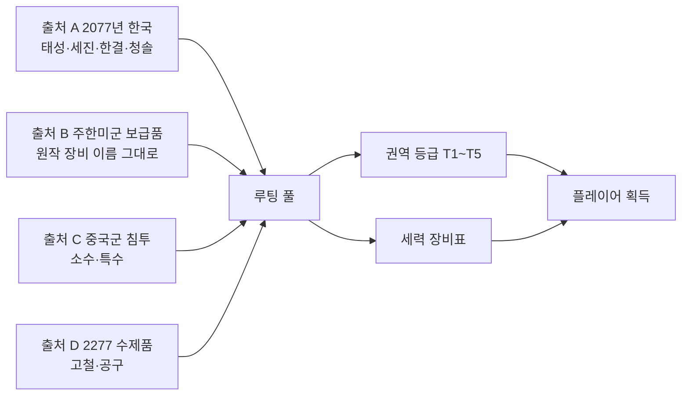
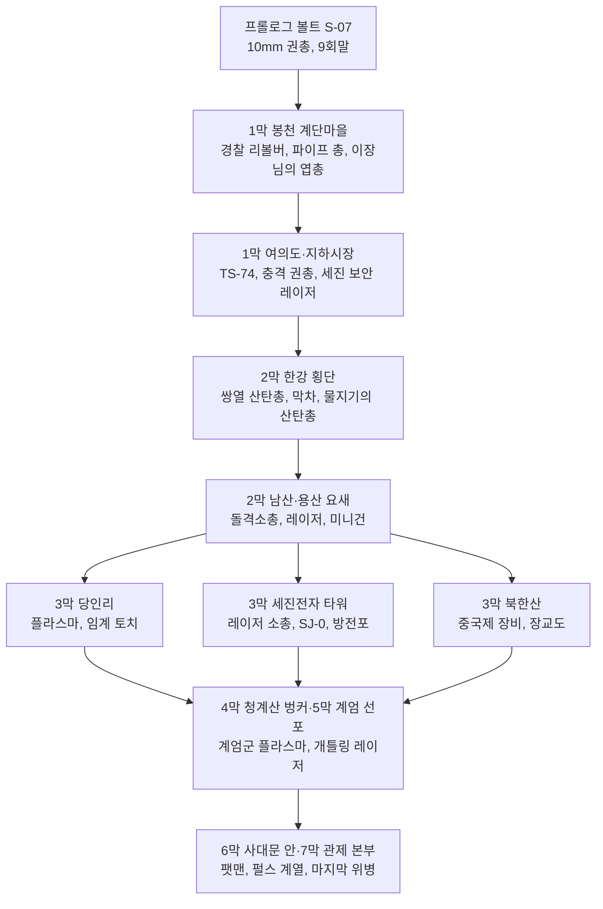

# SD-13. 아이템

> **서울 폴아웃 상세 기획서 세트** | 문서 ID: SD-13 | 버전: v1.0 | 작성일: 2026-10-12
> **범위**: 플레이어가 얻고 쓰는 아이템 전체의 설계 원칙과 카탈로그. 무기(W-), 탄약, 방어구·의복(A-), 소모품(I-), 잡화·제작 재료·퀘스트 아이템(M-), 제작 시스템(작업대·설계도·레시피), 아이템 상태(내구도) 5단계와 수리, 루팅 테이블 원칙, 페이퍼돌 레이어 분류와 그래픽 제작량. **다루지 않는 것**: 스킬북·보블헤드 대응 수집품([SD-10](10_character-system.md)), 피해·명중·치명타·중독·방사능 공식의 세부([SD-11](11_combat-system.md)), 상인 재고·매입 배율·수리 서비스 가격([SD-15](15_economy.md)), 크리처 개체별 드롭 수치([SD-14](14_creatures-enemies.md)), 도트 규격·프레임 수의 확정([SD-16](16_art-direction.md))
> **관련 문서**: [SC-00 컨셉](00_concept.md), [SD-03a 메인 스토리 1](03a_main-story-part1.md), [SD-03b 메인 스토리 2](03b_main-story-part2.md), [SD-04a~d 사이드·세력 퀘스트](04d_faction-questlines.md), [SD-05 비표시·반복·인카운터](05_misc-quests-encounters.md), [SD-06 세력](06_factions.md), [SD-07a 주요 인물](07a_characters-major.md), [SD-08 월드·권역](08_world-regions.md), [SD-09a~f 장소 카탈로그](09a_locations-r01-r02.md), [SD-10 캐릭터 시스템](10_character-system.md), [SD-11 전투 시스템](11_combat-system.md), [SD-12 탐험·UI](12_exploration-ui.md), [SD-14 크리처·적](14_creatures-enemies.md), [SD-15 경제](15_economy.md), [SD-16 아트 디렉션](16_art-direction.md), [SD-18 용어·명명](18_naming-terms.md)
> **원작 근거**: [RD-19 무기·탄약](../reverse-design/19_weapons-ammo.md), [RD-20 방어구·의복](../reverse-design/20_armor-apparel.md), [RD-21 소모품·잡화·제작](../reverse-design/21_consumables-misc-crafting.md), [RD-27 쯔꾸르 이식 시사점](../reverse-design/27_adaptation-notes.md) §7.2·§9.3·§14.2, [RD-26 용어집](../reverse-design/26_glossary.md)
> **조사 근거**: [SR-01 공식 설정](research/SR-01_fallout-canon.md)(C7·C8 기술·파워 아머 계보), [SR-04 생물](research/SR-04_korean-fauna.md), [SR-05 국가·사회](research/SR-05_korea-state-society.md)(§2.6 방위산업, §4.6 유통, §7.2 산업 투영)

---

## 1. 문서 개요

### 1.1 목적
- 서울판 아이템 데이터베이스의 **정본 카탈로그**를 만든다. 기획자는 이 표로 루팅·보상·상점 재고를 짜고, 제작자는 이 표로 아이콘·페이퍼돌 레이어·데이터베이스 항목을 만든다.
- 원작 폴아웃 3의 아이템 **시스템**(6계열 무기 스킬, 탄약 경제, 몸통·머리·눈 슬롯, 파워 아머 훈련 게이트, 의학 배율, 중독, 설계도 품질, 반복 거래)은 그대로 계승한다. 바꾸는 것은 **카탈로그(무엇이 있는가)와 출처(누가 만들었는가)**다.

### 1.2 요약

| 분류 | ID 범위 | 수량 | 구성 |
|---|---|---|---|
| 무기 | W-001~W-064 (일반), W-101~W-130 (고유), W-151~W-157 (제작) | **101종** | 일반 64 / 고유 30 / 제작 7. 공격 자세 8계열 |
| 탄약 | (무기 표 안에서 이름으로 참조) | 17종 + 잡동사니 | 원작 19종을 서울판 출처에 맞게 재편 |
| 방어구·의복 | A-001~A-079 (일반), A-101~A-112 (고유) | **91종** | 몸통 46 / 전신 4 / 머리 22 / 머리+눈 7 / 눈 12 (고유 포함 집계는 §5.9) |
| 소모품 | I-001~I-068 | **68종** | 의약품 10 / 약물 12 / 음식 26 / 음료 12 / 주류 4 / 기타 4 |
| 잡화 | M-001~M-099 (일반·재료·거래), M-201~M-240 (퀘스트) | 약 130종 | 화폐 3 / 제작 재료 30 / 수집 판매품 12 / 기능성 8 / 판매용 잡동사니 대표 20 / 설계도 8 / 퀘스트 40 |

- **무기 수 권장안: 101종**(§3.1). RD-27 §14.2 7번의 '통합 100~110종'은 원작 카탈로그를 줄이는 안이었다. 서울판은 새 카탈로그이므로 기능 중복을 처음부터 만들지 않고, 바이블 v0.3의 볼륨 확장(메인 약 40, 사이드 60+, 장소 250+)에 맞춰 80~110종 범위에서 101종으로 정한다.
- **고유 장비 45종**: 고유 무기 30 + 고유 방어구 15. 7막 메인 무대마다 1개 이상, 호감도 대상 8개 세력마다 '우호·신뢰·동맹' 보상 장비를 둔다(§5.10).
- **동료 장비는 없다**(바이블 K7). 대신 '신뢰' 이상 세력의 **지원 병력 호출 장비**를 둔다(§6.4).
- **상태(내구도)는 5단계**(새것·양호·낡음·위태·파손)로 단순화한다(§7). 원작의 개체별 HP는 쓰지 않는다.
- **장비 외형**은 몸통·머리·눈·무기 4종 레이어 전부를 걷기·전투 스프라이트에 반영한다(P9). 분량은 '외형 계열' 통합으로 줄인다: 무기 레이어 42장, 몸통 레이어 26계열, 머리 레이어 18계열, 눈 레이어 7계열(§10).

### 1.3 표기 메모
- 원작 용어는 [RD-26](../reverse-design/26_glossary.md)의 한글 패치 표기를 쓴다(스팀팩, 라드어웨이, 라드-X, 메드-X, 버프아웃, 멘타츠, 사이코, 제트, 뉴카-콜라, 미니 누크, 팻맨, 미니건, 돌격소총, 레이저 소총 등).
- 수치는 원작 기본값(스킬 100, 상태 '새것')에 비례한 **서울판 기준값**이다. 실시간 탑다운 전투 템포에 맞춘 전역 배율은 SD-11이 정한다([RD-27 §7.5](../reverse-design/27_adaptation-notes.md)). 이 문서의 값끼리의 **상대 관계**가 정본이다.
- `(SD-xx에서 ID 부여)`: 다른 문서 소관이라 번호를 붙이지 않은 대상이다.
- `[신규]`: 서울판이 원작에 없는 규칙이나 품목을 새로 넣은 곳이다.
- 장소는 바이블 §4의 장소명과 권역 번호(R01~R11)로 적는다. 장소 ID는 SD-09가 부여한다.

---

## 2. 아이템 설계 원칙

### 2.1 네 개의 출처
서울 수도 황무지의 모든 아이템은 아래 네 출처 가운데 하나에서 왔다. 출처가 곧 **외형 언어, 탄약 계통, 등장 권역, 들고 나오는 세력**을 정한다.

| 출처 | 시점 | 성격 | 대표 제조사·공급자 | 외형 언어 (SD-16과 맞출 것) | 주 등장처 |
|---|---|---|---|---|---|
| **A. 2077년 한국** | 전쟁 전 | 국가-재벌 연합 체제의 군수·치안·생활 장비. 한국은 민간 총기가 금지된 사회라 총기는 **경찰·군·예비군 무기고**에 몰려 있다(SR-05 §7.4) | 태성그룹 군수(무기·탄약·파워 아머 면허 정비), 세진전자(에너지 장비·보안 장비·진공관), 한결건설 공구 부문(공구·건설 장비), 청솔식품(식품·음료), 태성제약(의약품) | 회녹색·회색 도장, 한글 각인, 형식 번호 'TS-' 'SJ-', 둥근 진공관 표시창, 원자력 마크 | 파출소, 예비군 무기고, 구청 지하 비상 지휘소, 편의점, 약국, 아파트 |
| **B. 주한미군 보급품** | 전쟁 전 | 중국 본토 진격 전진기지의 미군 장비. **원작 장비를 원작 이름 그대로** 쓴다(10mm 권총, 돌격소총, 레이저 소총, 미니건, 팻맨, 전투 아머, T-45d·T-51b 파워 아머 등) | 미 육군 보급(원작 제조사는 언급하지 않는다), 일부는 태성그룹의 **면허 생산판** | 원작 외형 그대로. 13개 별 성조기 표식(C12) | 용산 기지, 김포·서부 평야 화물 터미널, 남산 대피 터널, 연합단·계엄군 무기고 |
| **C. 중국군 침투** | 2077년 침투 | 관제 본부 파괴 임무로 들어온 특수부대 장비. 수량은 적고 성능은 특수하다(은폐 기술 우위, C6) | 중국 인민해방군(원작 '중국제' 계열) | 원작 중국제 무기 외형, 짙은 녹색·흑색, 한자 각인 | 북한산(R09), 침투 터널, 도심 지하 |
| **D. 2277년 황무지 수제품** | 전후 | 고철·공구·생활용품으로 만든 무기와 방어구. 원작 설계도 무기와 약탈자 아머의 계보 | 정착지 대장간, 약탈자, 지하시장 기술자 | 덧댄 고철판, 노끈, 테이프, 녹, 재활용 표시가 남은 부품 | 전 권역, 정착지 상인 |

### 2.2 명명 규칙
- **실제 무기 제식명·실제 브랜드는 쓰지 않는다.** 한국 장비는 '가상 제조사 + 형식 번호 + 일반 명사'로 짓는다. 예: `태성 TS-74 보병소총`, `세진 SJ-L2 보안 레이저 권총`, `한결 NG-5 공업용 못총`.
  - 형식 번호의 두 자리 숫자는 가상 '채용 연도'다(TS-74 = 2074년 채용). 실제 한국군 형식 체계(K-숫자)와 겹치지 않게 접두어는 반드시 TS·SJ·HG를 쓴다.
  - 실제 국산 무기 애칭(동물·천체·전설 이름 계열)과 겹칠 수 있는 별칭은 붙이지 않는다. 별칭이 필요하면 생활어(순찰, 만점, 출근)를 쓴다.
- **주한미군 장비**는 원작 이름을 그대로 쓴다. 태성이 면허 생산한 판본은 `(태성 면허)`를 덧붙여 구분하되 수치는 같다.
- **중국군 장비**는 원작 표기 '중국제 ○○', '중국군 ○○'를 쓴다.
- **수제품**은 재료를 드러내는 이름을 쓴다(파이프 소총, 못 박힌 각목, 철근 몽둥이).
- **고유(유니크)** 는 사연을 담은 이름을 쓴다. 인명이 들어가면 바이블 §11 표기를 그대로 쓴다.
- **식품·음료**: 청솔식품 제품명은 한글 2~4음절 상품명(번개사이다, '한그릇', '든든')으로 짓는다. 실제 상품명과 같은 이름은 피한다(예: 실제 초코 과자·런천미트 상표).
- 표현 원칙: 반중 선전 문구가 새겨진 장비(예: 계엄군 탄약 상자의 표어)는 원작처럼 시대의 광기로 보이게 쓴다. 중국군 장비 설명은 '명령에 갇힌 병사'의 물건으로 쓴다(브리프 §5).

### 2.3 출처별 설계 규칙

| 규칙 | 출처 A (한국) | 출처 B (미군) | 출처 C (중국군) | 출처 D (수제) |
|---|---|---|---|---|
| 성능 위치 | 원작 동급보다 **피해 약간 낮고 내구 높음**. 경찰 장비는 비살상 효과(넘어뜨림·마비) | 원작 수치 기준 | 피해 낮고 **내구 매우 높음**(원작 중국제 권총 패턴), 은신 보정 | 피해 중간, **내구 낮음**, 값쌈 |
| 탄약 | 한미 공용 탄(10mm, 5.56mm, .308, 12게이지) + 한국 고유(신호탄, 40mm 유탄, 건설용 대못) | 원작 탄 전부 | 10mm, 5.56mm(노획 호환) | .32 구경탄, 12게이지, 건설용 대못, 잡동사니 |
| 수리 계열 | 'TS 계열', 'SJ 계열', '공구 계열' | 원작 수리 그룹 | '중국제 계열' | '수제 계열'(같은 자세의 수제품끼리 서로 수리) |
| 진행 단계 | 초반~중반 | 중반~후반 | 중반 특수 | 초반 |
| 세력 | 계엄군(TS 계열 + 개량), 자율방범대(경찰 장비), 새벽인력(진압 장비) | 연합단·원칙파(복원 미군 장비), 철벽경호(구입한 미군 장비), 변종(노획) | 중국군 잔존병 | 약탈자, 정착민 |

### 2.4 계승하는 원작 시스템 (요약)

| 원작 시스템 | 서울판 처리 | 근거 |
|---|---|---|
| 6계열 무기 스킬(소형 화기·에너지 무기·중화기·폭발물·근접 무기·비무장) | 유지. 무기마다 스킬 1개 | RD-19 §2.1, SD-10 |
| 공격 자세 8계열 | 그래픽·모션 분류로 사용. 스킬과 별개의 축이다 | RD-27 §7.2 |
| 탄약 무게 0 | 유지. 보급 병목은 '구할 수 있는가'다 | RD-19 §5.2 |
| 내구도와 부품 수리 | **5단계 상태 + 같은 수리 계열 부품 소모**로 단순화 | RD-27 §14.2 6번, §7 |
| 몸통·머리·눈 3슬롯, 전신·머리+눈 봉인 | 유지 | RD-20 §2.1 |
| DR 합산, 상한 85% | 유지 | RD-20 §2.2 |
| 파워 아머 훈련 게이트(3경로) | 유지. 경로를 서울판 세력으로 바꾼다 | RD-20 §2.6 |
| 의학 배율 `기본 × (1 + 의학 ÷ 50)` | 유지 | RD-21 §2.2 |
| 음식의 '회복 + 라드' 맞교환 | 유지 | RD-21 §2.3 |
| 약물 중독(확률 + 누적) | 유지. 규칙은 SD-11 | RD-21 §2.4 |
| 설계도 1~3장 품질 | 유지 | RD-21 §5.4 |
| 반복 거래 품목 | 유지. 거래처를 서울판 인물·세력으로 | RD-21 §4.2 |
| 록잇 런처의 잡동사니 탄환 | 유지(잡동사니 발사기) | RD-19 §4.2 |

### 2.5 서울판에서 새로 넣는 것 [신규]

| 항목 | 내용 | 이유 |
|---|---|---|
| 비살상 효과 무기 | 경찰·새벽인력 장비에 '넘어뜨림', '마비' 효과 | 새벽인력(인신매매단)의 포획 전술과 경찰 장비의 성격. 원작 메스메트론·충격봉 계보 |
| 로봇 대응 장비 계열 | 펄스 계열 + 세진 충격 장비 + 관제망 관련 고유 무기 | 메인 스토리의 적이 관제망 로봇이다. 로봇 대응 수단이 진행의 축이 된다 |
| 부위 치료 소모품 | 구급 부목 세트(불구 1부위 치료) | 실시간 전투에서 불구가 무작위로 걸린다(RD-27 §7.3). 의사 방문 외의 치료 수단 필요 |
| 수리 키트 | 부품 없이 상태 +1단계 | 5단계 상태에서 부품이 없는 고유 장비의 유지 수단(원작 외계인 에폭시 계보) |
| 전지 재충전 | 당인리 재가동 뒤 '빈 전지 → 전지' 충전 서비스 | 메인 퀘스트(MQ-301) 결과가 탄약 경제를 바꾼다 |
| 간이 조리 | 버너·작업대에서 식품 2~3개를 합쳐 회복량을 올린다 | 2077년 한국 가공식품(컵라면, 즉석밥)의 성격을 살림. 우선순위 낮음(§6.7) |
| 제한적 변장 | 세력 복장 풀세트가 일부 세력의 원거리 적대를 늦춘다 | 원작에는 없다. SD-06과 함께 확정(§5.8) |

---

## 3. 무기

### 3.1 무기 수 권장안: 101종

| 안 | 구성 | 수량 | 판단 |
|---|---|---|---|
| A. 대표만 | 자세 계열마다 5~7종 + 고유 20종 | 약 80 | 도트 부담이 가장 작다. 탐험 보상 밀도가 낮아 원작의 '고유 무기 찾기' 동선이 약해진다 |
| **B. 권장** | **일반 64 + 고유 30 + 제작 7** | **101** | 4개 출처가 각 계열에 최소 1종씩 들어간다. 고유 무기 30종은 7막 메인 무대와 세력 호감도 보상에 고르게 붙는다. 단독 고유 1종을 빼고 모두 기반 무기의 레이어를 재사용하므로 그래픽 부담이 작다 |
| C. 원작 규모 | 일반 75 + 고유 40 + 제작 7 | 약 122 | 범위(80~110)를 넘는다. 기능 중복(원작 나이프·스위치블레이드·전투 나이프 같은)이 다시 생긴다 |

- **권장 근거**
  - 원작 139종 가운데 실제로 쓰이지 않거나 기능이 겹친 무기(BB건, 밀대, 당구 큐, 스위치블레이드, 타이어 렌치 등, RD-19 §8.5)를 처음부터 만들지 않는다.
  - 고유 무기 비율은 원작 49%에서 **30%**로 줄인다. 대신 고유 무기마다 서울판 이야기(7막 메인 무대, 세력 수장, 정착지)를 하나씩 붙이고 세력 호감도 보상과 묶어 '이름 붙은 보상'의 밀도를 지킨다.
  - 그래픽 제작량은 무기 수가 아니라 **무기 레이어 수**가 정한다. 101종을 53장의 무기 레이어로 그린다(§3.11).

### 3.2 공격 자세 8계열 배분

| 자세 계열 | 공유 모션 (RD-27 §7.2) | 일반 | 고유 | 제작 | 합계 | 스킬 분포 | 무기 레이어 |
|---|---|---|---|---|---|---|---|
| 권총 | 한손 조준·사격·재장전 | 12 | 10 | 1 | 23 | 소형 화기 14, 에너지 무기 9 | P01~P11 (11) |
| 소총 | 양손 조준·사격·재장전 | 12 | 7 | 1 | 20 | 소형 화기 15, 에너지 무기 5 | R01~R11 (11) |
| 산탄총 | 양손 사격(펌프·꺾기) | 5 | 3 | 0 | 8 | 소형 화기 8 | S01~S05 (5) |
| 중화기 | 허리 높이 거치 사격 | 7 | 4 | 1 | 12 | 중화기 12 | H01~H08 (8) |
| 한손 근접 | 찌르기·베기 | 9 | 2 | 1 | 12 | 근접 무기 12 | M01~M07 (7) |
| 양손 근접 | 크게 휘두르기 | 6 | 4 | 0 | 10 | 근접 무기 10 | T01~T05 (5) |
| 비무장 | 주먹 연타 | 5 | 0 | 1 | 6 | 비무장 6 | U01~U04 (4) |
| 투척·설치 | 던지기·설치 | 8 | 0 | 2 | 10 | 폭발물 10 | X01~X02 (2) |
| **합계** | | **64** | **30** | **7** | **101** | | **53** |

- 스킬과 자세는 별개의 축이다. 레이저 권총은 '에너지 무기 스킬 + 권총 자세', 유탄 발사기는 '중화기 스킬 + 중화기 자세'다.
- 기관단총(W-015·W-016)은 원작에서 한 손 판정(건슬링어)이지만, 그림은 두 손으로 쥐는 **소총 자세**를 쓴다. 판정 규칙은 SD-10의 건슬링어·코만도 정의를 따른다.
- 투척·설치 계열은 손에 든 무기 레이어 대신 공용 '투척 손' 레이어(X01)와 '설치' 레이어(X02)만 쓰고, 날아가는 물체는 투사체 스프라이트(아이콘 축소판)로 그린다.

### 3.3 수치 칼럼 정의

| 칼럼 | 정의 | 비고 |
|---|---|---|
| 출처·제조사 | §2.1의 출처 기호(A·B·C·D) + 제조사·공급자 | |
| 스킬 | 피해·명중에 쓰는 무기 스킬(SD-10) | |
| 피해 | 1회 공격의 기본 피해. 스킬 100·상태 '새것' 기준. 산탄은 `합계 (탄당×수)`, 지속 피해는 `화염 2/초(5초)` 식 | 원작 표기 규칙(RD-19 §1.4) |
| 연사 | 초당 최대 공격 횟수(재장전 제외). 실시간 전투의 기준값 | 원작 발사 속도를 탑다운 템포에 맞춰 일부 낮췄다(10mm 권총 6→4 등) |
| DPS | `피해 × 연사`. 폭발 무기는 폭발 피해를 더한 값. 지속 피해·투척물은 넣지 않았다 | 밸런스 기준(RD-27 §7.5) |
| 사거리 | 유효 사거리(타일). 이 거리를 넘으면 명중 오차가 2배가 된다. 근접은 공격 판정 거리 | 타일 크기는 SD-16 |
| 탄창 | 1회 장전 탄수. `2 (1)`은 1회에 2발을 쓴다는 뜻 | |
| 무게 / 가격 | 소지 무게와 기본 가치(캡) | 매매 배율은 SD-15 |
| 내구 | 상태가 '새것'에서 '파손'까지 떨어지는 데 걸리는 공격 횟수의 등급(§7.2) | S·A·B·C·D·E |
| 레이어 | 페이퍼돌 무기 레이어 코드(§3.10) | |

### 3.4 일반 무기: 권총 자세 (W-001~W-012)

| ID | 이름 | 출처·제조사 | 스킬 | 탄약 | 피해 | 연사(/초) | DPS | 사거리(타일) | 탄창 | 무게 | 가격 | 내구 | 레이어 | 입수처(대표) | 비고 |
|---|---|---|---|---|---|---|---|---|---|---|---|---|---|---|---|
| W-001 | 경찰 리볼버 '순찰' | A 태성 TS-32 (경찰청 지급) | 소형 화기 | .32 구경탄 | 7 | 2.5 | 17.5 | 7 | 6 | 2 | 120 | B | P01 | 파출소 무기 보관함, 경찰 로봇 잔해, 봉천 계단마을 상인 | 초반 권총. 원작 .32 권총 대응 |
| W-002 | 10mm 권총 | B 주한미군 (태성 면허판 공존) | 소형 화기 | 10mm 탄 | 9 | 4 | 36 | 8 | 12 | 3 | 225 | B | P03 | 볼트 S-07 경비대(MQ-P4), 약탈자, 정착지 상인 | 게임 최초의 실총. 원작 그대로 |
| W-003 | 소음 10mm 권총 | B 주한미군 특수전 | 소형 화기 | 10mm 탄 | 8 | 4 | 32 | 8 | 12 | 3 | 250 | C | P04 | 용산 기지 특수전 창고, 철벽경호 저격조, 지하시장 상인 | 소음: 사격해도 탐지가 오르지 않는다 |
| W-004 | 태성 77식 군용 권총 | A 태성그룹 군수 (한국군 제식) | 소형 화기 | 10mm 탄 | 10 | 3.5 | 35 | 8 | 15 | 3 | 260 | A | P03 | 예비군 무기고, 계엄군 장교, 구청 지하 비상 지휘소 | 계엄군 표준 권총. 장탄 15 |
| W-005 | 중국제 권총 | C 중국군 침투 장비 | 소형 화기 | 10mm 탄 | 5 | 4 | 20 | 7 | 10 | 2 | 190 | A | P03 | 중국군 잔존병, 북한산 침투 거점 | 피해 최저, 내구 최고. 원작 그대로 |
| W-006 | .44 매그넘 리볼버 | B 미군 PX 수입 민수품 | 소형 화기 | .44 매그넘탄 | 35 | 1.5 | 52.5 | 9 | 6 | 4 | 300 | D | P02 | 용산 장교 숙소, 철벽경호 간부, 노들섬 무기상 | 원작 조준경 .44 매그넘에서 조준경을 뺀 판본 |
| W-007 | 한결 NG-5 공업용 못총 | A 한결건설 공구 부문 | 소형 화기 | 건설용 대못 | 12 | 2 | 24 | 5 | 20 | 3 | 90 | C | P05 | 공사장, 한결건설 현장 사무소, 아파트 리모델링 현장 | 명중 시 15% 확률로 다리 불구 |
| W-008 | 레이저 권총 | B 주한미군 | 에너지 무기 | 에너지 전지 | 12 | 3 | 36 | 9 | 30 | 3 | 320 | B | P06 | 연합단 상인, 용산 기지, 계엄군 장교 | 치명타 처치 시 분해(재) |
| W-009 | 세진 SJ-L2 보안 레이저 권총 | A 세진전자 보안 사업부 | 에너지 무기 | 에너지 전지 | 10 | 3 | 30 | 8 | 24 | 2 | 260 | A | P07 | 세이프빌 경비실, 세진전자 타워 저층, 관공서 경비실 | 초반 에너지 무기. 관공서·아파트 경비원 지급품 |
| W-010 | 세진 SJ-E5 충격 권총 | A 세진전자 보안 (경찰 비살상 장비) | 에너지 무기 | 에너지 전지 | 6 + 전기 2/초(3초) | 2 | 12 | 6 | 10 | 2 | 200 | B | P07 | 파출소, 새벽인력 추심원, 지하시장 | [신규] 인간형 명중 시 25% 마비 1초. 로봇 피해 +50% |
| W-011 | 플라스마 권총 | B 주한미군 | 에너지 무기 | 에너지 전지 | 25 | 2 | 50 | 9 | 16 | 3 | 360 | B | P08 | 용산 무기고, 계엄군 장교, 세진전자 타워 상층 | 치명타 처치 시 젤리화 |
| W-012 | 민방위 신호탄 권총 | A 태성그룹 군수 (민방위·구조용) | 소형 화기 | 신호탄 | 8 + 화염 3/초(4초) | 0.8 | 6.4 | 8 | 1 | 2 | 80 | B | P09 | 민방위 대피소 비상함, 한강 구조대 초소, 노들섬 | [신규] 착탄 지점 반경 3타일을 5초간 밝혀 어둠 속 적을 드러낸다 |

- **설계 의도**: 출처 A의 세진 에너지 권총 2종(W-009·W-010)이 **초반 에너지 무기 빌드**를 연다. 원작은 에너지 무기가 후반에 몰려 있었다(RD-19 §8.5). 충격 권총은 관제망 로봇 대응 수단이기도 하다.
- 경찰 리볼버(W-001)와 77식 군용 권총(W-004)은 2077년 한국의 '민간 총기 없는 사회'를 보여 준다. 총은 경찰과 군의 것이었고, 200년 뒤 황무지 사람들은 파출소와 예비군 무기고를 털어 무장한다.

### 3.5 일반 무기: 소총 자세 (W-013~W-024)

| ID | 이름 | 출처·제조사 | 스킬 | 탄약 | 피해 | 연사(/초) | DPS | 사거리(타일) | 탄창 | 무게 | 가격 | 내구 | 레이어 | 입수처(대표) | 비고 |
|---|---|---|---|---|---|---|---|---|---|---|---|---|---|---|---|
| W-013 | 파이프 소총 | D 2277 수제 | 소형 화기 | .32 구경탄 | 14 | 0.8 | 11.2 | 9 | 5 | 5 | 60 | E | R01 | 약탈자, 봉천 계단마을 대장간 | 수제 계열. 싸고 빨리 닳는다 |
| W-014 | 사냥용 소총 | A 수입 엽총 (구청 유해조수 포획단 지급) | 소형 화기 | .32 구경탄 | 25 | 0.75 | 18.8 | 12 | 5 | 6 | 150 | B | R02 | 구청 유해조수 포획단 창고, 관악산 사냥꾼 오두막, 정착지 상인 | 변이 멧돼지 사냥의 기본 총. 원작 그대로 |
| W-015 | 10mm 기관단총 | B 주한미군 | 소형 화기 | 10mm 탄 | 7 | 10 | 70 | 8 | 30 | 5 | 330 | A | R03 | 새벽인력 간부, 철벽경호, 용산 | 자동 |
| W-016 | 태성 TS-61 경찰 기관단총 | A 태성그룹 군수 (경찰 특공대) | 소형 화기 | 10mm 탄 | 6 | 9 | 54 | 8 | 25 | 4 | 280 | A | R03 | 경찰 특공대 무기고(여의도·도심), 자율방범대 간부 | 자동. 산포가 가장 작은 자동화기 |
| W-017 | 태성 TS-74 보병소총 | A 태성그룹 군수 (한국군 제식) | 소형 화기 | 5.56mm 탄 | 10 | 6 | 60 | 11 | 30 | 7 | 320 | A | R04 | 예비군 무기고, 계엄군 병사, 여의도 지하 벙커 | 자동. 계엄군 표준 소총 |
| W-018 | 돌격소총 | B 주한미군 | 소형 화기 | 5.56mm 탄 | 8 | 8 | 64 | 11 | 24 | 7 | 300 | A | R05 | 연합단, 철벽경호, 변종 | 자동. 원작 그대로 |
| W-019 | 중국제 돌격소총 | C 중국군 침투 장비 | 소형 화기 | 5.56mm 탄 | 11 | 8 | 88 | 11 | 24 | 7 | 500 | A | R06 | 중국군 잔존병, 북한산 침투 거점 | 자동. 자동화기 중 1발 피해 최고 |
| W-020 | 태성 TS-80 지정사수소총 | A 태성그룹 군수 (한국군 제식) | 소형 화기 | .308 구경탄 | 30 | 1.5 | 45 | 14 | 10 | 9 | 380 | C | R07 | 계엄군 저격조, 남산 대공 진지, 예비군 무기고(잠금 어려움) | 반자동. 치명 배수 x3 |
| W-021 | 저격소총 | B 주한미군 | 소형 화기 | .308 구경탄 | 40 | 1 | 40 | 16 | 5 | 10 | 300 | E | R07 | 철벽경호 저격수, 용산, 남산 송신탑 | 치명 배수 x5. 내구 최저급 |
| W-022 | 세진 SJ-L5 레이저 카빈 | A 세진전자 군수 (한국군·경찰 특공대) | 에너지 무기 | 에너지 전지 | 15 | 3 | 45 | 11 | 30 | 5 | 450 | A | R08 | 계엄군, 세진전자 타워, 관제망 경비 거점 | 레이저 권총과 레이저 소총 사이의 중간 단계 |
| W-023 | 레이저 소총 | B 주한미군 | 에너지 무기 | 마이크로퓨전 전지 | 23 | 2.5 | 57.5 | 13 | 24 | 8 | 1000 | A | R09 | 연합단 기사, 원칙파, 계엄군 장교 | 원작 그대로 |
| W-024 | 플라스마 소총 | B 주한미군 | 에너지 무기 | 마이크로퓨전 전지 | 45 | 1.5 | 67.5 | 13 | 12 | 8 | 1800 | B | R10 | 계엄군 정예, 청계산 벙커, 용산 무기고 | 원작 그대로 |

- 소총 자세는 4개 출처가 모두 들어간 유일한 계열이다. 같은 5.56mm 탄을 쓰는 세 소총(TS-74 / 돌격소총 / 중국제 돌격소총)은 **연사·피해·탄창이 서로 다르다**. 플레이어는 어느 세력에게서 노획하느냐로 성격을 고른다.
- 지정사수소총(W-020)은 저격소총(W-021)보다 1발 피해가 낮지만 내구가 두 단계 높다. 원작의 '저격소총 내구 83회' 문제(RD-19 §2.3)에 대한 대안이다.

### 3.6 일반 무기: 산탄총 자세 (W-025~W-029)

| ID | 이름 | 출처·제조사 | 스킬 | 탄약 | 피해 | 연사(/초) | DPS | 사거리(타일) | 탄창 | 무게 | 가격 | 내구 | 레이어 | 입수처(대표) | 비고 |
|---|---|---|---|---|---|---|---|---|---|---|---|---|---|---|---|
| W-025 | 파이프 산탄총 | D 2277 수제 | 소형 화기 | 12게이지 산탄 | 40 (5×8) | 0.6 | 24 | 4 | 1 | 5 | 70 | E | S01 | 약탈자, 탱크마을 대장간 | 1발 장전 |
| W-026 | 소드오프 산탄총 | D 엽총 개조 | 소형 화기 | 12게이지 산탄 | 50 (5.6×9) | 2 | 100 | 4 | 2 | 6 | 190 | D | S02 | 약탈자, 새벽인력, 지하시장 | 치명타 불가. 한 손 판정(SD-10 건슬링어) |
| W-027 | 쌍열 산탄총 | A 수입 엽총 (실내 사격장·엽사) | 소형 화기 | 12게이지 산탄 | 85 (9.4×9) | 1 | 85 | 5 | 2 (1) | 6 | 175 | C | S03 | 정착지 상인, 실내 사격장, 관악산 사냥꾼 | 1회 사격에 탄 2발 소모 |
| W-028 | 태성 TS-12 경찰 펌프 산탄총 | A 태성그룹 군수 (경찰 기동대) | 소형 화기 | 12게이지 산탄 | 45 (5×9) | 1.2 | 54 | 5 | 7 | 7 | 220 | A | S04 | 파출소 무기고, 자율방범대, 계엄군 검문소 | [신규] 3타일 안 명중 시 20% 넘어뜨림 |
| W-029 | 전투 산탄총 | B 주한미군 | 소형 화기 | 12게이지 산탄 | 55 (6.1×9) | 1.5 | 82.5 | 5 | 12 | 7 | 200 | D | S05 | 철벽경호, 연합단, 변종 | 원작 그대로 |

### 3.7 일반 무기: 중화기 자세 (W-030~W-036)

| ID | 이름 | 출처·제조사 | 스킬 | 탄약 | 피해 | 연사(/초) | DPS | 사거리(타일) | 탄창 | 무게 | 가격 | 내구 | 레이어 | 입수처(대표) | 비고 |
|---|---|---|---|---|---|---|---|---|---|---|---|---|---|---|---|
| W-030 | 화염방사기 | B 주한미군 | 중화기 | 화염방사기 연료 | 16 + 화염 2/초(5초) | 8 | 128 | 4 | 60 | 15 | 500 | D | H01 | 약탈자 방화범, 탱크마을, 용산 | 지면 화염 없음(투사형) |
| W-031 | 태성 TS-40 유탄 발사기 | A 태성그룹 군수 (한국군 분대 지원) | 중화기 | 40mm 유탄 | 10 + 폭발 60 | 0.8 | 56 | 10 | 6 | 12 | 650 | B | H02 | 계엄군 분대 지원병, 예비군 무기고(잠금 어려움), 용산 | [신규] 포물선 탄도. 엄폐물 너머 공격 |
| W-032 | 미니건 | B 주한미군 | 중화기 | 5mm 탄 | 5 | 20 | 100 | 9 | 240 | 18 | 1000 | A | H03 | 변종 상위 개체, 연합단 중화기병, 용산 | 회전 예열 0.5초 |
| W-033 | 미사일 발사기 | B 주한미군 | 중화기 | 미사일 | 20 + 폭발 150 | 0.5 | 85 | 14 | 1 | 20 | 500 | E | H04 | 계엄군, 남산 대공 진지, 김포 화물 터미널 | 원작 그대로 |
| W-034 | 개틀링 레이저 | B 주한미군 | 중화기 | 전자 충전 팩 | 8 | 20 | 160 | 10 | 240 | 18 | 2000 | A | H05 | 연합단 중화기병, 계엄군 정예, 관제망 경비 거점 | 회전 예열 0.5초 |
| W-035 | 세진 SJ-X9 방전포 | A 세진전자 군수 (대로봇 시제) | 중화기 | 전자 충전 팩 | 40 + 폭발 60 + 전기 15/초(2초) | 0.5 | 50 | 12 | 1 | 12 | 1800 | C | H06 | 세진전자 타워 상층 연구소, 관제 본부 외곽 무기고 | 로봇·파워 아머 상대 피해 +50%. 원작 테슬라 캐넌 대응 |
| W-036 | 팻맨 | B 주한미군 | 중화기 | 미니 누크 | 10 + 폭발 1600 | 0.25 | 402.5 | 14 | 1 | 30 | 1000 | E | H07 | 용산 기지 탄약고, 김포 화물 터미널, 계엄군 기갑 거점 | 포물선. 최고 화력. 탄약 고정 수량(§4) |

- 유탄 발사기(W-031)는 한국군 분대 지원 화기로 넣었다. 미사일 발사기보다 한 발이 약하고 연사가 빠르다. 계엄군이 이 무기로 엄폐한 플레이어를 몰아낸다.
- 방전포(W-035)는 세진전자가 '관제망 로봇이 반란을 일으킬 때'를 대비해 만든 대로봇 시제 무기다. 메인 스토리 3막(관제망 로봇 각성)의 결정타 역할을 한다.

### 3.8 일반 무기: 근접·비무장·투척 (W-037~W-064)

#### 3.8.1 한손 근접 (W-037~W-045)

| ID | 이름 | 출처·제조사 | 스킬 | 탄약 | 피해 | 연사(/초) | DPS | 사거리(타일) | 탄창 | 무게 | 가격 | 내구 | 레이어 | 입수처(대표) | 비고 |
|---|---|---|---|---|---|---|---|---|---|---|---|---|---|---|---|
| W-037 | 주방 식칼 | A 생활용품 | 근접 무기 | — | 5 | 2 | 10 | 1 | — | 1 | 15 | C | M01 | 아파트 주방, 식당, 약탈자 | 원작 나이프 대응 |
| W-038 | 태성 77식 대검 | A 태성그룹 군수 (한국군 제식) | 근접 무기 | — | 8 | 2 | 16 | 1 | — | 1 | 50 | A | M01 | 예비군 무기고, 계엄군, 정착지 상인 | 원작 전투 나이프 대응 |
| W-039 | 중국군 장교도 | C 중국군 침투 장비 | 근접 무기 | — | 10 | 1.5 | 15 | 1.2 | — | 3 | 75 | A | M02 | 중국군 잔존병 장교 | 원작 그대로 |
| W-040 | 공사장 쇠파이프 | D 공사장 자재 | 근접 무기 | — | 9 | 1.4 | 12.6 | 1.2 | — | 3 | 30 | B | M03 | 공사장, 약탈자, 지하철 선로 | 원작 납 파이프 대응 |
| W-041 | 경찰 진압봉 | A 경찰청 지급 | 근접 무기 | — | 5 | 1.8 | 9 | 1 | — | 2 | 70 | A | M03 | 파출소, 자율방범대 | [신규] 명중 시 10% 넘어뜨림. 원작 경찰봉 대응 |
| W-042 | 세진 SJ 전기 진압봉 | A 세진전자 보안 | 근접 무기 | — | 18 + 전기 2/초(4초) | 1.3 | 23.4 | 1 | — | 2 | 90 | C | M03 | 새벽인력, 세진 경비원, 지하시장 | 로봇 피해 +50%. 원작 충격봉 대응 |
| W-043 | 야전삽 | A 한국군 보급 | 근접 무기 | — | 12 | 1.2 | 14.4 | 1.2 | — | 3 | 55 | B | M04 | 예비군 무기고, 군 막사, 정착지 | [신규] 장착 중 '흙 더미' 지점을 파서 묻힌 상자를 꺼낼 수 있다(SD-12) |
| W-044 | 벌초용 낫 | A 생활 농기구 | 근접 무기 | — | 14 | 1.3 | 18.2 | 1.2 | — | 2 | 45 | C | M05 | 선유도, 노들섬 텃밭, 동부 정착지 | 치명 배수 x1.5 |
| W-045 | 리퍼 | B 주한미군 | 근접 무기 | — | 30 | 1.5 | 45 | 1.2 | — | 6 | 100 | C | M06 | 연합단, 철벽경호, 용산 | 회전 톱날. 원작 그대로 |

#### 3.8.2 양손 근접 (W-046~W-051)

| ID | 이름 | 출처·제조사 | 스킬 | 탄약 | 피해 | 연사(/초) | DPS | 사거리(타일) | 탄창 | 무게 | 가격 | 내구 | 레이어 | 입수처(대표) | 비고 |
|---|---|---|---|---|---|---|---|---|---|---|---|---|---|---|---|
| W-046 | 못 박힌 각목 | D 2277 수제 | 근접 무기 | — | 8 | 1 | 8 | 1.5 | — | 4 | 30 | E | T01 | 약탈자, 정착지 | 원작 못 박힌 판자 대응 |
| W-047 | 알루미늄 야구 방망이 | A 생활용품 (사회인 야구) | 근접 무기 | — | 10 | 1 | 10 | 1.5 | — | 3 | 55 | B | T01 | 아파트 창고, 학교 체육관, 약탈자 | 원작 야구 방망이 대응 |
| W-048 | 철근 몽둥이 | D 2277 수제 (철근 + 콘크리트 덩어리) | 근접 무기 | — | 16 | 0.7 | 11.2 | 1.5 | — | 12 | 50 | C | T02 | 약탈자, 난지도, 무너진 아파트 | 명중 시 10% 넘어뜨림 |
| W-049 | 소방 도끼 | A 소방 장비 | 근접 무기 | — | 20 | 0.8 | 16 | 1.5 | — | 6 | 80 | B | T03 | 소방서, 지하철역 비상함, 아파트 소화전함 | 원작 도끼 대응 |
| W-050 | 공사용 대형 해머 | A 한결건설 공구 부문 | 근접 무기 | — | 20 | 0.6 | 12 | 1.5 | — | 12 | 130 | B | T04 | 공사장, 한결건설 자재 창고 | 원작 슬레지해머 대응 |
| W-051 | 슈퍼 슬레지 | B 주한미군 | 근접 무기 | — | 25 | 0.6 | 15 | 1.5 | — | 20 | 180 | B | T05 | 연합단, 원칙파, 변종 | 원작 그대로 |

#### 3.8.3 비무장 (W-052~W-056)

| ID | 이름 | 출처·제조사 | 스킬 | 탄약 | 피해 | 연사(/초) | DPS | 사거리(타일) | 탄창 | 무게 | 가격 | 내구 | 레이어 | 입수처(대표) | 비고 |
|---|---|---|---|---|---|---|---|---|---|---|---|---|---|---|---|
| W-052 | 맨주먹 | — | 비무장 | — | 1 + 비무장 피해 | 2 | 2 | 0.8 | — | 0 | 0 | S | — | 기본 | 무기 레이어 없음 |
| W-053 | 쇠 너클 | D 수제 | 비무장 | — | 6 | 2 | 12 | 0.8 | — | 1 | 20 | B | U01 | 약탈자, 지하시장 | 원작 황동 너클 대응 |
| W-054 | 못 박힌 장갑 | D 수제 | 비무장 | — | 9 | 2 | 18 | 0.8 | — | 1 | 25 | C | U01 | 약탈자 | 원작 스파이크 너클 대응 |
| W-055 | 세진 충격 장갑 | A 세진전자 보안 | 비무장 | — | 12 + 전기 2/초(3초) | 1.6 | 19.2 | 0.8 | — | 2 | 120 | C | U02 | 세진 경비원, 세이프빌 경비실 | 로봇 피해 +50%, 15% 마비 1초 |
| W-056 | 파워 피스트 | B 주한미군 | 비무장 | — | 20 | 1.4 | 28 | 0.8 | — | 6 | 100 | B | U03 | 연합단, 철벽경호, 용산 | 원작 그대로 |

#### 3.8.4 투척·설치 (W-057~W-064)

| ID | 이름 | 출처·제조사 | 스킬 | 탄약 | 피해 | 연사(/초) | DPS | 사거리(타일) | 탄창 | 무게 | 가격 | 내구 | 레이어 | 입수처(대표) | 비고 |
|---|---|---|---|---|---|---|---|---|---|---|---|---|---|---|---|
| W-057 | 화염병 | D 2277 수제 | 폭발물 | — | 1 + 화염 5/초(5초) | — | — | 6 | — | 0.5 | 10 | — | X01 | 약탈자, 탱크마을 | [신규] 착탄 지점 2타일에 5초간 불 지대 |
| W-058 | 최루탄 | A 경찰청 지급 | 폭발물 | — | 1 + 최루 지대 3타일(8초) | — | — | 6 | — | 0.5 | 30 | — | X01 | 파출소, 자율방범대, 계엄군 검문소 | [신규] 지대 안 인간형 명중 −30%, 인지력 −2. 구울·로봇·파워 아머 착용자 무효 |
| W-059 | 연막탄 | A 태성그룹 군수 | 폭발물 | — | 0 (연막 4타일, 10초) | — | — | 6 | — | 0.5 | 25 | — | X01 | 예비군 무기고, 계엄군 | [신규] 연막 안의 대상은 시야 판정에서 보이지 않는다(은신 보조) |
| W-060 | 파편 수류탄 | B 주한미군 (태성 면허판 공존) | 폭발물 | — | 1 + 폭발 100 | — | — | 6 | — | 0.5 | 25 | — | X01 | 거의 모든 군 계열 적, 무기고 | 원작 그대로 |
| W-061 | 펄스 수류탄 | B 주한미군 | 폭발물 | — | 1 + EMP 10 | — | — | 6 | — | 0.5 | 40 | — | X01 | 연합단 상인, 용산, 세진전자 타워 | 로봇·파워 아머에 큰 피해, 로봇 2초 정지. 관제망 대응의 핵심 |
| W-062 | 플라스마 수류탄 | B 주한미군 | 폭발물 | — | 1 + 플라스마 150 | — | — | 6 | — | 0.5 | 50 | — | X01 | 계엄군 정예, 청계산 벙커 | 원작 그대로 |
| W-063 | 파편 지뢰 | B 주한미군 | 폭발물 | — | 1 + 폭발 100 | — | — | 설치 | — | 0.5 | 25 | — | X02 | 예비군 무기고, 약탈자 거점 입구 | 원작 그대로 |
| W-064 | 펄스 지뢰 | B 주한미군 | 폭발물 | — | 1 + EMP 10 | — | — | 설치 | — | 0.5 | 40 | — | X02 | 연합단 상인, 관제망 경비 거점 주변 | 원작 그대로 |

- 투척 사거리는 최대 투척 거리다. 투척물은 착탄까지 0.6초가 걸리고, 지뢰는 설치 1초 뒤 활성화된다.
- 화염병·최루탄·연막탄은 원작 폴아웃 3에 없는 투척물이다. 지면에 일정 시간 남는 '지대(zone)' 효과로 실시간 전투의 위치 싸움을 만든다. 지대 효과의 판정 규칙은 SD-11이 정한다.

### 3.9 고유 무기 (W-101~W-130)

- **규칙**: 고유 무기는 세계에 하나뿐이다. 기반 무기의 레이어를 그대로 쓰고 **팔레트 교체와 작은 장식(각인·테이프·도장)만** 다르게 그린다(단독 고유 W-115만 전용 레이어). 기반 무기와 같은 수리 계열이지만 **부품으로는 쓸 수 없다**(원작의 비대칭 규칙, RD-19 §6.1).
- 수치 칼럼은 기반 무기 대비 바뀐 값만 `기반→고유`로 적는다. 언급하지 않은 수치는 기반 무기와 같다.
- **입수 경로는 언제나 둘 이상**이다(바이블 §5.3 '메인 진행은 막히지 않는다'의 아이템판). 퀘스트 경로를 놓쳐도 처치·탐색·호감도 중 하나로 얻을 수 있다. 분기 세부는 해당 퀘스트 문서가 정본이다.
- `보상 세력·단계`: 세력 호감도(바이블 §6.2) 단계에 도달하면 그 세력이 주는 경우다. `—`는 호감도와 무관한 보상이다. 단계별 혜택 전체는 SD-06과 맞춘다(§5.10에 세력별 보상 장비 총괄).

| ID | 이름 | 자세·레이어 | 기반 무기 | 기반 대비 변경 | 입수처·조건 | 보상 세력·단계 | 유래 (이야기 연결) |
|---|---|---|---|---|---|---|---|
| W-101 | 이장님의 엽총 | 소총·R02 | W-014 사냥용 소총 | 피해 25→30, 연사 0.75→1.0, 내구 B→A, 가격 150→280 | 봉천 계단마을(R01). MQ-101 중 조만석의 부탁을 들어주거나, 계단마을 호감도 '우호' 이상에서 조만석에게 받는다 | 정착지 연합(봉천 계단마을)·우호 | 조만석이 2250년대 변이 들개 무리로부터 계단마을을 지킬 때 쓴 총. 개머리판에 계단 수 '312'가 새겨져 있다 |
| W-102 | 9회말 | 양손 근접·T01 | W-047 알루미늄 야구 방망이 | 피해 10→14, 치명 배수 x1→x2, 치명타 시 넘어뜨림, 가격 55→150 | 볼트 S-07 체육 창고(MQ-P2~MQ-P4 중 탐색). MQ-P4에서 '하도윤의 도움' 탈출 경로를 고르면 그가 건넨다. 놓치면 MQ-401 귀향 때 같은 창고에서 얻는다 | — | S-07 야구부가 200년 동안 대물림한 마지막 방망이. 적성 평가 사회에서 유일하게 성적과 무관한 놀이였다 |
| W-103 | 집결지의 소총 | 소총·R04 | W-017 태성 TS-74 보병소총 | 피해 10→13, 탄창 30→40, 가격 320→520 | 여의도 지하 벙커(R02). MQ-104 중 집결지 경비 장교의 유해 곁. MQ-104를 건너뛰어도 벙커 탐색으로 얻는다 | — | 2077-10-23 '비상 집결' 명령을 받고 끝내 아무도 오지 않은 벙커를 지킨 장교의 총. 총열 덮개에 집결 시각 '09:47'이 긁혀 있다 |
| W-104 | 마영식의 개조 충격 권총 | 권총·P07 | W-010 세진 SJ-E5 충격 권총 | 피해 6→9, 3점사, 마비 확률 25→40%, 가격 200→450 | 영등포 지하시장(R02). MQ-103 경로 완료 시 마영식이 준다. 다른 경로로 1막을 넘겼다면 지하시장 '신뢰'에서 받는다 | 지하시장·신뢰 | 2077년 세진전자 하청 기술자였던 마영식이 경찰 납품 불량품을 200년 동안 손본 물건 |
| W-105 | 뱃사공의 쌍열총 | 산탄총·S03 | W-027 쌍열 산탄총 | 피해 85→100, 재장전 시간 −50%, 가격 175→400 | 노들섬(HR). MQ-201을 통행세 협상(화술) 또는 선주 조합 편으로 해결하면 백인하가 준다. 노들섬 호감도 '신뢰'에서도 받는다 | 정착지 연합(노들섬)·신뢰 | 노들섬 선주 조합이 밀수꾼을 막을 때 쓰는 배 위의 총 |
| W-106 | 용산 수호자 | 소총·R05 | W-018 돌격소총 | 피해 8→11, 탄창 24→36, 가격 300→700 | 용산 요새(R06). 연합단 '동맹' 도달 시 다니엘 서가 수여. 적대하면 요새 무기고(잠금 매우 어려움)에서만 얻는다 | 연합단·동맹 | 연합단 단장이 대대로 물려받은 소총. 13개 별 성조기와 태극 문양이 나란히 각인돼 있다. 개머리판에 '기지를 지켜라' |
| W-107 | 임계 토치 | 권총·P08 | W-011 플라스마 권총 | 피해 25→35, 연사 2→3, 사거리 9→5, 가격 360→650 | 당인리 지하 원자력 발전소(R03). MQ-301 원자로 정비 구역 공구 보관함. 어느 협력자 경로든 얻는다 | — | 원자로 정비조가 쓰던 플라스마 절단기를 개조한 것. 짧고 뜨겁다 |
| W-108 | SJ-0 시제 레이저 | 소총·R08 | W-022 세진 SJ-L5 레이저 카빈 | 피해 15→28, 관제망 로봇 상대 피해 +50%, 내구 A, 가격 450→1500 | 세진전자 타워(R07). MQ-302 한유리 박사 연구실 금고(과학 75 단말 또는 금고 열쇠 M-2xx) | — | 관제망 설계자 한유리 박사가 '내가 만든 로봇을 내가 멈출 수 있어야 한다'며 만든 개인 시제품 |
| W-109 | 천웨이의 장교도 | 한손 근접·M02 | W-039 중국군 장교도 | 피해 10→16, 치명 배수 x1→x2, 가격 75→400 | 북한산(R09). MQ-303을 '전쟁이 끝났음을 증명'으로 끝내거나 중국군 잔존병 '동맹'이면 천웨이 상위가 건넨다. 전투로 끝내면 그의 유해에서 얻는다. 설명문이 다르다 | 중국군 잔존병·동맹 | 200년 동안 명령을 지킨 지휘관의 칼. 평화 판본의 설명: "그는 칼을 내려놓으며 처음으로 웃었다." |
| W-110 | 계엄사령관의 권총 | 권총·P03 | W-004 태성 77식 군용 권총 | 피해 10→15, 장탄 15→17, 내구 A→S, 가격 260→600 | 비상정부 '동맹'이면 강태오 대령이 수여한다. 또는 강태오 처치(MQ-106 이후 언제든) | 비상정부·동맹 | 계엄사령관의 의전 권총. 손잡이에 비상정부 휘장 |
| W-111 | 권한대행의 경호 권총 | 권총·P07 | W-009 세진 SJ-L2 보안 레이저 권총 | 피해 10→16, 연사 3→4, 가격 260→800 | 청계산 벙커(R11). MQ-402 중 남궁혁 집무실 진열장(잠금 매우 어려움), 또는 남궁혁 처치 | — | 2077년 국무위원 경호용으로 세진전자가 납품한 금장 판본. 남궁혁은 200년 동안 한 번도 쏘지 않았다 |
| W-112 | 오버시어의 10mm 권총 | 권총·P03 | W-002 10mm 권총 | 피해 9→12, 내구 B→A, 입수 시 항상 '새것', 가격 225→350 | 볼트 S-07(R01). MQ-P4 '은신' 탈출 경로에서 오버시어 사무실 금고를 열거나, MQ-403에서 윤정인이 살아 있으면 직접 건넨다(분기 조건은 SD-03b) | — | S-07 오버시어에게 대대로 전해진 권총. 윤정인은 이 총을 계엄군에게 넘기지 않았다 |
| W-113 | 기름띠 | 중화기·H01 | W-030 화염방사기 | 연료 소모 1/2, 화염 지속 5→8초, 가격 500→900 | 탱크마을(R03). 민경자의 사이드 퀘스트 보상(SD-04b에서 ID 부여) 또는 탱크마을 '신뢰' | 정착지 연합(탱크마을)·신뢰 | 탱크마을이 비축 탱크 바닥의 묵은 기름을 정제해 쓰는 개조 화염방사기 |
| W-114 | 출근 | 한손 근접·M03 | W-042 세진 SJ 전기 진압봉 | 피해 18→20, 인간형 마비 확률 50%(3초). 마비된 인간형을 처치하는 대신 '포획'할 수 있다(악 카르마) | 새벽인력 '동맹' 도달 시 황두칠이 수여. 또는 황두칠 처치·소매치기(MQ-105, MQ-504) | 새벽인력·동맹 | 새벽인력이 '인력'을 잡을 때 쓰는 진압봉. 손잡이에 "오늘도 성실 출근"이 인쇄돼 있다. 원작 메스메트론(노예 포획)의 서울판 |
| W-115 | 각성의 팔 | 권총·P10 | (단독 고유) 관제망 경비 로봇의 팔 레이저 | 에너지 전지 사용, 피해 18, 연사 2, 사거리 10, 내구 A, 가격 700. 착용자를 처음 인식한 관제망 경비 로봇의 첫 사격이 2초 늦다 | 각성회 '동맹' 도달 시 류정이 수여. 또는 각성회 성소 제단 절도(각성회 호감도 −40) | 각성회·동맹 | 각성회가 '잠든 수호자의 팔'로 모시는 유물. 원작 프로텍트론의 응시 계보 |
| W-116 | 1타 강사의 레이저 포인터 | 권총·P06 | W-008 레이저 권총 | 피해 12→14, 치명 배수 x1→x4, 가격 320→600 | 강남 학원가(R07). 대형 학원 원장실 금고(잠금 어려움). 원장실 단말(과학 50)로 금고 비밀번호를 얻을 수도 있다 | — | 2077년 수강생 3천 명을 거느린 강사의 '호신용' 레이저 권총. "핵심만 찍는다." 학원가 풍자 소품 |
| W-117 | 마지막 출동 | 양손 근접·T03 | W-049 소방 도끼 | 피해 20→26, 장착 중 화염 저항 +15%, 가격 80→300 | 마포 소방서 차고(R03). 출동 장비를 갖춘 채 앉아 있는 소방관 유해 곁 | — | 대전쟁 당일 출동 명령을 받고 차고를 나서지 못한 소방관의 도끼 |
| W-118 | 쓰레기산 대장의 철근 | 양손 근접·T02 | W-048 철근 몽둥이 | 피해 16→24, 넘어뜨림 10→25%, 가격 50→250 | 난지도 쓰레기 산(R03). 약탈자 두목 소지(처치·소매치기) | — | 쓰레기 산을 '왕국'이라 부르는 약탈자 두목의 몽둥이 |
| W-119 | 방범대장의 리볼버 | 권총·P01 | W-001 경찰 리볼버 '순찰' | 피해 7→12, 연사 2.5→3, 가격 120→350 | 자율방범대 대장(악 카르마일 때 나오는 랜덤 인카운터, SD-05에서 ID 부여) 처치 | — | 자율방범대가 옛 경찰 장비 가운데 가장 좋은 것을 대장에게 준다 |
| W-120 | 철벽 | 산탄총·S05 | W-029 전투 산탄총 | 피해 55→70, 탄창 12→16, 가격 200→550 | 철벽경호 간부(선 카르마일 때 습격 인카운터 상위 개체) 또는 철벽경호 본사(SD-09) | — | 철벽경호 창업자 이름을 딴 간부 지급 산탄총. 회사 이름이 각인돼 있다 |
| W-121 | 실험용 다탄두 팻맨 | 중화기·H07 | W-036 팻맨 | 1회 사격에 미니 누크 3개 소모, 탄두 3개가 부채꼴로 착탄, 가격 1000→3000 | 서부 평야 김포 화물 터미널(R10). '반출 대기' 미군 화물 컨테이너(잠금 매우 어려움) | — | 중국 본토 전선으로 보내지 못한 시험 화물. 원작 실험용 MIRV 대응. 탄 소모를 3개로 줄여 남용을 막는다 |
| W-122 | 원칙파의 회수 망치 | 양손 근접·T05 | W-051 슈퍼 슬레지 | 피해 25→32, 로봇 처치 시 진공관 추가 드롭 확률 +25%, 가격 180→500 | 원칙파 '동맹' 도달 시 원칙파 지휘관이 수여. 또는 지휘관 처치(MQ-503) | 원칙파·동맹 | 기술은 '회수'하는 것이지 나눠 주는 것이 아니라는 원칙파의 신념이 새겨진 망치 |
| W-123 | 침투조의 소음 권총 | 권총·P04 | W-005 중국제 권총 | 피해 5→9, 소음, 은신 기습 배수 +1, 가격 190→450 | 북한산 침투 거점 지휘소(R09). 중국군 잔존병 '신뢰'에서 받거나, 거점 탐색(잠금 어려움)으로 얻는다 | 중국군 잔존병·신뢰 | 2077년 침투조에게 지급된 소음 권총. 원작 소음 10mm 권총 계보지만 중국군 판본이다 |
| W-124 | 물지기의 산탄총 | 산탄총·S04 | W-028 태성 TS-12 경찰 펌프 산탄총 | 피해 45→55, 탄창 7→9, 넘어뜨림 20→30%, 가격 220→480 | 선유도(R04). 물 상인 조합 경비대장 소지. MQ-202 경로 완료 또는 선유도 '신뢰' | 정착지 연합(선유도)·신뢰 | 서울의 물을 지키는 사람들의 총. 총몸에 수조 번호 '제3 침전지'가 페인트로 적혀 있다 |
| W-125 | 송신탑의 눈 | 소총·R07 | W-021 저격소총 | 피해 40→48, 내구 E→C, 가격 300→700 | 남산 방송(R06). MQ-205에서 송미래의 방송을 지키는 선택을 하면 방송국 경비가 건넨다. 또는 송신탑 꼭대기 저격 둥지 | — | 남산 방송을 노리는 자들을 송신탑 위에서 지켜 온 저격수의 총 |
| W-126 | 막차 | 권총·P09 | W-012 민방위 신호탄 권총 | 화염 3→6/초, 조명 반경 3→6타일, 가격 80→260 | 하저 터널(HR·UG). MQ-203 침수 구간의 5호선 운전실. 다른 경로로 강을 건넜어도 터널을 탐색하면 얻는다 | — | 대전쟁 날 강 밑에서 멈춘 열차 기관사의 비상 신호탄 권총 |
| W-127 | 청사 경비 카빈 | 소총·R08 | W-022 세진 SJ-L5 레이저 카빈 | 피해 15→20. 들고 있으면 관제망 고정 포탑이 3초 늦게 사격한다(식별 코드 잔존) | 도심(R05). MQ-605 정부청사 경비실 무기 보관함 | — | 2077년 정부청사 경비대가 쓰던 카빈. 관제망 식별 코드 칩이 아직 살아 있다 |
| W-128 | 도어건 | 중화기·H03 | W-032 미니건 | 피해 5→6, 회전 예열 0.5→0.2초, 가격 1000→1800 | 비상정부 버티버드. MQ-604에서 버티버드를 탈취하거나, 추락한 버티버드 잔해(R11 주변 랜덤 지점) | — | 계엄군 버티버드 문에 달린 기관총을 떼어 낸 것 |
| W-129 | 박춘삼의 기관단총 | 소총·R03 | W-015 10mm 기관단총 | 피해 7→9, 탄창 30→45, 가격 330→520 | 지하시장 '우호' 이상에서 박춘삼의 경호 계약 퀘스트(SD-04a에서 ID 부여) 보상. 또는 MQ-506 지하시장 봉쇄 방어 성공 | 지하시장·우호 | 지하시장 계약 경호원 박춘삼이 '계약은 끝까지 지킨다'며 백 년 넘게 쓴 총 |
| W-130 | 마지막 위병 | 중화기·H06 | W-035 세진 SJ-X9 방전포 | 피해 40→55, 연사 0.5→0.7, 가격 1800→3200 | 관제 본부(R05 지하). MQ-701 위병소 무기고. 협력 세력과 공동 작전이면 그 세력 지휘관이 넘겨준다 | — | 관제 본부 위병소에 배치된 대로봇 방전포. 관제망이 반란을 일으킬 때를 대비한 마지막 장치였다 |

- **획득 유형 분포(주 경로 기준)**: 메인 퀘스트 연결 15(W-102·103·104·105·107·108·109·111·112·124·125·126·127·128·130), 세력 호감도 보상 9(W-101·106·110·113·114·115·122·123·129), 탐험 3(W-116·117·121), 처치·인카운터 3(W-118·119·120). 원작은 탐험 비중이 가장 컸다(31/68). 서울판은 **7막 메인 스토리의 주요 무대마다 고유 무기를 하나씩** 두고, 세력 호감도의 '우호·신뢰·동맹' 단계에도 무기 보상을 붙인다. 메인 연결 무기도 모두 두 번째 경로(탐색·호감도·처치)를 갖는다.
- **선택과 연결된 보상**: W-106(연합단 동맹/적대 시 무기고), W-109(평화/전투 설명문), W-110(비상정부 동맹/처치), W-112(어머니 생존), W-114(새벽인력 동맹 = 악 카르마 방향). 원작의 '도덕적 선택이 장비 보상으로 이어지는 구조'(RD-19 §8.4)를 계승한다.
- **동료 장비 없음**: 서울판에는 동료 시스템이 없다(바이블 K7). 동료 전용 판본 장비(RD-20 §2.7)는 만들지 않는다. 일시 동행 NPC와 지원 병력의 장비는 SD-14의 적·NPC 장비표가 정한다.

### 3.10 제작 무기 (W-151~W-157)

- 원작 제작 무기 7종의 **역할**(틈새 기능, 잡동사니에 가치 부여, 수리 스킬과 결합)을 그대로 계승하고, 재료와 외형을 2077년 한국 생활용품으로 바꿨다. 레시피와 설계도 규칙은 §6.5.

| ID | 이름 | 원작 대응 | 자세·레이어 | 스킬 | 탄약 | 피해 | 연사 | 사거리 | 탄창 | 무게 | 가격 | 내구 | 역할 |
|---|---|---|---|---|---|---|---|---|---|---|---|---|---|
| W-151 | 병뚜껑 지뢰 | 병뚜껑 지뢰 | 투척·설치·X02 | 폭발물 | — | 1 + 폭발 500 | — | 설치 | — | 0.5 | 75 | — | 최고급 지뢰. 캡 10개를 녹여 만든다 |
| W-152 | 번개 수류탄 | 뉴카 수류탄 | 투척·설치·X01 | 폭발물 | — | 1 + 폭발 400 + 화염 2/초(5초) | — | 6 | — | 0.5 | 50 | — | 번개사이다 '섬광'을 쓰는 고화력 수류탄 |
| W-153 | 압력 대못총 | 레일웨이 라이플 | 소총·R11 | 소형 화기 | 건설용 대못 | 30 | 1.5 | 12 | 8 | 9 | 220 | D | 부위 피해 ×3(불구 판정 3배). 처치 시 대상이 뒤 벽에 고정되는 연출 |
| W-154 | 잡동사니 발사기 | 록잇 런처 | 중화기·H08 | 중화기 | 잡동사니(무게 있는 잡화 아무거나) | 50 | 1 | 8 | 1 | 8 | 200 | C | 잡동사니를 탄환으로 쓴다. 고철 산을 탄약 창고로 바꾼다 |
| W-155 | 부탄 토치 검 | 시시케밥 | 한손 근접·M07 | 근접 무기 | — | 35 + 화염 2/초(5초) | 1.5 | 1.2 | — | 3 | 200 | B | 지속 화염 근접 무기. 휴대용 부탄가스 버너가 재료다 |
| W-156 | 독침 마취총 | 다트 건 | 권총·P11 | 소형 화기 | 마취 다트 | 6 + 독 8/초(8초) | 1 | 9 | 1 | 3 | 500 | B | 명중 시 양다리 불구 + 독 중첩. 유해조수 포획용 마취총을 장수말벌 독으로 개조 |
| W-157 | 발톱 건틀릿 | 데스클로 건틀릿 | 비무장·U04 | 비무장 | — | 20, 대상 DR 무시 | 1.4 | 0.8 | — | 10 | 150 | B | 비무장 최고 피해. 미군 생물병기의 발톱으로 만든다(크리처 명칭은 SD-14 확정 후 아이템 이름을 맞춘다) |

### 3.11 무기 레이어 목록 (페이퍼돌 무기 레이어)

- 무기 레이어는 해당 자세 계열의 **공유 모션 프레임 전체**에 맞춰 무기 모양만 그린 시트다. 같은 레이어를 쓰는 무기는 팔레트 교체·작은 장식 차분으로 구분한다.
- 그리는 순서(RD-27 §9.3): `뒤쪽 무기 → 기본 몸 → 몸통 → 얼굴·머리 → 머리 장비 → 눈 장비 → 앞쪽 무기`. 방향(4방향)에 따라 무기가 몸 앞·뒤로 바뀌므로 무기 레이어는 '앞'과 '뒤' 두 장으로 나뉜다(한 시트 안에 둔다).

| 코드 | 형상 | 자세 | 사용 무기 | 팔레트·장식 차분 |
|---|---|---|---|---|
| P01 | 소형 리볼버 | 권총 | W-001, W-119 | 경찰 흑색 / 방범대 황동 |
| P02 | 대형 리볼버 | 권총 | W-006 | — |
| P03 | 자동권총 | 권총 | W-002, W-004, W-005, W-110, W-112 | 미군 흑색 / 태성 회녹색 / 중국 짙은 녹색 / 의전 금장 / 오버시어 볼트 청색 |
| P04 | 소음 권총 | 권총 | W-003, W-123 | 미군 / 중국 |
| P05 | 공구형 못총 | 권총 | W-007 | — |
| P06 | 레이저 권총(미군) | 권총 | W-008, W-116 | 기본 / 학원 로고 스티커 |
| P07 | 세진 에너지 권총 | 권총 | W-009, W-010, W-104, W-111 | 보안 백색 / 경찰 청색 / 개조 테이프 / 금장 |
| P08 | 플라스마 권총 | 권총 | W-011, W-107 | 기본 / 정비조 황색 |
| P09 | 신호탄 권총 | 권총 | W-012, W-126 | 기본 / 지하철 기관사 표식 |
| P10 | 로봇 팔 레이저 | 권총 | W-115 | 전용 |
| P11 | 마취총 | 권총 | W-156 | — |
| R01 | 파이프 소총 | 소총 | W-013 | — |
| R02 | 사냥용 소총 | 소총 | W-014, W-101 | 기본 / 각인 개머리판 |
| R03 | 기관단총 | 소총 | W-015, W-016, W-129 | 미군 / 경찰 / 구울 경호원 붕대 감기 |
| R04 | 보병소총 | 소총 | W-017, W-103 | 기본 / 긁힌 총열 덮개 |
| R05 | 돌격소총 | 소총 | W-018, W-106 | 기본 / 연합단 각인 |
| R06 | 중국제 돌격소총 | 소총 | W-019 | — |
| R07 | 저격소총 | 소총 | W-020, W-021, W-125 | 태성 / 미군 / 남산 방송 위장포 |
| R08 | 세진 레이저 카빈 | 소총 | W-022, W-108, W-127 | 기본 / 시제 백색 / 청사 경비 청색 |
| R09 | 레이저 소총 | 소총 | W-023 | — |
| R10 | 플라스마 소총 | 소총 | W-024 | — |
| R11 | 압력 대못총 | 소총 | W-153 | — |
| S01 | 파이프 산탄총 | 산탄총 | W-025 | — |
| S02 | 소드오프 산탄총 | 산탄총 | W-026 | — |
| S03 | 쌍열 산탄총 | 산탄총 | W-027, W-105 | 기본 / 뱃사공 밧줄 감기 |
| S04 | 펌프 산탄총 | 산탄총 | W-028, W-124 | 기본 / 선유도 페인트 |
| S05 | 전투 산탄총 | 산탄총 | W-029, W-120 | 기본 / 철벽 각인 |
| H01 | 화염방사기 | 중화기 | W-030, W-113 | 기본 / 기름때 |
| H02 | 유탄 발사기 | 중화기 | W-031 | — |
| H03 | 미니건 | 중화기 | W-032, W-128 | 기본 / 버티버드 거치대 |
| H04 | 미사일 발사기 | 중화기 | W-033 | — |
| H05 | 개틀링 레이저 | 중화기 | W-034 | — |
| H06 | 방전포 | 중화기 | W-035, W-130 | 기본 / 위병소 적색 |
| H07 | 팻맨 | 중화기 | W-036, W-121 | 기본 / 시험 화물 표식 |
| H08 | 잡동사니 발사기 | 중화기 | W-154 | — |
| M01 | 짧은 날 | 한손 근접 | W-037, W-038 | 식칼 / 대검 (형상 차분 소) |
| M02 | 장교도 | 한손 근접 | W-039, W-109 | 기본 / 술 장식 |
| M03 | 짧은 둔기 | 한손 근접 | W-040, W-041, W-042, W-114 | 녹슨 파이프 / 경찰 흑색 / 세진 백색 / 새벽인력 형광 |
| M04 | 야전삽 | 한손 근접 | W-043 | — |
| M05 | 낫 | 한손 근접 | W-044 | — |
| M06 | 리퍼 | 한손 근접 | W-045 | — |
| M07 | 토치 검 | 한손 근접 | W-155 | — |
| T01 | 각목·방망이 | 양손 근접 | W-046, W-047, W-102 | 각목 / 알루미늄 / S-07 청색 테이프 |
| T02 | 철근 몽둥이 | 양손 근접 | W-048, W-118 | 기본 / 왕관 장식 고철 |
| T03 | 도끼 | 양손 근접 | W-049, W-117 | 기본 / 그을음 |
| T04 | 대형 해머 | 양손 근접 | W-050 | — |
| T05 | 슈퍼 슬레지 | 양손 근접 | W-051, W-122 | 기본 / 원칙파 도장 |
| U01 | 너클 | 비무장 | W-053, W-054 | 쇠 / 못 |
| U02 | 충격 장갑 | 비무장 | W-055 | — |
| U03 | 파워 피스트 | 비무장 | W-056 | — |
| U04 | 발톱 건틀릿 | 비무장 | W-157 | — |
| X01 | 투척 손 | 투척·설치 | W-057~W-062, W-152 | 손에 든 물체는 아이콘 축소판 |
| X02 | 설치 동작 | 투척·설치 | W-063, W-064, W-151 | 같음 |

- **합계 53장**(권총 11, 소총 11, 산탄총 5, 중화기 8, 한손 근접 7, 양손 근접 5, 비무장 4, 투척·설치 2). 팔레트·장식 차분은 38건이다.
- 맨주먹(W-052)은 무기 레이어가 없다. 비무장 자세 모션만 쓴다.

### 3.12 무기 진행 곡선

| 단계 | 대표 시점 (메인, 잠금 아님) | 권역 | 소형 화기 | 에너지 무기 | 중화기 | 근접·비무장 | 폭발물 | 주 공급원 |
|---|---|---|---|---|---|---|---|---|
| T1 초반 | MQ-P4 탈출 → MQ-101 | R01 관악, R04 선유도 | 10mm 권총, 경찰 리볼버, 파이프 소총·산탄총, 사냥용 소총 | (드묾) 세진 보안 레이저 권총 | — | 식칼, 쇠파이프, 못 박힌 각목, 야구 방망이, 쇠 너클 | 화염병 | 약탈자, 파출소, 볼트 S-07 |
| T2 초중반 | 1막(MQ-102~MQ-106) | R02 여의도·영등포, R08 동부 | 77식 군용 권총, TS-61, TS-74, 소드오프·펌프 산탄총, 못총 | 보안 레이저 권총, 충격 권총 | 화염방사기 | 대검, 진압봉, 야전삽, 소방 도끼 | 파편 수류탄, 최루탄 | 계엄군 첫 충돌, 예비군 무기고, 지하시장 |
| T3 중반 | 2막(MQ-201~MQ-207), 3막 진입 | R03 마포, R06 용산, R09 북부 | 돌격소총, 중국제 돌격소총, 전투 산탄총, 10mm 기관단총, TS-80, 저격소총 | 레이저 권총, 레이저 카빈 | 미니건, 유탄 발사기 | 장교도, 리퍼, 슈퍼 슬레지, 파워 피스트 | 펄스 수류탄·지뢰 | 연합단, 철벽경호, 중국군 잔존병, 변종 |
| T4 후반 | 3막~5막(MQ-301~MQ-508) | R07 강남, R11 청계산 | (고유 소형 화기) | 레이저 소총, 플라스마 권총·소총 | 개틀링 레이저, 미사일 발사기 | 세진 충격 장갑 | 플라스마 수류탄 | 계엄군 정예, 세진전자 타워 |
| T5 최종 | 6막·7막(MQ-601~MQ-702), 에필로그 | R05 도심, R10 서부 평야 | — | (고유) | 팻맨, 방전포, 다탄두 팻맨 | — | — | 관제망 경비 거점, 김포 화물 터미널 |

- **세력 등장이 계열 전환을 만든다**(원작 계승, RD-19 §8.1): 1막은 수제·경찰·한국군 장비, 2막 용산에서 미군 장비(연합단), 3막 북한산에서 중국군 장비가 열리고, 4막 이후는 계엄군 정예의 에너지 무기가 주력이 된다.
- **월드는 프롤로그 직후 전부 열린다**(바이블 §5.3). 표의 단계는 잠금이 아니라 **권역 위협도에 따른 루팅 등급**이다. 고레벨 권역에 일찍 들어가면 상위 장비를 일찍 얻지만, 그 권역의 적을 이겨야 한다(§9).
- **초반 고점은 열어 두되 비용을 붙인다**: 예비군 무기고(잠금 어려움)의 TS-80, 남산 대공 진지의 미사일 발사기, 김포 화물 터미널의 팻맨처럼 정보와 스킬이 있으면 일찍 얻는다. 대신 탄약 공급(§4.3)이 늦게 열려 남용을 막는다.
- **로봇 대응 축**: 펄스 수류탄(T3) → 충격 계열·방전포(T2~T5) → SJ-0·각성의 팔(고유)로 이어진다. 관제망 로봇이 깨어나는 3막 전에 플레이어가 한 가지 이상의 로봇 대응 수단을 갖게 루팅을 짠다.

### 3.13 수리 계열 (무기)

- 같은 무기는 언제나 서로의 부품이다. 여기에 **수리 계열 태그**가 같은 무기를 부품으로 쓸 수 있다(RD-20 §6의 '계열 태그' 권장안). 고유 무기는 부품이 될 수 없다.

| 수리 계열 | 소속 무기 |
|---|---|
| 리볼버 | W-001, W-006, (고유 W-119) |
| 자동권총 | W-002, W-003, W-004, (고유 W-110, W-112) |
| 중국제 소화기 | W-005, W-019, (고유 W-123) |
| 세진 에너지 소화기 | W-009, W-010, W-022, (고유 W-104, W-108, W-111, W-127) |
| 미군 레이저 | W-008, W-023, (고유 W-116) |
| 미군 플라스마 | W-011, W-024, (고유 W-107) |
| 기관단총 | W-015, W-016, (고유 W-129) |
| 보병·돌격소총 | W-017, W-018, (고유 W-103, W-106) |
| 저격소총 | W-020, W-021, (고유 W-125) |
| 엽총 | W-014, W-026, W-027, (고유 W-101, W-105) |
| 경찰·군 산탄총 | W-028, W-029, (고유 W-120, W-124) |
| 수제 화기 | W-013, W-025 |
| 공구 화기 | W-007, W-012, W-153, (고유 W-126) |
| 중화기 개별 | 화염방사기(W-030, 고유 W-113), 유탄 발사기, 미니건(고유 W-128), 미사일 발사기, 개틀링 레이저, 방전포(고유 W-130), 팻맨(고유 W-121), 잡동사니 발사기: 각자 같은 무기만 |
| 날붙이 | W-037, W-038, W-039, W-044, W-045, W-155, (고유 W-109) |
| 둔기 | W-040, W-041, W-042, W-043, W-046, W-047, W-048, W-050, W-051, (고유 W-102, W-114, W-118, W-122) |
| 도끼 | W-049, (고유 W-117) |
| 비무장 | W-053, W-054, W-055, W-056, W-157 |
| 단독 고유 | W-115 각성의 팔: 수리 키트(I-067)와 NPC 수리로만 |
