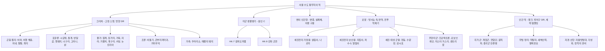

# SD-14. 크리처·적 도감

> **서울 폴아웃 상세 기획서 세트** | 문서 ID: SD-14 | 버전: v1.0 | 작성일: 2026-10-12
> **범위**: 서울 수도 황무지에서 플레이어가 싸우거나 마주치는 모든 적·크리처의 정본 데이터베이스. 설계 원칙(실제 생물 근거, 변이 원인, 실시간 전투 행동), 크리처(CR-001~), 미군 생물병기, 변종, 구울, 로봇·포탑(관제망 각성 단계 포함), 인간 적 세력 템플릿, 보스·유일 개체, 레벨 스케일링·스폰 규칙, 적 AI 행동 유형 분류표, 원작 대응표, 쯔꾸르 제작 메모. **다루지 않는 것**: 피해·명중·탐지 공식과 상태 머신의 엔진 규칙(SD-11), 랜덤 인카운터 목록과 암살대 출현 규칙의 정본(SD-05), 세력의 역사·관계(SD-06), 이름 있는 인물의 프로필(SD-07), 장소 상세(SD-09), 아이템 수치(SD-13)
> **관련 문서**: [SC-00 컨셉](00_concept.md), [SD-02 세계관·연표](02_world-and-lore.md), [SD-03 메인 스토리](03_main-story.md), [SD-04 사이드 퀘스트](04_side-quests.md), [SD-05 비표시·반복 퀘스트, 랜덤 인카운터](05_misc-quests-encounters.md), [SD-06 세력](06_factions.md), [SD-07 인물](07_characters.md), [SD-08 월드·권역](08_world-regions.md), [SD-09 장소 카탈로그](09_location-catalog.md), [SD-10 캐릭터 시스템](10_character-system.md), [SD-11 전투 시스템](11_combat-system.md), [SD-13 아이템](13_items.md), [SD-16 아트 디렉션](16_art-direction.md), [SR-04 한국 실제 생물](research/SR-04_korean-fauna.md), [RD-24 원작 크리처·적 도감](../reverse-design/24_bestiary.md), [RD-16 원작 전투 시스템](../reverse-design/16_combat-system.md), [RD-27 쯔꾸르 이식 시사점](../reverse-design/27_adaptation-notes.md)

---

## 목차

1. 문서 개요
2. 설계 원칙과 수치 체계
3. 크리처 ① 곤충·절지동물 (CR-001~089)
4. 크리처 ② 포유류·조류·가축·물가 생물 (CR-090~139)
5. 미군 생물병기 (CR-150~159)
6. 변종 (CR-170~179)
7. 구울과 야생 구울 (CR-200~209)
8. 로봇과 포탑 (CR-300~339)
9. 인간 적 세력 템플릿 (CR-400~499)
10. 보스·유일 개체 (CR-500~514)
11. 레벨 스케일링·스폰 규칙
12. 적 AI 행동 유형 분류
13. 원작 대응
14. 쯔꾸르 제작 메모
15. 미결 사항
- 부록 A. 신규 고유명사
- 부록 B. 참고 문서

---

## 1. 문서 개요

### 1.1 목적
- SD-04·05·09의 인카운터 편성, SD-11의 전투 밸런스, SD-13의 드롭 아이템, SD-16의 스프라이트 제작이 모두 이 문서의 ID와 수치를 참조한다. 적 데이터의 **단일 정본**이다.
- 원작 [RD-24](../reverse-design/24_bestiary.md)의 구조(계통별 3단계 계단, 행동 추가형 상위 변종, 지역 생태 배치, 고유 드롭)를 계승하고, 무대를 **실제 서울의 생물·공간·사회**로 바꾼다.

### 1.2 요약
- 크리처는 **서울 사람이 실제로 마주치는 생물**의 변이다. 근거 수치는 [SR-04](research/SR-04_korean-fauna.md)에서 인용한다. 설화·요괴·신화 소재는 쓰지 않는다.
- 변이 원인은 세 가지로 고정한다. ① 대전쟁의 방사능 낙진 ② 중미 전쟁기의 생물·화학무기 잔류물 ③ 용산의 미군 생물 연구 시료 유출. 원인에 따라 서식지와 변이 등급이 정해진다.
- 수록 규모: **크리처 21계통 64개 변종**, 미군 생물병기 2계통 7개, 변종 6개, 구울 7개, 로봇·포탑 24개, 인간 적 9개 세력 47개 템플릿, 보스·유일 개체 15개. 적 DB 항목은 약 **170개**다.
- 모든 적은 **실시간 맵 전투**(RD-27 §7)를 전제로 설계한다. 계통마다 '눈으로 읽히는 예비 동작'과 '플레이어가 할 일'이 하나씩 다르다(12장).
- 메인 스토리와 묶이는 적이 있다. **관제망 로봇**은 메인 진행에 따라 5단계로 깨어나고(8.6절), **계엄군 체포조**는 주인공을 산 채로 잡으려 하며(9.2절), **중국군 잔존병**은 MQ-08의 해법에 따라 적대가 풀린다(9.8절).

### 1.3 표기 메모
- **ID**: `CR-001` 형식. 계통마다 번호 대역을 나누고 빈 번호는 확장용으로 남긴다(2.7절). 다른 문서 소관 ID는 `(SD-xx에서 ID 부여)`로 쓴다.
- **단계**: 약 / 중 / 강 / 전설 / 유일. '전설'은 원작 [BS] 상위 변종(알비노 방사능전갈, 리버 등)에 해당하는 고레벨 희귀 변종이다. '유일'은 보스·고유 개체다.
- **수치 칸**: 레벨(Lv), HP, 피해(1회 기본 피해, 플레이어 DR 적용 전), DR(피해 저항 %), 속도(타일/초), XP. 계산 규칙은 2.4절.
- **근거 표기**: SR-04의 출처 번호 `[S##]`를 그대로 단다. SR-04가 `(일반 지식)`·`(미확인)`으로 적은 값은 같은 표시를 유지하거나 '게임 속 설정'으로 쓴다.
- **권역**: R01 관악, R02 여의도·영등포, R03 마포·상암, R04 서강·선유도, R05 도심(밀폐), R06 용산·남산, R07 강남, R08 동부, R09 북부 산악, R10 서부 평야, R11 청계산(바이블 §4.2 순서). 권역 밖 층은 `한강`(수역), `지하철`(노선망), `하수`(하수도·빗물터널)로 적는다.
- **시간대**: `주`(06~18시), `황`(17~20시), `야`(18~06시), `상`(상시), `실`(실내 상시).
- 원작 용어는 [RD-26 용어집](../reverse-design/26_glossary.md) 표기를 따른다(스팀팩, 라드어웨이, 핍-보이, 야생 구울, 글로잉 원, 버티버드 등).

---

## 2. 설계 원칙과 수치 체계

### 2.1 설계 원칙 6개

| # | 원칙 | 내용 | 적용 예 |
|---|---|---|---|
| 1 | 서울 사람이 아는 생물 | 원작이 '미국 동부 사람이 아는 생물'(바퀴, 파리, 개, 소, 곰)을 고른 원리를 서울에 적용한다. 크기만 키워도 공포가 생기는 생물을 1순위로 한다 | 바퀴, 러브버그, 시궁쥐, 들개, 멧돼지, 비둘기 |
| 2 | 설화·요괴·신화 금지 | 한국 설화의 짐승·요괴·귀신을 크리처로도, 이름으로도, 디자인 모티프로도 쓰지 않는다. 멸종 동물(호랑이·표범·늑대)도 '부활한 변이체'로 쓰지 않는다 | 데스클로 자리 = 군사 생물병기. 호랑이 멸종 기록은 박물관 터미널 소품으로만 |
| 3 | 실제 특성 하나를 과장 | 변이는 그 생물의 실제 특성 하나를 키운다. 크기·형태·행동 중 하나가 주축이다(SR-04 §1) | 장수말벌 = 독, 들개 = 무리, 멧돼지 = 돌진, 참게 = 옆걸음과 갑각 |
| 4 | 서식지는 실제 생태를 따른다 | 실제 출몰 데이터가 있는 곳에 우선 배치한다. 서울 플레이어가 "저기엔 저게 나온다"를 알아보게 한다 | 관악산 들개, 중랑천 외래 거북, 성수 강변 하루살이, 북한산 멧돼지 |
| 5 | 사람이 버린 동물의 후손 | 서울판 생태의 공통 주제다. 전쟁 전 사람이 기르다 버린 동물(유기견, 반려 거북, 사육곰, 모피용 뉴트리아, 가축)이 200년 동안 서울을 차지했다 | 2.3절 '토종 대 외래' 축 |
| 6 | 실시간 전투에서 구별되는 행동 | 계통마다 예비 동작(텔레그래프)과 대응법이 겹치지 않게 한다. 같은 계통의 상위 단계는 **행동을 하나 추가**한다(원작 RD-24 §11.1) | 참게 → 털집게 참게(넉백 추가), 왕지네 → 거대 왕지네(2마리 협공 추가) |

### 2.2 변이 원인 3가지

| 원인 | 시기·근거 | 만드는 변이 | 주 서식 | 예 |
|---|---|---|---|---|
| **A. 방사능 낙진** | 2077-10-23 대전쟁. 탄두는 인천·평택·김포·용산의 항구·비행장·기지에 집중됐다(바이블 §3.2). 200년간 누적 | 대형화, 털 빠짐, 피부 변색. 모든 크리처의 기본 변이 | 서울 전역. 서부 평야(R10)와 공항 쪽이 가장 심하다 | 바퀴, 쥐, 들개, 곰, 두머리소 |
| **B. 생물·화학무기 잔류물** | 중미 전쟁기(2066~2077) 중국의 생물무기 공세는 정사다(SR-01 §C, [G:FO1]). 한반도는 미군의 전진기지라 방역 물자·해독제·고엽제류 제초제가 대량 비축됐다. 현실의 DMZ 고엽제 살포(1968~1969)[S33], 구제역 매몰지 침출수[S50]가 모티브 | 독의 강화, 분비물 변성(발화성 독), 질병 매개 강화 | 군수 야적장, 방역 매몰지, 옛 화학 창고 주변 | 붉은불개미의 발화성 독, 흡혈모기의 열병, 매몰지 돼지 |
| **C. 미군 생물 연구 시료** | 용산 기지의 미군 생물방어 연구동이 2070년대에 '헌터-킬러 생체 계획'(5장)을 운영했다. 미군이 본토에서 들여온 FEV 시료 일부를 썼다(C16: FEV는 '미군이 들여온 시료' 수준). 2077-10-23 용산 피폭으로 연구동이 무너지며 배양액이 배수로를 따라 한강과 도심 지하로 흘렀다 | 군사 생물병기의 야생화, 인간의 변종화 | 용산 연구동 봉인 구역(R06), 밤섬, 서울역·도심 지하(R05) | 갈퀴도마뱀, 강화 군견, 변종, 실패체 |

- 원인 C의 유출 경로는 현실의 **맥팔랜드 사건**(2000년 용산 기지 영안실의 포름알데히드 한강 무단 방류)[S47]을 모티브로 쓴다. 실명·실제 시설명은 쓰지 않고, 영화 「괴물」(2006)의 괴수 디자인도 차용하지 않는다.
- 원인은 **겹칠 수 있다.** 오염원이 겹치는 곳일수록 같은 계통의 상위 변종 비율이 높다(11.4절 '오염 등급 보정').

### 2.3 서울판 생태의 축: 토종 대 외래

| 축 | 토종 계통 | 외래 계통 | 현실 근거 | 게임에서의 관계 |
|---|---|---|---|---|
| 물가 | 참게, 자라, 수달, 가물치 | 붉은귀거북·리버쿠터(외래 거북 떼), 늑대거북, 악어거북, 황소개구리, 뉴트리아, 미국가재 | 2024년 서울 도심 하천 거북 523마리 중 64%(333마리)가 외래종[S20]. 생태계교란 생물 40개 분류군(2024)[S23] | 외래 계통이 하천 대부분을 차지한다. 수달이 사는 곳은 '깨끗한 물'의 지표다 |
| 땅 | 왕개미, 왕지네, 장수말벌, 멧돼지 | 붉은불개미, 열대불개미, 등검은말벌 | 붉은불개미 2017년 부산항 첫 유입[S40], 등검은말벌 2003년 부산 영도 첫 확인[S38] | 외래 군체가 토종 군체와 영역 전쟁을 한다(11.6절 크리처 간 적대) |
| 최상위 포식자 | 없음(호랑이 1921년, 표범 1960년대, 늑대 1997년 무렵 사라짐)[S30][S31]. 현재 최상위는 삵[S28] | 군사 생물병기 갈퀴도마뱀(외래 대형 도마뱀 개조체) | 빈 생태 자리를 군사 연구가 채웠다(SR-04 §8.3) | 갈퀴도마뱀이 한강 생태의 정점이다 |

### 2.4 수치 체계

**기본 가정** (SD-10·SD-11이 확정하면 이 문서가 따른다)
- 플레이어 레벨 상한 30(원작 [BS] 기준). 플레이어 HP = 90 + 지구력 × 20 + (레벨 − 1) × 10(원작 공식). 레벨 1·지구력 5면 190, 레벨 20이면 380이다.
- 플레이어 이동 속도: 걷기 3.0 타일/초, 달리기 4.5 타일/초, 웅크려 걷기 1.5 타일/초.
- 피해는 원작처럼 `피해 × (1 − DR%)`로 줄어든다. 상세 공식은 SD-11.

**HP 규칙**
- 원작 대응 단계가 있는 적은 원작 HP를 그대로 쓴다.
- 원작 HP가 500을 넘는 대응 단계는 **압축**한다: `서울판 HP = 500 + (원작 HP − 500) ÷ 2`. 예: 리버 1,100 → 800, 오버로드 1,250 → 875, 알비노 방사능전갈 1,500 → 1,000, 베히모스 2,000 → 1,250, 여왕개미 1,000 → 750.
- 근거: 원작 HP 1,000대 적은 실시간 연사와 V.A.T.S. 치명타를 전제로 한 '총알 스펀지'다([RD-24 §11.2](../reverse-design/24_bestiary.md)). 서울판은 V.A.T.S.를 1차 제외하므로(P8) 상한을 깎는다.

**처치 시간 목표** (해당 레벨대 표준 무기, 스킬 50 기준)

| 단계 | 처치 시간 목표 | 예 |
|---|---|---|
| 약 | 1~2초 | 큰바퀴, 들개, 야생 구울 |
| 중 | 3~6초 | 변이 참게, 변이 멧돼지, 지킴이 |
| 강 | 7~15초 | 변이 반달곰, 갈퀴도마뱀, 수문장 |
| 전설 | 20~35초 | 흰왕지네, 포식 구울, 변종 입소관 |
| 유일(보스) | 45~120초 | 거인 변종, 원형 0호, 수문장-0 |

**DR 규칙**
- 원작 크리처는 DR 0이고 단단함을 '부위 배율'로 표현했다. 서울판은 부위 조준이 없으므로(RD-27 §7.3) 부위 배율을 **방향 DR**로 옮긴다. 예: 참게 `DR 50(정면)/0(측후면)`. 정면 갑각을 피해 옆이나 뒤를 쏘는 것이 실시간판의 '얼굴 노리기'다.
- **약점 창**: 공격 직후 0.5~1.0초 동안 방향 DR이 0이 된다(원작 마이얼럭이 근접 공격 때 머리를 드는 순간). 약점 창은 도트로 표시한다(갑각이 벌어지는 프레임).
- 로봇·인간은 장갑·방어구 DR을 쓴다(로봇 0~25, 인간 3~38).

**XP 규칙**
- `XP = 2 × Lv + HP ÷ 20`. 특수 능력(독·원거리·소환·지휘·은신) 보유 시 × 1.2. 보스·유일 개체 × 2.
- 반올림: 10 이하는 내림, 10 초과는 5 단위 반올림, 최소 1.
- 원작 앵커와의 대조: 방사능바퀴 1 → 큰바퀴 1, 화염개미 일개미 5 → 불개미 일개미 5, 데스클로 50 → 갈퀴도마뱀 50, 마리골드 여왕 90 → 컨테이너 여왕 150(보스 배수로 상향).

**속도 등급** (타일/초)

| 등급 | 속도 | 체감 | 예 |
|---|---|---|---|
| S1 매우 느림 | 1.0~1.5 | 웅크려 걷는 플레이어와 같다 | 알집바퀴, 외래 거북(육상), 거인 변종 |
| S2 느림 | 2.0~2.5 | 걸어서 따돌릴 수 있다 | 야생 구울 무리, 왕개미 일개미, 파수-3 |
| S3 보통 | 3.0~3.5 | 걷기와 같다. 달리면 따돌린다 | 시궁쥐, 변이 참게, 변종 |
| S4 빠름 | 4.0~4.5 | 달리기와 같다. 따돌릴 수 없다 | 들개, 변이 반달곰, 왕지네 |
| S5 매우 빠름 | 5.0 이상 | 달려도 따라잡힌다 | 갈퀴도마뱀, 강화 군견, 장수말벌 |
| 돌진 | 6.0~10.0 | 직선 순간 속도 | 멧돼지 돌진 8.0~9.0, 곰 덮치기 6.5 |

### 2.5 상태 이상 (적이 거는 것)

| 상태 | 거는 적 | 효과 | 지속 | 해제 | 근거 |
|---|---|---|---|---|---|
| 독 | 왕지네, 장수말벌, 불개미(열대) | 초당 고정 피해 | 4~5초 | 해독제, 시간 | 원작 방사능전갈 '독 3/초' 방식 |
| 화상 | 불개미, 살림이(증기), 화염방사기 | 초당 2 피해 | 5초 | 물에 들어가기, 시간 | 원작 화염개미 '화염 2/초' |
| 방사능 | 빛나는 구울, 실패체, 오염 지대 | 라드 누적 | 피격 시 | 라드어웨이 | 원작 RD-15 |
| 열병 | 흡혈모기 | 인지력 −2, HP 자연 회복 −50% | 24게임시간 | 항생제, 의사 | 빨간집모기의 일본뇌염 매개[S37] |
| 옴 | 옴 너구리 | 조준 흔들림 +30% | 12게임시간 | 항생제, 목욕(정착지 시설) | 너구리 개선충[S03] |
| SFTS 열병 | 작은소참진드기(환경) | 초당 HP −1, 최대 HP의 50%까지 | 48게임시간 | 항생제 + 의사 치료 | SFTS 치명률 18.0%[S41] |
| 시야 가림 | 러브버그 떼, 악어거북 진흙, 최루 포탑 | 화면 가장자리 어둡게, 적 탐지 거리 −50% | 3~6초 | 떼에서 벗어나기 | 러브버그 떼가 등산객 시야를 가림[S42] |
| 기침 | 팅커벨, 최루 포탑 | 달리기 불가, AP 회복 −50% | 3~6초 | 시간 | 게임 설정 |
| 이명 | 파수-3 진압 음파 | 탐지 범위 −50%, 명중 −20% | 5초 | 시간 | 원작 메스메트론의 '머리 불구' 대응 |
| 붙잡힘 | 변이 자라, 강화 군견, 황소개구리 혀 | 이동 불가 또는 강제 이동 | 1.0~1.5초 | 연타(탈출 입력) | 게임 설정 |
| 넘어짐 | 멧돼지 돌진, 큰반달곰 덮치기 | 행동 불가 | 1.0~1.5초 | 시간 | 원작 마이얼럭 헌터 넉백 |
| 그물 | 체포조·새벽인력 그물탄 | 이동 불가, 사격 가능 | 3초 | 근접 무기로 끊기(1초) | 게임 설정 |
| 기절 | 전기 충격봉 | 행동 불가 | 1.5초 | 시간 | 게임 설정 |

- 상태 이상의 엔진 구현(아이콘, 중첩 규칙)은 SD-11, 치료 아이템은 SD-13이 정한다.

### 2.6 부산물 드롭 원칙
- 크리처는 원작처럼 **고기·분비물 같은 부산물**을 고정 확률로 떨어뜨린다. 부산물은 SD-13의 제작·요리 재료로 이어진다(원작 RD-24 §11.3의 생존 루프 계승).
- 인간 적은 소지 장비 전부 + 사망 시 무작위 음식·약물·탄약을 남긴다(원작 규칙).
- 로봇은 에너지 셀, 핵분열 배터리, **진공관**, 고철을 남긴다. 진공관은 서울판에서 수리·제작의 핵심 재료다(세진전자 기술 = 진공관).
- 아래 표의 아이템 이름은 가칭이며 ID는 SD-13에서 부여한다.

### 2.7 ID 대역

| 대역 | 분류 | 절 |
|---|---|---|
| CR-001~089 | 곤충·절지동물 | 3장 |
| CR-090~139 | 가축·포유류·물가 생물·조류 | 4장 |
| CR-150~159 | 미군 생물병기 | 5장 |
| CR-170~179 | 변종 | 6장 |
| CR-200~209 | 구울·야생 구울 | 7장 |
| CR-300~339 | 로봇·포탑 | 8장 |
| CR-400~499 | 인간 적 | 9장 |
| CR-500~514 | 보스·유일 개체 | 10장 |
| CR-ENV-01~ | 환경 위험(개체가 아닌 생물 위협) | 4.8절 |

### 2.8 분류 트리

---
## 3. 크리처 ① 곤충·절지동물 (CR-001~089)

> 공통: 곤충·절지동물은 SD-10의 곤충 피해 강화 퍽(원작 엔토몰로지스트 대응, 피해 +50%)의 대상이다. 화염 피해 ×1.5(불개미 계통 제외). 스프라이트 크기 등급은 14.1절(XS 24px, S 32px, M 48px, L 96px, XL 144px, XXL 192px, 타일 48px 가정).

### 3.1 변이 바퀴 (CR-001~004) — 원작 방사능바퀴

**실제 근거 (SR-04 §5)**
- 국내 바퀴의 약 85%는 독일바퀴(11~14mm)다. 야생에는 없고 사람 거주지에만 산다[S36].
- 이질바퀴(미국바퀴)는 35~40mm로 독일바퀴의 약 4배이고 날 수 있다. 온난화로 중부까지 늘었다[S36].
- 서울 바퀴 방제 민원은 2021년 2,379건에서 2025년 1만 1,789건으로 약 5배가 됐다[S35]. 서울로 7017 화단은 물주기로 습도가 높아 바퀴가 많다는 분석이 있다[S35].

**변이 설정**
- 원인 A. 이질바퀴가 고양이 크기(약 40cm)로 커졌다. 원작 방사능바퀴(미국바퀴 변이)와 같은 계보다.
- 독일바퀴는 손바닥 크기(약 10cm)로 커졌지만 혼자서는 위협이 안 된다. 수백 마리가 한 덩어리로 움직이는 **떼 개체**로 처리한다.
- 볼트 S-07 하층 배수 구역에도 산다. 200년 동안 볼트가 막지 못한 유일한 '바깥 생물'이다(MQ-P2 해충 구제 튜토리얼).

**외형·스프라이트**: 큰바퀴 S(32px), 적갈색 광택 등판, 긴 더듬이 2가닥이 실루엣 포인트. 날바퀴는 날개를 편 프레임이 있다. 잔바퀴 떼는 M(48px) 칸 안에서 점 30~40개가 꿈틀대는 애니메이션이고 HP가 줄수록 점이 줄어든다. 알집바퀴는 M(48px), 꽁무니에 붙은 알집이 크다.

| ID | 이름 | 단계 | Lv | HP | 피해 | DR | 속도 | 공격 패턴 | XP |
|---|---|---|---|---|---|---|---|---|---|
| CR-001 | 잔바퀴 떼 (독일바퀴 변이) | 약 | 0 | 20(떼) | 접촉 1/0.5초 | 0 | 2.5 | 떼가 플레이어 발밑을 덮으며 지속 피해. 화염·폭발 ×2, 산탄 ×1.5 | 1 |
| CR-002 | 큰바퀴 (이질바퀴 변이) | 약 | 0 | 8 | 물기 3 | 0 | 3.0 | 날개를 퍼덕여 위협 → 3타일 안에 2초 머물면 도약 물기. 2~7마리 | 1 |
| CR-003 | 날바퀴 (이질바퀴 비행형) | 약 | 2 | 18 | 활강 물기 5 | 0 | 3.5(활강 6.0) | 장애물을 넘어 4타일 활강 후 물기. 활강 중 피격 시 추락 1초 | 4 |
| CR-004 | 알집바퀴 (번식 개체) | 중 | 4 | 90 | 물기 6 | 10 | 1.0 | 거의 움직이지 않는다. 10초마다 큰바퀴 1~2마리 부화(동시 최대 6). 처치 시 주변 큰바퀴 50% 도주 | 15 |

**행동 패턴 (AI-01 겁쟁이 해충 / AI-02 떼 / AI-11 둥지)**
- 큰바퀴는 원작처럼 바로 덤비지 않는다. 위협 동작(0.8초 날개 퍼덕임)이 경고다. 그 사이 물러나면 교전하지 않는다.
- 비무장 공격은 주먹 대신 **밟기 모션**이 나간다(원작 고유 연출 계승, 큰바퀴·잔바퀴 떼 전용).
- 볼트 S-07 판본은 공격성 1(원작 볼트 101 공격형)이라 위협 동작 없이 덤빈다.

**서식·시간·드롭**
- 권역: 전역의 실내. 볼트 S-07 하층(MQ-P2), 지하철 전 노선, 하수, 영등포 지하상가 외곽(R02), 서울로 고가 공원 화단(R05·R06 경계), 번개24 편의점 폐허, 봉천 재개발 폐허(R01). 알집바퀴는 지하 소굴 고정 배치.
- 시간: 실(상시). 지상은 야(20~05시) '시체 뜯는 바퀴' 인카운터(SD-05에서 ID 부여).
- 드롭: 바퀴 고기(큰바퀴·날바퀴 100%), 바퀴 알(알집바퀴 100%, 식재료·약품 재료).

### 3.2 변이 비행 해충 (CR-010~013) — 원작 블로트플라이

**실제 근거 (SR-04 §3.7, §5)**
- 러브버그(붉은등우단털파리): 2022년 여름 서울 서북부·고양에서 대발생했다. 서울 민원 2022년 4,418건 → 2024년 **9,296건**[S42]. 2025년 상반기 민원은 금천 698, 은평 599, 관악 508, 강서 410건 순이다[S42]. 2025년 6월 인천 계양산에서 등산객 시야를 가릴 정도의 떼가 몰렸다[S42]. 사람을 물지 않는다.
- 동양하루살이: 날개를 펴면 약 5cm이고 2급수 이상 깨끗한 물에 산다. 2000년대 이후 한강 수질이 좋아지며 성수동 등에서 대발생한다. 물지 않고 병을 옮기지 않는다[S43].
- 빨간집모기: 정화조 등 유기물이 많은 고인 물에 산다. 2026년 6월 대구에서 채집한 빨간집모기에서 일본뇌염 바이러스가 나왔다. 작은빨간집모기는 **저녁 8~10시**에 흡혈이 가장 많다[S37].

**변이 설정**
- 러브버그: 원인 A. 암수가 붙은 채 날개 폭 약 50cm로 커졌다. 체액이 산성으로 변했다(게임 설정). 두 몸이 붙어 있다는 실제 특징을 '짝 분리' 행동으로 쓴다.
- 팅커벨(동양하루살이): 원인 A. 날개 폭 약 60cm. 여전히 물지 않는다. 그러나 날개의 비늘 가루가 기도를 막는다. **깨끗한 물의 지표인데 사람에게는 재앙**이라는 실제 아이러니를 그대로 쓴다.
- 흡혈모기(빨간집모기): 원인 A+B. 몸길이 약 20cm. 전쟁 전 방역 약제에 내성을 얻은 계통이 남았다. 일본뇌염 매개라는 실제 사실을 '열병' 상태 이상으로 옮긴다.

**외형·스프라이트**: 러브버그 S(32px), 검은 몸에 붉은 등(실제 이름의 '붉은등'), 두 몸이 꽁무니로 붙은 실루엣. 러브버그 떼·팅커벨 떼는 M(48px)~L(96px) 반투명 군집 애니메이션. 팅커벨은 몸보다 큰 투명 날개 4장. 흡혈모기 S(32px), 줄무늬 다리와 바늘 주둥이.

| ID | 이름 | 단계 | Lv | HP | 피해 | DR | 속도 | 공격 패턴 | XP |
|---|---|---|---|---|---|---|---|---|---|
| CR-010 | 러브버그 (변이 우단털파리) | 약 | 1 | 15 | 산성 체액 4(원거리 5타일) | 0 | 2.5(불규칙) | 지그재그 비행 후 체액을 뱉는다. 처치 시 50% 확률로 수컷이 떨어져 HP 6 개체로 1회 더 덤빈다(짝 분리) | 3 |
| CR-011 | 러브버그 대발생 떼 | 약 | 1 | 40(떼) | 0 | 0 | 1.5 | 피해가 없다. 반경 4타일 안의 대상에 **시야 가림**. 밝은 색 장비와 열에 끌린다(게임 설정). 화염·폭발로 흩어진다 | 4 |
| CR-012 | 팅커벨 떼 (변이 동양하루살이) | 약 | 2 | 30(떼) | 0 | 0 | 2.0 | 비늘 가루로 **기침**(달리기 불가 3초). **핍-보이 조명을 켜면** 반경 20타일 안의 떼 1~2개가 몰려온다. 출현 2게임시간 뒤 사라진다 | 6 |
| CR-013 | 흡혈모기 (변이 빨간집모기) | 약 | 3 | 20 | 흡혈 4 + 흡수 | 0 | 3.5 | 붙어서 흡혈. 준 피해의 50%만큼 자기 HP 회복. 명중 시 10% 확률로 **열병** | 8 |

**행동 패턴 (AI-09 비행 / AI-02 떼 / AI-10 원거리)**
- 원작 블로트플라이처럼 작고 불규칙해 맞히기 어렵다. 대신 HP가 낮아 한 발이면 떨어진다. 산탄·폭발이 유리하다.
- 러브버그는 지면에 앉아 몇 초씩 쉬는 동작이 있다(원작 블로트플라이 대기 동작 계승). 앉아 있을 때 명중 판정 범위가 커진다.
- 팅커벨 떼는 적이 아니라 **환경 이벤트**에 가깝다. 강변에서 해 질 무렵 조명을 끄면 피할 수 있다.

**서식·시간·드롭**
- 러브버그: R09(은평 봉산·북한산 기슭이 최다), R01(관악), R10(강서). 시간: 주. 달력 6~7월에 출현량 2배(11.5절 달력 보정).
- 팅커벨: R08(성수·광진 강변), R07(잠실·송파 강변) 등 한강 동부 강변. 수질이 좋은 수역에만 나온다. 시간: 황(17~20시). 달력 5~6월 2배.
- 흡혈모기: 하수, 탱크마을 침수 탱크 바닥(R03), 세이프빌 지하 정화조(R07), 지하철 침수 구간, 선유도 퇴비장 주변(R04). 시간: 야, **20~22시 출현 2배**[S37].
- 드롭: 없음(러브버그·팅커벨). 흡혈모기는 '모기 침샘'(15%, 약품 재료).

### 3.3 변이 왕지네 (CR-070~072) — 원작 방사능전갈 ①

**실제 근거 (SR-04 §5)**
- 왕지네는 국내 대형 지네다(체장은 일반적으로 10cm 이상으로 알려짐, (미확인)). 서울 산자락과 주택가의 습한 곳에 산다(일반 지식). 물리면 통증이 심하다(일반 지식).
- 원작 방사능전갈의 원형은 애완동물 가게의 황제전갈이었다. 서울에는 야생 전갈이 없으므로 '다리 많은 독 포식자' 자리를 왕지네가 맡는다(바이블 §7).

**변이 설정**: 원인 A. 몸길이 약 2.5m. 독이 강해졌다. 습한 지하에서 200년 동안 먹이사슬 꼭대기에 올랐다.

**외형·스프라이트**: L(96px). 검붉은 마디 몸통과 노란 다리. 몸이 길어 4방향 모두 별도 프레임이 필요하다(좌우 반전만 공유). 흰왕지네는 팔레트 교체(유백색 + 붉은 다리).

| ID | 이름 | 단계 | Lv | HP | 피해 | DR | 속도 | 공격 패턴 | XP |
|---|---|---|---|---|---|---|---|---|---|
| CR-070 | 변이 왕지네 | 중 | 6 | 150 | 큰턱 20 + 독 3/초(5초) | 10 | 3.5 | 정면 돌진 → 측면으로 돌아 **휘감기** | 25 |
| CR-071 | 거대 왕지네 | 강 | 9 | 350 | 큰턱 50 + 독 8/초(5초) | 15 | 4.0 | 휘감기 + 2마리 1조. 한 마리가 물러나면 다른 한 마리가 반대편에서 들어온다 | 45 |
| CR-072 | 흰왕지네 | 전설 | 13 | 1,000 | 큰턱 90 + 독 20/초(4초) | 20 | 4.5 | 휘감기 + 어둠 속에서 HP 초당 1% 재생(조명 범위 안에서는 정지) | 90 |

**행동 패턴 (AI-08 휘감기)**
- **휘감기**: 몸을 S자로 말아 올리는 0.6초 예비 동작 뒤, 2.5초 동안 플레이어 주위 반경 2타일로 원을 그린다. 원이 닫히면 조이며 큰턱 공격 2회. 대응은 예비 동작 중 원 밖으로 대시(또는 구르기)하는 것이다.
- 원작 방사능전갈처럼 약점 부위가 없다. 몸이 길어 회전 반경이 넓고, 등 뒤 3타일이 사각이다.
- 강한 근접 공격을 받으면 1타일 뒷걸음질한다(원작 계승). 근접 캐릭터의 공격 틈이다.
- 실내에서는 다리 소리(효과음)가 위치를 알려 준다.

**서식·시간·드롭**
- 권역: 하수, 신월 빗물터널, 지하철 침수 구간, R01·R09·R11 산자락 폐가(돌담·낙엽 더미). 흰왕지네는 '거대 왕지네가 나오는 곳 어디든' 레벨 13 이상에서 대체 출현(원작 알비노 규칙).
- 시간: 야, 실.
- 드롭: 지네 독샘(일반 1개, 거대·흰 4개). 독 다트·해독제 재료(SD-13).

### 3.4 변이 장수말벌·등검은말벌 (CR-075~077) — 원작 방사능전갈 ②

**실제 근거 (SR-04 §5)**
- 장수말벌은 국내 최대 말벌이다(여왕 4cm 안팎으로 알려짐, (미확인)). **땅속에 집**을 짓고 5월 중순~9월 중순에 군집을 이루며 10월에 여왕을 기른다[S38].
- 서울 벌집 안전조치 출동은 2018~2020년 2만 928건이고 그중 63.6%가 주택가·아파트였다. 벌 쏘임 사망은 연 7~11명(2020~2023)이다[S38].
- 등검은말벌은 2003년 부산 영도에서 처음 확인된 외래 말벌이다. 연 12.4km 속도로 북상했다고 추정된다[S38]. 도심 고층 건물에 집을 짓는다(일반 지식).

**변이 설정**: 원인 A. 장수말벌 일벌 몸길이 약 60cm, 경비벌 약 1m. 땅속 벌집이 지하 던전 규모로 커졌다(여왕은 보스 CR-503). 등검은말벌은 외래 침입종 테마 그대로 강남 고층 타워 외벽을 차지했다.

**외형·스프라이트**: 일벌 M(48px), 주황 머리와 검은·노랑 띠 배. 경비벌 M(48px) 확대 판본. 등검은말벌 S(32px), 검은 몸에 주황 배 끝 한 줄(팔레트로 장수말벌과 구별). 날갯짓 2프레임 루프.

| ID | 이름 | 단계 | Lv | HP | 피해 | DR | 속도 | 공격 패턴 | XP |
|---|---|---|---|---|---|---|---|---|---|
| CR-075 | 장수말벌 일벌 | 중 | 5 | 55 | 독침 18 + 독 4/초(4초) | 0 | 4.5 | 직선 급강하 → 이탈 → 재돌입. 3~6마리. 둥지 반경 15타일 영역 방어 | 15 |
| CR-076 | 장수말벌 경비벌 | 강 | 8 | 120 | 독침 30 + 독 6/초(4초) / 독액 분사(원거리 4타일) 8 + 시야 가림 3초 | 5 | 4.5 | 둥지 입구 고정 경비. 분사로 시야를 가린 뒤 급강하 | 25 |
| CR-077 | 등검은말벌 | 중 | 6 | 50 | 독침 14 + 독 3/초(4초) | 0 | 5.0 | 6~10마리 큰 무리. 고층 외벽에서 떨어지듯 내려온다 | 15 |

**행동 패턴 (AI-09 비행 치고 빠지기 / AI-11 둥지)**
- 급강하 직전 공중에서 0.4초 정지(호버링)한다. 그 순간이 예비 동작이다. 옆으로 피하면 지나쳐 날아간다.
- **영역 방어**: 둥지 반경 15타일에 들어오면 경보가 울리고 일벌 전원이 출격한다. 반경 밖으로 30타일 벗어나면 추격을 멈춘다.
- **야간 약화**: 야간에는 일벌이 둥지로 돌아가 출격 수가 절반이 된다(벌집 공략 시간대 선택이 전략이 된다).
- **달력 보정**: 5~9월 군집 활성(기본), 10월 여왕 육성기(경비벌 +2, 신여왕 출현), 11~4월 휴면(일벌 수 1/3). 11.5절.

**서식·시간·드롭**
- 장수말벌: R11 청계산(최대 벌집, 보스 CR-503), R09 북한산, R01 관악산, 세이프빌 단지 정원(R07). 시간: 주.
- 등검은말벌: R07 강남 고층 타워 외벽, 세진전자 타워 외벽 구간(MQ-07 수직 던전의 외부 발코니 층). 시간: 주.
- 드롭: 말벌 독낭(30%, 독 무기·약품 재료), 말벌 유충(둥지 안 고정 배치, 식량).

### 3.5 변이 개미 (CR-080~088) — 원작 거대 개미·화염개미

**실제 근거 (SR-04 §5, §7)**
- 일본왕개미는 서울 공원과 보도블록 틈에 흔한 대형 토종 개미다(체장 (미확인), 일반 지식).
- 붉은불개미(영문 Red imported fire ant)는 **2017년 9월 28일 부산 감만부두**에서 25마리가 처음 발견됐고 약 1,000마리 개미집이 확인됐다. 2018년 평택·당진항, 인천항, 대구에서도 발견됐다. 독 성분은 솔레놉신이다[S40]. 일개미 2.5~6mm[S40a].
- 열대불개미도 독침이 있고 2023년 생태계교란 생물로 지정됐다[S40a].
- 원작 '화염개미(Fire ant)'와 이름부터 1:1로 대응한다.

**변이 설정**
- 왕개미: 원인 A. 몸길이 약 1m. 여왕 중심 군체(원작 거대 개미).
- 붉은불개미: 원인 A+B. 2070년대 미군의 중국 본토 진격 보급이 인천·평택·서울을 거쳤다(바이블 §3.2). 보급 컨테이너를 따라 들어온 불개미가 **서부 평야의 전진 보급 야적장**에 정착했다. 야적장의 방역 약제와 낙진이 겹쳐 솔레놉신이 **발화성 분비물**로 변했다. 침 대신 분비물을 뿜으면 공기 중에서 불이 붙는다(원작 화염 숨결 대응, 게임 설정).
- 열대불개미: 같은 경로로 들어온 별개 군체다. 불을 뿜지 못하고 독침이 강하다. 붉은불개미 군체와 야적장의 영역을 놓고 싸운다(원작 셰일브리지 침입자 개미 대응).

**외형·스프라이트**: 일개미 M(48px), 병정·전사 M(48px) 확대·큰턱 강조, 여왕 L(96px) 배가 부푼 실루엣. 붉은불개미는 왕개미 원화의 팔레트 교체(검정 → 적갈색) + 꽁무니 발광 프레임. 열대불개미는 황갈색 교체.

| ID | 이름 | 단계 | Lv | HP | 피해 | DR | 속도 | 공격 패턴 | XP |
|---|---|---|---|---|---|---|---|---|---|
| CR-080 | 왕개미 일개미 | 약 | 2 | 30 | 큰턱 7 | 0 | 2.5 | 정면으로 몰려와 포위. 최대 5마리 | 5 |
| CR-081 | 왕개미 병정 | 중 | 6 | 150 | 큰턱 24 / 개미산 분사 12(3타일, 방어구 내구도 −) | 10 | 3.0 | 근접과 짧은 분사를 섞는다 | 25 |
| CR-082 | 왕개미 여왕 | 강 | 7 | 750 | 큰턱 25 / 산성 침 40(원거리 8타일) | 15 | 1.0 | 알 무더기에서 20초마다 일개미 1마리 생성(최대 4). 원거리가 정확하다 | 60 |
| CR-085 | 불개미 일개미 | 약 | 2 | 30 | 큰턱 7 / 화염 분사 2 + 화상 2/초(5초) | 0 | 3.0 | 원거리 화염 선호. 화염 저항 85% | 6 |
| CR-086 | 불개미 병정 | 중 | 6 | 150 | 큰턱 24 / 화염 4 + 화상 2/초 | 10 | 3.0 | 화염 저항 85% | 25 |
| CR-087 | 불개미 전사 | 강 | 9 | 225 | 큰턱 32 / 화염 6 + 화상 2/초 | 15 | 3.5 | 최소 사거리 1.5타일. 바짝 붙으면 뒷걸음질하며 한두 번만 뿜는다. 회전 느림 | 35 |
| CR-088 | 독침 불개미 (열대불개미 변이) | 중 | 5 | 90 | 독침 15 + 독 3/초(5초) | 5 | 3.5 | 화염 없음. 붉은불개미 군체를 우선 공격 | 15 |

**행동 패턴 (AI-03 무리 / AI-10 원거리 / AI-11 둥지)**
- **더듬이 손상 → 광란**: 원작의 '더듬이 불구 시 광란'을 확률로 옮긴다. 피격 시 10%(곤충 피해 강화 퍽 보유 시 20%) 확률로 8초간 광란해 가까운 개미를 공격한다. 광란 개미가 죽인 적의 XP도 플레이어가 받는다(원작 규칙).
- 불개미는 화염 저항 85%라 화염방사기가 거의 통하지 않는다(원작 계승). 냉각·전기·탄환이 유리하다.
- 여왕을 죽이면 그 군체의 일개미 생성이 멈추고 소굴이 '정리' 상태가 된다(11.3절).

**서식·시간·드롭**
- 왕개미: R02 여의도 공원 지하 개미굴(여왕 1), R06 남산 북측 순환로(여왕 1), R07·R04 공원. 시간: 주·상.
- 불개미·독침 불개미: R10 서부 평야 전진 보급 야적장(가상 장소, SD-09에서 ID 부여)과 김포 방향 공항 화물 구역. 붉은불개미 여왕은 보스 CR-502. 시간: 상.
- 드롭: 개미 고기(일개미 20%, 병정 이상 100%), 불개미 분비샘(불개미 병정·전사 70%, 화염 연료·소이탄 재료, 원작 화염개미 꿀 대응), 여왕 페로몬(여왕 100%).

