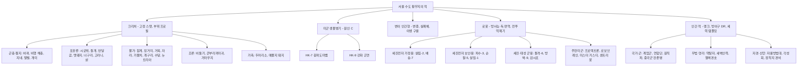
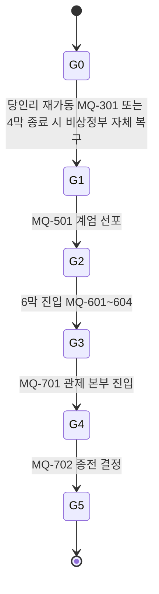
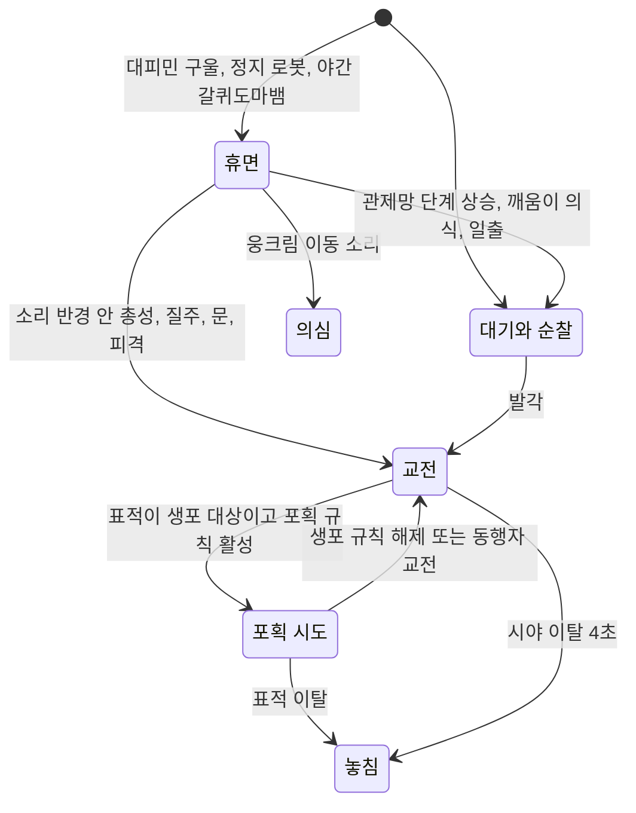

# SD-14. 크리처·적 도감

> **서울 폴아웃 상세 기획서 세트** | 문서 ID: SD-14 | 버전: v1.1 | 작성일: 2026-10-12
> **범위**: 서울 수도 황무지에서 플레이어가 싸우거나 마주치는 모든 적·크리처의 정본 데이터베이스. 설계 원칙(실제 생물 근거, 변이 원인, 실시간 전투 행동), 크리처(CR-001~), 미군 생물병기, 변종, 구울, 로봇·포탑(관제망 각성 단계 포함), 인간 적 세력 템플릿, 보스·유일 개체, 레벨 스케일링·스폰 규칙, 적 AI 행동 유형 분류표, 원작 대응표, 쯔꾸르 제작 메모. **다루지 않는 것**: 피해·명중·탐지 공식과 상태 머신의 엔진 규칙(SD-11), 랜덤 인카운터 목록과 암살대 출현 규칙의 정본(SD-05), 세력의 역사·관계·호감도 수치(SD-06), 이름 있는 인물의 프로필(SD-07a·07b), 장소 상세와 좌표(SD-09a~f), 아이템 수치(SD-13)
> **관련 문서**: [SC-00 컨셉](00_concept.md), [SD-02 세계관·연표](02_world-and-lore.md), [SD-03a 메인 스토리 1](03a_main-story-part1.md), [SD-03b 메인 스토리 2](03b_main-story-part2.md), [SD-04a~d 사이드·세력 퀘스트](04a_side-quests-south.md), [SD-05 비표시·반복 퀘스트, 랜덤 인카운터](05_misc-quests-encounters.md), [SD-06 세력](06_factions.md), [SD-07a 주요 인물](07a_characters-major.md), [SD-07b NPC 디렉터리](07b_npc-directory.md), [SD-08 월드·권역](08_world-regions.md), [SD-09a~f 장소 카탈로그](09a_locations-r01-r02.md), [SD-10 캐릭터 시스템](10_character-system.md), [SD-11 전투 시스템](11_combat-system.md), [SD-13 아이템](13_items.md), [SD-16 아트 디렉션](16_art-direction.md), [SR-04 한국 실제 생물](research/SR-04_korean-fauna.md), [RD-24 원작 크리처·적 도감](../reverse-design/24_bestiary.md), [RD-16 원작 전투 시스템](../reverse-design/16_combat-system.md), [RD-27 쯔꾸르 이식 시사점](../reverse-design/27_adaptation-notes.md)

---

## 목차

1. 문서 개요
2. 설계 원칙과 수치 체계
3. 크리처 ① 곤충·절지동물 (CR-001~089)
4. 크리처 ② 포유류·물가 생물·조류·가축, 환경 위험 (CR-090~139, CR-ENV)
5. 미군 생물병기 (CR-150~159)
6. 변종 (CR-170~179)
7. 구울과 야생 구울 (CR-200~209)
8. 로봇과 포탑, 관제망 각성 단계와 5~7막 편성 (CR-300~339)
9. 인간 적 세력 템플릿, 적대 세력 추적대 (CR-400~499)
10. 보스·유일 개체 (CR-500~539)
11. 레벨 스케일링·스폰 규칙, 동시 등장 수, 지역 변종 (CR-600~632)
12. 적 AI 행동 유형 분류
13. 원작 대응
14. 쯔꾸르 제작 메모
15. 미결 사항
- 부록 A. 신규 고유명사
- 부록 B. 참고 문서

---

## 1. 문서 개요

### 1.1 목적
- SD-04a~d·05·09a~f의 인카운터 편성, SD-11의 전투 밸런스, SD-13의 드롭 아이템, SD-16의 스프라이트 제작이 모두 이 문서의 ID와 수치를 참조한다. 적 데이터의 **단일 정본**이다.
- 원작 [RD-24](../reverse-design/24_bestiary.md)의 구조(계통별 3단계 계단, 행동 추가형 상위 변종, 지역 생태 배치, 고유 드롭)를 계승하고, 무대를 **실제 서울의 생물·공간·사회**로 바꾼다.

### 1.2 요약
- 크리처는 **서울 사람이 실제로 마주치는 생물**의 변이다. 근거 수치는 [SR-04](research/SR-04_korean-fauna.md)에서 인용한다. 설화·요괴·신화 소재는 쓰지 않는다.
- 변이 원인은 세 가지로 고정한다. ① 대전쟁의 방사능 낙진 ② 중미 전쟁기의 생물·화학무기 잔류물 ③ 용산의 미군 생물 연구 시료 유출. 원인에 따라 서식지와 변이 등급이 정해진다.
- 수록 규모: **크리처 15계통 60개 변종** + 환경 위험 5, 미군 생물병기 2계통 7개, 변종 7개(+고정 거인 4체), 구울 7개, 로봇·포탑·기체 30개, 인간 적 11개 세력 58개 템플릿과 추적대 11종 편성, **보스 29개**, 이름 있는 NPC 전투 수치 7개, **권역별 지역 변종 33개**. 적 DB 행은 약 **240개**이고, 레벨 23 이상에서 쓰는 '고참 판본'(11.4절)이 그 위에 붙는다.
- 모든 적은 **실시간 맵 전투**(RD-27 §7)를 전제로 설계한다. 계통마다 '눈으로 읽히는 예비 동작'과 '플레이어가 할 일'이 하나씩 다르다(12장).
- 메인 스토리와 묶이는 적이 있다. **관제망 로봇**은 메인 진행에 따라 G0~G5 단계로 깨어나 5막→6막→7막마다 편성이 바뀌고(8.6~8.7절), **계엄군 인도 분대**는 주인공을 산 채로 잡으려 하며(9.2절), **중국군 잔존병**은 MQ-303의 해법에 따라 적대가 풀린다(9.8절). 호감도가 '적대'로 떨어진 세력은 **암살대·추적대**를 보낸다(9.13절).

### 1.3 표기 메모
- **ID**: `CR-001` 형식. 계통마다 번호 대역을 나누고 빈 번호는 확장용으로 남긴다(2.7절). 다른 문서 소관 ID는 `(SD-xx에서 ID 부여)`로 쓴다.
- **단계**: 약 / 중 / 강 / 전설 / 유일. '전설'은 원작 [BS] 상위 변종(알비노 방사능전갈, 리버 등)에 해당하는 고레벨 희귀 변종이다. '유일'은 보스·고유 개체다.
- **수치 칸**: 레벨(Lv), HP, 피해(1회 기본 피해, 플레이어 DR 적용 전), DR(피해 저항 %), 속도(타일/초), XP. 계산 규칙은 2.4절.
- **근거 표기**: SR-04의 출처 번호 `[S##]`를 그대로 단다. SR-04가 `(일반 지식)`·`(미확인)`으로 적은 값은 같은 표시를 유지하거나 '게임 속 설정'으로 쓴다.
- **권역**: R01 관악, R02 여의도·영등포, R03 마포·상암, R04 서강·선유도, R05 도심(밀폐), R06 용산·남산, R07 강남, R08 동부, R09 북부 산악, R10 서부 평야, R11 청계산(바이블 §4.2 순서). 권역 밖 층은 브리프 공통 코드 `HR`(한강 수역·섬·둔치)과 `UG`(지하철·지하상가·하수도·빗물터널)로 적는다. 본문의 '지하철', '하수도'는 UG의 세부 층이다.
- **시간대**: `주`(06~18시), `황`(17~20시), `야`(18~06시), `상`(상시), `실`(실내 상시).
- 원작 용어는 [RD-26 용어집](../reverse-design/26_glossary.md) 표기를 따른다(스팀팩, 라드어웨이, 핍-보이, 야생 구울, 글로잉 원, 버티버드 등).

---

## 2. 설계 원칙과 수치 체계

### 2.1 설계 원칙 6개

| # | 원칙 | 내용 | 적용 예 |
|---|---|---|---|
| 1 | 서울 사람이 아는 생물 | 원작이 '미국 동부 사람이 아는 생물'(바퀴, 파리, 개, 소, 곰)을 고른 원리를 서울에 적용한다. 크기만 키워도 공포가 생기는 생물을 1순위로 한다 | 바퀴, 러브버그, 시궁쥐, 들개, 멧돼지, 비둘기 |
| 2 | 설화·요괴·신화 금지 | 한국 설화의 짐승·요괴·귀신을 크리처로도, 이름으로도, 디자인 모티프로도 쓰지 않는다. 멸종 동물(호랑이·표범·늑대)도 '부활한 변이체'로 쓰지 않는다 | 데스클로 자리 = 군사 생물병기. 호랑이 멸종 기록은 박물관 터미널 소품으로만 |
| 3 | 실제 특성 하나를 과장 | 변이는 그 생물의 실제 특성 하나를 키운다. 크기·형태·행동 중 하나가 주축이다(SR-04 §1) | 장수말벌 = 독, 들개 = 무리, 멧돼지 = 돌진, 참게 = 옆걸음과 갑각 |
| 4 | 서식지는 실제 생태를 따른다 | 실제 출몰 데이터가 있는 곳에 우선 배치한다. 서울 플레이어가 "저기엔 저게 나온다"를 알아보게 한다 | 관악산 들개, 중랑천 외래 거북, 성수 강변 하루살이, 북한산 멧돼지 |
| 5 | 사람이 버린 동물의 후손 | 서울판 생태의 공통 주제다. 전쟁 전 사람이 기르다 버린 동물(유기견, 반려 거북, 사육곰, 모피용 뉴트리아, 가축)이 200년 동안 서울을 차지했다 | 2.3절 '토종 대 외래' 축 |
| 6 | 실시간 전투에서 구별되는 행동 | 계통마다 예비 동작(텔레그래프)과 대응법이 겹치지 않게 한다. 같은 계통의 상위 단계는 **행동을 하나 추가**한다(원작 RD-24 §11.1) | 참게 → 털집게 참게(넉백 추가), 왕지네 → 거대 왕지네(2마리 협공 추가) |

### 2.2 변이 원인 3가지

| 원인 | 시기·근거 | 만드는 변이 | 주 서식 | 예 |
|---|---|---|---|---|
| **A. 방사능 낙진** | 2077-10-23 대전쟁. 탄두는 인천·평택·김포·용산의 항구·비행장·기지에 집중됐다(바이블 §3.2). 200년간 누적 | 대형화, 털 빠짐, 피부 변색. 모든 크리처의 기본 변이 | 서울 전역. 서부 평야(R10)와 공항 쪽이 가장 심하다 | 바퀴, 쥐, 들개, 곰, 두머리소 |
| **B. 생물·화학무기 잔류물** | 중미 전쟁기(2066~2077) 중국의 생물무기 공세는 정사다(SR-01 §C, [G:FO1]). 한반도는 미군의 전진기지라 방역 물자·해독제·고엽제류 제초제가 대량 비축됐다. 현실의 DMZ 고엽제 살포(1968~1969)[S33], 구제역 매몰지 침출수[S50]가 모티브 | 독의 강화, 분비물 변성(발화성 독), 질병 매개 강화 | 군수 야적장, 방역 매몰지, 옛 화학 창고 주변 | 붉은불개미의 발화성 독, 흡혈모기의 열병, 매몰지 돼지 |
| **C. 미군 생물 연구 시료** | 용산 기지의 미군 생물방어 연구동이 2070년대에 '헌터-킬러 생체 계획'(5장)을 운영했다. 미군이 본토에서 들여온 FEV 시료 일부를 썼다(C16: FEV는 '미군이 들여온 시료' 수준). 2077-10-23 용산 피폭으로 연구동이 무너지며 배양액이 배수로를 따라 한강과 도심 지하로 흘렀다 | 군사 생물병기의 야생화, 인간의 변종화 | 용산 연구동 봉인 구역(R06), 밤섬, 서울역·도심 지하(R05) | 갈퀴도마뱀, 강화 군견, 변종, 실패체 |

- 원인 C의 유출 경로는 현실의 **맥팔랜드 사건**(2000년 용산 기지 영안실의 포름알데히드 한강 무단 방류)[S47]을 모티브로 쓴다. 실명·실제 시설명은 쓰지 않고, 영화 「괴물」(2006)의 괴수 디자인도 차용하지 않는다.
- 원인은 **겹칠 수 있다.** 오염원이 겹치는 곳일수록 같은 계통의 상위 변종 비율이 높다(11.4절 '오염 등급 보정').

### 2.3 서울판 생태의 축: 토종 대 외래

| 축 | 토종 계통 | 외래 계통 | 현실 근거 | 게임에서의 관계 |
|---|---|---|---|---|
| 물가 | 참게, 자라, 수달, 가물치 | 붉은귀거북·리버쿠터(외래 거북 떼), 늑대거북, 악어거북, 황소개구리, 뉴트리아, 미국가재 | 2024년 서울 도심 하천 거북 523마리 중 64%(333마리)가 외래종[S20]. 생태계교란 생물 40개 분류군(2024)[S23] | 외래 계통이 하천 대부분을 차지한다. 수달이 사는 곳은 '깨끗한 물'의 지표다 |
| 땅 | 왕개미, 왕지네, 장수말벌, 멧돼지 | 붉은불개미, 열대불개미, 등검은말벌 | 붉은불개미 2017년 부산항 첫 유입[S40], 등검은말벌 2003년 부산 영도 첫 확인[S38] | 외래 군체가 토종 군체와 영역 전쟁을 한다(11.6절 크리처 간 적대) |
| 최상위 포식자 | 없음(호랑이 1921년, 표범 1960년대, 늑대 1997년 무렵 사라짐)[S30][S31]. 현재 최상위는 삵[S28] | 군사 생물병기 갈퀴도마뱀(외래 대형 도마뱀 개조체) | 빈 생태 자리를 군사 연구가 채웠다(SR-04 §8.3) | 갈퀴도마뱀이 한강 생태의 정점이다 |

### 2.4 수치 체계

**기본 가정** (SD-10·SD-11이 확정하면 이 문서가 따른다)
- 플레이어 레벨 상한 **35**([SD-10 §4.1](10_character-system.md)). 플레이어 최대 HP = `90 + 지구력 × 20 + 레벨 × 10`(SD-10). 지구력 5·레벨 1이면 200, 레벨 20이면 390, 레벨 35면 540이다. **HP 자연 회복은 없다**(SD-11 §11.1).
- 권역 위협도·장소 위협도(1~5)와 장소 레벨 범위, 레벨 연동 목록의 개방 문턱(플레이어 레벨 1·5·9·13·18·23·28)은 [SD-11 §10.4](11_combat-system.md)가 정본이다. 이 문서의 11장은 그 틀 위에 적 편성을 얹는다. 방사능 구역은 SD-11 §11.2의 Z1~Z5 등급을 쓴다.
- 플레이어 이동 속도는 [SD-11 §2.4](11_combat-system.md)를 따른다: 걷기 3.0, **달리기(기본 이동) 4.5**, **질주 6.5**(AP 소모), 웅크림 이동 1.5, 무기 넣고 달리기 5.0 t/s. 1t = 타일 한 칸 ≈ 1m.
- 피해는 원작처럼 `피해 × (1 − DR%)`로 줄어든다. 상세 공식은 SD-11.

**HP 규칙**
- 원작 대응 단계가 있는 적은 원작 HP를 그대로 쓴다.
- 원작 HP가 500을 넘는 대응 단계는 **압축**한다: `서울판 HP = 500 + (원작 HP − 500) ÷ 2`. 예: 리버 1,100 → 800, 오버로드 1,250 → 875, 알비노 방사능전갈 1,500 → 1,000, 베히모스 2,000 → 1,250, 여왕개미 1,000 → 750.
- 근거: 원작 HP 1,000대 적은 실시간 연사와 V.A.T.S. 치명타를 전제로 한 '총알 스펀지'다([RD-24 §11.2](../reverse-design/24_bestiary.md)). 서울판은 V.A.T.S.를 1차 제외하므로(P8) 상한을 깎는다.
- **인간 적 HP 기준식**: `HP ≈ 20 + 레벨 × 8`(파워 아머 착용 병종 × 1.2, ±15% 안에서 랭크별 조정). 원작 NPC 랭크 값(레이더 랭크 1 = 25, 랭크 3 = 85~90, 탈론 랭크 3 = 135)을 거의 그대로 재현한다. **플레이어 식(90 + 지구력 × 20 + 레벨 × 10)과 다르게 두는 이유**: 원작도 NPC에게 플레이어 식을 쓰지 않았고(레벨 1 레이더 25 대 플레이어 200), 플레이어는 한 전투에서 여러 적을 상대해야 하므로 적 1명의 처치 시간을 '약 1~2초, 중 3~6초' 목표(아래 표, SD-11 §10.3)에 맞춘다. 단단함은 HP 대신 방어구 DR로 올린다. 예외: 원작 [BS] 수치를 계승한 철벽경호 랭크 4, 이름 있는 보스는 개별 값(10장).
- **레벨 35 확장(고참 판본)**: 원작 계단은 레벨 12~15에서 멈춘다. 레벨 23 이상 장소에서는 11.4절의 '고참' 보정과 레벨 20~26의 후반 전용 개체(CR-176, CR-311, CR-316, CR-319, CR-325)를 쓴다.

**처치 시간 목표** (해당 레벨대 표준 무기, 스킬 50 기준)

| 단계 | 처치 시간 목표 | 예 |
|---|---|---|
| 약 | 1~2초 | 큰바퀴, 들개, 야생 구울 |
| 중 | 3~6초 | 변이 참게, 변이 멧돼지, 순찰-5 |
| 강 | 7~15초 | 변이 반달곰, 갈퀴도마뱀, 방벽-9 |
| 전설 | 20~35초 | 흰왕지네, 포식 구울, 변종 입소관 |
| 유일(보스) | 45~120초 | 거인 변종, 원형 0호, 방벽-9-0 |

**DR과 부위 규칙** ([SD-11 §4.6~4.8](11_combat-system.md) 정합)
- DR(%)은 몸 전체에 적용되는 기본 저항이다(상한 85, DT 없음). 원작 크리처는 DR 0이었다. 서울판은 포유류·조류·물고기를 0으로 두고, **외골격 곤충·갑각류에만 DR 5~20**을 준다. 로봇은 장갑 DR 0~25, 인간은 입은 방어구 DR 3~38이다.
- 원작의 '부위 배율'(마이얼럭 몸통 ½ 등)은 SD-11의 **무작위 부위 판정** 위에서 **부위 프로필**(아래 표)로 표현한다. 명중할 때마다 가중치로 부위를 뽑고, 부위 배수가 HP 피해에 곱해진다. 크리처·로봇의 부위 가중치는 이 문서가 정본이다(SD-11 §4.7이 형식을 정한다).
- **뒤쪽 90° 명중**(SD-11 공통 규칙)은 머리 +10과 특수 부위 '등'을 연다. 갑각 프로필(PW-D)에서는 뒤쪽 명중 시 껍질 70 가운데 40을 '배·꼬리 이음'(×1.0)으로 바꾼다. 정면 갑각을 피해 옆이나 뒤를 쏘는 것이 실시간판의 '얼굴 노리기'다.
- **약점 창**: 공격 직후 0.5~1.0초 동안 얼굴(또는 머리) 가중치가 +20 된다(원작 마이얼럭이 근접 공격 때 머리를 드는 순간). 도트에서는 갑각이 벌어지거나 머리를 드는 프레임으로 보인다.

**부위 프로필 표** (괄호 안은 HP 피해 배수, 표시 없으면 ×1.0)

| 코드 | 대상 | 머리 | 몸통 | 앞다리·팔·집게 | 다리 | 특수 부위 (부위 손상 효과) |
|---|---|---|---|---|---|---|
| PW-A | 소형 곤충(바퀴, 비행 해충, 모기) | 15 (×2) | 70 | — | 15 | 날개(비행형만, 다리 칸 대체 → 1.5초 추락) |
| PW-B | 개미·말벌·지네 | 15 (×2) | 60 | — | 15 | 더듬이 10 (광란 8초) |
| PW-C | 네발 포유류(쥐, 들개, 멧돼지, 곰, 고라니, 너구리, 삵, 수달, 뉴트리아, 가축) | 15 (×2) | 55 | 15 | 15 | — |
| PW-D | 갑각·거북(참게, 징거미, 가재, 거북, 자라) | 얼굴 10 (×2) | 껍질 70 (×0.5) | 집게·목 10 | 10 | 뒤쪽 명중 시 껍질 40 → 배 (×1.0) |
| PW-E | 물고기·양서류(가물치, 메기, 황소개구리) | 20 (×2) | 70 | — | 10(지느러미·뒷다리) | — |
| PW-F | 조류(비둘기, 까마귀, 가마우지) | 15 (×2) | 60 | — | — | 날개 25 (3초 추락, 받는 피해 ×1.25) |
| PW-G | 생물병기(갈퀴도마뱀, 강화 군견) | 12 (×2) | 50 | 20 | 18 | 통제 목줄 10 (통제 개체만, 뒤쪽 명중만 → 광란) |
| PW-H | 인간형(변종, 야생 구울, 인간 적) | 12 (×2) | 48 | 20 | 20 | SD-11 인간형 기본 |
| PW-I | 대형 인간형(거인 변종, 입소관) | 8 (×1.5, 머리 폭발 없음) | 60 | 16 | 16 | 등 우리 — (연출) |
| PW-J | 보행·궤도 로봇(파수-3, 순찰-5, 프로텍트론, 로보브레인) | 15 | 55 | 15 | 15 | 전투 억제기 15 (뒤쪽 명중만 → 광란) |
| PW-K | 부양 로봇(살림-2, 돌격-6, 살핌-1, 미스터 거스티) | — | 60 | 무기팔 25 | — | 추진기 15 (3초 추락), 억제기 10 (뒤쪽만) |
| PW-L | 중장갑 로봇(방벽-9, 센트리 봇) | 10 (×1) | 70 | 무기 20 | — | 억제기 10 (뒤쪽만). 약점 없음 |
| PW-M | 포탑·고정 포대 | — | 80 | — | — | 조준 칩·렌즈 20 (광란) |
| PW-N | 떼 개체(잔바퀴 떼, 러브버그 떼, 팅커벨 떼, 비둘기 떼) | — | 100 | — | — | 부위 없음. 부위 손상 없음. 범위 피해 ×1.5 |

**XP 규칙**
- `XP = 2 × Lv + HP ÷ 20`. 특수 능력(독·원거리·소환·지휘·은신) 보유 시 × 1.2. 보스·유일 개체 × 2.
- 반올림: 10 이하는 내림, 10 초과는 5 단위 반올림, 최소 1.
- 원작 앵커와의 대조: 방사능바퀴 1 → 큰바퀴 1, 화염개미 일개미 5 → 불개미 일개미 5, 데스클로 50 → 갈퀴도마뱀 50, 마리골드 여왕 90 → 컨테이너 여왕 150(보스 배수로 상향).

**속도 등급** (타일/초)

| 등급 | 속도 | 체감 | 예 |
|---|---|---|---|
| S1 매우 느림 | 1.0~1.5 | 웅크림 이동과 같다 | 알집바퀴, 외래 거북(육상), 거인 변종 |
| S2 느림 | 2.0~2.5 | 걷기보다 느리다. 걸어서 따돌린다 | 야생 구울 무리, 왕개미 일개미, 순찰-5 |
| S3 보통 | 3.0~3.5 | 걷기와 같다. 달리면 따돌린다 | 시궁쥐, 변이 참게, 변종 |
| S4 빠름 | 4.0~4.5 | 달리기와 같다. 질주해야 따돌린다 | 들개, 변이 반달곰, 왕지네 |
| S5 매우 빠름 | 5.0~6.5 | 질주로도 거리가 벌어지지 않는다 | 갈퀴도마뱀, 강화 군견, 장수말벌 |
| 돌진 | 6.0~10.0 | 직선 순간 속도 | 멧돼지 돌진 8.0~9.0, 곰 덮치기 6.5 |

### 2.5 상태 이상 (적이 거는 것)

| 상태 | 거는 적 | 효과 | 지속 | 해제 | 근거 |
|---|---|---|---|---|---|
| 독 | 왕지네, 장수말벌, 불개미(열대) | 초당 고정 피해 | 4~5초 | 해독제, 시간 | 원작 방사능전갈 '독 3/초' 방식 |
| 화상 | 불개미, 살림-2(증기), 화염방사기 | 초당 2 피해 | 5초 | 물에 들어가기, 시간 | 원작 화염개미 '화염 2/초' |
| 방사능 | 빛나는 구울, 실패체, 오염 지대 | 라드 누적 | 피격 시 | 라드어웨이 | 원작 RD-15 |
| 열병 | 흡혈모기 | 인지력 −2, 스팀팩·음식의 HP 회복량 −50% | 24게임시간 | 항생제, 의사 | 빨간집모기의 일본뇌염 매개[S37] |
| 옴 | 옴 너구리 | 조준 흔들림 +30% | 12게임시간 | 항생제, 목욕(정착지 시설) | 너구리 개선충[S03] |
| SFTS 열병 | 작은소참진드기(환경) | 초당 HP −1, 최대 HP의 50%까지 | 48게임시간 | 항생제 + 의사 치료 | SFTS 치명률 18.0%[S41] |
| 시야 가림 | 러브버그 떼, 악어거북 진흙, 최루 포탑 | 화면 가장자리 어둡게, 적 탐지 거리 −50% | 3~6초 | 떼에서 벗어나기 | 러브버그 떼가 등산객 시야를 가림[S42] |
| 기침 | 팅커벨, 최루 포탑 | 질주 불가, AP 회복 −50% | 3~6초 | 시간 | 게임 설정 |
| 이명 | 순찰-5 진압 음파 | 탐지 범위 −50%, 명중 −20% | 5초 | 시간 | 원작 메스메트론의 '머리 부위 손상' 대응 |
| 붙잡힘 | 변이 자라, 강화 군견, 황소개구리 혀 | 이동 불가 또는 강제 이동 | 1.0~1.5초 | 연타(탈출 입력) | 게임 설정 |
| 넘어짐 | 멧돼지 돌진, 큰반달곰 덮치기 | 행동 불가 | 1.0~1.5초 | 시간 | 원작 마이얼럭 헌터 넉백 |
| 그물 | 체포조·새벽인력 그물탄 | 이동 불가, 사격 가능 | 3초 | 근접 무기로 끊기(1초) | 게임 설정 |
| 기절 | 전기 충격봉 | 행동 불가 | 1.5초 | 시간 | 게임 설정 |

- 상태 이상의 엔진 구현(아이콘, 중첩 규칙)은 SD-11, 치료 아이템은 SD-13이 정한다.

### 2.6 부산물 드롭 원칙
- 크리처는 원작처럼 **고기·분비물 같은 부산물**을 고정 확률로 떨어뜨린다. 부산물은 SD-13의 제작·요리 재료로 이어진다(원작 RD-24 §11.3의 생존 루프 계승).
- 인간 적은 소지 장비 전부 + 사망 시 무작위 음식·약물·탄약을 남긴다(원작 규칙).
- 로봇은 에너지 셀, 핵분열 배터리, **진공관**, 고철을 남긴다. 진공관은 서울판에서 수리·제작의 핵심 재료다(세진전자 기술 = 진공관).
- 아래 표는 이 문서의 드롭·관련 아이템 이름과 SD-13 ID의 대응이다(RECON_SPEC §3.5.1·§3.5.3). 표에 없는 드롭 이름은 SD-13의 일반 재료(고기·고철 등)를 쓴다.

| 이 문서의 이름 | SD-13 ID | 나오는 곳 |
|---|---|---|
| 지네 독샘 | M-186 | 3.3 왕지네 |
| 말벌 독낭 / 여왕 말벌 독낭 | M-057 | 3.4, CR-503 |
| 불개미 분비샘 | I-020 | 3.5, CR-502 |
| 여왕 페로몬 | M-155 | 3.5, CR-502 |
| 변이 웅담 | M-150 | 4.3 |
| 참게 살 | I-042 | 4.5 |
| 청정 참게살(라드 0) | I-097 | CR-608 |
| 갈퀴도마뱀 발톱 | M-187 | 5.2, CR-505 |
| 갈퀴도마뱀 알 | M-157 | 5.2, CR-505 |
| 갈퀴 장갑(발톱 제작품) | W-157 | 5.2 |
| 통제 목줄 교란기 | M-188 | 5.2 |
| 지하철 정기권 | M-071 | 7.2~7.4, CR-306 |
| 구울 가면 | A-106 | 7.4 |
| 비상정부 등록증 | M-120~122 | 8.5 |
| 외눈의 인식표 | M-158 | CR-500 |
| KM-77 귀표 | M-160 | CR-507 |
| 인력 장부(조각·원본) | M-161 | 9.6, CR-513 |
| 소형 핵탄 | 탄약 '미니 누크'(SD-13 §4.1 고정 배치 수량 안) | CR-509 |

### 2.7 ID 대역

| 대역 | 분류 | 절 |
|---|---|---|
| CR-001~089 | 곤충·절지동물 | 3장 |
| CR-090~139 | 가축·포유류·물가 생물·조류 | 4장 |
| CR-150~159 | 미군 생물병기 | 5장 |
| CR-170~179 | 변종 | 6장 |
| CR-200~209 | 구울·야생 구울 | 7장 |
| CR-300~339 | 로봇·포탑 | 8장 |
| CR-400~499 | 인간 적 | 9장 |
| CR-500~529 | 보스·유일 개체(CR-529로 대역이 찼다) | 10장 |
| CR-530~539 | 이름 있는 NPC의 전투 수치(파수-3, 큰돌 등) | 10.4절 |
| CR-540~549 | 새 보스 예비 대역(다음 보스부터 여기에 등록, RECON_SPEC §3.6) | 10장 |
| CR-600~699 | 권역별 지역 변종(팔레트·보정 변형) | 11.8절 |
| CR-ENV-01~ | 환경 위험(개체가 아닌 생물 위협) | 4.11절 |

### 2.8 분류 트리

---
## 3. 크리처 ① 곤충·절지동물 (CR-001~089)

> 공통: 곤충·절지동물은 SD-10의 곤충 피해 강화 퍽(원작 엔토몰로지스트 대응, 피해 +50%)의 대상이다. 화염 피해 ×1.5(불개미 계통 제외). 스프라이트 크기 등급은 [SD-16 §7.3](16_art-direction.md)을 따른다: 소형 32×32, 중형 64×64, 대형 96×96, 거대 128×128 이상(타일 32px, 8방향 = 원화 5방향 + 좌우 반전). 모션 프레임 수는 SD-16 §3.6.4.

### 3.1 변이 바퀴 (CR-001~004) — 원작 방사능바퀴

**실제 근거 (SR-04 §5)**
- 국내 바퀴의 약 85%는 독일바퀴(11~14mm)다. 야생에는 없고 사람 거주지에만 산다[S36].
- 이질바퀴(미국바퀴)는 35~40mm로 독일바퀴의 약 4배이고 날 수 있다. 온난화로 중부까지 늘었다[S36].
- 서울 바퀴 방제 민원은 2021년 2,379건에서 2025년 1만 1,789건으로 약 5배가 됐다[S35]. 서울로 7017 화단은 물주기로 습도가 높아 바퀴가 많다는 분석이 있다[S35].

**변이 설정**
- 원인 A. 이질바퀴가 고양이 크기(약 40cm)로 커졌다. 원작 방사능바퀴(미국바퀴 변이)와 같은 계보다.
- 독일바퀴는 손바닥 크기(약 10cm)로 커졌지만 혼자서는 위협이 안 된다. 수백 마리가 한 덩어리로 움직이는 **떼 개체**로 처리한다.
- 볼트 S-07 하층 배수 구역에도 산다. 200년 동안 볼트가 막지 못한 유일한 '바깥 생물'이다(MQ-P2 해충 구제 튜토리얼).

**부위**: PW-A(잔바퀴 떼는 PW-N). **외형·스프라이트**: 큰바퀴 소형(32×32), 적갈색 광택 등판, 긴 더듬이 2가닥이 실루엣 포인트. 날바퀴는 날개를 편 프레임이 있다. 잔바퀴 떼는 중형(64×64) 칸 안에서 점 30~40개가 꿈틀대는 애니메이션이고 HP가 줄수록 점이 줄어든다. 알집바퀴는 중형(64×64), 꽁무니에 붙은 알집이 크다.

| ID | 이름 | 단계 | Lv | HP | 피해 | DR | 속도 | 공격 패턴 | XP |
|---|---|---|---|---|---|---|---|---|---|
| CR-001 | 잔바퀴 떼 (독일바퀴 변이) | 약 | 0 | 20(떼) | 접촉 1/0.5초 | 0 | 2.5 | 떼가 플레이어 발밑을 덮으며 지속 피해. 화염·폭발 ×2, 산탄 ×1.5 | 1 |
| CR-002 | 큰바퀴 (이질바퀴 변이) | 약 | 0 | 8 | 물기 3 | 0 | 3.0 | 날개를 퍼덕여 위협 → 3타일 안에 2초 머물면 도약 물기. 2~7마리 | 1 |
| CR-003 | 날바퀴 (이질바퀴 비행형) | 약 | 2 | 18 | 활강 물기 5 | 0 | 3.5(활강 6.0) | 장애물을 넘어 4타일 활강 후 물기. 활강 중 피격 시 추락 1초 | 4 |
| CR-004 | 알집바퀴 (번식 개체) | 중 | 4 | 90 | 물기 6 | 10 | 1.0 | 거의 움직이지 않는다. 10초마다 큰바퀴 1~2마리 부화(동시 최대 6). 처치 시 주변 큰바퀴 50% 도주 | 15 |

**행동 패턴 (AI-01 겁쟁이 해충 / AI-02 떼 / AI-11 둥지)**
- 큰바퀴는 원작처럼 바로 덤비지 않는다. 위협 동작(0.8초 날개 퍼덕임)이 경고다. 그 사이 물러나면 교전하지 않는다.
- 비무장 공격은 주먹 대신 **밟기 모션**이 나간다(원작 고유 연출 계승, 큰바퀴·잔바퀴 떼 전용).
- 볼트 S-07 판본은 공격성 1(원작 볼트 101 공격형)이라 위협 동작 없이 덤빈다.

**서식·시간·드롭**
- 권역: 전역의 실내. 볼트 S-07 하층(MQ-P2), UG(지하철 전 노선, 하수도), 영등포 지하상가 외곽(R02), 서울로 고가 공원 화단(R05·R06 경계), 번개24 편의점 폐허, 봉천 재개발 폐허(R01). 알집바퀴는 지하 소굴 고정 배치.
- 시간: 실(상시). 지상은 야(20~05시) '시체 뜯는 바퀴' 인카운터(SD-05에서 ID 부여).
- 드롭: 바퀴 고기(큰바퀴·날바퀴 100%), 바퀴 알(알집바퀴 100%, 식재료·약품 재료).

### 3.2 변이 비행 해충 (CR-010~013) — 원작 블로트플라이

**실제 근거 (SR-04 §3.7, §5)**
- 러브버그(붉은등우단털파리): 2022년 여름 서울 서북부·고양에서 대발생했다. 서울 민원 2022년 4,418건 → 2024년 **9,296건**[S42]. 2025년 상반기 민원은 금천 698, 은평 599, 관악 508, 강서 410건 순이다[S42]. 2025년 6월 인천 계양산에서 등산객 시야를 가릴 정도의 떼가 몰렸다[S42]. 사람을 물지 않는다.
- 동양하루살이: 날개를 펴면 약 5cm이고 2급수 이상 깨끗한 물에 산다. 2000년대 이후 한강 수질이 좋아지며 성수동 등에서 대발생한다. 물지 않고 병을 옮기지 않는다[S43].
- 빨간집모기: 정화조 등 유기물이 많은 고인 물에 산다. 2026년 6월 대구에서 채집한 빨간집모기에서 일본뇌염 바이러스가 나왔다. 작은빨간집모기는 **저녁 8~10시**에 흡혈이 가장 많다[S37].

**변이 설정**
- 러브버그: 원인 A. 암수가 붙은 채 날개 폭 약 50cm로 커졌다. 체액이 산성으로 변했다(게임 설정). 두 몸이 붙어 있다는 실제 특징을 '짝 분리' 행동으로 쓴다.
- 팅커벨(동양하루살이): 원인 A. 날개 폭 약 60cm. 여전히 물지 않는다. 그러나 날개의 비늘 가루가 기도를 막는다. **깨끗한 물의 지표인데 사람에게는 재앙**이라는 실제 아이러니를 그대로 쓴다.
- 흡혈모기(빨간집모기): 원인 A+B. 몸길이 약 20cm. 전쟁 전 방역 약제에 내성을 얻은 계통이 남았다. 일본뇌염 매개라는 실제 사실을 '열병' 상태 이상으로 옮긴다.

**부위**: PW-A(러브버그 떼·팅커벨 떼는 PW-N). **외형·스프라이트**: 러브버그 소형(32×32), 검은 몸에 붉은 등(실제 이름의 '붉은등'), 두 몸이 꽁무니로 붙은 실루엣. 러브버그 떼·팅커벨 떼는 중형(64×64)~대형(96×96) 반투명 군집 애니메이션. 팅커벨은 몸보다 큰 투명 날개 4장. 흡혈모기 소형(32×32), 줄무늬 다리와 바늘 주둥이.

| ID | 이름 | 단계 | Lv | HP | 피해 | DR | 속도 | 공격 패턴 | XP |
|---|---|---|---|---|---|---|---|---|---|
| CR-010 | 러브버그 (변이 우단털파리) | 약 | 1 | 15 | 산성 체액 4(원거리 5타일) | 0 | 2.5(불규칙) | 지그재그 비행 후 체액을 뱉는다. 처치 시 50% 확률로 수컷이 떨어져 HP 6 개체로 1회 더 덤빈다(짝 분리) | 3 |
| CR-011 | 러브버그 대발생 떼 | 약 | 1 | 40(떼) | 0 | 0 | 1.5 | 피해가 없다. 반경 4타일 안의 대상에 **시야 가림**. 밝은 색 장비와 열에 끌린다(게임 설정). 화염·폭발로 흩어진다 | 4 |
| CR-012 | 팅커벨 떼 (변이 동양하루살이) | 약 | 2 | 30(떼) | 0 | 0 | 2.0 | 비늘 가루로 **기침**(질주 불가 3초). **핍-보이 조명을 켜면** 반경 20타일 안의 떼 1~2개가 몰려온다. 출현 2게임시간 뒤 사라진다 | 6 |
| CR-013 | 흡혈모기 (변이 빨간집모기) | 약 | 3 | 20 | 흡혈 4 + 흡수 | 0 | 3.5 | 붙어서 흡혈. 준 피해의 50%만큼 자기 HP 회복. 명중 시 10% 확률로 **열병** | 8 |

**행동 패턴 (AI-09 비행 / AI-02 떼 / AI-10 원거리)**
- 원작 블로트플라이처럼 작고 불규칙해 맞히기 어렵다. 대신 HP가 낮아 한 발이면 떨어진다. 산탄·폭발이 유리하다.
- 러브버그는 지면에 앉아 몇 초씩 쉬는 동작이 있다(원작 블로트플라이 대기 동작 계승). 앉아 있을 때 명중 판정 범위가 커진다.
- 팅커벨 떼는 적이 아니라 **환경 이벤트**에 가깝다. 강변에서 해 질 무렵 조명을 끄면 피할 수 있다.

**서식·시간·드롭**
- 러브버그: R09(은평 봉산·북한산 기슭이 최다), R01(관악), R10(강서). 시간: 주. 달력 6~7월에 출현량 2배(11.5절 달력 보정).
- 팅커벨: R08(성수·광진 강변), R07(잠실·송파 강변) 등 한강 동부 강변. 수질이 좋은 수역에만 나온다. 시간: 황(17~20시). 달력 5~6월 2배.
- 흡혈모기: 하수, 탱크마을 침수 탱크 바닥(R03), 세이프빌 지하 정화조(R07), 지하철 침수 구간, 선유도 퇴비장 주변(R04). 시간: 야, **20~22시 출현 2배**[S37].
- 드롭: 없음(러브버그·팅커벨). 흡혈모기는 '모기 침샘'(15%, 약품 재료).

### 3.3 변이 왕지네 (CR-070~072) — 원작 방사능전갈 ①

**실제 근거 (SR-04 §5)**
- 왕지네는 국내 대형 지네다(체장은 일반적으로 10cm 이상으로 알려짐, (미확인)). 서울 산자락과 주택가의 습한 곳에 산다(일반 지식). 물리면 통증이 심하다(일반 지식).
- 원작 방사능전갈의 원형은 애완동물 가게의 황제전갈이었다. 서울에는 야생 전갈이 없으므로 '다리 많은 독 포식자' 자리를 왕지네가 맡는다(바이블 §7).

**변이 설정**: 원인 A. 몸길이 약 2.5m. 독이 강해졌다. 습한 지하에서 200년 동안 먹이사슬 꼭대기에 올랐다.

**부위**: PW-B. **외형·스프라이트**: 대형(96×96). 검붉은 마디 몸통과 노란 다리. 몸이 길어 4방향 모두 별도 프레임이 필요하다(좌우 반전만 공유). 흰왕지네는 팔레트 교체(유백색 + 붉은 다리).

| ID | 이름 | 단계 | Lv | HP | 피해 | DR | 속도 | 공격 패턴 | XP |
|---|---|---|---|---|---|---|---|---|---|
| CR-070 | 변이 왕지네 | 중 | 6 | 150 | 큰턱 20 + 독 3/초(5초) | 10 | 3.5 | 정면 돌진 → 측면으로 돌아 **휘감기** | 25 |
| CR-071 | 거대 왕지네 | 강 | 9 | 350 | 큰턱 50 + 독 8/초(5초) | 15 | 4.0 | 휘감기 + 2마리 1조. 한 마리가 물러나면 다른 한 마리가 반대편에서 들어온다 | 45 |
| CR-072 | 흰왕지네 | 전설 | 13 | 1,000 | 큰턱 90 + 독 20/초(4초) | 20 | 4.5 | 휘감기 + 어둠 속에서 HP 초당 1% 재생(조명 범위 안에서는 정지) | 90 |

**행동 패턴 (AI-08 휘감기)**
- **휘감기**: 몸을 S자로 말아 올리는 0.6초 예비 동작 뒤, 2.5초 동안 플레이어 주위 반경 2타일로 원을 그린다. 원이 닫히면 조이며 큰턱 공격 2회. 대응은 예비 동작 중 원 밖으로 대시(또는 구르기)하는 것이다.
- 원작 방사능전갈처럼 약점 부위가 없다. 몸이 길어 회전 반경이 넓고, 등 뒤 3타일이 사각이다.
- 강한 근접 공격을 받으면 1타일 뒷걸음질한다(원작 계승). 근접 캐릭터의 공격 틈이다.
- 실내에서는 다리 소리(효과음)가 위치를 알려 준다.

**서식·시간·드롭**
- 권역: 하수, 신월 빗물터널, 지하철 침수 구간, R01·R09·R11 산자락 폐가(돌담·낙엽 더미). 흰왕지네는 '거대 왕지네가 나오는 곳 어디든' 레벨 13 이상에서 대체 출현(원작 알비노 규칙).
- 시간: 야, 실.
- 드롭: 지네 독샘(일반 1개, 거대·흰 4개). 독 다트·해독제 재료(SD-13).

### 3.4 변이 장수말벌·등검은말벌 (CR-075~077) — 원작 방사능전갈 ②

**실제 근거 (SR-04 §5)**
- 장수말벌은 국내 최대 말벌이다(여왕 4cm 안팎으로 알려짐, (미확인)). **땅속에 집**을 짓고 5월 중순~9월 중순에 군집을 이루며 10월에 여왕을 기른다[S38].
- 서울 벌집 안전조치 출동은 2018~2020년 2만 928건이고 그중 63.6%가 주택가·아파트였다. 벌 쏘임 사망은 연 7~11명(2020~2023)이다[S38].
- 등검은말벌은 2003년 부산 영도에서 처음 확인된 외래 말벌이다. 연 12.4km 속도로 북상했다고 추정된다[S38]. 도심 고층 건물에 집을 짓는다(일반 지식).

**변이 설정**: 원인 A. 장수말벌 일벌 몸길이 약 60cm, 경비벌 약 1m. 땅속 벌집이 지하 던전 규모로 커졌다(여왕은 보스 CR-503). 등검은말벌은 외래 침입종 테마 그대로 강남 고층 타워 외벽을 차지했다.

**부위**: PW-B(날개 판정 없음, 더듬이 부위 손상 시 광란 대신 3초 추락). **외형·스프라이트**: 일벌 중형(64×64), 주황 머리와 검은·노랑 띠 배. 경비벌 중형(64×64) 확대 판본. 등검은말벌 소형(32×32), 검은 몸에 주황 배 끝 한 줄(팔레트로 장수말벌과 구별). 날갯짓 2프레임 루프.

| ID | 이름 | 단계 | Lv | HP | 피해 | DR | 속도 | 공격 패턴 | XP |
|---|---|---|---|---|---|---|---|---|---|
| CR-075 | 장수말벌 일벌 | 중 | 5 | 55 | 독침 18 + 독 4/초(4초) | 0 | 4.5 | 직선 급강하 → 이탈 → 재돌입. 3~6마리. 둥지 반경 15타일 영역 방어 | 15 |
| CR-076 | 장수말벌 경비벌 | 강 | 8 | 120 | 독침 30 + 독 6/초(4초) / 독액 분사(원거리 4타일) 8 + 시야 가림 3초 | 5 | 4.5 | 둥지 입구 고정 경비. 분사로 시야를 가린 뒤 급강하 | 25 |
| CR-077 | 등검은말벌 | 중 | 6 | 50 | 독침 14 + 독 3/초(4초) | 0 | 5.0 | 6~10마리 큰 무리. 고층 외벽에서 떨어지듯 내려온다 | 15 |

**행동 패턴 (AI-09 비행 치고 빠지기 / AI-11 둥지)**
- 급강하 직전 공중에서 0.4초 정지(호버링)한다. 그 순간이 예비 동작이다. 옆으로 피하면 지나쳐 날아간다.
- **영역 방어**: 둥지 반경 15타일에 들어오면 경보가 울리고 일벌 전원이 출격한다. 반경 밖으로 30타일 벗어나면 추격을 멈춘다.
- **야간 약화**: 야간에는 일벌이 둥지로 돌아가 출격 수가 절반이 된다(벌집 공략 시간대 선택이 전략이 된다).
- **달력 보정**: 5~9월 군집 활성(기본), 10월 여왕 육성기(경비벌 +2, 신여왕 출현), 11~4월 휴면(일벌 수 1/3). 11.5절.

**서식·시간·드롭**
- 장수말벌: R11 청계산(최대 벌집, 보스 CR-503), R09 북한산, R01 관악산, 세이프빌 단지 정원(R07). 시간: 주.
- 등검은말벌: R07 강남 고층 타워 외벽, 세진전자 타워 외벽 구간(MQ-302 수직 던전의 외부 발코니 층). 시간: 주.
- 드롭: 말벌 독낭(30%, 독 무기·약품 재료), 말벌 유충(둥지 안 고정 배치, 식량).

### 3.5 변이 개미 (CR-080~088) — 원작 거대 개미·화염개미

**실제 근거 (SR-04 §5, §7)**
- 일본왕개미는 서울 공원과 보도블록 틈에 흔한 대형 토종 개미다(체장 (미확인), 일반 지식).
- 붉은불개미(영문 Red imported fire ant)는 **2017년 9월 28일 부산 감만부두**에서 25마리가 처음 발견됐고 약 1,000마리 개미집이 확인됐다. 2018년 평택·당진항, 인천항, 대구에서도 발견됐다. 독 성분은 솔레놉신이다[S40]. 일개미 2.5~6mm[S40a].
- 열대불개미도 독침이 있고 2023년 생태계교란 생물로 지정됐다[S40a].
- 원작 '화염개미(Fire ant)'와 이름부터 1:1로 대응한다.

**변이 설정**
- 왕개미: 원인 A. 몸길이 약 1m. 여왕 중심 군체(원작 거대 개미).
- 붉은불개미: 원인 A+B. 2070년대 미군의 중국 본토 진격 보급이 인천·평택·서울을 거쳤다(바이블 §3.2). 보급 컨테이너를 따라 들어온 불개미가 **서부 평야의 전진 보급 야적장**에 정착했다. 야적장의 방역 약제와 낙진이 겹쳐 솔레놉신이 **발화성 분비물**로 변했다. 침 대신 분비물을 뿜으면 공기 중에서 불이 붙는다(원작 화염 숨결 대응, 게임 설정).
- 열대불개미: 같은 경로로 들어온 별개 군체다. 불을 뿜지 못하고 독침이 강하다. 붉은불개미 군체와 야적장의 영역을 놓고 싸운다(원작 셰일브리지 침입자 개미 대응).

**부위**: PW-B. **외형·스프라이트**: 일개미 중형(64×64), 병정·전사 중형(64×64) 확대·큰턱 강조, 여왕 대형(96×96) 배가 부푼 실루엣. 붉은불개미는 왕개미 원화의 팔레트 교체(검정 → 적갈색) + 꽁무니 발광 프레임. 열대불개미는 황갈색 교체.

| ID | 이름 | 단계 | Lv | HP | 피해 | DR | 속도 | 공격 패턴 | XP |
|---|---|---|---|---|---|---|---|---|---|
| CR-080 | 왕개미 일개미 | 약 | 2 | 30 | 큰턱 7 | 0 | 2.5 | 정면으로 몰려와 포위. 최대 5마리 | 5 |
| CR-081 | 왕개미 병정 | 중 | 6 | 150 | 큰턱 24 / 개미산 분사 12(3타일, 방어구 내구도 −) | 10 | 3.0 | 근접과 짧은 분사를 섞는다 | 25 |
| CR-082 | 왕개미 여왕 | 강 | 7 | 750 | 큰턱 25 / 산성 침 40(원거리 8타일) | 15 | 1.0 | 알 무더기에서 20초마다 일개미 1마리 생성(최대 4). 원거리가 정확하다 | 60 |
| CR-085 | 불개미 일개미 | 약 | 2 | 30 | 큰턱 7 / 화염 분사 2 + 화상 2/초(5초) | 0 | 3.0 | 원거리 화염 선호. 화염 저항 85% | 6 |
| CR-086 | 불개미 병정 | 중 | 6 | 150 | 큰턱 24 / 화염 4 + 화상 2/초 | 10 | 3.0 | 화염 저항 85% | 25 |
| CR-087 | 불개미 전사 | 강 | 9 | 225 | 큰턱 32 / 화염 6 + 화상 2/초 | 15 | 3.5 | 최소 사거리 1.5타일. 바짝 붙으면 뒷걸음질하며 한두 번만 뿜는다. 회전 느림 | 35 |
| CR-088 | 독침 불개미 (열대불개미 변이) | 중 | 5 | 90 | 독침 15 + 독 3/초(5초) | 5 | 3.5 | 화염 없음. 붉은불개미 군체를 우선 공격 | 15 |

**행동 패턴 (AI-03 무리 / AI-10 원거리 / AI-11 둥지)**
- **더듬이 부위 손상 → 광란**: PW-B의 더듬이 부위(가중치 10)가 손상되면 8초간 광란해 가까운 개미를 공격한다(SD-11 §4.8). 광란 개미가 죽인 적의 XP도 플레이어가 받는다(원작 규칙).
- 불개미는 화염 저항 85%라 화염방사기가 거의 통하지 않는다(원작 계승). 냉각·전기·탄환이 유리하다.
- 여왕을 죽이면 그 군체의 일개미 생성이 멈추고 소굴이 '정리' 상태가 된다(11.3절).

**서식·시간·드롭**
- 왕개미: R02 여의도 공원 지하 개미굴(여왕 1), R06 남산 북측 순환로(여왕 1), R07·R04 공원. 시간: 주·상.
- 불개미·독침 불개미: R10 서부 평야 전진 보급 야적장(가상 장소, SD-09b에서 ID 부여)과 김포 방향 공항 화물 구역. 붉은불개미 여왕은 보스 CR-502. 시간: 상.
- 드롭: 개미 고기(일개미 20%, 병정 이상 100%), 불개미 분비샘(불개미 병정·전사 70%, 화염 연료·소이탄 재료, 원작 화염개미 꿀 대응), 여왕 페로몬(여왕 100%).

## 4. 크리처 ② 포유류·물가 생물·조류·가축 (CR-090~139)

> 공통: 네발 포유류는 SD-10의 동물 우호 퍽(원작 애니멀 프렌드 대응) 대상이다. 1랭크면 비적대, 2랭크면 플레이어 편에서 싸운다. **생물병기(5장)와 갑각·거북(4.5절)은 대상이 아니다**(원작 '혐오체' 규칙 계승).

### 4.1 변이 시궁쥐 (CR-095~097) — 원작 땅두더지

**실제 근거 (SR-04 §2)**
- 시궁쥐는 몸길이 20cm 안팎에 꼬리가 붙는다(일반 지식). 하수도와 지하에 산다.
- 서울 쥐 출몰 민원은 2021년 1,043건 → 2024년 2,181건으로 두 배가 됐다. 강남·서초·관악에 몰리고, 구로구는 2021년 11건에서 2025년 257건이 됐다[S11].

**변이 설정**: 원인 A. 중형견 크기(몸길이 약 60cm)로 커졌다. 앞니가 칼날처럼 자랐다(원작 땅두더지 계승). 재개발 폐허와 쓰레기 산에서는 굴을 파는 계통이 갈라졌다.

**부위**: PW-C. **외형·스프라이트**: 소형(32×32). 회갈색 털이 군데군데 빠진 피부, 길게 튀어나온 누런 앞니 2개, 맨살 꼬리. 굴쥐는 흙빛 팔레트 + 땅속에서 머리만 내민 전용 프레임. 왕쥐는 대형(96×96) 확대 원화.

| ID | 이름 | 단계 | Lv | HP | 피해 | DR | 속도 | 공격 패턴 | XP |
|---|---|---|---|---|---|---|---|---|---|
| CR-095 | 변이 시궁쥐 | 약 | 2 | 35 | 물기 10 | 0 | 3.5 | 2타일 거리에서 덤벼 문다(원작 '긴 근접 사거리'). 3~5마리 | 5 |
| CR-096 | 굴쥐 | 중 | 5 | 80 | 물기 18 | 0 | 3.0(땅속 4.0) | 땅속으로 사라졌다가 플레이어 발밑에서 튀어나온다. 예비 동작: 흙 들썩임 1.0초 | 15 |
| CR-097 | 왕쥐 (시궁쥐 우두머리) | 강 | 7 | 160 | 물기 28 | 0 | 3.5 | 찍찍 울음으로 반경 12타일 안의 시궁쥐 2마리 호출(쿨 20초) | 25 |

**행동 패턴 (AI-03 무리 / AI-07 매복)**
- 압도적으로 밀리면(무리의 절반 이상 사망) 물러난다(원작 땅두더지 규칙).
- 뒷다리로 서서 냄새를 맡는 대기 동작이 있다. 이 동작 중에는 탐지 범위가 넓다.
- 굴쥐의 출현 지점은 흙 타일(재개발 공터, 쓰레기 산)로 한정한다. 포장도로와 실내 바닥에서는 땅속 이동을 못 한다.

**서식·시간·드롭**
- 권역: UG(하수도, 지하철), R02 영등포 지하상가 외곽, R01 봉천 재개발 폐허, R03 난지도 쓰레기 산(굴쥐·왕쥐 최다), R07 강남 상가 폐허. 시간: 상.
- 드롭: 쥐고기(100%). 왕쥐는 '왕쥐 앞니'(100%, 근접 무기 개조 재료).

### 4.2 변이 들개·진돗개 (CR-104~108) — 원작 개

**실제 근거 (SR-04 §2)**
- 관악산에만 들개 30여 마리가 있는 것으로 추정된다. 관악구 포획 수는 2023년 46 → 2024년 56 → 2025년(1~10월) 63마리다[S07]. 북한산에도 50여 마리가 있었다(과거 공단 추산)[S06].
- **3~7마리씩 무리**를 짓는다[S06]. 2024년 1월 서울대생이 들개 2마리에게 물렸고, 2025년 10월 기숙사 주변에 6마리 무리가 나타났다[S07].
- 기원은 **재개발 지역에 버려진 반려견**이다[S06]. 다 자란 개는 포획틀을 학습해 피한다[S06].

**변이 설정**: 원인 A. 원작 개처럼 변이가 적다. 털이 군데군데 빠지고 덩치가 커졌다. 2077년 피란 때 버려진 반려견과 미군·경비 업체의 사역견이 섞여 200년 동안 산에서 무리를 이뤘다. 포획틀을 피하던 실제 습성은 '함정을 피한다'는 규칙이 된다.
- **진돗개**는 들개와 다른 계통이다(바이블 §7). 정착지가 대대로 길러 온 토종 경비견이고 적대 크리처가 아니다. 봉천 계단마을의 백구가 대표다.

**부위**: PW-C. **외형·스프라이트**: 중형(64×64). 들개는 털 빠진 얼룩 피부의 잡종견 실루엣 3종(팔레트 교체로 6종). 우두머리는 목에 2077년 반려견 인식표가 남은 큰 개체. 진돗개는 흰색·황색 2팔레트, 말린 꼬리와 세운 귀가 실루엣 포인트.

| ID | 이름 | 단계 | Lv | HP | 피해 | DR | 속도 | 공격 패턴 | XP |
|---|---|---|---|---|---|---|---|---|---|
| CR-104 | 변이 들개 | 약 | 2 | 35 | 물기 8 | 0 | 4.5 | 3~7마리가 지그재그로 달려와 포위 | 5 |
| CR-105 | 사나운 들개 | 중 | 4 | 60 | 물기 12 | 0 | 4.5 | 뒤에서 물면 0.5초 경직. 포위 중 한 마리가 등 뒤로 돈다 | 10 |
| CR-106 | 들개 우두머리 | 강 | 7 | 150 | 물기 25 | 0 | 4.5 | 울부짖기: 무리 속도 +15%·피해 +20%(20초, 쿨 30초). 처치 시 무리 50% 도주 | 25 |
| CR-107 | 경비견 (약탈자·새벽인력 사육견) | 중 | 4 | 60 | 물기 12 | 0 | 4.5 | 탐지 거리 +50%(인지력 8). 먼저 발견하면 짖어 주인을 부른다 | 15 |
| CR-108 | 정착지 진돗개 | 중(비적대) | 5 | 80 | 물기 15 | 0 | 4.5 | 평소 비적대. 정착지 호감도 '적대'이거나 정착지에서 범죄가 적발되면 주민과 함께 공격 | 15 |

**행동 패턴 (AI-03 무리 포위 / AI-12 지원·호출)**
- 무리는 플레이어를 원형으로 둘러싸며 한 번에 1~2마리씩만 물러 들어온다. 포위가 닫히기 전에 한쪽을 뚫는 것이 대응이다.
- **함정 회피**: 들개는 지뢰·덫 타일을 50% 확률로 돌아간다(포획틀을 학습하는 실제 습성).
- 야간에는 무리 크기 +2.

**서식·시간·드롭**
- 권역: R01 관악산·서울대 캠퍼스 폐허(**들개 소굴**, 우두머리 고정, 보스 CR-500), R09 북한산 기슭, R08 아차산, 전역 재개발 폐허. 경비견은 약탈자·새벽인력 거점. 진돗개는 봉천 계단마을·탱크마을·뚝섬 장터 등 정착지.
- 시간: 상(야간 무리 +2).
- 드롭: 들개 고기(100%). 우두머리는 '낡은 반려견 인식표'(수집품, SD-13).

### 4.3 변이 반달가슴곰 (CR-109~111) — 원작 야오과이

**실제 근거 (SR-04 §4.2)**
- 지리산 복원사업은 2004년 5마리 방사로 시작했고 국내 활동 개체는 2024년 93마리다[S27]. 환경부는 지리산 수용 가능 개체수를 약 78마리로 추정했다[S27].
- 수컷 KM-53은 지리산을 벗어나 경북 김천 수도산까지 이동했고, 붙잡혀 돌려보내진 뒤에도 다시 이동을 반복했다[S27].
- 웅담 채취용 **사육곰**은 11개 농가에 199마리가 남았다고 보도됐다(2026년 1월부터 사육 금지)[S29].
- 반달가슴곰은 아시아흑곰이다. 원작 야오과이(흑곰 변이)와 같은 계통이다. 가슴의 흰 반달 무늬가 특징이다.

**변이 설정**: 원인 A. 몸길이 약 3m로 커지고 털이 빠졌다. **가슴 반달 무늬는 남는다**(도트 한 칸으로 알아보는 실루엣 포인트).
- 두 계통으로 나눈다. ① **야생 계통**: 복원 개체의 후손이 백두대간을 따라 북상해 서울 외곽 산에 닿았다(KM-53의 실제 이동이 근거). ② **농장 계통**: 2077년 폴아웃 세계의 한국에는 사육곰 농장이 남아 있었다(게임 속 설정). 전쟁 날 우리가 부서져 풀려난 곰의 후손이다. 사람 냄새에 익숙해 정착지의 음식을 노린다.

**부위**: PW-C. **외형·스프라이트**: 대형(96×96). 검은 털이 듬성듬성 빠진 회색 피부, 가슴의 흰 V자 반달. 농장곰은 배에 쓸개즙 채취 철관 흉터(분홍 점 2개). 큰반달곰은 거대(128×128) 확대 원화.

| ID | 이름 | 단계 | Lv | HP | 피해 | DR | 속도 | 공격 패턴 | XP |
|---|---|---|---|---|---|---|---|---|---|
| CR-109 | 변이 반달곰 (야생 계통) | 강 | 8 | 240 | 할퀴기·물기 70 | 0 | 4.0(덮치기 6.5) | 달려와 덮친 뒤 일어서서 내려친다. 혼자 또는 둘 | 30 |
| CR-110 | 농장곰 (농장 계통) | 강 | 10 | 300 | 할퀴기 70 | 0 | 4.0 | 음식을 든 대상을 우선 공격. 후각 추적이라 웅크림 은신이 통하지 않는다 | 35 |
| CR-111 | 큰반달곰 | 전설 | 14 | 520 | 할퀴기 95 / 덮치기 120 + 넘어짐 1.5초 | 0 | 4.5(덮치기 7.0) | 덮치기 후 두 번 연속 내려치기. 고레벨 오지 대체 출현 | 55 |

**행동 패턴 (AI-05 도약 강습)**
- **덮치기 예비 동작**: 몸을 낮추고 0.7초 엉덩이를 흔든다. 그 뒤 6타일 직선 도약. 옆으로 피하면 착지 후 1.0초 경직(공격 기회).
- 원작 야오과이처럼 **다리 부위 손상 시 덮치기 불가**(SD-11 §4.8).
- 근접 한 방 70은 이 레벨대 최강이다. 원거리 화기와 거리 유지가 필수다.
- 농장곰은 정착지 외곽 쓰레기장과 식량 창고에 밤마다 내려온다(정착지 방어 반복 퀘스트 후보, SD-05에서 ID 부여).

**서식·시간·드롭**
- 권역: R09 북한산·도봉산 오지(야생 계통), R11 청계산(야생 계통), R10 서부 평야 외곽의 '옛 곰 농장 터'(농장 계통, 가상 장소, SD-09b에서 ID 부여), R01 관악산 깊은 곳(레벨 10 이상 대체 출현).
- 시간: 야 위주(주간 출현 50%).
- 드롭: 곰 고기(100%, 라드 높음, 일시 근접 피해 보너스. 원작 야오과이 고기 계승), '변이 웅담'(농장곰 40%, 야생 10%. 고가 교역품, 약품 재료).

### 4.4 변이 멧돼지 (CR-100~102) — 신규 계통

**실제 근거 (SR-04 §2)**
- 서울 멧돼지 신고는 2022년 205건 → 2024년 **486건**이다[S01]. 2013~2014년 도심 멧돼지 출몰 1,306건 중 서울이 334건으로 전국 최다였다[S02].
- 240kg 개체 포획 보도가 있다(2016)[S02]. 잡식·야행성·가족 무리 생활이다(일반 지식).
- 2023년 북한산 독립운동가 묘역이 멧돼지에 파헤쳐졌다[S05]. 북한산 저지대에 포획틀 10개가 추가됐다[S04]. 아프리카돼지열병 매개 동물이다[S51][S52].

**변이 설정**: 원인 A. 엄니가 턱 밖으로 길게(최대 60cm) 자랐다. 등 갈기는 각질판으로 굳었다. 대형 수컷은 600kg에 이른다. 원작에 없는 **돌진형 중형~대형 크리처**다.

**부위**: PW-C(엄니멧돼지는 등 각질판 때문에 뒤쪽 명중 시 몸통 배수 ×0.75). **외형·스프라이트**: 새끼 소형(32×32) 줄무늬. 성체 중형(64×64)~대형(96×96). 엄니와 등 갈기 각질판이 실루엣 포인트. 돌진 모션 전용 3프레임(흙먼지 이펙트).

| ID | 이름 | 단계 | Lv | HP | 피해 | DR | 속도 | 공격 패턴 | XP |
|---|---|---|---|---|---|---|---|---|---|
| CR-100 | 줄무늬 새끼 멧돼지 | 약 | 1 | 20 | 들이받기 4 | 0 | 3.0 | 맞으면 비명. 반경 12타일 안의 성체가 즉시 교전, 속도 +25% | 3 |
| CR-101 | 변이 멧돼지 | 중 | 6 | 170 | 돌진 34 + 넉백 2타일 / 엄니 22 | 5 | 3.0(돌진 8.0) | 가족 무리(성체 1 + 새끼 2~4). 돌진과 엄니 걷어올리기 | 20 |
| CR-102 | 엄니멧돼지 (대형 수컷) | 강 | 10 | 380 | 돌진 75 + 넘어짐 1.5초 / 엄니 45 | 10 | 3.0(돌진 9.0) | 단독. 돌진 2회 연속(두 번째는 방향 재조정) | 40 |

**행동 패턴 (AI-04 돌진형)**
- **돌진 예비 동작**: 앞발로 땅을 긁고 콧김을 뿜는다(1.0초). 그 뒤 최대 10타일 직선 돌진. 돌진 중에는 방향을 바꾸지 못한다.
- **벽 충돌**: 돌진 중 벽·바위·차량 잔해에 부딪히면 2초 기절(받는 피해 ×1.5). 엄폐물 앞에 서서 유인하는 것이 정석이다.
- 회전이 느리다(180° 회전 0.8초). 돌진을 피한 직후가 공격 기회다.
- 낮에는 덤불 속에서 쉰다. 웅크림 접근으로 기습 치명타를 노릴 수 있다.

**서식·시간·드롭**
- 권역: R09 북한산·도봉산 기슭(은평·종로·성북·노원 쪽 주택가 폐허, 최다), R11 청계산, R01 관악산 남사면, R08 아차산. 파헤쳐진 묘역·공원 화단이 서식 표시다(환경 스토리텔링).
- 시간: 야(18~06시). 주간에는 휴식 중 배치.
- 드롭: 멧돼지 고기(100%), 멧돼지 엄니(성체 60%, 엄니멧돼지 100%. 근접 무기 제작 재료), 멧돼지 가죽(40%).

### 4.5 변이 갑각류·거북 (CR-118~126) — 원작 마이얼럭

**실제 근거 (SR-04 §3)**
- 참게: 집게에 털이 있고, 산란기에 바다 쪽으로 내려가는 회유성이다[S26]. 김포 한강에 인공 부화 치어를 해마다 방류했다(2018년 33만 마리)[S26].
- 징거미새우: 긴 집게다리를 가진 대형 민물새우다[S26]. 미국가재: 수온이 오르면 굴을 판다. 2019년 생태계교란 생물로 지정됐다[S26a].
- 서울 도심 하천 거북 **523마리 중 333마리(64%)가 외래종**이었다. 리버쿠터 189, 붉은귀거북 35, 중국줄무늬목거북 31마리. 가장 많은 곳은 **중랑천(284마리)**이다[S20]. 반려동물로 수입됐다가 버려져 정착했다[S20].
- 자라는 긴 목으로 무는 힘이 강하다(일반 지식). 악어거북은 2020년 생태계교란 생물로 지정됐고 늑대거북은 지정 예고가 있었다[S23]. 둘 다 북미산 대형 공격성 거북이다(일반 지식).
- 원작 마이얼럭은 게를 닮은 갑각류였다(RD-24 §5.9). 바이블 §7은 서울판을 '변이 외래 거북·참게'로 정했다. 두 갈래로 나눈다.

**변이 설정**
- 참게 갈래: 원인 A. 등딱지 폭 약 1m. 회유 습성이 남아 계절에 따라 하구(R10)와 상류(R08) 사이를 오간다(달력 보정 11.5절).
- 거북 갈래: 원인 A(+ 용산 하류는 원인 C). 반려 거북의 후손이 한강 지천을 차지했다. **악어거북**은 혀를 꿈틀거려 물고기를 꾀는 실제 사냥법(일반 지식)을 그대로 키웠다. 원작 마이얼럭 킹 자리다.

**부위**: PW-D. **외형·스프라이트**: 참게 중형(64×64), 털 난 집게와 납작한 등딱지, 옆걸음 전용 프레임. 털집게 참게 대형(96×96). 징거미 중형(64×64) 가로로 긴 몸에 몸보다 긴 집게. 외래 거북 소형(32×32), 눈 뒤의 붉은 줄(붉은귀거북)과 노란 줄무늬(리버쿠터) 2팔레트. 자라 중형(64×64) 뾰족 주둥이와 납작한 등. 늑대거북 대형(96×96) 톱니 등딱지. 악어거북 거대(128×128) 세 줄 돌기 등딱지와 갈고리 부리.

| ID | 이름 | 단계 | Lv | HP | 피해 | DR | 속도 | 공격 패턴 | XP |
|---|---|---|---|---|---|---|---|---|---|
| CR-118 | 변이 참게 | 중 | 6 | 120 | 집게 26 | 10 | 2.5(옆걸음 3.5) | **옆걸음이 더 빠르다.** 정면을 유지하며 옆으로 돈다. 2~4마리, 동족 호출 | 20 |
| CR-119 | 털집게 참게 | 강 | 9 | 250 | 집게 48 + 넉백 1.5타일 | 15 | 2.5(옆걸음 3.5) | 집게 들어 막기(정면 원거리 피해 −50%, 1.5초) 후 반격 | 30 |
| CR-120 | 변이 징거미 | 중 | 7 | 110 | 긴 집게 찌르기 30(사거리 2.5타일) | 10 | 3.0 | 찌른 뒤 꼬리를 쳐서 3타일 뒤로 튄다(실제 새우의 꼬리 튕기기) | 25 |
| CR-121 | 변이 미국가재 | 약 | 4 | 60 | 집게 14 | 10 | 2.5 | 둔치 흙 굴에서 나온다. 2~3마리 | 10 |
| CR-123 | 외래 거북 떼 (붉은귀거북·리버쿠터 변이) | 약 | 3 | 45 | 물기 9 | 15 | 1.5(물 3.0) | 바위에서 일광욕하다 놀라면 물로 미끄러진다. 4~8마리 | 8 |
| CR-124 | 변이 자라 | 중 | 7 | 140 | 목 뻗어 물기 34(사거리 2타일) + 붙잡힘 1.5초 | 10 | 2.0(물 3.5) | 진흙 매복. 1.5타일 안에 들어오면 기습. 예비 동작이 0.3초로 짧다 | 25 |
| CR-125 | 늑대거북 | 강 | 10 | 300 | 물기 60(팔 부위 피해 ×2) / 목 뻗기 2.5타일 | 15 | 2.0(물 3.5) | 물가 단독. 물리면 무기 떨굼 25% | 35 |
| CR-126 | 턱거북 (악어거북 변이) | 전설 | 13 | 520 | 물기 90(팔 부위 피해 ×2) / 진흙 분사 15 + 시야 가림(원거리 6타일) | 20 | 1.5(물 3.0) | **혀 미끼**: 물가에 반짝이는 '전리품 빛'을 띄워 유인한다. 2타일 안에 들어오면 물기 | 60 |

**행동 패턴 (AI-06 장갑 측면형 / AI-07 매복)**
- 갑각 계열은 몸통 피해 ×0.5다. **뒤쪽 90° 명중**이나 공격 직후 **약점 창**(1.0초)을 노린다. 참게는 정면을 유지하려고 옆걸음으로 돌기 때문에 플레이어도 원을 그리며 뒤를 잡아야 한다.
- 원작 마이얼럭처럼 **영역성이 강해** 끝까지 쫓고 근처 동족을 부른다. 혼자 다니지 않는다(늑대거북·턱거북 제외).
- 헤엄치는 동안에는 공격하지 않는다. 물에서 나오는 순간(0.5초)이 노릴 때다.
- **뒤집기**: 외래 거북 떼와 자라는 폭발이나 양손 둔기 파워 공격에 맞으면 3초 뒤집힌다(받는 피해 ×2, 부위 판정 '배' 고정).
- **턱거북의 혀 미끼**: 미끼 빛은 진짜 전리품 반짝임과 같은 그림이지만 0.5초마다 미세하게 흔들린다(관찰로 구별). 인지력 7 이상이면 핍-보이가 '수상한 움직임'을 표시한다.

**서식·시간·드롭**
- 참게·털집게: HR 한강 본류 둔치(여의도·반포·잠실), R04 선유도 옛 정수장 수조, R10 강서습지·하구. 달력 9~11월 하구 쪽 2배, 4~6월 상류 쪽 2배.
- 징거미·미국가재: R04 선유도, R10 강서습지, R08 강변 습지.
- 외래 거북 떼·자라: R08 **중랑천(거북 소굴)**, R05 청계천, R09 우이천, HR 둔치 전역. 늑대거북: 중랑천 하류·HR 반포. 턱거북: 중랑천 거북 소굴 깊은 곳(보스 CR-504 큰턱의 하위 개체), HR 밤섬 주변.
- 시간: 상(갑각), 주(거북 일광욕 배치), 야(자라 매복 2배).
- 드롭: 참게 살(100%, 최고급 식재료. 원작 마이얼럭 고기 '여기서 구할 수 있는 최고의 고기'에 대응), 털집게 참게 '연한 게살'(소프트셸 대응), 징거미 살, 자라 고기, 거북 등딱지 조각(거북 계열 30%, 방어구 보강·방패 재료).

### 4.6 변이 물고기·양서류 (CR-128~130)

**실제 근거 (SR-04 §3.2~3.3)**
- 가물치는 공기로 숨을 쉬고 단독 영역을 지키며 산란기에 공격성이 강하다. 50~70cm이고 1m가 넘는다는 서술도 있다(커뮤니티 자료라 신뢰 낮음)[S18].
- 메기는 대형 개체가 1m에 가깝다(일반 지식). 2026년 한강공원에서 20~30cm 메기 15마리가 잡혔다[S26c]. 원작에도 '메기 마이얼럭'이 삭제 변종으로 남아 있다(RD-24 §5.9).
- 황소개구리는 성체가 다리 포함 35cm 이상이고 무엇이든 삼킨다. 1958년 진해 양어장에 처음 들어왔고 1970년대 식용으로 본격 도입됐다[S21].

**변이 설정**: 원인 A. 가물치는 공기 호흡 습성 덕분에 **물 밖으로 기어 나와 쫓아온다.** 메기는 침수 지하 공간의 어둠에서 수염으로 사냥한다. 황소개구리는 혀가 길어져 사람을 끌어당긴다.

**부위**: PW-E. **외형·스프라이트**: 가물치 대형(96×96) 뱀 같은 얼룩무늬 몸. 메기 대형(96×96) 넓적한 머리와 긴 수염 4가닥. 황소개구리 중형(64×64) 녹갈색, 늘어나는 혀 이펙트(투사체형 스프라이트).

| ID | 이름 | 단계 | Lv | HP | 피해 | DR | 속도 | 공격 패턴 | XP |
|---|---|---|---|---|---|---|---|---|---|
| CR-128 | 변이 가물치 | 중 | 7 | 130 | 물기 30 | 0 | 물 4.0 / 육상 2.0 | 물가 매복 후 물기. **육상으로 6타일까지 기어 나와 쫓은 뒤** 물로 돌아간다 | 25 |
| CR-129 | 변이 황소개구리 | 중 | 5 | 90 | 혀 끌기(사거리 5타일, 2타일 당김) + 물기 20 | 0 | 2.5(도약 5.0) | 혀로 끌어당긴 뒤 문다. 2~4마리 | 15 |
| CR-130 | 변이 메기 | 중 | 8 | 180 | 물기 36 | 0 | 물 3.5 | 수염 감지: 침수 구역 안에서는 **은신이 통하지 않는다** | 30 |

**서식·시간·드롭**
- 가물치: R08 강변 습지 정체 수역, R10 강서습지, 저수지. 황소개구리: R10·R08 습지, R04 선유도 수조. 메기: UG 침수 지하(하저 터널 침수 구간, 신월 빗물터널), HR 교각 아래.
- 시간: 상(메기), 야(가물치·황소개구리 2배).
- 드롭: 가물치 고기, 개구리 다리, 메기 고기(각 100%).

### 4.7 수달·변이 뉴트리아 (CR-113~116) — 신규 계통

**실제 근거 (SR-04 §3.6, §7)**
- 한강 수달은 2022년 15마리에서 2026년 **27마리**로 늘었다. 본류 21, 지류 6. 성내천(5마리)이 최다이고 대부분 한강 동부에 산다. 27마리 모두 혈연관계이고 **5가족**이다[S15]. 멸종위기 야생생물 Ⅰ급이자 천연기념물이다[S15].
- 뉴트리아는 남미 원산이다. 1985년 프랑스에서 들인 100개체는 모두 죽었고, 1987년 불가리아에서 다시 들여와 증식했다. 육용·모피용이었으나 모피 값이 떨어지자 버려져 야생화했다. 몸길이 43~63cm, 꼬리 22~42cm, **5~9kg**이다. 2009년 생태계교란 생물로 지정됐다[S24]. 수도권 정착 여부는 (미확인)이다.

**변이 설정**
- 수달: 변이가 가장 적은 크리처다(몸 1.5배). **깨끗한 물의 지표**다. 수달이 사는 수역은 라드 오염이 낮다(핍-보이 라드 미터 연출과 연동). 기본은 비적대이고 새끼 굴에 다가갈 때만 공격한다.
- 뉴트리아: 원인 A. 게임 속 설정으로, 2070년대 한강 둔치에 모피 농장이 있었고 전쟁 날 풀려난 개체가 한강 하류와 난지도에 정착했다(실제 수도권 정착 근거가 없으므로 사육 농가 탈출로 서식 이유를 붙인다). 몸무게 약 40kg으로 커졌다. 둔치 제방에 굴을 뚫어 무너뜨린다.

**부위**: PW-C. **외형·스프라이트**: 수달 중형(64×64) 매끈한 갈색 몸, 헤엄 프레임. 뉴트리아 중형(64×64) 쥐 같은 몸, **주황색 앞니**(실제 특징, 일반 지식)가 실루엣 포인트. 거대 뉴트리아 대형(96×96).

| ID | 이름 | 단계 | Lv | HP | 피해 | DR | 속도 | 공격 패턴 | XP |
|---|---|---|---|---|---|---|---|---|---|
| CR-113 | 한강 수달 | 중(중립) | 4 | 70 | 물기 14 | 0 | 육상 3.0 / 물 5.0 | 비적대. 새끼 굴 6타일 안에 들어오면 적대. 물에서 치고 빠진다 | 10 |
| CR-114 | 수달 어미 | 중(중립) | 7 | 140 | 물기 26 | 0 | 육상 3.0 / 물 5.0 | 가족(어미 1 + 새끼 2~3) 중심. 공격받으면 가족 전원 적대 | 20 |
| CR-115 | 변이 뉴트리아 | 약 | 3 | 50 | 앞니 물기 12 | 0 | 육상 3.0 / 물 3.5 | 2~5마리. 둔치 굴에서 나온다 | 8 |
| CR-116 | 거대 뉴트리아 (군락 우두머리) | 중 | 6 | 140 | 물기 26 / 꼬리치기 10 + 넉백 | 0 | 육상 3.0 / 물 3.5 | 굴 입구 고정. 처치하면 군락 굴이 무너진다(소굴 정리) | 20 |

**서식·시간·드롭**
- 수달: R08 성내천·고덕천·암사, R07 잠실 쪽 지류, HR 한강 동부 본류. 5가족을 고정 배치한다(실제 5가족에 맞춤). 수달 가족을 지키는 사이드 퀘스트 후보(SD-04b·04c에서 ID 부여).
- 뉴트리아: R03 난지도 아래 둔치, R10 강서습지, HR 한강 하류 둔치.
- 시간: 주·황(수달), 상(뉴트리아).
- 드롭: 수달은 없음(처치 시 정착지 연합 호감도 −2, 뚝섬 장터·선유도 주민 반응). 뉴트리아는 뉴트리아 고기(100%), 뉴트리아 모피(60%, 의복 재료).

### 4.8 변이 조류 (CR-132~134) — 신규 계통

**실제 근거 (SR-04 §2, §3.5)**
- 집비둘기: 서울 약 4만 5천 마리(2015년 추정, 산정 방식 미확인). 서울역 일대 최대 351마리, 이촌한강공원 최대 322마리가 관찰됐다[S12].
- 큰부리까마귀: **5~7월 번식기**에 둥지 근처 행인의 머리·목을 쫀다. 2024년 5월 역삼동, 2026년 5월 출근길 피습이 보도됐다[S14a].
- 민물가마우지: 하루 700g 안팎의 물고기를 먹는다. 2017년 1만 6,021마리에서 최근 3만 2,196마리로 늘었다는 보도가 있다. 배설물로 나무가 하얗게 말라 죽는 **백화 현상**을 일으킨다[S19].
- 원작에는 조류 적이 없었다(RD-24 §5.12). 서울판의 신규 '공중 유닛'이다.

**변이 설정**: 원인 A. 비둘기는 큰 변화 없이 수가 늘어 질병 매개가 됐다. 까마귀는 날개 폭 약 2m로 커져 번식기 둥지 방어가 사냥 수준이 됐다. 가마우지는 몸이 1.5m로 커져 집단 잠수 사냥으로 사람도 공격한다.

**부위**: PW-F(비둘기 떼는 PW-N). **외형·스프라이트**: 비둘기 떼 중형(64×64) 군집 애니메이션. 까마귀 중형(64×64) 검은 몸, 날개 편 활공 프레임과 그림자 이펙트(그림자가 먼저 다가오는 연출). 가마우지 중형(64×64) 검은 몸에 흰 뺨, 물에서 튀어나오는 프레임.

| ID | 이름 | 단계 | Lv | HP | 피해 | DR | 속도 | 공격 패턴 | XP |
|---|---|---|---|---|---|---|---|---|---|
| CR-132 | 변이 비둘기 떼 | 약(중립) | 1 | 25(떼) | 쪼기 2 | 0 | 3.0 | 비적대. 땅에 떨어진 음식 아이템을 채 간다. 공격받으면 흩어졌다 다시 모인다 | 3 |
| CR-133 | 변이 큰부리까마귀 | 중 | 5 | 50 | 급강하 쪼기 16 + 머리 부위 피해 ×2 | 0 | 5.0 | 둥지 반경 10타일 영역 방어. 2~3마리. 그림자가 먼저 보이고 0.5초 뒤 급강하 | 15 |
| CR-134 | 변이 민물가마우지 | 중 | 6 | 60 | 잠수 기습 쪼기 20 | 0 | 물 4.5 / 비행 4.0 | 3~8마리 집단. 물속에서 동시에 튀어나온다 | 20 |

**서식·시간·드롭**
- 비둘기: R05·R06 서울역 일대, R05 광화문, HR 이촌·여의도 둔치. 까마귀: R07 강남 역삼동 가로수 폐허(주 서식), R06 남산, 공원. 가마우지: HR 밤섬, R04 선유도, HR 한강 하류. 가마우지 서식 나무는 하얗게 말라 죽은 '백화 지대'로 표시한다(CR-ENV-04).
- 시간: 주. 까마귀는 달력 5~7월 영역 반경 2배.
- 드롭: 비둘기는 없음. 까마귀 깃털(장식·화살 깃 재료), 가마우지 고기(100%).

### 4.9 기타 포유류 (CR-136~138)

**실제 근거 (SR-04 §2, §4.1)**
- 너구리: 서울 25개 자치구 중 24곳에서 관찰되고 구조 건수가 2022년 63 → 2024년 117건으로 늘었다. 한 번에 6~8마리를 낳는다. 개선충(피부병) 등 인수공통감염병 매개 가능성이 있어 서울시가 질병 모니터링을 시작했다[S03].
- 고라니: 몸길이 약 80~100cm, 체중 약 15kg, 수컷은 긴 송곳니가 있다[S09]. 고속도로 로드킬의 88%가 고라니였다[S10]. 세계적으로는 취약종(VU)이지만 한국에서는 흔하다[S08].
- 삵: 현재 한국 생태계의 최상위 포식자로 소개된다[S28]. 북한산 영상 포착, 2010년 청계산 발자국, 2025년 암사생태공원 어린 개체 사냥이 확인됐다[S28][S28a].

| ID | 이름 | 단계 | Lv | HP | 피해 | DR | 속도 | 공격 패턴 | XP |
|---|---|---|---|---|---|---|---|---|---|
| CR-136 | 옴 너구리 (변이 너구리) | 약 | 2 | 30 | 물기 6 + 옴 25% | 0 | 3.5 | 평소 겁이 많아 쓰레기를 뒤지다 도망친다. 궁지에 몰리면 문다 | 6 |
| CR-137 | 변이 고라니 | 약(도주형) | 3 | 45 | 송곳니 찌르기 18 | 0 | 5.0 | 사냥감. 보면 달아난다. 수컷은 3타일 안에서 탈출로가 막히면 송곳니로 찌른다 | 8 |
| CR-138 | 변이 삵 | 중 | 6 | 80 | 할퀴기 22 | 0 | 4.5 | 수풀 타일에서 탐지 거리 −50%. 첫 공격 피해 ×2(매복) 후 바로 물러난다 | 20 |

- **부위**: 모두 PW-C. **외형**: 너구리 소형(32×32) 털 빠진 꼬리와 눈 주변 검은 무늬. 고라니 중형(64×64) 뿔 없는 머리와 수컷의 긴 송곳니(실루엣 포인트). 삵 중형(64×64) 집고양이보다 큰 몸, 이마의 세로 줄무늬.
- 서식: 너구리는 전역 주택가 폐허·하천변(R07 양재천·탄천, R08 중랑천변). 고라니는 R10 강서습지·평야, R08 광나루 강변, R09 외곽. 삵은 R11 청계산, R08 암사, R09 북한산(야간).
- 시간: 야(너구리·삵), 주·황(고라니).
- 드롭: 너구리 고기(옴 감염 개체는 날로 먹으면 옴), 고라니 고기·고라니 송곳니(수컷 100%, 장식·근접 무기 재료), 삵 가죽(50%).

### 4.10 가축 (CR-090~093) — 원작 브라민

**실제 근거 (SR-04 §6)**
- 한·육우 319만 4천 마리, 돼지 1,131만 마리(2019년 6월)[S55].
- 2010~2011년 구제역으로 **348만 두**(돼지 331만 8천)를 살처분했고 매몰지가 4,500곳을 넘었다. 부실 매몰지 침출수가 2차 오염을 일으켰다[S50].

**변이 설정**: 원인 A. 원작 브라민과 같은 **두 머리 변이**를 한우에 그대로 적용한다. 누런 털색이 원작 브라민과 도트 팔레트로 구별된다. 짐 운반은 소, 식량 사육은 돼지가 맡는다. 원인 B: 전쟁 전 방역 매몰지 주변에서 야생화한 돼지는 오염 물질을 몸에 품는다.

**부위**: PW-C(두머리소는 머리 부위 배수 ×1.0, 두 머리가 한 부위. 원작 '머리 피해 50%'의 단순화). **외형·스프라이트**: 두머리소 대형(96×96), 누렁소 두 머리. 짐소는 안장과 짐 레이어. 매몰지 돼지 중형(64×64), 부스럼 난 분홍 피부와 녹색 얼룩.

| ID | 이름 | 단계 | Lv | HP | 피해 | DR | 속도 | 공격 패턴 | XP |
|---|---|---|---|---|---|---|---|---|---|
| CR-090 | 두머리소 (두 머리 한우) | 약(비적대) | 1 | 60 | 들이받기 8 | 0 | 2.0 | 맞으면 대개 도망. 방사능 저항 100%. 처치 시 주인 적대·카르마 감소 | 5 |
| CR-091 | 짐소 (캐러밴용) | 약(비적대) | 1 | 150 | 들이받기 8 | 0 | 2.0 | 캐러밴 상인 동행 | 9 |
| CR-092 | 성난 두머리소 | 약 | 3 | 60 | 돌진 들이받기 20 + 넉백 | 0 | 2.5(돌진 6.0) | 2~5마리 난동 인카운터(행운이 낮을수록 많음) | 9 |
| CR-093 | 매몰지 돼지 | 중 | 4 | 70 | 들이받기 14 + 방사능 접촉 | 0 | 3.0 | 2~4마리. 몸에 닿으면 라드 +3 | 15 |

- 서식: 두머리소는 봉천 계단마을·탱크마을·뚝섬 장터·노들섬, R10 서부 평야 목장. 짐소는 캐러밴(SD-15 상인 경로). 매몰지 돼지는 R10 '방역 매몰지'(가상 장소, SD-09b에서 ID 부여), R09 외곽.
- 드롭: 두머리소 고기·두머리소 우유(정착지 상점)·소가죽, 매몰지 돼지 고기(라드 높음).
- 원작의 '쓰러뜨리기(tipping)'는 은신 상태에서 두머리소에게 상호작용으로 남긴다(블랙 유머 계승).

### 4.11 환경 위험 생물 (CR-ENV)

> 개체로 싸우지 않는 생물 위협이다. 지형 타일·구역 속성으로 구현한다.

| ID | 이름 | 실제 근거 | 효과 | 위치 |
|---|---|---|---|---|
| CR-ENV-01 | 작은소참진드기 풀숲 | SFTS 누적 2,345명 발병·422명 사망, 치명률 18.0%, 백신·특효약 없음[S41] | 풀숲 타일을 1타일 이동할 때마다 0.5% 확률로 'SFTS 열병'(2.5절). 긴 바지·방호복 계열 착용 시 확률 ×0.2 | R09·R11·R08 산지 풀숲, R10 평야 |
| CR-ENV-02 | 말매미 군집 구역 | 가까이에서 80~100dB, 서울 도심 밀도가 농촌보다 높다는 보도, 열대야·조명으로 밤까지 운다[S44] | 구역 안에서 모든 청각 탐지 반경 −50%(플레이어와 적 모두). 발소리가 묻혀 은신 접근이 쉬워지고, 적의 접근도 들리지 않는다 | R07 세이프빌 가로수, R01 아파트 단지. 달력 7~8월만 |
| CR-ENV-03 | 매몰지 침출수 웅덩이 | 구제역 매몰지 침출수 2차 오염[S50] | 방사능 구역 Z2(SD-11 §11.2), 매몰지 돼지 스폰 지점 | R10 방역 매몰지 |
| CR-ENV-04 | 가마우지 백화 지대 | 배설물로 나무가 하얗게 말라 죽는 백화 현상[S19] | 산성 배설물 바닥: 밟으면 방어구 내구도 −1/초. 가마우지 스폰 표지 | HR 밤섬, R04 선유도 |
| CR-ENV-05 | 러브버그 대발생 구역 | 등산객 시야를 가릴 정도의 떼[S42] | 구역 전체 시야 거리 −30%. CR-011 무작위 스폰 | R09 봉산, 달력 6~7월 |

## 5. 미군 생물병기 (CR-150~159) — 원작 데스클로

### 5.1 기원: 헌터-킬러 생체 계획 (원인 C)

| 항목 | 내용 |
|---|---|
| 계획명 | **헌터-킬러 생체 계획**(약칭 HK 계획). 2070년대 주한미군의 생물방어 연구 부서가 운영한 비밀 계획(게임 속 설정) |
| 운영 시설 | **용산 생물방어 연구동**(가칭). 용산 기지 남쪽 의무 구역 지하. 현재 연합단 요새의 '봉인 구역'이다. 장소 ID는 SD-09c에서 부여 |
| 목적 | ① 중국의 생물무기 공세(정사, SR-01 §C)에 맞선 방역·해독 연구 ② 북방 병합지에서 넘어오는 산악 침투조를 추적·섬멸할 **생체 병기** 개발. 한국 산악에는 대형 포식자가 없다는 점(호랑이·표범·늑대 멸종[S30][S31])을 '빈 자리'로 보고 병기를 만들어 넣으려 했다 |
| 재료 | 미군이 본토에서 들여온 **FEV 시료 일부**(C16: '미군이 들여온 시료' 수준) + 대형 외래 파충류(물왕도마뱀) + 군견(사역견) |
| 현실 모티브 | 2015년 주한미군 기지로 살아 있는 탄저균 샘플이 배송된 사건(생물방어 훈련용)[S53]. 이 사건은 사실 그대로 인용하지 않고 '전쟁 전 생물방어 시료 반입 문서'라는 일반화된 소품으로만 쓴다(SR-04 §8.3) |
| 붕괴 | 2077-10-23 용산 피폭. 연구동 상층이 무너지고 사육동 우리가 열렸다. 배양액은 배수로를 따라 한강(밤섬 방향)과 서울역 쪽 지하 공동구로 흘렀다(→ 변종, 6장) |
| 2277년 | 연합단은 '기지를 지켜라' 교리에 따라 연구동 입구를 200년째 봉인해 지킨다. 안에 무엇이 있는지 아는 사람은 단장급뿐이다(MQ-206 용산 요새 연계 후보) |

- **설화가 아니다.** 이름·외형·행동 어디에도 한국 설화의 짐승(용, 이무기 등)을 쓰지 않는다. 디자인은 '실제 왕도마뱀 + 군사 개조'로만 만든다.
- 원작 데스클로(잭슨카멜레온 + 군사 유전자 조작 = 파충류 생물병기)와 계보가 같다. SR-04 §8.3의 C안(외래 대형 파충류 개조체)을 채택했다.

### 5.2 HK-7 갈퀴도마뱀 (CR-150~154)

**실제 근거**
- 물왕도마뱀(water monitor)은 동남아 원산의 대형 도마뱀이다. 헤엄을 잘 친다(일반 지식). 2026년 8월 수원 광교에서 물왕도마뱀으로 의심되는 개체가 수풀로 사라졌다는 보도가 있다(보도 제목만 확인)[S56].
- 반려동물로 들여온 외래 파충류가 버려져 하천에 정착하는 경로는 실제로 있다(서울 하천 외래 거북 64%)[S20].

**변이 설정**
- 몸길이 약 3.5m. 뒷다리로 일어서 짧게 달린다. 앞발 발톱이 갈퀴처럼 길어졌다(이름의 유래. 병사들이 붙인 별칭이 그대로 남았다). 군사 개조로 지구력과 공격성이 올라갔다.
- **헤엄친다.** 서울판에서 한강을 스스로 건너는 유일한 최상위 포식자다. 다리와 하저 터널만 건너면 안전하다는 상식을 깬다.
- **주행성이다.** 실제 왕도마뱀처럼 낮에 사냥하고 밤에는 둥지나 물속에서 쉰다(일반 지식). 멧돼지·곰·구울과 반대로 **밤이 더 안전한** 적이다.
- 번식한다(원작 데스클로처럼 둥지를 짓고 알을 낳는다). 밤섬이 최대 둥지다.

**부위**: PW-G. **외형·스프라이트**: 거대(128×128). 회녹색 비늘에 노란 반점(물왕도마뱀의 실제 무늬를 과장), 갈퀴 앞발, 갈라진 혀. 일어선 자세와 엎드린 자세 2계열 프레임. 통제 개체는 목에 진공관 통제 목줄(붉은 표시등). 늙은 수컷은 흉터와 회백색 팔레트.

| ID | 이름 | 단계 | Lv | HP | 피해 | DR | 속도 | 공격 패턴 | XP |
|---|---|---|---|---|---|---|---|---|---|
| CR-150 | 갈퀴도마뱀 아성체 | 강 | 8 | 180 | 갈퀴 40 | 0 | 5.0 | 2~3마리 무리. 도약 없이 달려든다 | 25 |
| CR-151 | 갈퀴도마뱀 | 강 | 12 | 500 | 갈퀴 100 / 도약 덮치기 100 + 넘어짐 / 꼬리 후려치기 40 + 넉백 | 0 | 5.5(도약 8.0) | 도약으로 거리를 단숨에 좁힌다. **등 뒤 180°에 서면 꼬리 후려치기** | 50 |
| CR-152 | 갈퀴도마뱀 둥지 암컷 | 전설 | 14 | 650 | 갈퀴 110 / 꼬리 50 | 0 | 5.5(도약 8.0) | 둥지 반경 25타일 안에서는 추격을 멈추지 않는다. 알을 건드리면 피해 +25% | 60 |
| CR-153 | 통제 갈퀴도마뱀 (계엄군 운용) | 강 | 12 | 500 | CR-151과 같음 | 0 | 5.5 | 계엄군을 공격하지 않는다. **통제 목줄 부위 손상(뒤쪽 명중) 또는 펄스 수류탄 → 광란**, 가까운 계엄군부터 공격 | 50 |
| CR-154 | 늙은 갈퀴도마뱀 (전쟁 전 개체 계열) | 전설 | 16 | 800 | 갈퀴 130 / 도약 130 / 꼬리 60 | 0 | 5.0(도약 7.5) | 도약 후 연속 갈퀴 3회. 은신을 냄새로 간파 | 70 |

**행동 패턴 (AI-05 도약 강습)**
- **도약 예비 동작**: 뒷다리로 일어서며 목을 젖힌다(0.6초). 도약 거리 8타일. 피하면 착지 후 0.8초 경직.
- **다리 부위 손상 시 도약 불가, 이동 −50%**(SD-11 §4.8). 두 발로 뛰는 생물이라 네발 크리처보다 감속 효과가 크다(원작 계승).
- **꼬리 후려치기**: 뒤를 잡는 플레이어를 벌하는 장치다. 측면 90°가 가장 안전한 위치다.
- 물에 들어가면 헤엄쳐 도주하거나 반대편 둔치로 건너간다. 물속에서는 공격하지 않는다.
- 크리처 간 적대: 참게·거북·가마우지·뉴트리아를 사냥한다. 변종과 서로 싸운다.
- **UG 지하철에는 스폰되지 않는다**(원작 데스클로 규칙 계승). 단 계엄군이 통제 개체를 데려오는 경우는 예외.

**서식·시간·드롭**
- 권역: **HR 밤섬(최대 둥지, 보스 CR-505)**, HR 한강 둔치 전역(주간, 둔치 바위 일광욕 배치), R06 용산 연구동 봉인 구역(보스 CR-506), R10 강서습지, UG 신월 빗물터널 입구. 통제 개체: 계엄군 우리 수송(버티버드 투하, 5막 이후 계엄군 강습).
- 시간: **주**(06~18시 활동, 야간 출현 30%이며 야간 개체는 '휴면' 상태로 배치되어 웅크림 접근 시 기습 가능).
- 드롭: 갈퀴도마뱀 발톱(100%, 근접 무기 '갈퀴 장갑' 재료. 원작 데스클로 손 → 데스클로 건틀릿 대응), 갈퀴도마뱀 알(둥지 고정 배치, 고가 식재료·퀘스트 아이템), 통제 목줄 장치(통제 개체 100%, 교란기 제작 재료).

### 5.3 HK-9 강화 군견 (CR-156~157)

**실제 근거**: 들개의 기원이 버려진 반려견이라는 실제 기록[S06]과, 서울시가 드론·열상카메라로 들개를 추적할 만큼 무리가 영리하다는 사실[S07]. 사역견 개조 병기(SR-04 §8.3 B안)를 HK 계획의 두 번째 계열로 둔다.

**변이 설정**: 군견을 HK 계획으로 강화한 개체의 후손이다. 근육이 비대하고 털이 거의 없다. 후각이 극단적으로 발달해 **은신이 통하지 않는다.** 일부는 들개 무리와 섞여 '군견 혈통 들개'(지역 변종 CR-604)를 남겼다. 비상정부는 연구동 기록에서 HK-9 조련 신호를 찾아 일부를 수색견으로 쓴다(추적대, 9.13절).

**부위**: PW-G. **외형·스프라이트**: 중형(64×64). 털 없는 검회색 피부, 넓은 가슴, 귀에 문신 일련번호(HK-9-xxx). 우두머리는 대형(96×96) 확대.

| ID | 이름 | 단계 | Lv | HP | 피해 | DR | 속도 | 공격 패턴 | XP |
|---|---|---|---|---|---|---|---|---|---|
| CR-156 | HK-9 강화 군견 | 강 | 9 | 200 | 물기 45 + 팔 물고 늘어지기(붙잡힘 1.5초, 무기 사용 불가) | 0 | 5.5 | 2~3마리. 한 마리가 붙잡으면 나머지가 다리를 문다 | 35 |
| CR-157 | HK-9 사냥 우두머리 | 전설 | 12 | 320 | 물기 60 + 붙잡힘 | 0 | 5.5 | 무리를 갈라 플레이어의 앞뒤를 동시에 노린다. 짖음으로 반경 30타일 안의 계엄군 추적대·들개 호출 | 50 |

- 서식: R06 용산 남측 폐허, R11 청계산 외곽(비상정부 수색견), R09 북한산 북사면. 시간: 상.
- 드롭: HK 군견 인식표(100%, 수집품. 모으면 연구동 봉인 구역의 단서. 사이드 퀘스트 후보, SD-04c에서 ID 부여).

---

## 6. 변종 (CR-170~179) — 원작 슈퍼 뮤턴트

### 6.1 기원과 생성 원리

| 항목 | 내용 |
|---|---|
| 1세대 | 2077-10-23. 용산 생물방어 연구동(5.1절)의 FEV 시료 배양조가 무너지며 배양액이 지하 공동구를 따라 **서울역 지하**로 흘렀다. 연구동 경비병, 이송 중이던 피험자, 서울역 지하 대피소의 피란민이 배양액과 고선량 낙진에 함께 노출됐다. 대부분 죽고, 살아남은 수십 명이 1세대 변종이 됐다 |
| 녹수조 | 배양액이 고인 서울역 지하 공동구의 침수 저수조. 200년이 지나도 녹색으로 빛난다. 주민들은 '녹수(綠水)'라고 부른다. 장소는 **L-UG-63 서울역 녹수조**(S-12 아래, SD-09f) |
| 기원 두 갈래 | ① **서울역 무리**: 위 1세대. 용산 생물방어 연구동 배양액 → 삼각지 공동구 → 서울역 녹수조(L-UG-63) ② **을지로 무리**: 연구동이 도심에 둔 **방산동 의무 분소**(L-R05-36, SD-09c)의 비교 시료가 환기구로 을지로 지하상가에 번졌다. 두 갈래 모두 같은 '미군이 들여온 시료'에서 나왔고, 등급표·행동은 같다(SD-09c D-2, RECON_SPEC N-40) |
| 생성 원리 | 사람이 녹수에 오래 잠기고 동시에 고선량 피폭을 받으면 변종이 된다. 성공률은 낮다(게임 속 설정, 약 1/10). 실패하면 죽거나 **실패체**(CR-175)가 된다 |
| 증식 | 변종은 불임이다. 그런데도 2180~2250년에 수가 늘었다(바이블 §3.5). 1세대 우두머리(옛 연구동 경비병)들이 **2077년의 '피험자 입소 절차'를 기억의 조각으로 되풀이**하기 때문이다. 이들은 사람을 잡아 등의 우리에 넣고 녹수조로 '입소'시킨다. 200년 전의 명령이 끝나지 않은 또 하나의 사례다(바이블 §5.1 주제) |
| 성장 | 나이가 들수록 계속 커진다(원작 동부형 슈퍼 뮤턴트 규칙 계승). 거인 변종은 200년 묵은 1세대다 |
| 규모 | 약 450(SD-06 F-09). 서울역 지하와 도심 지하철(R05·UG)에 몰려 있다 |
| 말투 | 2077년 연구동의 의무·행정 용어 조각을 되풀이한다. "피험자 입소." "격리 해제 불가." "체온 측정한다." 대화 상대가 아니라 '명령의 메아리'로 들리게 쓴다 |

- 원작 볼트 87의 '납치해서 FEV 통에 넣는다'와 기능은 비슷하지만 서울판은 **볼트가 아니라 무너진 군 연구동의 절차 메아리**이고, 녹수조의 양이 한정되어 있어 변종은 늘 '줄어드는 자원'을 지키는 처지다. 녹수조 처리(봉인·정화·폭파)는 SD-04c SQ-N24 〈녹수〉가 다룬다.

### 6.2 등급표

**부위**: 일반·덩치·큰덩치 PW-H, 입소관·거인 PW-I. 방사능 저항 100%(전 단계).
**외형·스프라이트**: 녹회색 피부의 거대 인간형. 일반 L(96px, 키 약 2.5m), 덩치 대형(96×96) + 고철 갑옷 레이어, 큰덩치 대형(96×96) + 2077년 진압 경찰 방호복 잔해와 진압 방패, 입소관 거대(128×128) + 연구동 경비 완장과 방독면, 거인 거대(192×192) + 등에 택배 화물 철망을 엮은 우리. 무기는 공격 자세 계열(SD-11 §3)을 공유하고 무기 레이어만 바꾼다.

| ID | 이름 | 단계 | Lv | HP | 피해 | DR | 속도 | 무기 풀 | XP |
|---|---|---|---|---|---|---|---|---|---|
| CR-170 | 변종 | 중 | 6 | 100 | 맨손 5 + 무기 | 0 | 3.0 | 각목·쇠파이프·공사장 철근 / 사냥총 / 낡은 자동소총 + 파편 수류탄 1 | 15 |
| CR-171 | 덩치 변종 | 강 | 9 | 250 | 맨손 6 + 무기 | 10 | 3.0 | 자동소총 / 슬레지해머 + 수류탄 / 미니건(드묾) | 30 |
| CR-172 | 큰덩치 변종 | 강 | 12 | 360 | 맨손 7 + 무기 | 15 | 3.0 | 미사일 발사기 / 미니건 / 진압 방패 + 슬레지해머 | 40 |
| CR-173 | 변종 입소관 | 전설 | 15 | 875 | 맨손 8 + 무기 | 20 | 3.0 | 레이저 소총 / 개틀링 레이저 / 대형 해머 + 수류탄. 에너지 무기를 다룬다 | 90 |
| CR-174 | 거인 변종 (고정 4체) | 유일 | 18 | 1,250 | 맨손 40 / 거리 시설물 휘두르기 110(전방 반원 3타일) | 20 | 2.0 | 신호등 기둥, 가로등, 버스 정류장 표지판, 공사장 H빔 중 개체별 고정 | 195 |
| CR-176 | 녹수 거구 | 전설 | 24 | 700 | 맨손 10 + 무기 | 25 | 3.0 | 미니건 / 미사일 발사기 / 공사장 H빔 + 수류탄. 녹수조를 지키는 2세대 최상위. 6막 서울역 지하 깊은 곳·도심 지하철 | 85 |
| CR-175 | 실패체 | 중 | 5 | 100 | 촉수 채찍 25 / 녹수 침 28 + 방사능 5/초(10초, 원거리 8타일) | 0 | 1.5 | 변종의 '경비견'. 여러 팔로 기어 다닌다 | 20 |

- **실패체**(원작 센타우로스 대응)는 녹수 노출에 실패하고도 죽지 않은 사람의 몸이다. 팔다리가 무작위로 자라 여러 팔로 몸을 끈다. **소리를 내지 않는다**(원작 계승). 실패체가 보이면 근처에 변종이 있다는 신호다.

### 6.3 행동 패턴 (AI-15 분대 전술 변형 / AI-19 거대 보스)
- 기본 전술은 원작과 같다. 근접 무기 개체가 앞으로 나서고 원거리 무기 개체가 뒤에서 쏜다. 수류탄은 같은 편이 휘말려도 던진다.
- **입소 행동**: 일반 변종 2마리 이상이 쓰러진 인간 NPC(정착민, 약탈자)를 발견하면 1마리가 등에 지고 녹수조 방향으로 이탈한다. 플레이어에게는 쓰지 않는다(패배 대체 이벤트를 만들지 않는다). 운반 중인 변종을 잡으면 포로가 풀려난다(호감도·카르마 보상은 SD-05).
- **입소관 지휘**: 반경 15타일 안의 변종 피해 +20%. 입소관이 쓰러지면 남은 변종의 50%가 녹수조 쪽으로 후퇴한다.
- 거인 변종은 말을 못 하고 포효만 한다. **머리를 날릴 수 없다**(PW-I, 원작 계승). 시설물 휘두르기 예비 동작 1.2초(시설물을 등 뒤로 젖힘). 반원 밖으로 나가거나 거인 발밑(사각, 1타일)으로 파고들면 피한다.
- 크리처 간 적대: 야생 구울과 싸운다(원작 계승). 갈퀴도마뱀과 싸운다. 거북·개미와는 적대하지 않는다.

**무리 편성 규칙**: 레벨 1~8 '변종 2~3 + 실패체 0~1', 레벨 9~14 '변종 2 + 덩치 1~2 + 실패체 1', 레벨 15 이상 '덩치 2 + 큰덩치 1~2 + 실패체 1~2, 20% 확률로 입소관'.

### 6.4 거인 변종 4체의 고정 배치

| 개체 | 위치 | 무기 | 특징 | 연계 |
|---|---|---|---|---|
| CR-174a 역전 거인 | 서울역 앞 고가 공원(서울로) 상판 | 신호등 기둥 | 고가 위라 아래에서 쏘면 '높은 쪽 낮은 엄폐' 판정을 받는다(SD-11 §2.4) | 6막 도심 외곽, R05·R06 경계 |
| CR-174b 광장 거인 | 세종대로 광화문 앞 광장 | 가로등 | 넓은 광장. 엄폐물이 적다 | 6막 MQ-605 사대문 안 |
| CR-174c 문 앞 거인 | 동대문(흥인지문) 앞 도로 | 공사장 H빔 | 차단벽 관문 근처. 관제망 포대와 동시에 싸울 수 있다 | 6막 MQ-603 차단벽 경로 |
| CR-174d 고가 밑 거인 | 삼각지 고가 아래(용산 북쪽) | 버스 정류장 표지판 | **도심 밖에 있는 유일한 거인.** 2막 용산 요새로 가는 길목 옆의 '아직 가면 안 되는 곳' | R06, 레벨 무관 고정 |

- 4체를 모두 쓰러뜨리면 업적(원작 「클수록 더…」 대응, 이름은 SD-12).
- 거인의 등 우리에는 포로(정착민 NPC)가 들어 있다. 거인을 쓰러뜨리고 우리를 열면 포로가 풀려난다.

### 6.5 평화적 개체와 큰돌
- 극소수의 변종은 노출 뒤에도 자아의 일부를 지킨다. **큰돌**이 대표다(이름 있는 NPC, 바이블 §11. 프로필은 SD-07a·07b).
- 큰돌은 큰덩치급 체격이고 2077년의 기억 일부를 갖고 있다. 적대 변종은 큰돌을 '이탈 피험체'로 부르며 보는 즉시 공격하고, 입소관은 큰돌을 '재입소'시키려 쫓는다. 이 관계가 큰돌의 퀘스트(일시 동행 포함) 동기다.
- 큰돌의 전투 수치는 10.4절(CR-530). 큰돌이 일시 동행하는 퀘스트 구간에서 일반 변종(CR-170)은 큰돌을 먼저 노린다. 플레이어가 이를 미끼로 쓸 수 있다.
- 동료 시스템은 없다(바이블 §6.2). 큰돌은 퀘스트가 끝나면 거처로 돌아간다.

---

## 7. 구울과 야생 구울 (CR-200~209)

### 7.1 구분
| 구분 | 처리 | 예 |
|---|---|---|
| 구울(이성 유지) | 사람이다. NPC·세력원으로 처리한다. 적대 시 인간 적 템플릿(9장)을 쓴다 | 지하시장 주민(F-10), 남궁혁, 마영식, 박춘삼, 중국군 잔존병 굴진 본대(F-08-A) |
| 야생 구울 | 크리처. 구울이 아닌 모든 존재에게 공격적이다 | 아래 표 |
| 야생화 병사 | 야생 구울이지만 잔존병 터널에 있어 세력 묶음(F-08-B)이다 | 9.8절 |

### 7.2 등급표
**부위**: PW-H. 방사능 저항 85%, 라드 100당 HP +1 회복(원작 계승). **외형·스프라이트**: 중형(64×64) 인간형. 일반은 넝마, 떠돌이는 2077년 민방위복·전투복 잔해 레이어, 빛나는 구울은 발광 팔레트 + 맥동 이펙트, 포식 구울은 대형(96×96) 부푼 살덩이 몸. 지하철 구울 3종은 일반 원화 + 의상 레이어(대피민 담요, 역무원 제복과 경광봉, 물에 젖은 검은 팔레트).

| ID | 이름 | 단계 | Lv | HP | 피해 | DR | 속도 | 공격 패턴 | XP |
|---|---|---|---|---|---|---|---|---|---|
| CR-200 | 야생 구울 | 약 | 3 | 25 | 근접 5 | 0 | 4.0 | 비명 뒤 한꺼번에 돌진. 3~6마리. 첫 공격은 달리며 내려치기 | 7 |
| CR-201 | 떠돌이 구울 | 중 | 6 | 80 | 근접 16 | 5 | 4.0 | 2077년 방호복 잔해(벗길 수 없음) | 15 |
| CR-202 | 빛나는 구울 (원작 글로잉 원) | 강 | 9 | 240 | 근접 32 / 방사능 폭발(반경 4타일) 5 + 방사능 5/초(2초) | 0 | 3.5 | 폭발 시 반경 안의 야생 구울 HP +30%. **먼저 잡아야 하는 적** | 35 |
| CR-203 | 포식 구울 (원작 리버) | 전설 | 13 | 800 | 근접 90 / 살점 투척(폭발 40 + 방사능, 부위 피해 ×2) | 0 | 4.0 | 넉백 돌진. 은신 간파. 헤엄 못 함 | 80 |
| CR-204 | 대피민 구울 (지하철 대피소 군집) | 약 | 3 | 25 | 근접 5 | 0 | 2.5 | **휴면 군집**. 승강장에 앉거나 누운 채 있다가 소리(총성·달리기·문)에 한꺼번에 깨어난다. 6~12마리 | 7 |
| CR-205 | 역무원 구울 | 중 | 5 | 60 | 경광봉 12 | 5 | 3.5 | 개찰구·승강장을 정해진 경로로 순찰. **'지하철 정기권'을 지닌 대상은 공격하지 않는다** | 15 |
| CR-206 | 침수 구울 | 중 | 6 | 80 | 근접 18 | 0 | 3.0 | 무릎 높이 물속에 엎드려 있다가 일어나 기습(물 타일에서 탐지 불가) | 20 |

### 7.3 지하철 구울: 끝나지 않은 대피
- 2077년 정부가 지정한 대피소의 대부분은 **지하철역**이었다(바이블 §3.4). 화생방을 견디는 1등급 대피 시설은 현실 서울에도 없다(SR-03). 대피한 사람 대부분이 죽고, 살아남은 일부가 구울이 됐다.
- **대피민 구울**은 200년째 '대피 중'이다. 휴면 군집을 은신으로 지나가면 싸우지 않아도 된다. 지하철 탐험의 긴장 장치다.
- **역무원 구울**은 2077년 10월 23일의 근무를 되풀이한다. 개찰구 앞에서 경광봉을 흔들고, 말풍선 텍스트로 안내 방송 문구를 중얼거린다("질서를 지켜 대피하십시오", "승차권을 확인합니다"). 원작 지하철 프로텍트론의 승차권 검사를 구울로 옮겼다. 정기권은 야생 구울 드롭(1.5%)과 역 사무실에서 얻는다(SD-13).
- **침수 구울**은 하저 터널(MQ-203)과 당인리 침수 구역(MQ-301)의 위협이다.

### 7.4 서식·드롭·등장 규칙
- 권역: UG 지하철 전 노선(대피소 지정역에 대피민 구울 고정), R02 영등포 지하상가 외곽(지하시장 경계 밖), R03 당인리 지하 원자력 발전소(빛나는 구울 다수, 보스 CR-518), R09 공릉동 연구용 원자로(빛나는 구울), R10 김포 방향 공항 터(떠돌이·빛나는 구울), UG 하저 터널(침수 구울).
- 단계: 일반 → 떠돌이 → 빛나는 → 포식이 레벨 3·6·9·13에 놓인다. 포식 구울은 6막 도심 지하철에서 레벨이 높을수록 많다.
- 드롭(전 변종 공통, 원작 계승): 캡 63%, 무작위 약물 12.5%, 무작위 아이템·탄약 25%, **지하철 정기권 1.5%**(크리처 중 최고 확률).
- **구울 가면**(SD-13 아이템)을 쓰면 모든 야생 구울이 비적대가 된다(원작 계승). 침수 구울과 포식 구울도 포함한다.

---

## 8. 로봇과 포탑 (CR-300~339)

### 8.1 공통 규칙
- 모든 로봇은 **방사능·독 저항 100%**다. 고기 대신 부품을 남긴다: 에너지 셀, 핵분열 배터리, **진공관**, 고철(원작 계승 + 진공관 추가).
- **전투 억제기**(뒤쪽 명중만, PW-J·K·L)가 손상되면 광란해 피아 구분 없이 가장 가까운 대상을 공격한다(SD-11 §4.8). 펄스 수류탄·펄스 무기는 로봇에게 피해 ×2, 억제기 부위 피해 ×0.5 가산(SD-13 무기 특성).
- SD-10의 로봇 정지 퍽(원작 로보틱스 엑스퍼트 대응)이 있으면 들키지 않고 다가가 정지시킬 수 있다. 정지 상태의 로봇과 부딪히면 즉시 발각된다(원작 계승).
- **제조사 계통이 판정 체계를 정한다.**

| 계통 | 제조·운용 | 판정 기준 | 관제망 연결 | 해킹 |
|---|---|---|---|---|
| 세진전자 가정용 | 세진전자 | 개체별 '가정 명령' | 없음 | 과학 25~50 |
| 세진전자 보안용(민수) | 세진전자, 한결건설 단지 관리 | 단지·건물 출입 등록 | 없음 | 과학 50 |
| **관제망 소속**(관제망 휘장) | 세진전자 설계, 2070년대 국가 납품 | **비상 주민 분류 지침**(8.5절) | 있음 | 과학 75, 6막 이후 관리자 코드 |
| 계엄군 운용(감색 + 노란 띠) | 비상정부가 벙커에서 독자 제어 | 계엄군 피아 식별 | 없음(벙커 독자망) | 과학 75 |
| 주한미군 | 원작 계열(로브코 등) 미국 장비 | 미군 IFF(피아 식별) 장치 | **없음**(미군 독자망) | 과학 50~75 |

- 주한미군 로봇이 관제망에 연결되지 않은 것은 설계상 이유다. **연합단이 미군 로봇을 재프로그래밍해 쓸 수 있는 근거**이고, 관제망이 깨어나도 연합단 로봇은 휩쓸리지 않는다.

### 8.2 세진전자 제품군 (가상 제품명)

> 세진전자(바이블 §3.3)는 2077년 한국 로봇 대국의 대표 기업이다. 작명은 [SD-18 §5.3·§5.6](18_naming-terms.md)을 따른다. 화면 이름은 `기능 명사 2자-세대 번호`(살림-2, 파수-3), 모델 번호는 `SJ-[분류 1자][제식 연도 2자리]`(G 경비, H 가사, M 군용, D 배달, C 돌봄, T 터미널, F 소방, P 생산)다. 관제망에 묶인 개체는 애칭 앞에 '관제'를 붙이고(`관제 순찰-5`), 계엄군이 벙커에서 독자 제어하는 개체는 '계엄'을 붙인다(`계엄 돌격-6`). 개체 이름은 작은따옴표로 뒤에 붙인다(`살림-2 '복실이'`).

| 모델 | 애칭 | 용도 | 원작 대응 | 2077년 광고 문구(소품) |
|---|---|---|---|---|
| SJ-H66 | 살림-2 | 가사 로봇(부양형) | 미스터 핸디 | "살림은 살림-2에게, 사모님은 여유를" |
| SJ-D72 | 배송-7 | 배달 로봇(번개24 계약) | (신규) | "번개처럼 문 앞까지" |
| SJ-H71 | 과외-3 | 학원가 학습 보조(비전투) | (신규) | "합격은 관리입니다" |
| SJ-G70 | 파수-3 | 단지·역사 경비(보행형) | 프로텍트론 | "세이프빌의 밤을 지킵니다" |
| SJ-G73 | 순찰-5 | 순찰 경비(궤도형). **관제망 표준 순찰 로봇** | 로보브레인 | "등록된 시민을 알아보는 눈" |
| SJ-G75 | 순찰-6 | 군·관제망 강화 순찰 | 로보브레인 상위 | (군납, 광고 없음) |
| SJ-G68 | 살핌-1 | 방송 드론(부양형) | 아이봇 | "정부 소식을 하늘에서" |
| SJ-M71 | 돌격-6 | 돌격 부양 로봇(군용, 태성그룹 무장) | 미스터 거스티 | (군납) |
| SJ-M72 | 방벽-9 | 관문·차단벽 중장갑 경비 | 센트리 봇 | (국가 납품) |
| SJ-G74 | 두뇌-4 | 연구·지휘. **관제망 편대 중계기** | 로보브레인(지휘 역할) | (국가 납품) |
| SJ-G77 | 순찰-8 | 관제 본부 순찰(장갑 돔) | 로보브레인 최상위 | (국가 납품) |
| SJ-M76 | 돌격-7 | 관제 본부 근위 부양형 | 미스터 거스티 상위 | (국가 납품) |
| SJ-C69 | 돌봄-4 | 요양·간호(비전투, 배경·퀘스트 NPC) | (신규) | "부모님 곁에 세진이 있습니다" |

**부위·외형**: 살림-2 PW-K, 중형(64×64) 은색 구체에 팔 3개. 배송-7 PW-J(다리 대신 바퀴), 소형(32×32) 하늘색 6륜 상자에 번개24 로고와 깃발 안테나. 파수-3 PW-J, 중형(64×64) 이족, 둥근 몸통 + 방패 팔, 머리 CRT 얼굴판(SD-16 §7.4 '파수 계열'). 순찰-5 PW-J, 대형(96×96) 무한궤도 하체에 진공관 판독 돔(주민등록증 판독기), 가슴 스피커. 살핌-1 PW-K, 소형(32×32) 확성기를 단 작은 구체. 돌격-6 PW-K, 대형(96×96) 회녹색 군용 구체에 팔 3개. 방벽-9 PW-L, 거대(128×128) 삼각 바퀴 다리와 양팔 무장. 관제망 소속은 세진전자 크림·청록 도색 위에 **관제망 휘장(동심원 위의 열쇠 구멍)**과 표시등 발광 레이어를 단다(SD-16 §2.8·§7.4). 발광 레이어 색이 G 단계에 따라 바뀐다.

| ID | 이름 | 단계 | Lv | HP | 피해 | DR | 속도 | 공격 패턴 | XP |
|---|---|---|---|---|---|---|---|---|---|
| CR-300 | 살림-2 (SJ-H66) | 중 | 3 | 100 | 집게 9 / 채소 절단날 20 / 스팀 다리미 증기 3 + 화상 | 0 | 3.0 | 고장 개체가 집을 '청소'하려고 침입자를 공격. 존댓말로 사과하며 때린다 | 10 |
| CR-301 | 배송-7 (SJ-D72) | 약 | 1 | 40 | 들이받기 6 / 처치 시 배터리 과부하 폭발 15(반경 1.5타일) | 0 | 4.5 | 플레이어를 '배송 대상'으로 오인해 추격 후 들이받는다. 화물칸 25% 확률로 번개사이다·통조림 | 4 |
| CR-302 | 과외-3 (SJ-H71) | 비전투 | — | 50 | — | 0 | 1.5 | 학원가 폐허에서 쪽지 시험을 낸다(상호작용 이벤트, SD-12). 공격하지 않는다 | — |
| CR-303 | 소방-4 (SJ-F69 소방 로봇) | 비전투(적대 시 약) | 4 | 120 | 고압 소화 분사 0(원뿔 3타일, 밀어내기 2타일·화상 해제) / 적대 시 도끼팔 15 | 10 | 2.0 | 기본 비적대. 화재 타일을 찾아 분사한다(불을 끄고 화상 상태를 지운다). 광란·관제 G3 편입 시에만 적대. 개체 '불끄미'(N-R03-055, L-R03-28)는 이 템플릿의 비적대 개체 | 8 |
| CR-304 | 할당-7 (SJ-P76 볼트 S-10 생산 로봇) | 비전투(적대 시 약) | 4 | 90 | 적대 시 집게 12 / 용접 불꽃 4 + 화상(근접) | 10 | 2.5 | 생산 라인을 돌며 파수 부품·진공관을 만든다. 감독-1이 파괴되면 72시간 동안 라인 로봇이 적대(SD-04b SQ-W23 해법 4) 뒤 정지. 개체 '할당-7'(N-R10-019) | 8 |
| CR-307 | 감독-1 (SJ-P75 볼트 S-10 감독 로봇) | 중 | 8 | 220 | 전기 충격 10 / 진압 음파 1 + 이명 5초(원거리 5타일) | 15 | 2.0 | 감독실 고정 경비. 반경 12t 안 생산 로봇·파수-3의 탐지 공유(두뇌-4와 같은 중계). '할당 미달' 판정 시 기숙사 환기를 줄인다(상태 '할당 미달 환기 감소', SD-11). 주인공을 '신규 노동자'로 등록하고, 관리자 인증 시 상급자로 읽는다(SD-09b). 개체 '감독-1'(N-R10-018) | 30 |
| CR-305 | 파수-3 (SJ-G70) | 약 | 3 | 75 | 손 레이저 30 ×2 / 머리 레이저 30 | 5 | 2.5 | 3정 레이저. 상체 좌우 90° 추적은 빠르고 180° 회전은 느리다. 등 뒤에 붙으면 거의 무력. 억제기가 등에 노출 | 10 |
| CR-306 | 역무 파수-3 (SJ-G70 지하철형) | 약 | 3 | 75 | CR-305와 같음 | 5 | 2.5 | **지하철 정기권 소지 시 우호**. 관제망 단계 G3 이후에는 정기권을 무시한다 | 10 |
| CR-308 | 순찰-5 (SJ-G73 민수형) | 중 | 6 | 200 | 레이저 38 / 진압 음파 1 + **이명** 5초(원거리 5타일) | 10 | 2.5 | 음파로 탐지·명중을 떨어뜨린 뒤 레이저. 진공관 돔이라 에너지 무기 피해 +25% | 25 |
| CR-309 | 관제 순찰-5 (관제망 사양) | 중 | 6 | 200 | CR-308과 같음 + 최루탄 1발(반경 2타일, 기침·시야 가림 4초) | 10 | 2.5 | 관제망 판정(8.5절). '정지 명령 → 3초 → 발포' 순서를 지킨다 | 25 |
| CR-310 | 순찰-6 (SJ-G75 강화형) | 강 | 9 | 300 | 레이저 소총급 45 / 진압 음파 / 최루탄 2발 | 15 | 3.0 | 관제 순찰-5 2기를 지휘. 지휘 중인 관제 순찰-5 명중 +15% | 40 |
| CR-312 | 살핌-1 (SJ-G68) | 약 | 1 | 30 | 전기 충격 5 / 원거리 1 | 0 | 3.5 | 방송 송출. 비상정부 소속 개체는 파괴 시 버티버드 투하 호출(행운이 낮을수록 확률 높음, 원작 아이봇 규칙) | 2 |
| CR-315 | 돌격-6 (SJ-M71) | 강 | 9 | 350 | 집게 23 / 플라스마 캐스터 60 / 화염방사기 6 + 화상 | 15 | 3.5 | 화염 사거리(3타일)에 들어오면 **반드시 화염으로 바꾼다**(원작 버릇). 경계를 드나들면 무기 교체만 반복한다. 오래 두면 HP 회복 | 45 |
| CR-318 | 방벽-9 (SJ-M72) | 강 | 12 | 500 | 개틀링 레이저 6(연사) / 미사일 20(폭발) / 근접 22 | 25 | 3.5 | 약점 없음. 빠르지만 회전이 느리다. 관문·차단벽에서 2~3기 | 60 |
| CR-319 | 근위 방벽-9 (관제 본부 근위 사양) | 전설 | 26 | 800 | 개틀링 레이저 10 / 미사일 30 / 충격파 35(근접 반경 2타일, 넉백) | 30 | 3.5 | 충격파로 근접 접근을 막는다. 7막 전용 | 110 |
| CR-311 | 순찰-8 (관제 본부 순찰 사양) | 전설 | 22 | 450 | 플라스마 40 / 진압 음파 + 이명 / 최루탄 2발 | 25 | 3.0 | 6막 후반·7막. 순찰-6의 상위. 진공관 돔이 장갑판으로 덮여 에너지 무기 추가 피해가 없다 | 80 |
| CR-313 | 두뇌-4 (SJ-G74 관제 중계 로봇) | 중 | 8 | 150 | 전기 충격 8 | 15 | 2.5 | **편대의 중계기**(SD-11 §8.6). 반경 12t 안 로봇의 탐지 공유, 2초마다 '집행 대상' 지정(머리 위 붉은 표지). 파괴되면 편대가 흩어진다. 먼저 잡아야 할 지원 개체 | 25 |
| CR-314 | 관제 중계 기둥 (고정) | 중 | 10 | 300 | 없음 | 30 | 0 | 두뇌-4의 고정판. 차단벽·광장에 서 있다. 공유 탐지만 한다 | 30 |
| CR-316 | 돌격-7 (관제 본부 근위 부양형) | 전설 | 24 | 500 | 플라스마 캐스터 75 / 화염 10 + 화상 | 25 | 4.0 | 돌격-6의 7막 판본. 화염 전환 버릇이 없다(설계 개선판) | 90 |
| CR-317 | 돌봄-4 보호 모드 (SJ-C69 보호 사양) | 약 | 6 | 70 | 최루 분사 2 + 기침·시야 가림 4초(원뿔 3타일) / 밀치기 5(넉백 1타일) | 5 | 3.0 | 비전투 돌봄-4의 전투 판본. 볼트 S-08에서 침입이 들키면(과학 75 해킹 실패 등) 4~6기가 '보호 모드'로 바뀐다. 비살상 무기만 쓰고 아이들 앞을 막아선다. 볼트 레벨 6~12(SD-09e L-R09-26, SD-04c SQ-N19) | 10 |

### 8.3 포탑·고정 포대 (원작 자동 터렛)

| ID | 이름 | 단계 | Lv | HP | 피해 | DR | 형태 | 특징 | XP |
|---|---|---|---|---|---|---|---|---|---|
| CR-320 | 감시포 1형 | 약 | 2 | 40 | 기관총 5(연사) | 10 | 천장형 | 바로 아래가 사각. 회전이 느리다(원작 계승) | 7 |
| CR-321 | 감시포 2형 | 중 | 5 | 75 | 레이저 9 | 10 | 바닥형 | 엄폐물 뒤에서도 위쪽으로 쏜다 | 15 |
| CR-322 | 감시포 3형 | 강 | 9 | 300 | 중기관포 14(연사, 관통) | 25 | 차단벽 고정 | 얇은 엄폐물(나무·판자) 관통 | 40 |
| CR-323 | 최루 포탑 | 약 | 3 | 60 | 최루탄 2 + 기침·시야 가림 6초 | 10 | 벽·바닥형 | 2077년 계엄 진압용 비살상 포탑. G3 이후 관리자 확보 작전에 쓴다 | 10 |
| CR-324 | 차단벽 미사일 포대 | 강 | 12 | 400 | 미사일 25(폭발, 반경 2타일) | 25 | 차단벽 고정 | 사거리 25타일. 예비 동작: 포신 조준 레이저 1.0초 | 55 |
| CR-325 | 감시포 4형 (본부 플라스마 포탑) | 전설 | 20 | 350 | 플라스마 30 | 25 | 벽 매립형 | 7막 전용. 벽에 매립되어 정면 90°만 쏜다. 측면 접근이 대응 | 70 |

- 포탑 공통: 조준 칩·렌즈(PW-M)가 손상되면 광란해 보이는 모든 것을 쏜다. 근처 터미널을 해킹(과학)하면 '표적 재설정(모두 쏘기)' 또는 '정지'를 고른다. 파괴되면 폭발한다(반경 1타일, 10). 대개 루팅할 수 없다.

### 8.4 주한미군 로봇 (원작 계열)

| ID | 이름 | 단계 | Lv | HP | 피해 | DR | 속도 | 특징 | XP |
|---|---|---|---|---|---|---|---|---|---|
| CR-330 | 미 육군 프로텍트론 | 약 | 3 | 75 | 손 레이저 30 / 머리 레이저 30 | 5 | 2.5 | 올리브색 도장, 13개 별 성조기 패치(C12). 기지 포드에서 깨어난다 | 10 |
| CR-331 | 미 육군 로보브레인 | 중 | 6 | 200 | 레이저 38 / 메스메트론 1 + 머리 부위 손상 | 10 | 2.5 | 사람 뇌를 담은 돔(원작 설정 그대로, 미국 장비). 돔이 약점(머리 가중치 25) | 25 |
| CR-332 | 미 육군 미스터 거스티 | 강 | 9 | 350 | 집게 23 / 플라스마 60 / 화염 6 | 15 | 3.5 | 돌격-6과 같은 화염 전환 버릇. 목소리가 크고 애국적이다(영어 대사 + 한글 자막) | 45 |
| CR-333 | 미 육군 센트리 봇 | 강 | 12 | 500 | 미사일 20 / 미니건 9 또는 개틀링 레이저 6 / 근접 22 | 25 | 3.5 | 권위적·사무적 군인 말투(원작 계승) | 60 |
| CR-334 | 연합단 재정비 판본 | — | — | — | — | — | — | CR-330~333의 팔레트 교체(연합단 문장, 회백색). 연합단 호감도 '신뢰' 이상이면 지원 병력 호출에 포함 | — |
| CR-335 | 원칙파 판본 | — | — | — | — | — | — | CR-330~333의 녹슨 갈색 판본(원작 아웃캐스트 로봇 대응). 원칙파 순찰에 1기 | — |
| CR-336 | 원자랜드 퍼레이드 로봇 (태성 퍼레이드형, 미군 장비 아님) | 비전투 | — | 150 | 없음. 행렬 앞을 가로막으면 밀려 넘어진다(넘어짐 1.0초, 피해 0) | 5 | 1.5 | 원자랜드(L-R07-02) 15:00 퍼레이드 배경 로봇. 파괴할 수 있고 전투하지 않는다(파괴 시 진공관·고철). 개체 '원자 토끼 퐁이'(N-R07-053)는 이 템플릿 + 이름표(SD-05 UQ-31) | — |

- 배치: R06 용산 요새(연합단), R10 서부 평야 '전진 보급창 터'(가상, 미군 로봇 포드 고정 배치), R09 공릉 회수 창고(원칙파), 미군 탄약고 폐허. 휴면 포드의 미군 로봇은 근처 터미널로 깨워 아군으로 쓸 수 있다(과학 50, 일회성).
- CR-336은 미군 로봇이 아니라 태성그룹 놀이 시설 장비다. 비전투 배경 로봇 번호를 이 표 끝의 빈칸에 둔다(RECON_SPEC §3.6).
- **볼트·시설 로봇 묶음**: CR-303(소방, 마포 소방서 차고 L-R03-28)·CR-304·307(볼트 S-10, L-R10-12)·CR-317(볼트 S-08, L-R09-26)·CR-336(원자랜드)은 관제망에 연결되지 않는다(8.1절 '세진전자 보안용(민수)' 판정). 외형 코드는 `RB-<CR-ID>-<소품>`(SD-07b §3, 예 `RB-CR303-PR173`).

### 8.5 관제망 판정: 비상 주민 분류 지침
- 관제망 소속 로봇·포탑은 세력이 아니라 **중립 위협**이다(SD-06 §2.2). 플레이어와 모든 세력을 같은 규칙으로 판정한다.

| 판정 | 조건 | 반응 |
|---|---|---|
| 등록자 | 비상정부 등록증(호감도 우호 이상이면 발급, SD-06) 또는 계엄군 복장(변장) | 비적대. 검문 대사만 |
| 미등록자 | 그 밖의 모든 사람. 볼트 밖 서울 주민 거의 전부 | '정지 명령'(말풍선) → 3초 안에 무기를 넣고 멈추지 않으면 발포. 무기를 넣고 멈추면 10초 뒤 '귀가 명령'과 함께 해제(G2까지). G3 이후에는 경고 없이 발포 |
| 적성 분자 | 미등록 상태로 관제망 로봇을 공격했거나 차단벽 구역에 무단 진입 | 즉시 교전. 반경 30타일 안의 관제망 개체에 공유 |
| 관리자(주인공) | 단계별로 다르다(8.6절) | G1~G2: 현장 로봇은 관리자 코드를 인증하지 못해 미등록자로 판정. 단 **'관리자 코드 제시'** 상호작용(과학 50, 개체당 1회)으로 그 개체를 60초 정지시킨다. G3: 비상정부가 관리자를 '확보 대상'으로 등록 → 관제망 로봇이 **비살상 무기**(최루·진압 음파·전기)를 먼저 쓴다. G4: 본부 방호 모드. 콘솔 인증 전까지 관리자도 침입자로 판정해 실탄 사격 |

- 관제망 로봇끼리는 경보를 공유한다(반경 30타일). 살핌-1가 경보를 들으면 반경 60타일까지 넓힌다.
- 관제망 로봇은 약탈자·변종·크리처도 '미등록 생물'로 공격한다. 5막 이후 서울 거리에서 로봇과 약탈자가 싸우는 장면이 자연스럽게 생긴다(크리처 간 적대, 11.6절).

### 8.6 관제망 각성 단계 (G0~G5)

| 단계 | 이름 | 시점(트리거) | 깨어나는 범위 | 플레이어가 체감하는 변화 |
|---|---|---|---|---|
| G0 | 휴면 | 프롤로그~4막 기본 | 관제망 로봇 대부분이 정지 상태(배경 오브젝트, 분해해 부품 획득 가능). **국지 전원 구역**만 자체 배터리로 작동: 세진전자 타워(MQ-302), 여의도 지하 벙커(MQ-104), 노량진 관제 중계소(각성회 거점, R01) | 정지 로봇은 위협이 아니다. 국지 전원 구역에서 처음으로 '깨어 있는 관제망 로봇'을 만난다 |
| G1 | 시험 통전 | 플레이어가 MQ-301에서 당인리를 재가동하거나, 3막에서 당인리를 봉인하지 않은 채 4막이 끝나면 비상정부가 자체 복구 | 전력망이 이어진 구역: R03 당인리 외곽, R05 차단벽 전 구간, R07 세진 축(세진전자 타워~세이프빌), R06 남산 송신탑, **R09 구파발 검문소 포탑**(L-R09-30, 당인리 전력망 북부 지선. SD-09e R09-H10 〈구파발 관문〉) | 차단벽 포대 가동. 일부 정지 로봇이 '대기 경계'(움직이지 않고 회전·감시)로 바뀐다. 살핌-1가 2077년 안내 방송을 틀며 떠다닌다 |
| G2 | 계엄 선포 | **MQ-501** | 서울 전역의 거리 순찰 시작(밀도는 아래 표). 정착지 앞 검문 | 거리에 로봇이 나온다. 정착지·세력과 로봇이 충돌한다. 5막 세력 위기 퀘스트의 배경 |
| G3 | 사대문 봉쇄 | **MQ-601~604** 중 하나로 6막 진입 | R05 도심 전역 최대 밀도, 차단벽 경보 연동, 도심 지하철 역무 파수-3 전부 기동 | 관리자 '확보 대상' 지정. 비살상 무기 먼저. 도심 밖 순찰은 G2 수준 유지 |
| G4 | 본부 방호 | **MQ-701** | 광화문 지하 관제 본부 내부 | 근위 사양(근위 방벽-9) 등장. 관리자도 침입자 판정 |
| G5 | 결말 상태 | **MQ-702** 이후 에필로그 | 결말에 따라 아래 표 | 월드 전체의 로봇 태도가 바뀐다 |

**G5 결말별 로봇 상태**

| 결말 | 관제망 로봇 | 플레이어 | 월드 변화 |
|---|---|---|---|
| E1 계엄 프로토콜 | 전역 순찰 최대 밀도. 미등록자를 '정리'한다. 정착지 주변에서 상시 교전 | 관리자로서 비적대 | 정착지 다수가 무너지거나 등록 심사장이 된다. 사냥감이 사람이 된 거리 |
| E2 연합단 이양 | 연합단 문장으로 재도색(팔레트 교체). 연합단의 적(약탈자·변종·적대 세력)만 공격 | 연합단 호감도에 따른다 | 군정 검문소가 거리마다 선다 |
| E3 시민 등록 | **'시민 보호' 모드.** 모든 주민을 보호하고 약탈자·변종·적대 크리처만 공격 | 아군 | 정착지 방어 이벤트에 로봇이 함께 싸운다 |
| E4 영구 정지 | 전부 정지. 다시 깨어나지 않는다 | — | 정지 로봇은 부품 채집 자원이 된다(진공관 대량 공급, SD-15) |
| E5 관리자 군림 | 플레이어 명령 수행. 플레이어에게 적대인 세력을 공격 | 주인 | 플레이어 적대 세력의 영역이 로봇에게 공격받는다 |

### 8.7 5막→6막→7막 관제망 편성

**편성 단위** (G2~G4 공통으로 쓰는 분대 템플릿)

| 코드 | 이름 | 구성 | 역할 | 등장 단계 |
|---|---|---|---|---|
| KS-1 | 거리 순찰조 | 관제 순찰-5 1 + 관제 파수-3 2 + 관제 살핌-1 1 (두뇌-4 없음, 단독 순찰) | 도로를 따라 순찰, 검문 | G2~ |
| KS-2 | 검문조 | 관제 순찰-5 2 + 최루 포탑 1(설치형) | 정착지 입구·다리 남단에 고정 | G2~ |
| KS-3 | 진압조 | 돌격-6 1 + 관제 순찰-5 2 | 경보 시 출동. 정착지 습격(MQ-507과 겹치면 계엄군과 합동) | G2~ |
| KS-4 | 사대문 순찰조 | 순찰-6 1 + 관제 순찰-5 2 + 관제 파수-3 2 | 도심 거리 순찰 | G3~ |
| KS-5 | 차단벽 수비조 | 감시포 3형 2 + 방벽-9 1 + 차단벽 미사일 포대 1 | 차단벽 관문 고정 | G1(포대만)·G3(전체) |
| KS-6 | 확보조 | 순찰-6 1 + 관제 순찰-5 2 + 최루 포탑 2 + 살핌-1 1 | 관리자(주인공) 확보. 비살상 우선 | G3 |
| KS-7 | 대응조 | 돌격-6 2 + 순찰-6 2 | 경보 발생 지점에 90초 안에 도착 | G3~ |
| KS-8 | 근위조 | 근위 방벽-9 1 + 순찰-8 2 + 감시포 4형 2(고정) | 관제 본부 층 수비 | G4 |

**편대** ([SD-11 §8.6](11_combat-system.md)의 편대 구조: 중계기 1 + 보안 로봇 전열 3~6 + 비행 경비 측면 2~4 + 군용 후열 0~1)

| 코드 | 막 | 중계기 | 전열(보안) | 측면(비행) | 후열(군용) | 합계 | 쓰임 |
|---|---|---|---|---|---|---|---|
| FD-5A 거리 편대 | 5막 G2 | 두뇌-4 1 | 관제 파수-3 3 + 관제 순찰-5 1 | 돌격-6 2 | — | 7 | MQ-501 계엄 선포 시가전, 정착지 앞 대치 |
| FD-5B 진압 편대 | 5막 G2 | 두뇌-4 1 | 관제 순찰-5 4 | 돌격-6 3 | 방벽-9 1 | 9 | MQ-507 계엄군 총공세와 합동(정착지 방어 웨이브전의 로봇 웨이브) |
| FD-6A 사대문 편대 | 6막 G3 | 두뇌-4 1 | 관제 순찰-5 3 + 순찰-6 1 | 돌격-6 3 | 방벽-9 1 | 9 | MQ-601~605 도심 거리 |
| FD-6B 확보 편대 | 6막 G3 | 두뇌-4 1 | 순찰-6 2 + 관제 순찰-5 2 | 돌격-6 2 | — | 7 | 관리자 확보. 최루·음파 우선. 최루 포탑 2기를 설치하며 전진 |
| FD-6C 관문 편대 | 6막 G3 | 관제 중계 기둥 1 | 관제 순찰-5 4 | 돌격-6 2 | 방벽-9 1 + 차단벽 미사일 포대 1 | 9 | MQ-603 차단벽 경로. 보스 CR-521과 같은 전장 |
| FD-7A 본부 편대 | 7막 G4 | 두뇌-4 1 | 순찰-8 4 | 돌격-7 3 | 근위 방벽-9 1 | 9 | MQ-701 층별 교전 |

- 근경(16t 안)에 동시에 두는 편대는 **최대 2개(로봇 20대 이내)**다(SD-11 §8.6). 나머지는 원경 추상 전투로 처리한다. 활성 인원 상한 40명 안의 배분은 11.7절.
- 5막 거리 편대(FD-5A)는 G2의 '정지 명령 → 3초' 순서를 지킨다. 6막 편대부터 경고가 없다.

**권역별 밀도** (동시에 존재하는 분대·편대 수. 실제 활성은 11.7절 상한을 따른다)

| 권역 | G1 시험 통전 | G2 계엄 선포(5막) | G3 사대문 봉쇄(6막) | 비고 |
|---|---|---|---|---|
| R05 도심 | KS-5 포대만 | KS-1 ×3, KS-5 ×4 | **FD-6A ×6, KS-4 ×4, KS-5 ×6, FD-6B ×2, KS-7 ×3** | 6막 무대. 관문마다 KS-5 |
| R06 용산·남산 | 없음 | KS-1 ×2, KS-2 ×2(한강대교·동작대교 남단) | G2 유지 + KS-7 ×1 | 연합단 요새 앞에서 로봇과 연합단이 대치 |
| R07 강남 | 세진 축 대기 경계 | KS-1 ×4, KS-2 ×2, FD-5A ×1 | G2 유지 | 세이프빌은 '등록 단지'라 검문만(호감도 연동) |
| R03 마포·상암 | 당인리 외곽 대기 경계 | KS-1 ×2, FD-5A ×1 | G2 유지 | 탱크마을 앞 검문조 |
| R01 관악 | 없음 | KS-1 ×2, KS-2 ×1(봉천 계단마을 입구) | G2 유지 | 각성회 노량진 중계소 주변은 각성회가 로봇을 '맞이'한다 |
| R02 여의도·영등포 | 없음 | KS-1 ×2 | G2 유지 | 지하시장은 지하라 순찰이 들어가지 않는다(MQ-506 봉쇄 퀘스트에서 예외) |
| R04·R08 | 없음 | KS-1 ×1~2 | G2 유지 | 뚝섬 장터·선유도 앞 검문 |
| R09·R10·R11 | 없음 | KS-1 ×1 | G2 유지 | 전력망이 약한 외곽. 로봇 밀도가 가장 낮다 |
| UG 지하철 | 역무 파수-3 휴면 | 도심 노선 역무 파수-3 기동 | 1호선 도심 구간 전체 기동(MQ-601) | 정기권 무시(G3) |

**7막 관제 본부 층별 편성** (MQ-701, 층 구성은 SD-09c·SD-03b가 정한다. 아래는 적 배치 기준안)

| 층(가칭) | 편성 | 위협 | 우회 수단 |
|---|---|---|---|
| 진입 구역 | FD-7A ×1, 감시포 1형 ×4 | 강 | 협력 세력 공동 작전 시 세력 병력이 진입 구역을 맡는다 |
| 전산 회랑 | 순찰-8 ×4, 감시포 4형 ×4, 최루 포탑 ×2 | 강 | 터미널 해킹(과학 75)으로 포탑 정지 |
| 발전·냉각층 | 돌격-7 ×3, 근위 방벽-9 ×1, 두뇌-4 ×1 | 전설 | 냉각 배관 은신 경로 |
| 근위층 | KS-8 ×2 | 전설 | 한유리의 기록 8건(MQ-304)을 모았으면 근위조 1개가 '설계자 권한'으로 정지 |
| 콘솔실 앞 | 보스 CR-522 마지막 문 | 유일 | 시민 보호 프로토콜 보유 시 2페이즈부터 시작 |

---

## 9. 인간 적 세력 템플릿 (CR-400~499)

### 9.1 공통 규칙
- 인간 적은 S.P.E.C.I.A.L.과 스킬을 가진 NPC다. 같은 이름 아래 **랭크**가 있고, 랭크가 오르면 레벨·HP·스킬·무기 풀이 함께 오른다(원작 RD-24 §8).
- 상위 랭크는 하위 랭크를 **대체하지 않고 추가된다**(원작 감시자 규칙). 고레벨에서도 약한 개체가 섞여 나와 성장 체감과 긴장을 함께 만든다.
- DR은 입은 방어구에서 온다. 아래 표의 DR은 기본 장비 기준이다. 부위는 PW-H(인간형). 방어구·무기 개별 수치는 SD-13.
- 드롭: 소지 장비 전부 + 사망 시 무작위 음식·약물·탄약(원작 계승). 카르마 '악'인 적은 SD-10의 손가락 퍽, '선'인 적은 귀 퍽 대상이다(원작 로브링어·컨트랙트 킬러 대응).
- **적대 판정은 호감도가 정한다**(바이블 §6.2, SD-06). 호감도 대상 세력은 '적대'(−60 이하)일 때만 보는 즉시 공격하고, '경계'면 영역 안에서 감시만 한다. 약탈자·변종은 고정 적대, 철벽경호·자율방범대는 카르마로 움직인다.
- **용서 플래그**(SD-11 §2.5): 플레이어가 무기를 넣고 4초 동안 공격하지 않으면 적대를 푸는 인간형이 있다. 아래 표의 '용서' 칸에 적는다. 세력 적대·현상금·암살대는 용서하지 않는다.
- 무기는 SD-11의 공격 자세 계열로 적고, 제품명은 SD-13이 정한다. 실제 무기 제식명은 쓰지 않는다.
- 모든 인간형은 주인공과 같은 모션 체계(SD-11 §3.6)를 공유한다. 세력 차이는 복장 레이어와 팔레트로 낸다.

### 9.2 계엄군 (F-01-B 비상정부 지상군) — 원작 엔클레이브

**편제 근거**: SD-06 §3.1(계엄군 420명, 지상 상시 약 160명, 기갑 계엄병 48명, 버티버드 6대 중 가동 4대).

| ID | 이름 | 랭크 | Lv | HP | DR | 주무기 | 보조·특수 | XP |
|---|---|---|---|---|---|---|---|---|
| CR-400 | 계엄 이병 (동원 신병) | 0 | 4 | 55 | 12 | 돌격소총 / 레이저 권총 | 방탄 헬멧·감색 전투복. 은신 탐지 낮음 | 10 |
| CR-401 | 보병 계엄병 | 1 | 8 | 90 | 18 | 레이저 소총 / 돌격소총 | 기절탄 수류탄 1. 왼팔 노란 '계엄' 완장 | 20 |
| CR-402 | 인도 분대원 | 1 | 8 | 90 | 18 | 전기 진압봉 / 그물탄 발사기 | 기절탄 2. **주인공에게는 비살상 무기만**, 동행자에게는 실탄(9.2.1) | 25 |
| CR-403 | 계엄 분대장 (중사·하사) | 2 | 12 | 125 | 22 | 플라스마 소총 / 레이저 소총 | 분대 명중 +10%. 무전 증원(60초 뒤 보병 계엄병 2) | 35 |
| CR-404 | 공병 계엄병 | 1 | 9 | 95 | 18 | 산탄총 | 지뢰 설치, 최루 포탑(CR-323) 1기 설치 | 25 |
| CR-405 | 기갑 계엄병 | 3 | 15 | 170 | 35 | 미니건 / 플라스마 소총 / 개틀링 레이저 | 면허 생산 파워 아머(태성 면허 정비형, SD-13). 넉다운 면역 | 40 |
| CR-406 | 기갑 근위병 (사령부 직할) | 4 | 22 | 250 | 40 | 화염 중화기 + 플라스마 권총 | 육지환 경호. 4막 청계산·7막 공동 작전·결전 | 55 |
| CR-407 | 계엄 장교 (소대장·중대장) | 장교 | 14 | 110 | 8 | 플라스마 권총 | 플라스마 수류탄. 통제 갈퀴도마뱀(CR-153) 우리를 연다. 먼저 잡으면 분대 사기 저하(도주 확률 +20%) | 40 |
| CR-408 | 분류관 (분류반) | 비전투 | 2 | 30 | 3 | 권총 | 교전 시 도주. 진공관 신원 조회기 드롭 | 5 |
| CR-409 | 회전익 조종사 | 1 | 8 | 80 | 10 | 권총 | 버티버드 격추 시 생존 50% | 20 |
| CR-337 | 버티버드 (계엄군 기체) | 기체 | — | 750 | 30 | 개틀링 레이저 / 미니건 / 미사일 2 | 상공 선회 사격 후 착륙 투하(2~4명). 격추 시 추락 폭발(반경 4타일, 80) | 100 |

**전술 (AI-15 분대 전술, AI-16 포획조)**
- 기본 분대는 4인(분대장 1 + 보병 3)이다. 엄폐 → 제압 사격 → 2인 측면 이동 → 기절탄 순서로 움직인다. 살핌-1(CR-312)가 동행하면 경보 반경이 넓어진다.
- 레벨대: 1막 이병·인도 분대(Lv4~8), 2~3막 보병·분대장·공병(Lv8~14), 4막 이후 기갑·장교(Lv14~), 7막 근위병(Lv22).
- 1막의 계엄군은 '이기기보다 따돌리는' 상대다. MQ-106(첫 번째 추적자)에서 싸우기·숨기·협상이 모두 열린다.

**9.2.1 생포 규칙 (SD-06 §3.1, SD-11 §7.7 정본)**
- 4막 MQ-402의 결과가 나오기 전까지 계엄군은 주인공을 **생포**하려 한다. 사살은 명령 위반이다. 인도 분대원과 보병 계엄병은 주인공에게 전기 진압봉·기절탄·그물탄만 쓰고, 동행 NPC·다른 세력에게는 실탄을 쓴다.
- 주인공의 '기절 게이지'가 가득 차면 생포 이벤트로 넘어간다(이벤트 내용은 SD-03a·03b, 미결 15장).
- MQ-402에서 벙커를 무너뜨리거나 탈출하면, 또는 비상정부 호감도가 '적대'로 떨어지면 **사살 명령**으로 바뀐다. 이후 모든 계엄군 템플릿은 주인공에게도 실탄을 쓴다.

### 9.3 연합단 (F-02, 적대 시) — 원작 브라더후드 오브 스틸

> 연합단은 평소 경계 후 우호다(SD-06). 호감도 '적대'이거나 MQ-503(연합단의 분열)에서 연합단과 맞서는 경로를 고르면 아래 템플릿이 적이 된다. 계급 명칭은 SD-06이 정하고, 아래는 가칭이다. 파워 아머는 주한미군이 남긴 웨스트 텍 계열 프레임을 연합단 공작창이 정비한 것이다(C8).

| ID | 이름 | 랭크 | Lv | HP | DR | 주무기 | 보조·특수 | XP |
|---|---|---|---|---|---|---|---|---|
| CR-410 | 연합단 견습병 | 1 | 5 | 70 | 15 | 자동소총 / 레이저 권총 | 전투복 + 연합단 휘장. 용서 가능 | 15 |
| CR-411 | 연합단 기사 | 2 | 10 | 110 | 30 | 레이저 소총 | 미군 파워 아머(정비품). 영어·한국어 섞인 구령 | 25 |
| CR-412 | 연합단 선임 기사 | 3 | 14 | 150 | 33 | 레이저 소총 / 플라스마 소총 / 슈퍼 슬레지 | 기사 2를 지휘 | 35 |
| CR-413 | 연합단 기갑 기사 | 4 | 18 | 200 | 38 | 미니건 / 개틀링 레이저 / 미사일 | 요새 방어·추격조 리더 | 45 |
| CR-414 | 공작창 기술병 | 1 | 7 | 80 | 10 | 레이저 권총 | 동행 로봇(CR-334) 수리: 초당 HP +5. 먼저 잡아야 할 지원 개체 | 20 |

- 전술: 2인 1조 엄폐 사격, 로봇(CR-334) 동반, 요새 터렛. '기지를 지켜라' 교리 때문에 요새 반경 밖으로 50타일 넘게 추격하지 않는다(추격조 제외).

### 9.4 원칙파 (F-03) — 원작 아웃캐스트

> 기본 '냉대'(비적대, 초기 −10). 호감도 '적대'이거나 MQ-503에서 원칙파와 맞서면 적이 된다. 거점은 공릉 회수 창고(R09). 약 70명이라 머릿수를 재정비 로봇으로 채운다(원작 계승).

| ID | 이름 | 랭크 | Lv | HP | DR | 주무기 | 보조·특수 | XP |
|---|---|---|---|---|---|---|---|---|
| CR-416 | 원칙파 회수병 | 1 | 6 | 80 | 25 | 자동소총 / 레이저 권총 | 낡은 파워 아머(녹슨 회색) | 15 |
| CR-417 | 원칙파 기사 | 2 | 10 | 110 | 28 | 레이저 소총 / 파워 피스트 / 슈퍼 슬레지 | 수류탄 20% | 25 |
| CR-418 | 원칙파 중화기병 | 3 | 12 | 125 | 30 | 화염방사기 / 미사일 발사기 | — | 30 |

- 순찰: 3명, 또는 2명 + 원칙파 로봇(CR-335) 1기. 다친 순찰대원은 다친 채 다음 스폰에 나오고, 죽은 대원은 72게임시간 동안 다시 나오지 않는다(원작 계승).
- **회수 요구**: 적대 상태의 원칙파는 먼저 플레이어의 가장 비싼 에너지 무기를 넘기라고 요구한다(대화). 넘기면 그 분대는 철수하고 호감도 +5(9.13절 회수조).

### 9.5 약탈자 (F-04) — 원작 레이더

**기본 템플릿** (원작 레이더 랭크 수치를 그대로 쓴다. 중화기는 랭크 1이 없어 최하위 구간에는 화염방사기·미사일 약탈자가 나오지 않는다)

| ID | 이름 | 랭크 | Lv | HP | DR | 주무기 | XP |
|---|---|---|---|---|---|---|---|
| CR-420 | 약탈자(총) | 1 | 1 | 25 | 5 | 낡은 권총 / 개조 권총 | 3 |
| CR-421 | 약탈자(총) | 2 | 4 | 55 | 8 | 사냥총 / 산탄총 / 자동소총 | 10 |
| CR-422 | 약탈자(총) | 3 | 9 | 85 | 12 | 자동소총 / 전투 산탄총 / 기관단총 | 20 |
| CR-423 | 약탈자(근접) | 1 | 1 | 30 | 5 | 야구방망이 / 골프채 / 쇠파이프 / 각목 + 파편 수류탄 | 3 |
| CR-424 | 약탈자(근접) | 2 | 4 | 60 | 8 | 소방 도끼 / 공사장 망치 / 칼 + 수류탄 | 10 |
| CR-425 | 약탈자(근접) | 3 | 9 | 90 | 12 | 슬레지해머 / 정글도 / 쇠갈퀴 + 수류탄 | 20 |
| CR-426 | 약탈자(중화기) | 2 | 4 | 55 | 8 | 화염방사기(용접 가스통 개조) / 미사일 발사기 | 15 |
| CR-427 | 약탈자(중화기) | 3 | 9 | 85 | 12 | 화염방사기 / 미사일 발사기 / 미니건(드묾) | 25 |

- 공통 장비: 약탈자 갑옷(공사장 안전모, 오토바이 보호대, 타이어 고무판 등 2077년 생활 폐품), 캡 50% 또는 담배 25%. 용서 가능(랭크 1·2만).
- 전술: 소수 무리, 경비견(CR-107) 동반, 근접형은 수류탄을 던지고 돌진. 도로 바리케이드 매복. 약물을 쓰면 3초 동안 피해 +25%(사망 시 약물 드롭).

**지역 집단 변형 (SD-06 F-04-A~D)**: 기본 템플릿에 집단 보정과 고유 템플릿을 더한다.

| 집단 | 거점 | 집단 보정(기본 템플릿 전원) | 고유 템플릿 | 두목 |
|---|---|---|---|---|
| F-04-C 남부순환 패거리 | 관악 일대(R01), 약 60 | 랭크 1~2만. 경비견 동반 50% | **CR-439 남부순환 개몰이꾼**(구 CR-428 번호에서 이동) Lv3 HP45 DR5, 호루라기로 들개 무리(CR-104 3~5)를 몰아온다, XP 8 | 삽자루(N-R01-060, 두목) / CR-512 깡철이(부두목·고가 아래 지부장) |
| F-04-A 난지 고철단 | 난지도 쓰레기 산(R03), 약 140 | 고철 갑옷 DR +5, 이동 −10%. 길든 시궁쥐 떼 동반 | **CR-429 고철 갑옷 약탈자** Lv7 HP80 DR15, 슬레지해머·산탄총, XP 20 / **CR-430 쓰레기 산 저격수** Lv8 HP70 DR8, 저격소총, 고지대 배치(높은 쪽 엄폐 판정), XP 25 | CR-509 쥐왕(산주, 전대 두목) |
| F-04-B 대로파 | 올림픽대로 잔해(R07·R08), 약 160 | 화염병 보유 50%(투척 12 + 화상) | **CR-431 버스 요새 약탈자** Lv6 HP70 DR10, 버스 잔해 요새의 창문 사격, XP 20 / **CR-432 차량 폭파꾼** Lv9 HP85 DR12, 원자력 차량 잔해를 쏴 폭발 유도(환경 폭발, SD-11 §9) + 미사일, XP 25 | CR-510 |
| F-04-D 활주로파 | 김포 방향 공항 터(R10), 약 150 | 라드 저항 50%(라드-X 남용), 중화기 비율 2배 | **CR-433 활주로 약탈자** Lv10 HP95 DR12, 미니건·미사일, XP 25 / **CR-434 관제탑 저격수** Lv12 HP90 DR10, 저격소총, 공항 관제탑 고정, XP 35 | CR-511 |
| F-04-E 신월 배수로파 | 신월 배수 박스·빗물터널(R10·UG), 약 90 | 물속 매복 시 탐지당하기 −30% | **CR-428 신월 배수로파 매복조** 랭크 2, Lv12 HP110 DR8, 작살총·산탄총·기관단총. 침수 구간(무릎~허리 물)에 엎드려 숨을 참고 대기하다 기습(침수 구울 CR-206과 같은 물 타일 은신). 갑문 수위를 올리면 매복조 절반이 쓸려 나간다(환경 해법, SD-09b L-R10-21), XP 35 | 두더지(N-R10-014) = CR-428 + 이름표(랭크 상향 판본, SD-04d) |

### 9.6 새벽인력 (F-05) — 원작 노예 사냥꾼

> 주인공 현상금의 주요 추적자다(바이블 §6). 비상정부의 생포 현상금(SD-06: 생포 3,000캡, 사망 300캡)을 하청으로 쫓는다. 1막에서는 호감도와 무관하게 **추심조**가 활성이고(MQ-105에서 장부를 처리하면 해제 가능), 이후에는 호감도 '적대'일 때만 추적한다.

| ID | 이름 | 랭크 | Lv | HP | DR | 주무기 | 보조·특수 | XP |
|---|---|---|---|---|---|---|---|---|
| CR-435 | 새벽인력 모집원 | 1 | 4 | 60 | 5 | 권총 / 그물탄 발사기 | 비적대로 다가와 "좋은 자리 있는데" 대화 후 적대(원작 첫 분대 방식) | 15 |
| CR-436 | 추심원 | 2 | 9 | 100 | 12 | 기관단총 / 산탄총 | 그물탄 + 마취 다트(다리 부위 피해 고정, 이동 −50%) | 30 |
| CR-437 | 인솔조원 (하청) | 1 | 6 | 80 | 8 | 자동소총 | '인력' 호송. 포로의 작업 목줄 원격기 소지(처치하면 포로 해방) | 15 |
| CR-438 | 새벽인력 반장 | 3 | 13 | 130 | 15 | 자동소총 / 마취총 | 반경 15타일 지휘(명중 +10%). 장부 드롭 | 40 |

- 전술: **생포 우선**. 그물·마취로 이동을 막고 기절 게이지를 노린다(9.2.1과 같은 규칙. 생포 이벤트는 새벽인력 판본, SD-05). 추적견(CR-107)이 먼저 냄새로 찾는다.
- 드롭: 인력 장부 조각(수집품, 현상금 경로 퀘스트 MQ-105 단서), 작업 목줄 열쇠.

### 9.7 철벽경호 (F-06) — 원작 탈론 컴퍼니

> 카르마가 '선' 이상인 주인공에게 암살대를 보낸다(9.13절). 외형은 2077년 한국 경호 업체의 이미지다. 검은 정장 위 방탄 조끼, 선글라스, 무전 이어피스.

| ID | 이름 | 랭크 | Lv | HP | DR | 무기 풀(1종) | XP |
|---|---|---|---|---|---|---|---|
| CR-440 | 철벽경호 요원 | 1 | 8 | 75 | 13 | 자동소총, 전투 산탄총, 레이저 소총, 미사일 발사기, 전투 나이프, 저격소총, 레이저 권총, 경찰봉 중 하나 | 20 |
| CR-441 | 철벽경호 요원 | 2 | 11 | 105 | 15 | 같음 | 25 |
| CR-442 | 철벽경호 요원 | 3 | 14 | 135 | 17 | 같음 | 35 |
| CR-443 | 철벽경호 특급 요원 | 4 | 18 | 250 | 22 | 같음 + 플라스마 소총 | 50 |

- 전술: 3~5인 분대, 엄폐 사격과 수류탄, 경비견(CR-107 검은 조끼 판본) 동반. 플레이어가 다른 세력과 교전 중이어도 끼어들어 플레이어를 노린다(원작 계승). 드롭: 경호 계약서(원작 개인 계약서 대응).

### 9.8 중국군 잔존병 (F-08) — 원작 중국군 잔존병

> 2077년 관제 본부 파괴 임무로 침투한 특수부대의 구울 생존자다. 41명(의식 유지 29 = F-08-A 굴진 본대, 야생화 12 = F-08-B). **비하가 아니라 '명령에 갇힌 병사'로 그린다**(브리프 §5). 초기 호감도 −60(영역 침입 시 적대).

| ID | 이름 | 랭크 | Lv | HP | DR | 주무기 | 보조·특수 | XP |
|---|---|---|---|---|---|---|---|---|
| CR-445 | 잔존병 병사 | 1 | 7 | 80 | 8 | 중국제 돌격소총 | 구울: 방사능 저항 85%·방사능 회복 | 20 |
| CR-446 | 잔존병 분대장 | 2 | 10 | 100 | 10 | 중국제 돌격소총 + 수류탄 | 지휘: 분대 엄호 사격 | 30 |
| CR-447 | 잔존병 공병 | 1 | 9 | 90 | 8 | 산탄총 | 지뢰, 침투 거미 드론(CR-338) 2기, 터널 붕괴 함정 기폭 | 25 |
| CR-448 | 잔존병 정찰조 | 3 | 12 | 100 | 12 | 소음 권총 / 중국제 저격소총 | **스텔스 아머**: 웅크려 움직이면 굴절 아지랑이만 보인다(탐지 거리 −80%). 공격하면 1.5초 드러난다 | 35 |
| CR-449 | 잔존병 장교 | 장교 | 12 | 110 | 8 | 중국제 권총 + 장교 검 | 지휘. 처치 시 분대 퇴각 | 35 |
| CR-450 | 야생화 병사 (F-08-B) | — | 8 | 90 | 8 | 근접 20(총검 소총을 곤봉처럼) | 야생 구울. 침투 터널 하층에만. 호감도와 무관하게 늘 적대 | 20 |
| CR-338 | 침투 거미 드론 | 기계 | 2 | 20 | 0 | 자폭 40(반경 2타일) | 2077년 중국군 장비. 소리가 작다. 예비 동작: 붉은 점멸 0.8초 | 6 |

- 전술(원작 AI: 매우 공격적·용감·아군 엄호): 터널 지형의 매복, 도망치는 적 차단, 압도적 화력. **순찰은 2077년 수칙대로 정해진 시각에 교대**한다. 플레이어는 교대 시각을 관찰해 은신으로 지나갈 수 있다(명령에 갇힌 병사라는 성격을 행동으로 보여 준다).
- 말투: 짧은 중국어 구령 + 한글 자막. 조롱·비하 대사를 쓰지 않는다.
- **MQ-303 평화 해법**(전쟁이 끝났음을 증명)을 마치면 굴진 본대(F-08-A)는 적대를 풀고, 6막 침투 터널(MQ-602) 경로가 열린다. 야생화 병사는 그대로 적대다.
- 스텔스 아머는 중국의 스텔스 기술 우위(C5)를 근거로 한다. 원작 [OA] 크림슨 드라군의 은신을 정사 세계 안의 장비로 옮긴 것이다.

### 9.9 자율방범대 (F-07) — 원작 감시자

> 카르마가 '악' 이하인 주인공에게 암살대를 보낸다(9.13절). 거점은 성수 방범 본부(R08). 외형: 형광 방범 조끼, '자율방범' 완장, 호루라기, 경광봉.

| ID | 이름 | 랭크 | Lv | HP | DR | 주무기 | 보조·특수 | XP |
|---|---|---|---|---|---|---|---|---|
| CR-452 | 자율방범대원 | 1 | 8 | 75 | 4 | 자동소총 / 사냥총 / 레이저 권총 | 호루라기: 협조자 1~2 호출 | 20 |
| CR-453 | 자율방범대원 | 2 | 11 | 105 | 5 | 기관단총 / 전투 산탄총 / 레이저 권총 | 같음 | 25 |
| CR-454 | 자율방범대원 | 3 | 14 | 135 | 6 | 레이저 소총 / 전투 산탄총 | 같음 | 35 |
| CR-455 | 방범 협조자 (주민 자원자) | — | 3 | 45 | 2 | 권총 / 각목 | 용서 가능. 대원이 쓰러지면 도주 | 8 |

- 원작처럼 랭크 1·2·3은 플레이어 레벨 1·6·9에서 '추가로' 열린다. 화력은 철벽경호와 같지만 조끼의 DR이 낮아 잡기 쉽다. 드롭: 수배 전단(원작 현상금 고지 대응).

### 9.10 지하시장 (F-10, 적대 시) — 원작 언더월드

> 영등포 지하상가의 구울 사회다. 기본 중립(초기 0). 호감도 '적대'이거나 MQ-506(지하시장 봉쇄)에서 지하시장과 맞서는 경로를 고르면 적이 된다. 모두 이성을 유지한 구울이다(방사능 저항 85%, 방사능 회복).

| ID | 이름 | 랭크 | Lv | HP | DR | 주무기 | 보조·특수 | XP |
|---|---|---|---|---|---|---|---|---|
| CR-456 | 지하시장 경비 | 1 | 8 | 90 | 12 | 자동소총 / 산탄총 | 출입구 고정. 셔터를 내려 지형을 바꾼다 | 20 |
| CR-457 | 계약 경호 구울 | 2 | 12 | 130 | 18 | 전투 산탄총 + 소방 도끼 | 박춘삼과 같은 직종(이름 있는 NPC는 10.4절) | 30 |
| CR-458 | 청부 구울 | 2 | 11 | 110 | 10 | 소음 권총 + 독 칼날(독 4/초) | 지하 통로 은신 접근. 청부조(9.13절) 구성원 | 35 |
| CR-459 | 길든 빛나는 구울 (문지기) | — | 9 | 240 | 0 | CR-202와 같음 | 지하시장이 길들여 입구를 지키게 한 개체(원작 언더월드의 길든 글로잉 원 대응). 적대 시에만 풀린다 | 35 |

### 9.11 각성회 (F-11) — 원작 원자의 자손

> 잠든 관제망을 '도시의 수호자'로 믿는 신앙 공동체다. 거점은 노량진 관제 중계소(R01). 초기 우호(+20). 내부 분파는 기다리는 **대기파**와 깨우려는 **개통파**다(SD-06). 각성회는 기술 숭배이지 실제 교단 풍자가 아니다(브리프 §5). 자살 공격 같은 묘사는 쓰지 않는다.
> 적대 조건: 호감도 '적대', 또는 MQ-505(각성)에서 개통파의 로봇 각성을 막는 경로. 이 경우 개통파만 적이 되고 대기파는 중립을 유지할 수 있다(SD-04d).

| ID | 이름 | 랭크 | Lv | HP | DR | 주무기 | 보조·특수 | XP |
|---|---|---|---|---|---|---|---|---|
| CR-460 | 각성회 신도 | 1 | 4 | 55 | 5 | 충격 렌치(근접 10 + 기절 10%) / 권총 | 흰 작업복에 진공관 목걸이. 용서 가능(대기파만) | 10 |
| CR-461 | 각성회 깨움이 | 2 | 8 | 80 | 8 | 레이저 권총 | **재가동 의식**: 전투 중 5초 동안 기도하면 반경 10타일 안의 정지 로봇(G0) 1기가 깨어나 아군이 된다. 의식 중 피격 시 취소. 먼저 잡아야 할 적 | 25 |
| CR-462 | 각성 호위 | 3 | 11 | 130 | 25 | 전기 해머(근접 30 + 로봇에게 피해 ×1.5) | 로봇 외장판을 덧댄 갑옷. 속도 3.0 | 30 |

- 깨움이가 깨운 로봇은 살림-2·파수-3·순찰-5(CR-300·305·308)의 '각성회 판본'(흰 천을 두른 팔레트)이다. 수치는 원래 템플릿과 같다.

### 9.12 정착지 경비대 (F-12-A~F)

> 정착지는 정착지별 호감도를 가진다(SD-06). 그 정착지의 호감도가 '적대'이거나 정착지 안에서 범죄(살인·절도)가 적발되면 경비대와 주민이 공격한다. 진돗개(CR-108)가 함께 나온다.

| ID | 이름 | 정착지 | Lv | HP | DR | 주무기 | 특수 | XP |
|---|---|---|---|---|---|---|---|---|
| CR-466 | 계단마을 자경단원 | F-12-A 봉천 계단마을(R01) | 5 | 70 | 8 | 사냥총 / 산탄총 / 각목 | 계단 고지대 사격 | 15 |
| CR-467 | 탱크마을 경비 | F-12-B 탱크마을(R03) | 8 | 90 | 12 | 자동소총 | 탱크 상부 고지대 저격 | 20 |
| CR-468 | 노들섬 선주 조합 경비 | F-12-C 노들섬(R06) | 9 | 95 | 12 | 산탄총 / 작살총 | 다리 위 바리케이드 | 25 |
| CR-469 | 선유도 물 상인 경비 | F-12-D 선유도(R04) | 8 | 85 | 10 | 자동소총 | 수조 둑 엄폐 | 20 |
| CR-470 | 뚝섬 장터 경비 | F-12-E 뚝섬 장터(R08) | 6 | 75 | 8 | 산탄총 | 장터 경보 종 | 15 |
| CR-471 | 세이프빌 경비 | F-12-F 세이프빌(R07) | 10 | 100 | 18 | 레이저 권총 / 레이저 소총 | 2077년 단지 경비 제복 + 방탄. 파수-3(CR-305 세이프빌 판본) 2기 동반 | 25 |
| CR-472 | 정착지 민병 (주민) | 공통 | 3 | 40 | 2 | 권총 / 각목 / 농기구 | 경보 시 합류. 용서 가능 | 8 |

### 9.13 적대 세력의 암살대·추적대 편성

> 출현 지점·빈도의 정본은 SD-05(랜덤 인카운터 RE-)다. 이 절은 **편성**을 정한다. 플레이어 레벨대 4구간으로 나눈다.

| 세력 | 조건 | 부대명 | Lv 1~7 | Lv 8~14 | Lv 15~21 | Lv 22+ | 특수 |
|---|---|---|---|---|---|---|---|
| 비상정부 F-01 | 4막 결과 전, 호감도 무관 | **인도 분대** | 이병 2 + 인도 분대원 2 | 인도 분대원 3 + 분대장 1 | 인도 분대원 2 + 분대장 1 + HK-9(CR-156) 1 | 같음 + 버티버드 투하 | 생포 규칙(9.2.1). 대사: "정지. 신원 확인한다" |
| 비상정부 F-01 | 호감도 적대 또는 4막 벙커 붕괴·탈출 | **청계 기동대 소대** | 보병 3 | 보병 3 + 분대장 1 | 기갑 1 + 보병 2 + 분대장 1 | 기갑 2 + 근위병 1 + 장교 1, 통제 갈퀴도마뱀 1 | 사살. 버티버드 투하 50% |
| 연합단 F-02 | 호감도 적대 | **기사 추격조** | 견습병 3 | 기사 1 + 견습병 2 + 프로텍트론(CR-334) | 선임 기사 1 + 기사 2 | 기갑 기사 1 + 선임 기사 1 + 기사 1 + 센트리 봇(CR-334) | 첫 분대는 '반환 요구'(연합단 장비 반납) 대화 후 적대 |
| 원칙파 F-03 | 호감도 적대 | **회수조** | 회수병 2 | 회수병 2 + 원칙파 로봇 1 | 기사 1 + 중화기병 1 + 원칙파 로봇 1 | 기사 2 + 중화기병 1 + 원칙파 로봇 1 | 에너지 무기 1정을 넘기면 철수 |
| 새벽인력 F-05 | 1막 현상금 활성, 이후 호감도 적대 | **추심조** | 모집원 1 + 추심원 1 + 추적견 2 | 추심원 2 + 추적견 2 | 추심원 2 + 반장 1 + 추적견 2 | 같음 + 인솔조원 2 | 생포 우선. 그물·마취 |
| 중국군 잔존병 F-08 | 호감도 적대(영역 밖까지 추적) | **사냥조** | 병사 2 | 병사 2 + 정찰조 1 | 정찰조 2 + 분대장 1 | 정찰조 2 + 장교 1 + 공병 1 | R09·R05·UG에서만 출현. 정찰조 은신 접근 |
| 지하시장 F-10 | 호감도 적대 | **청부조** | 청부 구울 1 | 청부 구울 2 | 청부 구울 2 + 계약 경호 구울 1 | 같음 + 청부 구울 1 | UG와 야간에만 출현. 첫 분대 "빚은 갚아야지" |
| 각성회 F-11 | 호감도 적대(또는 개통파 적대) | **개통파 순례단** | 신도 3 | 신도 2 + 깨움이 1 | 각성 호위 1 + 깨움이 1 + 신도 2 | 각성 호위 2 + 깨움이 2 | 정지 로봇이 있는 곳에서 출현 확률 2배 |
| 정착지 F-12 | 해당 정착지 호감도 적대 | **자경 추격대** | 민병 2 + 진돗개 1 | 해당 정착지 경비 2 + 민병 1 + 진돗개 1 | 경비 3 + 진돗개 1 | 경비 3 + 민병 2 + 진돗개 2 | 해당 정착지 권역 ±1 권역에서만 |
| 철벽경호 F-06 | 카르마 '선' 이상 | **철벽경호 암살대** | (Lv6 미만 미출현) | 요원 R1·R2 혼성 2~3 + 경비견 | R2·R3 3명 + 경비견 | R3 2 + 특급 요원 1 | 원작 탈론 암살대 규칙(고정 지점·RE, SD-05) |
| 자율방범대 F-07 | 카르마 '악' 이하 | **방범대 처단조** | (Lv6 미만 미출현) | 대원 R1·R2 2~3 + 협조자 1 | R2·R3 3명 + 협조자 1 | R3 3명 + 협조자 2 | 원작 감시자 암살대 규칙 |

- **공통 규칙**: 첫 분대는 비적대로 다가와 말을 건 뒤 적대한다(원작 계승). 빈도는 SD-05 §6.4 표를 따르고(호감도 적대 세력은 SD-06 §4.5의 하루 판정), 빠른 이동 도착 지점·도로·다리에 스폰한다(SD-05 정본). 호감도가 '경계'로 회복되면 추적대 판정이 멈춘다.
- 추적대가 플레이어를 놓친 뒤 25타일 이상 떨어지면 '놓침'으로 처리하고 귀환한다(SD-11 §2.5 청크 규칙).
- 적대 세력끼리 추적대가 마주치면 서로 싸운다(11.6절).

---

## 10. 보스·유일 개체 (CR-500~539)

### 10.1 설계 원칙
- **필드 보스**(크리처·지역 두목)는 고정 수치다. 늦게 가면 쉬워진다(원작 여왕개미·베히모스 방식). 위치는 '아직 가면 안 되는 곳'의 표지가 된다.
- **스토리 보스**(이름 있는 인간·메인 퀘스트 결전)는 플레이어 레벨에 비례한다(원작 어텀 대령·징웨이 방식). 식: `Lv = clamp(최소, 플레이어 레벨 + 보정, 최대)`, `HP = 기본 + Lv × 계수`. 쯔꾸르에서는 '보스 등장 시 플레이어 레벨을 읽어 능력치를 정하는 공통 이벤트'로 구현한다(RD-24 §12.1).
- 모든 보스는 **페이즈 2~3개**와 **비전투 해법 1개 이상**(설득·은신 우회·환경 이용·퀘스트 선택)을 가진다(원작 다중 해법 패턴). 보스 등급은 기습 배수 상한 ×2, 경직·넉다운 면역(SD-11 §4.9, §9.1).
- 보스 드롭의 고유 아이템 이름은 가칭이며 ID는 SD-13이 부여한다. 연계 퀘스트 ID가 아직 없는 것은 '(SD-04a~d에서 ID 부여)'로 적는다.

### 10.2 보스 총람

| ID | 이름 | 기반 | 위치 | Lv | HP | DR | 연계 | XP |
|---|---|---|---|---|---|---|---|---|
| CR-500 | 외눈 | 들개 우두머리 | R01 관악산 서울대 캠퍼스 폐허(들개 소굴) | 6 | 260 | 0 | 봉천 계단마을 사이드 퀘스트(SD-04a) | 50 |
| CR-501 | 배수구 어미 | 알집바퀴 군락 어미 | R02 영등포 지하상가 외곽 배수구(UG) | 5 | 300 | 10 | 지하시장 반복 퀘스트 '해충 구제'(SD-05) | 50 |
| CR-502 | 컨테이너 여왕 | 붉은불개미 여왕 | R10 전진 보급 야적장 지하 군체 | 18 | 950 | 15 | 서부 평야 사이드 퀘스트(SD-04b) | 165 |
| CR-503 | 땅벌집 여왕 | 장수말벌 여왕 | R11 청계산 땅속 벌집 | 16 | 800 | 10 | 청계산 사이드 퀘스트(SD-04a) | 145 |
| CR-504 | 큰턱 | 턱거북(악어거북) 우두머리 | R08 중랑천 거북 소굴 | 12 | 700 | 25 | 뚝섬 장터 사이드 퀘스트(SD-04c) | 120 |
| CR-505 | 밤섬 어미 | 갈퀴도마뱀 둥지 암컷 우두머리 | HR 밤섬 둥지 | 18 | 1,000 | 0 | 밤섬 사이드 퀘스트(SD-04b) | 170 |
| CR-506 | 원형 0호 | HK-7 원형 개체 | R06 용산 생물방어 연구동 봉인 구역 | 22 | 1,300 | 10 | 연합단 세력 퀘스트(SD-04d), MQ-206 정보 | 220 |
| CR-507 | 칠칠이 (귀표 KM-77) | 큰반달곰 | R09 도봉산 오지 | 14 | 700 | 0 | 랜덤 인카운터·사이드(SD-05·04c) | 125 |
| CR-508 | 큰입 | 변이 메기 | UG 하저 터널(침수된 5호선 강 밑 구간) | 9 | 500 | 0 | **MQ-203** 하저 터널 경로 | 85 |
| CR-509 | 쥐왕 | 난지 고철단 산주(전대 두목, F-04-A) | R03 난지도 쓰레기 산 꼭대기 | 12 | 300 | 20 | 탱크마을 사이드 퀘스트(SD-04b) | 80 |
| CR-510 | 방석구(별명 배기통, 통칭 버스왕) | 약탈자 두목(F-04-B 대로파) | R08 암사 나들목 버스 요새 L-R08-34(주), R07 대로파 소굴(SQ-S20) | 14 | 320 | 20 | 보스전 정본 SD-04c SQ-N17, SD-04a SQ-S20(생사·해산 공통 변수 `D_C070`) | 90 |
| CR-511 | 차보람(별명 방열복, 통칭 관제탑) | 약탈자 두목(F-04-D 활주로파) | R10 김포 방향 공항 관제탑 | 20 | 380 | 22 | 서부 평야 사이드(SD-04b) | 120 |
| CR-512 | 깡철이 | 남부순환 패거리 부두목(고가 아래 지부장, F-04-C). 두목은 삽자루(N-R01-060) | R01 남부순환로 고가 아래 | 6 | 180 | 10 | 1막 봉천 계단마을 사이드(SD-04a) | 40 |
| CR-513 | 황두칠 | 새벽인력 소장 | R02 새벽인력 본소 | 플레이어 비례(8~22) | 60 + Lv × 10 | 18 | **MQ-105**, MQ-504 | 65(Lv12 기준) |
| CR-514 | 윤석진 대위 | 계엄군 제1중대장 | 1막 추적(MQ-106), 4막 S-07 점령지(MQ-401) | 플레이어 + 2 (8~24) | 80 + Lv × 8 | 20 → 35(4막 파워 아머) | **MQ-106, MQ-401** | 75(Lv14 기준) |
| CR-515 | 육지환 대령 | 계엄사령관 | R11 청계산 벙커(MQ-402), 7막 관제 본부(적대 경로) | 플레이어 + 3 (15~35) | 100 + Lv × 10 | 40 | **MQ-402, MQ-701** | 135(Lv25 기준) |
| CR-516 | 멍쉐밍 상위 | 중국군 잔존병 지휘관(구울) | R09 북한산 굴진 기지 | 플레이어 비례(12~28) | 70 + Lv × 8 | 15 | **MQ-303** 전투 경로 | 95(Lv18 기준) |
| CR-517 | 왕 중사(본명 왕융성 王永盛) | 야생화 병사 분대장(F-08-B) | R09 침투 터널 하층 | 16 | 400 | 10 | MQ-303 평화 경로 후속, **MQ-602** | 105 |
| CR-518 | 당직 기사 문병철 | 빛나는 구울(2077년 발전소 당직 기사) | R03 당인리 지하 원자력 발전소 노심 통로 | 14 | 600 | 0 | **MQ-301** | 115 |
| CR-519 | 입소관 1호 | 변종 1세대 우두머리 | R05·UG 서울역 지하 녹수조 | 24 | 1,400 | 25 | 6막 서울역 경로, 녹수조 사이드(SD-04c) | 235 |
| CR-520 | 방벽-9 시제기 | 세진전자 시험용 중장갑 로봇 | R07 세진전자 타워 시험층 | 16 | 1,000 | 30 | **MQ-302** | 165 |
| CR-521 | 관문 포대 | 사대문 차단벽 복합 포대 | R05 동대문 차단벽 관문 | 22 | 1,200 | 30 | **MQ-603** | 210 |
| CR-522 | 마지막 문 | 관제 본부 최종 방호 기체 | R05 광화문 지하 관제 본부 콘솔실 앞 | 30 | 1,800 | 35 | **MQ-701** | 300 |
| CR-523 | 은솔(C-053) | 각성회 개통파 당번장 | R01 노량진 관제 중계소 | 플레이어 비례(12~26) | 60 + Lv × 8 | 25 | **MQ-505** | 90(Lv18 기준) |
| CR-524 | 로건 백 | 원칙파 회수대장 | R09 공릉 회수 창고 | 18 | 260 | 38 | **MQ-503**(원칙파와 맞서는 경로) | 100 |
| CR-525 | 다니엘 서 | 연합단 단장(적대 시에만) | R06 용산 요새 지휘부 | 플레이어 비례(15~32) | 90 + Lv × 10 | 40 | 연합단 적대 경로, MQ-503 | 135(Lv25 기준) |
| CR-526 | 구학수 | 지하시장 경비대장(구울, 적대 시에만) | R02 영등포 지하상가 중앙 | 16 | 300 | 22 | **MQ-506**(지하시장과 맞서는 경로) | 95 |
| CR-527 | 류강민 | 철벽경호 실장 | R10 철벽경호 본사 / 최종 암살대 | 20 | 400 | 25 | 카르마 '선' 최종 암살대, 철벽경호 사이드(SD-04b) | 120 |
| CR-528 | 오순례(C-065) | 자율방범대 대장 | R08 성수 방범 본부 / 최종 처단조 | 18 | 300 | 15 | 카르마 '악' 최종 처단조, 방범대 사이드(SD-04c) | 100 |
| CR-529 | 노심지기 | 빛나는 구울 우두머리(CR-202 기반, 2077년 원자로 운전원) | R09 공릉 연구로(L-R09-23) 원자로 홀 노심 구역 | 20 | 900 | 0 | SD-09e R09-H05 〈공릉의 빛〉, SD-04d FQ-WP-03(연료봉) | 170 |

- 고정 거인 변종 4체(CR-174a~d, 6.4절)는 보스 등급 규칙(기습 상한·넉다운 면역)을 같이 쓴다. 총람 30개 + 거인 4체 = 유일 개체 34개. 보스 대역 500~529가 찼으므로 다음 보스는 CR-540~549에 둔다.
- 보스 이름은 SD-07a·07b 확정 이름을 따른다: 방석구(별명 배기통, 통칭 버스왕), 차보람(별명 방열복, 통칭 관제탑), 깡철이(남부순환 패거리 부두목), 문병철, 은솔(C-053, 개통파 당번장), 로건 백, 구학수, 류강민, 오순례(C-065), 왕 중사(본명 왕융성). CR-522는 SD-08 §9.4 '정문 출입구'와 겹치지 않게 '마지막 문'으로 부른다. 계엄군 중위 선우진(C-034)은 CR-523과 다른 인물이다(이름 정정 이력: SD-07b X-001).

### 10.3 보스 상세

**CR-500 외눈** (관악산 들개 소굴)
- 2077년 인식표를 단 늙은 우두머리. 한쪽 눈이 흉터로 감겨 있다. 무리 6~8마리를 거느린다.
- 페이즈: ① 무리를 먼저 보내고 자신은 캠퍼스 건물 2층 난간에서 지켜본다 ② 무리가 절반 이하가 되면 울부짖기(무리 피해 +20%) 후 직접 돌진 ③ HP 30% 이하에서 캠퍼스 숲으로 도주 시도(다리 부위 손상이면 도주 불가).
- 비전투 해법: 동물 우호 퍽 2랭크면 무리째 비적대. 봉천 계단마을의 진돗개 백구와 함께 가면 외눈이 백구와 대치하는 사이 무리가 흩어진다(일시 동행 연출).
- 드롭: 외눈의 인식표(수집품. 2077년 주인 이름이 적혀 있다 → 볼트 밖 첫 '전쟁 전 사람' 이야기).

**CR-501 배수구 어미** (영등포 지하상가 배수구)
- 알집바퀴의 대형판. 배수구 천장에 붙어 있다가 떨어진다. 15초마다 큰바퀴 3마리 부화, 잔바퀴 떼 1개 상시.
- 페이즈: ① 천장에서 알 낙하(착지 지점 붉은 원) ② 바닥에 떨어진 뒤 돌진 ③ 알집이 터지며 잔바퀴 떼 3개 동시 방출.
- 해법: 배수 밸브(터미널)를 열어 물을 채우면 페이즈 3 없이 익사. 드롭: 대형 바퀴 알집(요리 재료), 지하시장 보상.

**CR-502 컨테이너 여왕** (서부 평야 야적장)
- 컨테이너 수십 개를 뚫어 이은 지하 군체의 여왕. 근위 불개미 5마리(불개미 전사 판본, Lv16 고참)가 둘러싼다(원작 '여왕의 5중주').
- 페이즈: ① 산성 침 원거리(40 + 산성) ② 근위개미 소환(20초마다 1) ③ HP 40% 이하에서 컨테이너 벽을 무너뜨려 지형 변경.
- 해법: 독침 불개미(열대불개미) 군체의 여왕 페로몬을 뿌리면 두 군체가 전쟁을 시작한다(원작 셰일브리지 대응). 드롭: 여왕 페로몬, 불개미 분비샘 ×5, 미군 보급 상자 열쇠.

**CR-503 땅벌집 여왕** (청계산)
- 땅속 벌집 최하층. 몸길이 2m. 비행하지 않는다(날개가 퇴화한 여왕, 게임 설정). 경비벌 4, 일벌 무한 생성(최대 8).
- 페이즈: ① 독액 분사 원뿔(시야 가림) ② 벌집 벽에서 유충 방(파괴 가능) 개방 ③ 달력 10월이면 신여왕 2마리 동반.
- 해법: 야간 진입(일벌 절반) + 화염·연막으로 벌집 입구를 막으면 일벌 생성 중단. 드롭: 여왕 말벌 독낭(강독 무기 재료), 말벌 유충 다수.

**CR-504 큰턱** (중랑천 거북 소굴)
- 등딱지 폭 3m의 턱거북. 하천 바닥에 묻혀 '섬'처럼 보인다. 외래 거북 떼 8~12마리가 주변에 있다.
- 페이즈: ① 혀 미끼로 유인 → 물기 ② 물속으로 들어가 진흙 분사 연속 ③ 뭍으로 올라와 돌진(이때 뒤쪽 명중 시 배 판정).
- 해법: 상류 보(洑)의 수문을 열어 물을 빼면 2페이즈가 사라진다. 드롭: 큰턱의 등딱지 조각(방패·방어구 개조 고급 재료), 전쟁 전 반려 거북 인식 칩(수집품).

**CR-505 밤섬 어미** (밤섬)
- 갈퀴도마뱀 둥지의 우두머리 암컷. 아성체 4, 갈퀴도마뱀 2가 함께 있다. 섬 전체가 Z2 방사능 구역이다.
- 페이즈: ① 둥지를 지키며 도약 공격 ② 알이 공격받으면 광폭(피해 +25%, 이동 +20%) ③ 물로 들어가 섬 반대편에서 기습.
- 해법: 낮이 아니라 **밤**에 상륙하면 1페이즈를 수면 상태에서 시작(기습 가능). 알을 가져가지 않고 떠나면 전투 없이 끝난다. 드롭: 갈퀴도마뱀 발톱 ×3, 갈퀴도마뱀 알(퀘스트 선택: 판매·연합단 연구·파기).

**CR-506 원형 0호** (용산 연구동 봉인 구역)
- HK 계획의 첫 성공 개체. 200년 동안 봉인 구역 안에서 살아남았다. 몸에 2077년 실험 장비(진공관 감시 전극)가 박혀 있다. 거대(128×128)보다 큰 거대(192×192).
- 페이즈: ① 실험실 우리 사이를 도약 ② 전극 과부하로 주변에 전기 방전(바닥 타일 감전) ③ HP 30%에서 연구동 배수구로 탈출 시도(못 막으면 R06 HR 둔치에 '도주한 원형'으로 재등장).
- 해법: 연구동 터미널(과학 75)로 사육동 진정 가스를 틀면 1페이즈를 건너뛴다. 연합단 호감도 '신뢰' 이상이면 연합단 지원 병력과 함께 들어간다. 드롭: HK 계획 연구 기록(로어, 연합단 세력 퀘스트), 원형의 갈퀴(고유 근접 무기 재료).

**CR-507 칠칠이 (귀표 KM-77)** (도봉산)
- 귀에 2070년대 복원사업 귀표 'KM-77'이 남은 늙은 큰반달곰. 지리산에서 북상한 계통의 끝이다(KM-53의 실제 이동 기록이 모티브).
- 페이즈: ① 덮치기 ② 바위를 던진다(원거리 40) ③ HP 30%에서 동굴로 물러나 새끼 2마리를 지킨다.
- 해법: 새끼를 건드리지 않고 동굴 앞에 음식을 두면 적대가 풀린다(평화 해법, 카르마 +). 드롭: KM-77 귀표(수집품), 곰 고기.

**CR-508 큰입** (하저 터널)
- 침수된 5호선 강 밑 구간에 사는 3m 메기. MQ-203(하저 터널 경로)의 관문 보스다. 터널 안은 무릎~허리 높이 물이고 칠흑이다.
- 페이즈: ① 수염 감지로 은신 무력, 물속 돌진 ② 터널 벽의 전동차 잔해를 들이받아 잔해 낙하 ③ 비상 조명(발전기 재가동, 수리 40)을 켜면 눈부심으로 3초 정지 반복.
- 해법: 비상 배수 펌프(터미널 + 수리 50)를 돌리면 물이 빠져 육상에서 무력(2.0 속도). 드롭: 메기 고기 대량, 2077년 승객 유실물(수집품).

**CR-509 쥐왕** (난지도 쓰레기 산)
- 원작 '바퀴 왕'의 서울판. 쓰레기 산 꼭대기의 폐타이어·냉장고 왕좌에 앉아 미니건을 든다. 길든 시궁쥐 떼(6~10)와 왕쥐 1을 부린다. 왕좌 안에 소형 핵탄(원작 미니 누크 대응)이 숨겨져 있다.
- 페이즈: ① 왕좌에서 미니건 ② 쥐 떼 호출(휘파람) ③ 쓰레기 경사면 굴리기(냉장고·드럼통 낙하).
- 해법: 쥐 먹이(음식 아이템 10개)로 쥐 떼를 다른 데로 유인. 탱크마을 경비와 함께 가면 협공. 드롭: 쥐왕의 왕관(장식 머리 장비), 소형 핵탄 1.

**CR-510 방석구(별명 배기통, 통칭 버스왕)** (암사 나들목 버스 요새 L-R08-34)
- 폐버스 10여 대를 쌓아 만든 요새의 두목. 보스전 정본은 SD-04c SQ-N17이다. SD-04a SQ-S20(R07 대로파 소굴)은 방석구가 살아 있으면 같은 템플릿, 이미 처리됐으면 부두목 경광 판본으로 싸운다(공통 변수 `D_C070`, SD-07b X-154). 원자력 버스 엔진을 '폭탄'으로 개조해 협박 수단으로 쓴다.
- 페이즈: ① 버스 지붕 사격 + 화염병 ② 원자력 버스 하나를 기폭(카운트다운 10초, 피하거나 수리 60으로 해제) ③ 근접(소방 도끼).
- 해법: 협박에 대화(화술 70)로 '거래'를 제안하면 요새를 넘기고 떠난다(대로파 해산 분기). 드롭: 대로파 장부, 원자력 엔진 부품.

**CR-511 차보람(별명 방열복, 통칭 관제탑)** (김포 방향 공항)
- 피폭이 심한 공항 관제탑을 차지한 활주로파 두목. 라드-X 중독으로 피부가 짓물렀지만 구울은 아니다. 저격소총과 미사일을 쓴다.
- 페이즈: ① 관제탑 꼭대기 저격(사거리 18t) ② 활주로의 원자력 견인차를 원격 폭파 ③ 관제탑 계단에서 근접.
- 해법: 관제탑 발전기를 끊으면 승강기가 멈춰 2페이즈 없이 계단전. 드롭: 관제탑 저격소총(고유 변형, SD-13), 공항 화물 열쇠.

**CR-512 깡철이** (남부순환로)
- 1막의 첫 인간 보스. 들개를 길들여 쓰는 남부순환 패거리 부두목(고가 아래 지부장). 두목은 삽자루(N-R01-060)다. 철판을 덧댄 오토바이 헬멧.
- 페이즈: ① 경비견 3마리 풀기 ② 고가 위에서 사냥총 ③ HP 40%에서 항복(용서 가능, 놓아주면 이후 봉천 계단마을 앞에 나타나지 않는다).
- 해법: 깡철이의 개를 동물 우호 퍽으로 돌리면 혼자 남아 항복. 드롭: 깡철이의 헬멧, 봉천 계단마을 현상금.

**CR-513 황두칠** (새벽인력 본소)
- 새벽인력 소장. 옛 인력사무소의 장부를 '국가 서류'처럼 다룬다. 싸움보다 장부와 협상을 앞세운다.
- 페이즈: ① 반장 2 + 추심원 4가 지키는 사무소, 황두칠은 금고실에서 무전으로 지휘 ② 금고실 문이 열리면 마취총과 그물로 생포 시도 ③ HP 30%에서 장부를 태우려 한다(막으면 장부 확보).
- 해법: 장부를 훔치거나(MQ-105), 화술로 현상금 계약을 사들이거나, 비상정부와의 하청 관계를 폭로. 드롭: 인력 장부 원본(현상금 해제 키 아이템), 소장실 열쇠.

**CR-514 윤석진 대위** (계엄군 제1중대장)
- 1막 내내 주인공을 쫓는 생포 작전 현장 지휘관(SD-06 신규 인물). MQ-106에서 처음 대면하고, 4막 MQ-401에서 점령된 S-07의 지휘관으로 다시 만난다.
- MQ-106 판본: 보병 계엄병 장비 + 인도 분대 2개. 생포 규칙(9.2.1). HP 40% 이하면 철수(죽지 않는다).
- MQ-401 판본: 기갑 계엄병 파워 아머(DR 35). 페이즈 ① 볼트 아트리움에서 분대 지휘 ② 볼트 주민을 방패로 위협(대화 분기) ③ 파워 아머 단독 돌격.
- 해법: MQ-106은 은신·협상으로 피할 수 있다. MQ-401은 육지환을 이미 설득했거나 볼트 내부 협력(하도윤)을 얻었으면 전투 없이 투항.

**CR-515 육지환 대령** (계엄사령관)
- 원칙과 선서를 중시하는 벙커 3세대 장교(SD-06). 지침의 실체를 알면 흔들린다.
- 전투 판본: 개량 파워 아머 + 플라스마 소총, 근위병 2 동반. 페이즈 ① 엄폐 지휘(근위병 전진) ② 근위병이 쓰러지면 직접 돌격 + 수류탄 ③ HP 25%에서 '항복 판정' 대화.
- 해법: MQ-402에서 설득(화술·증거)에 성공하면 적이 아니라 계엄군 일부를 이끌고 이탈한다. 7막에서는 비상정부 적대 경로일 때만 마지막 방어선에 선다.

**CR-516 멍쉐밍 상위** (중국군 잔존병 지휘관, 구울)
- 2077년 관제 본부 파괴 임무를 200년째 수행 중인 지휘관. 존중받아야 할 상대로 그린다.
- 전투 판본(MQ-303 전투 경로): 스텔스 아머 + 장교 검 + 중국제 권총. 페이즈 ① 정찰조 2와 함께 은신 매복 ② 터널 붕괴 함정 기폭 ③ 검을 뽑아 근접(경례 모션 뒤 시작).
- 해법: '전쟁이 끝났다는 증명'(MQ-303)이 기본 경로다. 전투로 이기면 남은 굴진 본대가 터널을 폭파해 MQ-602 경로가 닫힌다.

**CR-517 왕 중사** (침투 터널 하층)
- 야생화 병사 12명의 분대장이었던 구울. 이성을 잃었지만 수신호로 분대를 움직이는 습관이 남았다.
- 페이즈: ① 야생화 병사 4와 협공(수신호 → 협공 패턴이 정확하다) ② 터널 전등을 깨 칠흑으로 ③ 단독 돌격.
- 해법: MQ-303 평화 경로를 끝냈다면 멍쉐밍이 '분대장을 쉬게 해 달라'고 부탁한다(조용한 처치 연출). 6막 MQ-602 침투 터널 경로의 관문.

**CR-518 당직 기사 문병철** (당인리 지하 원자력 발전소)
- 2077-10-23 야간 당직 기사. 원자로 비상 정지 절차를 200년째 되풀이하는 빛나는 구울이다. 주변 침수 구역에 침수 구울 6.
- 페이즈: ① 방사능 폭발(반경 6t, 주변 구울 회복) ② 노심 통로의 냉각수 밸브를 열어 바닥 Z3 확산 ③ HP 30%에서 '정지 절차' 단말 앞으로 이동(그동안 무방비).
- 해법: 발전소 당직 일지를 찾아 '근무 교대' 명령(과학 50 + 당직 일지)을 단말로 내리면 문병철이 자리를 비키고 휴면한다. MQ-301의 전원 확보 경로 중 비전투 해법.

**CR-519 입소관 1호** (서울역 녹수조)
- 2077년 연구동 경비병 출신 1세대 변종 우두머리. 거인 직전의 크기(XXL). 연구동 경비 완장과 방독면. 등에 포로 우리.
- 페이즈: ① 녹수조 둘레에서 레이저 개틀링 + 변종 지휘 ② 녹수조에 포로를 '입소'시키려 한다(포로 구출 시간 제한 30초) ③ HP 30%에서 녹수조에 들어가 HP 20% 회복(1회).
- 해법: 녹수조 배수(터미널 + 수리 75)로 3페이즈 차단. 큰돌이 일시 동행 중이면 입소관이 큰돌을 '재입소'시키려 해 표적이 분산된다. 드롭: 연구동 출입증(봉인 구역 CR-506 단서), 고유 개틀링 레이저.

**CR-520 방벽-9 시제기** (세진전자 타워 시험층)
- 관제망 납품 전 세진전자가 타워 시험층에서 돌리던 시제 중장갑 로봇. G0 단계에서도 타워 국지 전원으로 깨어 있다.
- 페이즈: ① 시험장 레일 위를 오가며 개틀링 레이저 ② 시험 표적 로봇(파수-3 ×4)을 기동 ③ 과열(배기구 개방 5초, 이때만 억제기 노출, 피해 ×2).
- 해법: 시험층 제어실 터미널에서 '시험 종료' 시퀀스(과학 75 또는 한유리의 기록 3건). 각성회 협력 경로(MQ-302)면 깨움이가 시제기를 '축복'해 비적대로 만든다.

**CR-521 관문 포대** (동대문 차단벽 관문)
- 차단벽 위의 복합 방어 체계: 감시포 3형 ×2 + 차단벽 미사일 포대 ×1 + 중앙 제어탑(본체, HP 1,200). 주변에 FD-6C 관문 편대. 근처에 거인 변종 CR-174c가 있어 3자 난전이 될 수 있다.
- 페이즈: ① 원거리 포격 구간(엄폐 이동) ② 제어탑 근접 시 차단벽 방어 레이저 그물(바닥 타일 순차 점멸) ③ 제어탑 노출.
- 해법: MQ-603의 기본 경로는 관리자 권한으로 차단벽을 여는 것이다(전원 필요). 권한을 쓰면 포대가 정지하고 보스전이 없다. 권한 없이 강행 돌파할 때만 보스전이다.

**CR-522 마지막 문** (관제 본부 최종 방호 기체)
- 콘솔실 문 자체에 결합된 방호 기체. 문 위의 진공관 감시 렌즈(약점), 좌우 포탑 팔 2개, 바닥 감전 격자.
- 페이즈: ① 포탑 팔 2개(각 HP 300, 파괴 가능) ② 렌즈 개방 + 바닥 격자 순차 감전 + 근위 방벽-9 1기 호출 ③ 비상 계엄 방송(화면 흔들림·시야 가림) 속 마지막 사격.
- 해법: 시민 보호 프로토콜 보유 시 1페이즈를 건너뛰고 2페이즈부터, 한유리의 기록 8건 보유 시 근위 호출이 없다. 협력 세력 공동 작전이면 세력 병력이 포탑 팔 하나를 맡는다.

**CR-523 은솔** (각성회 개통파 당번장, C-053)
- '잠든 수호자를 깨워야 등록된 자가 구원받는다'고 믿는 개통파 당번장. 진공관 목걸이를 겹겹이 걸었다.
- 페이즈: ① 깨움이 2와 함께 재가동 의식(정지 로봇 3기 기동) ② 깨운 로봇 뒤에서 레이저 권총 ③ HP 30%에서 투항하거나 마지막 의식(중계소의 관제 순찰-5 전부 기동).
- 해법: MQ-505에서 대기파 지도부와 손잡고 의식 장치를 먼저 멈추면 전투 없이 개통파가 해산. 공격하지 않으면 각성회 호감도가 보존된다.

**CR-524 로건 백 / CR-525 다니엘 서** (연합단·원칙파)
- 로건 백: 원칙파 회수대장. 파워 아머 + 슈퍼 슬레지, 원칙파 로봇 2 동반. MQ-503에서 연합단 편에 서면 결전 상대다.
- 다니엘 서: 연합단 단장. **연합단 호감도 '적대'일 때만** 싸운다. 파워 아머 + 레이저 소총, 기갑 기사 2 동반. 요새 터렛이 함께 쏜다.
- 해법: 둘 다 화술·증거로 '기지를 지켜라' 교리를 건드리는 설득 경로가 있다(SD-04d).

**CR-526 구학수 / CR-527 류강민 / CR-528 오순례**
- 구학수: 지하시장 경비대장(구울). 지하상가 셔터를 내려 전장을 쪼개고 청부 구울 2를 은신시켜 둔다. MQ-506에서 지하시장과 맞서는 경로일 때만.
- 류강민: 철벽경호 실장. 카르마 '선' 주인공에게 마지막 암살대를 직접 이끌고 온다. 저격 + 연막 + 특급 요원 3.
- 오순례(C-065): 자율방범대 대장. 카르마 '악' 주인공을 처단하러 온다. 호루라기로 협조자 4를 부르고 산탄총으로 근접. 투항 대화(화술 60 + 카르마 회복 약속)로 끝낼 수 있다.

**CR-529 노심지기** (공릉 연구로 원자로 홀)
- 2077-10-23 밤 냉각 펌프가 멈춘 원자로를 끝까지 지킨 운전원. 200년째 노심 수조 둘레를 돌며 '수위 점검'을 되풀이하는 빛나는 구울 우두머리다. 빛나는 구울 4~6이 따른다. 제어실의 서민영(N-R09-038)은 공격하지 않는다(SD-09e L-R09-23).
- 페이즈: ① **방사능 폭발 주기**: 12초마다 반경 6t 폭발(방사능 8/초, 2초), 폭발마다 주변 빛나는 구울 HP +30% ② **수조 수위 조작**: 크레인 다리 위 제어반으로 수위를 내리면 노심이 드러나 원자로 홀이 Z4로 오르고(20초), 수위를 올리면 수조 둘레 통로가 잠긴다(이동 −50%). 제어반을 쏘거나(렌즈 아닌 패널, HP 150) 먼저 점거하면 이 페이즈를 끊는다 ③ HP 30%에서 노심 수조로 내려가 HP 20% 회복(1회), 폭발 주기가 8초로 줄어든다.
- 해법: 제어실에서 서민영과 함께 제어봉을 수동으로 내리고 수조를 다시 채우면(수리 70 + 관로 부품, 또는 FQ-WP-03 '봉인' 판) 노심지기가 운전원 습관대로 '정상 정지 확인'을 외치고 수조 둘레에 앉아 휴면한다(전투 없음). 운전 일지(LR-92)와 노심 관찰 기록(LR-93)은 이 해법의 단서다. 드롭: 마이크로퓨전 전지 ×3, 라드어웨이 ×2. 연료봉(M-383)은 핫셀에 있고 노심지기의 드롭이 아니다.

### 10.4 이름 있는 NPC의 전투 수치 (CR-530~536)

> 바이블 §11의 '이름 있는 NPC'다. **동료가 아니다**(바이블 §6.2). 퀘스트 중 **일시 동행**하거나, 적대 경로에서 적으로 만날 때 이 수치를 쓴다. 일시 동행 시 HP는 SD-11 §8.2의 식 `기본 HP × (1 + 0.06 × (플레이어 레벨 − 1))`로 늘어난다. 프로필·퀘스트는 SD-07a·07b.

| ID | 이름 | 기반 | 기본 Lv | 기본 HP | DR | 무기 | 전투 성향(SD-11) | 적대 조건 |
|---|---|---|---|---|---|---|---|---|
| CR-530 | 큰돌 | 평화적인 변종(큰덩치급) | 12 | 360 | 15 | 공사장 철근 다발(근접 40) + 맨홀 뚜껑 방패 | 돌격 | 퀘스트로만(큰돌 관련 퀘스트에서 공격 시) |
| CR-531 | 파수-3 (개체) | 세진전자 경비 로봇 파수-3(SJ-G70) 개체 | 6 | 150 | 15 | 손 레이저 30 ×2 / 머리 레이저 30 | 사수 | 퀘스트로만. 로봇 공통 규칙(독·방사능 면역). 관제망 연결 여부와 G 단계 반응은 SD-07a·03b |
| CR-532 | 박춘삼 | 지하시장 계약 구울 경호원 | 12 | 180 | 20 | 전투 산탄총 + 소방 도끼 | 돌격·사수 | 지하시장 적대 시 CR-526 휘하 |
| CR-533 | 진세라 | 철벽경호 용병 | 12 | 150 | 18 | 저격소총 + 권총 | 저격 | 카르마 '선' 암살대에 섞일 수 있다(SD-07a) |
| CR-534 | 독사 | 새벽인력 추심원 | 10 | 140 | 12 | 기관단총 + 마취 다트 | 사수 | 새벽인력 적대 시 추심조 지휘 |
| CR-535 | 제이슨 임 | 연합단 기사 | 12 | 170 | 33 | 레이저 소총 | 사수(파워 아머 전진) | 연합단 적대 시 기사 추격조 지휘 |
| CR-536 | 백구 | 봉천 계단마을 진돗개 | 5 | 100 | 0 | 물기 18 | 돌격 | 없음(봉천 계단마을 적대 시 주민과 함께 공격) |

---

## 11. 레벨 스케일링·스폰 규칙

### 11.1 레벨 결정 (SD-11 §10.4 정본 위에 얹는 규칙)
- 적 레벨: `clamp(장소 최소, 플레이어 레벨 + 장소 보정(−2~+3), 장소 최대)`. 장소 레벨 범위는 권역 위협도와 장소 위협도(1~5)가 정한다(SD-11 §10.4, 장소별 값은 SD-09a~f).
- **레벨 연동 목록 개방**: 플레이어 레벨 1·5·9·13·18·23·28에서 상위 변종·랭크가 열린다(SD-11). 각 변종은 **자기 Lv 이하인 가장 큰 문턱**에서 목록에 들어간다. 예: 변이 멧돼지(Lv6) → 문턱 5, 엄니멧돼지(Lv10) → 문턱 9, 갈퀴도마뱀(Lv12) → 문턱 9, 녹수 거구(Lv24) → 문턱 23.
- 상위 변종은 하위를 **대체하지 않고 추가**된다(원작 감시자 규칙). 문턱을 넘은 직후 상위 변종의 가중치는 25%, 다음 문턱에서 50%, 그다음부터 60% 상한.
- **막 보정**: 5막 MQ-501 이후 전 권역 장소 최소 레벨 +2. 6·7막 도심은 최소 18(SD-11).
- **무리 크기 보정**: 기본 무리 크기 + ⌊(적 레벨 − 장소 최소) ÷ 4⌋, 계통 최대치(예: 들개 7) 상한.

### 11.2 권역별 편성표

> 위협도·레벨 범위는 SD-11 §10.4의 값이다. '고정 강적'은 레벨과 무관한 위험 지대다.

| 권역 | 위협도 / 레벨 | 주 크리처 | 주 인간·로봇 | 고정 강적·보스 | 야간 교체 |
|---|---|---|---|---|---|
| R01 관악 | 1 / 1~6 | 큰바퀴, 시궁쥐, 들개 무리, 옴 너구리, 러브버그, 장수말벌(관악산) | 남부순환 패거리, 새벽인력 추심조(1막), 계엄군 인도 분대(1막), 각성회(중계소) | 외눈(CR-500), 깡철이(CR-512) | 들개 무리 +2, 멧돼지(남사면) |
| R02 여의도·영등포 | 1~2 / 3~9 | 시궁쥐, 왕개미(여의도 공원), 흡혈모기, 야생 구울(지하상가 외곽) | 새벽인력, 약탈자(랭크 1~2), 계엄군 공병(여의도 벙커) | 배수구 어미(CR-501), 황두칠(CR-513) | 흡혈모기 2배 |
| R04 서강·선유도 | 2 / 4~10 | 참게, 징거미, 황소개구리, 가마우지, 흡혈모기 | 약탈자(나루 습격), 선유도 경비(적대 시) | — | 가물치·황소개구리 2배 |
| R08 동부 | 2~3 / 5~12 | 외래 거북 떼, 자라, 늑대거북, 팅커벨(황혼), 수달(중립), 멧돼지(아차산) | 대로파, 자율방범대 본부 | 큰턱(CR-504), 방석구(CR-510, 암사 버스 요새) | 자라 매복 2배, 삵 |
| R03 마포·상암 | 3 / 7~15 | 쥐 계통(난지도), 뉴트리아, 흡혈모기, 침수 구울(당인리) | 난지 고철단, 계엄군 공병(당인리), 탱크마을 경비 | 쥐왕(CR-509), 문병철(CR-518, 당인리 내부 위협도 4) | 굴쥐 2배 |
| R06 용산·남산 | 3 / 7~15 | 큰부리까마귀(남산), 오염 자라, HK-9, 왕개미(남산) | 연합단 순찰(우호), 원칙파 순찰, 노들섬 경비 | 고가 밑 거인(CR-174d), 원형 0호(CR-506, 봉인 구역 위협도 5) | HK-9 출현 2배 |
| R07 강남 | 3~4 / 9~18 | 큰부리까마귀(역삼), 등검은말벌(타워 외벽), 옴 너구리(양재천) | 세이프빌 경비, 대로파, 철벽경호 강남 지사, 세진 로봇(타워) | 방벽-9 시제기(CR-520, 타워 상층 위협도 4~5) | 까마귀 비활동, 옴 너구리 2배 |
| R09 북부 산악 | 4 / 10~20 | 멧돼지·엄니멧돼지, 반달곰, 들개(군견 혈통), 러브버그 대발생, 왕지네 | 중국군 잔존병, 원칙파(공릉), 연합단 원정 | 칠칠이(CR-507), 멍쉐밍(CR-516), 왕 중사(CR-517), 로건 백(CR-524), 노심지기(CR-529, 공릉 노심 구역 Lv16~28) | 멧돼지·곰 주력, 잔존병 순찰 교대 |
| R11 청계산 | 4 / 14~24 | 장수말벌, 멧돼지, 반달곰, 삵, HK-9(수색견) | 계엄군 전 병종, 버티버드 | 땅벌집 여왕(CR-503), 육지환(CR-515) | 장수말벌 절반, 삵 |
| R10 서부 평야 | 5 / 16~28 | 불개미 군체, 매몰지 돼지, 고라니, 농장곰, 빛나는 구울(공항), 갈퀴도마뱀(강서습지) | 활주로파, 철벽경호 본사, 미군 로봇(전진 보급창 터) | 컨테이너 여왕(CR-502), 차보람(CR-511), 류강민(CR-527) | 빛나는 구울 2배 |
| R05 도심(밀폐) | 5 / 18~32 | 비둘기(오염), 청계천 거북, 포식 구울(지하철) | 변종 전 단계, 관제망 편대(G3), 계엄군(적대 경로) | 거인 3체(CR-174a~c), 입소관 1호(CR-519), 관문 포대(CR-521), 마지막 문(CR-522, 관제 본부 22~35) | 관제망은 시간대 무관 |
| UG 지하철·지하 | 장소별 / 3~30 | 바퀴 계통, 시궁쥐, 야생 구울(대피민·역무원·침수), 메기(침수 구간), 왕지네 | 지하시장(영등포), 역무 파수-3, 잔존병(침투 터널) | 큰입(CR-508, 하저 터널), 구학수(CR-526) | 실내라 교체 없음 |
| HR 한강·섬·다리 | 2~4 / 5~18 | 참게, 가마우지, 외래 거북, 뉴트리아, 수달, 갈퀴도마뱀(둔치 일광욕) | 노들섬 선주 조합, 약탈자 나루 습격, 계엄군 다리 검문소 | 밤섬 어미(CR-505, 위협도 4) | 갈퀴도마뱀 휴면, 가물치 활동 |

### 11.3 소굴·리스폰
- **리스폰 주기**: 원작처럼 셀(청크) 단위 72게임시간. 고정 배치 강적과 보스는 리스폰하지 않는다.
- **소굴 정리**: 소굴(들개 소굴, 개미 군체, 말벌 벌집, 거북 소굴, 뉴트리아 굴, 약탈자 거점)의 우두머리·여왕·두목을 처치하면 그 소굴은 '정리' 상태가 된다. 정리된 소굴은 리스폰하지 않고, 대신 30게임일 뒤 다른 계통(인접 권역의 떠돌이 무리)이 낮은 확률(20%)로 들어온다. 정착지 안전이 '쌓이는' 체감을 원작보다 강하게 준다.
- 정리된 소굴은 정착지 호감도 보상 대상이다(SD-05·SD-06).
- 세력 순찰(원칙파·연합단·계엄군)의 다친 대원은 다친 채 다음 스폰에 나오고, 죽은 대원은 72게임시간 동안 다시 나오지 않는다(원작 아웃캐스트 규칙).

### 11.4 고참 보정과 오염 보정 (레벨 35 확장)
- **고참 판본**: 장소 적 레벨이 어떤 강·전설 개체의 Lv보다 6 이상 높으면 그 개체를 '고참'으로 바꿔 넣는다. 보정: Lv +6, HP ×1.5, 피해 ×1.3, DR +5(상한 85), XP ×1.5. 외형은 진한 팔레트 + 흉터 오버레이 1종(전 계통 공용). 이름 앞에 '고참'(예: 고참 갈퀴도마뱀, 고참 큰덩치 변종). 원작 [BS]의 상위 변종 추가를 그림 부담 없이 35레벨까지 늘리는 장치다.
- 고참 판본은 레벨 23 문턱부터 열리고, 레벨 28 문턱에서 가중치 50%가 된다. 보스·유일 개체는 고참 판본이 없다.
- **오염 보정**: 방사능 구역 등급(SD-11 §11.2)에 따라 크리처 편성을 바꾼다.

| 구역 | 편성 보정 |
|---|---|
| Z1 | 없음 |
| Z2 | 같은 계통 상위 변종 가중치 +50%. 크리처 라드 저항 +25% |
| Z3 | 빛나는 구울 출현. 크리처 근접 공격에 방사능 +2 추가 |
| Z4 | 빛나는 구울·포식 구울 위주. 일반 크리처 출현 50% 감소 |
| Z5 | 적 배치 최소화(환경 자체가 위협) |

### 11.5 달력 보정
- 서울판은 계절 그래픽이 없지만 핍-보이 날짜(게임 달력)가 있다(SD-12). 실제 생활사가 있는 생물만 달력으로 출현량을 바꾼다. 달력 연동은 성능 부담이 없고, 서울 플레이어가 아는 '그 계절의 그 생물'을 재현한다.
- **1차 범위**: 아래 출현량 보정은 1차 제작에서 제외한다(채택 보류). 1차에는 SD-12의 핍-보이 달력 표시만 들어가고, 이 표는 후속 업데이트용 설계로 남긴다(15장 #6).

| 생물 | 달 | 보정 | 근거 |
|---|---|---|---|
| 큰부리까마귀 | 5~7월 | 영역 반경 2배 | 번식기 공격[S14a] |
| 러브버그 | 6~7월 | 출현 2배, CR-ENV-05 활성 | 여름 대발생[S42] |
| 팅커벨 | 5~6월 | 출현 2배 | 성수동 5월 대발생[S43] |
| 흡혈모기 | 8~9월 | 출현 2배 | 작은빨간집모기 8~9월 최다[S37] |
| 장수말벌 | 5~9월 활성 / 10월 / 11~4월 | 기본 / 경비벌 +2·신여왕 / 일벌 1/3 | 군집 생활사[S38] |
| 참게 | 9~11월 / 4~6월 | 하구 2배 / 상류 2배 | 회유성[S26] |
| 말매미 구역 | 7~8월 | CR-ENV-02 활성 | 여름 야간 울음[S44] |

### 11.6 크리처·세력 간 적대
원작처럼 같은 편으로 묶이지 않은 크리처끼리 가까이 있으면 싸운다. 스크립트 없는 장면을 만드는 장치다(RD-24 §11.3). 세력 간 관계는 SD-06 정본, 크리처 쪽은 아래 표가 정본이다.

| 공격하는 쪽 | 공격받는 쪽 | 대표 장면 |
|---|---|---|
| 갈퀴도마뱀 | 참게, 거북, 뉴트리아, 가마우지, 변종 | 한강 둔치에서 참게를 사냥하는 갈퀴도마뱀 |
| 변종 | 야생 구울, 갈퀴도마뱀, 관제망 로봇 | 서울역 지하에서 변종과 대피민 구울 |
| 반달곰 | 멧돼지(새끼 우선), 들개 | 북한산 기슭 |
| 들개 무리 | 고라니, 멧돼지 새끼, 너구리 | 관악산 |
| 붉은불개미 | 독침 불개미, 왕개미 | 서부 평야 야적장의 군체 전쟁 |
| 장수말벌 | 등검은말벌 | 강남 고층 외벽 |
| 관제망 로봇(G1 이후) | 미등록 생물 전부(크리처·약탈자·변종) | 5막 거리에서 로봇과 약탈자 |
| 약탈자 | 정착민, 캐러밴, 두머리소 | 다리 위 습격 |
| 야생 구울 | 구울 NPC는 공격하지 않는다(SD-11 §7.7) | — |

- 비적대 관계: 변종은 거북·개미와 싸우지 않는다(원작 슈퍼 뮤턴트 규칙). 수달·비둘기·고라니는 누구도 먼저 공격하지 않는다.

### 11.7 동시 등장 수 가이드 (SD-11 §8.5 정합)

**공통 예산** (SD-11 확정값): 활성 전투 인원 40명(플레이어 측 아군 14 + 적·제3세력 26), 화면 안 표시 24명, 투사체 128, 관제망 편대는 근경 최대 2편대(로봇 20대). **떼 개체(PW-N)는 1명으로 센다.** 포탑·고정 포대는 0.5명으로 센다(AI가 단순하다).

| 상황 | 적 활성 상한 | 아군 활성 상한 | 편성 지침 |
|---|---|---|---|
| 평시 필드(위협도 1~3) | 12 | 일시 동행 2 | 무리 2개 이하. 무리 크기는 11.1절 |
| 평시 필드(위협도 4~5) | 16 | 일시 동행 2 | 강 개체 무리 + 전설 1 |
| 실내 던전 1개 방 | 10 | 일시 동행 2 | 방 단위 스폰. 나머지는 다음 방 |
| 보스전 | 보스 1 + 부하 8 | 일시 동행 2, 세력 지원 4 | 페이즈마다 부하를 보충 |
| 암살대·추적대 | 5 | — | 9.13절 표의 최대 편성 |
| 세력 지원 병력 호출(신뢰 이상) | — | 4~6 | SD-11 §8.3 |

**대규모 교전 장면별 배분** (5~7막, SD-11 §8.5 장면 목록)

| 장면 | 적·제3세력 26명 배분 | 아군 14명 배분 | 웨이브·증원 |
|---|---|---|---|
| MQ-501 계엄 선포 | 관제망 FD-5A ×2(14) + 계엄군 분대 2(8) + 약탈자 4(혼란 틈타기, 제3세력) | 정착지 민병·경비 10 + 일시 동행 2 + 지원 2 | 편대 1개가 무너지면 60초 뒤 다음 편대 |
| MQ-503 연합단의 분열 | 원칙파 12 + 원칙파 로봇 4 + (연합단 편이 아닐 때) 연합단 10 | 플레이어가 고른 쪽 12 + 동행 2 | 거점 깃발 3개 쟁탈 |
| MQ-504 새벽의 장 | 새벽인력 16(추심원·반장) + 경비견 6 + 약탈자 4 | 해방된 '인력' 민병 8 + 지원 6 | 인력시장 구역별 3웨이브 |
| MQ-505 각성 | 개통파 10 + 깨운 로봇 10 + 관제망 KS-1 1(4) | 대기파 6 + 지원 6 + 동행 2 | 의식 장치가 돌아가는 동안 로봇이 계속 깨어난다(30초마다 2기) |
| MQ-506 지하시장 봉쇄 | 봉쇄 세력(계엄군 또는 새벽인력) 16 + 지하시장 반대파 10 | 지하시장 경비 10 + 동행 2 + 지원 2 | 지하상가 셔터 구간마다 재배치 |
| MQ-507 계엄군 총공세 | 웨이브 1: 계엄군 분대 3(12) + FD-5B 1(9) / 웨이브 2: 기갑 계엄병 4 + 통제 갈퀴도마뱀 2 + 버티버드 1 / 웨이브 3: 장교 1 + 근위병 2 + FD-5B 1 | 정착지 경비 8 + 민병 4 + 지원 2 | 웨이브당 적 26 이하. 웨이브 사이 45초 |
| MQ-601~605 도심 진입 | FD-6A 1(9) + KS-4 1(5) + 변종 무리 2(10) + 실패체 2 | MQ-508 협력 세력 분대 3(12) + 동행 2 | 진입로별. 거인과의 동시 교전은 거인 1 = 3명으로 센다 |
| MQ-603 차단벽 | FD-6C 1(9) + 관문 포대(본체 1 + 포탑 3 = 2명) + 거인 CR-174c(3) + 변종 무리(12) | 협력 세력 12 + 동행 2 | 포대 페이즈 동안 편대 증원 없음 |
| MQ-701 관제 본부 | 층마다 FD-7A 1(9) + 감시포 4형 4(2) + 근위 방벽-9 1 + 두뇌-4 1 = 13 이하 | 층마다 협력 세력 분대 2(8) + 동행 2 | 실내라 근경만. 층 이동 시 재배치 |

- 원경 추상 전투(SD-11 §8.5)에서 쓰는 적 '전력값'은 이 문서의 HP·피해·DR에서 자동 계산한다. 별도 값을 두지 않는다.

### 11.8 권역별 지역 변종 (CR-600~632)

> 기본 개체의 팔레트 교체 + 보정 1~2개로 만든 지역 판본이다. 같은 생물이라도 '어디서 왔는지'가 보이게 한다. 도트는 팔레트 교체와 작은 오버레이(목줄, 기름 막, 녹색 이끼 등)만 추가한다. 수치는 기반 개체에 보정을 더한다.

| ID | 이름 | 기반 | 권역 | 보정 | 외형 차이 | 근거·의도 |
|---|---|---|---|---|---|---|
| CR-600 | 캠퍼스 들개 | CR-104 | R01 서울대 캠퍼스 | 함정 회피 80%, 무리 최대 8 | 낡은 대학 점퍼 조각이 걸린 목 | 서울대 캠퍼스 들개 무리[S07] |
| CR-601 | 재개발 굴쥐 | CR-096 | R01 봉천 재개발 폐허 | 콘크리트 잔해 타일에서도 땅속 이동 | 회색 시멘트 가루 팔레트 | 재개발 지역 생태 |
| CR-602 | 관악 장수말벌 | CR-075 | R01 관악산 | 둥지 반경 20타일 | 기본 | 관악산 벌집 |
| CR-603 | 국회 왕개미 | CR-080·081 | R02 여의도 공원·국회 폐허 | 병정 비율 2배 | 붉은 카펫 섬유가 붙은 외골격 | 여의도 공원 |
| CR-604 | 군견 혈통 들개 | CR-104·105 | R09 북한산 북사면 | 인지력 +3, 은신 간파 50% | 검회색, 귀 문신 흔적 | HK-9 교잡(5.3절) |
| CR-605 | 지하상가 시궁쥐 | CR-095 | R02 영등포 지하상가 외곽(UG) | 어두운 곳에서 탐지당하기 −30% | 검은 털 | 지하 적응 |
| CR-606 | 난지 메탄쥐 | CR-095·097 | R03 난지도 쓰레기 산 | 화염에 맞으면 폭발(10, 반경 1타일) | 누런 얼룩 | 쓰레기 매립지 메탄 |
| CR-607 | 탱크마을 기름모기 | CR-013 | R03 탱크마을 탱크 바닥 | 화염 피해 ×2, 피격 시 기름 막(미끄러짐 1초) | 무지갯빛 기름 막 | 석유비축기지 탱크 |
| CR-608 | 선유도 청정 참게 | CR-118 | R04 선유도 수조 | HP −20%, 드롭 '청정 참게살'(라드 0) | 맑은 청회색 | 옛 정수장의 깨끗한 물 |
| CR-609 | 선유도 징거미 | CR-120 | R04 선유도 | 무리 2~3 | 투명한 몸 | 수조 생태 |
| CR-610 | 광화문 녹수 비둘기 | CR-132 | R05 광화문 | 접촉 시 방사능 +2, 적대(공격성 1) | 녹색 얼룩 깃털 | 변종 시체를 쪼아 먹는 도심 비둘기 |
| CR-611 | 청계천 녹등거북 | CR-123 | R05 청계천 | 라드 저항 50%, 물기 + 방사능 3 | 녹색 이끼 등딱지 | 녹수 하류 |
| CR-612 | 남산 송신탑 까마귀 | CR-133 | R06 남산 | 둥지 근처에서 핍-보이 라디오 잡음(연출) | 송신탑 전선 조각 둥지 | 송신탑 둥지 |
| CR-613 | 용산 오염 자라 | CR-124 | R06 용산 하류 | HP +30%, 물기 + 방사능 3 | 녹색 반점 | 원인 C(연구동 배수로) |
| CR-614 | 세이프빌 정원 말벌 | CR-075 | R07 세이프빌 단지 정원 | 세이프빌 주민도 공격(정착지 갈등 이벤트) | 기본 | 아파트 단지 벌집 63.6%[S38] |
| CR-615 | 역삼 까마귀 | CR-133 | R07 역삼 가로수 폐허 | 무리 3~5 | 기본 | 역삼동 피습 보도[S14a] |
| CR-616 | 중랑천 거북 대군 | CR-123 | R08 중랑천 | 무리 최대 12 | 붉은 줄·노란 줄 혼합 | 중랑천 284마리[S20] |
| CR-617 | 아차산 멧돼지 | CR-101 | R08 아차산 | 무리 성체 2 | 기본 | 산 → 주택가 경계 |
| CR-618 | 성수 팅커벨 대떼 | CR-012 | R08 성수 강변 | 떼 HP 2배, 반경 2배 | 큰 군집 | 성수동 대발생[S43] |
| CR-619 | 묘역 엄니멧돼지 | CR-102 | R09 북한산 묘역 | 야간 2마리 1조 | 흙 묻은 엄니 | 묘역 파헤침[S05] |
| CR-620 | 봉산 러브버그 대발생 떼 | CR-011 | R09 은평 봉산 | 시야 가림 반경 6타일 | 큰 군집 | 은평구 민원 2위[S42] |
| CR-621 | 공항 빛나는 구울 | CR-202 | R10 공항 폭심지 외곽 | 방사능 폭발 반경 +2 | 밝은 발광 | Z4 구역 |
| CR-622 | 활주로 시궁쥐 | CR-095 | R10 공항 화물 구역 | 물기 + 방사능 5 | 털 없는 붉은 피부 | 고피폭 |
| CR-623 | 강서습지 고라니 무리 | CR-137 | R10 강서습지 | 무리 3~5, 수컷 비율 높음 | 기본 | 한강변 우점 포유류[S08] |
| CR-624 | 하구 털집게 참게 | CR-119 | R10 김포 방향 하구 | 달력 9~11월 출현 3배 | 큰 털 집게 | 회유 산란[S26] |
| CR-625 | 옛 곰 농장 농장곰 | CR-110 | R10 곰 농장 터 | 무리 2(어미·새끼), 철창 지형 이용 | 녹슨 우리 흔적 | 사육곰[S29] |
| CR-626 | 청계산 삵 쌍 | CR-138 | R11 청계산 | 2마리 1조, 협공 | 기본 | 청계산 발자국[S28a] |
| CR-627 | 계엄 수색견 | CR-156 | R11 청계산 외곽 | 계엄군과 동행, 계엄군 공격 안 함 | 감색 조끼, 진공관 목줄 | 비상정부 운용(5.3절) |
| CR-628 | 하저 터널 침수 구울 | CR-206 | UG 하저 터널 | 물이 허리 높이라 상반신만 보임(피격 판정 −30%) | 젖은 검정 팔레트 | MQ-203 |
| CR-629 | 학원가 대피민 구울 | CR-204 | UG 학원가 역 | 휴면 군집 규모 2배, 각성 속도 느림 | 2077년 교복·학원 가방 조각 | 학원가 대피 풍경(환경 스토리텔링) |
| CR-630 | 빗물터널 메기 | CR-130 | UG 신월 빗물터널 | 무리 2 | 창백한 피부 | 지하 40m 빗물터널 |
| CR-631 | 교각 가마우지 | CR-134 | HR 노들섬·한강대교 교각 | 다리 위 통행자 습격 | 기본 | 백화 현상[S19] |
| CR-632 | 밤섬 아성체 무리 | CR-150 | HR 밤섬 | 라드 저항 50%, 무리 3~4 | 녹색 반점 | Z2 밤섬 |

---

## 12. 적 AI 행동 유형 분류

### 12.1 분류표 (SD-11 §7 상태 머신·전투 성향과의 접점)

> SD-11은 AI를 인지·상태·전술·행동의 네 층으로 나누고, 전투 성향 6종(돌격/사수/저격/지원/매복/떼)과 AI 속성(공격성·자신감·지원성·인지력·반응 지연·용서·항복)을 데이터로 받는다. 아래 표가 SD-14 쪽 데이터의 정본이다. '예비 동작'은 실시간 전투에서 플레이어가 읽는 텔레그래프다.

| 코드 | 유형 | SD-11 성향 | 공격성/자신감/지원성 | 인지력 | 반응 지연 | 예비 동작 | 플레이어 대응 | 대표 |
|---|---|---|---|---|---|---|---|---|
| AI-01 | 겁쟁이 해충 | 떼 | 0/1/0 (볼트 판본 1/4/0) | 3 | — | 날개 퍼덕임 0.8초 | 물러나면 교전 없음 | 큰바퀴, 옴 너구리 |
| AI-02 | 떼 개체 | 떼 | 2/4/0 | 2 | — | 없음(덩어리 이동) | 범위 무기·화염 | 잔바퀴 떼, 러브버그 떼, 팅커벨 떼, 비둘기 떼 |
| AI-03 | 무리 포위 | 떼·돌격 | 2/4/2 | 6~8 | — | 원형 포위 | 포위가 닫히기 전에 한쪽 돌파, 우두머리 우선 | 들개, 시궁쥐, 야생 구울, 왕개미 |
| AI-04 | 직선 돌진 | 돌격 | 2/4/1 | 4 | — | 발 긁기·콧김 1.0초 | 옆으로 피하기, 벽 앞 유인 → 기절 | 멧돼지, 성난 두머리소 |
| AI-05 | 도약 강습 | 돌격 | 2/4/1 | 7~9 | — | 몸 낮추기 0.6~0.7초 | 다리 부위 손상, 측면 위치 | 반달곰, 갈퀴도마뱀, HK-9 |
| AI-06 | 장갑 측면형 | 돌격 | 2/4/2 | 5 | — | 집게 들기 0.5초 | 뒤쪽 90° 명중, 약점 창 | 참게, 징거미, 외래 거북 |
| AI-07 | 매복 | 매복 | 2/4/0 | 5 | — | 흙 들썩임·물결 0.3~1.0초 | 관찰, 원거리 확인 사격, 조명 | 자라, 가물치, 굴쥐, 삵, 턱거북, 침수 구울 |
| AI-08 | 휘감기 | 돌격 | 2/4/1 | 4 | — | S자 말아 올림 0.6초 | 원 밖으로 대시 | 왕지네 |
| AI-09 | 비행 치고 빠지기 | 떼(비행) | 2/4/2 | 6 | — | 공중 정지 0.4초, 그림자 선행 0.5초 | 옆으로 피한 뒤 지나간 개체 사격 | 장수말벌, 까마귀, 가마우지, 날바퀴 |
| AI-10 | 원거리 견제 | 사수 | 2/4/1 | 5 | 0.4초 | 분사 자세 0.5초 | 최소 사거리 안으로 붙기 | 불개미, 러브버그, 실패체, 왕개미 병정 |
| AI-11 | 둥지·생성 | 지원 | 1/4/2 | 4 | — | 알 맥동 | 생성원 우선 처치 | 알집바퀴, 개미 여왕, 말벌 여왕 |
| AI-12 | 지원·호출 | 지원 | 1~2/3/2 | 6~8 | — | 울음·짖음·방송 | 먼저 처치 | 빛나는 구울, 새끼 멧돼지, 경비견, 살핌-1, 두뇌-4, 공작창 기술병, 깨움이 |
| AI-13 | 규칙형 경비 | 사수 | 1/4/1 | 4~6 | 0.25초 | 경고 방송 3초 → 분류 스캔 0.8초 | 시야 끊기, 조건 충족(정기권·등록증), 무기 넣기 | 파수-3, 순찰-5, 역무원 구울, 잔존병 순찰 |
| AI-14 | 고정 포대 | 사수 | 0/4/0 | 6 | 0.2초 | 조준 레이저 1.0초(미사일 포대) | 사각 이용, 조준 칩 사격, 터미널 | 감시포 1~4형, 최루 포탑, 미사일 포대 |
| AI-15 | 분대 전술 | 사수·측면·지원 | 2/2~3/2 | 5~7 | 0.3~0.45초 | 수류탄 경고 원 | 분대장 우선, 측면 대응, 엄폐 | 계엄군, 연합단, 원칙파, 약탈자, 철벽경호, 자율방범대, 잔존병, 변종 |
| AI-16 | 포획조 | 돌격(비살상)·사수 | 2/3/2 | 6 | 0.3초 | 그물탄 조준 0.4초 | 거리 유지, 그물 끊기(근접 1초), 분대장 처치 | 계엄군 인도 분대, 새벽인력 추심조, 관제망 확보조(G3) |
| AI-17 | 도주형 먹잇감 | — | 0/0/1 | 6 | — | 귀 세우기 | 원거리 사냥, 궁지 몰지 않기 | 고라니, 두머리소, 분류관 |
| AI-18 | 중립 영역 | 돌격 | 1/3/2 | 5 | — | 영역 경계 경고(울음) | 영역 피하기 | 수달, 까마귀(번식기), 정착지 진돗개 |
| AI-19 | 다중 페이즈 보스 | 보스 | 2/4/2 | 8 | 0.2~0.3초 | 페이즈마다 고유 | 10.3절 개별 해법 | 보스·유일 개체 |

### 12.2 서울판이 SD-11 상태 머신에 더하는 상태

- **휴면**: SD-11의 '대기'보다 인지가 낮은 상태다(인지 계수 ×0.3, 시야각 90°). 소리 사건만으로 깨어난다. 대피민 구울(CR-204), G0 정지 로봇, 야간 갈퀴도마뱀, 낮의 말벌 둥지 밖 개체가 쓴다.
- **포획 시도**: 교전 상태의 하위 모드다. 주인공에게 비살상 무기만 쓰고 기절 게이지를 올린다(9.2.1). 인도 분대, 새벽인력 추심조, 관제망 확보조(G3)만 가진다. 포획 결과 이벤트는 SD-03a·03b·SD-05.

---

## 13. 원작 대응

### 13.1 크리처·적 대응표 (RD-24 → 서울판)

| RD-24 계통 | 처리 | 서울판 | ID | 바뀐 점 |
|---|---|---|---|---|
| 방사능바퀴 | 계승 | 변이 바퀴(이질바퀴·독일바퀴) | CR-001~004 | 떼 개체·비행형·번식 개체로 3갈래 확장 |
| 블로트플라이 | 변형 | 러브버그, 팅커벨(동양하루살이), 흡혈모기 | CR-010~013 | '무해하지만 떼'와 '질병 매개'로 분리. 시야 가림·기침·열병 |
| 땅두더지 | 변형 | 변이 시궁쥐, 굴쥐, 왕쥐 / 뉴트리아(물가) | CR-095~097, 113~116 | 굴 매복 추가 |
| 개 | 계승 | 변이 들개 무리, 경비견, 정착지 진돗개 | CR-104~108 | 실제 무리 크기 3~7, 함정 회피 |
| 브라민 | 계승 | 두머리소(두 머리 한우), 짐소 | CR-090~093 | 매몰지 돼지 추가 |
| 거대 개미 | 계승 | 왕개미 | CR-080~082 | — |
| 화염개미 | 계승 | 붉은불개미, 독침 불개미 | CR-085~088 | 유입 경로를 미군 보급 컨테이너로 |
| 방사능전갈 | 변형 | 왕지네(지상) + 장수말벌·등검은말벌(비행) | CR-070~077 | 휘감기, 둥지 영역 방어 |
| 마이얼럭 | 변형 | 참게·징거미·미국가재(갑각) + 외래 거북·자라·늑대거북·턱거북(거북) | CR-118~126 | 몸통 ½ → PW-D, 옆걸음, 혀 미끼 |
| 마이얼럭 킹 | 변형 | 턱거북(악어거북) | CR-126 | 음파 → 진흙 분사·혀 미끼 |
| 메기 마이얼럭 ✂ | 부활 | 변이 메기 | CR-130 | 삭제 변종을 침수 지하 전용으로 |
| 야오과이 | 계승 | 변이 반달가슴곰(야생·농장 계통) | CR-109~111 | 가슴 반달 무늬, 농장 계통의 후각 추적 |
| 데스클로 | 변형 | HK-7 갈퀴도마뱀 | CR-150~154 | 주행성, 헤엄, 꼬리 후려치기 |
| 엔클레이브 데스클로 | 변형 | 통제 갈퀴도마뱀(계엄군) | CR-153 | 제어 장치 → 통제 목줄 |
| 야생 구울 계통 | 계승 | 야생 구울, 떠돌이, 빛나는, 포식 | CR-200~203 | 리버 HP 압축 1,100 → 800 |
| (신규) | 신설 | 대피민·역무원·침수 구울 | CR-204~206 | 지하철 대피소 테마 |
| 슈퍼 뮤턴트 계통 | 변형 | 변종, 덩치, 큰덩치, 입소관, 거인, 녹수 거구 | CR-170~176 | 기원을 볼트 실험 → 미군 연구동 시료 유출로. '입소 절차의 메아리' |
| 센타우로스 | 변형 | 실패체 | CR-175 | — |
| 실패한 FEV 피험체 ✝ | 계승 | 녹수조 주변 시체 소품 | — | 전투 데이터 없음 |
| 프로텍트론 | 변형 + 계승 | 파수-3(세진) / 미 육군 프로텍트론 | CR-305·306 / CR-330 | 정기권·등록증 판정 |
| 미스터 핸디 | 변형 | 살림-2 | CR-300 | 화염방사기 → 스팀 다리미 증기 |
| 미스터 거스티 | 변형 + 계승 | 돌격-6·7 / 미 육군 미스터 거스티 | CR-315·316 / CR-332 | 화염 전환 버릇 유지 |
| 로보브레인 | 변형 + 계승 | 순찰-5·6·8, 두뇌-4(편대 중계) / 미 육군 로보브레인 | CR-308~313 / CR-331 | 메스메트론 → 진압 음파(이명). 세진 판본은 사람 뇌를 쓰지 않는다 |
| 센트리 봇 | 변형 + 계승 | 방벽-9 / 미 육군 센트리 봇 | CR-318·319 / CR-333 | — |
| 아이봇 | 변형 | 살핌-1 | CR-312 | 버티버드 호출 규칙 계승 |
| 자동 터렛 | 변형 | 감시포 1~4형, 최루 포탑, 차단벽 미사일 포대 | CR-320~325 | 홀수·짝수 마크 → 형식 번호 |
| 리버티 프라임 | 삭제 | — | — | 서울판에 대응 아군 거대 로봇 없음. 관제망 자체가 그 자리 |
| 버티버드 | 계승 | 계엄군 버티버드 | CR-337 | — |
| 레이더 | 계승 | 약탈자 + 지역 집단 5 | CR-420~434, 439 | 집단별 보정·고유 템플릿 |
| 탈론 컴퍼니 | 계승 | 철벽경호 | CR-440~443 | 경호 업체 외형 |
| 감시자 | 계승 | 자율방범대 | CR-452~455 | 방범 조끼·호루라기 |
| 노예 사냥꾼 | 변형 | 새벽인력 | CR-435~438 | 생포 우선, 현상금 하청 |
| 엔클레이브 | 변형 | 계엄군 | CR-400~409 | 생포 규칙, 인도 분대 |
| 아웃캐스트 | 계승 | 원칙파 | CR-416~418 | 회수 요구 |
| BoS(적대 시) | 변형 | 연합단(적대 시) | CR-410~414 | 호감도 적대 시만 |
| 중국군 잔존병 | 계승 + 확장 | 중국군 잔존병 + 야생화 병사 + 거미 드론 | CR-445~450, 338 | 스텔스 정찰조, 순찰 교대 패턴 |
| [OA] 중국군 시뮬레이션·크림슨 드라군 | 흡수 | 잔존병 정찰조의 스텔스 | CR-448 | 시뮬레이션은 삭제 |
| [OA] 키메라·스파이더 드론 | 변형 | 침투 거미 드론 | CR-338 | 키메라 삭제 |
| [TP] 트로그·와일드맨 | 삭제 | — | — | 서울판 무대에 대응 지역 없음 |
| [BS] 상위 변종 | 변형 | '전설' 등급 + 고참 판본(11.4절) | — | 레벨 35까지 확장 |
| [PL] 늪지 주민·부족민·밀수업자 | 삭제 | — | — | 대응 지역 없음. '토착 집단' 역할은 정착지 경비대가 맡는다 |
| [PL] 스웜프러크 퀸 | 흡수 | 턱거북·큰턱 | CR-126, 504 | — |
| [MZ] 외계인·드론 | 삭제 | — | — | 서울판 범위 밖 |
| (원작에 없음) | 신설 | 멧돼지, 수달, 뉴트리아, 조류, 고라니, 삵, 너구리, 가물치, 황소개구리, 환경 위험 생물 | CR-100~138, ENV | 서울 실제 생물 |
| (원작에 없음) | 신설 | 소방-4, 볼트 S-10 할당·감독 로봇, 돌봄-4 보호 모드, 원자랜드 퍼레이드 로봇 | CR-303·304·307·317·336 | 장소 문서(09b·09d·09e)가 요청한 시설 로봇 |

### 13.2 시스템 대응
| 원작 요소 | 처리 | 서울판 |
|---|---|---|
| 크리처 DR 0 + 부위 배율 | 변형 | 부위 프로필 PW-A~N + 외골격 소량 DR(2.4절) |
| 레벨 6·9·12 계단, HP ×2~3 | 계승·확장 | 문턱 1·5·9·13·18·23·28(SD-11) + 고참 판본, HP 500 초과 압축 |
| 행동 추가형 상위 변종 | 계승 | 모든 계통에서 상위 단계에 행동 1개 추가(2.1절 원칙 6) |
| AI 속성 공격성·자신감·협조 | 계승 | 12.1절 AI-01~19 표 |
| 랭크형 인간 적, '추가되는' 랭크 | 계승 | 9.1절 |
| 카르마 암살대 | 계승 + 확장 | 카르마 2종 + 호감도 적대 세력 8종 추적대(9.13절) |
| 크리처 간 적대 | 계승 | 11.6절 표 |
| 고정 배치 강적 | 계승 | 거인 4체, 밤섬, 원형 0호 등 |
| 지역 생태 배치 | 계승 | 11.2절 + 지역 변종 33종 |
| 고유 부산물 드롭 → 제작 | 계승 | 갈퀴도마뱀 발톱, 지네 독샘, 불개미 분비샘 등 |
| XP 일부만 기록 | 신설 | XP 공식(2.4절)으로 전 개체 산정 |
| 엔클레이브 등장 전후 테이블 교체 | 변형 | 관제망 G0~G5 단계, 5막 막 보정 |

---

## 14. 쯔꾸르 제작 메모

### 14.1 그래픽 에셋 (SD-16 규격 기준)
- 규격: 타일 32px, 8방향(원화 5방향 + 좌우 반전 3), 비인간형 모션은 방향당 소형 14~17, 중형 21~29, 대형 30~40프레임(SD-16 §3.6.4). 거대(보스)는 대형 + 페이즈 전환 4~8프레임.
- **분량 절감 원칙**: 같은 계통의 상위 단계는 **확대 + 덧그림**(종양·흉터·장비 1개), 지역 변종과 고참 판본은 **팔레트 교체 + 공용 오버레이**만 쓴다. 새 실루엣은 계통 기본형과 보스급만 만든다(SD-16 §7.3 '변종 단계는 팔레트로').

| 분류 | 고유 원화(새 실루엣) | 변형(확대·팔레트·덧그림) | 주 크기 | 비고 |
|---|---|---|---|---|
| 곤충·절지 | 9: 큰바퀴, 알집바퀴, 러브버그, 흡혈모기, 왕지네, 장수말벌, 왕개미, 개미 여왕, 떼 군집 리그 1 | 15: 날바퀴, 등검은말벌, 경비벌, 거대·흰왕지네, 병정개미, 불개미 4, 독침 불개미, 잔바퀴 떼·러브버그 떼·팅커벨 떼(군집 리그 재사용) | 소형~대형 | 떼 군집은 방향 없는 12프레임 루프 |
| 포유류·조류·가축 | 15: 시궁쥐, 들개, 진돗개, 반달곰, 새끼 멧돼지, 멧돼지, 너구리, 고라니, 삵, 수달, 뉴트리아, 까마귀, 가마우지, 두머리소, 매몰지 돼지 | 14: 굴쥐, 왕쥐, 사나운 들개, 우두머리, 경비견, 농장곰, 큰반달곰, 엄니멧돼지, 수달 어미, 거대 뉴트리아, 비둘기 떼, 짐소, 성난 두머리소, 고참 오버레이 | 소형~대형 | 들개는 실루엣 2 × 팔레트 3 |
| 물가 | 10: 참게, 징거미, 미국가재, 외래 거북, 자라, 늑대거북, 턱거북, 가물치, 황소개구리, 메기 | 3: 털집게 참게, 외래 거북 2팔레트 | 소형~거대 | 물속 프레임(상반신만) 공용 마스크 |
| 생물병기 | 2: 갈퀴도마뱀(일어선·엎드린 2계열), HK-9 | 4: 아성체, 둥지 암컷, 통제 개체, 늙은 개체 | 중형~거대 | — |
| 변종·구울 | 4: 변종 리그, 입소관, 거인, 실패체 / 구울은 인간형 몸 + 포식 구울 1 | 장비 레이어 6, 구울 의상 레이어 5, 빛나는 발광 레이어 | 대형~거대 | 변종 무기는 인간형 무기 스탬프를 확대 |
| 로봇 | 15: 살림-2, 배송-7, 과외-3, 돌봄-4, 파수-3, 순찰-5, 살핌-1, 두뇌-4, 돌격-6, 방벽-9, 미군 4종, 거미 드론 | 12: 순찰-6·8, 돌격-7, 근위 방벽-9, 관제·계엄·각성회·연합단·원칙파 도색, 소방-4·할당-7(파수-3 리그 덧그림), 감독-1(순찰-5 리그 덧그림), 돌봄-4 보호 모드(표시등 팔레트), 퍼레이드형(인형탈 덧그림) | 소형~거대 | SD-16 기계 리그(부품 회전). 포탑 7종은 오브젝트 |
| 인간 적 | 인간형 몸 공유 | 세력 복장 약 22벌(SD-16 몸통 실루엣 16 × 세력 팔레트) | 64×64 전투 프레임 | 랭크는 색 띠·장비로 구분(원작 약점 보완) |
| 보스 고유 | 6: 배수구 어미, 땅벌집 여왕, 원형 0호, 큰입, 마지막 문(구조물), 관문 포대(구조물) | 24: 나머지 보스는 계통 원화 확대·덧그림 또는 인간형 + 고유 장비 | 거대 | 인간 보스는 초상화(SD-16 §8)가 핵심 |
| 지역 변종 | 0 | 33(11.8절) | — | 팔레트 + 오버레이만 |
| **합계** | **약 66** | **약 136** | — | 적 DB 행 약 247(고참 판본 별도) |

- **제작량 추정**: 고유 원화 66종 × 평균 방향당 28프레임 × 원화 5방향 ≈ **9,200칸**. SD-16 §11의 추정(크리처 약 4,000칸 + 로봇 약 1,000칸)의 약 1.8배다. SD-16과 맞추려면 단계 범위로 나눈다(15장 미결).

| 단계 | 대상 | 고유 원화 |
|---|---|---|
| 1차(버티컬 슬라이스·프롤로그~1막) | 큰바퀴, 알집바퀴, 시궁쥐, 들개, 진돗개, 러브버그, 흡혈모기, 야생 구울, 파수-3, 순찰-5, 살핌-1, 계엄군·약탈자·새벽인력 복장 | 약 14 |
| 2차(2~4막) | 물가 10, 멧돼지, 반달곰, 왕지네, 장수말벌, 개미, 갈퀴도마뱀, 변종 리그, 돌격-6, 방벽-9, 미군 4종 | 약 30 |
| 3차(5~7막·에필로그) | 거인, 입소관, 두뇌-4, 보스 고유 6, 나머지 | 약 22 |

### 14.2 이벤트·데이터 구현
- **스폰 지점**: 맵 이벤트로 둔다. 데이터 필드는 `계통, 장소 위협도, 무리 크기, 시간대 표, 달력 보정, 소굴 ID`. 레벨 연동은 공통 이벤트가 플레이어 레벨과 장소 범위를 읽어 DB 행을 고른다(11.1절).
- **떼 개체**(PW-N): 이벤트 1개 + 군집 애니메이션. HP가 줄면 군집 프레임 세트를 바꾼다(3단계).
- **예비 동작**: 공용 경고 이펙트 5종으로 통일한다. 직선 경고선(돌진·미사일), 원형 경고(낙하·폭발·휘감기), 그림자 선행(급강하), 붉은 표지(관제망 집행 대상), 바닥 타일 점멸(감전 격자). 같은 모양은 같은 뜻이다.
- **관제망 단계**: 전역 변수 `G단계(0~5)`. 관제망 소속 이벤트는 단계에 따라 페이지(정지/대기 경계/순찰/확보/방호/결말)를 바꾼다. 결말 상태(G5)는 `엔딩 ID` 변수와 함께 읽는다.
- **호감도 연동**: 세력별 호감도 변수(SD-06)를 적대 판정 공통 이벤트가 읽는다. 추적대(9.13절)는 SD-05 §6.4 빈도표를 읽는 판정 공통 이벤트 1개로 모든 세력을 처리한다.
- **보스 레벨 비례**: '보스 등장' 공통 이벤트가 플레이어 레벨로 Lv·HP를 계산해 DB 행에 덮어쓴다(10.1절).
- **고참 판본**: 같은 스프라이트 + 오버레이 1장 + DB 행 복제(보정 적용). 그림 추가가 거의 없다.
- **크리처 간 적대**: SD-11 §7.7의 세력 관계 기능에 크리처 계통을 '세력'으로 등록해 처리한다(11.6절 표가 관계값).
- **심리스 월드**: 활성 반경 밖 무리는 저처리(0.5초 갱신, SD-11 §14.4). 무리 단위로 청크에 귀속시키고, 청크가 내려가면 무리 상태(생존 수·HP)를 저장한다.

### 14.3 실시간 전투와의 관계
- 모든 적은 '예비 동작 → 공격 → 약점 창' 리듬을 갖는다. 예비 동작 길이는 위협과 비례한다(약 0.3~0.5초, 강 0.6~1.0초, 보스 1.0~1.2초). 이 길이가 SD-11 §10.3의 '강 적 근접 생존 6~10초' 목표를 맞추는 주 조정 수단이다.
- 은신·소리 규칙(SD-11 §7.3)을 크리처 테마에 연결했다: 말매미 구역(청각 −50%), 수염 감지(메기), 후각 추적(농장곰·HK-9), 휴면 군집(대피민 구울), 주행성·야간 휴면(갈퀴도마뱀).

---

## 15. 미결 사항

| # | 항목 | 내용 | 결정 문서 | 현재 결정 |
|---|---|---|---|---|
| 1 | 생포 이벤트 | 계엄군 인도 분대·새벽인력 추심조가 주인공을 생포했을 때의 진행(연행 장면, 탈출 퀘스트 또는 게임 오버 대체) | SD-03a·03b, SD-05, SD-11 | 해소: RECON_SPEC §4.2 N-47(SD-03a §6.7 정본: 비살상 무력화 → 연행, 소지 캡 30% 압수) |
| 2 | 관제망의 주인공 분류 | 8.5절의 G1~G4 단계별 관리자 판정 | SD-03a·03b | 해소: RECON_SPEC §4.2 N-74(SD-03a §4.9 정본) |
| 3 | 갈퀴도마뱀 크기 | 이 문서는 성체를 거대 128×128로 정했다(헤엄·도약 실루엣) | SD-16 | 해소: RECON_SPEC §4.1 N-11(성체 128×128, 유체·소형 판본 96×96) |
| 4 | 신규 보스 이름 10개 | 방석구, 차보람, 깡철이, 문병철, 은솔, 로건 백, 구학수, 류강민, 오순례, 왕 중사 | SD-07a·07b, SD-18 | 해소: RECON_SPEC §3.6·§5.23(SD-07b X-001·004·007·009·010·011·071 반영, CR-522 '마지막 문') |
| 5 | 세력 계급 명칭 | 연합단·원칙파·각성회·지하시장의 계급 이름 | SD-06 | 해소: RECON_SPEC §5.23(SD-06 계급표를 따른다) |
| 6 | 달력 보정 | 핍-보이 날짜로 출현량을 바꾸는 규칙(11.5절)의 채택 여부 | SD-12 | 해소: RECON_SPEC §5.23(채택 보류. 1차는 SD-12 달력 표시만, 출현량 보정은 1차 제외) |
| 7 | 제작량 | 고유 원화 약 66종·9,200칸으로 SD-16 추정의 약 1.8배. 3차 범위 조정 필요 | SD-16, SD-01 | 미결: RECON_SPEC §6 H-06(1차 제작 범위, 리드 결정) |
| 8 | 갑각 판정 서술 | 이 문서는 SD-11 §4.7 부위 판정 위의 PW-D(껍질 ×0.5 + 뒤쪽 명중 시 배)로 정했다 | SD-11 | 해소: RECON_SPEC §4.2 N-52(SD-11 §7.8 문구를 PW-D로 교체) |
| 9 | 로봇 명칭 | SD-18 §5.3 체계(살림-2, 배송-7, 돌봄-4, 방벽-9 등)를 따랐다 | SD-16 | 해소: RECON_SPEC §4.2 N-95(정식명 = SD-18 체계, 보듬이·나르미는 광고 애칭. SD-16이 고친다) |
| 10 | XP 곡선 | XP 공식(2.4절)과 SD-10의 레벨업 필요 XP 곡선의 실측 맞춤 | SD-10 | 해소: RECON_SPEC §5.23(공식 유지, 곡선 실측은 기술 시험판) |
| 11 | 수달 처치 페널티 | 정착지 연합 호감도 −2(제안) | SD-06 | 해소: RECON_SPEC §5.23(SD-06에 반영) |
| 12 | 아이템 | 드롭 아이템의 ID·수치 | SD-13 | 해소: RECON_SPEC §3.5(2.6절 대응표: M-071·A-106·M-120~122·W-157·M-150·M-158·M-160·M-161·I-042·I-020·M-057·M-186~188·I-097) |
| 13 | 고참 판본 비율 | 레벨 23·28 문턱의 고참 가중치(25%→50%) | SD-11 | 해소: RECON_SPEC §5.23(값 유지, 기술 시험판에서 검증) |
| 14 | 큰돌·파수-3의 적대 경로 | 이름 있는 NPC가 적이 되는 퀘스트 조건 | SD-07a, SD-04a~d | 해소: RECON_SPEC §5.23(SD-04 문서에 있는 조건 그대로) |
| 15 | CR-428 번호 충돌 | RECON_SPEC §3.6이 CR-428을 신월 배수로파 매복조에 배정했으나 이 문서 v1.0은 CR-428을 남부순환 개몰이꾼에 쓰고 있었다 | SD-05 | 해소(v1.1): RECON_SPEC 배정을 따르고 개몰이꾼을 CR-439로 옮겼다. SD-05 §5.2 RE-002 행의 'CR-428' → 'CR-439' 정정 필요 |

---

## 부록 A. 신규 고유명사

| 명칭 | 분류 | 한 줄 설명 | 처음 나온 절 |
|---|---|---|---|
| 잔바퀴 떼 / 큰바퀴 / 날바퀴 / 알집바퀴 | 크리처 | 독일바퀴·이질바퀴 변이 계통의 표시명 | 3.1 |
| 러브버그 대발생 떼 / 팅커벨 떼 / 흡혈모기 | 크리처 | 블로트플라이 자리의 비행 해충 3종 | 3.2 |
| 거대 왕지네 / 흰왕지네 | 크리처 | 왕지네 상위·전설 변종 | 3.3 |
| 장수말벌 경비벌 | 크리처 | 둥지 입구를 지키는 대형 장수말벌 | 3.4 |
| 왕개미 / 불개미 / 독침 불개미 | 크리처 | 일본왕개미·붉은불개미·열대불개미 변이의 표시명 | 3.5 |
| 굴쥐 / 왕쥐 | 크리처 | 땅속 매복 시궁쥐, 시궁쥐 우두머리 | 4.1 |
| 사나운 들개 / 들개 우두머리 / 정착지 진돗개 | 크리처 | 들개 계통과 정착지 경비견 | 4.2 |
| 농장곰 / 큰반달곰 | 크리처 | 사육곰 후손 계통, 반달곰 전설 변종 | 4.3 |
| 줄무늬 새끼 멧돼지 / 엄니멧돼지 | 크리처 | 멧돼지 새끼와 대형 수컷 | 4.4 |
| 털집게 참게 / 외래 거북 떼 / 턱거북 | 크리처 | 마이얼럭 대응 갑각·거북 계통 | 4.5 |
| 거대 뉴트리아 / 수달 어미 | 크리처 | 뉴트리아 군락 우두머리, 수달 가족 중심 | 4.7 |
| 옴 너구리 | 크리처 | 개선충 감염 너구리 | 4.9 |
| 두머리소 / 짐소 / 성난 두머리소 / 매몰지 돼지 | 크리처 | 브라민 대응 가축과 방역 매몰지 돼지 | 4.10 |
| CR-ENV(진드기 풀숲, 말매미 군집 구역, 매몰지 침출수, 가마우지 백화 지대, 러브버그 대발생 구역) | 환경 위험 | 개체가 아닌 생물 위협 구역 | 4.11 |
| 헌터-킬러 생체 계획(HK 계획) | 전쟁 전 계획 | 주한미군 생물방어 부서의 생체 병기 계획 | 5.1 |
| 용산 생물방어 연구동 | 장소 | HK 계획 시설. 연합단 요새의 봉인 구역 | 5.1 |
| HK-7 갈퀴도마뱀 | 생물병기 | 물왕도마뱀 개조체. 데스클로 대응 | 5.2 |
| 통제 갈퀴도마뱀 / 통제 목줄 장치 | 생물병기·아이템 | 계엄군이 운용하는 개체와 그 장치 | 5.2 |
| HK-9 강화 군견 / HK 군견 인식표 | 생물병기·아이템 | 군견 개조체와 수집품 | 5.3 |
| 녹수 / 녹수조 | 설정·장소 | FEV 배양액이 고인 서울역 지하 저수조 | 6.1 |
| 덩치 변종 / 큰덩치 변종 / 변종 입소관 / 녹수 거구 | 적 | 변종 등급 | 6.2 |
| 거인 변종(역전 거인, 광장 거인, 문 앞 거인, 고가 밑 거인) | 적 | 베히모스 대응 고정 4체 | 6.4 |
| 실패체 | 적 | 녹수 노출 실패 생존체. 센타우로스 대응 | 6.2 |
| 떠돌이 구울 / 빛나는 구울 / 포식 구울 | 적 | 야생 구울 상위 단계(로머·글로잉 원·리버 대응) | 7.2 |
| 대피민 구울 / 역무원 구울 / 침수 구울 | 적 | 지하철 구울 3종 | 7.2 |
| 지하철 정기권 | 아이템 | 역무원 구울·역무 파수-3을 비적대로 만드는 표 | 7.3 |
| 과외-3 / 돌봄-4 / 순찰-5·6·8 / 두뇌-4 / 돌격-6·7 / 방벽-9 / 근위 방벽-9 | 로봇 | SD-18 체계를 따른 세진 로봇 화면 이름(살림-2·배송-7·살핌-1은 SD-18 예시) | 8.2 |
| 소방-4 (SJ-F69) / 할당-7 (SJ-P76) / 감독-1 (SJ-P75) / 돌봄-4 보호 모드 | 로봇 | 소방 로봇, 볼트 S-10 생산·감독 로봇, 볼트 S-08 돌봄 로봇 전투 판본(CR-303·304·307·317) | 8.2 |
| 태성 퍼레이드형 로봇 | 로봇 | 원자랜드 퍼레이드 배경 로봇(CR-336) | 8.4 |
| SJ-H66, SJ-D72, SJ-H71, SJ-C69, SJ-G70, SJ-G73, SJ-G75, SJ-G77, SJ-G68, SJ-G74, SJ-M71, SJ-M76, SJ-M72 | 모델 번호 | 세진 로봇 형식 번호 | 8.2 |
| 감시포 1~4형 / 최루 포탑 / 차단벽 미사일 포대 / 관제 중계 기둥 | 포탑 | 관제망 고정 포대 | 8.3 |
| 침투 거미 드론 | 적 | 2077년 중국군 자폭 드론 | 9.8 |
| 관제망 각성 단계 G0 휴면 / G1 시험 통전 / G2 계엄 선포 / G3 사대문 봉쇄 / G4 본부 방호 / G5 결말 상태 | 시스템 | 관제망 로봇의 단계 | 8.6 |
| KS-1~8(거리 순찰조, 검문조, 진압조, 사대문 순찰조, 차단벽 수비조, 확보조, 대응조, 근위조) / FD-5A~7A(거리·진압·사대문·확보·관문·본부 편대) | 편성 | 관제망 분대·편대 템플릿 | 8.7 |
| 계엄 이병 / 공병 계엄병 / 기갑 근위병 / 분류관 / 회전익 조종사 | 적 | 계엄군 템플릿(보병 계엄병·기갑 계엄병·인도 분대는 SD-06) | 9.2 |
| 연합단 견습병 / 선임 기사 / 기갑 기사 / 공작창 기술병 | 적 | 연합단 적대 시 템플릿(가칭) | 9.3 |
| 원칙파 회수병 / 원칙파 기사 / 원칙파 중화기병 | 적 | 원칙파 템플릿(가칭) | 9.4 |
| 남부순환 개몰이꾼(CR-439) / 신월 배수로파 매복조(CR-428) / 고철 갑옷 약탈자 / 쓰레기 산 저격수 / 버스 요새 약탈자 / 차량 폭파꾼 / 활주로 약탈자 / 관제탑 저격수 | 적 | 약탈자 지역 집단 고유 템플릿 | 9.5 |
| 새벽인력 모집원 / 인솔조원 / 새벽인력 반장 | 적 | 새벽인력 템플릿 | 9.6 |
| 철벽경호 특급 요원 | 적 | 철벽경호 랭크 4 | 9.7 |
| 잔존병 정찰조 / 잔존병 공병 / 야생화 병사 | 적 | 중국군 잔존병 템플릿 | 9.8 |
| 방범 협조자 | 적 | 자율방범대 호출 주민 | 9.9 |
| 계약 경호 구울 / 청부 구울 / 길든 빛나는 구울 | 적 | 지하시장 적대 시 템플릿 | 9.10 |
| 각성회 깨움이 / 각성 호위 | 적 | 각성회 템플릿 | 9.11 |
| 계단마을 자경단원 / 정착지 민병 | 적 | 정착지 경비대 템플릿 | 9.12 |
| 청계 기동대 소대 / 기사 추격조 / 회수조 / 추심조 / 사냥조 / 청부조 / 개통파 순례단 / 자경 추격대 / 철벽경호 암살대 / 방범대 처단조 | 부대명 | 적대 세력 추적대 | 9.13 |
| 외눈 / 배수구 어미 / 컨테이너 여왕 / 땅벌집 여왕 / 큰턱 / 밤섬 어미 / 원형 0호 / 칠칠이(귀표 KM-77) / 큰입 | 보스 | 크리처 계열 보스 | 10.2 |
| 쥐왕 / 방석구(버스왕) / 차보람(관제탑) / 깡철이 | 보스 | 약탈자 집단 두목 | 10.2 |
| 문병철 / 입소관 1호 / 방벽-9 시제기 / 관문 포대 / 마지막 문 / 왕 중사 / 노심지기 | 보스 | 스토리·던전 보스 | 10.2 |
| 은솔 / 로건 백 / 구학수 / 류강민 / 오순례 | 인물(보스) | 세력 우두머리(적대 경로) | 10.2 |
| 갈퀴도마뱀 발톱 / 갈퀴 장갑 / 변이 웅담 / 참게 살 / 청정 참게살 / 불개미 분비샘 / 지네 독샘 / 말벌 독낭 / 외눈의 인식표 / 인력 장부 원본 / KM-77 귀표 | 아이템 | 부산물·고유 드롭(SD-13 ID는 2.6절 대응표) | 3~10장 |
| 전진 보급 야적장 / 옛 곰 농장 터 / 방역 매몰지 / 들개 소굴 / 거북 소굴 | 장소 | 크리처 서식 장소(가칭, SD-09a~f에서 ID 부여) | 3.5, 4.2~4.10 |
| PW-A~N | 데이터 코드 | 부위 프로필 | 2.4 |
| AI-01~19 | 데이터 코드 | 적 AI 행동 유형 | 12.1 |
| 고참 판본 | 시스템 | 레벨 23 이상 장소의 상위 보정 판본 | 11.4 |
| 지역 변종 CR-600~632(캠퍼스 들개, 군견 혈통 들개, 난지 메탄쥐, 탱크마을 기름모기, 선유도 청정 참게, 광화문 녹수 비둘기, 청계천 녹등거북, 중랑천 거북 대군, 묘역 엄니멧돼지, 공항 빛나는 구울, 계엄 수색견, 학원가 대피민 구울 등 33종) | 크리처 | 권역별 팔레트·보정 판본 | 11.8 |

## 부록 B. 참고 문서
- 바이블: [SC-00 컨셉](00_concept.md) v0.3 — §5 메인 스토리(7막), §6.2 호감도, §7 크리처, §11 고정 명칭
- 조사: [SR-04 한국 실제 생물](research/SR-04_korean-fauna.md)(근거 수치 `[S##]`), [SR-01 공식 설정](research/SR-01_fallout-canon.md)(C5 스텔스, C8 파워 아머, C16 FEV), [SR-03 인프라·군사](research/SR-03_seoul-infrastructure.md)(용산 기지)
- 원작: [RD-24 크리처·적 도감](../reverse-design/24_bestiary.md), [RD-16 전투 시스템](../reverse-design/16_combat-system.md) §9~10, [RD-27 쯔꾸르 이식 시사점](../reverse-design/27_adaptation-notes.md) §7·§9
- 상세 기획: [SD-06 세력](06_factions.md)(F-01~F-16, 계엄군 편제), [SD-10 캐릭터 시스템](10_character-system.md)(레벨 상한 35, HP 식), [SD-11 전투 시스템](11_combat-system.md)(이동 속도, 부위 판정, AI 상태 머신, 대규모 교전 상한, 위협도, Z1~Z5), [SD-16 아트 디렉션](16_art-direction.md)(스프라이트 규격), [SD-18 용어·명명 규칙](18_naming-terms.md)(세진 로봇 작명)
- 정합: RECON_SPEC(세트 정정 기준표) §3.5·§3.6·§4·§5.23

## 버전 이력

| 버전 | 날짜 | 내용 |
|---|---|---|
| v1.0 | 2026-10-12 | 초판 |
| v1.1 | 2026-10-12 | 세트 정합 반영(RECON_SPEC) |
