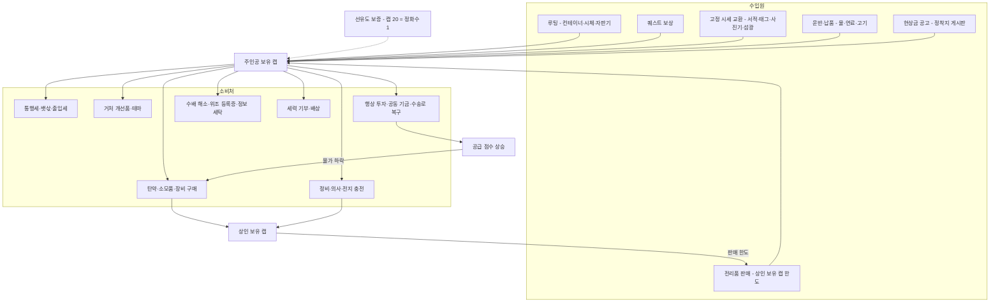
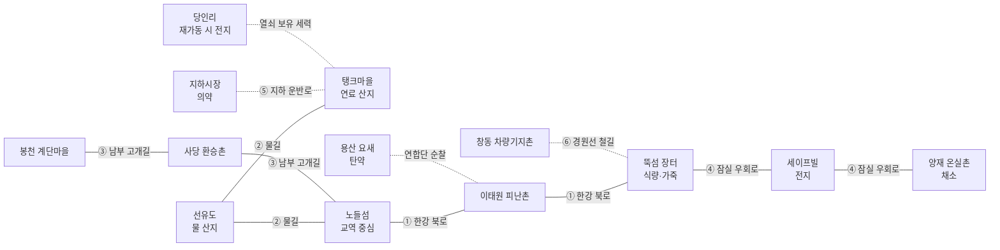
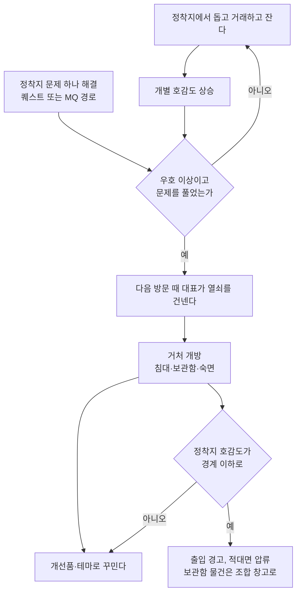

# SD-15. 경제

> **서울 폴아웃 상세 기획서 세트** | 문서 ID: SD-15 | 버전: v1.2 | 작성일: 2026-10-12
> **범위**: 2277년 서울 수도 황무지의 돈이 도는 구조 전체. 캡(병뚜껑)의 기원·보증·통용 범위·위조, 2077년 화폐(원화 지폐·전시 배급표·주민등록증 등)의 쓰임새, 선유도 물 교환증, **통합 매매가 공식**(물물교환 × 세력 호감도 단계 × 서울의 판도·공급 × 수배도 × 개인 보정), 상인 전체 목록(권역 R01~R11·HR·UG, 고정·순회·세력 상인 57명), 서비스(의사·수리·정보상·통행세·숙박·보관·현상금 처리·위조 등록증), 물·식량·연료·전지 공급망과 판도가 공급망을 기울이는 규칙, 주거(정착지 거처 6곳·개선품·테마·보관함), 수집품 판매처와 반복 수익원 후보, 레벨 구간별 경제 밸런스. **다루지 않는 것**: 아이템 개별 수치(→ [SD-13](13_items.md)), 호감도 증감량·판도 계산식(→ [SD-06](06_factions.md)), 물물교환·카리스마·퍽 정의(→ [SD-10](10_character-system.md)), 거래 창·수배도 UI(→ [SD-12](12_exploration-ui.md)), 반복 퀘스트 본문과 RQ-ID(→ [SD-05](05_misc-quests-encounters.md)), 장소 ID·좌표(→ SD-09a~f), NPC ID(→ [SD-07a](07a_characters-major.md)·[SD-07b](07b_npc-directory.md))
> **관련 문서**: [SC-00 컨셉](00_concept.md), [SD-02 세계관](02_world-and-lore.md), [SD-03a 메인 스토리 1](03a_main-story-part1.md), [SD-03b 메인 스토리 2](03b_main-story-part2.md), [SD-04a~d 사이드·세력 퀘스트](04d_faction-questlines.md), [SD-05 비표시·반복·인카운터](05_misc-quests-encounters.md), [SD-06 세력](06_factions.md), [SD-07b NPC 디렉터리](07b_npc-directory.md), [SD-08 월드·권역](08_world-regions.md), [SD-09a~f 장소 카탈로그](09a_locations-r01-r02.md), [SD-10 캐릭터 시스템](10_character-system.md), [SD-11 전투·상태](11_combat-system.md), [SD-12 탐험·UI](12_exploration-ui.md), [SD-13 아이템](13_items.md), [SD-14 크리처·적](14_creatures-enemies.md), [SD-16 아트](16_art-direction.md), [SD-17 사운드](17_sound.md), [SD-18 용어·명명](18_naming-terms.md)
> **원작 근거**: [RD-22 경제·주거](../reverse-design/22_economy-housing.md), [RD-07 비표시·반복 퀘스트](../reverse-design/07_misc-quests-encounters.md), [RD-14 캐릭터 시스템](../reverse-design/14_character-system.md), [RD-27 쯔꾸르 이식 시사점](../reverse-design/27_adaptation-notes.md) §6
> **조사 근거**: [SR-02 서울 지리](research/SR-02_seoul-geography.md)(한강·선유도·마포 석유비축기지), [SR-05 국가·사회](research/SR-05_korea-state-society.md)(§4.6 유통, 배급·주민등록)

---

## 1. 개요

### 1.1 목적
- 서울판의 캡 경제를 **한 장의 공식과 한 장의 지도**로 정리한다. 원작의 경제 시스템(캡 단일 화폐, 물물교환 선형 공식, 상인 보유 캡·재고 갱신, 의사 요금, 고정 시세 교환, 캐러밴 투자, 플레이어 하우스)은 계승한다(RD-22). 바꾸는 것은 셋이다.
  1. **가격이 세계의 기울기를 보여 준다.** 어느 세력과 가까운지, 구역을 누가 쥐었는지, 물길이 열렸는지, 수배 중인지에 따라 값이 달라진다(바이블 §5.8 원칙 3).
  2. **물이 캡을 떠받친다.** 선유도 물 상인 조합의 '캡 20개 = 정화수 1병' 보증이 화폐의 뿌리다(바이블 §11).
  3. **집은 고르는 것이 아니라 머문 곳에서 생긴다.** 양자택일 주택 대신, 주인공이 돕고 자고 거래한 정착지가 거처를 내준다.

### 1.2 범위와 경계
- 이 문서가 정한다: 매매가 공식과 보정의 적용 방식, 상인 57명, 서비스 요금, 공급 점수·교역로, 거처, RQ 후보와 교환 단가.
- 다른 문서가 정한다: 호감도 단계와 할인 원값(SD-06 §4.2·§4.3), 판도 계산(SD-06 §5), 수배도 변수(SD-12 §9.7), NPC ID·대사(SD-07b), 장소 ID(SD-09), RQ 본문·ID(SD-05), 거처 그래픽 규격(SD-16).

### 1.3 요약
- **화폐**: 번개사이다·뉴카-콜라의 2077년 금속 왕관 병뚜껑(캡)만 통용된다. 선유도 물 상인 조합이 **캡 20개 = 정화수 1병**을 보증한다(§2). 물 교환증(M-005)을 채택해 거래 창의 캡 옆 보조 칸에 둔다(SD-12 M-08 결정).
- **공식**: `가격 = 가치 × 상태 × 물물교환 × 호감도 단계 × 시장(판도·공급) × 수배 × 개인`. 구매가는 구역 시세 아래로, 판매가는 구역 시세의 95% 위로 가지 않는다(§3).
- **상인 57명**(고정 29, 세력 22, 순회 6). 보유 캡 5등급, 재고 2~7일 갱신(§4). **서비스**: 의사 40/70/100, 정비 '가치 차이 × 0.75 × 구매 배율', 통행세 0~150, 현상금 500·1,500·3,000(처단 5,000)(§5).
- **공급망**: 산지와 교역로 6개가 13개 구역의 공급 단계(풍족~단절)를 정한다. 주인공이 누구를 돕고 무엇을 넘겼는지가 가격표로 돌아온다(§6).
- **거처 6곳**: 정착지 개별 호감도 우호 + 문제 해결이면 대표가 열쇠를 먼저 건넨다. 동시 소유 가능(§7). **밸런스**: 레벨 구간 5개의 수입 목표와 반복 소비처·주간 한도로 캡 과잉을 막는다(§9).

### 1.4 설계 원칙

| # | 원칙 | 경제에서의 규칙 |
|---|---|---|
| 1 | 진영을 고르는 경제 장치는 없다 | 세력 화폐, 세력 전용 결제 수단, '어느 세력 상점을 이용하겠습니까' 같은 선택이 없다. 세력마다 거래 방식(캡·부품 교환·물물교환)이 다를 뿐이고 모두 같은 캡 경제 위에 있다(§2.5) |
| 2 | 값은 기울기의 그림자 | 호감도·판도·공급이 가격에 들어가지만 숫자로 설명하지 않는다. 상인의 인사말과 진열대(특산품, 빈 칸)로 보여 준다(§3.10) |
| 3 | 행동이 시장을 바꾼다 | 수송로를 지키고, 물을 실어 나르고, 원자로 열쇠를 누구에게 넘겼는지가 몇 구역의 물가를 바꾼다(§6.4). 상점 메뉴에 '투자하시겠습니까' 같은 진영 질문은 없다. 행상 투자도 '이 수송대의 짐을 늘려 주는 일'일 뿐이다 |
| 4 | 같은 자리에서 사고팔아 벌 수 없다 | 구매가 하한과 판매가 상한으로 차익 거래를 막는다(§3.7). 돈벌이는 탐험·운반·납품·퀘스트에서 나온다 |
| 5 | 캡은 끝까지 쓸 곳이 있다 | 원작의 후반 캡 과잉을 거처 개선(거처별), 정착지 공동 기금, 수송로 복구, 정비·통행세 같은 반복 소비처로 흡수한다(§9.4) |
| 6 | 2077년의 돈은 2277년의 잡화 | 원화 지폐·배급표·주민등록증은 화폐가 아니다. 다만 어떤 곳에서는 아직 '쓸 데'가 있다(§2.4) |

### 1.5 표기
- **가치**: SD-13 표의 `가격`(기본 가치, 캡). 무기·방어구는 상태 배율을 곱한 값이 실제 거래 기준이다(§3.8).
- **구매가 / 판매가**: 주인공이 **살 때 / 팔 때**의 값이다. 원작 표기 '매입가 / 매도가'와 방향이 헷갈리지 않도록 주인공 기준으로만 쓴다.
- **호감도 단계**: 적대·경계·중립·우호·신뢰·동맹(바이블 §6.2). 세력 약호는 SD-06 §2.2(BJ·YH·WP·SB·JG·JH·GS·JC·NJ·KD)를 따른다. SD-13의 v1.0 옛 표기 BS·JJ는 v1.1에서 BJ·JG로 바뀌었다(RECON_SPEC G-19·G-20).
- **인물 이름**: 상인·서비스 NPC 이름과 N-ID는 SD-07b 디렉터리 정본이다. v1.0의 (가칭) 인물 이름은 v1.1에서 모두 SD-07b 대응 인물로 바꿨다(SD-07b §6.3 X-094~X-140).
- 장소는 장소 이름과 권역 번호로 적는다. 장소 ID는 SD-09가 부여한다.
- `(SD-xx에서 ID 부여)`: 다른 문서 소관이라 번호를 붙이지 않은 대상이다.

---

## 2. 화폐: 캡

### 2.1 캡의 기원과 보증

| 연도 | 사건 |
|---|---|
| 2077 | 번개사이다(청솔식품)와 수입 뉴카-콜라가 같은 자판기에 꽂혀 있다. 병뚜껑은 공장 압인·인쇄 금속 왕관 뚜껑이다(SD-02 §5.4) |
| 2078~2150 | 원화는 쓸 곳이 사라진다. 정착지마다 다른 '표'(나뭇조각·탄피·배급표 재활용)가 쓰이지만 정착지 밖에서 통하지 않는다 |
| **2160** | **선유도 물 상인 조합 결성**(SD-02 §9.1). 조합은 물값을 받을 표로 번개사이다·뉴카-콜라 병뚜껑을 고른다. ① 어디서나 나온다 ② 새로 만들 수 없어 수가 늘지 않는다 ③ 압인 문양과 안쪽 패킹 때문에 흉내 내기 어렵다. "뚜껑 스무 개에 언제든 물 한 병"을 수조 앞 철판에 새긴다(**보증 철판**) |
| 2161~2277 | 행상 순환로를 따라 캡이 정착지 사이를 돌고 서울 전역의 표준 화폐가 된다. 캡을 쓰지 않는 집단도 바깥과는 캡 시세로 셈한다 |

- **보증의 실제 내용**: 조합 창구(선유도)와 **조합 보증 상인**(§4.2 표의 '보증' 표시)은 언제나 캡 20개를 받고 선유도 정화수(I-057) 1병을 내준다. 반대로 정화수를 캡으로 되사지는 않는다. 보증은 '캡 → 물' 한 방향이다.
- **보증이 경제에 하는 일**: 캡의 바닥 가치를 물로 묶는다. 다른 물값이 아무리 올라도 조합 창구의 물은 20캡이다. 그래서 물이 귀한 곳에서도 사람들은 캡을 믿는다. 게임에서는 정화수의 조합 창구 가격이 물물교환·호감도·시장 보정과 무관하게 **20캡 고정**이다(§3.7 예외).
- **조합의 뚜껑 장부**: 조합은 받은 캡을 '봉인 자루'(100개 단위, 납 도장)에 넣어 보관하고, 물을 사러 오는 행상에게 다시 내준다. 조합은 물 생산량보다 많은 캡을 받지 않는다. 생산이 줄면 창구에 '오늘 물 마감' 팻말이 걸린다(§6.4의 공급 변화).
- **보증 철판**: 선유도 수조 앞에 실제로 서 있는 상호작용 오브젝트다. 읽으면 "뚜껑 스물에 물 한 병. 선유도 물 상인 조합, 2160." 이 철판이 파괴되면(학살·시설 파괴 결과) 캡 보증이 무너진다(§6.4 #16 '보증 붕괴').

### 2.2 통용되는 병뚜껑

| 병뚜껑 | 출처 | 통용 | 판별 표지 | 게임 처리 |
|---|---|---|---|---|
| 번개사이다 뚜껑 | 청솔식품 번개사이다(I-048), 아이스 번개사이다(I-049) | ○ | 노란 번개 압인, 안쪽 코르크 패킹 | 마시면 캡 +1(SD-13) |
| 번개사이다 '섬광' 뚜껑 | 2077 한정판(I-050) | ○ | 은색 번개 압인 | 마시면 캡 +1. 수집가는 병째로 산다(§8.1) |
| 뉴카-콜라 뚜껑 | 미군 PX 수입(I-051) | ○ | 붉은 별 인쇄 | 마시면 캡 +1 |
| 뉴카-콜라 퀀텀 뚜껑 | 미군 PX 수입(I-052) | ○ | 푸른 별 인쇄 | 마시면 캡 +1 |
| 청솔 맥주 '거품' 뚜껑 | 청솔식품 맥주(I-062) | × | 거품 문양 | **잡뚜껑**. 마셔도 캡이 생기지 않는다(SD-13 효과표와 같다). 조합이 인정하지 않는다 |
| 청솔 소주 '한잔' 뚜껑 | 청솔식품 소주(I-060) | × | 돌려 따는 알루미늄 마개 | 왕관 뚜껑이 아니다. 캡으로 쓰지 않는다 |
| 청솔 생수 마개 | 청솔 생수(I-058) | × | 플라스틱 돌림 마개 | 캡 아님 |
| 위조 캡 | 2277년 수제 | × | §2.3 | 별도 잡화(위조 캡 꾸러미) |

- **결정**: 캡은 번개사이다 계열과 뉴카-콜라 계열 병뚜껑을 **혼용**한다(SD-13 미결 11, SD-18 U6 확정). 핍-보이와 거래 창에는 종류를 나누지 않고 '캡' 하나로 센다. 마실 때 '번개 뚜껑'인지 '별 뚜껑'인지는 획득 알림 문구만 다르다(`번개 뚜껑 1개를 챙겼다.` / `별 뚜껑 1개를 챙겼다.`).
- 국산 번개사이다가 서울 캡의 다수다. 뉴카-콜라는 용산·김포 쪽에서 많이 나온다. 이 차이는 세계 묘사(조합 창구의 자루에 붙은 비율 표, NPC의 "요즘은 별 뚜껑이 많이 돈다" 바크)로만 쓴다.

### 2.3 위조 캡

| 종류 | 만드는 쪽 | 만드는 법 | 걸리는 곳 |
|---|---|---|---|
| 두들김 캡 | 난지 고철단, 약탈자 | 깡통을 오려 망치로 두들겨 톱니를 낸다. 문양이 없다 | 어느 상인이든 바로 안다 |
| 긁은 캡 | 지하시장 뒷골목 | 맥주 '거품' 잡뚜껑의 문양을 긁어내고 번개를 새겨 넣는다 | 조합 감별소, 조합 보증 상인, 지하시장 상인회 |
| 납 캡 | 새벽인력 하청 | 진짜 캡을 틀로 떠서 납을 부어 만든다. 무게가 다르다 | 조합 감별소만(저울) |

- **아이템**: '위조 캡 꾸러미' M-165(1꾸러미 = 위조 캡 20개, 무게 0.2, 가치 0). 약탈자·새벽인력 인솔조·고철단 시체와 일부 컨테이너에서 나온다(T1~T3, 드롭 5%).
- **위조 캡은 캡이 되지 않는다.** 플레이어 소지 캡에 섞이지 않고 꾸러미로만 존재한다. 쓰는 법은 셋이다.
  1. **선유도 감별소에 넘긴다**(§8.2 '뚜껑 감별'): 1꾸러미 15캡 + 선유도 +1(일일 상한 포함).
  2. **상인에게 진짜처럼 쓴다**: '꾸러미로 치르기'를 고르면 `[물물교환]` 판정(두들김 불가, 긁은 캡 III, 납 캡 IV). 성공하면 꾸러미당 20캡으로 결제된다. 실패하면 '사기 적발'로 그 상인 소속 세력·정착지 -6, 카르마 -10. 성공해도 7일 안에 25% 확률로 드러난다(같은 감점).
  3. **지하시장 위조상에게 판다**: 1꾸러미 5캡. 위조 유통에 가담한 셈이라 카르마 -5.
- 위조 캡은 돈을 만드는 장치가 아니라 선택이 걸린 잡화다.

### 2.4 2077년 화폐의 2277년 쓰임새

| 물건 | SD-13 | 가치 | 2277년의 처지 | 쓰는 곳 |
|---|---|---|---|---|
| 전쟁 전 지폐(만 원권) | M-002 | 1 | 쓸모없는 종이. 다발로 나온다(아파트 금고, 세진전자 타워 임원 금고, 은행 금고에서 10~60장) | ① 일반 상인에게 가치 1의 잡화로 판다 ② **세이프빌 관리사무소**는 관리비·분양 대금의 절반까지를 만 원권으로 받는다(장당 2캡 환산, §5.5·§7.2). 단지 사람들은 2077년의 체면을 놓지 않았다 ③ 지하시장 골동품점 '세월상회'가 장당 2캡에 산다(주 100장 한도, §8.1) |
| 전시 배급표 | M-003 | 2 | 충성 등급별 색(청·녹·황·적)의 쌀·연료 교환권 | ① 지하시장 수집가가 장당 5캡(SD-13) ② **아직 '영업 중'인 번개24 로봇 점원**은 캡을 받지 않고 배급표만 받는다(SD-02 §4.6). 배급표 1장 = 가공식품 1개 또는 청솔 생수 1병(색이 높을수록 고를 수 있는 품목이 많다, §4.2 R05 #31) ③ 계엄군 시체에서 1~3장 나온다 |
| 충성 등급 주민등록증 | M-004(= M-053) | 1 | 2077년 시민의 신분증. 200년 된 '분류'의 증거 | 반복 거래(SD-13 §7.5): 각성회 '등록 명부' 10캡 + 각성회 +1 / 비상정부 주민 등록 사무소 25캡(카르마 -5). 어느 쪽에 넘길지는 플레이어의 행동이다. 묻는 화면은 없다 |
| 볼트 분양권 | M-063 | 50 | 한결건설 볼트 입주 추첨 당첨 증서 | 세이프빌 관리사무소 수집가 50캡 + 세이프빌 +1 |
| 은행 통장 M-166 | — | 0 | 2077년 예금 잔고가 찍힌 통장. 잔고는 0원이 된 적이 없다 | 판매 불가 잡동사니. 세이프빌 일부 NPC가 통장을 보고 '전쟁 전 부자 집안'으로 대우하는 바크만 있다. `(SD-13에서 ID 부여, 아이콘은 M-098 사원 명찰 공유)` |
| 청솔 상품권 M-167 | — | 3 | 번개24·청솔 마트 상품권 | 번개24 로봇 점원이 배급표 1장처럼 받는다. 그 밖에는 가치 3 잡화. `(SD-13에서 ID 부여)` |

- 설계 의도: 2077년 화폐는 **세이프빌과 번개24 로봇 점원**처럼 2077년이 끝나지 않은 곳에서만 화폐처럼 굴러간다. 바이블 §5.1 '끝나지 않은 명령'의 경제판이다. 2077년 동전은 아이템으로 만들지 않는다(캡과 헷갈림).

### 2.5 세력과 캡: 거래 방식은 다르고, 고르는 장치는 없다
- **캡으로 거래**: 비상정부(배급소, 등록증 필요. 벙커 안은 '배급 점수' 장부지만 대외 거래·현상금·등록 수수료는 캡), 연합단(PX·초소 노점), 새벽인력, 지하시장, 각성회(캡 + 관제망 부품, 헌금), 정착지 연합(선유도 보증), 난지 고철단(캡과 고철, 고철 1 = 5캡 시세).
- **교환으로 거래**: 원칙파(부품 교환만, 캡을 믿지 않는다), 중국군 잔존병(우호부터 물물교환, "보급은 상부가 한다"), 큰돌 무리(우호부터 물물교환, 캡은 '반짝이는 뚜껑'). 교환비는 캡 시세로 셈한다.
- **세력 화폐는 없다.** 어느 세력도 자기 화폐를 강요하지 않고, 플레이어가 화폐를 고르는 메뉴도 없다. 교환 세력과의 거래도 같은 거래 창에서 '캡 칸이 꺼진' 형태로 진행된다(§4.1). 바이블 §5.8 원칙 1의 경제판이다.

### 2.6 선유도 물 교환증 (M-005) 결정

| 항목 | 결정 |
|---|---|
| 채택 | **채택한다**(SD-13 미결 11) |
| 정체 | 선유도 물 상인 조합이 '정화수 1병을 언제든 내준다'고 도장을 찍은 증서. 무게 0, 가치 20 |
| 얻는 법 | ① 조합 창구에서 캡 20개로 산다(물물교환·호감도 무관, 1회 최대 50장) ② 선유도 퀘스트 보상(MQ-202 '물표 정기 계약', SD-04b 선유도 사이드) ③ 물 배달 반복 의뢰 보상(§8.2) |
| 쓰는 법 | ① 조합 창구·조합 보증 상인에게 내면 **정화수 1병**(공급 단계와 무관) ② 조합 보증 상인과의 거래에서 **액면 20캡의 보조 화폐**로 낸다 ③ 보증 상인이 아닌 상인은 잡화(가치 20)로만 받는다(물물교환 공식 적용) |
| 거래 창 표시 | **캡과 같은 화폐 줄에 보조 칸을 둔다**(SD-12 미결 M-08 결정): `캡 1,240 · 교환증 6`. 결제는 캡 먼저, 모자라면 교환증을 쓸지 한 번 묻는다(`교환증 2장(40캡)으로 치르겠습니까?`). 별도 교환 탭은 만들지 않는다. '물표'라는 말은 명예 주민 증표(M-136)에만 쓴다 |
| 경제적 의미 | 물이 귀해진 구역(§6.3 '품귀')에서 정화수 시장가가 40~50캡으로 올라도 교환증은 1병이다. 교환증을 쌓아 두면 물값 오름을 막을 수 있다. 반대로 물이 풍족할 때 교환증을 쓰면 손해다(시장가 16~18캡) |
| 무효화 | 보증 철판 파괴(§2.1) 또는 선유도 소멸 시 모든 교환증은 가치 0 잡화가 된다. 결말 슬라이드에 '종잇조각이 된 교환증' 문안 1줄(SD-03b) |
| 명예 주민 증표와의 구분 | 선유도 물표(M-136 차분)는 명예 주민 증표, 물 교환증(M-005)은 화폐 대용 증서다(SD-13 §7.4.2) |

### 2.7 캡의 흐름



- 상인에게 쓴 캡은 그 상인의 보유 캡으로 쌓여 다시 판매 한도가 된다(원작 순환).
- **공급으로 돌아오는 소비**(O5)는 서울판 고유다. 행상 투자·공동 기금·수송로 복구에 쓴 캡은 경제 밖으로 사라지는 대신 그 구역의 공급 점수를 올려 물가를 내린다(§6.6). 캡을 '세계를 기울이는 데' 쓰게 한다.

---
## 3. 거래 공식

### 3.1 통합 매매가 공식

```
기준가 V      = 가치 × 상태 배율(무기·방어구만, §3.8)

구매가(살 때) = 반올림( V × B(물물교환) × F구매(호감도 단계) × M구매(시장) × W구매(수배) × K구매(개인) )
                단, 구매가 ≥ 반올림( V × G(공급) )                       … 구매 하한

판매가(팔 때) = 반올림( V × S(물물교환) × F판매(호감도 단계) × M판매(시장) × W판매(수배) × K판매(개인) )
                단, 판매가 ≤ 내림( V × G(공급) × 0.95 )                   … 판매 상한

B(물물교환) = 1.55 − 0.45 × 물물교환 ÷ 100          (원작, SD-10 §3.5.3)
S(물물교환) = 0.45 + 0.45 × 물물교환 ÷ 100
M = P(판도) × G(공급)                                (§3.4)
```

- 곱셈 순서는 결과에 영향이 없다. **반올림은 마지막에 한 번**, 그다음 하한·상한을 적용한다(RD-22 §9 구현 주의).
- 가치 1 이상 물건의 판매가는 최소 1캡이다. 가치 0 물건(빈 전지 등)은 팔 수 없다.
- 상인이 그 물건을 '사지 않는' 경우(전문 상인의 취급 밖 품목, 퀘스트 아이템, 장물 규칙)는 공식보다 먼저 판정한다(§4.1).
- 계산은 엔진의 공통 함수 `PriceOf(아이템, 상인, 방향)` 하나가 한다(§11.2).

### 3.2 물물교환 배율 B·S
- 원작 공식을 그대로 쓴다(SD-10 §3.5.3). 물물교환 0에서 구매 155%·판매 45%, 100에서 구매 110%·판매 90%.
- **상인의 물물교환 스킬은 가격에 관여하지 않는다**(원작 폴아웃 3 규칙). 상인의 개성은 품목·보유 캡·특전·위치로 낸다.
- 물물교환을 올리는 장비: 번개24 점원 유니폼(A-009, +5), 떠돌이 상인 복장(A-017, +5), 재벌 임원 정장(A-007, +5), 선유도 물 상인 작업복(A-018, +5). 원작처럼 갈아입은 직후의 값으로 거래한다.

### 3.3 호감도 단계 배수 F
상인이 속한 **세력**(세력 상인) 또는 **정착지**(정착지 상인, 개별 호감도 `AFF_JC_<약호>`)의 단계로 정한다. 무소속 상인(떠돌이·행상·순회 의료반)은 F = 1.0이다.

**기본표 (SD-06 §4.2의 값을 배수로 옮김)**

| 단계 | F구매 | F판매 | 거래 |
|---|---|---|---|
| 적대 | — | — | 불가 |
| 경계 | 1.25 | 0.75 | 가능(세력별 예외 아래) |
| 중립 | 1.00 | 1.00 | 가능 |
| 우호 | 0.90 | 1.05 | 가능 |
| 신뢰 | 0.80 | 1.10 | 가능, 세력 장비 진열 |
| 동맹 | 0.75 | 1.15 | 가능, 고유 상품 진열 |

**세력별 덮어쓰기 (SD-06 §4.3 각 표의 '상점' 칸)**: 아래 칸은 기본표 대신 쓴다. 비어 있는 칸은 기본표를 따른다. F판매는 같은 행의 단계 기본값을 쓴다.

| 세력 | 경계 | 중립 | 우호 | 신뢰 | 동맹 | 비고 |
|---|---|---|---|---|---|---|
| BJ 비상정부 | 불가 | 불가 | 1.00(임시 등록증 필요) | 0.85 | 0.75 | 미등록자와는 거래하지 않는다 |
| YH 연합단 | 불가 | 1.10(이태원 초소 노점만) | 0.90(PX 출입) | 0.80 | 0.75 | |
| WP 원칙파 | 불가 | 교환 1.30 | 교환 1.00 | 0.85 | 0.85 + 희귀품 | 캡 대신 부품 교환(§4.1 교환 거래) |
| SB 새벽인력 | 1.30(노들섬 출장소만) | 1.10 | 1.00 | 0.85 | 0.75 | |
| JG 중국군 잔존병 | 불가 | 불가 | 교환 1.00 | 교환 0.85 | 교환 0.80 | 물물교환만 |
| JH 지하시장 | 1.25 | | | | | 기본표 그대로 |
| GS 각성회 | 1.25 | | | | | 기본표 그대로 |
| JC 정착지(개별) | 1.25 | | | | | 기본표 그대로 |
| NJ 난지 고철단 | 고철 교환만 1.40 | 1.15 | 1.00 | 0.85 | (동맹 없음) | |
| KD 큰돌 무리 | 없음 | 없음 | 교환 1.00 | 교환 0.90 | 교환 0.85 | 물물교환만 |

- SD-10 §3.7 권장값(경계 ×1.1 … 동맹 ×0.85) 대신 SD-06 §4.2의 단계 혜택표를 정본으로 쓴다. 할인이 커도 구매 하한(§3.7) 때문에 물물교환이 높으면 기본가에서 멈춘다(미결 E-02).
- **교환 거래**: '교환'은 캡이 오가지 않는 거래다. 플레이어가 내는 물건의 판매가 합이 받는 물건의 구매가 합 이상이어야 성립하고, 남는 차액은 버려진다(거스름돈 없음). 교환 거래는 수배 보정과 판도 보정을 받지 않는다.

### 3.4 시장 보정 M: 판도와 공급
- **판도 보정 P**(SD-06 §5.6을 수치화): 상인이 있는 구역의 판도 상태가 '지배' 또는 '우세'일 때, 그 지배 세력의 주인공 호감도로 정한다. **무소속 상인과 정착지 상인에게만** 적용한다(세력 상인은 이미 F로 반영).

| 지배 세력의 주인공 호감도 | P구매 | P판매 | 상인 인사(예) |
|---|---|---|---|
| 우호 이상 | 0.95 | 1.00 | "요즘 이 동네 쥔 사람들이 당신 편이라던데. 좀 깎아 드리지." |
| 중립 | 1.00 | 1.00 | — |
| 경계 이하 | 1.10 | 0.95 | "여기 순찰대가 당신 얼굴을 알아. 나도 위험수당은 받아야지." |
| 경합·공백 구역 | 1.00 | 1.00 | (공급 보정으로만 드러난다) |

- **공급 보정 G**: 품목군별·구역별 **공급 단계**(§6.3)로 정한다. 구매와 판매 모두에 곱한다. 귀한 곳에서는 사기도 비싸고 팔기도 비싸다. 운반의 이유가 된다.

| 공급 단계 | G | 상인 진열대 | 비고 |
|---|---|---|---|
| 풍족 | 0.80 | 해당 품목군 재고 ×1.5 | |
| 보통 | 1.00 | 기본 | |
| 부족 | 1.30 | 재고 ×0.6 | 상인 바크: "요새 ○○ 들어오는 길이 막혀서…" |
| 품귀 | 1.70 | 재고 ×0.3, 1인 구매 한도(품목당 3개) | 진열대 빈칸 그래픽 |
| 단절 | 2.20 | 일반 상인 재고 0. **암거래 상인**(지하시장·새벽인력 출장소·밀매상)만 판다 | 정착지 주민 바크·남산 방송 뉴스 |

- 공급 보정이 걸리는 **품목군**(6개): 물(I-054~I-059), 식량(I-022~I-047, 조리 결과물), 연료(화염방사기 연료, 부탄가스 통 M-023, 핵분열 배터리 M-018), 전지(에너지 전지, 마이크로퓨전 전지, 전자 충전 팩), 탄약(그 밖의 탄약), 의약(I-001~I-009). 그 밖의 품목(무기·방어구·잡화·약물)은 G = 1.0이다.

### 3.5 수배 보정 W
주인공의 수배 등급(SD-12 §9.7)에 따라 **무소속 상인과 정착지 상인**의 태도가 바뀐다. 세력 상인은 세력 방침을 따른다(표 아래).

| 수배 등급 | W구매 | W판매 | 상인 반응 |
|---|---|---|---|
| 0 미등재 · 1 소문 | 1.00 | 1.00 | — |
| 2 수배 공고 | 1.00 | 1.00 | 인사말에 소문 언급("전단 봤어요. 닮았던데.") |
| 3 지명 수배 | 1.10 | 0.90 | '입막음 값'. 정착지 상인 중 비상정부 정보원이 있는 곳(봉천·노들섬·세이프빌·양재 온실촌, SD-06 §6.3)은 거래 뒤 30% 확률로 밀고(수배도 +3, 다음 날 그 구역 추격조 판정 2배) |
| 4 총력 수배 | 1.20 | 0.80 | 비상정부 영향력 50 이상 구역의 무소속·정착지 상인은 **거래 거부**("미안해요. 우리 가게 문 닫게 할 순 없어서.") |

- 세력 상인의 수배 방침: 지하시장·원칙파·중국군 잔존병·큰돌 무리·난지 고철단은 수배를 신경 쓰지 않는다(W = 1.0). 연합단은 W = 1.0이다(비상정부 공고를 인정하지 않는다). 새벽인력은 수배 등급 2 이상이면 거래 창 대신 '생포 시도' 대화가 먼저 나온다(새벽인력 우호 이상이면 거래). 비상정부는 등록증이 없으면 거래하지 않는다.
- 정착지 개별 호감도가 **신뢰 이상**인 정착지의 상인은 수배 보정을 받지 않는다("우리 사람"은 판다).

### 3.6 개인 보정 K

| 원천 | K구매 | K판매 | 조건 | 정본 |
|---|---|---|---|---|
| 마스터 트레이더(PK-073) | 0.75 | — | 구매 하한 적용(원작 규칙 그대로) | SD-10 |
| 단골(PK-026) | 0.95 / 0.90 / 0.85 | 1.05 / 1.10 / 1.15 | 같은 상인과 누적 거래 500·1,000·1,500캡 | SD-10 |
| 선행 표창(PK-042) | 0.90 | — | 정착지 상인만, 카르마 선함 이상 | SD-10 |
| 단독 기울기 SOLO 6 이상 | 0.90 | — | 무소속 상인·행상만 | SD-06 §7.3 |
| 카르마 매우 악함 | 1.10 | 0.90 | 정착지 상인만. 밤(22:00~06:00)에는 일부 정착지 상인이 문을 닫는다 | SD-10 §6.4 |
| 상점 특전 | 0.90 등 | — | 퀘스트로 얻는 개별 할인(예: MQ-101 방어 성공 → 봉천 고물상 -10%, MQ-201 노들 우호 → 섬 식당 -10%) | SD-03a, SD-04 |
| 상인 개별 요율 | 표 §4.2 | 표 §4.2 | 사치품점·암거래상 등 상인 고유 배수(1.0~1.3) | 이 문서 |

- 단골 보정은 상인 단위로 누적한다(SD-10 데이터 메모: 단골 누적 거래액 배열).
- 같은 종류 퍽 할인은 곱한다. 구매 하한 때문에 할인이 겹쳐도 기본가 아래로 내려가지 않는다.

### 3.7 하한·상한·예외
- **구매 하한** = `V × G(공급)`. 할인을 아무리 쌓아도 그 구역 시세 아래로 사지 못한다. 원작 마스터 트레이더의 '기본가 하한'을 공급 단계까지 넓힌 것이다.
- **판매 상한** = `V × G(공급) × 0.95`. 보너스를 아무리 쌓아도 그 구역 시세의 95%까지만 받는다. 그래서 **같은 상인·같은 구역 안에서는 언제나 구매가 > 판매가**다(최소 차이 약 5%). 원작이 매도 상한 90%와 매입 하한 110%로 차익을 막은 것과 같은 목적이다(RD-22 §3.1).
- **구역 간 차익은 허용한다.** 물이 풍족한 선유도에서 사서 품귀인 탱크마을에 파는 것은 '운반'이다. 이 이익은 상인 보유 캡, 소지 무게, 공급 회복(납품하면 그 구역 공급 점수가 오른다, §6.6)으로 스스로 줄어든다.
- **예외(공식을 거치지 않는 값)**
  1. 선유도 조합 창구의 정화수: 20캡 고정(§2.1)
  2. 물 교환증 구입: 20캡 고정
  3. 고정 시세 교환(서적·태그·사진기 등, §8): 단가 고정
  4. 서비스 요금(의사·통행세·숙박 등, §5): 각 표의 값. 호감도 단계 F구매만 곱하는 서비스는 표에 표시
  5. 퀘스트 대화의 캡 지불(독사에게 200캡 등): 퀘스트 문서의 값

### 3.8 상태와 가치
- 무기·방어구의 기준가는 `가치 × 상태 배율`이다. 상태 배율은 SD-13 §8.1(SD-11 §11.8 확정값): 새것 1.00 / 양호 0.50 / 낡음 0.23 / 위태 0.05 / 파손 = 고철 가치(고철 M-010 1개분, 5).
- 원작의 `내구도^1.5`를 5단계로 근사한 값이라 원작의 '고쳐서 팔면 크게 남는' 성질이 남는다(RD-22 §3.3). 정비비(§5.2)가 이 차이의 일부를 가져간다.
- **상인 재고는 '양호' 이상만 진열한다.** 상인은 낡은 물건을 정비해서 판다. 주인공이 판 낡은 물건은 갱신 전까지 그대로 되살 수 있다(원작 되사기 규칙).

### 3.9 예시 표

**예시 1. 물물교환과 호감도 단계 (공급 보통, 판도·수배 보정 없음)** — `구매가 / 판매가`(캡)

| 품목(가치) | 물물교환 | 경계 | 중립 | 우호 | 신뢰 | 동맹 |
|---|---|---|---|---|---|---|
| 스팀팩 I-001 (25) | 15 | 46 / 10 | 37 / 13 | 33 / 14 | 30 / 14 | 28 / 15 |
| | 50 | 41 / 13 | 33 / 17 | 30 / 18 | 27 / 19 | 25 / 19 |
| | 100 | 34 / 17 | 28 / 23 | 25 / 23 | 25 / 23 | 25 / 23 |
| 10mm 권총 W-002 새것 (225) | 15 | 417 / 87 | 334 / 116 | 300 / 122 | 267 / 128 | 250 / 134 |
| | 50 | 373 / 114 | 298 / 152 | 268 / 159 | 239 / 167 | 225 / 175 |
| | 100 | 309 / 152 | 248 / 203 | 225 / 213 | 225 / 213 | 225 / 213 |
| 레이저 소총 W-023 새것 (1,000) | 15 | 1,853 / 388 | 1,483 / 518 | 1,334 / 543 | 1,186 / 569 | 1,112 / 595 |
| | 50 | 1,656 / 506 | 1,325 / 675 | 1,193 / 709 | 1,060 / 743 | 1,000 / 776 |
| | 100 | 1,375 / 675 | 1,100 / 900 | 1,000 / 945 | 1,000 / 950 | 1,000 / 950 |

- 물물교환 15는 시작값(카리스마·행운 5)이다(SD-10 §3.3).
- 물물교환 100에서는 우호부터 구매가가 하한(가치)에, 신뢰부터 판매가가 상한(95%)에 닿는다. 높은 물물교환과 높은 호감도의 효과는 겹치지 않고 서로를 대신한다. 물물교환을 찍지 않은 캐릭터도 세력과 가까워지면 값을 깎을 수 있다는 뜻이다.

**예시 2. 공급 단계 (중립 상인, 판도·수배 보정 없음)** — `구매가 / 판매가`

| 품목(가치) | 물물교환 | 풍족 ×0.8 | 보통 ×1.0 | 부족 ×1.3 | 품귀 ×1.7 |
|---|---|---|---|---|---|
| 선유도 정화수 I-057 (20) | 15 | 24 / 8 | 30 / 10 | 39 / 13 | 50 / 18 |
| | 50 | 21 / 11 | 27 / 14 | 34 / 18 | 45 / 23 |
| | 100 | 18 / 14 | 22 / 18 | 29 / 23 | 37 / 31 |
| 스팀팩 I-001 (25) | 15 | 30 / 10 | 37 / 13 | 48 / 17 | 63 / 22 |
| | 50 | 27 / 14 | 33 / 17 | 43 / 22 | 56 / 29 |

- 운반 차익 예: 물물교환 100이면 선유도(풍족)에서 18캡에 사서 품귀 구역에 31캡에 판다(병당 13캡). 상인 보유 캡과 납품에 따른 공급 회복(§6.6)이 곧 이익을 줄인다. 물물교환 15라면 남지 않으니 물 교환증을 가져가는 쪽이 맞다.

**예시 3. 수배 보정과 마스터 트레이더 (10mm 권총 새것, 중립·공급 보통)**

| 조건 | 물물교환 15 | 물물교환 50 |
|---|---|---|
| 수배 등급 0~2 | 334 / 116 | 298 / 152 |
| 수배 등급 3 (×1.10 / ×0.90) | 367 / 105 | 328 / 137 |
| 수배 등급 4 (×1.20 / ×0.80) | 400 / 93 | 358 / 122 |
| 마스터 트레이더(물물교환 60 필요) | — | 물물교환 60에서 225(하한) |

**예시 4. 판도가 바꾼 가격** — 뚝섬 장터 떠돌이 상인의 스팀팩(물물교환 50, 기준 33캡): R08이 정착지 연합 '우세'이고 주인공이 연합 우호면 ×0.95 = **31캡**. 대로파가 소굴을 넓혀 R08이 '경합', 의약 '부족'이 되면 ×1.3 = **43캡**("요새 약 들어오는 수레가 반만 와."). 주인공이 소굴을 비우고 호위를 두 번 하면 다시 내려간다.

### 3.10 거래 창 표시: 숫자 대신 인사
- 가격 배수의 내역(호감도 몇 %, 판도 몇 %)은 표시하지 않는다(바이블 §6.2 표시 원칙, SD-12 §11.2).
- 거래 창을 열 때 상인 인사 한 줄이 **가장 큰 보정 하나**를 말로 알려 준다. 우선순위: 거래 거부 사유 > 수배 > 공급 단절·품귀 > 호감도 단계 변화 > 판도 > 단골.

| 보정 | 인사 예(문안은 SD-07b·SD-17이 다듬는다) |
|---|---|
| 호감도 우호 | "요즘 용산 쪽에서 당신 칭찬이 많던데요. 값을 좀 쳐 드리죠."(SD-12 예문) |
| 공급 품귀 | "물길이 막혀서 물이 이것뿐이에요. 한 사람에 세 병." |
| 수배 3 | "…값은 더 받을게요. 대신 난 당신 못 본 겁니다." |
| 단골 | "단골손님 몫으로 하나 빼 뒀어요."(PK-026의 따로 빼 둔 재고 1칸) |

- '관계 수치 보기' 옵션(SD-06 §4.1)을 켜면 거래 창 오른쪽 아래에 `시세 ×0.95 · 단골 ×0.90` 같은 작은 꼬리표가 붙는다. 기본은 꺼짐이다.

**구현 정합(단계 0-10, 거래 창 v1)**
- `PriceOf`는 `TradeScreen.price_of(가치, 사는 쪽, 물물교환, F, K, G)` 하나다. 가치 1 물건은 사는 값(하한 1)과 파는 값(최소 1)이 같다 — 5% 차이는
  반올림에 묻힌다(그 밖의 가치에서는 언제나 사는 값 > 파는 값을 시험으로 지킨다).
- 0-10에서 M(판도·공급)과 W(수배)는 1.0으로 둔다: 봉천은 판도 '지배·우세'가 아니고, MQ-101 수배도 10은 등급 1(소문)이라 W가 걸리지 않는다.
  공급 단계(§6.3)·판도 틱이 들어오는 단계에서 G·P를 잇는다.
- F는 정착지 개별 호감도(`AFF_JC_BC`)의 단계 기본표(경계 1.25/0.75 … 동맹 0.75/1.15), 적대면 거래 창이 열리지 않는다(히스테리시스 없이 값으로만).
  K는 퀘스트 특전(MQ-101 결과: 고물상 방어·유인 −10% · 돈 +10%)과 품목별 배수(마을을 판 뒤 물값 ×2)를 쓴다.
- 상인 표 `tools/pipeline/merchant_export.py` → `data/merchants.json`(빌드에 들어감): V01 오봉수 고물상(D, 다 산다) · V02 하숙자 약국(D, 의약·음식·물만).
  진열 = 재고 단계 Ⅰ 중 지금 데이터 표에 있는 품목(10mm 탄·스팀팩·A-016·W-002·고철·구리선·테이프·계전기·건빵·참치·빗물 / 스팀팩·라드어웨이·
  수혈 팩·갑상선 방호정·정화수). W-001·W-014·.32 탄·12게이지·대못·M-100·I-007·I-092는 SD-13 추출 범위가 넓어지면 넣는다.
- 보유 캡·갱신: 기준 = 등급 a + b × 주인공 레벨, `GAME_DAY`가 갱신 주기(일) 이상 지나면 진열을 다시 채우고 캡 = min(기준×1.5, max(기준, 현재×0.5)).
  06:00 시각 판정은 게임 시계가 들어오는 단계에서. 상인 상태는 이야기 상태(`st.boxes["shop:V01"]`)에 남는다.
- 거래 창은 용기 창(2단)을 이어받은 **바구니 거래**다(SD-12 §11.1): 왼쪽 내 소지품(파는 값, 그 상인이 사는 것만), 오른쪽 진열(사는 값).
  E = 하나 담기 · Shift+E = 그 줄 전부 · R = 빼기 → 아래 줄 `내 캡 → 확정 뒤 / 이번 거래 차액 / 상인 캡 → 확정 뒤` → F 거래 확정(단추는 두 번).
  차액을 내 캡·상인 캡이 감당하지 못하면 확정이 꺼진다. 창을 닫으면 담은 것은 없던 일. 위에 인사 한 줄(가장 큰 보정을 말로).
  입고 있는 한 벌·퀘스트 물건은 팔 수 없다. 분류 탭(전체·무기·의복…)과 수량 창은 물건 수가 늘어나는 단계에서 더한다.

**구현 정합(단계 1-4 지하시장 상인)**
- `merchant_export.py`에 지하시장 9곳: V08 복희 양품점(노복희) · V09 영신통신 작업장(마영식) · V10 지하시장 진료소(금하람) · V11 수연 약방(엄수연) · V13 희정 인쇄(염희정) · V14 세월상회(사공민영) — 이 절 번호 — + VJ05 재석 전업사(진재석) · VJ07 지하 분식(변상민) · VJ10 민지 정수(도민지). VJ 번호는 이 절에 없어 임시로 붙였다 — 정본 번호가 나오면 바꾼다.
- 상인회 일을 해 준 단골(JM_REG = 1)은 지하시장 거래 값 −10%(SD-03a §8.3 기울기, `[0.90, 1.0]`).


### 3.11 물물교환이 걸린 대화 거래
거래 창 밖에서 물물교환이 조건이 되는 대화다. 판정 난이도는 SD-10 §3.6(I~V), 결과 수치는 각 퀘스트 문서가 정본이고 이 표는 경제 쪽 기준값이다.

| 대화 | 기본 | `[물물교환]` 성공 | 대안·출처 |
|---|---|---|---|
| 노들섬 위험 할증 | 500캡 | 250캡(III) | 캡 대신 노들섬 +2 / SD-03a MQ-201 |
| 행상 투자 단가 | §4.3 | 20% 할인 | 할인 대신 그 수송대 재고 +1단계 |
| 세력 물자 납품 단가 | — | +20% | 캡 대신 그 세력 +1~+3 / SD-10 §3.7 |
| 섬광 매입가 / 세월상회 예산 | 40 / 주 700 | 50(III) / 주 900(IV) | §8.1 |
| 현상금 공고 보상 | 공고액 | +25%(III) | 캡 대신 그 정착지 +2 / §5.7.4 |

- 퀘스트 대화의 물물교환 판정(양화 나루 장부 검산, 황두칠에게 현상금 사기 등)은 SD-03a 값을 따른다.

---

## 4. 상인

### 4.1 공통 규칙

**보유 캡 등급** — 상인이 가진 캡만큼만 주인공의 물건을 사 준다(원작). 플레이어가 산 만큼 상인 캡이 늘어난다.

| 등급 | 유형 | 기준 보유 캡 | 상한(Lv35) | 재고 갱신 | 대표 |
|---|---|---|---|---|---|
| E | 노점·식당·사냥꾼 | 150 + 8 × 레벨 | 430 | 2일 | 꼬치 노점, 사냥꾼 |
| D | 소상점·전문점 | 300 + 15 × 레벨 | 825 | 3일 | 고물상, 약방, 기름집 |
| C | 정착지 대표 상점·세력 매점 | 500 + 25 × 레벨 | 1,375 | 3일 | 대장간, 무기상 |
| B | 대상점·투자한 행상·밀매상 | 800 + 35 × 레벨 | 2,025 | 3일(일반) / 7일(고급) | 조합 창구, 공작창 |
| A | 세력 보급창 | 1,200 + 50 × 레벨 | 2,950 | 3일(일반) / 7일(세력 장비) | 연합단 PX, 청계산 보급창 |

- **갱신 때 보유 캡** = `min(기준값 × 1.5, max(기준값, 현재값 × 0.5))`. 플레이어가 많이 사 간 상인은 캡이 쌓이지만 기준의 1.5배를 넘지 않는다. 원작 캐러밴의 무한 누적(RD-22 §4.4)은 쓰지 않는다.
- **갱신 시각**: 게임 시간 06:00. 상인마다 갱신 주기를 따로 센다(공통 이벤트 1개가 상인 배열을 돈다, §11.2).
- **재고 단계**: 상인 재고는 주인공 레벨에 따라 4단계로 바뀐다. 원작의 레벨 연동 재고를 '단계 목록 4종'으로 단순화한 것이다(RD-22 §9). 단계의 최고 등급은 그 권역의 루팅 상한(SD-13 §9.2)을 넘지 않는다. 세력 상인은 호감도 단계가 따로 품목을 연다.

| 재고 단계 | 주인공 레벨 | 진열 최고 루팅 등급 | 비고 |
|---|---|---|---|
| Ⅰ | 1~6 | T1(권역 상한이 더 낮으면 그 값) | 프롤로그~1막 |
| Ⅱ | 7~12 | T2 | 2막~3막 초 |
| Ⅲ | 13~20 | T3 | 3막~5막 |
| Ⅳ | 21 이상 | T4 | 5막~7막. T5(팻맨·방전포·T-51b)는 어느 상점도 팔지 않는다 |

- **팔지 않는 것**: 파워 아머(대여·지급만, SD-06 §4.4), T5 무기, 고유 장비, 퀘스트 아이템. 미니 누크는 연합단 PX가 동맹에서 주 1발만 판다(SD-13 §4.1).
- **사지 않는 것**: 전문 상인(약방·식당·사냥꾼 등)은 취급 분야 밖 품목을 사지 않는다. 식당은 음식·재료, 약방은 의약·약물·생물 재료만 산다.
- **장물**: 훔친 물건(`[장물]`)은 주인 세력·정착지 상인에게 팔 수 없다. 다른 상인은 산다. 지하시장 '세월상회'와 밀매상은 출처를 따지지 않는다.
- **판도와 재고**: 상인이 있는 구역이 '공백'이면 정착지 상점 재고 -30%, '경합'이면 경비 +2(SD-06 §5.6). 지배 세력의 특산품이 무소속 상인 진열에 섞인다(연합단 지배 → 5.56mm 탄·마이크로퓨전 전지, 각성회 지배 → 진공관, 비상정부 지배 → 태성 전투식량, 정착지 연합 지배 → 정화수·노들섬 고구마).
- **교환 거래**(원칙파·중국군 잔존병·큰돌 무리): 거래 창의 캡 칸이 비활성이고, 오른쪽 아래에 `교환 균형: +38`이 뜬다. 균형이 0 이상이어야 확정 버튼이 켜진다(§3.3).
- **영업시간**: 정착지 상점 07:00~21:00, 노점 09:00~19:00, 식당·주점 10:00~02:00, 의사·세력 보급창 24시간, 지하시장 상가 24시간('그때'부터 셔터를 내린 적이 없다). 상인 NPC 일과(수면·식사)는 SD-07b가 정한다.
- **조합 보증 상인**(표의 '보증' 열 ○): 정화수 20캡 교환과 물 교환증 결제를 받는다(§2.6). 정착지 연합 가맹 정착지의 대표 상점 1곳씩과 물길 수송대다.
- **피난 상인**: 정착지가 파괴·점령되면 그 정착지 상인 중 생존자 1명이 노들섬 피난 노점으로 옮겨 E등급으로 장사를 이어 간다(노들섬도 없으면 뚝섬 장터).

### 4.2 권역별 상인 목록
- **유형**: 고정(정착지·무소속 상인), 세력(세력 소속 상인, F는 세력 호감도), 순회(§4.3).
- **F 기준**: 그 상인 가격에 들어가는 호감도. 정착지 약호는 SD-06 §2.2.
- 품목의 ID는 SD-13. `신규`는 이 문서가 SD-13에 등록을 요청하는 품목이다(부록 A).

#### R01 관악 (7명)

| 번호 | 이름 | 유형 | 장소 | 취급 품목 | 캡 | 갱신 | 서비스 | F 기준·조건 | 보증 | 비고 |
|---|---|---|---|---|---|---|---|---|---|---|
| V01 | 오봉수(N-R01-026) | 고정 | 봉천 계단마을 계단 아래 고물상 | 잡화, .32·10mm·12게이지·대못, 스팀팩, 황무지 정착민 복장 A-016, 실바람 경찰 리볼버 W-001, 10mm 권총 W-002, 사냥용 소총 W-014, 설계도 병뚜껑 지뢰 M-100(1장) | D | 3일 | — | 봉천(BC). MQ-101 방어 성공 시 -10%, 돈으로 해결 시 +10%(SD-03a) | ○ | MQ-101 '캡' 튜토리얼 상대(조만석이 데려간다) |
| V02 | 하숙자(C-057·N-R01-025) | 고정 | 봉천 계단마을 약국 | 의약 I-001~I-009, 해독 앰플 I-007, 갑상선 방호정 I-005, 항생제 I-092 | D | 3일 | 의사 | 봉천(BC) | — | 봉천 '빌린 침대' 옆. 1막의 첫 의사 |
| V03 | 남무진(N-R01-030) | 고정 | 봉천 계단마을 옥상 대장간 | 파이프 소총 W-013, 파이프 산탄총 W-025, 못 박힌 각목 W-046, 철근 몽둥이 W-048, 고철·테이프·접착제, 수리 키트 I-067 | D | 3일 | 정비(수제·공구·TS 계열) | 봉천(BC) | — | 작업대 공용 |
| V04 | 엄태경 '곰배'(N-R01-033) | 고정 | 관악산 사냥꾼 오두막 | 멧돼지 고기·육포 I-038·I-039, 곰 고기 I-041(드묾), 멧돼지 가죽 M-027, 사냥용 소총 W-014, .32 구경탄, 마취 다트 | E | 2일 | — | 무소속(F 1.0) | — | 독침 마취총 설계도 M-105 퀘스트 보상(SD-13) |
| V05 | 표하경(N-R01-042) | 고정 | 사당 환승촌 승강장 노점 | 지하 느타리 I-044, 지하철 정기권 M-071, 방독면 정화통 I-066, 신호탄, 해충 기피제 I-065 | E | 2일 | 숙박(매트) | 사당(SA) | — | 지하 레이어 첫 상인. 역 별명 '사당 아재'는 N-UG-001 한 사람만 쓴다(D3) |
| V06 | 한가람(N-R01-055) | 세력 | 노량진 관제 중계소 부품 교환대 | 진공관 M-014, 세진 회로 기판 M-019, 에너지 전지, 샛바람 레이저 권총 W-009, 세진 제압 전기 진압봉 W-042, 각성회 예복 A-043(우호) | D | 3일 | 헌금함(카르마) | 각성회(GS). 관제망 식별 태그 M-051을 1개 20캡에 산다(SD-13) | — | 정비 당번장(대기 6203). "부품은 수호자에게 돌아가야 합니다". 응답자 하은결(N-R01-502)은 다른 인물이다 |
| V07 | 권은서 분류관(N-R01-048) | 세력 | 사당 고개 검문소(L-R01-19, 판도 거점 '관악 검문소') 배급소·분류 천막 | 태성 전투식량 I-031, 군용 건빵 I-030, 10mm·5.56mm, 하늬 군용 권총 W-004, 라드-X, 갑상선 방호정, 계엄군 장교복 A-032(우호 해금) | C | 3일 | — | 비상정부(BJ). 우호 + 임시 등록증 M-120 필요 | — | MQ-106 뒤 상설화. R01 BJ 영향력 30 아래면 철수 |

#### R02 여의도·영등포 (8명)

| 번호 | 이름 | 유형 | 장소 | 취급 품목 | 캡 | 갱신 | 서비스 | F 기준·조건 | 보증 | 비고 |
|---|---|---|---|---|---|---|---|---|---|---|
| V08 | 노복희(C-050·N-R02-001) | 세력 | 영등포 지하상가 '복희 양품점' | 2077 의류 A-005~A-009, 장사꾼 코트 A-019(우호 해금), 구울 가면 A-106(우호), 회사원 정장 A-006 | C | 3일 | — | 지하시장(JH) | — | 상인회장. 2077년 이 자리 옷가게 주인 |
| V09 | 마영식(C-006) | 세력 | 영등포 지하상가 배전실 작업장 | 에너지 전지, 펄스 수류탄 W-061, 핵분열 배터리 M-018, 세진 회로 기판, 설계도 압력 대못총 M-102 | D | 7일 | 정비(에너지 무기·SJ 계열, 요율 0.9) | 지하시장(JH). 상인회 출입패 M-078 또는 JH 우호 | — | 진공관 M-014를 1개 15캡에 산다(SD-13). JH 동맹이면 작업대 사용권 |
| V10 | 금하람(C-051·N-R02-003) | 세력 | 영등포 지하상가 진료소 | 스팀팩, 라드어웨이(다량), 해독 앰플, 부목 I-006, 항생제 I-092 | C | 3일 | 의사, 성형(얼굴 파츠·피부색) | 지하시장(JH) | — | 수혈 팩 I-004를 1개 15캡에 산다(SD-13). 성형은 SD-10 §8.8 |
| V11 | 엄수연(N-R02-006) | 세력 | 영등포 지하상가 약방 | 약물 I-010~I-016, 울트라제트 I-012(우호), 변종 혈청 I-021, 지네 독샘 M-048 | D | 3일 | — | 지하시장(JH) | — | 말벌 독낭 M-026을 1개 20캡에 산다(SD-13 M-057) |
| V12 | 구문철 '귀동냥'(N-R02-501) | 세력 | 영등포 지하상가 뒤 계단참 | 지도 마커(장소 위치 정보), 소문 | E | 7일 | 정보상(§5.3) | 지하시장(JH) | — | 정보 세탁·목격자 매수·판도 소식 |
| V13 | 염희정(N-R02-008) | 세력 | 영등포 지하상가 B구역 셔터방 | 위조 주민등록증 M-062, 공구, 머리핀 M-070 | D | 7일 | 신원 세탁(§5.8) | 지하시장(JH). 신원 세탁은 JH 우호 | — | 전시 배급표 M-003을 장당 5캡, 위조 캡 꾸러미 M-165를 5캡에 산다. SD-04d '진이'도 이 인물 |
| V14 | 사공민영(N-R02-012) | 세력 | 영등포 지하상가 골동품점 | 진공관 라디오 M-083, 한글 타자기 M-085, 거처 테마 '모델하우스'·'관제실' 판매(§7.4) | C | 7일 | 고정 시세 매입(§8.1) | 지하시장(JH) | — | 2077 생활 잡화를 가치 그대로 산다(주 예산 700). 만 원권 장당 2캡(주 100장) |
| V15 | 주현태 매점 반장(N-R02-502) | 세력 | 새벽인력 본소(남구로 새벽 인력시장 터의 옛 공구상가 철골동) 매점 | 세진 제압 충격 권총 W-010, 전기 진압봉 W-042, 소드오프 W-026, 10mm 기관단총 W-015, 제트·사이코, 추심원 조끼, 그물총 W-066(신뢰) | C | 3일 | — | 새벽인력(SB). 수배 2 이상이면 우호 미만에서 '생포 시도' 대화가 먼저 | — | 인력 장부 조각 M-161은 사지 않는다(장부를 훔친 증거라며 적대) |

#### R03 마포·상암 (5명)

| 번호 | 이름 | 유형 | 장소 | 취급 품목 | 캡 | 갱신 | 서비스 | F 기준·조건 | 보증 | 비고 |
|---|---|---|---|---|---|---|---|---|---|---|
| V16 | 석해든(N-R03-005) | 고정 | 탱크마을 2번 탱크 대장간 | 금속 아머 A-025, 강화 금속 아머 A-026(신뢰 주문 제작), 파이프 산탄총, 화염병 W-057, 수리 키트, 설계도 M-100 | C | 3일 | 정비(전 계열, 파워 아머 제외), 탄약 재생대(우호), 주문 제작(§5.9) | 탱크마을(TK) | — | 기름띠 W-113은 민경자 퀘스트·신뢰 |
| V17 | 표동하(N-R03-010) | 고정 | 탱크마을 3번 탱크 연료상 | 화염방사기 연료, 부탄가스 통 M-023, 등유 통 M-169(교역 짐), 화염방사기 W-030, 태성 화상 연고 I-008, 핵분열 배터리(드묾) | D | 3일 | — | 탱크마을(TK) | ○ | 연료 산지라 연료 공급 '풍족'이 기본(§6.3) |
| V18 | 모금동(N-R03-012) | 고정 | 탱크마을 2호 골목 꼬치 노점 '솥뚜껑' | 탱크마을 꼬치구이 I-047, 멧돼지 구이(조리), 청솔 소주·맥주, 빗물 | E | 2일 | — | 탱크마을(TK) | — | — |
| V19 | 저울(별명, N-R03-024) | 세력 | 난지도 쓰레기 산 정문 컨테이너 | 고철·잡동사니 전 품목, 약탈자 아머 A-020~A-022, 수제 무기, 화염병, 설계도 잡동사니 발사기 M-103 | D | 3일 | — | 난지 고철단(NJ). 경계는 고철 교환만 | — | 고철 1 = 5캡 시세로 받는다. 탱크마을과 원수(산 물건을 탱크마을에 팔면 '고철단 물건'이라 -5%) |
| V20 | 모은호(N-R04-023) | 고정 | 망원 유수지 마을 '물막이 붕어집' | 가물치·메기 고기(I-069~I-076 예약분), 빈 병 M-087, 빗물, 벌초용 낫 W-044 | E | 2일 | 숙박(평상) | 망원(MW) | — | 유수지 양식 |

#### R04 서강·선유도 (3명)

| 번호 | 이름 | 유형 | 장소 | 취급 품목 | 캡 | 갱신 | 서비스 | F 기준·조건 | 보증 | 비고 |
|---|---|---|---|---|---|---|---|---|---|---|
| V21 | 고다현(N-R04-010) | 고정 | 선유도 물 상인 조합 창구(제3 침전지 앞) | 선유도 정화수 I-057(20 고정), 물 교환증 M-005(20 고정), 빈 병, 휴대 정수 키트 M-074(신뢰) | B | 2일 | 감별소(위조 캡), 조합 창고 | 선유도(SY). 정화수·교환증은 단계와 무관 | ○ | 보증의 원점. 빈 병을 1캡에 산다 |
| V22 | 변상철(N-R04-501) | 고정 | 선유도 잡화점 | 선유도 물 상인 작업복 A-018(우호 해금), 사냥용 소총, 쌍열 산탄총 W-027, 벌초용 낫, 해충 기피제, 선유도 수경 상추 I-045, 선유도 막걸리 I-061 | C | 3일 | 정비(공구·수제·TS 계열), 숙박(객주 2층) | 선유도(SY) | ○ | 객주와 양조장을 겸한다 |
| V23 | 물개(C-062·N-HR-033) | 고정 | 양화 나루 | 나룻배 뱃삯(§5.4), 밤 배 밀수품(미군 전투식량, 수입 위스키, 스텔스 보이 드묾) | E | 3일 | 나룻배 | 무소속(F 1.0). 밀수품은 요율 1.2 | — | 밤 배 거래가 선유도에 들키면 선유 -5(SD-03a) |

#### R05 도심 (2명, 1명은 3곳)

| 번호 | 이름 | 유형 | 장소 | 취급 품목 | 캡 | 갱신 | 서비스 | F 기준·조건 | 보증 | 비고 |
|---|---|---|---|---|---|---|---|---|---|---|
| V24 | 번개 점원 24-117호(N-R05-501) 외 2대 | 고정(로봇) | 명동 번개24(R05), 대치동 번개24(R07), 노량진 번개24(R01) | 청솔 가공식품, 청솔 생수 I-058, 번개사이다, 캔커피 I-053, 해충 기피제 | 캡 0 | 7일 | — | **배급표·청솔 상품권(M-167)만 받는다.** 배급표 색(충성 등급)이 높을수록 고를 수 있는 품목이 늘어난다(적: 식품 2종, 황: 4종, 녹: 생수 포함, 청: 전부) | — | 주인공은 팔 수 없다. 무인 점포(PK-039)가 있으면 해킹 II로 '관리자 모드'를 열어 하루 1회 무료 1개. 2077년이 끝나지 않은 가게 |
| V25 | 케일럽 오코너(N-R05-024) | 세력 | 1호선 시청역 승강장(도심 지하) | 교환: 레이저 권총, 마이크로퓨전 전지, 진공관, 원칙파 회수 기사 아머 A-037(신뢰) | C | 7일 | 기술품 회수 거래 | 원칙파(WP). 교환 | — | 6막 전에도 지하철로 닿는다 |

#### R06 용산·남산 (5명)

| 번호 | 이름 | 유형 | 장소 | 취급 품목 | 캡 | 갱신 | 서비스 | F 기준·조건 | 보증 | 비고 |
|---|---|---|---|---|---|---|---|---|---|---|
| V26 | 빅터 설(C-044·N-R06-005) | 세력 | 용산 요새 PX(병기창 창구 겸), 이태원 고개 초소 노점(중립 창구) | 탄약 전종, 레이저 권총·소총, 펄스 수류탄·지뢰, 전투 아머 A-033, 미군 전투식량 I-032, 스팀팩, 연합단 예복 A-036(우호), 군용 정비 키트 I-068(신뢰), 미니 누크(동맹, 주 1발) | A | 3일 / 7일 | — | 연합단(YH). 중립은 초소 노점(일반품, ×1.10), 우호부터 PX | — | 관제망 식별 태그 M-051 40캡, 계엄군 인식표 M-052 30캡에 산다(SD-13) |
| V27 | 레이철 공(C-043·N-R06-004) | 세력 | 용산 요새 공작창 | 마이크로퓨전 전지, 전자 충전 팩, 진공관, 기술 부품 | B | 7일 | 정비(전 계열 + 파워 아머는 신뢰), 탄약 재생대(우호), 전지 충전소(MQ-301 가동 뒤), 공작창 개조(동맹) | 연합단(YH) | — | 수석 공작관 |
| V28 | 클레어 맹(N-R06-025) | 세력 | 용산 요새 의무실 | 스팀팩, 라드어웨이, 메드-X, 부목, 미군 전투식량 | C | 3일 | 의사 | 연합단(YH). 우호부터(손님 숙소 사건 뒤 중립도 1회 치료) | — | 변종 혈액 샘플 M-056을 40캡 + XP 10에 산다(SD-13) |
| V29 | 곽시원(N-R06-040) | 고정 | 이태원 피난촌 수선집 | 의복 전반, 수선(의복 정비), 잡화, 10mm 탄 소량, 부대찌개(조리) | D | 3일 | 정비(의복·가죽 계열) | 이태원(IT) | ○ | 연합단 잡역으로 받은 탄약을 판다 |
| V30 | 철판(별명, N-R06-047) | 세력 | 남산 북사면 배수 터널(큰돌 무리 은신처) | 교환: 2077년 그림책·장난감, 변종이 모아 둔 탄약·스팀팩, 노획 전투 아머 조각 | E | 7일 | — | 큰돌 무리(KD). 우호부터 교환 | — | 캡을 '반짝이는 뚜껑'으로 받아 장식한다(받기만 하고 캡으로 치지 않음) |

#### R07 강남 (2명)

| 번호 | 이름 | 유형 | 장소 | 취급 품목 | 캡 | 갱신 | 서비스 | F 기준·조건 | 보증 | 비고 |
|---|---|---|---|---|---|---|---|---|---|---|
| V31 | 금새봄(N-R07-006) | 고정 | 세이프빌 잡화점 '세이프마트' | 2077 생활용품, 청솔 가공식품, 에너지 전지(단지 원자로 충전), 샛바람 레이저 권총 W-009, 세진 제압 충격 장갑 W-055, 집중정 '만점' I-017, 재벌 임원 정장 A-007, 거처 개선품·테마 '모델하우스' | C | 3일 | — | 세이프빌(SV). 출입 카드(MQ-204) 필요. 신뢰('입주민님') 전에는 요율 1.15(비입주민 할증) | ○(가맹 후) | 만 원권을 결제액의 절반까지 장당 2캡으로 받는다 |
| V34 | 소혜린(N-R07-024) | 세력 | 철벽경호 강남 지사 연락소 | 철벽경호 전투 아머 A-034, 돌격소총 W-018, 저격소총 W-021, 전투 산탄총 W-029, 사이코 | C | 3일 | — | 철벽경호(호감도 없음). **카르마 중립 이하만** 거래. 선함이면 "고객님은 계약 대상이십니다" 뒤 거래 없음 | — | 귀 M-061을 10캡(카르마 -750 이하 15캡)에 산다(PK-069) |

#### R08 동부 (5명)

| 번호 | 이름 | 유형 | 장소 | 취급 품목 | 캡 | 갱신 | 서비스 | F 기준·조건 | 보증 | 비고 |
|---|---|---|---|---|---|---|---|---|---|---|
| V35 | 소달수 '무두장이'(N-R08-005) | 고정 | 뚝섬 장터 가죽 골목 | 가죽 아머 A-023, 강화 가죽 아머 A-024(주문 제작), 가죽 벨트 M-043, 뉴트리아 모피 | C | 3일 | 정비(가죽·의복 계열), 주문 제작 | 뚝섬(TS) | — | 멧돼지 가죽 M-027을 가치 ×1.2에 산다(납품 단가) |
| V36 | 은기오 '잡동사니 박사'(N-R08-008) | 고정 | 뚝섬 장터 중앙 천막 | 제작 재료 M-010~M-049 전종, 설계도 번개 수류탄 M-101·잡동사니 발사기 M-103, 제작 무기 W-151~W-157(드묾) | C | 3일 | 정비(전 계열, 파워 아머 제외) | 뚝섬(TS) | ○ | 장터 대표 상점 |
| V37 | 홍차돌 '탄산 수집가'(N-R08-501) | 고정 | 뚝섬 장터 '번개 수집관' | 번개사이다, 아이스 번개사이다, 번개사이다 냉장고(거처 개선품) | D | 3일 | 고정 시세 매입(섬광·퀀텀, §8.1) | 뚝섬(TS) | — | 원작 뉴카-콜라 챌린지의 수집가 |
| V38 | 마금순(N-R08-004) | 고정 | 뚝섬 장터 우시장 | 두머리소 스테이크 I-040, 멧돼지 고기, 육포, 두머리소 가죽(멧돼지 가죽 M-027과 같은 재료로 처리) | D | 2일 | — | 뚝섬(TS) | — | 짐소(CR-091)는 팔지 않는다(동료·탈것 대용 금지) |
| V39 | 위서담(N-R08-043) | 고정 | 아차산 배수지 마을 | 아차산 약초 I-095, 배수지 물(관악산 약수 I-056과 같은 등급), 해독 앰플 재료(지네 독샘) | E | 2일 | — | 아차산(AC) | — | 약초는 열병·옴 치료 보조(§5.1) |

#### R09 북부 산악 (4명)

| 번호 | 이름 | 유형 | 장소 | 취급 품목 | 캡 | 갱신 | 서비스 | F 기준·조건 | 보증 | 비고 |
|---|---|---|---|---|---|---|---|---|---|---|
| V40 | 진나연(N-R09-022) | 고정 | 창동 차량기지촌 '객차 상점' | 지하철 부품(계전기 M-015, 전도체 M-016), 지하철 정기권, 핵분열 배터리, 신호탄, 공업용 테이프 | D | 3일 | 숙박(객차 침대) | 창동(CD) | ○(가맹 후) | 자치회 서기. 객차 상점과 침대 대여를 겸한다 |
| V41 | 펠릭스 문(C-047·N-R09-034) | 세력 | 공릉 회수 창고 교환소 | 교환: 에너지 무기, 마이크로퓨전 전지, 파워 아머 부품, 원칙파 회수 기사 아머 A-037(신뢰), 회수 목록 희귀품(동맹) | B | 7일 | 기술품 회수 거래(SD-13 §4.3), 정비(에너지 무기) | 원칙파(WP). 교환 | — | 기술 부품 30점 한 번에 납품하면 중재(SD-06 §3.8) |
| V42 | 탄궈량 상사(N-R09-004) | 세력 | 북한산 굴진 기지 보급 갱도 | 교환: 10mm·5.56mm(2077년 탄), 중국제 권총·돌격소총 W-005·W-019, 중국군 장교도 W-039, 스텔스 보이(신뢰), 스텔스 아머 부품(신뢰) | C | 7일 | 스텔스 아머 정비(동맹) | 중국군 잔존병(JG). 우호부터 교환. 받는 것: 전지·무전 부품·식량 | — | 보급 담당 상사. 딱딱한 침투 교육 한국어를 쓴다(가칭 '웨이란'은 삭제, P-10) |
| V43 | 발자국(별명, N-R09-044) | 고정 | 수유 고개 아래 산악 오두막(곰 추적자) | 곰 고기 I-041, 멧돼지 육포, .32·.308 탄, 사냥용 소총 | E | 2일 | — | 무소속(F 1.0) | — | 변이 웅담 M-150을 100캡 고정에 산다(약재) |

#### R10 서부 평야 (2명)

| 번호 | 이름 | 유형 | 장소 | 취급 품목 | 캡 | 갱신 | 서비스 | F 기준·조건 | 보증 | 비고 |
|---|---|---|---|---|---|---|---|---|---|---|
| V44 | 철부지 '밀매상'(별명, N-R10-501) | 고정 | 김포 방향 화물 터미널 외곽 컨테이너 은신처 | 미군 화물: 레이저 소총 W-023, 플라스마 권총 W-011, 미사일, 전자 충전 팩, 전투 아머, 라드-X·라드어웨이(다량), 스텔스 보이 | B | 7일 | — | 무소속. **요율 1.25**. 수배·카르마·판도 보정 없음 | — | 암거래 상인: 공급 '단절' 품목도 판다(§3.4) |
| V45 | 쇠망치(별명, N-R10-502) | 고정 | 신월 배수로 입구 정비 천막 | 수리 키트, 군용 정비 키트(드묾), 고철, 부품 | D | 3일 | 정비(전 계열, 파워 아머는 '양호'까지만) | 무소속 | — | 고위험 권역의 유일한 정비공 |

#### R11 청계산·양재 (3명)

| 번호 | 이름 | 유형 | 장소 | 취급 품목 | 캡 | 갱신 | 서비스 | F 기준·조건 | 보증 | 비고 |
|---|---|---|---|---|---|---|---|---|---|---|
| V46 | 권용준 중대장(N-R11-023) | 세력 | 청계산 벙커 보급창 | 계엄군 장비 전종, 갈마 레이저 카빈 W-022, 플라스마 소총 W-024(동맹), 마이크로퓨전 전지, 군용 정비 키트, 플라스마 수류탄 | A | 3일 / 7일 | 면허 파워 아머 정비(동맹, 정비 하사 우나은 N-R11-032) | 비상정부(BJ). 신뢰 + 청계산 벙커 출입 패스 | — | 4막 MQ-402에서 처음 닿는다. 비상정부 무력화 뒤 폐쇄 |
| V32 | 서보람(N-R11-036) | 고정 | 양재 온실촌(L-R11-09) 온실 조합 직판대 | 양재 온실 채소 I-096, 해충 기피제, 빗물 | E | 2일 | — | 양재(YJ) | — | 물량 절반은 강남 검문소 납품. 비상정부 판도가 높으면 재고가 준다(§6.4 #14) |
| V33 | 구태희 주무관(N-R11-501) | 세력 | 양재 고개 검문소(SD-06 '강남 검문소', L-R11-08) 배급소·분류반 창구 | 태성 전투 자극제 '선봉' I-019, 전투식량, 5.56mm, 높새 돌격소총 W-017(신뢰), 계엄군 전투복 A-031·헬멧(신뢰) | B | 3일 / 7일 | 자진 등록(§5.7) | 비상정부(BJ). 우호 + 임시 등록증 | — | 충성 등급 주민등록증 M-053을 25캡에 산다(카르마 -5) |

#### HR 한강·섬 (4명)

| 번호 | 이름 | 유형 | 장소 | 취급 품목 | 캡 | 갱신 | 서비스 | F 기준·조건 | 보증 | 비고 |
|---|---|---|---|---|---|---|---|---|---|---|
| V47 | 염시원(N-HR-008) | 고정 | 노들섬 '선창 총포' | .44 매그넘 리볼버 W-006, 쌍열·전투 산탄총, 탄약 전종(T1~T3), 파편 수류탄, 신호탄 권총 W-012 | C | 3일 | 정비(소형 화기 전 계열) | 노들섬(ND) | — | 원작 '노들섬 무기상'(SD-13) |
| V48 | 백복례(N-HR-009) | 고정 | 노들섬 섬 식당 | 국밥·부대찌개(조리 결과물), 노들섬 고구마 I-046, 두머리소 스테이크, 정화수 | D | 2일 | — | 노들섬(ND). 노들 우호 -10%(SD-03a) | ○ | 노들섬 대표 상점(보증, 다리 시장 식당). 고기 납품을 받는다(§8.2) |
| V49 | 양시헌(N-HR-007) | 고정 | 노들섬 선창 주점 '물마루'·여관 | 청솔 소주·맥주, 선유도 막걸리, 수입 위스키, 설계도 부탄 토치 검 M-104 | D | 3일 | 대여 객실, 소문(정보상의 하위) | 노들섬(ND) | — | — |
| V50 | 우강윤 출장소장(N-HR-005) | 세력 | 새벽인력 노들섬 출장소 | 제압 장비, 약물, 탄약, 일당 전표 M-113(신뢰) | C | 3일 | — | 새벽인력(SB). 경계에서도 열린다(×1.30) | — | 노들 우호 이상이면 출장소가 섬 남쪽 선착장으로 밀려난다 |

#### UG 지하철·지하 (1명)

| 번호 | 이름 | 유형 | 장소 | 취급 품목 | 캡 | 갱신 | 서비스 | F 기준·조건 | 보증 | 비고 |
|---|---|---|---|---|---|---|---|---|---|---|
| V51 | 여의나루 순복(N-UG-011) | 고정 | 5호선 여의나루역 대합실(운반조 쉼터, 대기 구역 지킴이) | 지하 느타리, 신호탄, 방독면 정화통, 지하시장 정수 I-059 | E | 2일 | 숙박(대합실 매트) | 무소속(F 1.0). MQ-203 개통 뒤 등장 | — | 지하시장 운반조의 단골 쉼터 |

### 4.3 순회 상인

#### 4.3.1 한강 행상 조합 수송대 (투자 플래그)
- 원작 캐러밴 상인 4명(RD-22 §4.4)의 서울판이다. 한강 행상 조합(F-17, 조합장 노윤기, 노들섬·뚝섬 장터 사무소)이 두 머리 한우가 끄는 수송대 4개를 SD-06 §10.17의 수송로 4개에 돌린다. 수송대마다 상인 1, 호위 2, 짐소 1(CR-091).

| 번호 | 수송대(상인) | 수송로·정류장 | 전문 품목 | 원작 대응 | 초기 캡·정비 | 1차 투자 뒤 | 2차 투자 뒤 | 완전 투자 선물 |
|---|---|---|---|---|---|---|---|---|
| V52 | 북로 수송대 위동하(N-HR-025) | 한강 북로: 노들섬 → 이태원 피난촌 → 뚝섬 장터 → 노들섬 | 무기·탄약 | 행운의 하리스 | D / 정비(소형 화기) | C, 재고 +1단계 | B, 정비 전 계열 | 마이크로퓨전 전지 48 + 펄스 수류탄 3 |
| V53 | 물길 수송대 염지담(N-R04-020) | 물길: 노들섬 → 선유도 → 탱크마을 → 망원 유수지 → 노들섬 | 물·식량·의약 | 호프 박사 | D / — | C, 정화수 재고 ×2 | B, 의사(이동 진료) | 스팀팩 5 + 물 교환증 10 |
| V54 | 고개길 수송대 연보경(N-R01-040) | 남부 고개길: 봉천 계단마을 → 사당 환승촌 → 노들섬(남단) → 봉천 | 방어구·의복 | 크로우 | D / 정비(의복·가죽) | C | B, 정비 전 계열(파워 아머 제외) | 고유 아닌 강화 가죽 아머 A-024 '새것' + 민방위 방독면 |
| V55 | 우회로 수송대 쇠돌(별명, N-R08-502) | 잠실 우회로: 뚝섬 장터 → 세이프빌 → 양재 온실촌 → 뚝섬 | 잡동사니·부품·설계도 | 정신나간 볼프강 | D / 정비(공구 계열) | C, 설계도 1장 진열 | B | 스텔스 보이 2 |

- **투자 플래그**: 조합 사무소의 노윤기에게 "이 수송대 짐을 늘리고 싶다"고 말하면 투자한다. 수송대마다 2회: **1차 250캡, 2차 600캡**(마스터 트레이더면 반값, `[물물교환]` 판정 성공 시 20% 할인, §3.11). 4개 전부 3,400캡(마스터 트레이더 1,700캡).
- 조건: 그 수송대의 수송로가 '개통' 또는 '위협' 상태여야 한다(§6.2). '단절'이면 노윤기가 "길부터 열어 달라"고 한다(수송로 복구, §6.6).
- 효과: 보유 캡 등급·재고 단계 상승은 다음 정류장 도착부터, 정비·선물은 즉시. 투자한 수송로의 공급 기여 +10(§6.3). 투자 사실은 행적 기록 '도움'(공개도 2)으로 퍼져 정착지 연합 +2(1회, 수송대당).
- **진영 선택이 아니다.** 투자는 수송대의 짐을 늘리는 일이다. 어느 세력 편에 서는지를 묻지 않는다.
- **운영 규칙**: 정류장마다 12시간 머물고 다음 정류장까지 6시간(순환 약 3~4일). 대기로 시간을 넘기면 도착 시각을 계산한다. 수송대 1개를 공격하면 4개 모두 거래를 거부한다(원작 연좌). 습격은 주인공이 같은 청크에 있을 때만 실제 전투, 아니면 교역로 위협도로 판정한다. 상인이 죽으면 30일 뒤 새 상인(투자 단계 1 하락)이 온다.
- 호위는 일시 동행 NPC가 아니다. 주인공을 따라오지 않는다(바이블 K7).

#### 4.3.2 그 밖의 순회 상인

| 번호 | 이름 | 순회 범위 | 취급·서비스 | 조건 | 비고 |
|---|---|---|---|---|---|
| V56 | 소윤희(C-067·N-R01-037, 순회 의료반 들것) | R01·R02·R03·R08을 7일 주기로 돈다(정류장: 봉천 → 영등포 지하상가 출구 → 탱크마을 → 뚝섬 장터) | 의사, 스팀팩·라드어웨이·부목 판매(E등급) | 카르마 선함 이상이면 치료 무료, 악함 이하면 치료 거절(약은 판다). SD-06 §10.18 | 비상정부가 '미등록 의료 행위자'로 수배. 계엄군 검문소 근처에서는 장사하지 않는다 |
| V57 | 떠돌이 고물상 (무명 템플릿 4종) | 랜덤 인카운터(전 권역, R05 제외) | 잡화·탄약·스팀팩·의복·잡동사니(E등급), 일부는 정비(수제 계열) | 무소속. SOLO 6 이상이면 -10% | 원작 스캐빈저 대응. RE-ID와 출현 표는 SD-05. 짐소·진돗개 잡종을 데리기도 한다 |

### 4.4 상인 수 집계
- 권역별: R01 7, R02 8, R03 5, R04 3, R05 2, R06 5, R07 2, R08 5, R09 4, R10 2, R11 3, HR 4, UG 1, 순회 6 = **57명**(고정 29, 세력 22, 순회 6). 시작 권역(R01·R02)에 15명을 몰아 1막의 거래 학습을 돕고, 고위험 권역(R05·R10)은 2명 이하로 둔다. 양재 온실촌·양재 고개 검문소는 R11이다(RECON_SPEC N-14). 이름과 N-ID는 SD-07b §5.1 정본을 따른다. 강을 건너면 새 시장이 열린다.
- 상인이 아닌 특수 매입처와 서비스 전용 NPC 약 14명(§5·§8)을 더하면 경제 NPC는 약 71명으로, 이름 있는 NPC 500명(바이블 §5.7)의 약 14%다.

---

## 5. 서비스

### 5.1 의사

**요금표** — 의사 요금은 물물교환의 영향을 받지 않는다(원작). 의사가 속한 세력·정착지의 호감도 단계 F구매만 곱한다.

| 서비스 | 요금(캡) | 효과 | 원작 |
|---|---|---|---|
| 치료: 경상 | 40 | HP 전부 + 손상 부위 전부 회복 | 50 |
| 치료: 중상 | 70 | 같음 | 75 |
| 치료: 위중 | 100 | 같음 | 100 |
| 방사능 제거 | 100 (라드 200 미만이면 60) | 라드 0 | 100 |
| 중독 치료 | 60 | 모든 약물·알코올 중독 해소 | 50 |
| 질병: 열병·옴 | 40 | 즉시 해소(SD-14 §질병) | (신규) |
| 질병: SFTS 열병 | 80 | 즉시 해소. 항생제만으로는 지속 시간을 절반으로 줄일 뿐이다 | (신규) |
| 성형(얼굴 파츠·피부색) | 200 | 생성 화면의 얼굴 부품 다시 고르기(SD-10 §8.8). 금하람만 | (신규) |

- **부상 구간 판정**: `손상 지수 = (1 − 현재 HP ÷ 최대 HP) + 0.15 × 손상 부위 수`. 0.34 미만 경상, 0.34~0.66 중상, 0.67 이상 위중. 손상 지수가 0이면 의사가 치료를 거절한다("멀쩡한데 왜 왔어요?"). 원작이 밝히지 않은 3구간 기준을 이렇게 정한다(RD-22 §5.1 미확인 사항).
- 원작보다 치료 하단을 낮추고 중독을 올렸다. 실시간 전투는 부위 손상이 잦아(SD-11 §4.8) 경상 방문이 많고, 2077년 약물(집중정 '만점', 철야 앰플)이 늘어 중독이 흔하기 때문이다.
- **치료 연출**: 결제 → 조작 잠금 → 의사가 치료 동작 → 암전 2초 → 효과 적용 → 대화 복귀. 원작의 8초 암전을 2초로 줄인다(실시간 월드의 템포).
- **항생제** I-092: 열병·옴 해소, SFTS 열병 지속 시간 절반. 가치 30. 의사 상인(V02·V10)과 약방이 판다.

**의사 목록** (요금 보정은 소속 세력·정착지 단계)
- 하숙자(V02, 봉천 약국, 08~22시): 1막의 첫 의사. 봉천 신뢰면 1일 1회 무료.
- 금하람(V10, 지하시장 진료소, 24시간): 성형. 구울 의사라 방사능 제거 ×0.8.
- 클레어 맹(V28, 용산 요새 의무실, 24시간): YH 우호부터, 신뢰면 무료.
- 명해인(N-HR-015, 서비스 전용, 진료선·노들섬 구휼소 2층, 08~20시): 정착지 공동 기금(§6.6)이 쌓이면 1일 1회 무료.
- 표은채(N-R07-008, 서비스 전용, 세이프빌 단지 의원, 08~20시): 비입주민 ×1.3. 방사능 제거 뒤 라드 저항 +10%(12시간).
- 신소진(N-R11-015, 벙커 의무실장, 청계산 벙커): BJ 신뢰부터, 동맹이면 무료.
- 물길 수송대 염지담(V53, 2차 투자 뒤 이동 진료), 소윤희(V56, 순회, 카르마 선함 이상 무료·악함 이하 거절).
- 거처 '동네 의원 세트'(§7.3): 치료·부위 손상·방사능 무료·무제한.

### 5.2 수리·정비

**정비비 공식**

```
정비비 = 올림( 가치 × (목표 배율 − 현재 배율) × 0.75 × B(물물교환) × F구매 × 정비사 요율 )
         단, 정비비 ≥ 올림( 가치 × (목표 배율 − 현재 배율) × 0.70 ),  최소 5캡
상태 배율: 새것 1.00 / 양호 0.50 / 낡음 0.23 / 위태 0.05 / 파손 0.00
```

- NPC 정비는 플레이어 수리 스킬 상한과 관계없이 **'새것'까지** 올린다(SD-11 §11.8, SD-13 §8.3). 거래 창 수리 칸에서 목표 단계를 고른다(한 단계씩도 가능).
- 같은 종류 부품을 소모하지 않는다. 그래서 **고유 장비 유지의 주 경로**다(원작 상인 수리의 역할, RD-22 §4.3).
- 하한 0.70 때문에 '낡은 물건을 사서 정비해 되파는' 이익은 물물교환 100·동맹에서도 1개당 20캡 남짓에 그친다(§3.7).
- **정비사 요율**: 기본 1.0. 전문 분야(예: 마영식의 에너지 무기)는 0.9, 파워 아머는 1.2, 고위험 권역 정비공(V45)은 1.1.

**예시** (물물교환 15 / 50 / 100, 중립. 오른쪽은 물물교환 50에서 우호 / 신뢰 / 동맹)

| 장비(가치) | 현재 → 새것 | 15 | 50 | 100 | 우호 | 신뢰 | 동맹 |
|---|---|---|---|---|---|---|---|
| 10mm 권총 W-002 (225) | 양호 | 126 | 112 | 93 | 101 | 90 | 84 |
| | 낡음 | 193 | 173 | 143 | 155 | 138 | 130 |
| | 위태 | 238 | 213 | 177 | 192 | 170 | 160 |
| 가죽 아머 A-023 (160) | 양호 | 89 | 80 | 66 | 72 | 64 | 60 |
| | 낡음 | 137 | 123 | 102 | 111 | 98 | 92 |
| 레이저 소총 W-023 (1,000) | 양호 | 556 | 497 | 413 | 448 | 398 | 373 |
| | 낡음 | 857 | 766 | 636 | 689 | 613 | 574 |
| T-45d 파워 아머 A-050 (740, 요율 1.2 전) | 양호 | 412 | 368 | 306 | 331 | 295 | 276 |
| | 낡음 | 634 | 567 | 471 | 510 | 453 | 425 |

- 비교: 10mm 권총 새것 구매가는 물물교환 15·중립에서 334캡이다. '낡음'을 정비하면 193캡이다. 같은 수리 계열 부품으로 직접 고치면 0캡이지만 수리 스킬 상한에 묶인다. 세 길이 모두 의미 있게 남는다.

**정비사 목록과 범위**

| 정비사 | 위치 | 정비 계열 | 파워 아머 | 조건 |
|---|---|---|---|---|
| 남무진 (V03) | 봉천 | 수제·공구·TS | × | — |
| 마영식 (V09) | 지하시장 | 에너지 무기·SJ(요율 0.9) | × | JH 우호 또는 출입패 |
| 석해든 (V16) | 탱크마을 | 전 계열 | × | — |
| 변상철 (V22) | 선유도 | 공구·수제·TS | × | — |
| 레이철 공 (V27) | 용산 공작창 | 전 계열 | ○(신뢰) | YH 우호 |
| 곽시원 (V29) | 이태원 | 의복·가죽 | × | — |
| 소달수 (V35) | 뚝섬 | 가죽·의복 | × | — |
| 은기오 (V36) | 뚝섬 | 전 계열 | × | — |
| 펠릭스 문 (V41) | 공릉 | 에너지 무기 | ×(파워 아머 부품만 교환) | WP 우호 |
| 탄궈량 (V42) | 북한산 | 중국제 계열, 스텔스 아머 | 스텔스 아머(동맹) | JG 우호 |
| 쇠망치 (V45) | 신월 배수로 | 전 계열(요율 1.1) | '양호'까지 | — |
| 권용준 (V46) · 우나은(N-R11-032) | 청계산 | 전 계열 | ○(동맹, 우나은) | BJ 신뢰 |
| 염시원 (V47) | 노들섬 | 소형 화기 | × | — |
| 행상 수송대 | 각 수송로 | 투자 단계별(§4.3) | × | 투자 |

### 5.3 정보상
지하시장 정보상 구문철(V12)이 주로 팔고, 노들섬 선창 주점 양시헌(V49)이 '소문'만 판다. SD-06 §6의 정보 전파 규칙을 돈으로 쓰는 창구다.

| 상품 | 요금 | 효과 | 조건·대가 | 정본 |
|---|---|---|---|---|
| 장소 소문 | 50 | 미발견 장소 1곳을 지도에 '표시' 상태로 띄운다(권역별 목록에서 고른다) | 권역당 최대 5곳 | SD-12 §5.5 |
| 판도 소식 | 30 | 핍-보이 지도의 판도 겹치기를 지금 정보로 갱신(SD-06 §5.7의 '아는 만큼만 보인다') | 1일 1회 | SD-06 §5.7 |
| 누가 나를 아는가 | 50 | 핍-보이 세력 기록에 '퍼지는 중인 행적'을 1회 보여 준다(어느 세력에 몇 시간 뒤 닿는지) | — | SD-06 §6.2 |
| 목격자 매수 | 200(고정) | 공개도 1 기록 1건 삭제. 7일 뒤 20% 확률로 소문이 샌다 | 직접 매수(100~300, 화술)보다 비싸지만 판정이 없다 | SD-06 §6.5 |
| 정보 세탁 | 500 | 공개도 1~2 기록 1건의 귀속을 다른 세력으로 바꾼 소문을 퍼뜨린다 | 카르마 -10, 15% 발각(지하시장 -10, 해당 세력 -10) | SD-06 §6.5 |
| 추격자 동선 | 100 | 다음 수배 추격조의 출현 지점 1곳을 지도에 표시(24시간) | 수배 등급 2 이상 | SD-12 §9.7 |
| 정보 매입 | 아이템 가치 × 1.0 | 주인공이 가진 '정보' 태그 퀘스트 아이템의 **사본**을 판다(원본은 남는다). 정보상은 산 정보를 48시간 뒤 정기 구매 세력(비상정부·새벽인력·연합단)에 넘긴다 | 넘어간 세력에서 3.9 인도 효과의 1/3(공개도 1). 원래 세력이 알면 -5 | SD-06 §6.3, SD-13 §7.7 |

- 정보상은 진영을 고르게 하지 않는다. 정보를 팔지 말지, 누구의 행적을 덮을지가 개별 사안으로 쌓일 뿐이다(바이블 §5.8 원칙 5).

### 5.4 통행세 (다리·나루·하저 터널·도로)

| 횡단로·관문 | 주인 | 첫 통과(도보) | 빠른 이동 통행세 | 면제·할인 | 봉쇄 | 출처 |
|---|---|---|---|---|---|---|
| 한강대교·노들섬 | 노들섬 선주 조합 | 100캡. 수배 2 이상이면 위험 할증 500(`[물물교환 50]` 250). 또는 조합 일·교각 밀항·정면 돌파 | 노들섬 통행권(M-213) 있으면 0, 없으면 30(재통과와 같은 값) | 노들 우호 이상 면제 | 노들섬 적대, 중앙 경간 파괴 | SD-03a MQ-201 |
| 한강대교 남단 검문소 | 비상정부 | BJ 우호 + 등록증이면 통과. 아니면 노량진 선착장 계단으로 돌아간다(검문 없음) | 0. 단 수배 3 이상이면 이 횡단로 빠른 이동 시 검문 사건 20%(SD-05 RE) | — | R01·HR BJ 영향력 30 미만이면 검문소 철수 | SD-06 §5.6 |
| 양화 나루 | 선유도 물 상인 조합 | 뱃삯 200. 조합 일(면제), 장부 검산(반값), 밤 배(물개, 웃돈 50) | 정기 뱃삯 15(재승선과 같은 값) | 선유 우호 이상 면제, 나룻배 빠른 이동(양평 펌프장 부두↔양화 나루) 개통 | 선유도 적대 | SD-03a MQ-202 |
| 하저 터널(5호선 여의나루~마포) | 없음 | 무료(방사능·전투가 대가) | 0 | 지하시장 운반조 길 안내 20캡(지하 우호 무료) | 침수 사건, 변종 점거 | SD-03a MQ-203 |
| 잠실철교 | 대로파(약탈자) | 통행료 150 / 교전 / `[힘 7]` 위협 / 점검 통로 은신 | 60(대로파 점거 중) | 올림픽대로 소굴 소탕 뒤 무료 | — | SD-03a MQ-204 |
| 한남 고가 | 한남 고가파 | 통행세 50(도로 관문, 같은 강변) | — | 고가파 소탕 뒤 무료 | — | SD-06 §10.4 |
| 새벽인력 '인력 검문' | 새벽인력 | 영향력 40 이상 구역의 도로 거점에서 30~80캡(무장 통행세) | 같은 강변 빠른 이동 도착 시 20% 검문 | SB 우호 이상 면제 | MQ-504 새벽인력 몰락 뒤 소멸 | SD-06 §5.6 |
| 지하시장 출입 | 지하시장 | '매끈이 출입세' 50, 또는 `[카리스마 6]` | — | 상인회 출입패·JH 우호 이상 면제 | JH 적대 | SD-03a MQ-103 |
| 세이프빌 방문 | 세이프빌 입주자대표회의 | 하루 관리비 30캡(또는 만 원권 15장) | — | 세이프빌 신뢰('입주민님') 면제 | SV 적대 | 이 문서 |
| 양화대교(X02) | 선유도 물 상인 조합 | 10캡(06~22시 통행, 밤에는 선유도 차단문을 닫는다) | 10 | 조합 '물표' 소지 시 무료 | 선유도 적대 | SD-08 §8.2 |
| 잠실대교(X13) | 뚝섬 장터 다리지기 | 10캡 | 10 | 장터 우호 이상 무료 | 뚝섬 적대 | SD-08 §8.2 |
| 광진교(X15) | 한강 행상 조합 | 5캡 또는 물 1병 | 5 | — | 행상 조합 적대 | SD-08 §8.2 |
| 경원선 궤도차(창동 ↔ 청량리) | 창동 차량기지촌 | 10캡(화면 전환 이동 30분) | 빠른 이동과 별개(궤도차는 빠른 이동이 아니다) | — | 창동 적대, 궤도차 미개통 | SD-09e R09-H06 |

- 빠른 이동 통행세는 이동 확인창에 표시하고 이동 때 자동으로 낸다. 기본값은 비용이 없는 횡단로 → 가장 가까운 횡단로(SD-12 §5.6). 캡이 모자라면 그 횡단로는 고를 수 없다.
- **'정기' = 재통과 = 빠른 이동 통행세**(같은 값, RECON_SPEC N-17). 그 밖의 다리의 존재·붕괴 여부는 SD-08 §8.2가 정한다. 새 횡단로가 생기면 이 표의 형식(첫 통과 / 빠른 이동 / 면제 / 봉쇄)으로 더한다.
- **통행세는 주인의 판도와 함께 움직인다.** 다리 주인이 바뀌면(판도 거점 탈환) 통행세 주인과 면제 조건이 새 주인을 따른다. 예: 한강대교를 비상정부가 차지하면(MQ-507 실패 등) 통행세 대신 '등록 확인'이 생기고 BJ 우호 미만은 이 다리로 빠른 이동을 할 수 없다.

### 5.5 숙박·목욕·미용

**숙박** — 1박은 게임 시간 최대 24시간. 돈을 낸 침대는 '소유 침대'로 쳐서 숙면 효과(XP +10%, 12시간, SD-11 §11.5)를 준다. 요금에 그 정착지 F구매를 곱한다.

| 숙소 | 위치 | 요금 | 비고 |
|---|---|---|---|
| 조만석의 빌린 침대 | 봉천 계단마을 옥탑 | 0 | 1막 동안 무료(SD-03a MQ-101). 봉천 우호면 거처(§7.2)로 바뀐다 |
| 1번 탱크 여인숙 | 탱크마을 | 25 | 주인 탁미란(N-R03-501, 서비스 전용). 목욕탕 겸업 |
| 선창 주점 객실 | 노들섬 | 40 | V49. 원작 대여 객실(120캡)의 서울판 |
| 객주 2층 | 선유도 | 30 | V22 |
| 장꾼 숙소 | 뚝섬 장터 | 20 | 번영회 운영. 장터 우호면 15 |
| 게스트 세대 | 세이프빌 | 60(만 원권 30장 가능) | 관리소장 우태현(C-061, 서비스 전용). 비입주민 할증 포함 |
| 객차 침대 | 창동 차량기지촌 | 15 | V40 |
| 승강장 매트 | 사당 환승촌 / 여의나루역 | 10 | V05 / V51 |
| 평상 | 망원 유수지 마을 | 10 | V20 |
| 세력 안전 가옥 | SD-06 §4.2 | 0 | 우호 1곳, 신뢰 2곳. 침대·보관함(§7.6) |

**목욕·미용**

| 서비스 | 위치·담당 | 요금 | 효과 |
|---|---|---|---|
| 탱크 목욕탕 | 탱크마을 1번 탱크(탁미란) | 15 | 옴 해소, 라드 -15. 비축유 정제의 폐열로 데운다 |
| 단지 사우나 | 세이프빌 지하 방호층 | 30(입주민 15) | 옴 해소, 라드 -25 |
| 계단 미용실 | 봉천 계단마을(오영자 N-R01-501, 서비스 전용) | 이발 30 / 염색 50 | 머리 모양·머리색 변경(SD-10 §8.8) |
| 단지 미용실 | 세이프빌 | 이발 50 / 염색 80 | 2077년 유행 머리 모양 3종 추가 |
| 살림이(거처 집사) | 주인공 거처(§7.3) | 0 | 이발·염색 무료 |

### 5.6 보관과 은행
- **은행은 두지 않는다.** 캡은 무게가 0이고 원작처럼 잃어버리지 않으므로 예금의 쓸모가 없다. 이자는 캡 과잉(원작 약점)을 키운다. 2077년 은행은 '금고를 여는 던전'으로만 남는다(SD-12 §7.4 은행·사무실 금고).
- 예금에 가장 가까운 것은 **물 교환증**(§2.6)이다. 물값 오름에 대비해 쌓아 두는 증서다.
- **조합 창고(화물표)** — 한강 행상 조합이 운영하는 물건 보관망이다. 강을 사이에 둔 짐 정리를 돕는다.

| 항목 | 규칙 |
|---|---|
| 창고 | 노들섬 조합 사무소, 뚝섬 장터 조합 사무소, 선유도 조합 창구 뒤 창고, 탱크마을 5번 탱크 창고 (4곳) |
| 맡기기 | 무료. 창고마다 무게 300까지 |
| 같은 창고에서 찾기 | 무료 |
| 다른 창고에서 찾기 | 이송료 = 무게 1당 2캡(최소 10캡). 즉시 받는다(수송대가 미리 옮겨 둔 것으로 처리) |
| 조건 | 그 정착지 개별 호감도 중립 이상. 적대가 되면 그 창고만 못 쓰고 물건은 남는다 |
| 수송로 단절 | 단절된 수송로 너머 창고로는 이송 불가(§6.2) |
| 정착지 소멸 | 그 창고의 물건은 가장 가까운 남은 창고로 옮겨진다(잃지 않는다) |

- 거처 보관함(§7.5)과 세력 안전 가옥 보관함(§7.6)은 무료·무게 무제한이다. 조합 창고는 거처가 없는 초중반과 강 건너 이동의 편의다.

### 5.7 현상금

#### 5.7.1 주인공에게 걸린 현상금 (확정)
SD-12 §9.7의 제안값을 확정하고 SD-06 §4.5와 맞춘다.

| 현상금 | 거는 쪽 | 금액 | 걸리는 때 | 집행자 |
|---|---|---|---|---|
| 수배 공고 | 비상정부(공보방송 공고) | **500캡** | 수배 등급 2 | 현상금 사냥꾼, 새벽인력 추격조 |
| 지명 수배 | 비상정부 | **1,500캡** | 수배 등급 3 | 현상금 사냥꾼(늘어남), 철벽경호 계약조(진세라 등. SD-03a MQ-201은 등급 2부터 등장) |
| 총력 수배(생포) | 비상정부 | **3,000캡** | 수배 등급 4 | 계엄군 처단조, 현상금 사냥꾼 |
| 처단 공고 | 비상정부 | **5,000캡** | 수배 등급 4 + 비상정부 적대 + MQ-402 이후 | 계엄군 처단조(SD-06 §4.5) |
| 새벽인력 하청 계약금 | 비상정부 → 새벽인력(장부, 공개되지 않음) | 생포 3,000캡(고정) / 새벽인력 적대 시 6,000 | 게임 시작부터(SD-06 §3.2.1 '3,000캡짜리 물건') | 새벽인력 추적대 |
| 정착지 공동 현상금 | 정착지 연합 | 1,500캡 | 정착지 연합 평균 적대 | 자율방범대 출동조 |
| 정착지 현상금 | 정착지 1곳 | 300캡 | 그 정착지 적대 | 그 정착지 자경대 |
| 지하시장 게시판 | 지하시장 | 800캡 | 지하시장 적대 | 계약 경호단 추심조 |

- 공고 금액은 수배 전단·공보방송 문안·핍-보이 '수배' 칸에 보이는 값이다. 새벽인력 하청 계약금은 MQ-105에서 황두칠의 장부(M-211)를 읽어야 알게 된다.
- 현상금 사냥꾼이 쓰러지면 공고 사본(잡화, 가치 0)을 떨어뜨린다. 그 사본을 남산 방송에 넘기면 비상정부의 공고가 방송으로 비판받는다(남산 방송 협력 플래그일 때, 수배도 -5, 1회).

#### 5.7.2 수배도 해소 수단과 비용

| 수단 | 비용 | 수배도 | 대가·조건 | 출처 |
|---|---|---|---|---|
| 옷 갈아입기 | 0 | 변화 없음. 무명 NPC 알아보기 확률 절반 | 인상착의가 공고와 다를 때 | SD-12 §9.7 |
| 위조 주민등록증 첫 구입 | M-062 구매가(가치 60) | -15(1회) | §5.8 | SD-12 §9.7 |
| 신원 세탁 | 600(`[물물교환 III]` 450) | -20, 공고 인상착의 초기화 | JH 우호. 막당 1회. 10% 발각(공보방송 '위조 신원 적발', 수배도 +10) | 이 문서 |
| 독사 매수 | 200 | 추적조 철수(1막) | 새벽 +10, 봉천 -5 | SD-03a MQ-101 |
| 황두칠에게 현상금 사기 | 1,000(`[물물교환 50]` 필요) | -30, 장부에서 이름 삭제 | 새벽 +15 | SD-03a MQ-105 |
| 새벽인력 합의금 | 500 | 새벽인력 추격조 7일 정지 | 실장 구만호 중재(SB +15, 14일마다) | SD-06 §3.8 |
| 진세라 계약 매입 | 1,000 | 철벽경호 계약조 해제(진세라 건) | MQ-201 | SD-03a |
| 자진 등록 | 등록 수수료 100 | 공고 문안이 '자진 출석 대기'로 바뀌고 수배도 -10 | 양재 고개 검문소 분류반 창구(V33 구태희). BJ +10. 그 뒤 계엄군 수색대가 위치를 즉시 안다 | SD-06 §3.8 |
| 공고 사본 방송 | 0 | -5(1회) | 남산 방송 협력 | 이 문서 |
| 비상정부 신뢰 | — | 공고 철회, 0 고정 | 관계가 떨어지면 해제 | SD-12 §9.7 |

- **하한**: 막이 정한 최저 등급 아래로는 내려가지 않는다(SD-12 §9.7). 캡으로 산 감소도 하한에서 멈춘다. 돈으로 수배를 지울 수는 있어도 '쫓기는 주인공'이라는 이야기를 지울 수는 없다.

#### 5.7.3 세력·정착지 현상금 해소
- 정착지 공동 1,500: 성수 방범 본부 증표 접수계(지장 카드 기록원 방소이 N-R08-019가 겸한다)에 같은 금액을 '배상'으로 내면 공고가 내려가고 자율방범대 출동조가 멈춘다(호감도 회복은 SD-06 §3.8).
- 정착지 1곳 300: 그 정착지 대표에게 벌금 300 + 속죄 의뢰 1건. 지하시장 800: 상인회 중재 300(JH 경계 이상). 절도 벌금: 물건값 × 2(SD-06 §3.4).

#### 5.7.4 주인공이 받는 현상금
- 정착지 게시판에 **현상금 공고**가 붙는다: 약탈자 두목·변이 크리처·새벽인력 인솔조장 등. 공고 1건 100~400캡(대상 위협도 × 100, 상한 400). SD-14 보스급(CR-500대)은 600~1,000캡 일회 공고.
- 처치 증거(대상의 고유 잡화: 두목 완장, 인식표 등)를 게시판 주인에게 가져가면 받는다. 공고는 정착지마다 7일에 1건 새로 붙는다(반복 수익원 RQ 후보, §8.2).
- 판도와 연결: 공고 대상 거점을 비우면 그 구역 사건 보정과 공급 점수가 오른다(§6.4).

### 5.8 위조 등록증과 신원 세탁

| 항목 | 위조 주민등록증 (M-062) | 신원 세탁 |
|---|---|---|
| 판매처 | 지하시장 위조상 염희정(V13). 밀매상 V44도 가끔(재고 1) | 염희정만 |
| 가격 | 가치 60, 거래 공식 적용(물물교환 15·중립 89캡) | 600캡 고정(`[물물교환 III]` 450) |
| 조건 | JH 중립 이상 | JH 우호 이상, 막당 1회 |
| 효과 | ① 첫 구입 때 수배도 -15(1회, SD-12) ② 비상정부 검문 1회 통과(소모) ③ 세이프빌 판독기 통과(MQ-204, 소모하지 않음) | 수배도 -20, 수배 공고의 인상착의 초기화, 다음 3일 동안 무명 NPC 알아보기 확률 0 |
| 발각 | 검문 때 `15% + 수배 등급 × 5%`(분류반 창구 앞은 30%). 발각되면 BJ -6(SD-13)과 그 자리 생포 시도 | 10%(공보방송 '위조 신원 적발' 보도, 수배도 +10, 염희정이 7일간 잠적) |
| 카르마 | 0 | 0 |

- 위조 등록증의 '충성 등급'은 4등급(일반)이다. 비상정부가 주는 진짜 임시 등록증(M-120, BJ 우호)과 달리 배급소 거래는 열지 못한다.

### 5.9 그 밖의 유료 서비스

| 서비스 | 요금 | 위치 | 규칙 | 출처 |
|---|---|---|---|---|
| 전지 재충전 | 빈 전지 3 + 5캡 → 에너지 전지 1 / 마이크로퓨전 전지·전자 충전 팩은 10캡 | 당인리 재가동(MQ-301) 뒤 남산 방송·용산 요새·세이프빌 충전소. 이용 조건은 당인리 열쇠 보유 세력에 따라 달라진다(§6.4 #3~#7) | 당인리 봉인·폭파 시 충전소 없음 | SD-13 §4.3 |
| 탄약 재생대 | 우호 10캡/회, 신뢰 이상 무료 | 용산 공작창(YH), 탱크마을 대장간(TK) | 산출식은 SD-13 §4.3 | SD-13 |
| 주문 제작: 강화 가죽 아머 A-024 | 멧돼지 가죽 4 + 120캡, 1일 뒤 수령 | 뚝섬 무두장이 V35 | 뚝섬 우호 | SD-13 |
| 주문 제작: 강화 금속 아머 A-026 | 강판 조각 M-013 6 + 고철 10 + 300캡, 2일 뒤 수령 | 탱크마을 대장간 V16 | 탱크마을 신뢰 | SD-13 |
| 공작창 개조 | 장비 1점에 피해 또는 DR +10%(1회) 600캡 | 용산 공작창 V27 | YH 동맹 | SD-06 §4.3.2 |
| 지원 병력 호출 | **호출 요금 없음**(RECON_SPEC N-02: 신뢰 2명·24시간 / 동맹 4명·12시간, 캡 비용 없음, 난지 고철단은 신뢰 2명까지). 호출 수단 아이템의 사용 재료만 든다: 일당 전표 M-113(SB, 소모품 1장 200캡 상당), 상인회 계약서 M-115(JH, 150캡 상당), 자경대 확성기(식량 가치 100), 회수 비컨(기술 부품 5점), 고철단 스프레이(고철 10) | — | 호출 규칙은 SD-06 §8. 세력에 내는 호출 요금은 없다 | SD-06 §8.2, SD-13 §7.4.1 |
| 일시 동행 고용 | 퀘스트가 정한 값(예: 박춘삼 50캡) | 해당 퀘스트 | 퀘스트가 끝나면 돌아간다. 동료가 아니다 | SD-03a |
| 공개 사과 방송 | 0 | 남산 방송 | 협력 플래그. 정착지 연합 가맹 정착지 +10(1회) | SD-06 §3.8 |
| 세력 기부·배상 | 1점당 100 × (1.25 − 물물교환/200) / 배상 200캡당 +1 | 각 세력 거점 | 상한은 SD-06 §3.4·§3.8 | SD-06 |
| 정착지 공동 기금·각성회 헌금 | 10캡당 카르마 +1(1일 +30 상한) | 봉천 배급소, 노들섬 구휼소 등 / 노량진 중계소 | 공동 기금은 공급 점수에도 들어간다(§6.6) | SD-10 §6.3 |

---

## 6. 물·식량·연료·전지 경제

### 6.1 기본 재화
물·식량·연료·전지가 서울의 생활을 굴린다(SD-02 §9.2). 탄약·의약은 따라 움직인다.

| 재화 | 대표 아이템 | 산지(공급원) |
|---|---|---|
| 물 | 선유도 정화수 I-057, 관악산 약수 I-056, 지하시장 정수 I-059 | 선유도(꾸준히 내는 유일한 곳), 관악산 약수터, 아차산 배수지, 지하시장 정수기 |
| 식량 | 노들섬 고구마 I-046, 수경 상추 I-045, 두머리소 고기, 양재 온실 채소 I-096 | 노들섬 텃밭, 선유도 수경 농장, 뚝섬 우시장, 양재 온실촌, 망원 양식, 버섯 재배장. 200년 묵은 가공식품은 줍는 것이지 생산되지 않는다 |
| 연료 | 화염방사기 연료, 부탄가스 통 M-023, 등유 통 M-169 | 탱크마을(비축유 정제) |
| 전지 | 에너지 전지, 마이크로퓨전 전지, 전자 충전 팩, 핵분열 배터리 M-018 | 세이프빌 단지 원자로, 관제망 잔해, 당인리 재가동 뒤 충전소 |
| (탄약·의약) | 일반 탄약, 스팀팩 등 | 용산 요새·탱크마을 재생대 / 지하시장 진료소·운반조 |

- 이 문서는 '교역 짐'을 인벤토리 품목으로 많이 만들지 않는다. 공급망은 **구역별 공급 점수**라는 내부 값으로 돌고, 플레이어는 가격·진열대·바크·방송으로 느낀다. 운반 의뢰용 짐 4종(물통 짐 M-168, 등유 통 M-169, 식량 자루 M-170, 전지 상자 M-171)만 퀘스트 아이템급 잡화로 둔다(무게 10, 판매 불가).

### 6.2 교역로

| 교역로 | 경유 | 나르는 것 | 기본 위협원 | 시작 상태 | 근거 |
|---|---|---|---|---|---|
| ① 한강 북로 | 노들섬 → 이태원 피난촌 → 뚝섬 장터 | 식량·탄약·잡화 | 한남 고가파 | 위협 | SD-06 §10.17 |
| ② 물길 | 노들섬 → 선유도 → 탱크마을(→ 망원) | 물·연료 | 난지 고철단, 변이 참게 | 위협 | SD-06 §10.17 |
| ③ 남부 고개길 | 봉천 계단마을 → 사당 환승촌 → 노들섬 | 식량·물·의약 | 남부순환 패거리, 계엄군 검문 | 위협 | SD-06 §10.17 |
| ④ 잠실 우회로 | 뚝섬 장터 → 세이프빌 → 양재 온실촌 | 전지·식량·연료 | 대로파, 철벽경호 통행 검문 | 위협 | SD-06 §10.17 |
| ⑤ 지하 운반로 (신규) | 영등포 지하상가 → 5호선 하저 구간 → 마포 | 의약·전지 부품 | 변종(침수 구간), 야생 구울 | 단절(MQ-203 개통 전) | SD-03a MQ-203 |
| ⑥ 경원선 철길 (신규) | 창동 차량기지촌 → (경원선 궤도차, 석계 경유) → 청량리 역전 시장 → 뚝섬 장터 | 지하철 부품·식량 | 수유 고개파, 잔존병 영역 | 단절(창동 가맹 전) | 이 문서 |



**교역로 상태**

| 상태 | 판정(판도 틱마다, 3일) | 공급 기여 | 보이는 것 |
|---|---|---|---|
| 개통 | 경로 위 위협원 거점이 모두 비었거나, 위협원 세력이 주인공 우호 이상, 또는 최근 7일 안에 호위 완료 2회 이상 | 연결된 구역의 해당 품목군 +30 | 수송대가 제때 온다. 남산 방송 "물길이 열렸답니다" |
| 위협 | 위협원 거점이 경로 위에 있다(기본) | +10 | 수송대가 늦거나 반만 온다. 상인 바크 |
| 단절 | 위협원이 경로 위 거점을 하나 더 차지함, 수송대 상인 사망, 다리 봉쇄, 계엄 검문 강화(MQ-501 뒤 BJ 영향력 50 이상) | 0 | 수송대가 오지 않는다. 진열대 빈칸 |

- 투자한 수송대(§4.3)의 교역로는 기여 +10을 더 받는다.
- 주인공이 위협원 거점을 비우면(SD-06 §5.3 거점 탈환) 다음 판도 틱에 '개통'으로 바뀐다. 위협원이 다시 들어오려면 판도 시뮬레이션(SD-06 §5.4)을 거쳐야 하므로 한동안 열려 있다.

### 6.3 공급 점수와 공급 단계

```
공급 점수(구역 r, 품목군 g) = 산지 기저 + Σ 교역로 기여 + 판도 보정 + 사건 보정 + 납품 보정
  산지 기저   : 그 구역에 g의 산지가 있으면 60~120(산지 규모), 없으면 0~40
  교역로 기여 : 연결된 교역로마다 개통 +30 / 위협 +10 / 단절 0 (투자 +10)
  판도 보정   : 그 구역 산지의 주인(정착지·세력)이 지배·우세 +10, 경합 -10, 공백 -20
  사건 보정   : -60 ~ +40. §6.4 표. 7일마다 0 쪽으로 5씩 줄어든다
  납품 보정   : 0 ~ +20. §6.6
```

| 공급 단계 | 점수 | 가격 G |
|---|---|---|
| 풍족 | 150 이상 | 0.80 |
| 보통 | 100~149 | 1.00 |
| 부족 | 70~99 | 1.30 |
| 품귀 | 40~69 | 1.70 |
| 단절 | 40 미만 | 2.20(암거래만) |

- 계산 시점: 판도 틱(게임 시간 3일)과 같은 공용 이벤트에서 13구역 × 6품목군 = 78칸을 다시 센다. 단계가 바뀌면 그 구역 상인 진열대와 바크 세트를 바꾼다.
- **시작 공급 단계** (게임 시작 시점. 엔진은 각 칸의 시작 점수를 단계 중앙값으로 맞춘다)

| 구역 | 물 | 식량 | 연료 | 전지 | 탄약 | 의약 | 비고 |
|---|---|---|---|---|---|---|---|
| R01 관악 | 보통 | 보통 | 부족 | 부족 | 보통 | 보통 | 약수·빗물·사냥 |
| R02 여의도·영등포 | 보통 | 보통 | 보통 | 보통 | 보통 | 풍족 | 지하시장 |
| R03 마포·상암 | 부족 | 보통 | 풍족 | 부족 | 보통 | 부족 | 연료 산지 |
| R04 서강·선유도 | 풍족 | 보통 | 부족 | 부족 | 부족 | 보통 | 물 산지 |
| R05 도심 | 품귀 | 품귀 | 품귀 | 보통 | 부족 | 품귀 | 상주 상인 거의 없음 |
| R06 용산·남산 | 보통 | 보통 | 보통 | 보통 | 풍족 | 보통 | 연합단 |
| R07 강남 | 부족 | 보통 | 부족 | 풍족 | 보통 | 보통 | 세이프빌 전력, 양재 채소 |
| R08 동부 | 보통 | 풍족 | 보통 | 부족 | 보통 | 보통 | 뚝섬 우시장 |
| R09 북부 산악 | 보통 | 부족 | 부족 | 부족 | 보통 | 부족 | 산물 |
| R10 서부 평야 | 품귀 | 품귀 | 부족 | 보통 | 보통 | 부족 | 밀매상 |
| R11 청계산·양재 | 보통 | 보통 | 보통 | 풍족 | 풍족 | 보통 | 비상정부 벙커(배급소), 양재 온실촌 채소 |
| HR 한강·섬 | 보통 | 풍족 | 보통 | 부족 | 보통 | 보통 | 노들섬 교역 |
| UG 지하 | 부족 | 부족 | 품귀 | 보통 | 보통 | 부족 | 운반조 |

### 6.4 판도와 사건이 공급망에 주는 영향
주인공의 행동이 경제로 '기우는' 지점이다. 사건은 행적 기록과 같은 공개도 규칙으로 퍼지지만, 공급 변화는 정보와 무관하게 **실제로** 일어난다(물이 끊긴 것은 모두가 안다).

| # | 주인공의 행동·사건 | 공급망 변화 | 기울어지는 것 |
|---|---|---|---|
| 1 | 난지도 쓰레기 산 거점을 비운다(고철단 소탕, 두목 처리) | ② 물길 개통. R03 물·HR 연료 +30 | R03 TK 판도 +, 고철 교환소 V19 폐쇄(고철 거래처가 하나 준다) |
| 2 | 난지 고철단과 손잡는다(NJ 우호 이상) | 고철단이 물길을 습격하지 않는다 → ② 개통 | 탱크마을 호감도 연동 -0.6(SD-06 §3.6). 물길은 열렸는데 탱크마을 상인은 값을 올린다 |
| 3 | MQ-301 당인리 제어실 열쇠를 **연합단**에 | 전지: R06·HR +40(용산·남산 충전소 YH 우호면 무료), R03 +20 | 연합단 판도 R03 +25. 탄약·전지가 용산 쪽에 몰린다 |
| 4 | 열쇠를 **탱크마을**에 | 전지: R03 +40(탱크마을 충전소 추가), R04·HR +20. 탱크마을 발전기가 원자로 전력으로 바뀌어 연료 산지 기저 +20 | 정착지 연합 판도 R03. 연료가 남아 물길로 흘러간다 |
| 5 | 열쇠를 **비상정부**에 | 충전소 3곳 모두 '등록자 전용'(BJ 우호 + 등록증). 미등록자에게 전지 R03·R06·R07 품귀 | BJ 판도 R03 +25. 공보방송 "국토 정상화의 첫 불빛" |
| 6 | 열쇠를 **각성회**에 | 노량진 중계소 충전소 추가(헌금 10캡/회). R01 전지 +30 | GS 판도 R01. 경비 로봇이 '정비'된다(SD-06 §14.5) |
| 7 | 당인리를 봉인·폭파 | 충전소 없음. 전지 기저 변화 없음(줍기만). 폭파면 R03 TK -10(피난) → R03 연료 -30 | 원작처럼 '아무도 갖지 못한' 결과 |
| 8 | 선유도 정수 설비 복구 사이드 완료(PK-111, SD-04b) | 선유도 물 산지 기저 +40 → 물길·고개길 연결 구역 물 한 단계 상승 | 선유도 판도 +, 물 교환증의 가치가 '평소엔 손해'가 된다(물이 싸져서) |
| 9 | MQ-105·MQ-504로 새벽인력이 몰락 | '인력 검문' 소멸 → ③ 남부 고개길 개통. 세이프빌 가사·경비 인력 끊김 → R07 숙박·관리비 ×1.2(30일) | 봉천·사당의 식량이 싸지고 세이프빌은 비싸진다 |
| 10 | MQ-303을 평화롭게 끝낸다 | 창동 차량기지촌 휴전 → ⑥ 경원선 철길 개통 가능(창동 가맹 시) → R09·R08 식량·전지 +20 | 북부의 진열대가 채워진다. 잔존병 교환소(V42)가 2077년 탄을 내놓는다 |
| 11 | MQ-501 계엄 선포 | 전시: 전 구역 탄약·의약 사건 보정 -30(7일). BJ 영향력 50 이상 구역을 지나는 교역로 '단절' | 정착지 방어(MQ-507)의 결과가 그대로 물가가 된다 |
| 12 | MQ-507에서 정착지 방어 실패 | 그 정착지 산지 기여 0, 그 정착지를 지나는 교역로 단절. 예: 노들섬 함락 → ①②③ 단절, HR 식량 품귀 | 판도와 생활이 한꺼번에 무너진다. 피난 상인(§4.1) |
| 13 | 대로파 올림픽대로 소굴을 비운다 | ④ 잠실 우회로 개통, 잠실철교 통행료 소멸 | 세이프빌·양재와 뚝섬이 이어진다 |
| 14 | 비상정부가 R11 양재 일대를 지배(양재 고개 검문소 확대) | 양재 온실 채소가 검문소 납품으로 묶인다 → ④ 잠실 우회로로 채소를 받던 R07과 R11 식량 '부족', BJ 배급소에는 '풍족' | 등록하면 먹고, 등록하지 않으면 비싸게 먹는다. 지침의 경제판 |
| 15 | 연합단이 HR·R06을 지배 | 연합단 순찰로 ① 한강 북로 개통. R06·R08 탄약 풍족 | 총으로 지킨 길. 통행이 안전해진다 |
| 16 | 보증 철판 파괴·선유도 소멸 | 물 산지 기저 0. **캡 신뢰 붕괴**: 30일 동안 모든 정착지·무소속 상인 구매 ×1.15, 물 교환증 무효 | 캡의 뿌리가 뽑힌다. 남산 방송 "뚜껑이 그냥 뚜껑이 됐습니다" |

### 6.5 기우는 경제의 예
**예 1. 기름과 고철 (R03)**
- 시작: 물길(②)이 '위협'. 탱크마을은 기름이 남아도는데(연료 풍족) 노들섬·선유도는 연료 '보통~부족', 탱크마을은 물이 '부족'이다. 탱크마을 꼬치 노점은 정화수 한 병에 35캡을 받는다.
- 주인공이 탱크마을 자경대와 함께 난지도 망루 두 곳을 비우면(행동 #1) 다음 판도 틱에 물길이 열린다. 탱크마을 물이 '보통'이 되고(정화수 27캡), 선유도 연료가 '보통'이 된다. 남산 방송: "탱크마을 기름 배가 선유도에 닿았답니다."
- 같은 시기 고철단과 흰 깃발로 거래를 터 온 플레이어라면 망루를 비우는 대신 고철단 우호(행동 #2)로 물길을 연다. 물가는 똑같이 내려가지만, 탱크마을 대장간(V16)은 "고철단 냄새가 나는 손님"에게 값을 올린다(탱크마을 호감도 하락의 F). 같은 결과, 다른 기울기.

**예 2. 원자로 열쇠와 전지값**
- MQ-301 뒤 제어실 열쇠(M-218)를 누구 손에 두고 떠났는지가 3막 이후 에너지 무기 빌드의 비용을 정한다(행동 #3~#7).
- 레이저 소총을 쓰는 플레이어가 열쇠를 연합단에 맡기면 용산 충전소가 무료가 되고 R06 전지가 '풍족'이 된다. 비상정부에 맡기면 충전소에 등록증이 필요해진다. 등록하지 않을 플레이어에게는 마이크로퓨전 전지가 비싸고 귀한 물건이 된다. 묻는 창은 없다. 열쇠를 건넨 그 행동이 가격표로 돌아온다.

**예 3. 물길이 끊긴 주 (5막)**
- MQ-501 계엄 선포로 한강대교 남단 검문소가 커지고(R01·HR BJ +20) 남부 고개길(③)이 '단절'된다. 봉천 계단마을의 물·의약이 '품귀'가 된다. 고물상 오봉수는 스팀팩을 한 사람에 세 개만 판다.
- 주인공이 MQ-507에서 봉천을 지키고 검문소를 몰아내면 다음 틱에 '위협'으로, 수송대 호위를 두 번 하면 '개통'으로 돌아온다. 물 교환증을 쌓아 둔 플레이어는 그 사이에도 조합 보증 상인(V01)에게서 정화수를 20캡에 받는다. 교환증이 쓸모를 보이는 순간이다.

### 6.6 주인공이 공급을 움직이는 수단

| 수단 | 효과 | 상한 | 연결 |
|---|---|---|---|
| 납품(그 구역 상인에게 해당 품목군을 판다) | 판매 가치 50캡마다 그 구역·품목군 납품 보정 +1 | 칸당 +20, 7일마다 5씩 감소 | 운반 차익을 스스로 줄인다(§3.7) |
| 수송대 호위(RQ 후보) | 그 교역로 '개통' 판정에 들어간다(7일 안 2회) | — | SD-06 §3.4 '수송대 호위 +4' |
| 위협원 거점 소탕 | 교역로 개통, 판도 이동 | — | SD-06 §5.3 |
| 행상 투자 | 교역로 기여 +10 | 수송대당 1회 | §4.3 |
| 정착지 공동 기금 기부 | 1,000캡마다 그 정착지 구역의 모든 품목군 사건 보정 +5, 판도 +3(SD-06 §5.3 물자 지원) | 구역당 누적 +15 | 카르마 10캡당 +1(SD-10, 일일 상한) |
| 수송로 복구 공사 기금 | 단절된 교역로 1개를 1,500캡으로 '위협'까지 되돌린다(조합장 노윤기에게 낸다. 다리 보수·나룻배 새로 짓기) | 교역로당 30일에 1회 | 위협원이 그대로면 다시 단절될 수 있다 |
| 물 배달(RQ 후보) | 품귀 정착지에 정화수 10병을 나르면 그 구역 물 사건 보정 +10 | 7일 1회 | 선유도 +1, 그 정착지 +2 |

- 캡을 공급으로 바꾸는 수단(기금·복구·투자)은 원작에 없던 **반복 소비처**다. 후반의 남는 캡이 세계를 기울이는 데 쓰인다(§9.4).

### 6.7 결말과 에필로그 경제
MQ-702 결말에 따라 에필로그(MQ-E1)의 경제 규칙이 일괄로 바뀐다. 결말 슬라이드 문안은 SD-03b가 정한다.

| 결말 | 경제 변화 |
|---|---|
| E1 계엄 프로토콜 | 비상정부 배급 경제. 관제망 검문이 모든 교역로에 선다. 미등록자에게 정착지·무소속 상인 구매 ×1.3, 등록자(BJ 우호 이상)에게 배급소 개방. 번개24 로봇 점원이 전 지점 영업 재개(배급표만) |
| E2 연합단 지휘권 | 로봇 순찰로 모든 교역로 '개통'. 통행세가 연합단 '보호세'로 바뀐다(횡단로마다 30캡, YH 신뢰 이상 면제). 탄약 전 구역 +1단계 |
| E3 시민 등록 | 관제망 경비 로봇이 수송대를 호위한다. 모든 교역로 '개통', 전 구역 공급 사건 보정 +20(영구). 서울 회의가 통행세를 없앤다 |
| E4 관제망 영구 정지 | 정지한 로봇이 부품 자원이 된다(진공관·회로 기판 매입가 ×0.7, 공급 풍족, SD-14). 당인리 전원선을 끊었다면 충전소 폐쇄 |
| E5 관리자 군림 | 주인공이 관제망의 주인. 모든 상인이 두려움으로 값을 낮춘다(구매 ×0.85), 대신 정착지 바크가 차가워지고 공동 기금 카르마 효율 절반 |

---

## 7. 주거

### 7.1 원칙
- 원작은 '원자의 힘'의 선택으로 메가톤 집과 텐페니 스위트 중 **하나만** 줬다(RD-22 §7.1). 서울판은 고르는 장면 없이, **주인공이 실제로 돕고 머문 정착지가 거처를 먼저 건넨다**(SD-06 §4.4 '세력이 먼저 건넨다'의 정착지판). 여러 곳을 동시에 가질 수 있다.
- 조건은 그 정착지의 **개별 호감도 우호 이상 + 그 정착지 문제 하나 해결**이다. 조건이 채워진 뒤 정착지에 들르면 대표가 열쇠를 건넨다. 받기·거절 선택지는 없다(가지 않으면 그만이다).
- 거처는 진행 보상이 아니라 '어디에 뿌리를 내렸는가'의 흔적이다. 결말 슬라이드의 정착지 문안에 "○○에는 아직 그 사람의 방이 남아 있다" 한 줄을 더한다(SD-03b).

### 7.2 거처 6곳

| 거처 | 정착지(권역) | 획득 조건 | 건네는 사람 | 기본 시설 | 특징 |
|---|---|---|---|---|---|
| 312번째 계단 옥탑방 | 봉천 계단마을(R01) | MQ-101 완료 + 봉천 우호 + SQ-S02 완료 | 조만석(봉천 계단 열쇠, M-136 차분) | 침대, 보관함 2, 입주 기념 진열장 | 조만석의 '빌린 침대'가 그대로 거처가 된다(SD-03a). 백구가 가끔 문 앞에서 잔다. 가장 일찍 얻는다 |
| 4번 탱크 빈 칸 | 탱크마을(R03) | 탱크마을 우호 + SQ-W01 완료(SQ-W02·W03도 같은 효과, SD-04b) 또는 MQ-301 탱크마을 협력 경로 | 민경자 | 침대, 보관함 2, 기름 난로(조리 가능) | 탱크 벽을 울리는 메아리. 포장마차 테마와 잘 맞는다 |
| 노들섬 선실 | 노들섬(HR) | 노들섬 우호 + MQ-201 '조합 일' 또는 SQ-W16 완료(SQ-W17도 같은 효과, SD-04b) | 백인하 | 침대, 보관함 2, 선창 창문(한강대교가 보인다) | 강 한가운데. 남북 어느 쪽으로도 가깝다 |
| 정수장 관리동 2층 | 선유도(R04) | 선유도 우호 + MQ-202 '조합 일' 또는 선유도 정수 설비 복구(SQ-W09, 퀘스트 퍽 PK-111. 대체 조건은 SD-04b) | 조합장 탁수연 | 침대, 보관함 2, **선유도 정수기 기본 설치** | 매주 정화수 5병. 물 상인들의 아침 소리 |
| 장터 2층 점포방 | 뚝섬 장터(R08) | 뚝섬 우호 + SQ-N13 완료(SD-04c) | 번영회장 곽재민 | 침대, 보관함 2, **위탁 판매대** | 위탁 판매대에 올린 잡화는 3일마다 가치 × 0.5로 팔린다(회당 최대 300캡, 상인 보유 캡과 무관) |
| 세이프빌 112동 1503호 | 세이프빌(R07) | ① 세이프빌 신뢰('입주민님') + FQ-JC-04(가맹) 뒤 무상 배정, 또는 ② 세이프빌 우호 + **분양 대금 2,500캡**(만 원권으로 절반까지, 장당 2캡), 또는 ③ 세이프빌 우호 + SQ-S14 완료 | 관리소장 우태현 | 2077년 가구 완비, 보관함 3, 입주 기념 진열장, 전기(전축·냉장고 즉시 작동) | 유일하게 캡으로 살 수 있는 거처. 단지에 비상정부 정보원이 있어 수배 3 이상이면 귀가할 때 10% 밀고 |

- 거처별 지정 사이드는 SD-04a·04b·04c가 정했다(RECON_SPEC N-71). '같은 효과'로 적은 퀘스트는 어느 하나만 끝내도 조건이 채워진다.
- **분양은 진영 선택이 아니다.** 세이프빌 분양은 단지 사람들의 2077년식 체면을 풍자하는 거래다. 다른 거처의 획득을 막지 않는다.
- 거처를 하나도 얻지 않아도 진행에 지장이 없다. 세력 안전 가옥(§7.6)과 숙소(§5.5)가 대신한다.



### 7.3 개선품
- 거처마다 따로 산다(같은 개선품도 거처별로 1개씩). 판매처는 그 거처 정착지의 대표 상인(봉천 V01, 탱크마을 V16, 노들섬 V48, 선유도 V22, 뚝섬 V36, 세이프빌 V31)이고 일부는 세월상회(V14)·우회로 수송대(V55)도 판다. 가격은 거래 공식(§3.1)을 따른다.

| 개선품 | 가치 | 기능 | 원작 대응 |
|---|---|---|---|
| 동네 의원 세트 | 1,200 | 치료·부위 손상·방사능을 무료·무제한 | 나의 첫 의무실 |
| 약제실 | 1,200 | 중독 무료 해독. '조제'로 두면 24시간마다 무작위 소모품 1개(스팀팩·라드어웨이·라드-X·해독 앰플·제트·멘타츠·철야 앰플·관악산 약수). 조제 중에는 해독 불가 | 나의 첫 실험실 |
| 한결 공구 작업대 | 700 | 작업대(SD-13 §7.9.1). 작업대 밑에 병뚜껑 지뢰가 놓이지 않는다(정착지 작업대 규칙) | 나의 첫 작업대 |
| 진공관 전축 | 400 | 남산 방송·공보방송·용산 기지 방송 재생. 들으며 자면 숙면 효과 +2시간 | 나의 첫 주크박스 |
| 번개사이다 냉장고 | 500 | 번개사이다·뉴카-콜라를 아이스로 바꾼다(I-049, SD-13). 냉장 보관함. 첫 설치 때 아이스 번개사이다 6병 | 고급 뉴카-콜라 자판기 |
| 선유도 정수기 | 600 | 매주 정화수 5병(선유도 거처는 기본). 선유도 우호 이상에서만 판다 | 집사의 정화수 |
| 살림이 복구 | 800(또는 `[수리 60]` + 진공관 3 + 세진 회로 기판 2) | 가정용 로봇 '살림이'(SD-02 §5.2)가 거처를 지킨다. 이발·염색 무료, 매일 아침 '오늘의 판도 소식'(정보상 판도 소식과 같은 효과, §5.3), 하루 1회 농담 | 집사 로봇 |
| 입주 기념 진열장 | 150(봉천·세이프빌 기본) | 흔들인형 20종 진열(SD-10 §7.1) | 보블헤드 진열대 |
| 무기 거치대 | 200 | 무기 3정을 걸어 둔다. 걸린 무기의 외형이 페이퍼돌 무기 레이어 아이콘으로 보인다(P9 연동) | (신규) |

- 거처 1곳을 모두 갖추면 약 5,750캡(물물교환 15 기준 구매가 약 8,500캡). 6곳 전부면 원작 주택 총액(약 1.2만 캡)의 서너 배가 된다. 후반 캡의 주 소비처다(§9.4).

### 7.4 테마
- 테마는 가구 세트다. 1회 구입에 **거처 1곳**에 적용된다. 가치 1,000. 마지막에 적용한 테마 증서(M-172)가 잡화(판매 불가)로 남고, 새 테마를 사면 교체된다. 테마 보너스 아이템은 테마별로 **1회만** 생긴다(원작 규칙).
- 테마를 바꿀 때 보관함 밖(바닥·선반)에 둔 물건은 가장 가까운 보관함으로 옮긴다(원작의 '사라지는 물건' 문제를 없앤다).

| 테마 | 판매처 | 모습 | 보너스(1회) |
|---|---|---|---|
| 모델하우스 | 세이프빌 V31, 세월상회 V14 | 2077년 세이프빌 분양 모델하우스: 소파, 진공관 텔레비전 장식, 액자 '행복한 입주' | 청솔 가공식품 10, 전쟁 전 평상복 A-005 |
| 기숙사 | 봉천 V01 | 볼트 S-07 기숙사: 2층 침대, 시험 시간표 게시판 | 보관함 +1(사물함), 볼트 S-07 작업복 A-002 |
| 수험생 방 | 뚝섬 V36 | 대치동 독서실 칸막이, 문제집 탑, 형광등 | 집중정 '만점' 3, SD-10 배치 스킬북 중 1권을 테마 상자에 둔다(새 권 추가 아님, SD-10·SD-09 협의) |
| 포장마차 | 탱크마을 V18 | 주황 천막, 버너 조리대, 플라스틱 의자 | 거처에서 조리 가능(휴대용 버너 불필요), 양념 꾸러미 5, 청솔 소주 6 |
| 관제실 | 세월상회 V14 | 진공관 단말, 서울 지도 벽판, 녹색 대기등 | 진공관 5, 세진전자 정비복 A-011, 벽 지도에서 판도 겹치기 열람 |
| 고철 소굴 | 난지 고철단 V19 | 고철 간판, 타이어 의자, 형광 낙서 | 화염병 5, 약탈자 아머(가시) A-022. 정착지 주민 방문 바크가 '무섭다'로 바뀐다 |

### 7.5 보관함과 진열
- 거처 보관함은 비워지지 않고 무게 제한이 없다(원작). 거처 보관함과 조합 창고(§5.6) 사이 이송은 같은 이송료로 된다.
- 진열: 입주 기념 진열장(흔들인형), 책장(스킬북 진열, 개선품 아님·기본), 무기 거치대. 진열은 효과가 없고 받침 문구·책 제목을 다시 읽게 한다(SD-10 §7.1).
- 캡을 보관함에 넣을 수 있다(원작). 소유 보관함이므로 절도 판정이 없다.

### 7.6 세력 안전 가옥
- SD-06 §4.2의 안전 가옥(우호 1곳, 신뢰 2곳, 동맹 + 작업대·정비대)은 거처가 아니다. 침대·보관함만 있고 꾸밀 수 없다. 호감도가 우호 아래로 떨어지면 출입이 막히고, 보관함 물건은 그 세력 거점 창구에서 7일 안에 찾아갈 수 있다(그 뒤 몰수).
- 위치 제안(SD-06·SD-09 확정): BJ 노량진 계엄군 초소 숙소 → 강남 검문소 장교 숙소 → 청계산 VIP 숙소 / YH 용산 손님 숙소(잠기지 않는 판본) → 남산 분견대 초소 → 기사 숙소 / WP 공릉 숙직실 / SB 노들섬 출장소 숙직실 → 본소 반장실 / JG 휴게 갱도 / JH 셔터방 → 마영식 뒷방 / GS 중계소 대기실 / NJ 컨테이너 숙소 / KD 배수 터널 은신처. 정착지 연합은 거처(§7.2)가 대신한다.

### 7.7 압류와 보존
- 정착지 개별 호감도가 **경계**가 되면 거처 문 앞에 '출입 자제' 쪽지가 붙는다(출입은 된다). **적대**가 되면 압류되어 출입할 수 없고, 보관함 물건은 가장 가까운 조합 창고로 옮겨진다(잃지 않는다). 호감도가 중립으로 돌아오면 거처가 다시 열린다.
- 정착지가 파괴·점령되면(MQ-507 실패 등) 거처는 사라지고 물건은 조합 창고로 옮겨진다. 구입한 개선품은 잃는다. 결말 슬라이드에 "그 방은 불탔다" 한 줄.

---

## 8. 수집품 판매처와 반복 수익원

### 8.1 고정 시세 매입처
물물교환과 무관한 단가다(원작 RD-22 §6.4 '고정 시세 vs 스킬 시세'). 전투가 이어지는 한 끝나지 않는 품목에는 **주간 한도**를 둔다(§9.3).

**SD-13 §7.5 반복 거래의 매입 NPC** (단가·덤은 SD-13 그대로)

| 품목 | 매입 NPC | 주간 한도 |
|---|---|---|
| 전쟁 전 서적 M-050 | 연합단 기록관 에밀리 차(C-041, 서비스 전용) | — |
| 관제망 식별 태그 M-051 | 빅터 설 V26(40) / 한가람 V06(20) | 20 |
| 계엄군 인식표 M-052 | 빅터 설 V26 | 20 |
| 충성 등급 주민등록증 M-053 | 한가람 V06(각성회) / 구태희 V33(비상정부) | — |
| 사진기·필름 M-054·M-055 | 송미래(남산 방송) | — |
| 변종 혈액 샘플 M-056 | 클레어 맹 V28 | 10 |
| 말벌 독낭(데이터 ID M-026, 거래 창구 표기 M-057) | 엄수연 V11 | — |
| 전쟁 전 문제집 M-058 | 봉천 계단 학교 오해인 선생(N-R01-031, 서비스 전용) | — |
| 봉제 인형 M-059 | 뚝섬 '물새 집' 원은채 원장(N-R08-006, 서비스 전용) | — |
| 손가락 M-060 / 귀 M-061 | 성수 방범 본부 지장 카드 기록원 방소이(N-R08-019, 증표 접수 겸임) / 소혜린 V34 | 15 / 15 |
| 위조 주민등록증 M-062 / 볼트 분양권 M-063 | 염희정 V13(판매) / 우태현(C-061, 세이프빌) | — |
| 진공관 M-014 / 수혈 팩 I-004 / 고철 M-010 | 마영식 V09 / 금하람 V10 / 조만석·지하시장 | — |

**이 문서가 더하는 매입처**

| 품목 | 매입처 | 단가 | 덤·한도 |
|---|---|---|---|
| 번개사이다 '섬광' I-050 | 홍차돌 V37 | 40(`[물물교환 III]` 50) | 30병째 설계도 M-101. 주 10병(PK-091 변환분 때문) |
| 뉴카-콜라 퀀텀 I-052 | 홍차돌 V37 | 80 | 고정 12병 |
| 변이 웅담 M-150 | 발자국 V43 | 100 | — |
| 2077 생활 잡화 M-080~M-099 | 세월상회 V14 | 가치 × 1.0 | 주 예산 700(`[물물교환 IV]` 900). 원작 샤나의 기본가 매입 |
| 만 원권 M-002 / 전시 배급표 M-003 | 세월상회 V14 / 염희정 V13 | 2 / 5 | 만 원권 주 100장 |
| 위조 캡 꾸러미 M-165 | 선유도 감별소 V21 / 염희정 V13 | 15 / 5 | 선유도 +1 / 카르마 -5 |

**설계도 판매처**: 병뚜껑 지뢰 M-100 — 봉천 V01·탱크마을 V16 / 번개 수류탄 M-101 — 뚝섬 V36 / 압력 대못총 M-102 — 마영식 V09 / 잡동사니 발사기 M-103 — 뚝섬 V36·난지 V19 / 부탄 토치 검 M-104 — 노들섬 V49 / 독침 마취총 M-105 — 엄태경 V04(퀘스트) / 갈퀴 장갑 M-106 — 연합단 기록관(신뢰). 상점은 1장씩만 진열하고 30일마다 다시 들인다.

### 8.2 반복 수익원 (RQ 후보, ID는 SD-05에서 부여)

| 후보 | 의뢰처 | 내용 | 보상 | 주기 | 기울기 연결 |
|---|---|---|---|---|---|
| 물지게 | 선유도 조합 창구(V21) | 공급 '부족' 이하 정착지에 정화수 10병을 나른다 | 물 교환증 3 + 그 정착지 +2 | 7일 | 그 구역 물 사건 보정 +10(§6.6) |
| 수송대 호위 | 노윤기(노들섬) | 수송대의 한 구간을 호위 | 80~150캡 | 수송대별 3일 | 교역로 '개통' 판정, SD-06 '수송대 호위 +4' |
| 게시판 현상금 | 각 정착지 게시판 | 약탈자 두목·변이 크리처·인솔조장 처치 | 100~400캡 | 정착지별 7일 | 대상 거점이 비면 판도·공급 상승 |
| 뚜껑 감별 | 선유도 감별소(V21) | 위조 캡 꾸러미를 가져온다 | 15캡/꾸러미 | 상시 | 선유도 +1 |
| 고기 납품 | 다리 시장 식당 백복례(V48) | 고기류 5점 | 60캡 | 3일 | HR 식량 납품 보정 |
| 독샘 납품 | 약상 엄수연(V11) | 지네 독샘·말벌 독낭 3점 | 50캡 + 해독 앰플 1 | 3일 | — |
| 장부 검산 | 선유도 조합(V21) | `[물물교환 50]` 조합 장부 대조 | 40캡 + 선유도 +1 | 7일 | MQ-202 '장부 검산'의 반복판 |
| 그때 물건 | 세월상회(V14) | 지정 2077 잡화 3종(주마다 바뀐다) | 가치 × 1.5 | 7일 | 지하시장 +1 |

- SD-13 §7.5가 정한 반복 거래(연합단 기록 수집, 관제망 로봇 처치 증명, 계엄군 처치 증명, 등록 명부, 서울 기록 사업, 변종 연구, 해독 앰플 조제, 아이들의 교재, 장터의 아이들, 방범 포상, 청부 계약)는 위 표에 다시 적지 않았다.

---

## 9. 경제 밸런스

### 9.1 레벨 구간별 목표

| 구간 | 레벨 | 대응 막 | 누적 수입 목표 | 평균 보유 캡 | 주요 지출 | 이 구간에 살 수 있어야 하는 것 |
|---|---|---|---|---|---|---|
| Ⅰ | 1~6 | 프롤로그~1막 | 1,500~2,500 | 150~500 | 스팀팩, .32·10mm 탄, 위조 등록증, 독사 매수 200, 지하시장 출입세 | 스팀팩 5 + 위조 등록증 + 정화수 10 |
| Ⅱ | 7~12 | 2막~3막 초 | 7,000~10,000 | 600~1,500 | 통행세·뱃삯, 가죽·금속 아머, 정비, 의사 | 강 횡단 1회(200) + 금속 아머(약 600) + 정비 2회 |
| Ⅲ | 13~20 | 3막~5막 | 20,000~28,000 | 1,500~4,000 | 에너지 무기·전지, 거처 개선품 1~2, 행상 투자, 공동 기금 | 레이저 소총(약 1,300) + 개선품 1 + 투자 1차 4개(1,000) |
| Ⅳ | 21~27 | 5막~7막 | 38,000~50,000 | 3,000~6,000 | 고급 탄, 파워 아머 정비, 테마, 수송로 복구, 수배 해소 | 테마 1~2 + 파워 아머 정비 2회 + 투자 2차 |
| Ⅴ | 28~35 | 에필로그·완주 | 60,000~75,000 | 소비처로 흡수 | 거처 6곳 완비, 공동 기금 | — |

- 수입 구성 목표(구간 Ⅲ 기준): 루팅 캡 15%, 전리품 판매 35%, 퀘스트 보상 30%, 고정 시세 교환·RQ 15%, 운반·현상금 5%.
- **퀘스트 캡 보상 기준**(SD-03a·03b·04a~d·05 참고값): 메인 100~500, 사이드 100~600, 세력 퀘스트 150~800, 반복 50~200. 구간 Ⅰ의 퀘스트는 300캡을 넘지 않는다(초반 캡 부족을 지킨다, RD-22 §8.2).

### 9.2 루팅 캡과 적 소지 캡

| 루팅 등급(SD-13 §9.1) | 일반 컨테이너 캡 | 금고 | 비고 |
|---|---|---|---|
| T1 | 2~12 | ×3 | 포천 파인더(PK-022)는 별도 목록(일반 20~80, 금고 110~190, 10%) |
| T2 | 5~20 | ×3 | 금전 등록기·번개24 계산대 ×1.5 |
| T3 | 10~35 | ×3 | |
| T4 | 15~60 | ×3 | |
| T5 | 30~100 | ×3 | |

| 적 | 소지 캡 | 덧붙는 것 |
|---|---|---|
| 약탈자 | 2~15 | 위조 캡 꾸러미 5% |
| 새벽인력 | 10~40 | 위조 캡(납 캡) 5%, 일당 전표 |
| 철벽경호 | 30~90 | (SD-13 '캡 많음') |
| 계엄군 | 0~10 | 전시 배급표 1~3 |
| 연합단 | 5~20 | — |
| 원칙파·중국군 잔존병 | 0 | 캡을 쓰지 않는다 |
| 지하시장 경호 구울 | 5~25 | — |
| 야생 구울 · 변종 | 0~3 · 0~5 | 잡동사니 |
| 크리처·로봇 | 0 | 부산물·부품 |

- 적 소지 캡은 `× (1 + 0.03 × 주인공 레벨)`(Lv35 약 ×2)로 늘린다. 장비 가치가 레벨과 함께 오르는 것보다 완만하게 둔다.

### 9.3 캡 과잉 방지 장치
원작의 약점은 '반복 수입은 무한, 가치 있는 지출은 1회성'이었다(RD-22 §8.2). 서울판의 장치:

| # | 장치 | 내용 |
|---|---|---|
| 1 | 상인 보유 캡 상한 | 갱신 때 기준값의 1.5배 상한(§4.1). 무한 누적 금지 |
| 2 | 구매 하한·판매 상한 | 같은 구역 안 차익 없음(§3.7) |
| 3 | 상태 배율 | 낡은 장비의 가치를 크게 깎는다(§3.8) |
| 4 | 무한 루프 주간 한도 | 태그·인식표 20, 손가락·귀 15, 변종 혈액 10, 섬광 10(§8.1) |
| 5 | 고급품 비판매 | 파워 아머·T5·고유 장비를 팔지 않는다. 캡으로 진행을 건너뛰지 못한다 |
| 6 | 반복 소비처 | 정비, 통행세(빠른 이동), 의사, 전지 충전, 탄약 재생대 사용료, 조합 창고 이송료 |
| 7 | 공급으로 돌아오는 소비 | 공동 기금, 수송로 복구, 행상 투자(§6.6). 캡을 세계의 기울기로 바꾼다 |
| 8 | 거처별 개선품·테마 | 6곳 × (개선품 약 5,750 + 테마) ≈ 4만 캡대의 선택적 소비 |
| 9 | 운반 차익의 자기 제한 | 납품 보정이 품귀를 풀어 차익이 사라진다(§6.6) |
| 10 | 의무실 효과의 지연 | 동네 의원 세트(1,200)는 거처를 얻은 뒤에만 산다. 거처는 정착지 우호와 문제 해결이 필요해 중반 이후다. 의사 수요가 초중반에 남는다 |
| 11 | RQ 주간 캡 연성 상한 | 반복 퀘스트(RQ) 캡 보상 합계가 한 주 1,200캡을 넘으면 그 주의 나머지 RQ 캡 보상을 절반으로 준다(SD-05 M-12 채택, RECON_SPEC N-56) |
| 12 | 생포 압수 | 생포(SD-03a §6.7, 새벽인력 추심조·계엄군 인도 분대의 비살상 무력화 → 연행) 때 소지 캡 30%를 압수한다. 물 교환증·거처 보관함·조합 창고는 제외(RECON_SPEC N-47) |

### 9.4 소비처 총괄

- 1회차 예상 소비: 탄약·소모품·장비 15,000~25,000(반복), 정비·의사·전지 충전 5,000~9,000(반복), 통행세 1,000~2,500(반복), 수배 해소 0~3,000, 행상 투자 3,400(1회), 거처 개선품·테마 6,000~40,000(선택), 공동 기금·수송로 복구 0~10,000, 세력 기부·배상 0~3,000(상한).
- 구간 Ⅳ 평균 보유 캡 3,000~6,000을 유지하려면 거처 2~3곳 완비 또는 공동 기금 사용이 필요하다. 플레이 테스트에서 보유 캡이 레벨 25에 10,000을 넘으면 장치 4(주간 한도)와 9.2의 적 소지 캡 계수를 먼저 조정한다.

---

## 10. 원작 대응 (RD-22)

| 원작 | 서울판 | 구분 |
|---|---|---|
| 캡(기원 설명 없음) | 번개사이다·뉴카-콜라 병뚜껑 + 선유도 조합의 물 보증(2160) | 계승 + 기원 신설 |
| 전쟁 전 지폐(가치 10) | 만 원권(가치 1). 세이프빌·세월상회에서만 화폐처럼 쓰인다 | 변형 |
| 물물교환 선형 공식 | 그대로 + 호감도·판도·공급·수배 보정 | 계승 + 확장 |
| 기본가 하한·매도 90% 상한 | 구역 시세 하한·구역 시세 95% 상한 | 변형 |
| 내구도^1.5 가치 | 상태 5단계 배율 | 단순화 |
| 상인 보유 캡·주 2회 갱신·레벨 연동 재고 | 5등급 캡(누적 상한 1.5배), 2·3·7일 갱신, 재고 단계 Ⅰ~Ⅳ | 계승 + 단순화 |
| 캐러밴 4명·투자 200/500 | 행상 조합 수송대 4, 투자 250/600 + 교역로 공급 기여 | 변형 |
| 의사 50/75/100·방사능 100·중독 50 | 40/70/100·100(60)·60, 질병·성형 신설 | 변형 |
| 고정 시세 교환·샤나의 기본가 매입 | 서적·태그·인식표·손가락·귀·섬광·퀀텀 + 주간 한도, 세월상회 | 계승 + 한도 |
| 교회 헌금 | 공동 기금·각성회 헌금 + 공급 점수 | 변형 |
| 메가톤 집/텐페니 스위트 양자택일 | 정착지 거처 6곳, 호감도·문제 해결로 각자 얻는다 | **변형(바이블 §5.8)** |
| 개선품 5·테마 6(1,414)·집사 | 개선품 9(거처별)·테마 6(1,000)·살림이 | 변형 |
| 동료 구입(셰런·클로버·RL-3) | **삭제**(바이블 K7) | 삭제 |
| 노예 매매 | 새벽인력 인력 납품(SD-06). 단가 없음 | 변형 |
| 상인 상자 탄약 삭감 | 상인 살해 시 상자에 재고 50%만 | 단순화 |
| (없음) | 공급 단계·교역로, 통행세, 수배 보정, 물 교환증, 위조 캡, 조합 창고, 현상금 | 신설 |

---

## 11. 제작 메모 (엔진: 범용 2D)

### 11.1 데이터
- **상인 DB**(57행 + 서비스 전용 14): 번호, 이름, 소속(약호·정착지), 캡 등급, 갱신 주기, 재고 단계별 품목 목록 4종, 매입 분야, 서비스 플래그, 정비 계열, 요율, 보증·교환 전용 여부.
- **변수**: 상인 상태 57 × 3(보유 캡, 마지막 갱신, 단골 누적액 — SD-10 V0071~0075 배열과 공유), 공급 점수 78(13구역 × 6품목군), 교역로 상태 6 + 투자 단계 4, 거처 소유 6 + 개선품 비트 54 + 테마 ID 6. 캡은 기본 소지금, 물 교환증은 아이템 수량.

### 11.2 공용 스크립트 함수
- `PriceOf(아이템, 상인, 방향)`: §3.1 공식 하나. 상점 화면·수리 화면·교환 화면이 모두 이 함수를 부른다. '판매가 = 구매가 ÷ 2' 같은 고정식(쯔꾸르식 기본 상점 규칙)을 쓰지 않는다(RD-27 §6 상점 항목).
- `ShopOpen(상인)`: 거래 가능 판정(적대·등록증·카르마·수배 4) → 인사 한 줄 선택(§3.10) → 거래 창.
- `Restock()`: 게임 시간 06:00마다 상인 배열을 돌며 갱신 주기를 센다.
- `SupplyTick()`: 판도 틱(3일)에 붙여 교역로 상태 → 공급 점수 → 공급 단계 → 진열 세트를 갱신한다.
- `RepairCost(장비, 정비사, 목표 단계)`: §5.2.

### 11.3 그래픽·연출
- 상인 NPC는 SD-06 §17.2의 정착지 주민 템플릿과 세력 시트를 쓰고, 이름 있는 상인 약 25명에 얼굴 그래픽을 준다(나머지는 템플릿 얼굴).
- 진열대 타일: 가득·보통·빈칸 3상태(공급 단계 표현). 정착지 상점 맵마다 진열대 이벤트 2~4개.
- 거처: 맵 6장. 테마는 맵을 바꾸지 않고 거처마다 둔 **가구 앵커 이벤트 8~10개**의 페이지를 테마 번호로 바꾼다. 가구 그림은 테마 6종 × 약 12점 = 72점을 6개 거처가 공유한다.
- 아이콘: 물 교환증, 위조 캡 꾸러미, 은행 통장, 청솔 상품권, 항생제, 교역 짐 4종, 개선품 9종, 테마 증서 1종(팔레트 차분).
- 상점 화면을 열면 시간이 멈춘다(SD-12 §2.3). 수송대는 청크 스폰이며, 화면 밖 이동은 시각 계산으로만 처리한다.

### 11.4 제작량 요약
| 항목 | 수량 |
|---|---|
| 상인 57 + 서비스 전용 NPC 14 | 71명(N-ID는 SD-07b) |
| 상점 품목 목록 | 57 × 재고 단계 4 ≈ 230 목록(같은 계열 상인은 목록 공유로 약 80) |
| 인사 문안 | 보정 6종 × 상인 유형 5 = 30 세트 + 이름 있는 상인 고유 인사 약 50줄 |
| 거처 맵 / 가구 그림 | 6장 / 72점 |
| 공급 바크 | 6품목군 × 5단계 × 2줄 = 60줄 |

---

## 12. 미결 사항

| # | 항목 | 이 문서의 결정·제안 | 확정 문서 | 현재 결정 |
|---|---|---|---|---|
| E-01 | SD-12·SD-03a의 옛 이름 | SD-12 §9.7·§10, SD-03a의 옛 계엄사령관 이름·옛 비상정부 방송 이름은 바이블 v0.4에 따라 '육지환'·'공보방송'으로 고친다. 이 문서는 새 이름만 쓴다 | SD-12, SD-03a | 해소: RECON_SPEC §1 G-01·G-10(전역 치환 적용) |
| E-02 | 호감도 가격 배수 | SD-06 §4.2 값(경계 ×1.25 … 동맹 ×0.75)을 정본으로 썼다 | SD-10 | 해소: RECON_SPEC §4.1 N-03(SD-06 §4.2 값 정본, SD-10 §3.7 교체) |
| E-03 | 신규 아이템 ID | 위조 캡 꾸러미, 은행 통장, 청솔 상품권, 항생제, 교역 짐 4종, 양재 온실 채소, 아차산 약초, 그물총, 테마 증서 | SD-13 | 해소: RECON_SPEC §3.5(M-165~M-172, I-092·095·096, W-066. 본문에 기입) |
| E-04 | 충전소 이용 조건 | 당인리 열쇠를 받은 세력에 따라 충전소 조건이 달라진다(§6.4 #3~#7) | SD-13, SD-03a | 해소: RECON_SPEC §5.24(SD-13 반영 승인) |
| E-05 | 생포 처리 시 캡 | 생포 때 소지 캡 30% 압수. 물 교환증·거처 보관함·조합 창고는 안전 | SD-06, SD-11, SD-03a | 해소: RECON_SPEC §4.2 N-47(§9.3 장치 12) |
| E-06 | 그 밖의 다리 | 주인 있는 다리의 통행세 | SD-08 | 해소: RECON_SPEC §5.24(SD-08 §8.2 기준으로 양화대교 X02 10캡·잠실대교 X13 10캡·광진교 X15 5캡을 §5.4에 추가) |
| E-07 | RQ ID와 주간 한도 | §8.2 후보와 §8.1 주간 한도 | SD-05 | 해소: RECON_SPEC §5.24(SD-05 확정. RQ 주간 캡 연성 상한 1,200은 N-56) |
| E-08 | 신규 인물 이름 | (가칭) 상인·서비스 NPC 약 45명의 실명 충돌 검사 | SD-07b, SD-18 | 해소: RECON_SPEC §5.24(SD-07b X-094~X-140 대응 반영, V41 펠릭스 문 P-07, V42 탄궈량 P-09·P-10. 포털 확인은 하지 않는다: §6 H-01 종결, 바이블 K11) |
| E-09 | 거처 획득 사이드 | 거처 조건의 '사이드 1건' 지정 | SD-04a·04b·04c | 해소: RECON_SPEC §4.2 N-71(§7.2 반영) |
| E-10 | 문서 간 인물 이름 불일치(참고) | 자율방범대 대장 = 오순례(C-065). 난지 고철단: 쥐왕 = 산주(전대 두목), 두목 = 맹구철 '쇠갈퀴'. 이 문서는 해당 인물을 상인으로 쓰지 않았다 | 리드, SD-07a | 해소: SD-07b X-006 |
| E-11 | 공급 계산 부하 | 78칸 재계산을 3일마다 1회. 기술 시험판에서 PC·모바일 부하 측정 | 엔진 결정 | 엔진 해소(v1.2): Godot 4(바이블 K9, H-04 결정). 부하 측정만 단계 T에 남음 |
| E-12 | 테마 수 | 1차 출시에 6종이 많으면 모델하우스·수험생 방·포장마차 3종으로 줄인다 | SD-01, SD-16 | 미결: RECON_SPEC §6 H-06 |

---

## 부록 A. 신규 고유명사

| 명칭 | 분류 | 한 줄 설명 | 처음 나온 절 |
|---|---|---|---|
| 보증 철판 | 오브젝트·설정 | 선유도 수조 앞 '뚜껑 스물에 물 한 병' 약속을 새긴 철판 | 2.1 |
| 봉인 자루, 뚜껑 장부 | 설정 | 선유도 조합이 캡을 100개씩 납 도장으로 봉해 보관하는 자루와 장부 | 2.1 |
| 조합 보증 상인 | 시스템 | 정화수 20캡 교환과 물 교환증 결제를 받는 상인 | 2.1 |
| 잡뚜껑 | 용어 | 맥주 왕관 뚜껑 등 조합이 인정하지 않는 병뚜껑 | 2.2 |
| 두들김 캡, 긁은 캡, 납 캡, 위조 캡 꾸러미(M-165) | 아이템·설정 | 위조 캡 3종과 그 묶음 | 2.3 |
| 선유도 감별소 | 시설 | 조합 창구의 위조 캡 감별 창 | 2.3 |
| 은행 통장(M-166), 청솔 상품권(M-167), 항생제(I-092) | 아이템 | 2077 잡화 2종과 질병 치료제 | 2.4, 5.1 |
| 물통 짐, 등유 통, 식량 자루, 전지 상자(M-168~M-171) | 아이템 | 운반 의뢰용 교역 짐 | 6.1 |
| 양재 온실 채소(I-096), 아차산 약초(I-095) | 아이템 | 정착지 특산 식품·약재 | 4.2 |
| 구문철·주현태(R02), 탁미란(R03), 변상철(R04), 홍차돌·쇠돌(R08), 철부지·쇠망치(R10), 번개 점원 24-117호(R05) | 인물 | 이 문서가 처음 만든 상인·서비스 NPC 가운데 SD-07b가 신규 대역(N-<권역>-501~)으로 등록한 인물. 나머지 상인은 SD-07b의 기존 인물로 대응했다(v1.1에서 가칭 해제, 대응표는 SD-07b §5.1) | 4.2~8.1 |
| 번개 점원 24-117호 | 로봇 | 배급표만 받는 번개24 로봇 점원(3곳) | 4.2 |
| 복희 양품점, 세월상회, 귀동냥, 선창 총포, 선창 주점, 구휼소, 번개 수집관, 장꾼 숙소, 탱크 목욕탕, 단지 사우나, 계단 미용실 | 상호·시설 | 상점·서비스 시설 | 4.2, 5.5 |
| 북로·물길·고개길·우회로 수송대 | 조직 | 행상 조합 수송대 4개 | 4.3 |
| 조합 창고(화물표) | 시스템 | 행상 조합의 4곳 연결 보관망 | 5.6 |
| 신원 세탁 | 서비스 | 지하시장 위조상의 수배 해소 서비스 | 5.8 |
| 지하 운반로, 경원선 철길 | 교역로 | 신규 교역로 2개 | 6.2 |
| 공급 점수, 공급 단계(풍족·보통·부족·품귀·단절), 납품 보정, 수송로 복구 공사 기금 | 시스템 용어 | 공급망 규칙 | 6.3, 6.6 |
| 312번째 계단 옥탑방, 4번 탱크 빈 칸, 노들섬 선실, 정수장 관리동 2층, 장터 2층 점포방, 세이프빌 112동 1503호 | 장소 | 주인공 거처 6곳 | 7.2 |
| 위탁 판매대 | 시설 | 뚝섬 거처의 자동 판매 선반 | 7.2 |
| 동네 의원 세트, 약제실, 한결 공구 작업대, 진공관 전축, 번개사이다 냉장고, 선유도 정수기, 살림이 복구, 입주 기념 진열장, 무기 거치대 | 아이템(개선품) | 거처 개선품 9종 | 7.3 |
| 모델하우스, 기숙사, 수험생 방, 포장마차, 관제실, 고철 소굴 | 테마 | 거처 테마 6종 | 7.4 |

## 부록 B. 참고 문서
- 바이블: [SC-00 v0.4](00_concept.md) §4.2, §5.5, §5.8, §6.2, §11
- 함께 맞춘 SD: [SD-02](02_world-and-lore.md) §4.4·§4.6·§5.4·§9.1~9.3 / [SD-03a](03a_main-story-part1.md) MQ-101~105, MQ-201~204 / [SD-06](06_factions.md) §3.4·§3.8·§4.2~4.6·§5·§6·§7.3·§10.12·§10.17·§10.18 / [SD-10](10_character-system.md) §3.5.3·§3.7·§4.3·§6.3·§7.1·§8.8, PK-022·026·042·043·073·080·091·111 / [SD-11](11_combat-system.md) §11.5~11.8 / [SD-12](12_exploration-ui.md) §5.6·§5.7·§9.7·§11.1~11.3 / [SD-13](13_items.md) §4·§6·§7·§8·§9 / [SD-14](14_creatures-enemies.md) 질병·짐소 / [SD-18](18_naming-terms.md) §3.12·§5.5
- 원작: [RD-22 경제·주거](../reverse-design/22_economy-housing.md) 전체, [RD-07](../reverse-design/07_misc-quests-encounters.md), [RD-27](../reverse-design/27_adaptation-notes.md) §6
- 정합: RECON_SPEC(세트 정정 기준표) §3.5·§4·§5.24, [SD-07b](07b_npc-directory.md) §5.1(상인 대응표)·§6.3(정정 목록)

## 버전 이력

| 버전 | 날짜 | 내용 |
|---|---|---|
| v1.0 | 2026-10-12 | 초판 |
| v1.1 | 2026-10-12 | 세트 정합 반영(RECON_SPEC) |
| v1.2 | 2026-10-12 | 엔진(범용 2D, Godot 4 권장)·모바일 지원·범위 조정(K9~K11) 반영: 제작 메모 서술(공통 이벤트·쯔꾸르 기본 상점), E-08 포털 확인 생략(H-01 종결), E-11 엔진 해소 |
