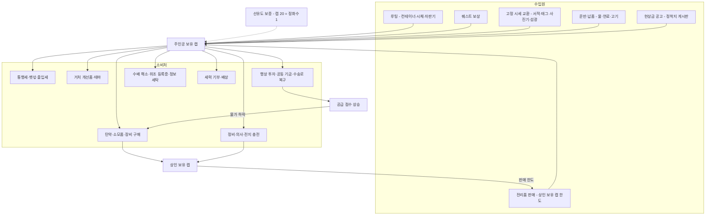

# SD-15. 경제

> **서울 폴아웃 상세 기획서 세트** | 문서 ID: SD-15 | 버전: v1.0 | 작성일: 2026-10-12
> **범위**: 2277년 서울 수도 황무지의 돈이 도는 구조 전체. 캡(병뚜껑)의 기원·보증·통용 범위·위조, 2077년 화폐(원화 지폐·전시 배급표·주민등록증 등)의 쓰임새, 선유도 물 교환증, **통합 매매가 공식**(물물교환 × 세력 호감도 단계 × 서울의 판도·공급 × 수배도 × 개인 보정), 상인 전체 목록(권역 R01~R11·HR·UG, 고정·순회·세력 상인 57명), 서비스(의사·수리·정보상·통행세·숙박·보관·현상금 처리·위조 등록증), 물·식량·연료·전지 공급망과 판도가 공급망을 기울이는 규칙, 주거(정착지 거처 6곳·개선품·테마·보관함), 수집품 판매처와 반복 수익원 후보, 레벨 구간별 경제 밸런스. **다루지 않는 것**: 아이템 개별 수치(→ [SD-13](13_items.md)), 호감도 증감량·판도 계산식(→ [SD-06](06_factions.md)), 물물교환·카리스마·퍽 정의(→ [SD-10](10_character-system.md)), 거래 창·수배도 UI(→ [SD-12](12_exploration-ui.md)), 반복 퀘스트 본문과 RQ-ID(→ [SD-05](05_misc-quests-encounters.md)), 장소 ID·좌표(→ SD-09a~f), NPC ID(→ [SD-07a](07a_characters-major.md)·[SD-07b](07b_npc-directory.md))
> **관련 문서**: [SC-00 컨셉](00_concept.md), [SD-02 세계관](02_world-and-lore.md), [SD-03a 메인 스토리 1](03a_main-story-part1.md), [SD-03b 메인 스토리 2](03b_main-story-part2.md), [SD-04a~d 사이드·세력 퀘스트](04d_faction-questlines.md), [SD-05 비표시·반복·인카운터](05_misc-quests-encounters.md), [SD-06 세력](06_factions.md), [SD-07b NPC 디렉터리](07b_npc-directory.md), [SD-08 월드·권역](08_world-regions.md), [SD-09a~f 장소 카탈로그](09a_locations-r01-r02.md), [SD-10 캐릭터 시스템](10_character-system.md), [SD-11 전투·상태](11_combat-system.md), [SD-12 탐험·UI](12_exploration-ui.md), [SD-13 아이템](13_items.md), [SD-14 크리처·적](14_creatures-enemies.md), [SD-16 아트](16_art-direction.md), [SD-17 사운드](17_sound.md), [SD-18 용어·명명](18_naming-terms.md)
> **원작 근거**: [RD-22 경제·주거](../reverse-design/22_economy-housing.md), [RD-07 비표시·반복 퀘스트](../reverse-design/07_misc-quests-encounters.md), [RD-14 캐릭터 시스템](../reverse-design/14_character-system.md), [RD-27 쯔꾸르 이식 시사점](../reverse-design/27_adaptation-notes.md) §6
> **조사 근거**: [SR-02 서울 지리](research/SR-02_seoul-geography.md)(한강·선유도·마포 석유비축기지), [SR-05 국가·사회](research/SR-05_korea-state-society.md)(§4.6 유통, 배급·주민등록)

---

## 1. 개요

### 1.1 목적
- 서울판의 캡 경제를 **한 장의 공식과 한 장의 지도**로 정리한다. 기획자는 이 문서로 상점 데이터·서비스 요금·보상 캡을 정하고, 제작자는 이 문서로 상점 공통 이벤트와 공급망 변수를 만든다.
- 원작의 경제 시스템(캡 단일 화폐, 물물교환 선형 공식, 상인 보유 캡 한도, 재고 갱신, 의사 3단 요금, 고정 시세 교환 루프, 캐러밴 투자, 플레이어 하우스)은 그대로 계승한다([RD-22](../reverse-design/22_economy-housing.md)). 서울판이 바꾸는 것은 세 가지다.
  1. **가격이 세계의 기울기를 보여 준다.** 같은 물건도 어느 세력과 가까운지, 그 구역을 누가 쥐고 있는지, 물길이 열려 있는지, 주인공이 수배 중인지에 따라 값이 달라진다(바이블 §5.8 원칙 3 "세계가 먼저 알려 준다").
  2. **물이 캡을 떠받친다.** 선유도 물 상인 조합의 '캡 20개 = 정화수 1병' 보증이 화폐의 뿌리다(바이블 §11).
  3. **집은 고르는 것이 아니라 머문 곳에서 생긴다.** 원작의 양자택일 주택(메가톤 집/텐페니 스위트) 대신, 주인공이 실제로 돕고 자고 거래한 정착지가 거처를 내준다.

### 1.2 범위와 경계

| 이 문서가 정한다 | 다른 문서가 정한다 |
|---|---|
| 매매가 공식 전체, 호감도 단계 배수의 적용 방식, 판도·공급·수배 보정 | 호감도 단계 자체와 단계별 할인율의 원값(SD-06 §4.2·§4.3. 이 문서는 그 값을 공식에 넣는 방법을 정한다) |
| 상인 57명의 위치·품목·보유 캡·갱신·조건 | 상인 NPC의 N-ID·얼굴·대사 문안(SD-07b), 장소 L-ID(SD-09) |
| 의사·정비·통행세·숙박·보관·현상금·위조 요금 | 수배도 변수와 등급 진입(SD-12 §9.7, SD-03a) |
| 공급 점수와 공급 단계, 교역로 상태가 가격에 주는 영향 | 판도 거점·영향력 계산(SD-06 §5) |
| 거처 6곳의 획득 조건·개선품·테마·보관 | 거처 맵의 타일·가구 그래픽 규격(SD-16) |
| 반복 수익원(RQ) 후보와 교환 단가 | RQ 본문·ID(SD-05) |

### 1.3 요약
- **화폐는 캡 하나다.** 번개사이다(청솔식품)와 뉴카-콜라(미군 PX 수입)의 2077년 금속 왕관 병뚜껑만 통용된다. 2160년 결성된 선유도 물 상인 조합이 조합 창구에서 **캡 20개 = 선유도 정화수 1병**으로 언제든 바꿔 준다. 이 보증이 캡의 가치를 고정한다(§2).
- **선유도 물 교환증(M-005)을 채택한다.** 무게 0, 액면 20캡. 조합 창구에서 정화수 1병과 언제나 바꾸며, 거래 창에서는 캡 옆 보조 화폐 칸에 표시한다(SD-12 미결 M-08 결정). 물값이 오른 곳에서도 교환증은 1병이므로 '물가 오름의 방패'가 된다(§2.6).
- **통합 매매가 공식**: `가격 = 가치 × 상태 × 물물교환 배율 × 호감도 단계 배수 × 시장 보정(판도·공급) × 수배 보정 × 개인 보정`. 구매가는 '그 구역 시세' 아래로, 판매가는 '그 구역 시세의 95%' 위로 가지 않는다. 같은 자리에서 사고팔아 버는 길은 없다(§3).
- **상인 57명**: 고정 상인 29, 세력 상인 22, 순회 상인 6(한강 행상 조합 수송대 4, 순회 의료반, 떠돌이 고물상 무리). 보유 캡은 5등급(노점 150캡~ / 세력 보급창 1,200캡~, 레벨에 따라 증가), 재고는 2~7일마다 갱신된다(§4).
- **서비스 요금**: 의사 치료 40/70/100캡·방사능 100·중독 60·질병 40~80, 정비는 '가치 차이 × 0.75 × 물물교환 구매 배율', 통행세는 횡단로별 0~150캡, 현상금은 수배 등급 2·3·4에서 500·1,500·3,000캡(처단 공고 5,000)(§5).
- **공급망**: 물(선유도)·식량(노들섬·양재·뚝섬)·연료(탱크마을)·전지(세이프빌, 당인리 재가동 뒤 용산·남산)의 산지와 수송로 6개가 13개 구역의 **공급 단계**(풍족·보통·부족·품귀·단절)를 정한다. 판도가 바뀌고 길이 끊기면 값이 오른다. 주인공이 누구를 돕는지가 가격표로 돌아온다(§6).
- **거처 6곳**: 봉천 옥탑방, 탱크마을 4번 탱크 칸, 노들섬 선실, 선유도 관리동, 뚝섬 장터 2층 점포방, 세이프빌 1203호. 그 정착지의 개별 호감도가 '우호'에 이르고 정착지 문제 하나를 풀면 대표가 먼저 열쇠를 건넨다. 여러 곳을 동시에 가질 수 있다(§7).
- **밸런스**: 레벨 구간 5개(Ⅰ~Ⅴ)에 누적 수입·보유 캡 목표를 두고, 캡 과잉(원작 약점)을 거처 개선품·투자·공동 기금·정비·통행세 같은 반복 소비처와 무한 루프의 주간 예산으로 막는다(§9).

### 1.4 설계 원칙

| # | 원칙 | 경제에서의 규칙 |
|---|---|---|
| 1 | 진영을 고르는 경제 장치는 없다 | 세력 화폐, 세력 전용 결제 수단, '어느 세력 상점을 이용하겠습니까' 같은 선택이 없다. 세력마다 거래 방식(캡·부품 교환·물물교환)이 다를 뿐이고 모두 같은 캡 경제 위에 있다(§2.5) |
| 2 | 값은 기울기의 그림자 | 호감도·판도·공급이 가격에 들어가지만 숫자로 설명하지 않는다. 상인의 인사말과 진열대(특산품, 빈 칸)로 보여 준다(§3.10) |
| 3 | 행동이 시장을 바꾼다 | 수송로를 지키고, 물을 실어 나르고, 원자로 열쇠를 누구에게 넘겼는지가 몇 구역의 물가를 바꾼다(§6.6). 상점 메뉴에 '투자하시겠습니까' 같은 진영 질문은 없다. 행상 투자도 '이 수송대의 짐을 늘려 주는 일'일 뿐이다 |
| 4 | 같은 자리에서 사고팔아 벌 수 없다 | 구매가 하한과 판매가 상한으로 차익 거래를 막는다(§3.7). 돈벌이는 탐험·운반·납품·퀘스트에서 나온다 |
| 5 | 캡은 끝까지 쓸 곳이 있다 | 원작의 후반 캡 과잉을 거처 개선(거처별), 정착지 공동 기금, 수송로 복구, 정비·통행세 같은 반복 소비처로 흡수한다(§9.4) |
| 6 | 2077년의 돈은 2277년의 잡화 | 원화 지폐·배급표·주민등록증은 화폐가 아니다. 다만 어떤 곳에서는 아직 '쓸 데'가 있다(§2.4) |

### 1.5 표기
- **가치**: SD-13 표의 `가격`(기본 가치, 캡). 무기·방어구는 상태 배율을 곱한 값이 실제 거래 기준이다(§3.8).
- **구매가 / 판매가**: 주인공이 **살 때 / 팔 때**의 값이다. 원작 표기 '매입가 / 매도가'와 방향이 헷갈리지 않도록 주인공 기준으로만 쓴다.
- **호감도 단계**: 적대·경계·중립·우호·신뢰·동맹(바이블 §6.2). 세력 약호는 SD-06 §2.2(BJ·YH·WP·SB·JG·JH·GS·JC·NJ·KD)를 따른다. SD-13 §5.10의 BS·JJ 표기는 BJ·JG와 같다.
- **(가칭)**: 이 문서가 새로 지은 이름으로, SD-07b의 실명 충돌 검사와 확정을 기다린다.
- 장소는 장소 이름과 권역 번호로 적는다. 장소 ID는 SD-09가 부여한다.
- `(SD-xx에서 ID 부여)`: 다른 문서 소관이라 번호를 붙이지 않은 대상이다.

---

## 2. 화폐: 캡

### 2.1 캡의 기원과 보증

| 연도 | 사건 | 근거 |
|---|---|---|
| 2077 | 청솔식품 번개사이다와 미군 PX 수입 뉴카-콜라가 같은 자판기에 나란히 꽂혀 있다. 병뚜껑은 공장 압인과 인쇄로 만든 금속 왕관 뚜껑이다 | SD-02 §5.4, SD-18 §5.5 |
| 2078~2150 | 원화는 쓸 곳이 사라진다. 물물교환과 정착지마다 다른 '표'(나뭇조각, 탄피, 배급표 재활용)가 쓰인다. 표는 정착지 밖에서 통하지 않는다 | 이 문서 |
| 2150년대 | 선유도의 옛 정수장 수조를 고쳐 물 농사를 짓는 사람들이 생긴다. 깨끗한 물을 꾸준히 낼 수 있는 곳은 서울에 선유도뿐이다 | SD-02 §9.1 |
| **2160** | **선유도 물 상인 조합 결성.** 조합은 물값을 받을 표로 **번개사이다·뉴카-콜라 병뚜껑**을 고른다. 이유: ① 서울 어디서나 나온다 ② 200년 동안 새로 만들 수 없어 수가 늘지 않는다 ③ 압인 문양과 안쪽 패킹 때문에 흉내 내기 어렵다. 조합은 "뚜껑 스무 개를 가져오면 언제든 물 한 병"을 약속하고, 이 약속을 수조 앞 철판에 새긴다(**보증 철판**) | SD-02 §9.1, 바이블 §11 |
| 2161~2190 | 행상 순환로(노들섬~선유도~탱크마을~뚝섬)가 생기면서 캡이 정착지 사이를 돈다. 탱크마을 기름, 노들섬 통행세, 뚝섬 자릿세가 모두 캡으로 매겨진다 | SD-02 §9.1 |
| 2190~2277 | 캡이 서울 전역의 표준 화폐가 된다. 원칙파·중국군 잔존병·큰돌 무리처럼 캡을 쓰지 않는 집단도 바깥과는 캡 시세로 물건 값을 셈한다 | SD-06 |

- **보증의 실제 내용**: 조합 창구(선유도)와 **조합 보증 상인**(§4.2 표의 '보증' 표시)은 언제나 캡 20개를 받고 선유도 정화수(I-057) 1병을 내준다. 반대로 정화수를 캡으로 되사지는 않는다. 보증은 '캡 → 물' 한 방향이다.
- **보증이 경제에 하는 일**: 캡의 바닥 가치를 물로 묶는다. 다른 물값이 아무리 올라도 조합 창구의 물은 20캡이다. 그래서 물이 귀한 곳에서도 사람들은 캡을 믿는다. 게임에서는 정화수의 조합 창구 가격이 물물교환·호감도·시장 보정과 무관하게 **20캡 고정**이다(§3.7 예외).
- **조합의 뚜껑 장부**: 조합은 받은 캡을 '봉인 자루'(100개 단위, 납 도장)에 넣어 보관하고, 물을 사러 오는 행상에게 다시 내준다. 조합은 물 생산량보다 많은 캡을 받지 않는다. 생산이 줄면 창구에 '오늘 물 마감' 팻말이 걸린다(§6.6의 '물 품귀').
- **보증 철판**: 선유도 수조 앞에 실제로 서 있는 상호작용 오브젝트다. 읽으면 "뚜껑 스물에 물 한 병. 선유도 물 상인 조합, 2160." 이 철판이 파괴되면(학살·시설 파괴 결과) 캡 보증이 무너진다(§6.6 '보증 붕괴').

### 2.2 통용되는 병뚜껑

| 병뚜껑 | 출처 | 통용 | 판별 표지 | 게임 처리 |
|---|---|---|---|---|
| 번개사이다 뚜껑 | 청솔식품 번개사이다(I-048), 아이스 번개사이다(I-049) | ○ | 노란 번개 압인, 안쪽 코르크 패킹 | 마시면 캡 +1(SD-13) |
| 번개사이다 '섬광' 뚜껑 | 2077 한정판(I-050) | ○ | 은색 번개 압인 | 마시면 캡 +1. 수집가는 병째로 산다(§8.1) |
| 뉴카-콜라 뚜껑 | 미군 PX 수입(I-051) | ○ | 붉은 별 인쇄 | 마시면 캡 +1 |
| 뉴카-콜라 퀀텀 뚜껑 | 미군 PX 수입(I-052) | ○ | 푸른 별 인쇄 | 마시면 캡 +1 |
| 청솔 맥주 '거품' 뚜껑 | 청솔식품 맥주(I-062) | × | 거품 문양 | **잡뚜껑**. 마셔도 캡이 생기지 않는다(SD-13 효과표와 같다). 조합이 인정하지 않는다 |
| 청솔 소주 '한잔' 뚜껑 | 청솔식품 소주(I-060) | × | 돌려 따는 알루미늄 마개 | 왕관 뚜껑이 아니다. 캡으로 쓰지 않는다 |
| 청솔 생수 마개 | 청솔 생수(I-058) | × | 플라스틱 돌림 마개 | 캡 아님 |
| 위조 캡 | 2277년 수제 | × | §2.3 | 별도 잡화(위조 캡 꾸러미) |

- **결정**: 캡은 번개사이다 계열과 뉴카-콜라 계열 병뚜껑을 **혼용**한다(SD-13 미결 11, SD-18 U6 확정). 핍-보이와 거래 창에는 종류를 나누지 않고 '캡' 하나로 센다. 마실 때 '번개 뚜껑'인지 '별 뚜껑'인지는 획득 알림 문구만 다르다(`번개 뚜껑 1개를 챙겼다.` / `별 뚜껑 1개를 챙겼다.`).
- 국산 번개사이다가 서울 캡의 다수다. 뉴카-콜라는 용산·김포 쪽에서 많이 나온다. 이 차이는 세계 묘사(조합 창구의 자루에 붙은 비율 표, NPC의 "요즘은 별 뚜껑이 많이 돈다" 바크)로만 쓴다.

### 2.3 위조 캡

| 종류 | 만드는 쪽 | 만드는 법 | 걸리는 곳 |
|---|---|---|---|
| 두들김 캡 | 난지 고철단, 약탈자 | 깡통을 오려 망치로 두들겨 톱니를 낸다. 문양이 없다 | 어느 상인이든 바로 안다 |
| 긁은 캡 | 지하시장 뒷골목 | 맥주 '거품' 잡뚜껑의 문양을 긁어내고 번개를 새겨 넣는다 | 조합 감별소, 조합 보증 상인, 지하시장 상인회 |
| 납 캡 | 새벽인력 하청 | 진짜 캡을 틀로 떠서 납을 부어 만든다. 무게가 다르다 | 조합 감별소만(저울) |

- **아이템**: '위조 캡 꾸러미'(1꾸러미 = 위조 캡 20개, 무게 0.2, 가치 0, `(SD-13에서 ID 부여)`). 약탈자·새벽인력 인솔조·고철단 시체와 일부 컨테이너에서 나온다(T1~T3, 드롭 5%).
- **위조 캡은 캡이 되지 않는다.** 플레이어 소지 캡에 섞이지 않고 꾸러미로만 존재한다. 쓰는 법은 셋이다.
  1. **선유도 감별소에 넘긴다**(§8.4 RQ 후보 '뚜껑 감별'): 1꾸러미 15캡 + 선유도 +1(일일 상한 포함). 조합이 위조 유통 경로를 추적한다.
  2. **상인에게 진짜처럼 쓴다**: 거래 창에서 '꾸러미로 치르기'를 고르면 `[물물교환]` 판정(두들김 불가, 긁은 캡 보통, 납 캡 어려움). 성공하면 꾸러미당 20캡 결제로 처리한다. 실패하면 '사기 적발'로 그 상인 소속 세력·정착지 호감도 -6, 카르마 -10, 거래 창이 닫힌다. 성공해도 행적 기록(공개도 0)이 남고, 그 상인이 조합 감별소와 거래하면 7일 안에 25% 확률로 드러난다(드러나면 같은 감점).
  3. **지하시장 위조상에게 판다**: 1꾸러미 5캡. 위조 유통에 가담한 셈이라 카르마 -5.
- 위조 캡은 '돈을 만드는 장치'가 아니라 '선택이 걸린 잡화'다. 정직하게 넘기면 선유도와 가까워지고, 속여 쓰면 들킬 위험을 안는다.

### 2.4 2077년 화폐의 2277년 쓰임새

| 물건 | SD-13 | 가치 | 2277년의 처지 | 쓰는 곳 |
|---|---|---|---|---|
| 전쟁 전 지폐(만 원권) | M-002 | 1 | 쓸모없는 종이. 다발로 나온다(아파트 금고, 세진전자 타워 임원 금고, 은행 금고에서 10~60장) | ① 일반 상인에게 가치 1의 잡화로 판다 ② **세이프빌 관리사무소**는 관리비·분양 대금의 절반까지를 만 원권으로 받는다(장당 2캡 환산, §5.5·§7.2). 단지 사람들은 2077년의 체면을 놓지 않았다 ③ 지하시장 골동품점 '세월상회'가 장당 2캡에 산다(주 100장 한도, §8.1) |
| 전시 배급표 | M-003 | 2 | 충성 등급별 색(청·녹·황·적)의 쌀·연료 교환권 | ① 지하시장 수집가가 장당 5캡(SD-13) ② **아직 '영업 중'인 번개24 로봇 점원**은 캡을 받지 않고 배급표만 받는다(SD-02 §4.6). 배급표 1장 = 가공식품 1개 또는 청솔 생수 1병(색이 높을수록 고를 수 있는 품목이 많다, §4.2 R05 #31) ③ 계엄군 시체에서 1~3장 나온다 |
| 충성 등급 주민등록증 | M-004(= M-053) | 1 | 2077년 시민의 신분증. 200년 된 '분류'의 증거 | 반복 거래(SD-13 §7.5): 각성회 '등록 명부' 10캡 + 각성회 +1 / 비상정부 주민 등록 사무소 25캡(카르마 -5). 어느 쪽에 넘길지는 플레이어의 행동이다. 묻는 화면은 없다 |
| 볼트 분양권 | M-063 | 50 | 한결건설 볼트 입주 추첨 당첨 증서 | 세이프빌 관리사무소 수집가 50캡 + 세이프빌 +1 |
| 은행 통장 (신규) | — | 0 | 2077년 예금 잔고가 찍힌 통장. 잔고는 0원이 된 적이 없다 | 판매 불가 잡동사니. 세이프빌 일부 NPC가 통장을 보고 '전쟁 전 부자 집안'으로 대우하는 바크만 있다. `(SD-13에서 ID 부여, 아이콘은 M-098 사원 명찰 공유)` |
| 청솔 상품권 (신규) | — | 3 | 번개24·청솔 마트 상품권 | 번개24 로봇 점원이 배급표 1장처럼 받는다. 그 밖에는 가치 3 잡화. `(SD-13에서 ID 부여)` |
| 500원 동전 | — | — | 2077 동전 | 아이템으로 만들지 않는다. 컨테이너 묘사 문장으로만('동전 몇 개가 녹슬어 붙어 있다'). 캡과 헷갈리게 하지 않는다 |

- 설계 의도: 원작의 '전쟁 전 지폐'는 무게 0 고가 잡화였다(RD-22 §2.2, 기본가 10). 서울판 만 원권은 SD-13이 가치 1로 낮췄다. 대신 **세이프빌과 번개24 로봇 점원**이라는 '2077년이 아직 끝나지 않은 곳'에서만 화폐처럼 굴러간다. 바이블 §5.1 '끝나지 않은 명령'의 경제판이다.

### 2.5 세력과 캡: 거래 방식은 다르고, 고르는 장치는 없다

| 세력 | 거래 방식 | 캡과의 관계 | 비고 |
|---|---|---|---|
| BJ 비상정부 | 배급소·검문소 매점(등록증 필요) | 대외 거래·현상금·등록 수수료는 캡. 벙커 안은 '배급 점수' 장부 | 미등록자에게 파는 것 자체가 지침 위반이라 중립 이하에서는 거래가 없다(SD-06 §4.3.1) |
| YH 연합단 | PX(우호 이상), 이태원 초소 노점(중립) | 캡 | 탄약 재생대·충전소 운영 |
| WP 원칙파 | 공릉 교환소: **부품 교환만** | 캡을 믿지 않는다. 물건 값은 캡 시세로 환산해 교환비를 정한다 | 교환 창은 거래 창과 같고 '캡' 칸만 비활성(§4.1) |
| SB 새벽인력 | 본소 매점, 노들섬 출장소 | 캡. 인력 매매·현상금 하청 | 일당 전표(M-113) 200캡 |
| JG 중국군 잔존병 | 우호부터 **물물교환** | 캡을 쓰지 않는다. 2077년 탄약·스텔스 부품과 바꾼다 | 2077년 군표나 위안화는 쓰지 않는다. 그들은 "보급은 상부가 한다"고 믿는다 |
| JH 지하시장 | 상가 점포 | 캡. 구울 손님에겐 만 원권에도 정이 남아 있다 | 정보상·위조상 |
| GS 각성회 | 부품 교환대, 헌금함 | 캡과 관제망 부품 | 헌금 10캡당 카르마 +1(SD-10 §6.3) |
| JC 정착지 연합 | 정착지 상점 | 캡. 선유도가 보증 | 자릿세·통행세·공동 기금 |
| NJ 난지 고철단 | 고철 교환 | 캡과 고철. 고철 1 = 5캡 시세 | 경계부터 고철 교환만 |
| KD 큰돌 무리 | **물물교환** | 캡을 '반짝이는 뚜껑'으로만 안다. 2077년 잡동사니와 바꾼다 | 우호부터 |

- **세력 화폐는 없다.** 어느 세력도 자기 화폐를 강요하지 않고, 플레이어가 화폐를 고르는 메뉴도 없다. 교환 전용 세력(원칙파·잔존병·큰돌 무리)과의 거래도 같은 거래 창에서 '캡 칸이 꺼진' 형태로 진행된다. 바이블 §5.8 원칙 1의 경제판이다.

### 2.6 선유도 물 교환증 (M-005) 결정

| 항목 | 결정 |
|---|---|
| 채택 | **채택한다**(SD-13 미결 11) |
| 정체 | 선유도 물 상인 조합이 '정화수 1병을 언제든 내준다'고 도장을 찍은 증서. 무게 0, 가치 20 |
| 얻는 법 | ① 조합 창구에서 캡 20개로 산다(물물교환·호감도 무관, 1회 최대 50장) ② 선유도 퀘스트 보상(MQ-202 '물표 정기 계약', SD-04b 선유도 사이드) ③ 물 배달 반복 의뢰 보상(§8.4) |
| 쓰는 법 | ① 조합 창구·조합 보증 상인에게 내면 **정화수 1병**(공급 단계와 무관) ② 조합 보증 상인과의 거래에서 **액면 20캡의 보조 화폐**로 낸다 ③ 보증 상인이 아닌 상인은 잡화(가치 20)로만 받는다(물물교환 공식 적용) |
| 거래 창 표시 | **캡과 같은 화폐 줄에 보조 칸을 둔다**(SD-12 미결 M-08 결정): `캡 1,240 · 물표 6`. 결제 순서는 캡 먼저, 모자라면 물표를 쓸지 한 번 묻는다(`물표 2장(40캡)으로 치르겠습니까?`). 별도 교환 탭은 만들지 않는다 |
| 경제적 의미 | 물이 귀해진 구역(§6.4 '품귀')에서 정화수 시장가가 40~50캡으로 올라도 교환증은 1병이다. 교환증을 쌓아 두면 물값 오름을 막을 수 있다. 반대로 물이 풍족할 때 교환증을 쓰면 손해다(시장가 16~18캡) |
| 무효화 | 보증 철판 파괴(§2.1) 또는 선유도 소멸 시 모든 교환증은 가치 0 잡화가 된다. 결말 슬라이드에 '종잇조각이 된 물표' 문안 1줄(SD-03b) |
| 명예 주민 증표와의 구분 | 선유도 물표(M-136 차분)는 명예 주민 증표, 물 교환증(M-005)은 화폐 대용 증서다(SD-13 §7.4.2) |

### 2.7 캡의 흐름



- 상인에게 쓴 캡은 그 상인의 보유 캡으로 쌓여 다시 판매 한도가 된다(원작 순환).
- **공급으로 돌아오는 소비**(O5)는 서울판 고유다. 행상 투자·공동 기금·수송로 복구에 쓴 캡은 경제 밖으로 사라지는 대신 그 구역의 공급 점수를 올려 물가를 내린다(§6.8). 캡을 '세계를 기울이는 데' 쓰게 한다.

---
## 3. 거래 공식

### 3.1 통합 매매가 공식

```
기준가 V      = 가치 × 상태 배율(무기·방어구만, §3.8)

구매가(살 때) = 반올림( V × B(물물교환) × F구매(호감도 단계) × M구매(시장) × W구매(수배) × K구매(개인) )
                단, 구매가 ≥ 반올림( V × S(공급) )                       … 구매 하한

판매가(팔 때) = 반올림( V × S(물물교환) × F판매(호감도 단계) × M판매(시장) × W판매(수배) × K판매(개인) )
                단, 판매가 ≤ 내림( V × S(공급) × 0.95 )                   … 판매 상한

B(물물교환) = 1.55 − 0.45 × 물물교환 ÷ 100          (원작, SD-10 §3.5.3)
S(물물교환) = 0.45 + 0.45 × 물물교환 ÷ 100
M = P(판도) × S(공급)                                (§3.4)
```

- 곱셈 순서는 결과에 영향이 없다. **반올림은 마지막에 한 번**, 그다음 하한·상한을 적용한다(RD-22 §9 구현 주의).
- 가치 1 이상 물건의 판매가는 최소 1캡이다. 가치 0 물건(빈 전지 등)은 팔 수 없다.
- 상인이 그 물건을 '사지 않는' 경우(전문 상인의 취급 밖 품목, 퀘스트 아이템, 장물 규칙)는 공식보다 먼저 판정한다(§4.1).
- 계산은 엔진의 공통 함수 `PriceOf(아이템, 상인, 방향)` 하나가 한다(§11.2).


### 3.2 물물교환 배율 B·S
- 원작 공식을 그대로 쓴다(SD-10 §3.5.3). 물물교환 0에서 구매 155%·판매 45%, 100에서 구매 110%·판매 90%.
- **상인의 물물교환 스킬은 가격에 관여하지 않는다**(원작 폴아웃 3 규칙). 상인의 개성은 품목·보유 캡·특전·위치로 낸다.
- 물물교환을 올리는 장비: 번개24 점원 유니폼(A-009, +5), 떠돌이 상인 복장(A-017, +5), 재벌 임원 정장(A-007, +5), 선유도 물 상인 작업복(A-018, +5). 원작처럼 갈아입은 직후의 값으로 거래한다.

### 3.3 호감도 단계 배수 F
상인이 속한 **세력**(세력 상인) 또는 **정착지**(정착지 상인, 개별 호감도 `AFF_JC_<약호>`)의 단계로 정한다. 무소속 상인(떠돌이·행상·순회 의료반)은 F = 1.0이다.

**기본표 (SD-06 §4.2의 값을 배수로 옮김)**

| 단계 | F구매 | F판매 | 거래 |
|---|---|---|---|
| 적대 | — | — | 불가 |
| 경계 | 1.25 | 0.75 | 가능(세력별 예외 아래) |
| 중립 | 1.00 | 1.00 | 가능 |
| 우호 | 0.90 | 1.05 | 가능 |
| 신뢰 | 0.80 | 1.10 | 가능, 세력 장비 진열 |
| 동맹 | 0.75 | 1.15 | 가능, 고유 상품 진열 |

**세력별 덮어쓰기 (SD-06 §4.3 각 표의 '상점' 칸)**: 아래 칸은 기본표 대신 쓴다. 비어 있는 칸은 기본표를 따른다. F판매는 같은 행의 단계 기본값을 쓴다.

| 세력 | 경계 | 중립 | 우호 | 신뢰 | 동맹 | 비고 |
|---|---|---|---|---|---|---|
| BJ 비상정부 | 불가 | 불가 | 1.00(임시 등록증 필요) | 0.85 | 0.75 | 미등록자와는 거래하지 않는다 |
| YH 연합단 | 불가 | 1.10(이태원 초소 노점만) | 0.90(PX 출입) | 0.80 | 0.75 | |
| WP 원칙파 | 불가 | 교환 1.30 | 교환 1.00 | 0.85 | 0.85 + 희귀품 | 캡 대신 부품 교환(§4.1 교환 거래) |
| SB 새벽인력 | 1.30(노들섬 출장소만) | 1.10 | 1.00 | 0.85 | 0.75 | |
| JG 중국군 잔존병 | 불가 | 불가 | 교환 1.00 | 교환 0.85 | 교환 0.80 | 물물교환만 |
| JH 지하시장 | 1.25 | | | | | 기본표 그대로 |
| GS 각성회 | 1.25 | | | | | 기본표 그대로 |
| JC 정착지(개별) | 1.25 | | | | | 기본표 그대로 |
| NJ 난지 고철단 | 고철 교환만 1.40 | 1.15 | 1.00 | 0.85 | (동맹 없음) | |
| KD 큰돌 무리 | 없음 | 없음 | 교환 1.00 | 교환 0.90 | 교환 0.85 | 물물교환만 |

- **SD-10 §3.7 권장값과의 관계**: SD-10은 '경계 ×1.1, 우호 ×0.95, 신뢰 ×0.9, 동맹 ×0.85'를 권장했다. 이 문서는 세력 문서인 SD-06의 단계 혜택표(경계 +25%, 우호 -10%, 신뢰 -20%, 동맹 -25%)를 정본으로 삼는다. 할인이 커져도 구매 하한(§3.7) 때문에 물물교환이 높은 플레이어에게는 원작 마스터 트레이더처럼 기본가에서 멈춘다. SD-10 §3.7 표를 이 값으로 갱신하도록 요청한다(미결 E-02).
- **교환 거래**: '교환'은 캡이 오가지 않는 거래다. 플레이어가 내는 물건의 판매가 합이 받는 물건의 구매가 합 이상이어야 성립하고, 남는 차액은 버려진다(거스름돈 없음). 교환 거래는 수배 보정과 판도 보정을 받지 않는다.

### 3.4 시장 보정 M: 판도와 공급
- **판도 보정 P**(SD-06 §5.6을 수치화): 상인이 있는 구역의 판도 상태가 '지배' 또는 '우세'일 때, 그 지배 세력의 주인공 호감도로 정한다. **무소속 상인과 정착지 상인에게만** 적용한다(세력 상인은 이미 F로 반영).

| 지배 세력의 주인공 호감도 | P구매 | P판매 | 상인 인사(예) |
|---|---|---|---|
| 우호 이상 | 0.95 | 1.00 | "요즘 이 동네 쥔 사람들이 당신 편이라던데. 좀 깎아 드리지." |
| 중립 | 1.00 | 1.00 | — |
| 경계 이하 | 1.10 | 0.95 | "여기 순찰대가 당신 얼굴을 알아. 나도 위험수당은 받아야지." |
| 경합·공백 구역 | 1.00 | 1.00 | (공급 보정으로만 드러난다) |

- **공급 보정 S**: 품목군별·구역별 **공급 단계**(§6.4)로 정한다. 구매와 판매 모두에 곱한다. 귀한 곳에서는 사기도 비싸고 팔기도 비싸다. 운반의 이유가 된다.

| 공급 단계 | S | 상인 진열대 | 비고 |
|---|---|---|---|
| 풍족 | 0.80 | 해당 품목군 재고 ×1.5 | |
| 보통 | 1.00 | 기본 | |
| 부족 | 1.30 | 재고 ×0.6 | 상인 바크: "요새 ○○ 들어오는 길이 막혀서…" |
| 품귀 | 1.70 | 재고 ×0.3, 1인 구매 한도(품목당 3개) | 진열대 빈칸 그래픽 |
| 단절 | 2.20 | 일반 상인 재고 0. **암거래 상인**(지하시장·새벽인력 출장소·밀매상)만 판다 | 정착지 주민 바크·남산 방송 뉴스 |

- 공급 보정이 걸리는 **품목군**(6개): 물(I-054~I-059), 식량(I-022~I-047, 조리 결과물), 연료(화염방사기 연료, 부탄가스 통 M-023, 핵분열 배터리 M-018), 전지(에너지 전지, 마이크로퓨전 전지, 전자 충전 팩), 탄약(그 밖의 탄약), 의약(I-001~I-009). 그 밖의 품목(무기·방어구·잡화·약물)은 S = 1.0이다.

### 3.5 수배 보정 W
주인공의 수배 등급(SD-12 §9.7)에 따라 **무소속 상인과 정착지 상인**의 태도가 바뀐다. 세력 상인은 세력 방침을 따른다(표 아래).

| 수배 등급 | W구매 | W판매 | 상인 반응 |
|---|---|---|---|
| 0 미등재 · 1 소문 | 1.00 | 1.00 | — |
| 2 수배 공고 | 1.00 | 1.00 | 인사말에 소문 언급("전단 봤어요. 닮았던데.") |
| 3 지명 수배 | 1.10 | 0.90 | '입막음 값'. 정착지 상인 중 비상정부 정보원이 있는 곳(봉천·노들섬·세이프빌·양재 온실촌, SD-06 §6.3)은 거래 뒤 30% 확률로 밀고(수배도 +3, 다음 날 그 구역 추격조 판정 2배) |
| 4 총력 수배 | 1.20 | 0.80 | 비상정부 영향력 50 이상 구역의 무소속·정착지 상인은 **거래 거부**("미안해요. 우리 가게 문 닫게 할 순 없어서.") |

- 세력 상인의 수배 방침: 지하시장·원칙파·중국군 잔존병·큰돌 무리·난지 고철단은 수배를 신경 쓰지 않는다(W = 1.0). 연합단은 W = 1.0이다(비상정부 공고를 인정하지 않는다). 새벽인력은 수배 등급 2 이상이면 거래 창 대신 '생포 시도' 대화가 먼저 나온다(새벽인력 우호 이상이면 거래). 비상정부는 등록증이 없으면 거래하지 않는다.
- 정착지 개별 호감도가 **신뢰 이상**인 정착지의 상인은 수배 보정을 받지 않는다("우리 사람"은 판다).

### 3.6 개인 보정 K

| 원천 | K구매 | K판매 | 조건 | 정본 |
|---|---|---|---|---|
| 마스터 트레이더(PK-073) | 0.75 | — | 구매 하한 적용(원작 규칙 그대로) | SD-10 |
| 단골(PK-026) | 0.95 / 0.90 / 0.85 | 1.05 / 1.10 / 1.15 | 같은 상인과 누적 거래 500·1,000·1,500캡 | SD-10 |
| 선행 표창(PK-042) | 0.90 | — | 정착지 상인만, 카르마 선함 이상 | SD-10 |
| 단독 기울기 SOLO 6 이상 | 0.90 | — | 무소속 상인·행상만 | SD-06 §7.3 |
| 카르마 매우 악함 | 1.10 | 0.90 | 정착지 상인만. 밤(22:00~06:00)에는 일부 정착지 상인이 문을 닫는다 | SD-10 §6.4 |
| 상점 특전 | 0.90 등 | — | 퀘스트로 얻는 개별 할인(예: MQ-101 방어 성공 → 봉천 고물상 -10%, MQ-201 노들 우호 → 섬 식당 -10%) | SD-03a, SD-04 |
| 상인 개별 요율 | 표 §4.2 | 표 §4.2 | 사치품점·암거래상 등 상인 고유 배수(1.0~1.3) | 이 문서 |

- 단골 보정은 상인 단위로 누적한다(SD-10 데이터 메모: 단골 누적 거래액 배열).
- 같은 종류 퍽 할인은 곱한다. 구매 하한 때문에 할인이 겹쳐도 기본가 아래로 내려가지 않는다.

### 3.7 하한·상한·예외
- **구매 하한** = `V × S(공급)`. 할인을 아무리 쌓아도 그 구역 시세 아래로 사지 못한다. 원작 마스터 트레이더의 '기본가 하한'을 공급 단계까지 넓힌 것이다.
- **판매 상한** = `V × S(공급) × 0.95`. 보너스를 아무리 쌓아도 그 구역 시세의 95%까지만 받는다. 그래서 **같은 상인·같은 구역 안에서는 언제나 구매가 > 판매가**다(최소 차이 약 5%). 원작이 매도 상한 90%와 매입 하한 110%로 차익을 막은 것과 같은 목적이다(RD-22 §3.1).
- **구역 간 차익은 허용한다.** 물이 풍족한 선유도에서 사서 품귀인 탱크마을에 파는 것은 '운반'이다. 이 이익은 상인 보유 캡, 소지 무게, 공급 회복(납품하면 그 구역 공급 점수가 오른다, §6.8)으로 스스로 줄어든다.
- **예외(공식을 거치지 않는 값)**
  1. 선유도 조합 창구의 정화수: 20캡 고정(§2.1)
  2. 물 교환증 구입: 20캡 고정
  3. 고정 시세 교환(서적·태그·사진기 등, §8): 단가 고정
  4. 서비스 요금(의사·통행세·숙박 등, §5): 각 표의 값. 호감도 단계 F구매만 곱하는 서비스는 표에 표시
  5. 퀘스트 대화의 캡 지불(독사에게 200캡 등): 퀘스트 문서의 값

### 3.8 상태와 가치
- 무기·방어구의 기준가는 `가치 × 상태 배율`이다. 상태 배율은 SD-13 §8.1(SD-11 §11.8 확정값): 새것 1.00 / 양호 0.50 / 낡음 0.23 / 위태 0.05 / 파손 = 고철 가치(고철 M-010 1개분, 5).
- 원작의 `내구도^1.5`를 5단계로 근사한 값이라 원작의 '고쳐서 팔면 크게 남는' 성질이 남는다(RD-22 §3.3). 정비비(§5.2)가 이 차이의 일부를 가져간다.
- **상인 재고는 '양호' 이상만 진열한다.** 상인은 낡은 물건을 정비해서 판다. 주인공이 판 낡은 물건은 갱신 전까지 그대로 되살 수 있다(원작 되사기 규칙).

### 3.9 예시 표

**예시 1. 물물교환과 호감도 단계 (공급 보통, 판도·수배 보정 없음)** — `구매가 / 판매가`(캡)

| 품목(가치) | 물물교환 | 경계 | 중립 | 우호 | 신뢰 | 동맹 |
|---|---|---|---|---|---|---|
| 스팀팩 I-001 (25) | 15 | 46 / 10 | 37 / 13 | 33 / 14 | 30 / 14 | 28 / 15 |
| | 50 | 41 / 13 | 33 / 17 | 30 / 18 | 27 / 19 | 25 / 19 |
| | 100 | 34 / 17 | 28 / 23 | 25 / 23 | 25 / 23 | 25 / 23 |
| 10mm 권총 W-002 새것 (225) | 15 | 417 / 87 | 334 / 116 | 300 / 122 | 267 / 128 | 250 / 134 |
| | 50 | 373 / 114 | 298 / 152 | 268 / 159 | 239 / 167 | 225 / 175 |
| | 100 | 309 / 152 | 248 / 203 | 225 / 213 | 225 / 213 | 225 / 213 |
| 레이저 소총 W-023 새것 (1,000) | 15 | 1,853 / 388 | 1,483 / 518 | 1,334 / 543 | 1,186 / 569 | 1,112 / 595 |
| | 50 | 1,656 / 506 | 1,325 / 675 | 1,193 / 709 | 1,060 / 743 | 1,000 / 776 |
| | 100 | 1,375 / 675 | 1,100 / 900 | 1,000 / 945 | 1,000 / 950 | 1,000 / 950 |

- 물물교환 15는 시작값(카리스마·행운 5)이다(SD-10 §3.3).
- 물물교환 100에서는 우호부터 구매가가 하한(가치)에, 신뢰부터 판매가가 상한(95%)에 닿는다. 높은 물물교환과 높은 호감도의 효과는 겹치지 않고 서로를 대신한다. 물물교환을 찍지 않은 캐릭터도 세력과 가까워지면 값을 깎을 수 있다는 뜻이다.

**예시 2. 공급 단계 (중립 상인, 판도·수배 보정 없음)** — `구매가 / 판매가`

| 품목(가치) | 물물교환 | 풍족 ×0.8 | 보통 ×1.0 | 부족 ×1.3 | 품귀 ×1.7 |
|---|---|---|---|---|---|
| 선유도 정화수 I-057 (20) | 15 | 24 / 8 | 30 / 10 | 39 / 13 | 50 / 18 |
| | 50 | 21 / 11 | 27 / 14 | 34 / 18 | 45 / 23 |
| | 100 | 18 / 14 | 22 / 18 | 29 / 23 | 37 / 31 |
| 스팀팩 I-001 (25) | 15 | 30 / 10 | 37 / 13 | 48 / 17 | 63 / 22 |
| | 50 | 27 / 14 | 33 / 17 | 43 / 22 | 56 / 29 |

- 운반 차익 예: 물물교환 100으로 선유도(물 풍족)에서 정화수를 18캡에 사서 탱크마을(물 품귀)에 31캡에 팔면 병당 13캡이 남는다. 50병(무게 50)이면 650캡이지만, 탱크마을 상인 보유 캡(약 900)과 납품에 따른 공급 회복(§6.8)이 곧 이익을 줄인다. 물물교환 15라면 병당 -6캡으로 남지 않는다. 대신 물 교환증 50장(1,000캡)을 가져가 조합 보증 상인에게 바꾸는 쪽이 맞다.

**예시 3. 수배 보정과 마스터 트레이더 (10mm 권총 새것, 중립·공급 보통)**

| 조건 | 물물교환 15 | 물물교환 50 |
|---|---|---|
| 수배 등급 0~2 | 334 / 116 | 298 / 152 |
| 수배 등급 3 (×1.10 / ×0.90) | 367 / 105 | 328 / 137 |
| 수배 등급 4 (×1.20 / ×0.80) | 400 / 93 | 358 / 122 |
| 마스터 트레이더(물물교환 60 필요) | — | 물물교환 60에서 225(하한) |

**예시 4. 판도가 바꾼 가격 (같은 무소속 상인, 같은 품목)**
- 뚝섬 장터의 무소속 떠돌이 상인이 스팀팩을 판다(물물교환 50, 중립 기준 33캡).
  - R08이 정착지 연합 '우세'이고 주인공이 연합 우호: 33 × 0.95 = **31캡**, 인사 "장터 사람들이 당신 이야기를 하더라고."
  - 대로파가 올림픽대로 소굴을 넓혀 R08이 '경합'이 되고 한강 북로가 위협받아 의약이 '부족': 33 × 1.3 = **43캡**, 인사 "요새 약 들어오는 수레가 반만 와."
  - 주인공이 대로파 소굴을 비우고(거점 탈환) 행상 호위를 두 번 하면 다시 '우세'·'보통'으로 돌아온다. 같은 상인, 같은 물건이 주인공의 행동을 따라 값이 움직인다.

### 3.10 거래 창 표시: 숫자 대신 인사
- 가격 배수의 내역(호감도 몇 %, 판도 몇 %)은 표시하지 않는다(바이블 §6.2 표시 원칙, SD-12 §11.2).
- 거래 창을 열 때 상인 인사 한 줄이 **가장 큰 보정 하나**를 말로 알려 준다. 우선순위: 거래 거부 사유 > 수배 > 공급 단절·품귀 > 호감도 단계 변화 > 판도 > 단골.

| 보정 | 인사 예(문안은 SD-07b·SD-17이 다듬는다) |
|---|---|
| 호감도 우호 진입 | "요즘 용산 쪽에서 당신 칭찬이 많던데요. 값을 좀 쳐 드리죠."(SD-12 예문) |
| 호감도 경계 | "손님, 오늘은 값이 좀 셉니다. 이유는 아시죠?" |
| 공급 품귀 | "물길이 막혀서 물이 이것뿐이에요. 한 사람에 세 병." |
| 공급 풍족 | "탱크마을 기름 수레가 어제 두 대나 왔어. 싸게 가져가." |
| 수배 3 | "…값은 더 받을게요. 대신 난 당신 못 본 겁니다." |
| 단골 | "단골손님 몫으로 하나 빼 뒀어요."(PK-026의 따로 빼 둔 재고 1칸) |

- '관계 수치 보기' 옵션(SD-06 §4.1)을 켜면 거래 창 오른쪽 아래에 `시세 ×0.95 · 단골 ×0.90` 같은 작은 꼬리표가 붙는다. 기본은 꺼짐이다.

### 3.11 물물교환이 걸린 대화 거래
거래 창 밖에서 물물교환이 조건이 되는 대화다. 판정 난이도는 SD-10 §3.6(I~V), 결과 수치는 각 퀘스트 문서가 정본이고 이 표는 경제 쪽 기준값이다.

| 대화 | 기본 | `[물물교환]` 성공 | 대안(SD-10 §3.7) | 출처 |
|---|---|---|---|---|
| 노들섬 통행세 위험 할증 | 500캡 | 250캡(난이도 III, 물물교환 50) | 성공 시 캡 이득 대신 노들섬 +2 | SD-03a MQ-201 |
| 양화 나루 장부 검산 | 뱃삯 200 | 반값 + 선유 +8 | — | SD-03a MQ-202 |
| 황두칠에게 현상금 사기 | 1,000캡 | (물물교환 50 필요) 수배도 -30 | — | SD-03a MQ-105 |
| 행상 투자 단가 | §4.3 | 1·2차 각 20% 할인 | 성공 시 할인 대신 그 수송대 재고 +1단계 | 이 문서 |
| 세력 물자 거래 조건(납품 단가) | §8.1 | +20% | 성공 시 캡 대신 그 세력 +1~+3 | SD-10 §3.7 |
| 탄산 수집가 섬광 매입가 | 40캡 | 50캡(난이도 III) | — | §8.1 |
| 골동품점 '세월상회' 예산 | 주 700캡 | 주 900캡(난이도 IV) | — | §8.1 |
| 현상금 공고 보상 흥정 | 공고액 | +25%(난이도 III) | 성공 시 캡 대신 그 정착지 +2 | §8.4 |

---

## 4. 상인

### 4.1 공통 규칙

**보유 캡 등급** — 상인이 가진 캡만큼만 주인공의 물건을 사 준다(원작). 플레이어가 산 만큼 상인 캡이 늘어난다.

| 등급 | 유형 | 기준 보유 캡 | 상한(Lv35) | 재고 갱신 | 대표 |
|---|---|---|---|---|---|
| E | 노점·식당·사냥꾼 | 150 + 8 × 레벨 | 430 | 2일 | 꼬치 노점, 사냥꾼 |
| D | 소상점·전문점 | 300 + 15 × 레벨 | 825 | 3일 | 고물상, 약방, 기름집 |
| C | 정착지 대표 상점·세력 매점 | 500 + 25 × 레벨 | 1,375 | 3일 | 대장간, 무기상 |
| B | 대상점·투자한 행상·밀매상 | 800 + 35 × 레벨 | 2,025 | 3일(일반) / 7일(고급) | 조합 창구, 공작창 |
| A | 세력 보급창 | 1,200 + 50 × 레벨 | 2,950 | 3일(일반) / 7일(세력 장비) | 연합단 PX, 청계산 보급창 |

- **갱신 때 보유 캡** = `min(기준값 × 1.5, max(기준값, 현재값 × 0.5))`. 플레이어가 많이 사 간 상인은 캡이 쌓이지만 기준의 1.5배를 넘지 않는다. 원작 캐러밴의 무한 누적(RD-22 §4.4)은 쓰지 않는다.
- **갱신 시각**: 게임 시간 06:00. 상인마다 갱신 주기를 따로 센다(공통 이벤트 1개가 상인 배열을 돈다, §11.2).
- **재고 단계**: 상인 재고는 주인공 레벨에 따라 4단계로 바뀐다. 원작의 레벨 연동 재고를 '단계 목록 4종'으로 단순화한 것이다(RD-22 §9). 단계의 최고 등급은 그 권역의 루팅 상한(SD-13 §9.2)을 넘지 않는다. 세력 상인은 호감도 단계가 따로 품목을 연다.

| 재고 단계 | 주인공 레벨 | 진열 최고 루팅 등급 | 비고 |
|---|---|---|---|
| Ⅰ | 1~6 | T1(권역 상한이 더 낮으면 그 값) | 프롤로그~1막 |
| Ⅱ | 7~12 | T2 | 2막~3막 초 |
| Ⅲ | 13~20 | T3 | 3막~5막 |
| Ⅳ | 21 이상 | T4 | 5막~7막. T5(팻맨·방전포·T-51b)는 어느 상점도 팔지 않는다 |

- **팔지 않는 것**: 파워 아머(대여·지급만, SD-06 §4.4), T5 무기, 고유 장비, 퀘스트 아이템. 미니 누크는 연합단 PX가 동맹에서 주 1발만 판다(SD-13 §4.1).
- **사지 않는 것**: 전문 상인(약방·식당·사냥꾼 등)은 취급 분야 밖 품목을 사지 않는다. 식당은 음식·재료, 약방은 의약·약물·생물 재료만 산다.
- **장물**: 훔친 물건(`[장물]`)은 주인 세력·정착지 상인에게 팔 수 없다. 다른 상인은 산다. 지하시장 '세월상회'와 밀매상은 출처를 따지지 않는다.
- **판도와 재고**: 상인이 있는 구역이 '공백'이면 정착지 상점 재고 -30%, '경합'이면 경비 +2(SD-06 §5.6). 지배 세력의 특산품이 무소속 상인 진열에 섞인다(연합단 지배 → 5.56mm 탄·마이크로퓨전 전지, 각성회 지배 → 진공관, 비상정부 지배 → 태성 전투식량, 정착지 연합 지배 → 정화수·노들섬 고구마).
- **교환 거래**(원칙파·중국군 잔존병·큰돌 무리): 거래 창의 캡 칸이 비활성이고, 오른쪽 아래에 `교환 균형: +38`이 뜬다. 균형이 0 이상이어야 확정 버튼이 켜진다(§3.3).
- **영업시간**: 정착지 상점 07:00~21:00, 노점 09:00~19:00, 식당·주점 10:00~02:00, 의사·세력 보급창 24시간, 지하시장 상가 24시간('그때'부터 셔터를 내린 적이 없다). 상인 NPC 일과(수면·식사)는 SD-07b가 정한다.
- **조합 보증 상인**(표의 '보증' 열 ○): 정화수 20캡 교환과 물 교환증 결제를 받는다(§2.6). 정착지 연합 가맹 정착지의 대표 상점 1곳씩과 물길 수송대다.
- **피난 상인**: 정착지가 파괴·점령되면 그 정착지 상인 중 생존자 1명이 노들섬 피난 노점으로 옮겨 E등급으로 장사를 이어 간다(노들섬도 없으면 뚝섬 장터).

### 4.2 권역별 상인 목록
- **유형**: 고정(정착지·무소속 상인), 세력(세력 소속 상인, F는 세력 호감도), 순회(§4.3).
- **F 기준**: 그 상인 가격에 들어가는 호감도. 정착지 약호는 SD-06 §2.2.
- 품목의 ID는 SD-13. `신규`는 이 문서가 SD-13에 등록을 요청하는 품목이다(부록 A).

#### R01 관악 (7명)

| 번호 | 이름 | 유형 | 장소 | 취급 품목 | 캡 | 갱신 | 서비스 | F 기준·조건 | 보증 | 비고 |
|---|---|---|---|---|---|---|---|---|---|---|
| V01 | 오봉구 (가칭) | 고정 | 봉천 계단마을 계단 아래 고물상 | 잡화, .32·10mm·12게이지·대못, 스팀팩, 황무지 정착민 복장 A-016, 실바람 경찰 리볼버 W-001, 10mm 권총 W-002, 사냥용 소총 W-014, 설계도 병뚜껑 지뢰 M-100(1장) | D | 3일 | — | 봉천(BC). MQ-101 방어 성공 시 -10%, 돈으로 해결 시 +10%(SD-03a) | ○ | MQ-101 '캡' 튜토리얼 상대(조만석이 데려간다) |
| V02 | 남은숙 (가칭) | 고정 | 봉천 계단마을 약국 | 의약 I-001~I-009, 해독 앰플 I-007, 갑상선 방호정 I-005, 항생제(신규) | D | 3일 | 의사 | 봉천(BC) | — | 봉천 '빌린 침대' 옆. 1막의 첫 의사 |
| V03 | 조두례 (가칭) | 고정 | 봉천 계단마을 옥상 대장간 | 파이프 소총 W-013, 파이프 산탄총 W-025, 못 박힌 각목 W-046, 철근 몽둥이 W-048, 고철·테이프·접착제, 수리 키트 I-067 | D | 3일 | 정비(수제·공구·TS 계열) | 봉천(BC) | — | 작업대 공용 |
| V04 | 곰배 (가칭, 별명) | 고정 | 관악산 사냥꾼 오두막 | 멧돼지 고기·육포 I-038·I-039, 곰 고기 I-041(드묾), 멧돼지 가죽 M-027, 사냥용 소총 W-014, .32 구경탄, 마취 다트 | E | 2일 | — | 무소속(F 1.0) | — | 독침 마취총 설계도 M-105 퀘스트 보상(SD-13) |
| V05 | 사당 아재 (역 별명) | 고정 | 사당 환승촌 승강장 노점 | 지하 느타리 I-044, 지하철 정기권 M-071, 방독면 정화통 I-066, 신호탄, 해충 기피제 I-065 | E | 2일 | 숙박(매트) | 사당(SA) | — | 지하 레이어 첫 상인 |
| V06 | 하은결 (가칭) | 세력 | 노량진 관제 중계소 부품 교환대 | 진공관 M-014, 세진 회로 기판 M-019, 에너지 전지, 샛바람 레이저 권총 W-009, 세진 제압 전기 진압봉 W-042, 각성회 예복 A-043(우호) | D | 3일 | 헌금함(카르마) | 각성회(GS). 관제망 식별 태그 M-051을 1개 20캡에 산다(SD-13) | — | 정비 당번. "부품은 수호자에게 돌아가야 합니다" |
| V07 | 선우채린 주무관 (가칭) | 세력 | 남부순환로 관악 검문소 배급소 | 태성 전투식량 I-031, 군용 건빵 I-030, 10mm·5.56mm, 하늬 군용 권총 W-004, 라드-X, 갑상선 방호정, 계엄군 장교복 A-032(우호 해금) | C | 3일 | — | 비상정부(BJ). 우호 + 임시 등록증 M-120 필요 | — | MQ-106 뒤 상설화. R01 BJ 영향력 30 아래면 철수 |

#### R02 여의도·영등포 (8명)

| 번호 | 이름 | 유형 | 장소 | 취급 품목 | 캡 | 갱신 | 서비스 | F 기준·조건 | 보증 | 비고 |
|---|---|---|---|---|---|---|---|---|---|---|
| V08 | 노복희 | 세력 | 영등포 지하상가 '복희 양품점' | 2077 의류 A-005~A-009, 장사꾼 코트 A-019(우호 해금), 구울 가면 A-106(우호), 회사원 정장 A-006 | C | 3일 | — | 지하시장(JH) | — | 상인회장. 2077년 이 자리 옷가게 주인 |
| V09 | 마영식 | 세력 | 영등포 지하상가 배전실 작업장 | 에너지 전지, 펄스 수류탄 W-061, 핵분열 배터리 M-018, 세진 회로 기판, 설계도 압력 대못총 M-102 | D | 7일 | 정비(에너지 무기·SJ 계열, 요율 0.9) | 지하시장(JH). 상인회 출입패 M-078 또는 JH 우호 | — | 진공관 M-014를 1개 15캡에 산다(SD-13). JH 동맹이면 작업대 사용권 |
| V10 | 금하람 | 세력 | 영등포 지하상가 진료소 | 스팀팩, 라드어웨이(다량), 해독 앰플, 부목 I-006, 항생제(신규) | C | 3일 | 의사, 성형(얼굴 파츠·피부색) | 지하시장(JH) | — | 수혈 팩 I-004를 1개 15캡에 산다(SD-13). 성형은 SD-10 §8.8 |
| V11 | 지은자 '약방 할매' (가칭) | 세력 | 영등포 지하상가 약방 | 약물 I-010~I-016, 울트라제트 I-012(우호), 변종 혈청 I-021, 지네 독샘 M-048 | D | 3일 | — | 지하시장(JH) | — | 말벌 독낭 M-026을 1개 20캡에 산다(SD-13 M-057) |
| V12 | 구문철 '귀동냥' (가칭) | 세력 | 영등포 지하상가 뒤 계단참 | 지도 마커(장소 위치 정보), 소문 | E | 7일 | 정보상(§5.3) | 지하시장(JH) | — | 정보 세탁·목격자 매수·판도 소식 |
| V13 | 길영배 '도장장이' (가칭) | 세력 | 영등포 지하상가 B구역 셔터방 | 위조 주민등록증 M-062, 공구, 머리핀 M-070 | D | 7일 | 신원 세탁(§5.8) | 지하시장(JH). 신원 세탁은 JH 우호 | — | 전시 배급표 M-003을 장당 5캡, 위조 캡 꾸러미를 5캡에 산다 |
| V14 | 탁이순 '세월상회' (가칭) | 세력 | 영등포 지하상가 골동품점 | 진공관 라디오 M-083, 한글 타자기 M-085, 거처 테마 '전쟁 전'·'관제실' 판매(§7.5) | C | 7일 | 고정 시세 매입(§8.1) | 지하시장(JH) | — | 2077 생활 잡화를 가치 그대로 산다(주 예산 700). 만 원권 장당 2캡(주 100장) |
| V15 | 주현태 매점 반장 (가칭) | 세력 | 새벽인력 본소(구로 공구상가 철골동) 매점 | 세진 제압 충격 권총 W-010, 전기 진압봉 W-042, 소드오프 W-026, 10mm 기관단총 W-015, 제트·사이코, 추심원 조끼, 그물총(신뢰, 신규) | C | 3일 | — | 새벽인력(SB). 수배 2 이상이면 우호 미만에서 '생포 시도' 대화가 먼저 | — | 인력 장부 조각 M-161은 사지 않는다(장부를 훔친 증거라며 적대) |

#### R03 마포·상암 (5명)

| 번호 | 이름 | 유형 | 장소 | 취급 품목 | 캡 | 갱신 | 서비스 | F 기준·조건 | 보증 | 비고 |
|---|---|---|---|---|---|---|---|---|---|---|
| V16 | 석대철 (가칭) | 고정 | 탱크마을 2번 탱크 대장간 | 금속 아머 A-025, 강화 금속 아머 A-026(신뢰 주문 제작), 파이프 산탄총, 화염병 W-057, 수리 키트, 설계도 M-100 | C | 3일 | 정비(전 계열, 파워 아머 제외), 탄약 재생대(우호), 주문 제작(§5.9) | 탱크마을(TK) | — | 기름띠 W-113은 민경자 퀘스트·신뢰 |
| V17 | 탁유진 (가칭) | 고정 | 탱크마을 3번 탱크 연료상 | 화염방사기 연료, 부탄가스 통 M-023, 등유 통(신규 교역 짐), 화염방사기 W-030, 태성 화상 연고 I-008, 핵분열 배터리(드묾) | D | 3일 | — | 탱크마을(TK) | ○ | 연료 산지라 연료 공급 '풍족'이 기본(§6.5) |
| V18 | 민순옥 '민 씨네 꼬치' (가칭) | 고정 | 탱크마을 탱크 사이 노점 | 탱크마을 꼬치구이 I-047, 멧돼지 구이(조리), 청솔 소주·맥주, 빗물 | E | 2일 | — | 탱크마을(TK) | — | 대표 민경자의 조카 |
| V19 | 녹손 (가칭, 별명) | 세력 | 난지도 쓰레기 산 정문 컨테이너 | 고철·잡동사니 전 품목, 약탈자 아머 A-020~A-022, 수제 무기, 화염병, 설계도 잡동사니 발사기 M-103 | D | 3일 | — | 난지 고철단(NJ). 경계는 고철 교환만 | — | 고철 1 = 5캡 시세로 받는다. 탱크마을과 원수(산 물건을 탱크마을에 팔면 '고철단 물건'이라 -5%) |
| V20 | 반소영 (가칭) | 고정 | 망원 유수지 마을 '물막이 붕어집' | 가물치·메기 고기(I-069~I-076 예약분), 빈 병 M-087, 빗물, 벌초용 낫 W-044 | E | 2일 | 숙박(평상) | 망원(MW) | — | 유수지 양식 |

#### R04 서강·선유도 (3명)

| 번호 | 이름 | 유형 | 장소 | 취급 품목 | 캡 | 갱신 | 서비스 | F 기준·조건 | 보증 | 비고 |
|---|---|---|---|---|---|---|---|---|---|---|
| V21 | 고은비 (가칭) | 고정 | 선유도 물 상인 조합 창구(제3 침전지 앞) | 선유도 정화수 I-057(20 고정), 물 교환증 M-005(20 고정), 빈 병, 휴대 정수 키트 M-074(신뢰) | B | 2일 | 감별소(위조 캡), 조합 창고 | 선유도(SY). 정화수·교환증은 단계와 무관 | ○ | 보증의 원점. 빈 병을 1캡에 산다 |
| V22 | 변상철 (가칭) | 고정 | 선유도 잡화점 | 선유도 물 상인 작업복 A-018(우호 해금), 사냥용 소총, 쌍열 산탄총 W-027, 벌초용 낫, 해충 기피제, 선유도 수경 상추 I-045, 선유도 막걸리 I-061 | C | 3일 | 정비(공구·수제·TS 계열), 숙박(객주 2층) | 선유도(SY) | ○ | 객주와 양조장을 겸한다 |
| V23 | 물개 | 고정 | 양화 나루 | 나룻배 뱃삯(§5.4), 밤 배 밀수품(미군 전투식량, 수입 위스키, 스텔스 보이 드묾) | E | 3일 | 나룻배 | 무소속(F 1.0). 밀수품은 요율 1.2 | — | 밤 배 거래가 선유도에 들키면 선유 -5(SD-03a) |

#### R05 도심 (2명, 1명은 3곳)

| 번호 | 이름 | 유형 | 장소 | 취급 품목 | 캡 | 갱신 | 서비스 | F 기준·조건 | 보증 | 비고 |
|---|---|---|---|---|---|---|---|---|---|---|
| V24 | 번개 점원 24-117호 외 2대 | 고정(로봇) | 명동 번개24(R05), 대치동 번개24(R07), 노량진 번개24(R01) | 청솔 가공식품, 청솔 생수 I-058, 번개사이다, 캔커피 I-053, 해충 기피제 | 캡 0 | 7일 | — | **배급표·청솔 상품권만 받는다.** 배급표 색(충성 등급)이 높을수록 고를 수 있는 품목이 늘어난다(적: 식품 2종, 황: 4종, 녹: 생수 포함, 청: 전부) | — | 주인공은 팔 수 없다. 해킹으로 '관리자 모드'를 열면 하루 1회 무료 1개(카르마 0, SD-12 해킹 II). 2077년이 끝나지 않은 가게 |
| V25 | 노아 차 (가칭) | 세력 | 1호선 시청역 승강장(도심 지하) | 교환: 레이저 권총, 마이크로퓨전 전지, 진공관, 원칙파 회수 기사 아머 A-037(신뢰) | C | 7일 | 기술품 회수 거래 | 원칙파(WP). 교환 | — | 6막 전에도 지하철로 닿는다 |

#### R06 용산·남산 (5명)

| 번호 | 이름 | 유형 | 장소 | 취급 품목 | 캡 | 갱신 | 서비스 | F 기준·조건 | 보증 | 비고 |
|---|---|---|---|---|---|---|---|---|---|---|
| V26 | 빅터 설 | 세력 | 용산 요새 PX(병기창 창구 겸), 이태원 고개 초소 노점(중립 창구) | 탄약 전종, 레이저 권총·소총, 펄스 수류탄·지뢰, 전투 아머 A-033, 미군 전투식량 I-032, 스팀팩, 연합단 예복 A-036(우호), 군용 정비 키트 I-068(신뢰), 미니 누크(동맹, 주 1발) | A | 3일 / 7일 | — | 연합단(YH). 중립은 초소 노점(일반품, ×1.10), 우호부터 PX | — | 관제망 식별 태그 M-051 40캡, 계엄군 인식표 M-052 30캡에 산다(SD-13) |
| V27 | 레이철 공 | 세력 | 용산 요새 공작창 | 마이크로퓨전 전지, 전자 충전 팩, 진공관, 기술 부품 | B | 7일 | 정비(전 계열 + 파워 아머는 신뢰), 탄약 재생대(우호), 전지 충전소(MQ-301 가동 뒤), 공작창 개조(동맹) | 연합단(YH) | — | 수석 공작관 |
| V28 | 데이비드 염 (가칭) | 세력 | 용산 요새 의무실 | 스팀팩, 라드어웨이, 메드-X, 부목, 미군 전투식량 | C | 3일 | 의사 | 연합단(YH). 우호부터(손님 숙소 사건 뒤 중립도 1회 치료) | — | 변종 혈액 샘플 M-056을 40캡 + XP 10에 산다(SD-13) |
| V29 | 하산 백 (가칭) | 고정 | 이태원 피난촌 수선집 | 의복 전반, 수선(의복 정비), 잡화, 10mm 탄 소량, 부대찌개(조리) | D | 3일 | 정비(의복·가죽 계열) | 이태원(IT) | ○ | 연합단 잡역으로 받은 탄약을 판다 |
| V30 | 조약돌 (가칭) | 세력 | 남산 북사면 배수 터널(큰돌 무리 은신처) | 교환: 2077년 그림책·장난감, 변종이 모아 둔 탄약·스팀팩, 노획 전투 아머 조각 | E | 7일 | — | 큰돌 무리(KD). 우호부터 교환 | — | 캡을 '반짝이는 뚜껑'으로 받아 장식한다(받기만 하고 캡으로 치지 않음) |

#### R07 강남 (4명)

| 번호 | 이름 | 유형 | 장소 | 취급 품목 | 캡 | 갱신 | 서비스 | F 기준·조건 | 보증 | 비고 |
|---|---|---|---|---|---|---|---|---|---|---|
| V31 | 윤슬기 (가칭) | 고정 | 세이프빌 관리사무소 매점 '단지 마트' | 2077 생활용품, 청솔 가공식품, 에너지 전지(단지 원자로 충전), 샛바람 레이저 권총 W-009, 세진 제압 충격 장갑 W-055, 집중정 '만점' I-017, 재벌 임원 정장 A-007, 거처 개선품·테마 '전쟁 전' | C | 3일 | — | 세이프빌(SV). 출입 카드(MQ-204) 필요. 신뢰('입주민님') 전에는 요율 1.15(비입주민 할증) | ○(가맹 후) | 만 원권을 결제액의 절반까지 장당 2캡으로 받는다 |
| V32 | 하늘 '온실지기' (가칭) | 고정 | 양재 온실촌 온실 직판대 | 양재 온실 채소(신규), 해충 기피제, 빗물 | E | 2일 | — | 양재(YJ) | — | 물량 절반은 강남 검문소 납품. 비상정부 판도가 높으면 재고가 준다(§6.6) |
| V33 | 신하윤 주무관 (가칭) | 세력 | 강남 검문소(양재) 배급소·분류반 창구 | 태성 전투 자극제 '선봉' I-019, 전투식량, 5.56mm, 높새 돌격소총 W-017(신뢰), 계엄군 전투복 A-031·헬멧(신뢰) | B | 3일 / 7일 | 자진 등록(§5.7) | 비상정부(BJ). 우호 + 임시 등록증 | — | 충성 등급 주민등록증 M-053을 25캡에 산다(카르마 -5) |
| V34 | 서지혁 (가칭) | 세력 | 철벽경호 강남 지사 연락소 | 철벽경호 전투 아머 A-034, 돌격소총 W-018, 저격소총 W-021, 전투 산탄총 W-029, 사이코 | C | 3일 | — | 철벽경호(호감도 없음). **카르마 중립 이하만** 거래. 선함이면 "고객님은 계약 대상이십니다" 뒤 거래 없음 | — | 귀 M-061을 10캡(카르마 -750 이하 15캡)에 산다(PK-069) |

#### R08 동부 (5명)

| 번호 | 이름 | 유형 | 장소 | 취급 품목 | 캡 | 갱신 | 서비스 | F 기준·조건 | 보증 | 비고 |
|---|---|---|---|---|---|---|---|---|---|---|
| V35 | 도해순 '무두장이' (가칭) | 고정 | 뚝섬 장터 가죽 골목 | 가죽 아머 A-023, 강화 가죽 아머 A-024(주문 제작), 가죽 벨트 M-043, 뉴트리아 모피 | C | 3일 | 정비(가죽·의복 계열), 주문 제작 | 뚝섬(TS) | — | 멧돼지 가죽 M-027을 가치 ×1.2에 산다(납품 단가) |
| V36 | 은기오 '잡동사니 박사' (가칭) | 고정 | 뚝섬 장터 중앙 천막 | 제작 재료 M-010~M-049 전종, 설계도 번개 수류탄 M-101·잡동사니 발사기 M-103, 제작 무기 W-151~W-157(드묾) | C | 3일 | 정비(전 계열, 파워 아머 제외) | 뚝섬(TS) | ○ | 장터 대표 상점 |
| V37 | 홍차돌 '탄산 수집가' (가칭) | 고정 | 뚝섬 장터 '번개 수집관' | 번개사이다, 아이스 번개사이다, 번개사이다 냉장고(거처 개선품) | D | 3일 | 고정 시세 매입(섬광·퀀텀, §8.1) | 뚝섬(TS) | — | 원작 뉴카-콜라 챌린지의 수집가 |
| V38 | 구판석 '소장수' (가칭) | 고정 | 뚝섬 장터 우시장 | 두머리소 스테이크 I-040, 멧돼지 고기, 육포, 두머리소 가죽(멧돼지 가죽 M-027과 같은 재료로 처리) | D | 2일 | — | 뚝섬(TS) | — | 짐소(CR-091)는 팔지 않는다(동료·탈것 대용 금지) |
| V39 | 도분이 '약초꾼' (가칭) | 고정 | 아차산 배수지 마을 | 아차산 약초(신규), 배수지 물(관악산 약수 I-056과 같은 등급), 해독 앰플 재료(지네 독샘) | E | 2일 | — | 아차산(AC) | — | 약초는 열병·옴 치료 보조(§5.1) |

#### R09 북부 산악 (4명)

| 번호 | 이름 | 유형 | 장소 | 취급 품목 | 캡 | 갱신 | 서비스 | F 기준·조건 | 보증 | 비고 |
|---|---|---|---|---|---|---|---|---|---|---|
| V40 | 함덕구 (가칭) | 고정 | 창동 차량기지촌 '객차 상점' | 지하철 부품(계전기 M-015, 전도체 M-016), 지하철 정기권, 핵분열 배터리, 신호탄, 공업용 테이프 | D | 3일 | 숙박(객차 침대) | 창동(CD) | ○(가맹 후) | 기관사 함명수의 형 |
| V41 | 루카스 문 | 세력 | 공릉 회수 창고 교환소 | 교환: 에너지 무기, 마이크로퓨전 전지, 파워 아머 부품, 원칙파 회수 기사 아머 A-037(신뢰), 회수 목록 희귀품(동맹) | B | 7일 | 기술품 회수 거래(SD-13 §4.3), 정비(에너지 무기) | 원칙파(WP). 교환 | — | 기술 부품 30점 한 번에 납품하면 중재(SD-06 §3.8) |
| V42 | 웨이란 보급병 (가칭) | 세력 | 북한산 굴진 기지 보급 갱도 | 교환: 10mm·5.56mm(2077년 탄), 중국제 권총·돌격소총 W-005·W-019, 중국군 장교도 W-039, 스텔스 보이(신뢰), 스텔스 아머 부품(신뢰) | C | 7일 | 스텔스 아머 정비(동맹) | 중국군 잔존병(JG). 우호부터 교환. 받는 것: 전지·무전 부품·식량 | — | 이름은 SD-07b 실명 검사 대상. 딱딱한 침투 교육 한국어를 쓴다 |
| V43 | 진막례 '산포수' (가칭) | 고정 | 수유 고개 아래 산악 오두막 | 곰 고기 I-041, 멧돼지 육포, .32·.308 탄, 사냥용 소총 | E | 2일 | — | 무소속(F 1.0) | — | 변이 웅담 M-150을 100캡 고정에 산다(약재) |

#### R10 서부 평야 (2명)

| 번호 | 이름 | 유형 | 장소 | 취급 품목 | 캡 | 갱신 | 서비스 | F 기준·조건 | 보증 | 비고 |
|---|---|---|---|---|---|---|---|---|---|---|
| V44 | 철부지 '밀매상' (가칭, 별명) | 고정 | 김포 방향 화물 터미널 외곽 컨테이너 은신처 | 미군 화물: 레이저 소총 W-023, 플라스마 권총 W-011, 미사일, 전자 충전 팩, 전투 아머, 라드-X·라드어웨이(다량), 스텔스 보이 | B | 7일 | — | 무소속. **요율 1.25**. 수배·카르마·판도 보정 없음 | — | 암거래 상인: 공급 '단절' 품목도 판다(§3.4) |
| V45 | 쇠망치 (가칭, 별명) | 고정 | 신월 배수로 입구 정비 천막 | 수리 키트, 군용 정비 키트(드묾), 고철, 부품 | D | 3일 | 정비(전 계열, 파워 아머는 '양호'까지만) | 무소속 | — | 고위험 권역의 유일한 정비공 |

#### R11 청계산 (1명)

| 번호 | 이름 | 유형 | 장소 | 취급 품목 | 캡 | 갱신 | 서비스 | F 기준·조건 | 보증 | 비고 |
|---|---|---|---|---|---|---|---|---|---|---|
| V46 | 황보진 보급 사무관 (가칭) | 세력 | 청계산 벙커 보급창 | 계엄군 장비 전종, 갈마 레이저 카빈 W-022, 플라스마 소총 W-024(동맹), 마이크로퓨전 전지, 군용 정비 키트, 플라스마 수류탄 | A | 3일 / 7일 | 면허 파워 아머 정비(동맹) | 비상정부(BJ). 신뢰 + 청계산 벙커 출입 패스 | — | 4막 MQ-402에서 처음 닿는다. 비상정부 무력화 뒤 폐쇄 |

#### HR 한강·섬 (4명)

| 번호 | 이름 | 유형 | 장소 | 취급 품목 | 캡 | 갱신 | 서비스 | F 기준·조건 | 보증 | 비고 |
|---|---|---|---|---|---|---|---|---|---|---|
| V47 | 염대근 (가칭) | 고정 | 노들섬 '선창 총포' | .44 매그넘 리볼버 W-006, 쌍열·전투 산탄총, 탄약 전종(T1~T3), 파편 수류탄, 신호탄 권총 W-012 | C | 3일 | 정비(소형 화기 전 계열) | 노들섬(ND) | — | 원작 '노들섬 무기상'(SD-13) |
| V48 | 하복순 '하씨네 국밥' (가칭) | 고정 | 노들섬 섬 식당 | 국밥·부대찌개(조리 결과물), 노들섬 고구마 I-046, 두머리소 스테이크, 정화수 | D | 2일 | — | 노들섬(ND). 노들 우호 -10%(SD-03a) | ○ | 노들섬 대표 상점(보증). 고기 납품을 받는다(§8.4) |
| V49 | 백영길 (가칭) | 고정 | 노들섬 선창 주점 | 청솔 소주·맥주, 선유도 막걸리, 수입 위스키, 설계도 부탄 토치 검 M-104 | D | 3일 | 대여 객실, 소문(정보상의 하위) | 노들섬(ND) | — | 선주 가문 백씨. 백인하의 사촌 |
| V50 | 염판호 출장소장 (가칭) | 세력 | 새벽인력 노들섬 출장소 | 제압 장비, 약물, 탄약, 일당 전표 M-113(신뢰) | C | 3일 | — | 새벽인력(SB). 경계에서도 열린다(×1.30) | — | 노들 우호 이상이면 출장소가 섬 남쪽 선착장으로 밀려난다 |

#### UG 지하철·지하 (1명)

| 번호 | 이름 | 유형 | 장소 | 취급 품목 | 캡 | 갱신 | 서비스 | F 기준·조건 | 보증 | 비고 |
|---|---|---|---|---|---|---|---|---|---|---|
| V51 | 여의나루 할머니 (역 별명) | 고정 | 5호선 여의나루역 대합실(운반조 쉼터) | 지하 느타리, 신호탄, 방독면 정화통, 지하시장 정수 I-059 | E | 2일 | 숙박(대합실 매트) | 무소속(F 1.0). MQ-203 개통 뒤 등장 | — | 지하시장 운반조의 단골 쉼터 |

### 4.3 순회 상인

#### 4.3.1 한강 행상 조합 수송대 (투자 플래그)
- 원작 캐러밴 상인 4명(RD-22 §4.4)의 서울판이다. 한강 행상 조합(F-17, 조합장 노윤기, 노들섬·뚝섬 장터 사무소)이 두 머리 한우가 끄는 수송대 4개를 SD-06 §10.17의 수송로 4개에 돌린다. 수송대마다 상인 1, 호위 2, 짐소 1(CR-091).

| 번호 | 수송대(상인) | 수송로·정류장 | 전문 품목 | 원작 대응 | 초기 캡·정비 | 1차 투자 뒤 | 2차 투자 뒤 | 완전 투자 선물 |
|---|---|---|---|---|---|---|---|---|
| V52 | 북로 수송대 염소희 (가칭) | 한강 북로: 노들섬 → 이태원 피난촌 → 뚝섬 장터 → 노들섬 | 무기·탄약 | 행운의 하리스 | D / 정비(소형 화기) | C, 재고 +1단계 | B, 정비 전 계열 | 마이크로퓨전 전지 48 + 펄스 수류탄 3 |
| V53 | 물길 수송대 고덕배 (가칭) | 물길: 노들섬 → 선유도 → 탱크마을 → 망원 유수지 → 노들섬 | 물·식량·의약 | 호프 박사 | D / — | C, 정화수 재고 ×2 | B, 의사(이동 진료) | 스팀팩 5 + 물 교환증 10 |
| V54 | 고개길 수송대 오만복 (가칭) | 남부 고개길: 봉천 계단마을 → 사당 환승촌 → 노들섬(남단) → 봉천 | 방어구·의복 | 크로우 | D / 정비(의복·가죽) | C | B, 정비 전 계열(파워 아머 제외) | 고유 아닌 강화 가죽 아머 A-024 '새것' + 민방위 방독면 |
| V55 | 우회로 수송대 쇠돌 (가칭, 별명) | 잠실 우회로: 뚝섬 장터 → 세이프빌 → 양재 온실촌 → 뚝섬 | 잡동사니·부품·설계도 | 정신나간 볼프강 | D / 정비(공구 계열) | C, 설계도 1장 진열 | B | 스텔스 보이 2 |

- **투자 플래그**: 조합 사무소의 노윤기에게 "이 수송대 짐을 늘리고 싶다"고 말하면 투자한다. 수송대마다 2회: **1차 250캡, 2차 600캡**(마스터 트레이더면 반값, `[물물교환]` 판정 성공 시 20% 할인, §3.11). 4개 전부 3,400캡(마스터 트레이더 1,700캡).
- 조건: 그 수송대의 수송로가 '개통' 또는 '위협' 상태여야 한다(§6.3). '단절'이면 노윤기가 "길부터 열어 달라"고 한다(수송로 복구, §6.8).
- 효과: 보유 캡 등급·재고 단계 상승은 다음 정류장 도착부터, 정비·선물은 즉시. 투자한 수송로의 공급 기여 +10(§6.4). 투자 사실은 행적 기록 '도움'(공개도 2)으로 퍼져 정착지 연합 +2(1회, 수송대당).
- **진영 선택이 아니다.** 투자는 수송대의 짐을 늘리는 일이다. 어느 세력 편에 서는지를 묻지 않는다.
- **운영 규칙**: 수송대는 정류장마다 게임 시간 12시간 머물고 다음 정류장으로 6시간 걷는다(순환 약 3~4일). 대기 기능으로 시간을 넘기면 도착 시각이 계산된다(원작의 대기 불일치를 고친다). 수송대 1개를 공격하면 4개 모두 거래를 거부한다(원작 적대 연좌). 수송대가 습격당하는 장면은 주인공이 같은 청크에 있을 때만 실제 전투로 처리하고, 없을 때는 수송로 위협도로 판정한다(§6.3). 상인이 죽으면 조합이 30일 뒤 새 상인(같은 품목, 투자 단계 1 하락)을 보낸다. 투자금은 돌려주지 않는다.
- 호위는 일시 동행 NPC가 아니다. 주인공을 따라오지 않는다(바이블 K7).

#### 4.3.2 그 밖의 순회 상인

| 번호 | 이름 | 순회 범위 | 취급·서비스 | 조건 | 비고 |
|---|---|---|---|---|---|
| V56 | 소윤희 (순회 의료반 들것) | R01·R02·R03·R08을 7일 주기로 돈다(정류장: 봉천 → 영등포 지하상가 출구 → 탱크마을 → 뚝섬 장터) | 의사, 스팀팩·라드어웨이·부목 판매(E등급) | 카르마 선함 이상이면 치료 무료, 악함 이하면 치료 거절(약은 판다). SD-06 §10.18 | 비상정부가 '미등록 의료 행위자'로 수배. 계엄군 검문소 근처에서는 장사하지 않는다 |
| V57 | 떠돌이 고물상 (무명 템플릿 4종) | 랜덤 인카운터(전 권역, R05 제외) | 잡화·탄약·스팀팩·의복·잡동사니(E등급), 일부는 정비(수제 계열) | 무소속. SOLO 6 이상이면 -10% | 원작 스캐빈저 대응. RE-ID와 출현 표는 SD-05. 짐소·진돗개 잡종을 데리기도 한다 |

### 4.4 상인 수 집계

| 권역 | 고정 | 세력 | 순회(정류장) | 계 |
|---|---|---|---|---|
| R01 | 5 | 2 | (V54·V56) | 7 |
| R02 | 0 | 8 | (V56) | 8 |
| R03 | 4 | 1 | (V53·V56) | 5 |
| R04 | 3 | 0 | (V53) | 3 |
| R05 | 1(로봇 3곳) | 1 | — | 2 |
| R06 | 1 | 4 | (V52) | 5 |
| R07 | 2 | 2 | (V55) | 4 |
| R08 | 5 | 0 | (V52·V55·V56) | 5 |
| R09 | 2 | 2 | — | 4 |
| R10 | 2 | 0 | — | 2 |
| R11 | 0 | 1 | — | 1 |
| HR | 3 | 1 | (V52·V53·V54) | 4 |
| UG | 1 | 0 | — | 1 |
| 순회 | — | — | 6 | 6 |
| **합계** | **29** | **22** | **6** | **57** |

- 상인이 아닌 **특수 매입처**(기록관·송미래·고아원·방범 본부 등)와 **서비스 전용 NPC**(미용사·여인숙·관리소장 등)는 §5·§8에 따로 적는다(약 14명). 상인과 합치면 경제 NPC는 약 71명이고, 이름 있는 NPC 500명(바이블 §5.7)의 약 14%다.
- 권역별 밀도: 시작 권역(R01·R02)에 15명을 몰아 1막의 거래 학습을 돕고, 고위험 권역(R10·R11·R05)은 2명 이하로 둔다. 강 북쪽(R05·R06·R08·R09)에 16명, 남쪽(R01·R02·R07·R10·R11)에 22명, 강 위·서쪽(R03·R04·HR)에 12명이다. 강을 건너면 '새 시장'이 열리는 감각을 준다.

---

