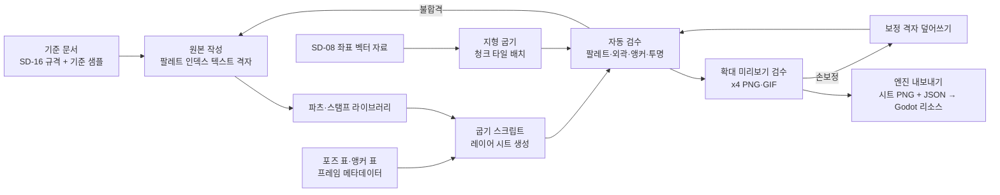

# SD-16. 아트 디렉션·그래픽 스타일 가이드

> **서울 폴아웃 상세 기획서 세트** | 문서 ID: SD-16 | 버전: v2.2 | 작성일: 2026-10-12 (v2.2 2026-10-13)
> **범위**: '2077년 폴아웃 세계의 서울'의 비주얼 컨셉과 재벌별 디자인 언어, 그래픽 기술 규격(시점·타일·해상도·캐릭터 비율·방향·모션·외곽선·안티앨리어싱·광원) 확정안, 마스터 팔레트와 권역·세력·UI·상황 팔레트, 페이퍼돌 레이어 규격, 타일셋·프리팹 재사용 체계, 좌표 기반 지형 표현 규칙, 월드맵(핍-보이 지도) 아트, 캐릭터·NPC·크리처·로봇 스프라이트, 주요 인물 고유 초상화와 일반 NPC 모듈 초상화, UI 아트(서술형 세력 탭·'서울의 판도' 지도 레이어·세력 휘장 포함), 판도에 따라 바뀌는 월드 에셋, 7막 관제 본부 콘솔 오브젝트, 이펙트, 한국어 간판·선전물, 바이블 v0.3 볼륨(장소 250+, 이름 있는 NPC 500+) 기준 에셋 수량과 우선순위, 버티컬 슬라이스 기준 샘플, Claude 제작 파이프라인 / 다루지 않는 것: UI 화면 구조와 조작(SD-12), 전투 수치와 판정(SD-11), 아이템·크리처 데이터(SD-13·SD-14), 장소 배치(SD-08·SD-09), 사운드(SD-17)
> **관련 문서**: [SC-00 컨셉](00_concept.md), [SD-01 게임 개요](01_game-overview.md), [SD-07a 주요 인물](07a_characters-major.md), [SD-07b NPC 디렉터리](07b_npc-directory.md), [SD-06 세력](06_factions.md), [SD-08 월드·권역](08_world-regions.md), [SD-09a~f 장소 카탈로그](09a_locations-r01-r02.md), [SD-03a 메인 스토리 1부](03a_main-story-part1.md), [SD-11 전투 시스템](11_combat-system.md), [SD-12 탐험·UI](12_exploration-ui.md), [SD-13 아이템](13_items.md), [SD-14 크리처·적](14_creatures-enemies.md), [SD-17 사운드](17_sound.md), [SD-18 용어·명명 규칙](18_naming-terms.md), 원작 [RD-25 아트·오디오·연출](../reverse-design/25_art-audio-presentation.md), [RD-27 쯔꾸르 이식 시사점](../reverse-design/27_adaptation-notes.md), [RD-18 UI/UX](../reverse-design/18_ui-ux.md), [RD-20 방어구·의복](../reverse-design/20_armor-apparel.md), 조사 [SR-02 서울 지리](research/SR-02_seoul-geography.md), [SR-04 생물](research/SR-04_korean-fauna.md), [SR-05 국가·사회](research/SR-05_korea-state-society.md)

---

## 1. 개요

### 1.1 목적
- 모든 그래픽을 Claude 한 명이 만든다(P2). 그래서 이 문서는 **제작 명세서**다. 규격과 규칙이 정해지지 않은 채로 만든 에셋은 다시 만든다.
- 그래픽 품질은 타협하지 않는다(P5). 분량이 모자라면 그림 수준이 아니라 콘텐츠 범위를 줄인다. 분량은 **재사용 구조**(공격 자세 계열, 파츠 리그, 팔레트 교체, 머리 앵커 합성)로 관리한다.
- RD-27 §14.2 3번(타일 크기·해상도·축척)과 §15 1번(기준 샘플 목록)을 이 문서에서 확정한다.

### 1.2 요약
1. **비주얼 컨셉**: "원자력과 진공관으로 2077년까지 달려온 한국 도시가 무너진 지 200년." 폴아웃의 원자력 시대 산업 디자인 문법(유선형·크롬·냉각 핀·진공관·단색 CRT)을 **한국 도시의 공간 문법**(아파트 단지·간판 숲·지하철·고가도로·편의점·학원가)에 입힌다. 1950~70년대 한국 복고 풍속은 쓰지 않는다.
2. **기술 규격(확정)**: 쯔꾸르식 3/4 탑다운, **타일 32×32px**, **내부 해상도 640×360**(정수 배율 ×2·×3·×4·×6 출력), 인간형 표준 키 40px(약 3.6등신), 전투 프레임 64×64px, **8방향**(직접 그리는 5방향 + 좌우 반전 3방향), 방향당 135프레임의 인간형 모션 세트(공통 32 + 공격 자세 8계열 103). 엔진은 범용 2D 엔진(기본값 Godot 4, 바이블 K9)이고 PC·모바일이 같은 에셋을 쓴다. 화면 비율에 따라 논리 해상도를 최대 854×480까지 넓힌다(3.3절).
3. **팔레트**: 64색 마스터 팔레트(13개 램프) + 교체 팔레트(피부 6·머리색 8·세력 12) + 권역 보조색(권역당 4색) + UI 팔레트(핍-보이 녹 8색, 관제망 앰버 8색) + 상황 필터 14종.
4. **관제망 색 코드**: 수도 관제망의 상태를 색으로 읽게 한다. 대기 = 앰버 느린 점멸, 계엄 프로토콜 = 적색, 시민 보호 프로토콜 = 청록, 정지 = 소등. 로봇 눈, 포탑 표시등, 차단벽 경광등, 관제 콘솔 화면이 모두 이 규칙을 따른다.
5. **페이퍼돌**: 몸 → 몸통 장비 → 머리카락 → 머리 장비 → 눈 장비 → 무기의 6슬롯. 몸과 몸통 장비는 **파츠 리그**로 전 프레임을 굽고, 머리카락·머리 장비·눈 장비는 **머리 앵커 합성**(방향 5 × 상태 3 = 15컷)으로 붙인다. 파워 아머는 별도 리그다.
6. **볼륨 대응(바이블 v0.3)**: 장소 250+와 이름 있는 NPC 500+를 품질 타협 없이 만들기 위해 **조합 체계**를 쓴다. NPC 맵 스프라이트는 공용 몸체 + 의상·머리 레이어 + 세력 팔레트로 조합하고, 일반 NPC 초상화는 부위 조합식 모듈로, 장소는 타일셋 + 프리팹 + 장소마다 1~3개의 고유 '앵커 소품'으로 만든다. 고유 그림 예산은 주요 인물·랜드마크·메인 퀘스트 장면에 몰아 쓴다.
7. **제작 방식**: Claude가 팔레트 인덱스 격자(텍스트)로 파츠를 그리고, 포즈 표와 합성 스크립트로 시트를 굽고, 검수 스크립트와 확대 미리보기로 검사한 뒤 손보정한다(13절).

### 1.3 확정 결정 요약
| # | 항목 | 확정안 | 절 |
|---|---|---|---|
| A1 | 시점 | 쯔꾸르식 3/4 탑다운(지면은 위에서, 수직면은 정면에서 본다) | 3.1 |
| A2 | 타일 크기 | 32×32px (RD-27 §14.2-3 확정) | 3.2 |
| A3 | 내부 해상도 | 640×360, 정수 배율 출력만 허용 | 3.3 |
| A4 | 캐릭터 비율 | ~~성인 키 40px, 약 3.6등신~~ → **v2.0 아이작풍: 성인 키 약 34px, 약 2등신, 머리 22×20 구체** | 3.4, 3.11 |
| A5 | 방향 수 | 8방향. 직접 그리는 5방향(S·SE·E·NE·N), W·SW·NW는 좌우 반전 | 3.5 |
| A6 | 모션 | 공통 8종 32프레임 + 공격 자세 8계열 103프레임 = 방향당 135프레임 | 3.6 |
| A6-1 | 이동 미끄러짐 금지 | 거리 구동 재생 + 단계 렌더 + 디딤발 고정 작화(검사 0px), 관성 없음, 이동 중 조준은 상·하체 분리 | 3.6.5, 5.10 |
| A7 | 외곽선 | 실루엣 1px 잉크(P01) + v2.0 아래쪽 묵직한 밑선 1줄, 내부 선은 재질 램프 최암 단계 | 3.7, 3.11 |
| A8 | 안티앨리어싱 | 내부 곡선만 수동 1단계. 투명 경계 AA 금지 | 3.8 |
| A9 | 광원 | 환경은 좌상단 45°. 반전되는 스프라이트는 상단 정면광(좌우 대칭) | 3.9 |
| A10 | 마스터 팔레트 | 64색 고정. 인덱스 PNG(0번 투명 + 1~64번) | 4.2 |
| A11 | 페이퍼돌 | 6슬롯, 방향별 그리기 순서 표, 머리 앵커 합성 | 5절 |
| A12 | 한글 도트 폰트 | 본문 12px, 보조 10px, 제목 16px. 1순위 갈무리(Galmuri, OFL) | 9.7 |
| A13 | 얼굴 그래픽 | 96×96px 흉상, 주요 인물 표정 6종 | 8절 |
| A14 | 파이프라인 | 텍스트 격자 파츠 → 포즈 표 → 시트 굽기 → 자동 검수 → 손보정 | 13절 |
| A15 | 대량 NPC 전략 | 공용 몸체 리그 + 의상·머리 레이어 조합 + 세력 교체 팔레트. 고유 그림은 주요 인물만 | 7.2절 |
| A16 | 초상화 2단 체계 | 주요 인물 고유 초상화(표정 6) + 일반 NPC 모듈 초상화(부위 조합, 표정 3) | 8절 |
| A17 | 장소 재사용 | 타일셋 26종 + 프리팹(건물·골목·아파트 동·상가) 라이브러리 + 장소 고유 '앵커 소품' | 6.6절 |
| A18 | 지형 표현 | SD-08 좌표계의 벡터 지형(경계·도로·하천·등고선)을 규칙 기반 타일로 굽는다 | 6.7절 |
| A19 | 월드맵 | 핍-보이 지도: 단색 녹 선화, 1px = 실제 50m, 전체 740×600px 스크롤 지도 | 9.3절 |
| A20 | 세력 표시 | 휘장 아이콘 16·32·64px 3규격. 핍-보이 세력 탭은 **숫자 게이지 없이 서술형**, 지도에 '서울의 판도' 레이어 | 9.6절 |
| A21 | 판도 반응 에셋 | 깃발·검문소·바리케이드·정착지 경비 복장을 세력별 교체 세트로 만들어 판도에 따라 바꾼다 | 6.8절 |
| A22 | 관제 본부 콘솔 | 생체 인증 판·테이프 슬롯·진공관 코어·지휘 열쇠를 독립 상호작용 오브젝트로 만든다(결말 = 콘솔 앞 행동) | 6.9절 |
| A23 | 그림체 | **아이작풍 v2.0**(그림체만, 맵·시스템 그대로, 컷신·초상화 포함) | 3.11 |
| A24 | 바닥 합성 | 바닥은 타일을 찍지 않고 쯔꾸르풍 재질 텍스처(월드 좌표, 평평한 바탕 + 또렷한 무늬) + 물결 경계 + 오토타일식 테·그늘. 팔레트 안 색만, 셰이더 = 파이썬 정본(픽셀 차 0) | 6.10 |

### 1.4 표기 메모
- 색은 `P00`~`P63`(마스터), `S1`~`S6`(피부 교체), `H1`~`H8`(머리색 교체), `PF-xx`(세력 교체), `Rxx-a`~`d`(권역 보조색), `U0`~`U7`(핍-보이 UI), `A0`~`A7`(관제망 UI)로 부른다.
- 방향은 `S`(아래, 화면 쪽), `SE`, `E`, `NE`, `N`(위, 화면 안쪽), `NW`, `W`, `SW`로 적는다.
- 크기는 모두 **원본 픽셀**(내부 해상도 기준) 단위다. 이 문서의 '원본'은 Claude가 팔레트 인덱스 격자로 직접 그리는 스프라이트·타일 데이터를 말한다. 스프라이트 이전의 컨셉 원화(디자인 시안 그림) 단계는 두지 않는다(바이블 K11, 13.2절). 화면 출력 크기는 여기에 정수 배율을 곱한 값이다.
- 다른 문서 소관의 ID는 쓰지 않거나 `(SD-xx에서 ID 부여)`로 적는다. 제품명·모델명 중 '가칭'은 SD-13·SD-14·SD-18에서 확정한다.

---

## 2. 비주얼 컨셉: 2077년 폴아웃 세계의 서울

### 2.1 한 줄 정의
> **"원자력과 진공관으로 2077년까지 달려온 한국 도시가, 그 자리에서 멈춘 지 200년."**

- 원작 폴아웃 3는 "1950년대 미국이 상상한 원자력 미래가 무너진 모습"이다([RD-25 §2.2](../reverse-design/25_art-audio-presentation.md)). 서울판은 **같은 기술 상상력(원자력·진공관·로봇·파워 아머)이 한국의 도시 구조 위에서 2077년까지 굴러간 모습**이다.
- 레트로는 **기술**에서 온다. 건축과 생활 공간은 한국 현대 도시(아파트 단지, 학원가, 편의점, 지하상가, 고가도로, 지하철)를 그대로 쓰고, 그 안의 기계와 제품과 광고가 폴아웃식이다.
- 톤은 원작 공식(비참한 현실 × 기술 낙관 × 블랙 유머, [RD-25 §7.1](../reverse-design/25_art-audio-presentation.md))을 따른다. 화면은 진지하고 탁하게, 유머는 글과 제품 디자인으로.

### 2.2 비주얼 키워드
| 키워드 | 의미 | 서울판 대표 구현 | 원작 대응(RD-25 §2.1) |
|---|---|---|---|
| 원자력 일상 | 원자력이 가전·차량·아파트에 들어간 생활 | 단지 지하 소형 원자로, 원자력 충전소, 원자력 스쿠터, 원자 궤도 마크 붙은 냉장고 | 레트로 퓨처리즘, 원자력 시대 낙관 |
| 진공관 정보 사회 | 휴대전화·인터넷·평면 디스플레이가 없는 2077년 | 단색 CRT 단말기가 줄지어 선 학원 자습실, 진공관 랙이 가득한 관제 본부, 동 입구의 등록 단말기 | 하드웨어(터미널·라디오) |
| 아파트 공화국 | 같은 모양의 고층 판상형 동이 끝없이 늘어선 도시 | 측벽의 거대한 동 번호와 브랜드, 단지 담장, 경비실, 놀이터, 지하주차장 대피소 | 교외 주택(아메리카나) |
| 간판 숲 | 건물 한 면을 층마다 덮은 가로 간판 | 학원가 상가 정면, 지하상가 통로 | 지역 광고 포스터 |
| 등록과 분류 | 주민등록과 충성 등급, 동·호수, 수험 번호 | 주민등록증, 등급 도장, 볼트 S-07 생활기록부, 관제망 바코드 대신 펀치카드 | 오웰풍 권위 |
| 무인 소비 | 사람 대신 로봇이 파는 도시 | 아직 영업 중인 번개24 무인 판매 로봇, 택배 보관함, 배달 로봇 | 스캐빈징·명랑한 잔혹 |
| 전시 체제 | 징병·배급·계엄·반중 선전·민방위 | 민방위 대피소 표지, 배급소 줄 표시, 계엄 포고문 현수막 | 미국 선전 포스터 |
| 황량함과 회색 | 콘크리트 폐허와 마른 산 | 회청색 아파트 폐허, 마른 화강암 산, 흙탕 한강 | 황량함과 부패 |

### 2.3 '2077년 한국' 적용 규칙
#### 2.3.1 쓴다 / 쓰지 않는다
| 구분 | 쓴다 (2077년 폴아웃 한국) | 쓰지 않는다 (금지) | 이유 |
|---|---|---|---|
| 주거 | 15~35층 판상형·탑상형 아파트, 4~5층 빌라, 오피스텔, 고시원 | 초가·기와 마을, 달동네 판잣집의 1960년대 연출, 한옥 골목 장식 | 1950~70년대 복고 금지(사용자 지시). 한옥은 궁궐 주변 실제 공간에서만 최소로 쓴다(SR-02 §4.4) |
| 상업 | 편의점, 학원가, 지하상가, 대형마트, PC방(→단말기실), 코인 빨래방, 무인 판매점 | 다방, 구멍가게, 만화방, 연탄 가게, 복덕방의 옛 간판 | 같음 |
| 교통 | 지하철(스크린도어·노선 색 띠·역 번호), 고가도로, 마을버스, 원자력 택시, 배달 스쿠터 | 우마차, 1970년대 시내버스 안내양, 증기기관차 | 같음 |
| 기술 | 단색 CRT, 진공관 랙, 펀치카드, 다이얼·토글 스위치, 원자력 전지, 레이저 무기 | 스마트폰·평면 모니터·LED 전광판·바코드·QR코드·드론 쿼드콥터 | 폴아웃 기술 규칙(C7) |
| 의복 | 2070년대 기성복(점퍼, 패딩, 정장, 교복형 학원 단체복, 작업 조끼), 볼트 점프슈트 | 한복 일상복, 1970년대 교련복·새마을 모자, 나팔바지 | 복고 금지 |
| 글자 | 한글 전용 + 레트로 영어 음차 브랜드, 공문 개조식 | 세로쓰기 한자 간판, 손글씨 페인트 궁서 간판 | 2077년 서울에 맞지 않는다 |
| 문양 | 원자 궤도, 번개, 방패, 톱니, 동심원(레이더), 펀치카드 구멍 | 태극 문양 장식, 단청, 전통 매듭·문살을 장식으로 쓰기 | 전통 문양의 꾸밈 사용 금지 |
| 신앙·괴물 | 실제 생물 변이, 기술 숭배(각성회) | 도깨비·구미호·해태·불가사리 같은 설화 존재, 무속 장식 | 사용자 지시 2 |

- 궁궐·성곽·숭례문 같은 **실제 문화재 공간**은 장소로서 그린다(도심 밀폐 구역). 다만 꾸밈으로 다른 장소에 옮기지 않는다.
- 1970~90년대에 지어진 건물이 2077년까지 남아 있는 것은 자연스럽다(재건축되지 않은 상가, 오래된 교각). 그때도 **간판과 설비는 2070년대 것**으로 바꿔 그린다.

#### 2.3.2 폴아웃 문법을 한국 공간에 입히는 방법
| 한국 공간 요소 | 2077년 폴아웃화 규칙 | 화면 예 |
|---|---|---|
| 아파트 단지 | 판상형 동의 각진 몸체는 그대로 두고, **설비**를 폴아웃화한다. 옥상의 원자로 냉각탑(작은 돔 + 방열 핀), 측벽 상단의 원자 궤도 브랜드 마크, 동 입구 등록 단말기, 지하주차장 입구의 볼트식 방폭문 | 세이프빌 단지(7.3절, 11절) |
| 학원가 | 상가 건물 정면을 층마다 가로 간판으로 채운다. 창문 너머로 단색 CRT 단말기 줄, 1층 번개24와 분식점. 셔틀 정류장에는 원자력 셔틀버스 | 강남 대치 학원가(R07) |
| 편의점 | 유리 정면 + 처마 띠 간판 + '24' 숫자. 안쪽에 무인 판매 로봇과 번개사이다 냉장 진열대(원자력 냉각) | 번개24 매장 |
| 지하상가 | 낮은 천장, 양쪽 셔터 상점, 바닥 안내선, 천장 매달림 간판. 2077년판은 형광등 대신 원통형 백열 조명과 CRT 안내판 | 영등포 지하상가 → 지하시장(R02) |
| 고가도로 | 콘크리트 교각과 상판은 현실 그대로. 상판 위에 원자력 차량 잔해, 방음벽에 선전 포스터, 표지판 갠트리에 관제망 감시 카메라(진공관 카메라) | 올림픽대로·강변북로 폐허 |
| 지하철 | 역명판(한글 역명 + 로마자 + 노선 색 띠 + 역 번호), 스크린도어(강화 유리 + 기계식 문), 개찰구는 토큰·펀치 승차권 방식, 대합실에 민방위 대피소 표지와 배급 안내 | 2호선 순환선 역(R05·R02) |
| 관공서 | 1970년대식 석조·콘크리트 관청 실루엣 + 2070년대 비상 설비(차단벽, 경광등, 확성기 탑) | 정부청사, 주민센터 |
| 초고층 | 유리 커튼월 대신 **금속 패널 + 좁은 띠창 + 원자력 첨탑**. 2077년 초고층은 유리를 덜 쓰고 장식 핀과 리벳을 드러낸다 | 세진전자 타워(R07) |

### 2.4 형태 언어 3원칙
1. **건축은 각, 기계는 곡.** 한국 도시의 건물은 판상·격자·박스로 각지게 그린다. 차량·로봇·가전·무기는 둥근 모서리, 유선형 덮개, 돌출 핀으로 그린다. 이 대비가 '한국 도시 + 폴아웃 기술'을 한 화면에서 구분하게 한다.
2. **장식은 기능에서 나온다.** 냉각 핀, 리벳, 노브, 진공관 창, 배기구, 경고 띠처럼 '거기 있을 이유가 있는' 부품을 과장한다. 이유 없는 곡선 장식(아르누보풍 덩굴 등)은 넣지 않는다([RD-25 §2.2](../reverse-design/25_art-audio-presentation.md)의 '젯슨 가족식 캠프로 빠지지 않기').
3. **브랜드는 크게, 숫자는 더 크게.** 동 번호(107동), 노선 번호, 역 번호, 볼트 번호(S-07), 충성 등급(1~5등급), 수험 번호가 화면의 주요 표지다. '등록과 분류'의 사회를 숫자로 보여 준다.

### 2.5 재벌별 제품 디자인 언어
네 재벌의 제품은 화면에서 **색과 형태만으로** 누구 것인지 읽혀야 한다. 실제 기업의 상징색·로고 형태와 겹치지 않게 정했다(실명 가상화 원칙, [SR-05 §8.3](research/SR-05_korea-state-society.md)).

| 재벌 | 상징색(마스터 인덱스) | 로고 모티프 | 형태 언어 | 대표 제품 | 화면에서 보는 곳 |
|---|---|---|---|---|---|
| **태성그룹** (원자력·중공업·군수) | 적갈 `P24`·`P25` + 검정 `P01` + 놋쇠 `P48` | 원자 궤도 3개가 감싼 별(★ 대신 다섯 모 원자핵) | 두꺼운 강판 프레스, 볼트 머리 노출, 굵은 수평 냉각 핀, 붉은 경고 띠, 원형 계기 창 | 원자력 세단 '새빛 V8'(가칭), 원자력 트럭 '일꾼'(가칭), 도시형 소형 원자로, 무기 전반, 파워 아머 면허 정비 장비 | 도로 잔해 차량, 원자력 충전소, 당인리 원자로, 무기 아이콘, 계엄군 장비 |
| **세진전자** (로봇·컴퓨터·관제망) | 크림 `P08`·`P09` + 청록 `P61`·`P62` + CRT 녹·앰버 | 동심원 세 개(레이더) 안의 'SJ' | 캡슐형 둥근 몸체, 크림·청록 투톤, 단색 CRT 얼굴판, 다이얼·토글, 외바퀴·궤도 하체, 둥근 안테나 볼 | 관제망 경비 로봇(파수 계열), 돌봄 로봇 돌봄-4(광고 애칭 '보듬이'), 배달 로봇 배송-7(광고 애칭 '나르미'), SJ 단말기, 진공관 메인프레임 | 거의 모든 터미널, 로봇 적, 관제 본부, 세진전자 타워 |
| **한결건설** (대피 시설·아파트) | 볼트 청 `P44`·`P45` + 볼트 황 `P49` + 콘크리트 회청 | 방패 안의 집 지붕 + 톱니 테두리(볼트-텍 면허 표시 병기) | 판상 콘크리트, 방폭문, 굵은 톱니 원, 노란 안전 띠, 동 번호 스텐실 | 세이프빌 아파트, 서울 볼트 S-01~S-12, 지하 대피실, 마스코트 '든든이'(안전모 쓴 아이) | 아파트 측벽, 볼트 문, 분양 광고, 볼트 내부 표어 |
| **청솔식품** (음료·식품·편의점) | 하늘청 `P46` + 주황 `P27` + 흰 `P09` | 소나무 가지 위 번개(번개사이다), '24' 숫자 안의 번개(번개24) | 둥근 유리병, 왕관 병뚜껑, 둥근 모서리 냉장 진열대, 처마 띠 간판 | 번개사이다(하늘청 유리병 + 흰 라벨 + 주황 번개), 편의점 번개24, 즉석식품 | 편의점, 자판기, 아이템 아이콘, 캡(병뚜껑) |

- **볼트-텍 면허**: 서울 볼트는 볼트-텍 면허 시공이다. 그래서 볼트 내부와 점프슈트는 원작과 같은 **청·황**을 쓰고, 한결건설 방패 엠블럼을 작게 병기한다. 볼트 문은 원작의 톱니 원판 문법을 따르되 중앙 번호를 `S-07`처럼 서울 계열 번호로 쓴다.
- **뉴카-콜라와의 경쟁**: 번개24 진열대에는 번개사이다(하늘청 병)와 수입 뉴카-콜라(붉은 로켓형 병)가 나란히 놓인다. 두 병은 색과 병 모양이 정반대여야 한다.
- **재벌 제품의 낡음 단계**: 새것(전쟁 전 광고·볼트 안) → 낡음(색 1단계 어둡게, 모서리 녹 `P25`) → 폐허(도색 벗겨짐, 녹 `P24~P26` 50% 이상, 유리 깨짐). 같은 오브젝트를 3단계로 만들어 장소의 시간감을 조절한다.

### 2.6 세력 비주얼 정체성
세력 색은 4.5절의 교체 팔레트로 구현한다. 아래는 디자인 지침이다.

| 세력 | 실루엣 키 | 색 | 표식 | 금지 |
|---|---|---|---|---|
| 비상정부·계엄군 | 긴 외투 자락(무릎), 둥근 철모, 면허 생산 파워 아머의 각진 흉갑, 노란 완장 | 흑청 `PF-01` + 금장 | 횃불을 쥔 방패(가상 휘장), 완장 글자 '계엄' | 실제 정당·실제 부대 마크, 현실 계엄 사건 연상 소품 |
| 연합단 | 무전기 안테나·배낭이 위로 돌출, 헬멧 위 고글 | 올리브 `PF-02` + 카키 + 퇴색 흰 별 | 13개 별 성조기 패치(C12), 한영 혼용 스텐실 계급명 | 브라더후드 문장 모방 |
| 원칙파 | 연합단 장비에 붉은 페인트 사선 | 연합단 + 적 `P53` 줄 | 붉은 X 표식 | — |
| 약탈자 | 비대칭 고철 어깨판, 배달 오토바이 헬멧, 교통콘 주황 조각 | 녹·적갈 + 스프레이 적 | 해골 스프레이, 거꾸로 붙인 도로 표지판 | 실존 폭력 조직 상징 |
| 새벽인력 | 형광 작업 조끼, 쇠사슬, 클립보드 장부 | 형광 주황 `PF-05` + 회색 | 조끼 등판의 '인력' 스텐실, 번호표 목걸이 | — |
| 철벽경호 | 검은 정장 위 전투 아머, 짧은 머리, 이어 무전기 | 흑 `PF-06` + 은 | 은색 방패 배지 | 실존 경호 업체 로고 |
| 자율방범대 | 형광 황록 조끼, 완장, 손전등 | 황록 `PF-07` + 남색 | 완장 '방범' | — |
| 중국군 잔존병 | 슬림 전신 스텔스 아머, 고글 헬멧, 구울 피부 | 흑록 `PF-08` + 붉은 별 | 원작 계열 붉은 별 | 민족 비하 캐리커처(찢어진 눈, 과장된 얼굴). '명령에 갇힌 병사'로 정중하게 그린다 |
| 변종 | 비대한 상체, 작은 머리, 고철 흉갑(맨홀 뚜껑·도로 표지판) | 회녹 피부 `PF-09` | 철판에 휘갈긴 숫자 | — |
| 지하시장 | 지하상가 간판 조각을 이어 붙인 옷, 앞치마, 작업 고글 | 구울 피부 + 백열 노랑 | 셔터에 칠한 상호 | — |
| 각성회 | 발목까지 내려오는 A라인 로브, 머리 위 CRT 녹광 머리띠 | 흰 로브 + 앰버 | 펀치카드 구멍 문양 띠 | 실제 종교 복식(사제복·가사·십자가·만(卍)) |

### 2.7 무드 기준: 공간별 색과 빛
| 공간 | 색 기준 | 빛 기준 | 감정 목표 |
|---|---|---|---|
| 볼트 S-07 | 볼트 청·황 + 금속 회색, 채도 중간 | 균일한 천장 백색광, 그림자 짧음 | 통제된 청결, 시험 사회의 긴장 |
| 관악산 비탈·봉천 | 화강암 흰 회색 + 마른 갈색 + 붉은 벽돌 빌라 | 따뜻한 햇빛, 긴 그림자 | 해방감과 상실(볼트 문 개방 뒤 첫 시야) |
| 강남·초고층 | 차가운 금속 회청 + 네온 분홍 잔재 | 흐림, 반사광 | 재벌 권력의 박제 |
| 한강 | 탁한 청록 + 회색 콘크리트 제방 | 수면 반사, 물안개 | 가로막힘, 횡단의 긴장 |
| 도심 밀폐 구역 | 가장 차가운 청회 + 관제망 앰버 | 항상 흐림, 앰버 경광 | 200년 묵은 명령의 무게 |
| 지하(지하철·지하상가) | 어두운 회갈 + 백열 노랑 점 조명 | 국소 조명, 넓은 어둠 | 지하 사회의 밀도 |
| 북부 산악 | 화강암 + 침엽 짙은 녹 + 단풍 적갈 | 차가운 아침빛, 안개 | 고립된 병사들의 시간 |
| 서부 평야 | 방사능 황록 풀 + 아스팔트 | 탁한 황색 하늘 | 위험, 고레벨 |

- **녹색은 아낀다.** 원작처럼 건강한 녹색을 의도적으로 줄인다([RD-25 §2.3](../reverse-design/25_art-audio-presentation.md)). 예외는 선유도 물 농사(R04-b)와 엔딩 E3·E4 결말 슬라이드다. 이때 처음 보는 '살아 있는 녹색'이 재생의 신호가 된다.
- **원작의 3색 대비를 서울판으로 옮긴다**: 따뜻한 산과 비탈(관악·북부) ↔ 차가운 도심과 강남 ↔ 청결한 볼트. 여기에 서울판 고유의 네 번째 색 '관제망 앰버'를 더한다.

### 2.8 관제망 색 코드 (서울판 고유 규칙)
수도 관제망은 메인 스토리의 핵심 장치다(바이블 §5.2). 플레이어가 화면 색만으로 관제망의 상태를 알게 한다.

| 상태 | 색 | 점멸 | 쓰이는 곳 | 스토리 시점 |
|---|---|---|---|---|
| 대기 | 앰버 `P59` | 2초 주기 느린 점멸(밝음 0.5초) | 잠든 경비 로봇 눈, 포탑 표시등, 차단벽 경광등, 관제 콘솔 | 게임 시작~3막 당인리(MQ-301) 전원 복구 전 |
| 깨어남(전원 인가) | 앰버 `P60` | 0.5초 주기 빠른 점멸 | 같음 + 확성기 탑 | MQ-301 전원 복구 이후, 5막 MQ-501 계엄 선포 |
| 계엄 프로토콜 | 적 `P54` | 상시 점등, 공격 시 깜빡임 | 적대 로봇 눈, 포탑 레이저 조준선 | MQ-501 이후 적대 로봇, 6·7막, E1 |
| 시민 보호 프로토콜 | 청록 `P62` | 상시 점등 | 우호 로봇 눈, 콘솔 | E3 |
| 연합단 지휘권 | 올리브 녹 + 흰 | 상시 점등 | 로봇 어깨 표식 덧칠 | E2 |
| 관리자 군림 | 앰버 + 적 교차 | 1초 교차 | 로봇 눈, 방송탑 | E5 |
| 영구 정지 | 소등(회색 `P04`) | 없음 | 모든 관제망 기기 | E4 |

- 관제망 기기는 모두 **세진전자 크림·청록 + 관제망 휘장(동심원 위의 열쇠 구멍)**을 공유한다. 일반 세진 가정용 로봇에는 관제망 휘장이 없다. 플레이어는 휘장을 보고 '관제망에 묶인 기계'를 구분한다.
- 핍-보이 화면은 녹색이고(원작 계승), 관제망 콘솔과 등록 단말기는 앰버다. 주인공 핍-보이에 '관리자 코드'가 뜨는 1막(MQ-101~102) 장면에서는 핍-보이 녹 화면 안에 **앰버 글자 한 줄**이 처음 섞인다. 이것이 주인공과 관제망의 연결을 색으로 알리는 첫 신호다.

---

## 3. 기술 규격 (확정안)

### 3.1 시점: 쯔꾸르식 3/4 탑다운
| 대상 | 그리는 방법 |
|---|---|
| 지면(도로·흙·바닥) | 바로 위에서 본 평면으로 그린다. 원근 축소 없음 |
| 수직면(벽·건물 정면·교각) | **남쪽 면(화면 쪽)만** 정면으로 그린다. 높이는 1층 = 1타일(32px)을 기준으로 하되 고층은 6.5절 압축 규칙을 따른다. 동·서 측면은 두께 2~4px의 띠로만, 북쪽 면은 그리지 않는다 |
| 오브젝트(차량·책상·자판기) | 윗면 + 남쪽 정면. 윗면 깊이는 실제 깊이의 1/2로 줄인다 |
| 캐릭터·크리처 | 약간 위에서 내려다본 정면·측면(머리 윗부분이 1~2px 보인다). 발 기준점이 지면 위치다 |
| 카메라 | 고정 시점. 회전·확대 없음. 조준 중에는 조준 방향으로 최대 4타일(128px) 앞서 이동한다(카메라 리드, SD-11·SD-12와 맞춤). **예외: 저격 스코프 조준 중에만 최대 6타일(192px)**(SD-11, RECON_SPEC N-50) |

- 원작의 수직 구조(고층 건물, 캣워크)는 층 분리와 높이 압축으로 처리한다(RD-27 X12, 6.5절).

### 3.2 타일 크기 결정 (RD-27 §14.2-3 확정)
| 기준 | 48px (쯔꾸르 MZ 기본값, 참고) | **32px (채택)** | 24px | 16px ×3 |
|---|---|---|---|---|
| 캐릭터 디테일 | 매우 높음. 인물 60px 이상 | 높음. 인물 40px, 장비 계열을 실루엣으로 구분 가능 | 중간. 인물 30px, 눈 장비·머리 장비 판독 어려움 | 낮음. 인물 24px, 페이퍼돌 6슬롯 판독 불가 |
| 제작량(타일 1장 픽셀 수) | 2,304 | 1,024 | 576 | 256 |
| 페이퍼돌 × 모션 제작량 | 과다. 1인 제작 불가 수준 | 파츠 리그로 감당 가능 | 적음 | 적음 |
| 내부 해상도와 정수 배율 | 1920×1080 = ×1 고정. 배율 여지 없음 | 640×360에서 720p·1080p·1440p·4K 모두 정수 배율 | 640×360에서 시야 26.7×15타일(넓음) | 시야 40×22타일(과다) |
| 화면 시야(타일) | 40×22.5 (1080p 기준) | **20×11.25** | 26.7×15 | 40×22.5 |
| 실시간 전투 적합성 | 시야 넓고 인물 큼 | 인물 판독과 시야의 균형. 조준 리드로 전방 14타일 확보 | 시야 넓고 인물 작음 | 인물 너무 작음 |
| 판정 | 품질 최고, 제작 불가 | **품질과 제작량의 균형점** | 품질 타협 | 품질 타협 |

- **확정: 타일 32×32px.** 오토타일 하위 조각은 16×16px(쿼터 타일)이다.
- 엔진 메모(v1.2): 엔진은 범용 2D 엔진, 기본값 **Godot 4.x**다(바이블 K9). TileSet 타일 크기 32×32, 뷰포트 640×360 + 정수 배율, 텍스처 필터 최근접, 픽셀 스냅으로 맞춘다(설정값은 3.3절). 쯔꾸르 RPG **스타일**(3/4 탑다운 시점·도트 그림체)은 그대로이고, 에셋 규격도 바뀌지 않는다.
- 축척: 인물 키 40px 기준으로 **1타일 ≈ 실제 1.5m**다. 건물·도로 폭은 6.5절의 압축 규칙을 쓴다. 외부 월드 청크 크기(권장 40×40타일 = 1,280×1,280px, 화면 2장 폭)는 SD-08과 맞춘다.

### 3.3 화면 해상도
| 항목 | 값 |
|---|---|
| 내부 해상도 | **640×360px** (16:9) |
| 출력 배율 | 1280×720 = ×2 / 1920×1080 = ×3 / 2560×1440 = ×4 / 3840×2160 = ×6 |
| 화면 비율 확장 (v1.2) | 정수 배율 `n = min(⌊화면 높이 ÷ 360⌋, ⌊화면 폭 ÷ 640⌋)`, 논리 해상도 = `(화면 폭 ÷ n, 화면 높이 ÷ n)`. 남는 쪽으로 **월드를 넓혀 보여 준다.** 상한 **854×480**(약 27×15타일, SD-19의 화면비 제안 H-11과 같은 범위)을 넘는 부분만 레터박스(검정 `P00`). 1366×768 → 683×384, 20:9 휴대폰 2400×1080 → 800×360, 4:3 태블릿 2048×1536 → 682×480(위아래 16px씩 띠). 기기별 표와 UI 앵커 규칙은 SD-12 §17.3 |
| 모바일 | 가로 고정. 16:9~20:9 휴대폰은 좌우로, 4:3·5:3 태블릿은 위아래로 넓어진다. 월드 그림은 노치·둥근 모서리 아래까지 그리고, UI만 OS 안전 영역 안에 둔다. 넓어진 시야 때문에 타일셋·프리팹의 가장자리 처리(화면 끝 잘림)는 854×480 기준으로 검수한다 |
| 보간 | 최근접(nearest)만. 쌍선형·쌍삼차 보간 금지 |
| 픽셀 격자 | 모든 스프라이트·타일·UI·글자는 내부 해상도의 같은 격자에 놓는다. 카메라 좌표도 내부 픽셀 단위로 반올림한다 |
| 혼합 해상도 | 금지. 고해상도 UI·고해상도 글꼴을 도트 위에 섞지 않는다 |
| 화면 시야 | 20×11.25타일(기준). 화면 비율 확장 시 최대 약 27×15타일. HUD를 빼면 기준 플레이 영역은 약 20×10타일(모바일은 아래 양쪽 모서리를 터치 버튼이 가린다, SD-12 §17.2) |
| 프레임 속도 | 게임 60fps(모바일 배터리 절약 모드 30fps). 스프라이트 애니메이션은 '틱'(1/60초) 단위로 프레임 유지 시간을 정한다 |
| Godot 4 설정 (v1.2) | 스트레치 모드 `viewport`, 비율 `expand`, 배율 모드 `integer`(정수 배율), 기본 캔버스 텍스처 필터 `Nearest`, 2D 변환·정점 픽셀 스냅 켬, 렌더러 호환성(Compatibility, 2D 전용·저사양 모바일 대응). 854×480 상한과 레터박스는 창 크기 변경 신호에서 스크립트로 계산한다. 텍스처는 무손실(Lossless) 가져오기, VRAM 압축 금지(도트 색 번짐 방지) |

### 3.4 캐릭터 비율과 크기
| 대상 | 키(px) | 머리(px) | 어깨 폭 | 프레임 | 비고 |
|---|---|---|---|---|---|
| 성인 표준 | 40 | 11 (폭 10) | 13~15 | 64×64 | 약 3.6등신. 너무 귀엽지 않은 쯔꾸르 스타일 |
| 성인 장신·거구 | 42~43 | 11 | 15~17 | 64×64 | 큰돌 이전 인간 체형, 경호원 |
| 성인 소형 | 37~38 | 11 | 12~13 | 64×64 | 노인, 마른 인물 |
| 10세 아동 | 30 | 10 | 10 | 64×64 | MQ-P2 주인공·볼트 아이들 |
| 파워 아머 | 46 | 12 (헬멧) | 20~22 | 64×64 | 별도 리그(5.7절) |
| 변종 | 54~58 | 9 (작은 머리) | 26~30 | 96×96 | 큰돌 포함 |
| 구울 | 39~40 | 11 | 12~13 | 64×64 | 인간 리그 + 구울 피부 교체 팔레트 + 마른 실루엣 파츠 |

- **기준점**: 64×64 프레임의 발 중심 `(32, 60)`. 정수리는 `y = 20` 부근이다. 프레임 위쪽 20px와 좌우 여백은 무기 휘두르기·장총 총신·파워 아머 어깨가 쓰는 공간이다.
- **세로 배분(성인 40px)**: 머리 11(머리카락 포함 정수리 +1~3) / 목 1 / 몸통(어깨~허리) 12 / 골반 3 / 다리 13.
- **얼굴 판독 최소치**: S 방향에서 눈 1×2px 두 개, 눈썹 1px, 입은 기본 생략(표정은 초상화가 맡는다). 구울은 코 자리에 1px 어두운 점.

### 3.5 방향 수
- **8방향 확정.** 실시간 탑다운 사격에서 4방향은 대각선 조준이 어색하다(RD-27 §7.1).
- **직접 그리는 5방향**: `S`, `SE`, `E`, `NE`, `N`. 나머지 `SW`, `W`, `NW`는 `SE`, `E`, `NE`를 좌우 반전해 쓴다. 그리는 양이 8방향 대비 62.5%다.
- 좌우 반전의 결과 규칙
  - 무기를 쥔 손이 바뀐다. **'주 사용 손 = 화면에서 앞쪽 손'**으로 정의하고 반전을 허용한다.
  - 스프라이트 안에 **읽을 수 있는 글자를 넣지 않는다**(반전되면 거꾸로 읽힌다). 등판 글자·번호는 1px 색 띠로 대신한다.
  - 비대칭 표식(완장, 어깨 패치)은 양쪽 팔에 모두 그리거나, 몸 중앙(가슴)에 둔다.
  - 광원은 좌우 대칭인 상단 정면광으로 칠한다(3.9절).
- 투사체·이펙트는 **16방향**(22.5° 간격) 사전 회전 시트로 만든다. 실행 중 회전은 쓰지 않는다.
- 차량·대형 소품은 4방향(정면·측면·후면, 측면 반전) 고정 소품이다.

### 3.6 모션 목록과 프레임 수
#### 3.6.1 공통 모션 (인간형 전투 리그, 방향당)
| 모션 | 프레임 | 프레임 유지(틱) | 반복 | 메모 |
|---|---|---|---|---|
| 대기 | 4 | 12·10·12·10 | 반복 | 숨쉬기. 어깨 1px 오르내림 |
| 걷기 | 6 | 거리 구동(6px) | 반복 | 1주기 = 2걸음 = 36px. 프레임은 이동 거리로 넘긴다(3.6.5절) |
| 달리기 | 6 | 거리 구동(8px) | 반복 | 1주기 48px. 상체 앞으로 2px 기울임, 공중 프레임 2장 |
| 은신 대기 | 2 | 20 | 반복 | 무릎 굽힘, 키 34px |
| 은신 이동 | 4 | 거리 구동(4px) | 반복 | 1주기 16px. 키 34px, 낮은 보폭 |
| 피격 | 2 | 4·6 | 1회 | 1프레임째 몸 뒤로 1px. 흰 번쩍임은 이펙트 레이어(10절) |
| 사망 | 5 | 5·5·6·8·유지 | 1회 | 마지막 프레임 = 시체. 머리는 '누움' 상태(5.5절) |
| 상호작용 | 3 | 6 | 1회 | 줍기·조작·문 열기 공용 |
| **소계** | **32** | | | |

#### 3.6.2 공격 자세 8계열 (RD-27 §7.2, 방향당)
| 계열 | 조준 대기 | 조준 이동 | 공격 | 재장전·보조 | 합계 | 공격 모션 구성 |
|---|---|---|---|---|---|---|
| A 권총 | 1 | 4 | 3 | 5 | 13 | 발사(반동) 1 → 복귀 2. 한손 조준 |
| B 소총 | 1 | 4 | 3 | 6 | 14 | 어깨 견착, 발사 1 → 복귀 2 |
| C 산탄총 | 1 | 4 | 4 | 6 | 15 | 발사 1 → 펌프 2 → 복귀 1 |
| D 중화기 | 1 | 4 | 3 | 6 | 14 | 허리 거치. 연사 루프 2 + 반동 1. 화염방사기·미사일 발사기 공용 |
| E 한손 근접 | 1 | 4 | 8 | 0 | 13 | 베기 4(준비1·휘두름2·회수1) + 찌르기 4 |
| F 양손 근접 | 1 | 4 | 6 | 0 | 11 | 들어 올림 2 → 휘두름 2 → 회수 2 |
| G 비무장 | 1 | 4 | 6 | 0 | 11 | 잽 3 + 스트레이트 3. 파워 피스트류 공용 |
| H 투척·설치 | 1 | 4 | 4 | 3 | 12 | 던지기 4 + 설치(쪼그려 놓기) 3 |
| **소계** | | | | | **103** | |

- **방향당 합계 135프레임**, 직접 그리는 5방향이면 레이어 1벌당 **675칸**이다.
- 연사 속도가 공격 모션보다 빠르면(기관단총·미니건) 발사 프레임 1장을 연사 주기에 맞춰 반복하고, 사격을 멈출 때 복귀 프레임을 재생한다. 연사 주기 값은 SD-13·SD-11이 정한다.
- 결정타·사지 절단·분해 사망(RD-27 X5·X6)은 레이어마다 그리지 않는다. 공용 이펙트와 공용 잔해 스프라이트(머리 없는 시체, 재 더미, 녹색 점액 더미)로 처리한다(10.4절). 표현 수위 옵션이 끄면 일반 사망 모션만 쓴다.
- V.A.T.S. 축약형(RD-27 §7.4)을 넣게 되면 부위 영역 정의(머리·몸통·팔·다리 사각형)를 프레임 메타데이터에 더한다. 그림 추가는 없다.

#### 3.6.3 생활 모션 (NPC 전용, 선택)
| 모션 | 프레임 | 방향 | 용도 |
|---|---|---|---|
| 의자에 앉기 | 1 | S·E·N | 식당, 교실, 상점 |
| 바닥에 앉기 | 1 | S·E | 지하시장, 노숙 |
| 작업(망치질·단말기 입력) | 4 | S·E·N | 정비공, 단말기 앞 NPC |
| 손짓 | 2 | S·E | 대화 중 강조 |
| 눕기 | 1 | 고정 | 침대, 진료소 |
| 팔짱·기대기 | 1 | S·E | 경비, 상인 |

#### 3.6.4 비인간형 기본 모션 (크리처·로봇, 방향당)
| 모션 | 소형(쥐·바퀴) | 중형(개·멧돼지·로봇) | 대형(곰·보스) |
|---|---|---|---|
| 대기 | 2 | 4 | 4 |
| 이동 | 4 | 6 | 6 |
| 공격 | 3 | 4~6 (2종까지) | 6 × 2종 |
| 피격 | 1 | 2 | 2 |
| 사망 | 4 | 5 | 6 |
| 특수(돌진·비행 상승·독 분사) | 0~3 | 0~4 | 4~8 |
| **합계** | 14~17 | 21~29 | 30~40 |

#### 3.6.5 이동 미끄러짐 금지 (확정)
땅을 딛고 움직이는 모든 캐릭터(주인공·NPC·적·크리처·로봇)는 **미끄러지듯 움직이는 순간이 없어야 한다.** 발이 땅에 닿아 있는 동안 그 발은 땅에 붙어 있고, 몸이 움직이면 반드시 걸음이 그만큼 나온다. 자유 이동(픽셀 단위, SD-11 §2.4)을 유지하면서 이것을 지키기 위해 아래 규칙을 둔다.

**① 거리 구동 재생.** 이동 모션의 프레임은 시간이 아니라 **실제로 이동한 거리**로 넘긴다. 모션마다 '프레임 거리'가 고정이고, 속도가 바뀌면(무게 감속, 다리 손상, 계단, 얕은 물, 과적, 아날로그 스틱을 덜 기울임) 보폭은 그대로이고 재생 빈도만 바뀐다. **이동 방향은 8방향으로 스냅**한다(아날로그 입력 포함, SD-11 §2.4). 다리 프레임이 8방향뿐이라 그 사이 각도로 움직이면 디딤발이 옆으로 밀리기 때문이다. 대각선 이동은 가로·세로 같은 속도 성분을 쓴다(정규화).

| 모션 | 프레임 | 프레임 거리(직교) | 대각선 1프레임 | 1주기 | 기준 속도 → 재생 빈도 |
|---|---|---|---|---|---|
| 걷기 | 6 | 6px | (4, 4)px | 36px | 3.0t/초 → 16프레임/초. 과적 2.25t/초 → 12 |
| 달리기 | 6 | 8px | (6, 6)px | 48px | 4.5t/초 → 18. 무기 넣고 5.0t/초 → 20. 질주 6.5t/초 → 26 |
| 은신 이동 | 4 | 4px | (3, 3)px | 16px | 1.5t/초 → 12 |
| 조준 이동(8계열 공통) | 4 | 6px | (4, 4)px | 24px | 3.0t/초 → 16 |
| 크리처·로봇 이동(3.6.4절) | 4~6 | 종마다 데이터 | 종마다 데이터 | 종마다 데이터 | SD-14 속도 ÷ 프레임 거리 |

**② 단계 렌더(보폭 동기 위치).** 스프라이트는 논리 위치가 아니라 **마지막 프레임 경계의 위치**에 그린다. 프레임이 바뀌는 순간에만 정확히 프레임 거리만큼 앞으로 나간다. 충돌·명중 판정은 논리 위치를 쓰고 카메라도 논리 위치를 부드럽게 따라간다. 그림과 판정의 차이는 최대 프레임 거리 1개(8px)로 인간형 충돌 반지름(0.3t = 9.6px)보다 작다.

**③ 디딤발 고정 작화.** 디딤 구간의 프레임은 디딤발이 엉덩이 기준으로 **프레임마다 정확히 프레임 거리만큼 뒤로** 가도록 그린다. ②와 합치면 디딤발의 세계 좌표 변화가 0px이 된다.
- 측면(E·W): 가로 고정. 디딤 중인 부츠는 평평하게 같은 픽셀로 그린다(디딤 프레임끼리 부츠 모양이 바뀌지 않는다).
- 대각선(SE·NE·SW·NW): 오블리크 3/4 투영에서 앞발이 화면 아래(NE·NW는 위)에 놓이므로 **가로·세로를 모두** 맞춘다. 디딤발이 프레임마다 (−4, −4)px(걷기)·(−6, −6)px(달리기) 움직인다.
- 정면·후면(S·N): 발이 몸 앞뒤로 겹쳐 보이는 방향이라 세로 보폭 전체를 64px 프레임 안에 그릴 수 없다. 대신 발 교대와 1px 상하 흔들림을 거리에 고정한다. 디딤발이 바뀌는 프레임에서 몸이 내려앉아 접지감을 준다. 이 방향은 걸음 주기가 이동 거리와 어긋나지 않는 것까지를 기준으로 삼는다.
- 검사: 굽기 도구(v1 `art/tools/rig_pc.py`, v2.0 `art/tools/chibi.py`)가 방향·모션마다 디딤발의 세계 좌표를 계산해 보고한다(`04_pc_footlock.txt`). 허용치는 0px이고, 반올림 때문에 생기는 1px까지만 예외로 둔다. 새 몸·몸통 장비 계열은 이 검사를 통과해야 승인된다.

**④ 출발과 정지.** 관성(가속·감속)이 없다.
- 출발: 입력 첫 틱에 속도 100%, 첫 프레임은 디딤 자세(0번)다.
- 정지: 입력을 놓으면 그 자리에서 선다. 현재 프레임이 발을 든 프레임이나 공중 프레임이면 디딤 자세 1장(4틱)을 보여 주고 대기로 넘어간다. 정지 중 위치 이동은 0이다.

**⑤ 실제 이동 기준.** 재생과 하체 방향은 입력이 아니라 **실제 이동량**으로 정한다.
- 벽에 막혀 이동이 0이면 대기 모션이다. 제자리걸음은 금지한다.
- **벽 비비기 금지(v1.3, 리드 지시).** 진로가 막히면 벽을 따라 미끄러지지 않는다. 충돌은 가려던 선분 위에서 닿기 직전까지만 옮기고(축을 나눈 보정 없음, `Sweep.move`), 걸음은 **보폭 하나를 끝까지 걸을 수 있을 때만** 뗀다(보폭 앞보기). 그래서 벽 앞에서는 디딤 자세로 선 뒤 대기로 넘어가고, 계속 밀어도 위치·그림이 그대로다. 서 있다가 막힌 쪽을 누르면 몸만 그쪽으로 돌린다.
- 대각선으로 벽에 닿아도 열린 축으로 비켜 가지 않는다. 플레이어는 벽과 나란한 방향을 눌러 걷는다. AI(와 시험 봇)는 막힌 방향 대신 가까운 열린 8방향(±45°, ±90°)으로 **돌아서 걷고**(`Sweep.steer`), 걸음 하나를 다 걸은 뒤에만 방향을 다시 고른다(매 틱 방향을 바꾸면 새 보폭이 그림 위치로 돌아가 제자리 뛰기가 된다).
- 걸음 방향·빠르기가 바뀌면 새 보폭은 **그림 위치**(마지막으로 그린 발 자리)에서 시작한다. 그림이 앞뒤로 튀지 않는다.

**⑥ 이동 중 조준: 상·하체 분리(5.10절).** 360° 조준과 자유 이동이 동시에 일어나므로 **하체는 이동 방향, 상체는 조준 방향**으로 따로 스냅한다.
- 조준과 이동 사이 각이 90° 이하이면 하체는 이동 방향을 보고 정재생한다.
- 90°를 넘으면 하체는 반대 방향(조준 쪽)을 보고 **역재생**한다(뒷걸음). 디딤발 고정 프레임을 거꾸로 돌리면 뒷걸음에서도 디딤발이 고정된다.
- 상·하체가 비틀리는 각은 최대 90°다.

**⑦ 외력 이동.** 넉백·밀림·폭발로 몸이 밀리는 것은 **발이 땅에서 떨어진 프레임**(피격 1프레임째, 날아감, 넉다운, 구르기) 동안에만 일어난다. 대기·걷기 자세 그대로 위치가 바뀌는 일은 없다. 공중 이동도 벽에 닿으면 그 자리에서 멈추고 벽을 따라 미끄러지지 않는다.
- 작은 피격 밀림은 피격 1프레임째 그림의 '몸 뒤로 1px'과 같은 1px만 밀린다.
- 큰 넉백은 날아감(공중) → 착지 → 넉다운 순서이고, 착지 뒤 미끄러짐은 없다.
- 근접 접근 보정(SD-11 §15.5)은 걷기·달리기 재생과 함께 실제 걸음으로 다가간다.

**⑧ 예외.** 땅을 딛지 않는 이동만 예외다.
- 헤엄·비행·수중: 발 접지가 없으므로 헤엄·날갯짓 주기만 거리에 맞춘다.
- 실린 이동: 승강기·탈것 위에 서 있는 동안은 그 바닥과 함께 움직인다. 위치는 바닥 기준 좌표로 계산하고, 바닥 위에서 걸으면 ①~③을 그대로 적용한다.

### 3.7 외곽선 규칙
| 대상 | 외곽(실루엣) | 내부 선 | 메모 |
|---|---|---|---|
| 인물·크리처·로봇 | 1px `P01` 잉크 | 재질 램프의 최암 단계(선택적 외곽선). 피부는 `P38`, 볼트 청은 `P43` | 위쪽(빛 받는 쪽) 실루엣은 재질 램프 2단계 어두운 색까지 밝혀도 된다 |
| 소품·오브젝트 | 1px `P01` 또는 `P02` (아래·옆) | 재질 최암 | 윗면 테두리는 재질 램프 1단계 어둡게 |
| 지면 타일 | 없음 | 없음 | 경계는 색 대비와 그림자로만 |
| 벽·건물 정면 | 아래쪽 바닥 접선에만 1px `P02` | 창틀·층 띠는 재질 최암 | 벽 윗면과 정면 사이 1px 하이라이트 |
| 이펙트(빛·불·폭발) | 없음 | 없음 | 투사체 탄환만 1px 어두운 심 허용 |
| 얼굴 그래픽 | 1px `P00`·`P01` | 선택적 외곽선 | 머리카락 끝은 외곽선을 끊어 가볍게 |
| UI | 없음 | 없음 | 단색 CRT 화면은 외곽선 개념 없음 |

- **이중 외곽선 금지**(2px 검은 테두리). 실루엣이 둔해진다.
- 어두운 지하에서 인물이 묻히면 외곽선을 바꾸지 않고 그림자 타원과 주변 조명으로 분리한다.

### 3.8 안티앨리어싱·디더링·금지 기법
- **안티앨리어싱**: 내부 곡선과 대각선에만 수동으로 1단계(중간색 1px) 넣는다. 길이 3px 이상의 계단에만 쓴다.
- **투명 경계 AA 금지**: 스프라이트 바깥 가장자리에 반투명·중간색을 넣지 않는다. 배경색이 다양하므로 후광(헤일로)이 생긴다. 알파는 0 또는 255만 쓴다. 예외는 이펙트(10절)의 가산 혼합 스프라이트다.
- **선 기울기**: 직선은 1:1, 1:2, 2:1, 1:3, 3:1처럼 일정한 픽셀 길이 반복으로 그린다. 1-2-1-3처럼 들쭉날쭉한 계단을 만들지 않는다.
- **디더링**: 2×2 체커 디더링만 허용한다. 쓰는 곳은 큰 그림(픽처 640×360)의 하늘 그라데이션, 방사능 빛 번짐 가장자리, 넓은 평면 재질(콘크리트 벽 4타일 이상)이다. 32px 이하 스프라이트에는 쓰지 않는다.
- **금지**: 필로 셰이딩(외곽선 따라 안쪽으로 어두워지는 음영), 무작위 노이즈 질감, 의미 없는 1px 고립 점(먼지 효과 제외), 실행 중 스프라이트 확대·축소·임의 각도 회전, 블러, 그라데이션 도구.

### 3.9 광원 방향과 그림자
| 항목 | 규칙 |
|---|---|
| 환경 광원 | **좌상단(북서) 높이 45°**. 타일·건물·소품의 밝은 면은 위와 왼쪽, 어두운 면은 오른쪽과 아래 |
| 반전 스프라이트 광원 | 인물·크리처·로봇은 좌우 반전되므로 **상단 정면광**(좌우 대칭)으로 칠한다. 정수리·어깨·윗면이 밝고, 턱 밑·팔 아래·다리 사이가 어둡다. 좌우 한쪽만 밝은 하이라이트를 넣지 않는다 |
| 캐릭터 그림자 | 스프라이트에 굽지 않는다. 발 기준점 아래 타원(성인 14×5px, 소형 8×3px, 대형 24×8px) `P01` 곱하기 40%를 별도 레이어로 그린다 |
| 건물·소품 그림자 | 오른쪽 아래로 떨어진다. 높이 1타일당 그림자 길이 16px(높이의 1/2), 곱하기 35%. 그림자 전용 타일층에 그린다 |
| 실내 조명 | 지붕 있는 공간은 그림자 방향 규칙 대신 광원 오브젝트 주변 조명(9절·10.6절)으로 표현한다 |
| 시간대 | 그림자 방향은 바꾸지 않는다. 시간대는 화면 색조(4.7절)로만 표현한다(RD-27 X11) |

### 3.10 애니메이션 공통 규칙
- 모든 프레임의 발 기준점은 `(32, 60)`에 고정된다. 몸이 들썩이는 것은 프레임 안에서 그린다. 기준점을 움직이지 않는다.
- 스미어 프레임(휘두르기 잔상)은 무기 레이어가 아니라 이펙트 레이어의 궤적 스프라이트로 그린다(10.2절). 그래서 무기 형상을 바꿔도 궤적은 공용이다.
- 피격 반응·사망은 무기 계열과 무관하게 공통 모션을 쓴다. 공격 도중 피격되면 공격을 끊고 피격 모션으로 넘어간다(SD-11의 경직 규칙과 맞춘다).

---

### 3.11 아이작풍 그림체 v2.0 (확정, 2026-10-13 리드 결정)
리드 결정: **그림체만** '바인딩 오브 아이작'풍으로 바꾸고, 맵 구성·시점·타일 크기·해상도·방향 수·이동 규칙·시스템은 그대로 둔다. 컷신(인게임 연출)·초상화·대화창·견본에도 같은 그림체를 쓴다. 원작의 캐릭터·몬스터·그림은 베끼지 않는다. 이 절이 3.4·3.7·5·8절과 어긋나면 **이 절이 우선**이다.

| 항목 | v1.x (대체됨) | v2.0 아이작풍 |
|---|---|---|
| 비율 | 키 40px, 약 3.6등신 | 성인 키 약 34px(외곽선 포함, 아동 K1 28px), **약 2등신**(머리 22×20px 구체 + 몸통·짧은 다리) |
| 칸 | 64×64, 발 (32, 60) | 굽힌 시트 40×48, 발 (20, 44). 페이퍼돌 몸 32×32 발 (16, 30), 머리 40×40 구 중심 (20, 22) |
| 머리 | 몸 시트에 포함, 머리 앵커 15컷 | **단위 구 + z-버퍼**로 그리는 독립 층. 5방향(YAW S 0°·SE 38°·E 72°·NE 128°·N 180°) × 표정 5(idle·blink·fire·talk·hurt). 머리카락·장비는 구 둘레의 껍질·원반·덩어리로 정해 방향끼리 어긋나지 않는다 |
| 외곽선 | 실루엣 1px, 이중 외곽선 금지 | 실루엣 1px `P01` 먹선 + **아래쪽 한 줄 더(묵직한 밑선)**. 몸·머리를 따로 외곽선 친 뒤 합친다. 소품도 같은 먹선. 초상화(배율 ≥ 2)는 2px |
| 음영 | 재질 램프, 좌상단 광 | 같은 램프를 구·원통 법선으로 칠한다(광원 좌상단 앞). 투명 경계 AA 금지는 그대로 |
| 얼굴 | 눈 1×2px, 입 생략 | 큰 눈(흰자 + 눈동자)과 입. 표정이 맵 위에서도 읽힌다(쏠 때 찡그림·맞을 때·말할 때) |
| 타일 | 32×32 오토타일 | 그대로 32×32, 같은 아틀라스 ID. 벽·구조물은 타일, 굵은 금·얼룩, 벽 정면 아래에 먹선. **바닥은 v2.1부터 타일을 찍지 않고 재질 합성(6.10절)** |
| 초상화 | 96×96 흉상 | 그대로 96×96. 같은 구 머리를 3배로 그린 흉상, 표정 8(기본·미소·놀람·분노·슬픔·피곤·말함·아픔) |

**보폭(컷당 px, 디딤발 고정 0px).** 다리가 짧아 3.6.5절 표의 프레임 거리를 아래로 바꾼다. 재생 빈도 = 속도 ÷ 프레임 거리(거리 구동 그대로).

| 모션 | 컷 | 옆(E·W) | 대각(축 거리) | 앞뒤(S·N) | 발 주기 |
|---|---|---|---|---|---|
| 걷기 | 6 | 4 | 3 | 3 | 0·1 디딤, 2·5 두 발 뜸(몸 −1px), 디딤 바뀌는 컷 0·3 |
| 달리기·질주 | 6 | 6 | 4 | 4 | 같은 주기, 몸 흔들림 1·0·−1 |
| 바퀴벌레(비인간형 예) | 4 | 3 | 3 | 3 | 디딤 컷 0·2 |

- 검사: `art/tools/chibi.py footlock_report()`(인물 17계열 × M1·F1), `chibi_creatures.py`(바퀴벌레) → `samples/04_pc_footlock.txt`·`12_outfits_footlock.txt`·`15_creatures_footlock.txt`. 허용치 0px.
- 벽 비비기 금지(3.6.5절 ⑤⑦)는 그림체와 무관하게 그대로다.

**층(5절 대체).** 몸(이동 방향) → 머리(조준 방향) → 머리 장비 → 눈 장비 → 손 무기. 머리는 몸 컷마다 메타의 '머리 구 중심'에 얹고, 구르기는 몸이 웅크린 공이 되고 머리가 공 둘레를 90°씩 돈다. 북쪽을 보면 무기가 몸 뒤로 간다. 방호복·스텔스 아머(T10·T15)는 머리 대신 후드 머리를 쓴다. 장비 층은 기본 머리 대비 바뀐 칸만 담는다. 시트는 전부 팔레트 인덱스(0 투명, 1~64 마스터, 65~69 피부, 70~73 머리색, 74~77 세력 주색, 78~79 세력 강조).

**제작 도구.** `art/tools/chibi.py`(인물·머리·초상화), `chibi_creatures.py`(바퀴벌레·개·쥐), `tiles_isaac.py`(타일·소품), `chibi_samples.py`(견본 04·08·12~17), 장면 `scene_s07.py`·`scene_bongcheon.py`·`scene_birth.py`(탄생 컷신), 내보내기 `tools/pipeline/paperdoll_export.py`(페이퍼돌 v2)·`art_import.py`. 자동 검수 `qa.py` v1(아이작풍 규칙: 직선 3px 이상 겹친 먹선만 이중 외곽선으로 센다, 맨 아래 줄 44~45).

**그대로 두는 것.** 키 아트(09)는 아직 v1 그림체다(단계 0에서 다시 그린다). 핍-보이·HUD·관제망 UI 화면, 간판 글자, 이펙트 색 규칙은 바꾸지 않는다.

## 4. 팔레트

### 4.1 팔레트 체계
| 층 | 내용 | 색 수 | 쓰는 곳 |
|---|---|---|---|
| 마스터 팔레트 | 모든 에셋의 기본 색. 13개 램프 | **64** | 전 에셋 |
| 교체 팔레트 | 피부 S1~S6, 구울 피부 SG1~SG2, 머리색 H1~H8, 세력 PF-01~PF-12 | 램프 단위 | 인물 레이어, NPC |
| 권역 보조색 | 권역마다 4색(R01-a~R11-d) | 44 | 해당 권역 타일셋·소품 |
| UI 팔레트 | 핍-보이 녹 U0~U7, 관제망 앰버 A0~A7 | 16 | UI, 터미널, 화면 속 CRT |
| 상황 필터 | 화면 색조·덧씌우기 | 14종 | 시간대, 날씨, 방사능, 연출 |

- **팔레트 준수 검사**: 에셋 분류마다 허용 색 집합을 정한다(13.5절). 예를 들어 인물 레이어는 '마스터 + 교체 팔레트'만, 권역 타일은 '마스터 + 그 권역 보조색'만 허용한다. 검사 스크립트가 허용 집합 밖의 색을 하나라도 찾으면 반려한다.
- **인덱스 PNG**: 원본은 인덱스 색 PNG로 저장한다. 0번 = 완전 투명, 1~64번 = `P00`~`P63`, 65번 이후 = 교체·보조 슬롯(13.3절).

### 4.2 마스터 팔레트 (64색)
| ID | HEX | 이름 | 램프 | 주 용도 |
|---|---|---|---|---|
| P00 | `#0B0A0D` | 칠흑 | 잉크·중성 | 레터박스, 최암 그림자, 얼굴 외곽 |
| P01 | `#1A181D` | 잉크 | 잉크·중성 | **기본 외곽선**, 캐릭터 그림자 |
| P02 | `#2B2830` | 먹회 | 잉크·중성 | 소품 외곽, 깊은 그늘 |
| P03 | `#3E3A40` | 짙은 회 | 잉크·중성 | 금속 그늘, 검은 옷 명부 |
| P04 | `#555052` | 쇳빛 | 잉크·중성 | 금속 중간, 소등된 램프 |
| P05 | `#6E6966` | 회 | 잉크·중성 | 석재·금속 |
| P06 | `#8B857D` | 밝은 회 | 잉크·중성 | 석재 밝은 면 |
| P07 | `#ABA49A` | 시멘트 | 잉크·중성 | 마른 콘크리트, 화강암 |
| P08 | `#CBC5B9` | 크림 회 | 잉크·중성 | 세진 크림 그늘, 종이 |
| P09 | `#E9E4D8` | 종이 백 | 잉크·중성 | 최명, 흰 라벨, 로브 |
| P10 | `#232A33` | 밤 콘크리트 | 냉회청 | 도심 최암 그늘 |
| P11 | `#36404B` | 젖은 콘크리트 | 냉회청 | 아파트 외벽 그늘 |
| P12 | `#4D5966` | 회청 | 냉회청 | 아파트 외벽 그늘면 |
| P13 | `#687584` | 콘크리트 | 냉회청 | **아파트 외벽 기본** |
| P14 | `#8E9BA8` | 밝은 회청 | 냉회청 | 외벽 밝은 면, 유리 반사 |
| P15 | `#B7C1C8` | 흐린 하늘 | 냉회청 | 하늘, 크롬 하이라이트 |
| P16 | `#2E2219` | 탄 흙 | 흙·황토 | 흙 최암 |
| P17 | `#46331F` | 젖은 흙 | 흙·황토 | 흙 그늘 |
| P18 | `#634A2C` | 흙 | 흙·황토 | **황무지 지면 기본** |
| P19 | `#826439` | 마른 흙 | 흙·황토 | 지면 밝은 면, 가죽 |
| P20 | `#A2824E` | 황토 | 흙·황토 | 마른 풀, 카키 |
| P21 | `#C4A56E` | 마른 풀 | 흙·황토 | 마른 풀 끝, 모래 |
| P22 | `#E0C996` | 볕 | 흙·황토 | 지면 하이라이트 |
| P23 | `#3A1A12` | 녹 그늘 | 녹·적갈 | 녹 최암, 마른 피 |
| P24 | `#5C2716` | 적갈 | 녹·적갈 | 녹, **태성 적갈 어두움** |
| P25 | `#85391C` | 녹 | 녹·적갈 | 녹 기본, **태성 적갈** |
| P26 | `#AD5426` | 벽돌 | 녹·적갈 | 붉은 벽돌, 녹 밝은 면 |
| P27 | `#D27A3A` | 주황 | 녹·적갈 | 녹 하이라이트, **청솔 주황 번개** |
| P28 | `#262A18` | 숲 그늘 | 올리브 | 식생 최암, 군복 그늘 |
| P29 | `#3D4324` | 짙은 올리브 | 올리브 | 마른 잎, 군복 |
| P30 | `#5A6132` | 올리브 | 올리브 | 잔디 잔재, 연합단 군복 |
| P31 | `#7E8448` | 마른 잎 | 올리브 | 잎 밝은 면 |
| P32 | `#A5A86A` | 시든 풀 | 올리브 | 풀 끝 |
| P33 | `#14262A` | 깊은 물 | 물 | 한강 깊은 곳 |
| P34 | `#1F3D40` | 탁한 물 | 물 | **수면 기본** |
| P35 | `#2F5A58` | 물 | 물 | 얕은 물 |
| P36 | `#4A7C74` | 여울 | 물 | 물가, 이끼 |
| P37 | `#79A79A` | 물빛 | 물 | 수면 반사 |
| P38 | `#3B2220` | 피부 최암 | 피부(S3) | 피부 외곽·내부 선 |
| P39 | `#6B3D30` | 피부 그늘 | 피부(S3) | 피부 그늘 |
| P40 | `#9C6248` | 피부 중간 | 피부(S3) | 피부 기본 어두움 |
| P41 | `#C98E6C` | 피부 | 피부(S3) | **피부 기본** |
| P42 | `#EBBE98` | 피부 밝음 | 피부(S3) | 피부 하이라이트 |
| P43 | `#142445` | 볼트 남 | 볼트 청 | 점프슈트 최암 |
| P44 | `#1F3A6E` | 볼트 청 어두움 | 볼트 청 | 점프슈트 그늘, 세이프빌 |
| P45 | `#2E569C` | 볼트 청 | 볼트 청 | **점프슈트 기본** |
| P46 | `#4C7DC8` | 하늘청 | 볼트 청 | 점프슈트 하이라이트, **번개사이다 병** |
| P47 | `#6E4E10` | 황 그늘 | 볼트 황 | 황색 최암, 놋쇠 그늘 |
| P48 | `#B08A1C` | 놋쇠 | 볼트 황 | 볼트 황 그늘, **태성 놋쇠** |
| P49 | `#E8C23A` | 볼트 황 | 볼트 황 | **점프슈트 황, 안전 띠** |
| P50 | `#FFEC9A` | 백열 | 볼트 황 | 전구, 황 하이라이트 |
| P51 | `#3D0E12` | 핏빛 그늘 | 경고 적 | 피 최암 |
| P52 | `#6E1A1E` | 검붉음 | 경고 적 | 피, 적 그늘 |
| P53 | `#A82A26` | 경고 적 | 경고 적 | 경고 표지, 붉은 별 |
| P54 | `#E04A35` | 경광 적 | 경고 적 | **계엄 프로토콜**, 경광등, 적 표시 |
| P55 | `#2F7A1A` | 방사 녹 그늘 | 방사능 | 방사능 웅덩이 가장자리 |
| P56 | `#7CD62B` | 방사 녹 | 방사능 | **방사능 빛**, 빛나는 구울 |
| P57 | `#D4FF6A` | 방사 섬광 | 방사능 | 방사능 최명 |
| P58 | `#6A3A08` | 앰버 그늘 | 앰버 | 앰버 CRT 그늘 |
| P59 | `#C47A12` | 관제 앰버 | 앰버 | **관제망 대기** |
| P60 | `#FFC24A` | 앰버 섬광 | 앰버 | 관제망 깨어남, 불꽃 심 |
| P61 | `#0E4A52` | 청록 그늘 | 청록 | 세진 청록 어두움 |
| P62 | `#1F9AA6` | 세진 청록 | 청록 | **세진전자, 시민 보호 프로토콜** |
| P63 | `#7FF0E8` | 청록 섬광 | 청록 | 레이저 심, 체렌코프 빛 |

- 램프 구성: 잉크·중성 10 / 냉회청 6 / 흙·황토 7 / 녹·적갈 5 / 올리브 5 / 물 5 / 피부 5 / 볼트 청 4 / 볼트 황 4 / 경고 적 4 / 방사능 3 / 앰버 3 / 청록 3.
- 램프 안의 색상(Hue)은 어두울수록 차갑게(청·보라 쪽), 밝을수록 따뜻하게(황 쪽) 이동한다. 같은 램프 안에서만 음영을 쌓는 것이 원칙이고, 램프를 넘나드는 음영(예: 흙 그늘에 냉회청)은 '반사광' 표현에만 쓴다.
- 채도 상한: 일반 지형·건물은 각 램프의 중간 3단계만 쓴다. 고채도 색(`P27`, `P46`, `P49`, `P54`, `P56`, `P60`, `P62`, `P63`)은 **브랜드·경고·빛·스토리 신호**에만 쓴다. 화면 면적 기준 고채도 색은 평상시 5% 이하가 목표다.

### 4.3 교체 팔레트: 피부·머리색
교체 팔레트는 같은 단계 수(피부 5, 머리 4)로 만들어 인덱스만 바꿔 끼운다.

| ID | 이름 | 1(최암) | 2 | 3 | 4 | 5(최명) |
|---|---|---|---|---|---|---|
| S1 | 밝은 쿨 | `#4A2A2A` | `#7E4C42` | `#B47E68` | `#E0AE90` | `#F8D8BE` |
| S2 | 밝은 웜 | `#45261F` | `#7A4632` | `#AE7452` | `#D9A07A` | `#F2C9A4` |
| S3 | 중간(기준) | `#3B2220` | `#6B3D30` | `#9C6248` | `#C98E6C` | `#EBBE98` |
| S4 | 중간 짙음 | `#34201A` | `#5E3626` | `#8A563A` | `#B47A54` | `#D9A27A` |
| S5 | 짙음 | `#26160F` | `#46281B` | `#6C4029` | `#925C3C` | `#B98060` |
| S6 | 매우 짙음 | `#1A0F0B` | `#33201A` | `#52321F` | `#744A31` | `#98694A` |
| SG1 | 구울 | `#2E2418` | `#4F4230` | `#77684A` | `#A09270` | `#C8BE98` |
| SG2 | 야생 구울 | `#26261A` | `#44462C` | `#6A6C44` | `#908F60` | `#B4B07E` |

- 주인공 캐릭터 생성(MQ-P1 출생신고)에서 S1~S6을 고른다. 구울 NPC는 SG1, 야생 구울은 SG2다. 빛나는 구울은 SG2 위에 방사능 빛 이펙트(`P55`~`P57`, 10.5절)를 덧그린다.

| ID | 이름 | 1 | 2 | 3 | 4 |
|---|---|---|---|---|---|
| H1 | 흑발 | `#0F0D10` | `#1E1A1F` | `#332C33` | `#4A4048` |
| H2 | 짙은 갈색 | `#1C120D` | `#352218` | `#553624` | `#7A5034` |
| H3 | 밝은 갈색 | `#3A2414` | `#63401F` | `#8E6230` | `#B88A4C` |
| H4 | 회색 | `#3A3A3E` | `#66666A` | `#9A9A9C` | `#CACAC8` |
| H5 | 백발 | `#6E6E70` | `#A2A2A2` | `#CFCFCC` | `#F0F0EC` |
| H6 | 탈색 | `#6A5020` | `#A08038` | `#CCAE60` | `#EED896` |
| H7 | 적갈 염색 | `#3E1410` | `#6E2418` | `#9C3A22` | `#C85E36` |
| H8 | 청록 염색 | `#0E2A30` | `#1A4A52` | `#2C7480` | `#4FA6AE` |

### 4.4 권역별 보조 팔레트 (R01~R11)
권역 타일셋은 마스터 팔레트 + 아래 보조색 4개만 쓴다. '주조 램프'는 그 권역 화면 면적의 60% 이상을 차지하는 램프다. '기본 색조'는 낮 시간 화면 색조 `[R, G, B, 회색]`(-255~255, 회색 0~255)이다.

| 권역 | 주조 램프 | a | b | c | d | 기본 색조 | 성격 |
|---|---|---|---|---|---|---|---|
| R01 관악 | 흙·황토, 잉크·중성 | `#D8D4CC` 화강암 | `#4F5A3A` 솔잎 잔존 | `#5E7A8C` 슬레이트 지붕 | `#C46A4A` 빌라 벽돌 | `[8, 4, -8, 10]` | 따뜻한 산비탈, 첫 서울 조망 |
| R02 여의도·영등포 | 냉회청, 볼트 황 | `#B8913A` 금빛 유리 | `#5F8C7C` 돔 녹청 | `#F2B866` 백열등 | `#6A5A78` 보랏빛 그늘 | `[-6, -2, 4, 20]` | 섬의 고층 폐허, 지하상가 백열 |
| R03 마포·상암 | 흙·황토, 녹 | `#6B5E3E` 쓰레기 흙 | `#9AA05A` 메탄 늪 | `#A9B0B4` 탱크 은색 | `#BFE6FF` 체렌코프 청백 | `[4, 2, -6, 25]` | 쓰레기 산, 석유 탱크, 지하 원자로 |
| R04 서강·선유도 | 물, 냉회청 | `#3F8FA0` 맑은 물 | `#6FAE5C` 재배 녹색 | `#D6D9CF` 수조 백색 | `#2C5E6E` 수조 그늘 | `[-4, 4, 6, 5]` | 유일하게 '살아 있는 녹색'이 있는 곳 |
| R05 도심(밀폐) | 냉회청, 앰버 | `#9A9488` 성곽 돌 | `#2A2F45` 차가운 남 | `#5C3F2E` 퇴색 목재 | `#FF8A1E` 관제 경광 | `[-14, -6, 8, 45]` | 가장 차갑고 흐림. 앰버 경광이 유일한 온색 |
| R06 용산·남산 | 올리브, 냉회청 | `#55603A` 연합단 올리브 | `#C8C0A8` 퇴색 흰 별 | `#8C3B32` 퇴색 적 | `#3A4A6A` 퇴색 청 | `[0, 2, -2, 20]` | 군 요새, 송신탑 |
| R07 강남 | 냉회청, 잉크·중성 | `#F05A9A` 네온 분홍 | `#8E1F55` 네온 그늘 | `#C7D3DC` 크롬 | `#2D3B4E` 유리 그늘 | `[-8, -6, 10, 30]` | 재벌의 박제된 도시 |
| R08 동부 | 물, 올리브 | `#E07A2A` 주황 비닐 | `#5E6B3A` 습지 | `#8FA3A0` 강안개 | `#B3423A` 천막 적 | `[4, 2, 0, 15]` | 장터와 습지 |
| R09 북부 산악 | 잉크·중성, 올리브 | `#E6EAF0` 눈 | `#7A2E22` 단풍 적갈 | `#2E3A2A` 침엽 그늘 | `#9AA3A8` 암벽 | `[-10, -4, 6, 20]` | 차가운 바위산, 고립 |
| R10 서부 평야 | 흙·황토, 방사능 | `#B7C24A` 방사능 풀 | `#3A3A36` 아스팔트 | `#D9C27A` 갈대 | `#6E8F2A` 독성 늪 | `[10, 12, -18, 30]` | 탁한 황색 하늘, 고레벨 |
| R11 청계산 | 냉회청, 잉크·중성 | `#1C2230` 흑청 | `#C9A43A` 금장 | `#7A8A96` 벙커 콘크리트 | `#4A1E28` 휘장 적포도 | `[-6, -6, 0, 35]` | 비상정부의 권위 |

- 권역 경계의 전환 지대(약 2청크 폭)에서는 두 권역의 기본 색조를 선형 보간한다. 심리스 월드에서 경계가 '갑자기 색이 바뀌는 선'으로 보이지 않게 한다(RD-27 §8.4).
- 권역 보조색은 그 권역 밖 타일에 쓰지 않는다(픽처 제외, 13.6절).

### 4.5 세력 교체 팔레트 (PF-01~PF-12)
- 팔레트 ID `PF-xx`는 SD-06의 세력 ID(`F-xx`)와 다른 체계다. 대응은 아래 표의 세력 이름으로 맞춘다.
몸통 장비 레이어의 '주색 슬롯(4단계)'과 '강조 슬롯(2단계)'을 바꿔 끼운다. `*` 표시는 교체 팔레트 전용색(마스터 밖)이다.

| ID | 세력 | 주색 1~4 | 강조 1~2 | 메모 |
|---|---|---|---|---|
| PF-01 | 비상정부·계엄군 | `#1C2230`* `#2A3346`* `#3E4A62`* `#5A6A86`* | `P48` `P49` | 금장 단추, 노란 완장 |
| PF-02 | 연합단 | `P28` `P29` `P30` `P31` | `P08` `#8C3B32`* | 퇴색 흰 별, 퇴색 적 줄 |
| PF-03 | 원칙파 | `P28` `P29` `P30` `P31` | `P53` `P54` | 붉은 사선 페인트 |
| PF-04 | 약탈자 | `P23` `P24` `P25` `P26` | `P53` `#E8682A`* | 스프레이 적, 교통콘 주황 |
| PF-05 | 새벽인력 | `P03` `P04` `P05` `P06` | `#FF7A1C`* `#FFB066`* | 형광 주황 조끼 |
| PF-06 | 철벽경호 | `P00` `P01` `P02` `P03` | `P14` `P15` | 은색 방패 배지 |
| PF-07 | 자율방범대 | `P43` `P44` `P12` `P13` | `#C8E62A`* `#EEFF7A`* | 형광 황록 조끼 |
| PF-08 | 중국군 잔존병 | `#141E18`* `#22301F`* `#34452C`* `#4C5E3C`* | `P53` `P54` | 붉은 별 |
| PF-09 | 변종(피부) | `#2A3226`* `#465240`* `#667458`* `#8C9A78`* | `#B4BE9C`* `P23` | 피부 5단계째는 강조 1 사용 |
| PF-10 | 각성회 | `P06` `P07` `P08` `P09` | `P59` `P60` | 앰버 머리띠·펀치카드 띠 |
| PF-11 | 볼트 S-07 | `P43` `P44` `P45` `P46` | `P48` `P49` | 원작 볼트 청·황 계승 |
| PF-12 | 정착지 민병 | `P17` `P18` `P19` `P20` | `P27` `P45` | 주황 비닐, 청 방수포 조각 |

### 4.6 UI 팔레트
| ID | 핍-보이 녹 | 용도 | ID | 관제망 앰버 | 용도 |
|---|---|---|---|---|---|
| U0 | `#050A06` | 화면 바탕 최암 | A0 | `#0D0702` | 바탕 최암 |
| U1 | `#0B1F10` | 화면 바탕 | A1 | `#2A1604` | 바탕 |
| U2 | `#123A1C` | 격자선, 비활성 틀 | A2 | `#4A2A06` | 격자선 |
| U3 | `#1C5E2C` | 비활성 글자 | A3 | `#7A4A0C` | 비활성 글자 |
| U4 | `#2D8C42` | 보조 글자, 그래프 | A4 | `#B06E12` | 보조 글자 |
| U5 | `#46C25E` | **기본 글자** | A5 | `#E09A1E` | **기본 글자** |
| U6 | `#7CF08E` | 강조, 선택 테두리 | A6 | `#FFC24A` | 강조 |
| U7 | `#D2FFD8` | 선택 반전 바탕, 섬광 | A7 | `#FFE9B0` | 반전, 섬광 |

- 핍-보이 화면·HUD·세진 SJ 단말기는 U 팔레트, 관제망 콘솔·볼트 등록 단말기·비상정부 단말기는 A 팔레트를 쓴다(2.8절).
- 단색 CRT 원칙: 한 화면 안에서는 한 UI 팔레트만 쓴다. 위험·경고는 색을 바꾸지 않고 **반전(U7 바탕 + U0 글자)과 점멸**로 표시한다. 예외는 HUD의 적 표시(`P54`)와 1막의 '앰버 한 줄' 연출(2.8절)뿐이다.
- 대화창·로딩·메인 메뉴처럼 CRT가 아닌 UI는 잉크·중성 램프 + 볼트 황 강조를 쓴다(9.4절).

### 4.7 상황 필터
값은 화면 색조 `[R, G, B, 회색]`이다. 권역 기본 색조에 **더한다**. 덧씌우기 레이어는 별도 스프라이트다.

| # | 상황 | 색조 가산 | 덧씌우기·추가 처리 | 전환 시간 |
|---|---|---|---|---|
| 1 | 낮(기본) | `[0, 0, 0, 0]` | — | — |
| 2 | 새벽 | `[-20, -10, 10, 20]` | 지면 안개 1층(알파 25%) | 게임 내 1시간에 걸쳐 |
| 3 | 노을 | `[30, 0, -25, 10]` | — | 같음 |
| 4 | 밤 | `[-70, -55, -20, 40]` | 광원 레이어 가산(10.6절). 창문·간판 야간 타일 교체 | 같음 |
| 5 | 깊은 밤(무월광) | `[-100, -85, -40, 60]` | 핍-보이 조명 반경 96px | 같음 |
| 6 | 비 | `[-25, -15, 0, 40]` | 빗줄기 2층(전경·원경), 지면 물웅덩이 반사 타일 교체 | 2초 |
| 7 | 폭우·뇌우 | `[-40, -30, -5, 60]` | 비 + 번개 섬광(흰 2틱 + 잔광 6틱) | 2초 |
| 8 | 안개 | `[10, 10, 15, 60]` | 안개 패럴랙스 2층(속도 다름) | 3초 |
| 9 | 방사능 경계(약) | `[-10, 15, -15, 30]` | 화면 가장자리 녹 비네트(`P55` 곱하기 20%) | 0.5초 |
| 10 | 방사능 위험(강) | `[-30, 40, -35, 80]` | 비네트 40% + 가로 노이즈 줄(1px, 무작위 2~4줄) | 0.5초 |
| 11 | 실내 정전 | `[-60, -60, -50, 80]` | 광원 레이어만 밝음 | 즉시 |
| 12 | 회상·기록 | `[0, 0, 0, 255]` | 필름 긁힘 덧씌우기(선택) | 1초 |
| 13 | 계엄 경보 | `[40, -20, -20, 0]` 펄스 | 1초 주기 사인 펄스, 확성기 탑 적 경광 | 즉시 |
| 14 | 관제망 각성 | `[25, 10, -30, 0]` 펄스 | 2초 주기 펄스, 화면 위쪽 앰버 스캔선 | 즉시 |

- 회상·기록(12)은 볼트 S-07 기록 영상, 2077년 터미널 사진, 한유리 박사의 기록 재생 장면에 쓴다(원작 트랜퀼리티 레인 흑백 연출의 변형, RD-25 §10.1).
- 필터는 겹칠 수 있다(밤 + 비 + 방사능 경계). 합한 값이 범위를 넘으면 잘라 낸다. 단, 회색 값의 합이 120을 넘으면 120으로 제한해 화면이 완전히 무채색이 되지 않게 한다(회상·기록 제외).

---

## 5. 페이퍼돌 레이어 규격 (P9)

### 5.1 슬롯과 합성 방식
| 슬롯 | 내용 | 합성 방식 | 원본 단위 | 변형 처리 |
|---|---|---|---|---|
| 몸 | 성별 2(체형 1종씩) + 얼굴 파츠 4 | **파츠 리그 굽기**(13.2절): 부위 스탬프 × 포즈 표 → 전 프레임 | 부위 스탬프 약 60장/체형 | 피부 S1~S6 교체 |
| 몸통 장비 | 실루엣 계열 16종(5.9절) | 파츠 리그 굽기. 몸과 같은 포즈 표를 쓴다 | 부위 스탬프 40~70장/계열 | 낡음 3단계, 세력 교체 PF-xx |
| 머리카락 | 12종 | **머리 앵커 합성** | 5방향 × 3상태 = 15컷 × 앞/뒤 조각 | 머리색 H1~H8 |
| 머리 장비 | 모자·헬멧·두건 등 외형 18종 | 머리 앵커 합성 | 15컷 | 세력 교체 |
| 눈 장비 | 안경·고글·안대·방독면 눈부분 등 8종 | 머리 앵커 합성 | 15컷 | — |
| 무기 | 외형 형상 단위(SD-13 무기 외형 ID) | **손 앵커 합성**: 무기 스탬프(방향 5 × 각도 4) + 계열 포즈 표 | 20스탬프/무기 | 일부 색 교체(도색) |

- 모든 레이어는 몸과 **같은 프레임 수, 같은 64×64 프레임, 같은 발 기준점**을 쓴다(RD-27 §9.3).
- 머리 앵커 합성은 몸 시트의 프레임마다 기록된 `머리 위치(x, y)`와 `머리 상태(정상/숙임/누움)`를 읽어 해당 컷을 붙인다. 머리 관련 3슬롯의 제작량이 675칸에서 15컷으로 줄어든다.
- 손 앵커 합성은 프레임마다 기록된 `주 손 위치`, `보조 손 위치`, `무기 각도 단계(0~3)`를 읽어 무기 스탬프를 붙인다.
- 굽기(bake)는 빌드 단계에서 한다. 게임 실행 중에는 굽힌 레이어 시트를 순서대로 겹치기만 한다(인물 1명당 최대 9장 드로우).
- **v0.3 반영**: 동료 시스템이 없으므로 동료 장비 외형 반영(RD-27 §14.2-8)은 다루지 않는다. 일시 동행 NPC와 세력 지원 병력은 고정 복장 NPC로 만든다(7.2절).

### 5.2 기본 그리기 순서
레이어마다 '뒤 조각(_b)'과 '앞 조각(_f)'이 있을 수 있다. 뒤 조각은 몸보다 먼저, 앞 조각은 몸보다 나중에 그린다.

| 순서 | 레이어 | 내용 예 |
|---|---|---|
| 1 | 무기_b | N 방향에서 몸 앞(화면 안쪽)으로 든 무기, 등에 멘 장총 |
| 2 | 몸통 장비_b | 배낭·망토·긴 외투 뒷자락, 먼 쪽 소매 |
| 3 | 머리카락_b | 긴 머리 뒷부분(S·SE·E 방향) |
| 4 | 몸 | 피부, 속옷 수준의 기본 몸, 얼굴 파츠 |
| 5 | 몸통 장비_f | 몸통·팔·다리를 덮는 장비 본체 |
| 6 | 머리카락_f | 앞머리, 옆머리 |
| 7 | 머리 장비 | 모자·헬멧 |
| 8 | 눈 장비 | 안경·고글 |
| 9 | 무기_f | 손에 든 무기 |

### 5.3 방향별 겹침 규칙
| 방향 | 무기 | 배낭·등 장비 | 머리카락 | 눈 장비 | 비고 |
|---|---|---|---|---|---|
| S | 앞(_f) | 뒤(_b): 어깨끈만 보임 | 뒷머리 _b, 앞머리 _f | 표시 | 기준 방향 |
| SE | 앞 | 뒤: 배낭 옆면 3px | 같음 | 표시 | |
| E | 앞(주 손이 화면 쪽) | 뒤: 배낭 측면 전체 | 옆머리 _f, 뒷머리 _b | 표시(옆 실루엣 1~2px) | W는 E 반전, 주 손 바뀜 허용(3.5절) |
| NE | 앞(총구가 몸 오른쪽 위로) | **앞**: 배낭이 몸을 가림 | 뒷머리 _f | 숨김(끈만) | 등 장비 순서가 바뀌는 첫 방향 |
| N | **뒤(_b)**: 몸이 무기를 가린다. 총구·날 끝만 머리 옆으로 보임 | **앞**: 배낭이 몸 위 | 머리 전체 _f | 숨김(끈만) | 장총은 어깨 위로 2~4px 보이게 그린다 |

- 근접 휘두르기는 모션 도중 무기가 몸의 앞뒤를 오간다. 해당 프레임은 메타데이터의 `무기_층` 값(앞/뒤)으로 순서를 프레임 단위로 바꾼다.
- 사망 모션의 마지막 2프레임은 모든 레이어를 '누움' 기준으로 합성한다. 무기는 손에서 떨어져 시체 옆에 별도 스프라이트(줍기 가능 오브젝트)로 남는다.

### 5.4 프레임 메타데이터 (몸 시트가 기준)
| 필드 | 형식 | 설명 |
|---|---|---|
| `foot` | (32, 60) 고정 | 발 기준점 |
| `head` | (x, y, 상태 0~2) | 머리 앵커. 상태 0 정상 / 1 숙임·피격 / 2 누움 |
| `hand_main`, `hand_off` | (x, y) | 주 손·보조 손 |
| `weapon_angle` | 0~3 | 무기 스탬프 각도 단계(방향별 기본각 기준 -45°/0°/+45°/+90°) |
| `weapon_layer` | f / b | 무기 앞뒤 |
| `muzzle` | (x, y) | 총구 화염·투사체 발생점(무기 스탬프의 총구 오프셋을 더해 계산) |
| `hitbox` | (x, y, w, h) | 피격 판정 사각형(SD-11 기준값의 그림 측 근거) |
| `parts` | 선택 | V.A.T.S. 축약형을 넣을 때 부위 사각형 |

### 5.5 머리 앵커 합성과 머리카락 처리
- 컷 구성: 방향 5(S·SE·E·NE·N) × 상태 3(정상·숙임·누움) = 15컷. 컷 크기는 24×24px, 기준점은 머리 앵커와 일치하는 컷 중심 아래쪽 `(12, 18)`이다.
- 머리 장비마다 **머리카락 처리 값**을 갖는다.

| 값 | 의미 | 예 |
|---|---|---|
| 표시 | 머리카락을 그대로 그린다 | 머리띠, 귀마개, 무전 헤드셋 |
| 뒷머리만 | 앞·윗머리를 지우고 뒤·옆 아래만 남긴다(머리카락마다 '모자 아래' 컷 15장을 따로 둔다) | 야구모자, 철모, 안전모, 배달 헬멧 |
| 숨김 | 머리카락을 그리지 않는다 | 방독면 후드, 전투 헬멧, 두건 |

- 머리카락 12종 × '모자 아래' 컷 포함 = 12 × 30컷 = 360컷이다. 이것으로 모든 모자·헬멧과 조합된다.

### 5.6 부위 점유 규칙 (RD-20 계승)
| 장비 유형 | 점유 | 숨기는 레이어 |
|---|---|---|
| 일반 몸통 | 몸통 | — |
| 머리+눈 장비(방독면, 용접 마스크) | 머리 + 눈 | 눈 장비 |
| 전신(방호복, 중국군 스텔스 아머) | 몸통 + 머리 + 눈 | 머리카락, 머리 장비, 눈 장비. 자체 머리 컷을 쓴다 |
| 파워 아머 | 전신 + 몸 교체 | 몸 포함 전부. 파워 아머 리그로 바꾼다(5.7절) |

### 5.7 파워 아머 리그
- 별도 몸 리그다. 키 46px, 어깨 폭 20~22px, 같은 64×64 프레임과 발 기준점.
- 모션은 인간형과 같은 목록을 쓰되 걷기·달리기의 무게감을 다시 그린다(걷기 6프레임 중 착지 2프레임에 1px 내려앉음). 은신 모션은 은신 이동 4프레임만 둔다(은신 대기 = 은신 이동 1프레임째).
- 실루엣 2종: 구형(각진 흉갑, 원통 헬멧, 등 원자로 돌출 4px)과 신형(둥근 흉갑, 돔 헬멧, 어깨 판). 계엄군 면허 생산형·연합단 회수형·원칙파형은 세력 교체 팔레트와 덧그림 표식으로 나눈다. 구체적인 파워 아머 제품 목록은 SD-13이 정한다.
- 무기 스탬프는 공용이고, 손 앵커 위치만 파워 아머 리그 값을 쓴다. 무기가 작아 보이는 것은 원작과 같으므로 그대로 둔다.

### 5.8 팔레트 교체 활용
| 대상 | 교체 슬롯 | 예 |
|---|---|---|
| 피부 | 몸·얼굴 파츠의 피부 5단계 | S1~S6, 구울 SG1·SG2 |
| 머리색 | 머리카락 4단계 | H1~H8 |
| 세력 | 몸통 장비의 주색 4 + 강조 2 | 같은 전투 아머가 계엄군(PF-01)·철벽경호(PF-06)·원칙파(PF-03) |
| 낡음 | 주색 4단계를 한 단계 어둡게 밀고, 녹 슬롯을 켠다 | 새것 / 낡음 / 폐허 |
| 등급 표식 | 강조 슬롯 1칸 | 계엄군 계급 줄 색, 연합단 기사 견장 |

- **색만 다른 장비는 레이어를 새로 그리지 않는다**(RD-27 §9.3). 외형(실루엣)이 다를 때만 새 계열을 만든다.

### 5.9 장비 계열별 실루엣 차별화 원칙
- **1비트 실루엣 시험**: 모든 몸통 계열을 1×에서 검은색 하나로 칠했을 때, 이웃 계열과 구분되어야 한다. 구분이 안 되면 같은 계열로 합치거나 실루엣을 고친다.
- 차이는 **어깨 폭, 상의 길이, 다리 폭, 돌출물(안테나·배낭·어깨판·가시), 머리 모양** 다섯 축에서 만든다. 색이나 무늬로만 구분하는 계열은 허용하지 않는다.

| # | 몸통 실루엣 계열 | 실루엣 키(1×에서 보이는 차이) | 쓰는 대상 |
|---|---|---|---|
| T01 | 볼트 점프슈트 | 몸에 붙음, 허리 벨트 1px, 매끈한 외곽 | 주인공 초기, 볼트 주민 |
| T02 | 볼트 경비 진압복 | 어깨 패드 좌우 +1px, 가슴 보호대 | S-07 경비 |
| T03 | 황무지 평상복 | 헐렁한 상의 끝단이 엉덩이 아래 2px, 목도리 | 정착지 주민 |
| T04 | 약탈자 고철 갑옷 | **비대칭 어깨판(한쪽 +3px)**, 가시·타이어 조각 | 약탈자 |
| T05 | 가죽 아머 | 가슴판 + 한쪽 어깨 패드(+2px) | 황무지 전사 |
| T06 | 전투 아머 | 상체 두께 +1px, 각진 가슴판, 무릎 패드 | 계엄군 보병, 철벽경호 |
| T07 | 금속 아머 | 둥근 어깨판 좌우 +2px, 하체 판 | 고철 기술자, 원칙파 일부 |
| T08 | 계엄군 장교 외투 | **무릎까지 내려오는 외투 자락**, 넓은 깃 | 계엄군 장교, 육지환 |
| T09 | 연합단 야전복 | **배낭 + 무전 안테나 돌출(위로 4px)** | 연합단 |
| T10 | 방호복(전신) | 둥근 후드 머리, 통짜 다리, 산소통 | 원자로·오염 구역 |
| T11 | 정장·사무복 | 좁은 어깨, 몸에 맞는 재킷 V 깃 | 2077년 기록 인물, 비상정부 관료, 철벽경호 간부 |
| T12 | 작업복·조끼 | 조끼 끝단 각진 하단, 주머니 돌출 | 새벽인력, 자율방범대, 정비공, 배달 기사 |
| T13 | 의료 가운 | **무릎 아래까지 일자 가운** | 의사, 연구원 |
| T14 | 각성회 로브 | **발목까지 A라인으로 퍼짐** | 각성회 |
| T15 | 중국군 스텔스 아머(전신) | 슬림 전신, 고글 헬멧 일체 | 중국군 잔존병 |
| T16 | 넝마·구울 의복 | 찢어진 끝단, 한쪽 소매 없음 | 구울, 지하시장, 빈민 |

- 머리 장비 외형 18종도 같은 원칙으로 나눈다: 둥근 돔(철모·볼트 경비 헬멧), 챙(야구모자·안전모), 높은 관(장교 정모), 후드(방호), 일체형(파워 아머 헬멧은 리그 소속), 끈형(두건·머리띠) 등.

---

### 5.10 상·하체 분리 (이동 중 조준, 3.6.5절 ⑥)
- 몸·몸통 장비 레이어는 굽기 단계에서 **허리선(골반 위, 64×64 프레임 y 46 기준, 몸 시트 메타데이터 `허리_y`)**으로 잘라 상체 시트와 하체 시트로 나눈다. 머리·눈·무기 레이어는 상체에 속한다.
- 하체 시트는 공통 이동 모션(걷기·달리기·은신 이동)을 이동 방향 8방향으로 쓴다. 상체 시트는 조준 방향 8방향의 '조준 대기·조준 이동·공격·재장전'을 쓴다. 상체는 하체 프레임의 `엉덩이 흔들림(y)` 값만큼 함께 오르내린다.
- 조준하지 않을 때(무기 넣음, 대화, 상호작용)는 나누지 않은 전신 프레임을 쓴다.
- 비틀림 범위는 최대 90°다. 그래서 상·하체 조합은 방향당 3가지(같음·±45°·±90°)뿐이다. 허리선에서 옷 무늬가 끊겨 보이지 않도록, 허리띠·허리 솔기를 몸통 장비 16계열 모두의 공통 디자인 요소로 둔다.
- 제작량: 조준 이동 4프레임은 상체만 그린다. 다리는 공통 이동 모션을 재사용하므로 방향당 프레임 수(135)는 늘지 않는다.

## 6. 타일셋과 장소 재사용 체계

### 6.1 시트 규격 (32px, 쯔꾸르식 오토타일 구성)
| 시트 | 크기(px) | 내용 | 메모 |
|---|---|---|---|
| A1 | 512×384 | 애니메이션 물·용암형 지면(3프레임) | 한강 수면, 방사능 웅덩이, 침수 바닥 |
| A2 | 512×384 | 지면 오토타일(블록 2×3타일) 32종 | 흙, 아스팔트, 보도, 풀, 잔해 |
| A3 | 512×256 | 건물 외벽·지붕 오토타일 | 빌라, 상가, 단지 담장 |
| A4 | 512×480 | 벽 윗면 + 벽 정면 오토타일 | 실내 벽, 성곽, 차단벽 |
| A5 | 256×512 | 일반 지면 128칸 | 특수 바닥(볼트 격자 바닥, 승강장 점자 블록) |
| B~E | 각 512×512 | 오브젝트 256칸/장 | 소품, 간판, 차량, 표지 |

- 오토타일 하위 조각은 16×16px(쿼터) 조합 방식으로 그린다. 원본은 이 쿼터 조합식 시트 하나이고, 변환 스크립트가 Godot 4 TileSet의 지형(terrain) 세트(47칸 블롭)와 `.tres` 리소스를 만든다. 시트 이름 A1~E는 그리는 단위를 나누는 이름으로만 남긴다.
- 큰 랜드마크(남산 송신탑, 국회 돔, 세진전자 타워 기단)는 타일이 아니라 **대형 오브젝트 이미지**(최대 512×512)로 둔다.

### 6.2 타일셋 목록 (26종)
| ID | 타일셋 | 주 권역·장소 | 핵심 타일 |
|---|---|---|---|
| TS-O01 | 공통 도로·지면 | 전역 | 아스팔트(균열 3단계), 차선, 횡단보도, 보도블록, 맨홀, 가드레일, 버스 정류장 |
| TS-O02 | 아파트 단지 | R01·R07·R08·R09 | 판상형 외벽 모듈, 동 번호, 경비실, 놀이터, 단지 담장·정문, 지하주차장 입구 |
| TS-O03 | 상가·학원가 | R07·R02·전역 | 상가 정면 모듈, 간판 슬롯, 번개24 정면, 셔틀 정류장 |
| TS-O04 | 빌라·계단 골목 | R01 봉천, R08 | 4~5층 빌라, 필로티, 계단 길, 전신주, 골목 담 |
| TS-O05 | 고가도로·강변도로 | 한강변, 내부순환 | 교각, 상판, 램프, 방음벽, 표지판 갠트리 |
| TS-O06 | 한강·다리 | HR | 수면(A1), 둔치, 제방, 다리 상판·교각, 끊긴 다리 끝, 하저 터널 입구 |
| TS-O07 | 산지·화강암 | R01·R09·R11 | 암벽, 능선, 등산로 계단, 데크, 송신 시설 |
| TS-O08 | 도심 | R05 | 정부청사 외벽, 광장 포장, 성곽, 궁궐 담, 관제망 차단벽 |
| TS-O09 | 군사 요새 | R06 용산 | 모래주머니, 철조망, 감시탑, 연합단 바리케이드 |
| TS-O10 | 초고층 저층부 | R07 강남, R02 | 금속 패널 기단, 회전문, 광장 조형물 |
| TS-O11 | 매립지·산업 | R03 | 쓰레기 산 사면, 석유 탱크, 파이프라인, 메탄 늪 |
| TS-O12 | 평야·공항 | R10 | 활주로, 유도로 표시, 격납고, 갈대밭 |
| TS-O13 | 정착지 고철 | 전 정착지 | 고철 장벽, 컨테이너, 천막, 판자, 망루 |
| TS-O14 | 권역 전환 | 경계 지대 | 지면 혼합 타일, 잔해 띠 |
| TS-I01 | 볼트 | S-01~S-12 | 톱니 문, 아트리움, 교실·시험장, 주거, 원자로, 오버시어실 |
| TS-I02 | 지하철 | UG | 대합실, 개찰구, 승강장, 스크린도어, 선로 터널, 대심도 에스컬레이터 |
| TS-I03 | 지하상가 | UG, R02 | 셔터 상점, 통로, 지하시장 개조물 |
| TS-I04 | 아파트 실내 | 전역 | 거실, 주방, 베란다, 지하주차장 대피소 |
| TS-I05 | 상가·학원 실내 | 전역 | 교실, 자습실(단말기 줄), 편의점 내부, 분식점 |
| TS-I06 | 관공서 | R05·전역 | 주민센터, 청사 사무실, 관제 본부 |
| TS-I07 | 벙커·군사 실내 | R02·R06·R11 | 여의도 지하 벙커, 청계산 벙커, 요새 내부 |
| TS-I08 | 발전소·산업 | R03 | 당인리 원자로, 침수 지하, 터빈실 |
| TS-I09 | 초고층 타워 실내 | R07 | 로비, 사무층, 연구층, 승강로, 진공관 연산 홀 |
| TS-I10 | 하수·빗물 터널 | UG | 원형 터널, 수로, 펌프실 |
| TS-I11 | 동굴·산 지하 | R09 | 화강암 터널, 침투 터널 지지목 |
| TS-I12 | 특수 | 탱크마을 등 | 원형 탱크 내부 마을, 회상(흑백) 세트 |

### 6.3 핵심 타일 명세
| 대상 | 구성 | 규칙 |
|---|---|---|
| **아파트 외벽** | 저층부 2타일(필로티·현관) + 반복 중층 모듈 1타일(창 2 + 발코니 난간) + 옥상 1타일(냉각 돔·물탱크) | 측벽에 동 번호(2~3자리 숫자, 높이 12px 이상)와 브랜드 띠. 창은 4종(불 꺼짐·깨짐·판자 막음·불 켜짐 야간)을 무작위 배치 표로 섞는다 |
| **고가도로** | 교각 1×2타일(남면) + 상판 오토타일(폭 4~6타일) + 램프 3단(경사 표현) + 방음벽 | 상판 아래 그늘 타일(어둡게 `P10`~`P11`). 상판 가장자리 난간 1px 하이라이트. 상판 위·아래 층 규칙은 6.5절 |
| **한강 다리** | 상판(트러스형·거더형 2종), 교각, 끊긴 끝(철근 노출·수면에 떨어진 상판 조각), 노들섬 접속부 | 다리 길이는 실제 비율을 압축하되 **강폭 대비 다리 길이 비율은 유지**한다. 다리마다 주인이 다르므로 바리케이드·통행소 프리팹 슬롯 2곳을 둔다 |
| **지하철 승강장** | 승강장 바닥(점자 블록 노란 줄), 스크린도어(유리 + 기계식 문, 열림·닫힘·깨짐), 역명판, 노선 색 띠 벽, 선로 1단 낮은 바닥 | 역명판은 '한글 역명 + 로마자 + 역 번호 + 노선 색'을 간판 중(10×10) 글자로 실제로 쓴다(11.2절). 노선 색은 실제 노선 색을 따르되 마스터 팔레트 근사색으로 고정(SD-08과 맞춤) |
| **볼트 내부** | 톱니 문(대형 오브젝트 192×192, 회전 8프레임), 철제 격자 바닥, 볼트 청 벽 + 황 띠, 표어 화면(CRT), 생활기록부 게시판 | S-07 고유: 시험 성적 순위 게시판, 교실 책상 열, '적성 평가실'. 다른 볼트는 같은 세트 + 실험 소품만 바꾼다 |
| **정부청사** | 석조 열주 정면(6타일 높이 압축), 청사 현관, 비상 차단벽, 확성기 탑 | 1970년대 관청 실루엣 + 2070년대 비상 설비. 앰버 경광등 위치를 정면마다 1개 이상 둔다 |
| **초고층 타워 내부** | 로비 대리석 바닥, 금속 패널 벽, 승강로(층 이동 오브젝트), 사무층 칸막이, 진공관 연산 홀(랙 2×3타일) | 세진전자 타워는 **층 묶음**(로비 / 사무 / 연구 / 연산 / 최상층)마다 색 강조를 바꿔 수직 던전의 층 감각을 준다 |

### 6.4 오토타일 규칙
- **지면 우선순위**(높을수록 위에 덮인다): 수면 < 뻘·모래 < 흙 < 풀 < 잔해 < 아스팔트 < 보도 < 실내 바닥. 오토타일 경계는 높은 쪽이 낮은 쪽을 덮는다.
- **자연 경계**(흙·풀·뻘)는 ±2px 불규칙 가장자리. 직선 경계를 쓰지 않는다. **인공 경계**(보도·아스팔트·콘크리트)는 직선 + 연석 1px 하이라이트.
- (바닥은 v2.1부터 6.10절로 대체) 반복 무늬 깨기: 넓은 지면 오토타일마다 무작위 변형 타일 4장(균열·얼룩·풀포기·쓰레기)을 두고 배치 도구가 15% 확률로 섞는다.
- 오토타일 하나의 쿼터 조각은 다른 오토타일과 공유하지 않는다(경계 이음매 오류 방지).

### 6.5 높이와 층 표현
- **저층 건물(1~3층)**: 1층 = 1타일 높이로 정면을 그린다.
- **실내 벽(확정, v1.3)**: 실내 방의 북쪽 벽 정면은 **2타일(64px)**로 그린다. 인물 키 40px 대비 천장 높이 약 2.6m에 맞춘 값이다. 외부의 '1층 = 1타일'은 건물 외관 압축 규칙이고 실내에는 쓰지 않는다. 벽 정면 위에는 벽 윗면(어두운 천장 공간 `P10` + 테두리 1px `P13`)을 1타일 이상 둔다. 동·서·남쪽 벽은 윗면만 그린다(3.1절). 3층 높이 공간(볼트 아트리움, 지하철 대합실)은 벽 정면 3타일로 그린다. 맨 위 1타일은 위층 복도 난간 띠다.
- **고층 압축**: 4층 이상은 '저층부 2타일 + 반복 모듈 N + 옥상 1타일'로 그리고, 정면 높이는 최대 6타일(192px)로 제한한다. 실제 층수는 반복 모듈 수와 측벽 동 번호·층 표시로만 암시한다. 화면 시야(11타일)를 건물 하나가 다 가리지 않게 한다.
- **가림 처리**: 높이 1타일 이상인 물체의 윗부분은 '인물 위' 층에 둔다. 인물이 그 뒤로 들어가면 가리는 부분을 50% 투명(디더 체커)으로 바꾼다.
- **층 ID**: 0 = 지면, 1 = 고가·다리 상판, 2 = 옥상·성곽 위. 층 사이는 램프·계단 타일로만 오간다. 인물이 층 0에 있을 때 층 1 상판은 인물 위에 그리고, 층 1에 있을 때는 상판 아래 인물·크리처를 숨긴다(소리·나침반 표시만). 구현은 SD-08·SD-12와 맞춘다.
- **계단**: 남북 방향 계단만 정면으로 그린다. 동서 방향 오르내림은 층계참 + 짧은 남북 계단으로 바꿔 그린다(봉천 계단마을 규칙).
- **절벽·사면**: 산지 높이 차는 정면 암벽 1~3타일로 표현하고, 등고선 1단(6.7절)마다 암벽 1타일을 쓴다.

### 6.6 프리팹 재사용 체계 (장소 250+ 대응)
장소 250곳 이상을 손으로 한 칸씩 찍지 않는다. **타일셋 → 프리팹 → 장소 조립 → 앵커 소품**의 4층 구조로 만든다.

| 층 | 단위 | 예 | 수량 목표 | 재사용 방식 |
|---|---|---|---|---|
| 1 타일셋 | 타일 | 6.2절 26종 | 약 7,500칸 | 전 장소 공용 |
| 2 프리팹 | 타일 묶음(건물·골목·동·상가) | 판상형 아파트 동(15층·25층 2종 × 방향 2), 빌라 블록 4종, 상가 건물 6종, 편의점 2종, 주민센터 1종, 고가 구간 4종, 지하철 출입구 3종, 정착지 장벽 구간 6종, 다리 구간 4종 | 외부 120종, 실내 방 단위 150종 | 회전 없이 배치, 상태 변형(멀쩡/파손/점거) 3단계 |
| 3 장소 조립 | 프리팹 + 지형 | 아파트 단지 = 동 프리팹 6~20개 + 담장 + 놀이터 + 경비실 | 장소 250+ | SD-09의 장소별 좌표·규모에 맞춰 배치 |
| 4 앵커 소품 | 장소 고유 그림 | 봉천 계단마을 망루, 탱크마을 탱크 정문, 노들섬 선착장 크레인, 세이프빌 정문 아치 | 장소당 1~3개(주요 장소 3~6개) | 재사용 금지. 그 장소를 기억하게 하는 그림 |

- **장소 등급별 고유 그림 예산**(SD-09 등급과 맞춘다)

| 등급 | 대상 | 고유 그림 | 실내 맵 |
|---|---|---|---|
| S | 메인 퀘스트 핵심(볼트 S-07, 관제 본부, 세진전자 타워, 당인리, 청계산 벙커, 용산 요새, 노들섬 등) 약 15곳 | 전용 타일셋 일부 + 앵커 6개 이상 | 3~10장, 방마다 고유 배치 |
| A | 정착지·세력 본거지·대형 던전 약 45곳 | 앵커 3~5개 | 2~5장 |
| B | 일반 던전·랜드마크 약 110곳 | 앵커 1~2개 | 1~3장(방 프리팹 조립) |
| C | 소형 장소(지하철역 일부, 편의점, 캠프) 약 80곳 | 앵커 1개(간판·표지 변형 허용) | 0~1장 |

- **아파트 단지 반복은 숨기지 않는다.** 서울의 실제 반복성이다(SR-05 §5.10). 대신 단지마다 **동 번호 체계, 브랜드 띠 색, 점거 흔적(정착지·약탈자·빈 단지)**을 바꿔 구분한다.
- **실내 방 프리팹**: 아파트 세대(25평형·34평형 평면 2종), 상가 한 층, 학원 교실, 편의점, 지하철 대합실 구간을 '방 프리팹'으로 만들고, 소품 배치 표(장소 성격별: 약탈자 점거, 구울 거주, 2077년 그대로)를 갈아 끼운다(원작의 교외 주택 템플릿 재사용, RD-12 §6.4).

### 6.7 좌표 기반 지형 표현 규칙 (SD-08 좌표계 연동)
맵은 실제 좌표 기반으로 배치한다(바이블 §4.1). 지형은 **SD-08이 정한 벡터 자료(권역 경계, 도로 중심선, 하천 수면선, 등고선)를 규칙에 따라 타일로 굽는** 방식으로 만든다. 손으로 그리는 것은 굽힌 뒤의 다듬기와 프리팹 배치다.

| 지형 요소 | 원자료(SD-08) | 타일 표현 규칙 |
|---|---|---|
| 권역 경계 | 경계 폴리라인 | 경계선 자체는 그리지 않는다. 경계 양쪽 2청크에서 지면 오토타일 비율과 색조를 보간한다(4.4절). 경계가 하천·도로·산 능선과 겹치면 그 지형이 경계를 대신한다 |
| 간선도로(올림픽대로·강변북로·세종대로 등) | 중심선 + 차로 수 | 차로 1개 = 2타일. 왕복 8차로 = 16타일 + 중앙분리대 1 + 보도 각 2. 고가 구간은 TS-O05 프리팹으로 바꾼다 |
| 일반 도로·골목 | 중심선 + 등급 | 2차로 4타일, 골목 2타일, 계단 골목 1~2타일 |
| 한강 | 수면 폴리곤 | 깊은 물(`P33`) / 중간(`P34`) / 얕은 물(`P35`)을 제방에서의 거리로 나눈다. 제방은 콘크리트 사면 2타일 + 둔치 3~6타일 |
| 지천(중랑천·안양천·탄천 등) | 수면 폴리곤 | 콘크리트 정비 하천은 직선 호안 + 마른 바닥 구간을 섞는다(SR-02 §2.5 '마른 수로 길') |
| 산지 | 등고선(간격 SD-08) | 등고선 1단 = 정면 암벽 또는 흙 사면 1타일. 화강암 노출 지대는 `R01-a`·`R09-d` 암벽, 숲은 마른 침엽 오브젝트 밀도로 표현 |
| 해안·저지대 침수 | 침수 폴리곤 | 얕은 물 A1 타일 + 잠긴 차량 소품 |

- 굽기 순서: 지형 고도 → 수면 → 도로 → 블록(필지) → 프리팹 → 소품 → 다듬기. 각 단계 결과를 청크 단위 PNG 미리보기로 남겨 검수한다(13.5절).
- 실제 방위를 지킨다. 남산은 광화문 남쪽, 여의도는 남서쪽, 잠실은 동남쪽에 놓인다(SR-02 §7.4).
- **실제 참사 장소 회피**(RECON_SPEC N-93): ① 성수대교는 지도·월드 어디에도 그리지 않는다. 교각 잔해도 두지 않는다(SD-08 §8) ② 이태원 피난촌은 이태원로 동쪽 언덕과 옛 시장 골목에 앉히고, 실제 참사 골목에는 전투·사망·군중 연출을 두지 않는다. 그 골목은 '천막 창고 뒤 막힌 길'로 막는다(SD-09c D-7).

### 6.8 판도 반응 월드 에셋 (바이블 v0.4 §5.8·§6.2)
기울기는 숫자보다 **세계의 반응**으로 보여 준다. 권역·정착지의 '판도'(어느 세력의 영향력이 큰가, SD-06·SD-08)가 바뀌면 아래 에셋이 바뀐다. 모두 **세력별 교체 세트**로 만들고, 같은 자리(프리팹의 '판도 슬롯')에 끼운다.

| 에셋 | 판도 슬롯 위치 | 세력별 변형 | 규격 | 전환 연출 |
|---|---|---|---|---|
| 세력 깃발·현수막 | 정착지 정문, 망루, 고가 난간, 아파트 측벽 | 깃발 11종(호감도 대상 10 + 약탈자. 대상 10은 SD-06 §2.2 약호 BJ·YH·WP·JH·GS·JG·SB·JC·NJ·KD) × 상태 2(새것/찢김). 현수막은 가로 3·5타일 2종 | 깃발 32×64px, 4프레임 펄럭임 | 판도 전환 시 찢긴 깃발 → 내려감 → 새 깃발(주인공이 보지 않을 때 교체) |
| 검문소 | 다리 입구, 권역 경계 도로, 지하철 출입구 | 계엄군(차단봉 + 경광등 + 확성기) / 연합단(모래주머니 + 성조기 패치 방패) / 새벽인력(컨테이너 + 번호표 창구) / 정착지 연합(고철 문 + 주황 천막) / 무주(버려진 검문소) | 3×4타일 프리팹 5종 | 순찰 NPC 교체와 함께 바뀐다 |
| 바리케이드 | 골목 입구, 단지 담장 틈 | 세력별 재료 차이: 계엄군 철제 방벽, 연합단 모래주머니·철조망, 약탈자 차량·타이어, 정착지 고철판, 각성회 펀치카드 띠를 두른 로봇 잔해 | 1×2·1×3타일 각 세력 2종 | 파괴 상태 변형 1종 |
| 정착지 경비 복장 | 정착지 경비 NPC | 기본 = 정착지 민병(PF-12). 판도가 넘어가면 해당 세력 교체 팔레트로 복장 스왑, 머리 장비를 세력 것으로 교체 | 몸통 계열 T03·T05·T06 + PF 스왑 | NPC 교대 근무 타이밍에 바꾼다 |
| 벽 표식·낙서 | 건물 정면, 지하철 벽 | 세력 휘장 스텐실 11종, 덧칠(X 표시) 1종 | 32×32px 덧그림 | 판도 전환 시 이전 표식에 X 덧칠 |
| 확성기 탑·방송 | 도심, 계엄 판도 지역 | 계엄 판도에서만 앰버·적 경광 켜짐 | 대형 오브젝트 64×128px | 2.8절 관제망 색 코드와 연동 |

- **가독성 규칙**: 플레이어가 화면 한 장 안에서 그 장소의 판도를 읽을 수 있어야 한다. 정착지·검문소 화면에는 판도 슬롯을 최소 2개(깃발 1 + 경비 또는 바리케이드 1) 둔다.

### 6.9 7막 관제 본부 콘솔 세트
결말은 메뉴가 아니라 **콘솔 앞의 행동**이다(바이블 §5.5). 콘솔은 하나의 큰 그림이 아니라, 행동마다 따로 다룰 수 있는 **독립 상호작용 오브젝트 5개**와 배경 콘솔로 만든다.

| 오브젝트 | 크기(px) | 상태 프레임 | 관련 행동 | 디자인 |
|---|---|---|---|---|
| 배경 관리자 콘솔 | 288×160 (9×5타일) | 대기 앰버 / 인증 중 / 계엄 적 / 시민 보호 청록 / 소등 | 전체 무대 | 세진전자 크림 콘솔 + 앰버 CRT 6면 + 관제망 휘장. 2.8절 색 코드를 그대로 따른다 |
| 생체 인증 판 | 32×32 | 꺼짐 / 대기 점멸 / 손 올림 4프레임(스캔선 위→아래) / 승인 / 거부 | E1·E2·E3·E5 인증 | 손바닥 모양 놋쇠 판 + 앰버 스캔 유리. 주인공 손이 닿는 높이(인물 상호작용 모션과 맞춤) |
| 테이프 슬롯 | 32×32 | 빈 슬롯 / 테이프 삽입 3프레임 / 릴 회전 4프레임 반복 / 배출 | E3 시민 보호 프로토콜 | 진공관 시대 릴 테이프 장치. 테이프 아이템 아이콘과 같은 릴 모양을 써서 '이걸 여기 넣는다'가 읽히게 한다 |
| 진공관 코어 | 96×128 (3×4타일) | 정상(진공관 앰버 발광 3프레임 반복) / 손상 1·2단계 / 파괴 6프레임(파열·연기) / 꺼짐 | E4 코어 파괴 | 콘솔 뒤 유리 원통 안 진공관 탑. 파괴 가능 오브젝트임을 금이 가는 유리로 단계 표시 |
| 지휘 열쇠 | 16×32 (꽂힘) / 아이템 아이콘 32×32 | 잠김 / 배출(튀어나옴 3프레임) / 뽑힘 | E2 건네기, E5 고정 | 놋쇠 막대형 열쇠 + 관제망 휘장 머리. 인증 뒤에만 배출되는 연출로 '권한이 물건이 되는 순간'을 보여 준다 |
| 관리자 고정 홈 | 16×32 | 빈 홈 / 열쇠 꽂힘 / 돌림 4프레임(2초) / 고정(적색 잠금 표시등) | E5 관리자 군림 | 콘솔 옆 놋쇠 홈. 지휘 열쇠 투입구와 모양을 다르게(사각 테두리 + 적색 표시등) 해 '돌리면 되돌릴 수 없다'가 읽히게 한다(SD-09c U-02, SD-03b §6) |

- 곁에 선 세력 NPC가 콘솔 앞에서 막거나 재촉하는 연출(바이블 §5.5)을 위해 콘솔 주변 3타일 폭을 비워 두고, 세력별 대기 위치 마커(최대 3세력)를 둔다.
- 당인리 전원선을 끊는 E4 대체 행동은 당인리 쪽 '전원 차단 레버' 오브젝트(32×64, 3상태)로 만든다.

---

### 6.10 바닥 합성: 쯔꾸르풍 재질 텍스처 + 오토타일식 경계 (확정, v2.2, 리드 지시 2026-10-13)
리드 지적 ① "타일이 단조롭고 반복적이다, 타일 간 단절이 심하다(특히 바닥), 재질이 바뀌는 곳은 자연스럽게" ② "풀밭이 산만하다, 전체적으로 최대한 쯔꾸르 그래픽 느낌이 나게". 그래서 **바닥은 타일 한 장씩 찍지 않고**, 그림은 **쯔꾸르(RPG 만들기 MV·VX) 타일의 문법**을 따른다. 지도 자료(바닥 타일 번호 격자)는 그대로다. 6.4절의 오토타일 경계·변형 타일 규칙은 바닥에 한해 이 절로 대체한다(벽·건물·소품은 타일).

**쯔꾸르풍 그림 원칙(바닥·벽 타일 공통).** ① 바탕은 한 색으로 평평하게. ② 픽셀 잡음·디더 점·얼룩 질감을 쓰지 않는다. ③ 무늬는 간격을 둔 또렷한 작은 모양(풀포기 'ᐱ', 자갈, 금, 리벳)과 통째로 찍는 부드러운 얼룩 덩어리로만. ④ 구조물은 규칙적인 판·벽돌·줄눈 + 윗·왼 밝은 테, 아래·오른 어두운 테(경사). ⑤ 그늘·그림자는 또렷한 한 단계(벽 발치는 두 단계) 띠·타원.

| 단계 | 규칙 | 값(바깥 R01 기준) |
|---|---|---|
| ① 재질 텍스처 | 바닥 타일 번호 → 재질(흙·성긴 풀·빽빽한 풀·아스팔트·보도블록, 실내는 철판·격자·장판·진료실 타일). 재질마다 **256×256px 이음매 없는 텍스처**(원칙 ①~④)와 한 단계·두 단계 어두운 벌. **월드 픽셀 좌표로 읽는다** | 되풀이 주기 8타일 |
| ② A·B 벌 | 유기 재질(흙·풀·아스팔트)은 같은 바탕의 두 벌을 아주 큰 얼룩(64~256px)으로 고르고, B는 어긋난 자리에서 읽어 되풀이 주기를 깬다. 판·줄눈이 있는 재질(보도·실내)은 한 벌만(경계에서 판이 잘리지 않게) | |
| ③ 재질 경계 | 가까운 타일 중심 4곳의 이중선형 가중치(정수, 합 4096) + **재질마다 다른 자리의 매끈한 큰 얼룩 잡음** → 가장 큰 재질. 경계는 타일 선을 따르지 않는 **매끈한 물결선**(잔 점 없음). 색을 섞지 않으므로 팔레트 밖 색이 없다 | 물결 폭: 흙·풀 ±6px, 아스팔트 ±2px |
| ④ 오토타일식 테 | 재질에 높이(pri)를 둔다: 흙 0 < 성긴 풀 1 < 빽빽한 풀 2 < 아스팔트 3 < 보도 4 < 계단 5. 경계에서 **위 재질은 1px 어두운 테두리**, 아래 재질은 위 재질이 테두리를 가질 때만 **그늘 띠**(흙 2px, 그 밖 1px). 같은 높이(실내 재질 이음매)는 양쪽 1px 그늘 | |
| ⑤ 단단한 재질 | 보도블록·계단(바깥), 실내 바닥 전부는 **섞지 않는다**: 타일 선 그대로 곧은 연석 가장자리 + ④의 테. 벽·평평한 구조물(덮개 1·3)에 덮인 바닥은 경계 계산에서 빠진다 | |
| ⑥ 그늘·그림자 | 벽(덮개 1) 아래: 2px 두 단계 + 5px까지 한 단계(또렷한 띠). 옆 벽 2px. 소품(덮개 2: 바위·드럼통·장벽) 아래 타원(가로 13·세로 6, 아래 타일로 3px 넘침) 한 단계 | 디더 없음 |
| ⑦ 잔 소품 | 타일 좌표 해시로 흩는다(타일 안 위치 ±4px·좌우 반전도 해시). 흙: 밝은·어두운 얼룩 덩어리, 자갈, 바위, 잎, 뼈, 깡통. 풀: 볕·그늘 얼룩, 풀 덤불, 꽃, 토끼풀. 아스팔트: 밝은·어두운 얼룩, 기름, 부스러기, 팬 구멍, 덧씌운 보수 자리, 종이. 보도: 종이·꽁초·잎. 경계에서 이웃 재질이 덮은 픽셀에는 그리지 않는다 | 밀도 6~16% |
| ⑧ 고정 소품 | 차선(`asphalt_lane`)·실내 유도선(`guide_h`·`guide_v`·교차 `guide_x`·T자 `guide_t`)은 그 타일에 늘 그린다 | |

- **벽·구조 타일**(원칙 ①~④): 콘크리트 옹벽 = 평평한 바탕 + 거푸집 이음매(어두운 선 + 밝은 선) + 폼타이 구멍 + 갓돌·아래 때 띠, 벽돌 = 8×4 벽돌을 엇갈려 윗줄 밝게·아랫줄 어둡게 + 밝은 줄눈, 계단 = 평평한 디딤판 + 밝은 모서리 + 어두운 챌판, 실내 벽 = 평평한 판 + 경사 테 + 노란 띠·걸레받이. 바닥 타일 함수(`tiles_isaac.dirt` 등)는 합성 텍스처에서 32px 한 칸을 잘라 쓴다(컷신·견본도 게임과 같은 바닥).
- **구현**: 파이썬 정본 `art/tools/ground.py`(텍스처·잔 소품·잡음 생성, 정수 합성) ↔ 실행 중 셰이더 `game/systems/world/ground.gdshader` + `GroundLayer`(청크마다 한 장, 테두리 1칸은 이웃 청크와 서로 채운다). 두 쪽은 **같은 정수 식**이라 픽셀 단위로 같아야 한다(`tools/screens/ground_check.py`: 바깥 두 곳 + 실내, 다른 픽셀 0).
- **자원**: 재질 아틀라스(바깥 7재질 1536×1792, 실내 4재질 1536×1024), 잔 소품 32×32 한 줄, 잡음 256×256 한 장. 청크 붙이기 예산(4ms) 안(측정 최대 약 2.5ms).
- **견본**: `samples/03_ground_r01`(시험 구역 한 화면), `03_ground_blend`(재질 경계 견본), `10_ground_s07`(실내), 타일 시트 `03_tiles_r01`·`10_tiles_s07`, 장면 `05_scene_bongcheon`·`11_scene_s07`·탄생 컷신도 같은 바닥·벽을 쓴다.
- **새 재질 추가**: `ground.py` 세트 표에 재질(텍스처 함수·물결 폭·높이·테·그늘·B 문턱·잔 소품·단단함)과 타일 이름 → 재질을 넣고 `art_import.py`를 돌린다. 셰이더는 바꾸지 않는다(재질 8종·타일 번호 32개까지).

## 7. 캐릭터·NPC·크리처·로봇 스프라이트

### 7.1 스프라이트 등급
| 등급 | 대상 | 리그 | 굽는 모션 | 고유 그림 |
|---|---|---|---|---|
| PC | 주인공 | 인간형 전투 리그 + 페이퍼돌 6슬롯 | 전체 135프레임 × 5방향 | 몸 2벌 |
| N1 전투 NPC | 계엄군, 연합단, 약탈자, 새벽인력, 철벽경호 등 적·아군 병력 | 같은 리그 + 고정 장비 조합 | 공통 32 + 쓰는 공격 계열 1~2개 | 없음(조합) |
| N2 주요 인물 | 바이블 §11 주요·핵심 인물, 이름 있는 NPC 약 30명 | 같은 리그 + **전용 머리·복장 파츠 1~2개** | 공통 + 생활 모션(+전투 시 계열) | 전용 파츠 |
| N3 일반 이름 있는 NPC | SD-07b의 이름 있는 NPC 약 470명 | 같은 리그 + 조합 + **시그니처 소품 1개** | 공통 + 생활 모션 | 시그니처 소품만 |
| N4 군중·배경 | 이름 없는 주민·상인 | 같은 리그 + 무작위 조합 | 대기·걷기·생활 일부 | 없음 |
| CR 크리처 | SD-14 크리처 | 종별 리그 | 3.6.4절 | 종마다 |
| RB 로봇 | SD-14 로봇 | 기계 리그(부품 회전) | 3.6.4절 | 모델마다 |

### 7.2 NPC 500+ 제작 전략 (바이블 v0.3 볼륨)
- **공용 몸체**: 인간형 리그의 몸 4벌(남·여 × 표준·마름/거구 체형)만 그린다. 노인·아동은 몸 2벌 추가(노인 공용, 아동 공용). 구울은 표준 몸 + SG 피부 + 마른 얼굴 파츠.
- **조합 축과 경우의 수**

| 축 | 수 | 비고 |
|---|---|---|
| 몸 | 6 | 남·여 표준, 남·여 체형 변형, 노인, 아동 |
| 피부 | 8 | S1~S6, SG1, SG2 |
| 머리카락 | 12 × 머리색 8 | 대머리 포함 |
| 몸통 계열 | 16 × 낡음 3 × 세력 팔레트 12 | 5.9절 |
| 머리·눈 장비 | 18 + 8 + 없음 | |
| 시그니처 소품 | 이름 있는 NPC마다 1개 | 앞치마, 장부, 지팡이, 공구 벨트, 목에 건 주민등록증, 배달 상자, 확성기, 낚싯대 등 |

- 이론 조합 수는 수십만이므로 **같은 겉모습의 이름 있는 NPC를 한 정착지 안에 두지 않는다**는 규칙만 지키면 된다. 조합 표(SD-07b의 NPC ID별 외형 코드)를 데이터로 관리한다.
- **외형 코드 형식**: `몸-피부-머리-머리색-몸통계열-낡음-팔레트-머리장비-눈장비-소품` (예: `F1-S3-HR05-H2-T03-1-PF12-HD00-EY02-PR117`). SD-07b가 NPC마다 이 코드를 적고, 빌드가 코드대로 굽는다. **번호마다의 뜻(몸 M1·F1·M2·F2·E1·E2·K1, 머리 HR00~11, 머리 장비 HD01~18, 눈 EY01~08, 낡음 0~2, 소품 PR001~200, 로봇 `RB-<CR-ID>-<소품>`)은 [SD-07b §3](07b_npc-directory.md) 코드표가 정본이다**(RECON_SPEC N-84).
- **시그니처 소품**: 이름 있는 NPC가 군중과 구분되는 장치다. 손·등·허리 앵커에 붙는 16×16 이하 스탬프로, 대기·걷기·생활 모션에만 굽는다. 소품 라이브러리 목표 200종(많은 NPC가 공유하되 한 정착지 안에서는 겹치지 않게).
- **일시 동행 NPC와 지원 병력**(동료 시스템 대체, 바이블 §6.2): 고정 외형 코드를 가진 N1·N2 NPC다. 전용 레이어를 만들지 않는다.

### 7.3 크리처 규격과 '실제 생물 변이' 시각 규칙
| 크기 등급 | 프레임 | 몸 크기 | 예(바이블 §7) |
|---|---|---|---|
| 소형 | 32×32 | 12~20px | 변이 바퀴벌레, 변이 시궁쥐, 변이 하루살이·러브버그 |
| 중형 | 64×64 | 24~40px | 변이 들개, 변이 멧돼지, 외래 거북·참게 변이, 왕지네, 장수말벌, 붉은불개미, 변이 수달·뉴트리아 |
| 대형 | 96×96 | 48~72px | 변이 반달가슴곰, 두 머리 한우, 변종, 갈퀴도마뱀 유체·소형 판본(아성체) |
| 거대(보스) | 128×128 이상 | 80px 이상 | HK-7 갈퀴도마뱀 성체(128×128, 헤엄·도약 실루엣, RECON_SPEC N-11), 보스 개체(SD-14) |

- **원형 보존 70% 규칙**: 1×에서 실루엣의 70% 이상이 원형 종으로 읽혀야 한다. 서울 사람이 "저건 멧돼지다", "저건 반달곰이다"라고 알아봐야 한다. 식별 특징을 반드시 남긴다: 반달가슴곰의 가슴 흰 반달, 참게의 털 난 집게, 장수말벌의 주황 머리와 줄무늬 배, 이질바퀴의 적갈 광택과 긴 더듬이, 러브버그의 짝지어 붙은 두 몸과 붉은 가슴, 한우의 황갈 털.
- **변이 4축**(SR-04 §8.2): ① 크기(대형화) ② 종양·혹 ③ 털 빠짐·피부 변색 ④ 기존 부속지 강화(엄니·집게·독침 확대). **한 종에 2축까지만** 쓴다.
- **금지**: 원형에 없는 부속지 추가(뿔·날개·촉수·여분의 눈), 설화 동물 실루엣(해태·구미호·불가사리 등), 사람 얼굴을 닮은 무늬.
- **컨셉 원화 없음(v1.2, 바이블 K11)**: 크리처·로봇은 별도 컨셉 원화(디자인 시안 그림)를 그리지 않는다. SD-14의 외형 서술과 이 절의 변이 규칙을 보고 스프라이트 원본을 바로 그리고, 1× 원본과 ×4 미리보기로 디자인을 검토한다. 제작량은 스프라이트 프레임 수(12.1절)로만 센다.
- **변종 단계는 팔레트로**: 일반 → 강화(채도 낮추고 종양 덧그림 1개) → 알파·빛나는 개체(방사능 빛 `P55`~`P57` 덧그림, 10.5절). 새 실루엣은 보스급만 만든다.
- **변종(인간형 변이)**: 비대한 상체, 작은 머리, 고철 갑옷(맨홀 뚜껑 방패, 도로 표지판 흉갑, 철근 무기). 큰돌처럼 평화적인 개체는 갑옷 대신 천 조각과 모자를 써서 실루엣으로 구분한다.

### 7.4 로봇 규격
| 계통(정식 제품명은 SD-18 §5.3, 모델 번호·CR-ID는 SD-14) | 프레임 | 실루엣 | 관제망 휘장 |
|---|---|---|---|
| 관제망 경비 로봇(파수 계열) | 64×64 | 이족, 둥근 몸통 + 방패 팔, 머리 CRT 얼굴판 | 있음 |
| 돌봄-4(SJ-C69, 2077년 광고 애칭 '보듬이') | 64×64 | 외바퀴 + 둥근 몸통 + 세 팔(집게·쟁반·주사기) | 없음(일부 관제망 등록) |
| 배송-7(SJ-D72, 2077년 광고 애칭 '나르미') | 32×32 | 6륜 상자형 + 깃발 안테나 | 없음 |
| 관제망 포탑 | 32×64 | 원통 + 회전 포신 | 있음 |
| 방벽-9(SJ-M72, 관문·차단벽 중장갑) | 128×128 | 삼각 바퀴 다리 + 양팔 무장(SD-14 §8.2) | 있음 |
| 산업·물류·시설 로봇 | 64×64 | 로봇 팔·지게. 소방-4(CR-303), 볼트 S-10 할당·감독 로봇(CR-304·307), 원자랜드 퍼레이드 로봇(CR-336)도 이 프레임에 덧그림 | 없음 |

- 로봇은 부품 회전이 자연스러워 파츠 리그와 잘 맞는다. 몸통·머리·팔을 부품 스탬프로 나누고 회전 각도 단계를 미리 그린다.
- 눈·표시등은 **별도 발광 레이어**로 굽는다. 관제망 상태(2.8절)가 바뀌면 이 레이어의 색만 바꾼다.
- 파수-3(이름 있는 NPC)은 파수 계열 공용 몸에 낡은 도색, 손으로 쓴 일련번호 덧그림, 한쪽 방패 팔 교체로 구분한다.
- 데이터·적 라벨·에셋 표에는 정식 제품명(돌봄-4, 배송-7, 방벽-9 등)을 쓴다. '보듬이'·'나르미'는 2077년 광고 애칭이라 광고 문구·대사·고유 장소명('나르미 물류 센터' 등)에만 쓴다(RECON_SPEC N-95).

---

## 8. 얼굴 그래픽 (대화용 초상화)

### 8.1 규격
| 항목 | 값 |
|---|---|
| 크기 | 96×96px 흉상(정수리~가슴 위). 대화창 왼쪽 고정 |
| 각도 | 3/4 정면, 화면 오른쪽(대화창 본문 쪽)을 향한다 |
| 팔레트 | 마스터 + 교체 팔레트. 피부는 5단계 교체 팔레트를 그대로 쓴다 |
| 외곽선 | 1px `P00`·`P01` + 선택적 외곽선(3.7절) |
| 배경 | 투명. 대화창이 권역 색조의 단색 판을 깐다 |
| 광원 | 좌상단(초상화는 반전하지 않으므로 환경 광원을 따른다) |
| 표정 차분 | 눈썹·눈·입 영역(약 40×30px)만 교체하는 차분 이미지. 몸·머리는 공용 |
| 주인공 | 대화 중에는 표시하지 않는다(원작처럼 주인공 대사는 선택지). 캐릭터 생성·핍-보이 상태 화면에서만 모듈 초상화로 보인다 |

### 8.2 2단 체계
| 단 | 대상 | 수 | 표정 | 제작 |
|---|---|---|---|---|
| 고유 초상화 | 바이블 §11 핵심·주요 인물 + 이름 있는 NPC 7명 + 각 정착지 대표·세력 간부 | 약 40명 | 6종: 기본, 미소, 분노, 슬픔, 놀람, 결의(인물별 특수 1종으로 바꿀 수 있음) | 인물마다 전용 그림 |
| 모듈 초상화 | 그 밖의 이름 있는 NPC 약 460명 | 조합 | 3종: 기본, 긍정, 부정 | 부위 조합(8.3절) |

- **장면 전용 의상 얼굴**: 컷신에서 인물의 맵 스프라이트 옷이 평소와 다르면(병상의 환자복, 잠옷, 포로복, 변장 등), 대화창 얼굴 그림도 같은 옷으로 바꾼다. 표정 세트는 그 장면에 필요한 것만 그린다. 얼굴은 같고 목선 아래 옷 층만 갈아 끼운다(초상화 모듈의 몸통 코드, 예: `GOWN` 환자복). 기준: MQ-P1 윤정인(2258, 23세, 환자복).

### 8.3 모듈 초상화 규격 (일반 NPC)
| 부위 | 종수 | 앵커 | 교체 팔레트 |
|---|---|---|---|
| 얼굴형(턱·광대·귀) | 남 6 + 여 6 + 노인 4 + 구울 4 | 기준 | 피부 |
| 눈(표정 3세트 포함) | 16 | 눈 앵커 | — |
| 눈썹 | 10 | 눈 앵커 위 4px | 머리색 |
| 코 | 8 | 코 앵커 | 피부 |
| 입(표정 3세트 포함) | 12 | 입 앵커 | 피부 |
| 머리카락(앞·뒤) | 24 | 정수리 앵커 | 머리색 |
| 수염·주름·흉터·구울 피부 손상 | 20 | 얼굴 영역 | 피부 |
| 의상 목선(몸통 계열과 대응) | 16 계열 × 세력 팔레트 | 어깨선 | 세력 |
| 머리·눈 장비 | 맵 스프라이트 장비와 같은 목록 | 정수리·눈 앵커 | 세력 |

- 맵 스프라이트 외형 코드(7.2절)와 **같은 코드로 초상화를 조립**한다. 맵에서 본 사람과 대화창의 얼굴이 어긋나지 않는다.
- 모듈 조립 뒤 **손보정 1회**를 원칙으로 한다. 부위 경계(눈썹-앞머리, 턱-목선)의 이음매를 다듬고, 이름 있는 NPC마다 고유 특징 1개(점, 흉터, 안경 금 간 자국, 머리 장식)를 덧그린다. 조립만 하고 손보정 없이 내보내지 않는다(P5).
- 구울 모듈은 얼굴형 4종 + 피부 손상 덧그림 8종을 따로 둔다. 구울 인물이 많은 지하시장(영등포)에서 같은 얼굴이 반복되지 않게 한다.

### 8.4 주요 인물 디자인 메모 (나이·세부는 SD-07a와 맞춘다)
| 인물 | 실루엣·얼굴 키 | 색 | 시그니처 |
|---|---|---|---|
| 윤정인 (S-07 오버시어) | 단정히 묶은 머리, 곧은 자세, 지친 눈가 | 볼트 청 + 오버시어 금 띠 | 오버시어 배지, 생활기록부 파일 |
| 하도윤 (S-07 친구) | 주인공 또래, 헝클어진 앞머리, 정비공 소매 걷음 | 볼트 청 작업복 + 기름 얼룩 | 공구 벨트, 볼트 문 정비 키 |
| 남궁혁 (권한대행, 구울) | 2077년 장관 정장을 200년 입은 구울. 반듯한 가르마, 피부 손상 | 흑청 정장(PF-01) + 금 휘장 | 2077년 행정안전부 배지, 서류철 |
| 육지환 대령 (계엄사령관) | 장교 외투(T08), 짧은 머리, 각진 턱 | 흑청 + 노란 완장 | 지휘봉, 파워 아머 헬멧을 옆구리에 낌 |
| 다니엘 서 (연합단 단장) | 한미 혼혈 계보, 회색 섞인 짧은 머리, 넓은 어깨 | 올리브 + 퇴색 흰 별 | 오래된 성조기 패치를 꿰맨 야전 상의 |
| 마영식 (지하시장 구울 기술자) | 구울, 확대경 고글을 이마에 올림 | 넝마 + 세진전자 하청 작업복 잔해 | 납땜 인두, 진공관 몇 개를 꽂은 앞치마 |
| 멍쉐밍 상위 (중국군 잔존병, 구울) | 스텔스 아머(T15) 헬멧을 벗은 구울, 꼿꼿한 군인 자세 | 흑록 + 붉은 별 | 낡은 명령서 통. 비하 캐리커처 금지(2.6절) |
| 송미래 (남산 방송 진행자) | 헤드폰, 큰 몸짓, 밝은 표정 | 회청 재킷 + 청록 방송국 표식 | 마이크, 방송 원고 |
| 한유리 박사 (2077년 사망) | 2077년 연구원 사진·기록 영상으로만 등장. 단정한 단발, 안경 | 흰 가운 + 세진 청록 | 회상 필터(흑백)로 표시하는 초상화 1벌 |
| 조만석 (봉천 계단마을 이장) | 노인, 굽은 등, 큰 손 | 흙색 평상복 | 지팡이 겸 쇠파이프 |
| 백인하 (노들섬 선주 조합장) | 바닷바람 맞은 얼굴, 짧게 자른 머리 | 방수포 청 + 주황 구명조끼 | 장부와 호루라기 |
| 민경자 (탱크마을 대표) | 단단한 체격, 안전모 | 정착지 민병 + 탱크 은색 | 파이프 렌치 |
| 황두칠 (새벽인력 소장) | 사람 좋은 웃음을 짓는 중년, 형광 조끼 위 양복 상의 | 형광 주황(PF-05) + 회색 | 인력사무소 장부, 번호표 |
| 류정 (각성회 안내자) | 흰 로브, 앰버 머리띠, 조용한 눈 | PF-10 | 펀치카드 묶음 |

- 이름 있는 NPC로 남은 백구(진돗개), 큰돌(평화적인 변종), 제이슨 임(연합단 기사), 박춘삼(구울 경호원), 파수-3(로봇), 진세라(철벽경호 용병), 독사(새벽인력 추심원)도 고유 초상화 대상이다. 백구는 초상화 대신 맵 스프라이트의 감정 표현(꼬리·귀 4프레임)만 쓴다. 파수-3은 CRT 얼굴판 표정 6종으로 초상화를 대신한다.

---

## 9. UI 아트
화면 구조·조작·정보 항목은 SD-12가 정한다. 이 절은 **그림 규격**만 정한다. 좌표는 내부 해상도 640×360 기준이다.

### 9.1 HUD
| 요소 | 위치·크기 | 그림 규칙 |
|---|---|---|
| 체력(HP) 막대 | 왼쪽 아래 (12, 332), 120×6 | U5 채움, U2 바탕, 눈금 10칸. 낮으면 점멸 |
| AP 막대 | 오른쪽 아래 (508, 332), 120×6 | 같음. AP 용도는 SD-11 |
| 탄약 | AP 막대 위 (568, 316) | `12/48` 숫자 10px 글꼴 + 탄 아이콘 16×16 |
| 방위 띠(나침반) | 아래 가운데 (200, 340), 240×12 | 원작 나침반 계승(RD-18 §3.2). 장소 9×9 아이콘, 퀘스트 마커, 적 표시 `P54` 막대 |
| 은신 표시 | 위 가운데 (290, 8) | `[숨음]` `[주의]` `[위험]` 대괄호 글자(RD-18 §3.4 단말 문법). 위험은 반전 점멸 |
| 방사능 계기 | 오른쪽 위 (560, 8), 72×40 | 바늘 계기 도트 그림, 피폭 중에만 |
| 알림 | 왼쪽 위 (8, 8), 최대 3줄 | 아이템·장소·퀘스트·세력 소식(9.6절). 4초 표시 후 2초 페이드 |
| 상호작용 문구 | 대상 머리 위 | 10px 글꼴 + 1px 그림자 `P00`. 소유물은 이름을 `P54`로 |

- HUD는 핍-보이 투사 화면이라는 설정이므로 U 팔레트 단색이다(4.6절). 예외: 적 표시, 소유물 이름(`P54`).
- HUD 요소는 맵 위에 반투명 바탕을 깔지 않는다. 대신 글자·막대에 1px `U0` 테두리를 둘러 어떤 지면 위에서도 읽히게 한다.
- **모바일 터치 HUD**(v1.2): 배치 좌표는 SD-12 §17.2가 정본이다. 그림 규칙: 가상 스틱은 U 팔레트 단색 원(바깥 링 1px + 반투명 채움 30%), 행동 버튼은 36×36 원형 판 + 16×16 아이콘(누름·사용 불가 상태 포함 3벌), 상황 버튼은 48×48 판 + 12px 글자. 터치 버튼도 U 팔레트만 쓴다.

### 9.2 핍-보이 화면
- 전체 화면 640×360. 기기 틀(베젤) + CRT 화면 영역 464×300(가운데 왼쪽). 오른쪽에 노브·버튼 그림, 아래에 탭 표시.
- 탭: STAT / ITEM / DATA(원작 3탭 구조, RD-27 X16). 하위 탭 이름·한글 표기는 SD-12가 정한다. DATA 아래에 **지도**(9.3절), **세력**(9.6절), 퀘스트, 기록, 라디오가 들어간다.
- CRT 효과: 1px 가로 주사선(짝수 줄 U0 곱하기 15%), 화면 가장자리 둥근 비네트, 켤 때 6프레임 '켜짐' 연출(가운데 가로선 → 확장). 오른쪽 아래 지문 자국 1개(원작 오마주, RD-25 §2.8).
- STAT 화면의 인물 그림: 볼트-텍 마스코트 '볼트 보이'를 새로 그린 도트 선화(96×96, U 팔레트 단색). 원작 일러스트를 따라 그리지 않고 같은 성격의 새 포즈로 그린다(RD-25 §10.3).

### 9.3 월드맵(핍-보이 지도)
| 항목 | 규격 |
|---|---|
| 축척 | **1px = 실제 50m**. 서울 동서 약 37km × 남북 약 30km → 지도 원본 **약 740×600px** |
| 표시 | CRT 화면 안 464×300 창에서 스크롤·2단 확대(×1, ×2 정수 배율) |
| 원본 소스 | SD-08 좌표계의 벡터 자료(한강·지천 수면, 간선도로, 지하철 노선, 권역 경계, 등고선)를 같은 축척으로 래스터화한 뒤 손보정 |
| 선 위계 | 한강 수면 = U3 면 채움 + U5 1px 기슭선 / 간선도로 = U4 2px / 일반 도로 = U3 1px / 지하철 = 점선 U4(지하 표시) / 권역 경계 = U2 1px 쇄선 / 등고선 = U2 1px, 3단마다 U3 |
| 장소 아이콘 | 9×9px, 유형 16종(정착지, 볼트, 지하철역, 랜드마크, 던전, 군사, 상점, 의료, 방송 등). 미발견 = 테두리만, 발견 = 채움 |
| 마커 | 퀘스트 마커 11×11 화살촉, 사용자 마커 11×11 빈 화살촉, 주인공 7×7 방향 삼각 |
| 글자 | 권역 이름 10px 대문자 간격, 장소 이름은 커서를 올렸을 때만 |
| 실제 지형 판독 | 서울 사람이 지도만 보고 '한강의 굽이, 여의도 모양, 남산 위치'를 알아봐야 한다. 래스터화 뒤 이 세 곳은 반드시 손으로 형태를 확인한다 |

#### 9.3.1 '서울의 판도' 지도 레이어 (바이블 v0.4 §6.2)
- 지도 위에 켜고 끄는 레이어다. 권역·거점마다 **영향력이 가장 큰 세력**을 보여 준다(값과 계산은 SD-06·SD-08).
- 표현은 **색 + 무늬** 이중 부호다. 색만으로 구분하지 않는다(색각 이상 대응, 단색 CRT와의 조화).

| 세력 | 판도 색 | 무늬(4×4 반복) |
|---|---|---|
| 비상정부 | `#5A6A86` | 가로줄 |
| 연합단 | `P30` | 사선 ／ |
| 원칙파 | `P53` | 사선 ＼ |
| 지하시장 | `#F2B866` | 점 |
| 각성회 | `P59` | 동심원 점 |
| 중국군 잔존병 | `#4C5E3C` | 세로줄 |
| 새벽인력 | `#FF7A1C` | 체커 |
| 정착지 연합 | `P27` | 십자 |
| 난지 고철단(NJ, 약탈자 예외 집단 F-04-A) | `#E8682A` 형광 주황(고철단 스프레이) | 지그재그 |
| 큰돌 무리(KD, 변종 예외 집단 F-09-C) | `#8C9A78` 이끼 회녹(변종 피부 밝은 단계) | 큰 점(2×2 한 개) |
| 약탈자(무법) | `P25` | 성긴 점 |
| 변종(서울역·을지로 무리) | `P25` + 붉은 테두리(`P54` 1px) | 성긴 점 |
| 관제망(G1 이후 경비 구역) | `P59` 앰버 | 가로 스캔선(1px, 2초 주기로 아래로 흐름) |
| 무주 | 없음 | 없음 |

- 판도 레이어를 켰을 때만 CRT 단색 원칙의 예외로 위 색을 50% 체커 디더링으로 녹색 위에 겹친다. 거점(정착지·요새·검문소)에는 세력 휘장 16×16(9.6절)을 찍는다.
- 판도가 바뀐 권역은 다음에 지도를 열 때 1회 경계가 3번 점멸한다. 숫자나 퍼센트는 표시하지 않는다.

### 9.4 대화창
- 위치: 화면 아래 640×124, 위쪽 1px `P49` 볼트 황 선 + 바탕 `P01` 90%.
- 왼쪽 초상화 96×96 + 이름표(10px). 오른쪽 본문 영역 512×100: 본문 12px 글꼴, 줄 높이 16px, 최대 4줄. 본문 한 줄 최대 약 40자(한글).
- 선택지 목록: 본문 아래로 전환되는 별도 창(같은 크기). 판정 태그는 대괄호 `[화술 45%]`, `[지능]`, `[과학]`처럼 본문과 같은 글꼴, 색만 `P49`. 실패한 선택지는 `P05`로 흐리게.
- 글자 출력: 1글자당 1틱. 버튼을 누르면 즉시 전체 표시.

### 9.5 터미널
| 종류 | 팔레트 | 머리글 예 | 메모 |
|---|---|---|---|
| 세진 SJ 단말기(일반) | U | `세진전자 통합 단말 체계 SJ-OS 7.7` | 원작 로브코 텀링크 대응. 공문 개조식(SR-05 §6.4) |
| 관제망 콘솔·등록 단말기 | A | `수도 관제망 단말 / 등록 관리자 인증 대기` | 앰버. 2.8절 |
| 비상정부 단말기 | A + 머리글만 `P49` | `국가비상대비 통보` | 공문체 |

- 화면 448×288, 글자 격자: 한글 12px 폭·ASCII 6px 폭 고정폭, 줄 높이 14px → 한글 37자 × 20줄.
- 해킹(단어 추측) 화면은 같은 격자에 주소 열(ASCII 16진)과 기호 덤프를 두 단으로 배치한다. 단어는 한글 단어로 할지 SD-12가 정한다(한글이면 글자 폭이 2칸).
- 출력 연출: 한 줄씩 위에서 아래로 찍힘(1줄 3틱), 커서 블록 점멸 30틱 주기.

### 9.6 세력 표시: 서술형 세력 탭·소식·휘장 (바이블 v0.4)
**원칙: 숫자 게이지를 그리지 않는다.** 관계는 말과 그림으로 보여 준다(바이블 §5.8·§6.2).

- **세력 탭 화면 구성**(핍-보이 DATA 하위, U 팔레트)

| 영역 | 내용 | 그림 |
|---|---|---|
| 세력 목록(왼쪽 140px) | 만난 세력만 표시. 휘장 16×16 + 세력 이름 | 처음 만나기 전에는 목록에 없다 |
| 휘장(오른쪽 위) | 휘장 64×64 | 관계에 따라 **휘장의 상태 그림**이 바뀐다(아래 표) |
| 관계 서술(휘장 옆) | 한 줄~두 줄 문장. 예: "연합단 순찰대가 당신에게 경례한다." / "새벽인력 장부에 당신 이름 옆 값이 올랐다." | 12px 본문. 문장은 SD-06이 단계·상황별로 쓴다 |
| 최근 일(아래) | 그 세력과 관련해 주인공이 한 일 3~5줄, 날짜(게임 내) 붙음 | 10px. 오래된 줄은 U3로 흐리게 |
| 세력 판도(아래 오른쪽) | 그 세력이 우세한 권역을 작은 지도(120×96) 위 무늬로 | 9.3.1절 무늬 |

- **휘장 상태 그림(숫자 대신)**: 단계 이름도 화면에 쓰지 않는다. 휘장 64×64 원본 1장 + 상태 덧그림 6종으로 만든다.

| 내부 단계 | 휘장 상태 그림 |
|---|---|
| 적대 | 휘장 위에 붉은 X 낙서, 깨진 테두리 |
| 경계 | 테두리에 금 간 자국, 휘장 절반이 어둡게(U3) |
| 중립 | 기본 휘장 |
| 우호 | 테두리에 작은 리본·손잡이 장식 |
| 신뢰 | 휘장 아래 교차한 열쇠·통행증 |
| 동맹 | 휘장 둘레 겹테두리 + 섬광(U7) 4프레임 |

- **숫자 표시 옵션**: 설정에서 켜면 관계 서술 아래에 `-100~+100` 숫자만 10px로 표시한다. 게이지 막대는 옵션에서도 쓰지 않는다.
- **세력 소식 알림**: 호감도 변화 자체를 팝업하지 않는다. 판도·단계가 바뀌거나 세계의 반응이 생길 때 HUD 알림(9.1절)에 **휘장 16×16 + 한 문장**("남산 방송이 당신 이야기를 했다", "탱크마을 정문 깃발이 바뀌었다")을 띄운다. 숫자·화살표(▲▼)는 쓰지 않는다.
- **세력 휘장 아이콘 규격**

| 크기 | 용도 | 규칙 |
|---|---|---|
| 16×16 | HUD 알림, 지도 거점, 세력 목록 | 2색 실루엣(U5 + U0). 1×에서 11종(호감도 대상 10 + 약탈자)이 모두 구분되어야 한다 |
| 32×32 | 대화창 이름표 옆, 판도 슬롯 스텐실(6.8절) | 3~4색 |
| 64×64 | 세력 탭, 결말 슬라이드 | 마스터 팔레트 풀컬러 판(슬라이드용) + U 단색 판(핍-보이용) 2벌 |

- 휘장 모티프: 비상정부 = 횃불을 쥔 방패, 연합단 = 13개 별 원 + 열쇠 모양 기지 문, 원칙파 = 연합단 휘장에 붉은 사선, 지하시장 = 셔터 위 백열전구, 각성회 = 펀치카드 구멍 동심원, 중국군 잔존병 = 붉은 별 + 낡은 명령서 띠, 새벽인력 = 번호표 고리, 정착지 연합 = 맞잡은 손 위 지붕(정착지별 소휘장 6종 별도), 난지 고철단 = 형광 스프레이로 그린 쥐 머리와 쇠갈퀴(약탈자 해골과 구별되게 해골을 쓰지 않는다), 큰돌 무리 = 흙 손바닥 도장(M-119 '큰돌의 손바닥 표시'), 약탈자 = 해골 스프레이(호감도 대상 아님, 지도용).

### 9.7 한글 도트 폰트
| 용도 | 크기 | 1순위 후보 | 대체 후보 |
|---|---|---|---|
| 본문(대화·터미널·핍-보이) | 12px | 갈무리 11(Galmuri11) | Neo둥근모(12px 운용) |
| 보조(HUD·수치·지도) | 10px | 갈무리 9(Galmuri9) | — |
| 제목(탭·메뉴·로딩 제목) | 16px | Neo둥근모 Pro(16px) | 갈무리 큰 크기 |
| 간판·역명판(그림 속 글자) | 7~16px | **직접 제작한 비트맵 글자 세트**(11.2절) | — |
| 모바일 본문 기본 / 아주 크게 (v1.2) | 16px / 20px | Neo둥근모 Pro(16px) / 20px 판본(같은 계열 또는 16px 글꼴 기반 자작) | — |
| 모바일 HUD 라벨 최소 (v1.2) | 12px | 갈무리 11 | 10px 라벨을 12px로 바꿔 그린다 |

- 라이선스: 후보는 모두 SIL 오픈 폰트 라이선스(OFL)로 알려져 있다. 배포 전 판본별 라이선스 파일을 확인한다(16절 미결).
- 표기 규칙(조사 처리와 무관한 것)
  - 자간 0px(글꼴 자체 여백 사용), 행간 4px(줄 높이 = 글자 + 4).
  - 줄바꿈은 어절 단위. 문장부호(`.` `,` `?` `!` `)` `」`)는 줄 첫머리에 오지 않는다. 숫자와 단위(`250 캡`, `12 라드`)는 줄을 나누지 않는다.
  - 숫자는 반각, 천 단위 쉼표(`1,250 캡`). 날짜는 `2077. 10. 23.`(공문서식), 시각은 `14:00` 24시간제.
  - 말줄임은 `…` 한 글자. 따옴표는 대화 인용 `"…"`, 강조·명칭 `'…'`, 문서 제목 `「…」`.
  - 판정·상태 표시는 대괄호 `[ ]`. 영문 대문자는 원작 용어(S.P.E.C.I.A.L., V.A.T.S.)와 터미널 머리글에만.
  - 글자에 1px 그림자를 줄 때는 오른쪽 아래 `P00` 하나만. 외곽선 글자(4방향 테두리)는 맵 위 이름표에만 쓴다.

### 9.8 아이콘
| 종류 | 크기 | 팔레트 | 메모 |
|---|---|---|---|
| 아이템 아이콘 | 32×32 | 마스터 | 거래·인벤토리·줍기 알림. 외형이 같은 변형은 공유 |
| 핍-보이 아이템 그림 | 64×64 | U 단색 선화 | ITEM 탭 상세. 주요 무기·의복·퀘스트 물건만 |
| 퍽·스킬·S.P.E.C.I.A.L. 그림 | 96×96 | U 단색 | 볼트 보이 새 포즈(9.2절) |
| 상태 이상 | 16×16 | U 단색 | 방사능 단계, 중독, 부위 손상, 과적 등 |
| 지도 장소 | 9×9 | U 단색 | 9.3절 |
| 세력 휘장 | 16·32·64 | 9.6절 | — |

---

## 10. 이펙트
| # | 분류 | 구성 | 크기·프레임 | 혼합 |
|---|---|---|---|---|
| 10.1 | 총구 화염 | 권총·소총·산탄·중화기 4종 × 16방향 | 16×16~32×32, 2~3프레임(2틱씩) | 가산 |
| 10.1 | 투사체 | 탄환(2×1 심 + 잔상 4px), 레이저(빔 1~2px `P63`·`P54` 두 계열, 0.1초 유지 후 소멸 4프레임), 플라스마 구(8×8, 녹), 화염 줄기, 미사일·수류탄 | 16방향 | 탄환 일반, 에너지 가산 |
| 10.2 | 근접 궤적 | 한손 베기·찌르기, 양손 휘두름, 주먹 충격 | 48×48, 3프레임 | 가산 50% |
| 10.3 | 피격 | 피격 섬광(스프라이트 흰 실루엣 1틱), 피 튐 3종, 금속 불꽃(로봇), 점액(곤충), 치명타 강조(별 모양 섬광 + 히트스톱 4틱) | 16×16~32×32 | — |
| 10.4 | 폭발·사망 | 소형·중형·대형 폭발(32/64/128, 8~12프레임), 원자력 차량 폭발(대형 + 버섯 연기 기둥), 공용 잔해(머리 없는 시체, 재 더미, 녹 점액 더미) | 표현 수위 옵션 연동 | 가산 + 일반 연기 |
| 10.5 | 방사능 | 방사능 웅덩이 빛(A1 3프레임), 빛나는 개체 오라(덧그림 4프레임), 피폭 시 화면 노이즈(4.7절) | — | 가산 |
| 10.6 | 조명 | 빛 원판(64·128·256px 방사형 4단계): 백열 `P50`, 형광 청백 `P15`, CRT 녹 `U5`, 관제 앰버 `P59`, 경광 적 `P54`, 화염 `P27`, 체렌코프 `P63` | 깜빡임 패턴 3종(안정·불안정·고장) | 밤·실내에 가산 |
| 10.7 | 날씨 | 빗줄기 2층, 물웅덩이 파문, 안개 패럴랙스 2층, 먼지바람, 낙엽(R09), 눈(R09 고지) | 반복 타일 128×128 | 일반 |
| 10.8 | 연출 | 볼트 문 개방 흰 섬광, 관제망 각성 스캔선, 남산 방송 송출 전파 링, 결말 방송 파문 | 전용 | 가산 |

- 이펙트는 외곽선이 없다(3.7절). 가산 혼합 스프라이트만 반투명을 허용한다(3.8절).
- 무기마다 다른 것은 총구 화염·투사체·아이콘뿐이다(RD-27 §7.2). 이것도 계열 공용 세트의 색 교체가 기본이다.
- [단계 0-7 정합] 공기총류(소음 무기, 예: BB총 W-065)는 총구 화염 대신 **분출** 2컷(16방향, 회색 계열 `P05`·`P04`·`P03`, 가산)을 쓴다.
  게임 탄환은 2×1 심 + 잔상 4px의 밝은 앞 4px 아래(거의 세로로 날면 오른쪽)에 1px 어두운 심 `P01`을 댄다(3.7절 예외) — S-07의
  밝은 바닥에서 노란 1px 선이 묻히지 않게 한다. 총구 효과는 무기 그림의 총구 점에서, 무기와 같은 층에 그린다(N·NE 조준이면 몸 뒤).
  벽·엄폐물에 막힌 탄은 금속 불꽃 3컷을 쏜 쪽으로 튀긴다. 시트: `game/assets/fx/combat_fx.png`(`tools/pipeline/fx_export.py`).

---

## 11. 한국어 간판·광고·선전물

### 11.1 디자인 규칙
1. **가상 브랜드만** 쓴다. 바이블 재벌(태성그룹·세진전자·한결건설·청솔식품)과 원작 용어(볼트-텍·뉴카-콜라)와 이 문서·SD-18의 가칭 외에는 상호를 '업종명 + 흔한 고유명'(○○약국, ○○학원)으로 만든다. 실제 상호·로고·아파트 브랜드·편의점 체인 금지.
2. **업종명 + 고유명 구조**와 **2~4글자 큰 글씨**(SR-05 §6.4). 층마다 가로 간판, 창문 시트지, 세로 돌출 간판으로 '간판 숲'을 만든다.
3. **2077년 글자 맛**: 한글 고딕 굵은 글자 + 레트로 영어 음차 병기(예: '아토믹', '로보', '세이프'). 페인트 손글씨·궁서 간판 금지(2.3절).
4. **진짜 한글만** 쓴다. 의미 없는 가짜 한글 획 덩어리는 한국 플레이어에게 바로 틀려 보인다. 글자가 7px보다 작아지는 원거리 간판은 글자 대신 색 띠로 처리한다.
5. 선전물은 **풍자**다. 반중 선전은 '시대의 광기'로만 그리고 민족 비하 표현·그림을 쓰지 않는다. 실제 정당·정치인·종교 단체를 연상시키는 문구를 쓰지 않는다.
6. 실제 긴급 번호(112·113·119 등)와 실제 기관명은 쓰지 않는다. 신고처는 '관제망 단말기', '동 등록 창구' 같은 게임 속 장치로 쓴다.

### 11.2 간판용 비트맵 글자 세트
| 세트 | 글자 크기 | 글자 수 | 용도 |
|---|---|---|---|
| 간판 대 | 16×16 | 자주 쓰는 업종·브랜드 음절 약 400자 | 상가 간판, 아파트 측벽 브랜드 |
| 간판 중 | 10×10 | 약 600자 | 역명판, 표지판, 현수막 |
| 간판 소 | 7×7 | 약 250자(단순화 자형) | 원거리 표지, 동 번호 옆 글자 |
| 숫자·로마자 | 5×7, 8×12, 12×16 | 숫자 10 + 대문자 26 | 동 번호, 역 번호, 노선 번호, 볼트 번호 |

- 텍스트 UI 글꼴(9.7절)과 별개다. 간판 글자는 타일·오브젝트 원본에 직접 찍는다(좌우 반전되지 않는 물체에만).
- **제작 방식(기준 샘플 #14에서 확정)**: 음절을 한 자씩 그리지 않고 **자모를 직접 그려 조합**한다. 초성 19 · 중성 21 · 종성 27을 꼴(세로 모음 / 가로 모음 / 겹모음) × 받침 유무로 나눈 자리 상자에 배치하므로 11,172자 모두 조합된다. 표의 글자 수는 '검수를 마친 글자' 수다. 조합 결과가 어색한 글자만 손 보정 격자로 덮는다(예: 좁은 자리의 쌍자음 '께').
- 간판 대 규격: 16×16 칸 안의 15×15 자면에 오른쪽·아래 1px 자간을 둔다. 세로획은 2px이다. 가로획은 속공간 2px가 남으면 2px, 빽빽하면 1px로 줄인다(굵은 고딕을 16px에 담는 규칙). ㅇ은 팔각 고리, ㅅ·ㅈ·ㅊ의 빗획은 줄마다 이어 붙여 점선이 되지 않게 한다.
- 글자 색은 간판 쪽에서 입힌다. 기본은 1px 그림자(오른쪽 아래, 광원 왼쪽 위)이고, 입체 글자는 윗면 밝은 줄을 더한다. CRT 화면 글자는 1px 번짐과 주사선을 쓴다. 낙서는 같은 글꼴을 기울이고 흔들어 쓴 뒤 스프레이 안개와 흘러내림을 더한다.

### 11.3 2077년 폴아웃식 문구 예시 20
| # | 문구 | 매체 | 브랜드·주체 |
|---|---|---|---|
| 1 | 원자력이 지키는 내 집, 세이프빌 | 아파트 측벽 | 한결건설 |
| 2 | 지하 3층 개인 대피실 완비 — 청약 경쟁률 777:1 | 분양 현수막 | 한결건설 |
| 3 | 든든이와 함께 대피 훈련! 매월 15일, 당황하지 말고 계단으로 | 단지 게시판 | 한결건설 |
| 4 | 번개처럼 상쾌하게! 번개사이다 | 자판기·냉장고 | 청솔식품 |
| 5 | 언제나 켜져 있는 이웃, 번개24 — 방사능 측정지 입고 | 편의점 창문 시트 | 청솔식품 |
| 6 | 병뚜껑 10개 모으면 번개사이다 한 병 더! | 편의점 포스터 | 청솔식품 |
| 7 | 한 번 충전으로 서울-부산 100번, 태성 새빛 V8 | 고가도로 광고판 | 태성그룹 |
| 8 | 우리 동네 작은 원자로, 오늘도 무사고 2,184일 | 단지 지하 출입구 | 태성그룹 |
| 9 | 할머니의 새 손주, 세진 보듬이 | 버스 정류장 광고 | 세진전자 |
| 10 | 택배는 나르미에게. 문 앞까지, 대피소까지 | 택배 보관함 | 세진전자 |
| 11 | 관제망이 지켜봅니다. 안심하고 주무십시오 | 확성기 탑 표지 | 수도 관제망 |
| 12 | 등록하십시오. 등록되지 않은 이웃은 보호받지 못합니다 | 주민센터 포스터 | 비상 주민 분류 지침 |
| 13 | 배급표는 주민등록증(충성 등급 표시)과 함께 지참할 것 | 배급소 안내판 | 정부 공문 |
| 14 | 충성 1등급 — 볼트 입주 우선 추첨 대상입니다 | 동 등록 창구 | 정부·한결건설 |
| 15 | 적성 평가 D-100, 합격의 원자 공식 — 대치 원자학원 | 학원가 간판 | 가상 학원 |
| 16 | 국경까지 40km. 붉은 그림자를 경계합시다 | 지하철 대합실 선전물 | 전시 선전(풍자) |
| 17 | 징병 검사는 국민의 영광, 파워 아머는 국민의 자랑 | 병무 포스터 | 전시 선전 |
| 18 | 민방위 대피소 — 수용 인원 5,800명 | 지하주차장 입구 | 민방위(안쪽은 녹슨 차로 가득) |
| 19 | 성적이 곧 미래다 / 오버시어님께 감사합니다 | 볼트 S-07 표어 화면 | 볼트 S-07 |
| 20 | 2077년 수능도 원자력 시대답게 — 진공관 모의고사 채점 24시간 | 학원 창문 시트 | 가상 학원 |

- 같은 포스터의 **낙서 판본**을 만들어 장소의 변화를 보여 준다(RD-25 §2.5의 볼트 101 포스터 변화 계승). 예: 19번 '오버시어님께 감사합니다' → 4막 점령된 S-07에서 '오버시어님께 감사합니다'에 붉은 줄과 '누구의 오버시어?' 낙서.

---

## 12. 에셋 목록·수량·우선순위

### 12.1 수량 추정 (바이블 v0.3 볼륨: 장소 250+, 이름 있는 NPC 500+, 사이드 60+)
| 분류 | 단위 | 추정 수량 | 굽힌 결과(참고) | 절감 장치 |
|---|---|---|---|---|
| 타일셋 | 26종 | 약 7,500칸 | — | 오토타일, 변형 4장 무작위 |
| 외부 프리팹 | 건물·골목·동·상가·고가·다리 | 약 120종 × 상태 3 | — | 6.6절 |
| 실내 방 프리팹 | 세대·교실·상가 층 등 | 약 150종 | — | 소품 배치 표 교체 |
| 장소 앵커 소품 | S 15곳 × 6 / A 45 × 4 / B 110 × 1.5 / C 80 × 1 | 약 520점 | — | 장소 기억용 고유 그림만 손으로 |
| 판도 교체 세트 | 깃발·검문소·바리케이드·표식 | 약 60점 | — | 세력별 같은 슬롯 |
| 관제 본부 콘솔 세트 | 오브젝트 6 + 전원 차단 레버 | 7점(상태 프레임 약 46) | — | 6.9절 |
| 인간형 몸 | 공용 몸 6 + 파워 아머 리그 2 | 부위 스탬프 약 480장 | PC 몸 2벌 × 675칸, NPC 몸은 필요 모션만 | 파츠 리그 |
| 몸통 장비 | 실루엣 16 | 스탬프 약 900장 | 계열당 675칸 굽힘 | 세력 팔레트 12 × 낡음 3 |
| 머리 3슬롯 | 머리카락 12, 머리 장비 18, 눈 장비 8 | 약 930컷 | — | 머리 앵커 합성 |
| 무기 외형 | SD-13 확정 53 | 스탬프 약 1,060장 + 도색 차분 약 200 | — | 손 앵커 + 공격 자세 8계열 |
| 시그니처 소품 | 이름 있는 NPC용 | 200종 | — | 앵커 합성 |
| N2 전용 파츠 | 주요 인물 약 30명 | 약 60점 | — | — |
| 크리처·로봇 스프라이트 | 고유 실루엣 약 66종 + 변형(확대·팔레트·덧그림) 약 136 | 고유 66종 × 방향당 평균 28프레임 × 5방향 | **약 9,200칸**(SD-14 §14.1 정본) | 변형은 팔레트·덧그림, 로봇은 부품 회전. 1차 14종 → 2차 30종 → 3차 22종 |
| 고유 초상화 | 약 40명 × 표정 6 | 240점 | — | 표정 차분 |
| 모듈 초상화 부위 | 8.3절 | 약 260장 | 460명 조립 + 손보정 | 맵 외형 코드 공유 |
| 이펙트 | 10절 | 약 80종 | — | 계열 공용 |
| 아이콘 | 아이템 32×32 / 핍-보이 그림 / 퍽·스킬 / 상태 / 지도 / 휘장 | 약 700 / 120 / 110 / 30 / 16 / 33 | — | 같은 외형 공유 |
| UI | HUD(PC·터치 2벌), 핍-보이, 지도 원본 740×600 + 판도 레이어, 대화창, 터미널 3종, 세력 탭, 미니게임, 터치 UI 약 46점(SD-12 §16.3) | 1세트 | — | — |
| 픽처 | 인트로 슬라이드 10, 프롤로그 1(볼트 밖 첫 풍경 = 키 아트. 볼트 안 장면은 모두 인게임 컷신), 막 전환 8, 결말 슬라이드 약 104(SD-03b ES-01~32 약 72 + 사이드 ES-33~48 16장 × 평균 2판본 약 32), 로딩 배경 30 | 약 153점(640×360) | — | 결말 조합 규칙 |
| 간판·선전물 | 간판 글자 세트 약 1,250자 + 간판·포스터 소품 | 약 150점 | — | 글자 세트 조판 |

- 가장 큰 항목은 여전히 **인물 레이어 × 모션**(RD-27 §9.2)이고, v0.3에서 **장소 조립(프리팹·앵커)**과 **NPC 조합(외형 코드·모듈 초상화)**이 그다음이다.
- 수량은 SD-09(장소 수·등급), SD-07b(NPC 수), SD-13(무기·의복 외형 수), SD-14(크리처 종 수)가 확정되면 다시 계산한다.
- v1.2: 크리처·로봇 행을 SD-14 집계(약 9,200칸)로 바꿨다. v1.1의 SD-16 가정(크리처 약 4,000 + 로봇 약 1,000칸)과의 1.8배 차이는 SD-14 값을 정본으로 하고 단계(1차 14·2차 30·3차 22종)로 나누는 것으로 정리했다. 컨셉 원화는 그리지 않으므로 이 수량이 크리처 그래픽 제작량 전부다. 무기 외형은 SD-13 확정 53개로 고쳤다.

### 12.2 제작 우선순위
- 단계 구분과 일정의 정본은 [SD-19 개발 로드맵](19_dev-roadmap.md)이다. 아래는 그래픽 쪽 우선 에셋이다.

| 단계 | 범위 | 그래픽 우선 에셋 |
|---|---|---|
| T 기술 시험판 | 작은 외부 구역 + 실내 1곳 + 실시간 전투 + 장비 교체 | 12.3절 기준 샘플의 일부(팔레트, PC 몸 1벌, 몸통 2계열, 권총·근접, 바퀴벌레, 계엄군 1명) |
| 0 버티컬 슬라이스 | 프롤로그(MQ-P1~P4) + 1막 첫 퀘스트(MQ-101 산 아래 마을) | 12.3절 전부 |
| 1 1막 | R01·R02, 지하시장, 여의도 벙커, 새벽인력 | 지하상가·벙커 타일셋, 구울·새벽인력, 모듈 초상화 1차 |
| 2 2막 | 한강·다리·하저 터널, R06 용산·남산, 판도 레이어 | 한강·고가 타일셋, 연합단, 판도 교체 세트 |
| 3 3~4막 | 당인리, 세진전자 타워, 북한산, 청계산, 귀향 S-07 | 발전소·초고층·벙커·동굴 타일셋, 로봇 계통, 중국군 잔존병 |
| 4 5~7막·결말 | 서울 회의, 도심 밀폐 구역, 관제 본부, 결말 슬라이드 | 도심 타일셋, 콘솔 세트, 결말 픽처 |
| 5 월드 채우기 | 사이드 60+, 세력 퀘스트 라인, B·C등급 장소, 인카운터 | 프리팹 확장, 크리처 변형, 아이콘 |

### 12.3 버티컬 슬라이스 기준 샘플 목록 (RD-27 §15-1 확정)
기준 샘플은 이후 모든 에셋의 **검수 기준**이다. 기준 샘플이 승인되기 전에는 대량 제작을 시작하지 않는다.

| # | 샘플 | 내용 | 검증하는 것 |
|---|---|---|---|
| 1 | 팔레트 시트 | 마스터 64 + 교체·권역·UI 팔레트 스와치 | 색 체계 |
| 2 | 볼트 S-07 타일셋 기본 | 톱니 문(8프레임), 아트리움, 교실·적성 평가실, 주거, 진료소, 오버시어실 약 250칸 | 실내 타일 품질, 3/4 시점 |
| 3 | 관악산 비탈·봉천 계단마을 외부 | 화강암 사면, 계단 골목, 빌라, 고철 장벽, 망루(앵커), 전망대(앵커) 약 300칸 | 외부 타일, 계단·층 규칙, 권역 색조 |
| 4 | 주인공 몸 남·여 | 135프레임 × 5방향, 10세 아동 몸(대기·걷기·사격 연습) | 파츠 리그, 모션 품질 |
| 5 | 몸통 4계열 | T01 점프슈트, T02 경비 진압복, T03 황무지 평상복, T06 전투 아머(PF-01 계엄군) | 실루엣 시험, 팔레트 교체 |
| 6 | 머리 3슬롯 | 머리카락 4종(모자 아래 포함), 경비 헬멧, 야구모자, 안경 | 머리 앵커 합성 |
| 7 | 무기 | A 권총, B 소총(사격장 공기총·계엄군 소총), E 한손 근접(경봉), G 비무장 | 손 앵커, 공격 자세 |
| 8 | 크리처 | 변이 바퀴벌레(소형), 변이 시궁쥐(소형), 변이 들개(중형) | 생물 변이 규칙 |
| 9 | NPC | S-07 주민 조합 8, 경비 2, 계엄군 병사 3, 육지환(N2), 새벽인력 추적자 2, 봉천 주민 6, 조만석(N2), 백구 | 외형 코드 조합, 생활 모션 |
| 10 | 초상화 | 고유: 윤정인·하도윤·육지환·조만석 × 6표정 / 모듈: 1차 부위 세트로 10명 조립 | 2단 체계 |
| 11 | UI | HUD, 핍-보이 STAT, 지도(R01 부분 + 판도 레이어), 세력 탭(정착지 연합 1건), 대화창, 출생신고 등록 단말(캐릭터 생성, 앰버), 생활기록부(S.P.E.C.I.A.L.), 적성 평가 화면 | UI 팔레트, 서술형 세력 탭 |
| 12 | 이펙트 | 권총 화염·탄환, 근접 궤적, 피격, 점액 사망, 볼트 문 개방 섬광 | 이펙트 규칙 |
| 13 | 픽처 | 출생 장면(**인게임 컷신**: 실제 맵 타일·스프라이트·대화창·감정 말풍선으로 연출, 일러스트 아님), **관악산 비탈에서 처음 내려다본 서울**(남산 송신탑·한강·무너진 아파트 숲, 640×360 키 아트) | 프로젝트의 대표 그림, 이벤트 연출 문법 |
| 14 | 간판 | 봉천 상가 간판 5, S-07 표어 화면 4, 간판 대 글자 세트 초판 150자 | 한글 간판 규칙 |

---

## 13. 제작 파이프라인 (Claude 제작)

### 13.1 흐름

### 13.2 원본 형식
- **컨셉 원화 단계 없음(v1.2, 바이블 K11)**: 인물·크리처·로봇 모두 스프라이트 이전의 디자인 시안 그림을 따로 만들지 않는다. 문서의 외형 서술과 기준 샘플(12.3절)을 보고 아래 텍스트 격자 원본을 바로 그린다.
- **텍스트 격자**: 원본은 팔레트 인덱스를 글자 하나로 적은 격자 파일이다(예: `.` 투명, `a`~`z`·`A`~`Z`·`0`~`9`가 팔레트 슬롯). 파일 머리에 크기·팔레트 슬롯 표·기준점을 적는다. Claude가 직접 읽고 고칠 수 있고, 변경 이력이 줄 단위로 남는다.
- **파츠 리그**: 인물은 머리·몸통·골반·위팔·아래팔·손·허벅지·정강이·발 등 부위 스탬프를 방향 5 × 회전 단계(0·±22.5·±45°는 손으로 따로 그린 스탬프)로 그린다. 포즈 표가 프레임마다 부위 위치·회전 단계·앞뒤 순서를 정하고, 굽기 스크립트가 합성한다.
- **손보정**: 굽힌 결과 중 관절 이음매가 어긋나는 프레임(평균 10~20%)은 프레임 단위 '보정 격자'를 덮어써서 고친다. 보정 격자는 포즈 표가 바뀌어도 프레임 ID로 다시 적용된다.
- **도구**: 파이썬 + 이미지 라이브러리(인덱스 PNG 입출력), JSON 메타데이터, 미리보기는 ×4 PNG와 GIF. 모두 텍스트로 재현 가능한 스크립트로 만든다.

### 13.3 시트 규격
| 시트 | 배열 | 프레임 | 메타데이터 |
|---|---|---|---|
| 인물 레이어 | 행 = 방향(S·SE·E·NE·N), 열 = 모션 순서대로 이어 붙임(135열) | 64×64 | JSON: 모션별 시작 열·프레임 수·틱, 5.4절 앵커 |
| 머리 앵커 컷 | 행 = 방향, 열 = 상태 3(+ 모자 아래 3) | 24×24 | 기준점 |
| 무기 스탬프 | 행 = 방향, 열 = 각도 4 | 48×48 | 손잡이점, 총구점 |
| 크리처·로봇 | 행 = 방향, 열 = 모션 | 32/64/96/128 | 모션·히트박스 |
| 엔진 내보내기 | 시트 PNG + JSON에서 Godot 4 SpriteFrames·AtlasTexture 리소스(`.tres`)를 스크립트로 생성 | 원본과 같음 | 모바일은 외형 코드별 합성 캐시를 실행 중에 굽는다(SD-11 §15.7) |

- 인덱스 슬롯: 1~64 = 마스터, 65~69 = 피부 5, 70~73 = 머리색 4, 74~77 = 세력 주색 4, 78~79 = 세력 강조 2, 80~82 = 녹 슬롯, 83~86 = 권역 보조색 4. 굽기 단계에서 교체 팔레트로 최종 색을 정한다.

### 13.4 파일 명명 규칙
- 형식: `{분류}_{대상}_{변형}_{모션|상태}.png` + 같은 이름 `.json`. 영문 소문자·숫자·밑줄만 쓴다.
- 분류 접두어: `ts_`(타일셋), `pf_`(프리팹), `an_`(앵커 소품), `pc_`(주인공 레이어), `np_`(NPC 레이어·파츠), `cr_`(크리처), `rb_`(로봇), `fc_`(초상화), `fx_`(이펙트), `ic_`(아이콘), `ui_`(UI), `pic_`(픽처), `sg_`(간판·선전물), `fl_`(판도 교체 세트), `map_`(월드맵).
- 대상 이름은 다른 문서의 ID를 그대로 쓴다: 크리처 `cr_cr001_base_walk`, 주요 인물 초상화 `fc_c001_neutral`, 장소 앵커 `an_l-r01-01_watchtower`, 무기 `pc_wpn_w012`, 몸통 계열 `pc_torso_t06_pf01`, 타일셋 `ts_i01_a2`.
- 방향은 파일을 나누지 않고 시트 행으로 둔다. 반전 방향(W·SW·NW)은 파일로 만들지 않는다.

### 13.5 품질 검수 체크리스트
| # | 항목 | 방식 |
|---|---|---|
| 1 | 허용 팔레트 밖 색 0개 | 자동 |
| 2 | 알파는 0·255만(이펙트 가산 스프라이트 제외) | 자동 |
| 3 | 실루엣 외곽선 1px `P01`, 이중 외곽선 없음 | 자동 + 눈 |
| 4 | 발 기준점 `(32, 60)` 고정, 모든 레이어 프레임 수 일치 | 자동 |
| 5 | 머리·손 앵커가 프레임 밖이나 몸 밖으로 튀지 않음 | 자동 |
| 6 | 1px 고립 점, 들쭉날쭉한 선 계단 | 자동 경고 + 눈 |
| 7 | 1비트 실루엣 시험 통과(몸통 계열·휘장·크리처) | 자동 시트 + 눈 |
| 8 | 상단 정면광 규칙(반전 스프라이트에 좌우 비대칭 하이라이트 없음) | 눈 |
| 9 | 스프라이트 안 읽히는 글자 없음(반전 대상) | 눈 |
| 10 | 원형 생물 70% 규칙, 금지 부속지 없음 | 눈 |
| 11 | 간판 글자가 실제 한글이고 맞춤법이 맞음, 실명 상표 없음 | 눈 |
| 12 | 권역 색조·상황 필터를 걸어도 판독 가능(밤·비·방사능 3종 미리보기) | 자동 미리보기 + 눈 |
| 13 | 1× 원본 크기에서 판독(확대 미리보기만 보고 통과시키지 않는다) | 눈 |
| 14 | 기준 샘플과 나란히 놓고 화풍 비교 | 눈 |
| 15 | 지형 굽기 결과가 실제 방위·형태(한강 굽이, 여의도, 남산)를 지킴 | 청크 미리보기 + 눈 |

### 13.6 픽처(일러스트) 규격
- **인게임 컷신 우선(2026-10-12 사용자 결정, 이후 모든 연출에 적용)**: 인물이 등장하는 사건 장면은 실내·실외를 가리지 않고 일러스트를 그리지 않는다(예: MQ-P1 출생신고, MQ-106 버티버드 착륙). 실제 맵 화면에서 이벤트로 연출한다(쯔꾸르식). 수단은 NPC 방향 전환, 감정 말풍선(! … ♥ 등 16×16), 소품 상태 프레임(예: 단말 6번 칸 점등), 흰색·검은색 디더 페이드, 대화창 얼굴 그림이다. 픽처는 풍경·시간 경과·결말처럼 맵으로 보여 줄 수 없는 장면에만 쓴다.
- 640×360(전체 화면) 또는 480×270(슬라이드 틀 안). 전 팔레트(마스터 + 모든 보조색) 사용, 2×2 디더링 허용(3.8절).
- 결말 슬라이드는 **같은 구도의 상태 변형**을 우선한다(같은 노들섬 구도 + 깃발·사람·불빛만 바꿈). 판도·호감도 구간별 슬라이드 수를 이 방식으로 줄인다.

---

## 14. 원작 대응 (RD-25 대비)
| RD-25 항목 | 처리 | 서울판 |
|---|---|---|
| §2.1 비주얼 키워드 | 변형 | 1950년대 아메리카나 → 2077년 한국 도시(아파트·간판 숲·지하철). 레트로는 기술로만 |
| §2.2 레트로 퓨처리즘 산업 디자인 | 계승 | 냉각 핀·크롬·진공관·단색 CRT. 재벌별 디자인 언어로 나눔(2.5절) |
| §2.3 색채(따뜻한 황무지·차가운 도심·볼트 청황) | 계승 + 추가 | 3색 대비 유지 + '관제망 앰버' 색 코드 신설(2.8절) |
| §2.4 랜드마크 | 변형 | 워싱턴 기념비 → 남산 송신탑, 국회의사당 → 여의도 국회 돔(대형 오브젝트) |
| §2.5 볼트 인테리어·포스터 변화 | 계승 | S-07 표어와 4막 낙서 판본 |
| §2.6 포스터·광고 | 변형 | 가상 재벌·전시 선전 20문구(11.3절) |
| §2.7 볼트 보이 | 계승(새로 그림) | 퍽·STAT 그림. 원작 이미지 사용 금지 |
| §2.8 핍-보이 녹색 CRT | 계승 | U 팔레트. 관제망 앰버 화면과 대비 |
| §2.9 캐릭터·크리처 디자인 | 변형 | 실제 한국 생물 변이 규칙(7.3절), 세진 로봇 |
| §6 연출(인트로·볼트 문·킬캠) | 변형 | 볼트 문 섬광·첫 서울 조망 키 아트. 킬캠 → 히트스톱(RD-27 X4) |
| §10.1 팔레트·타일 방향 | 계승·확정 | 32px 타일, 64색 마스터, 상황 필터 14종 |
| 3D 조명·날씨·이미지스페이스 | 대체 | 색조 필터 + 광원 원판(RD-27 X11) |
| 동료 외형(RD-27 §14.2-8) | 삭제 | 동료 시스템 없음(바이블 v0.3) |

## 15. 제작 메모 (엔진: 범용 2D, Godot 4 기준)
- **엔진과 에셋**: 엔진은 범용 2D 엔진, 기본값 Godot 4.x(바이블 K9). 에셋 원본은 32px 시트 + JSON 메타데이터이고, 변환 스크립트가 Godot 리소스(TileSet·SpriteFrames·AtlasTexture, 텍스트 `.tres`)를 만든다. 텍스트 리소스라 생성·검수·차이 비교가 쉽다(RD-27 §8.3). 기술 시험판에서 확인할 것: 인물 9레이어 합성 성능(PC 화면 인물 30명, 모바일은 합성 캐시), 정수 배율과 화면 비율 확장(854×480 상한), 층 ID 가림 처리, 모바일 텍스처 메모리(600MB 이하, 아틀라스는 권역 단위로 불러오고 해제).
- **실시간 전투와의 관계**: 모션 프레임 유지 틱은 SD-11의 공격 속도·경직 값과 맞춘다. 히트박스·총구점은 프레임 메타데이터에서 읽는다.
- **심리스 월드와의 관계**: 지형은 SD-08 청크 단위로 굽고 청크마다 미리보기를 남긴다. 권역 색조 보간은 청크 경계 2청크 폭.
- **판도·호감도와의 관계**: 판도 교체 세트와 세력 탭 휘장 상태는 SD-06 변수에 연결되는 '그림 슬롯'만 정의한다. 문장과 계산은 SD-06·SD-12.

## 16. 미결 사항
| # | 항목 | 현재 권장 | 결정 주체 | 현재 결정 |
|---|---|---|---|---|
| 1 | 32px 타일 + 640×360 정수 배율 + 화면 비율 확장 실제 동작 | 기술 시험판에서 PC·모바일 실기 확인 | 엔진 결정(RD-27 §14.2-1) | 엔진 해소(v1.2): Godot 4 기준(바이블 K9, RECON_SPEC H-04 결정). 실기 확인만 단계 T에 남음 |
| 2 | 한글 폰트 판본별 라이선스(갈무리, Neo둥근모) | 배포 전 라이선스 파일 확인 | 리드 | 미결: RECON_SPEC §6 H-03 |
| 3 | 볼트 보이 새 도트 사용의 IP 판단 | 비상업 팬게임 원칙 안에서 새로 그림. 불가하면 S-07 고유 마스코트로 대체 | 리드 | 미결: RECON_SPEC §6 H-03 |
| 4 | 지하철 노선 실제 색 사용 여부 | 실제 노선 색의 근사색 사용 | SD-08 | 해소: RECON_SPEC §5.25(근사색 승인) |
| 5 | 핍-보이 해킹 단어의 한글 여부 | 한글 2~4음절 단어 | SD-12 | 해소: RECON_SPEC §5.25(승인) |
| 6 | 장소 등급별 수(S·A·B·C)와 앵커 예산 | 6.6절 표 | SD-09 | 해소: RECON_SPEC §5.25(SD-09 등급 집계를 쓴다) |
| 7 | 무기 외형 수, 파워 아머 실루엣 2종의 제품 대응 | 무기 외형 약 70 | SD-13 | 해소: RECON_SPEC §5.25(약 70 유지) |
| 8 | 판도 레이어 색 + 무늬의 최종 세력 목록 | 9.3.1절 표 | SD-06 | 해소: RECON_SPEC §5.25·§4.2 N-30(SD-06 약호 20개 + 비가맹 공동체 GT·SW. 판도 레이어는 9.3.1절 표 + 변종·관제망 행) |
| 9 | V.A.T.S. 축약형 채택 시 부위 사각형 | 메타데이터 필드만 예약 | SD-11 | 해소: RECON_SPEC §5.25(예약 유지) |
| 10 | 데스클로 대응 생물병기 원형 | HK-7 갈퀴도마뱀, 성체 거대 128×128 | SD-14 | 해소: RECON_SPEC §4.1 N-11 |
| 11 | 크리처 제작량 차이(SD-14 약 9,200칸 vs SD-16 가정 약 5,000칸) | SD-14 값 정본, 단계로 나눔 | SD-14, 리드 | 종결(v1.2): 컨셉 원화 단계 없음(바이블 K11, RECON_SPEC H-06의 '크리처 원화' 항목 종결). 12.1절 수량을 SD-14 값으로 갱신 |
| 12 | 모바일 화면 비율 상한 854×480 | 시야 이득을 약 27×15타일로 제한 | SD-11, SD-12, SD-19 | 제안. SD-19 H-11(모바일 화면비)에서 확정, 단계 T에서 확인 |

---

## 부록 A. 신규 고유명사
| 명칭 | 분류 | 한 줄 설명 | 처음 나온 절 |
|---|---|---|---|
| 새빛 V8 (가칭) | 제품(태성그룹) | 원자력 세단 | 2.5 |
| 일꾼 (가칭) | 제품(태성그룹) | 원자력 트럭 | 2.5 |
| 보듬이 | 광고 애칭(세진전자) | 돌봄-4(SJ-C69)의 2077년 광고 애칭. 정식 제품명은 돌봄-4 | 7.4, 11.3 |
| 나르미 | 광고 애칭(세진전자) | 배송-7(SJ-D72)의 2077년 광고 애칭. 정식 제품명은 배송-7 | 7.4, 11.3 |
| SJ 단말기 / SJ-OS | 제품(세진전자) | 세진 단말기와 운영 체계(원작 로브코 텀링크 대응) | 2.5, 9.5 |
| 든든이 | 마스코트(한결건설) | 안전모 쓴 아이. 세이프빌·대피 훈련 홍보 | 2.5 |
| 관제망 휘장 | 상징 | 동심원 위 열쇠 구멍. 관제망에 묶인 기기 표시 | 2.8 |
| 비상정부 휘장 | 상징 | 횃불을 쥔 방패 | 2.6, 9.6 |
| 대치 원자학원 | 가상 상호 | 학원가 간판·광고 예시 | 11.3 |
| 판도 슬롯 | 제작 용어 | 판도에 따라 세력별 에셋을 끼우는 프리팹 자리 | 6.8 |
| 앵커 소품 | 제작 용어 | 장소를 기억하게 하는 재사용 금지 고유 그림 | 6.6 |
| 외형 코드 | 제작 용어 | NPC 맵 스프라이트·초상화 조립 코드 | 7.2 |
| 몸통 실루엣 계열 T01~T16 | 제작 분류 | 몸통 장비 외형 단위 | 5.9 |
| 교체 팔레트 PF-01~PF-12 | 제작 분류 | 세력 교체 팔레트(SD-06 세력 ID와 별개) | 4.5 |

## 부록 B. 참고 문서
- 바이블: [SC-00 컨셉](00_concept.md) v1.1 (§2, §3.3, §4, §5.3~5.8, §6.2, §7, §8, §10 K9~K11, §11)
- 원작: [RD-25 아트·오디오·연출](../reverse-design/25_art-audio-presentation.md) §2·§6·§10, [RD-27 쯔꾸르 이식 시사점](../reverse-design/27_adaptation-notes.md) §2·§7·§9·§14·§15, [RD-18 UI/UX](../reverse-design/18_ui-ux.md) §3·§6·§10, [RD-20 방어구·의복](../reverse-design/20_armor-apparel.md) §6, [RD-12 월드 구조](../reverse-design/12_world-structure-settlements.md) §6
- 조사: [SR-02 서울 지리](research/SR-02_seoul-geography.md) §2~§8, [SR-03 인프라·군사](research/SR-03_seoul-infrastructure.md) §4, [SR-04 생물](research/SR-04_korean-fauna.md) §8, [SR-05 국가·사회](research/SR-05_korea-state-society.md) §5~§8
- 정합: RECON_SPEC(세트 정정 기준표) §3.2·§4·§5.25

## 버전 이력

| 버전 | 날짜 | 내용 |
|---|---|---|
| v1.0 | 2026-10-12 | 초판 |
| v1.1 | 2026-10-12 | 세트 정합 반영(RECON_SPEC) |
| v1.2 | 2026-10-12 | 엔진(범용 2D, Godot 4 권장)·모바일 지원·범위 조정(K9~K11) 반영: 엔진 서술을 Godot 4 기준으로(3.2·3.3·6.1·13.3·15절: 뷰포트 640×360 + 정수 배율, 텍스처 필터 최근접, 픽셀 스냅), 화면 비율 확장 규칙(상한 854×480)과 모바일 안전 영역(3.3절), 컨셉 원화 단계 없음 명시(1.4·7.3·13.2절)와 '원화' 표기를 '원본'으로, 크리처·로봇 수량을 SD-14 약 9,200칸으로·무기 외형 53으로 갱신(12.1절), 미결 1 해소·11 종결·12 신설 |
| v1.3 | 2026-10-13 | 벽 비비기 금지(3.6.5절 ⑤⑦): 선분 위 접촉까지만 이동, 보폭 앞보기, AI는 걸음 단위로 방향 재선택 |
| v2.0 | 2026-10-13 | 리드 결정: 그림체를 아이작풍으로(3.11절 신설, A4·A7 갱신, A23 신설). 맵·시스템은 그대로. 2등신 구 머리 독립 층, 묵직한 밑선, 보폭 표 교체, 페이퍼돌 v2 층, 초상화 표정 8 |
| v2.1 | 2026-10-13 | 리드 지적(바닥 타일 단조로움·반복·경계 단절) 반영: 6.10절 바닥 합성 신설(재질 텍스처 월드 좌표, A·B 큰 얼룩 섞기, 잡음 경계 섞기, 경계 때, 벽 그늘·소품 그림자 2단 디더, 잔 소품 해시, 단단한 재질), A24 신설, 6.4절 바닥 규칙 대체 |
| v2.2 | 2026-10-13 | 리드 지시(풀밭 덜 산만하게, 타일 전체를 쯔꾸르 느낌으로): 6.10절을 쯔꾸르풍으로 개정(평평한 바탕·또렷한 무늬·잡음/디더 제거, 매끈한 물결 경계, 높이별 테두리·그늘, 보도·실내는 곧은 가장자리, 또렷한 그늘·그림자, 얼룩은 통째 잔 소품). 벽·계단·실내 벽 타일도 같은 원칙으로 다시 그림 |
