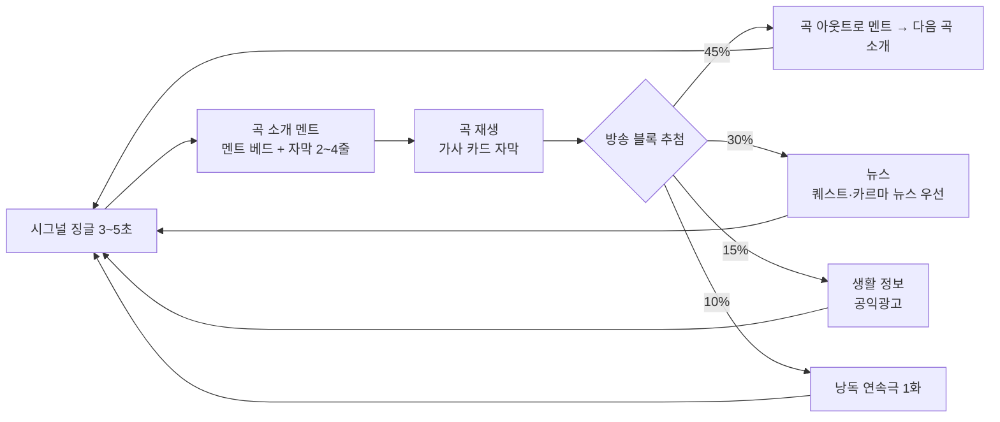

# SD-17. 사운드

> **서울 폴아웃 상세 기획서 세트** | 문서 ID: SD-17 | 버전: v1.0 | 작성일: 2026-10-12
> **범위**: 사운드 방향(오리지널 음악 원칙), BGM 큐 목록(볼트·권역 R01~R11·정착지·던전·전투·메인 스토리·엔딩 E1~E5·타이틀), 라디오(방송국·음성 없는 방송 구현·수록곡·멘트·플레이어 반응 뉴스), 효과음 목록과 우선순위, 음성 없는 대화의 청각 피드백, 믹싱·공간감·심리스 BGM 전환 규칙, 제작 방식·일정·파일 규격 / 다루지 않는 것: 라디오 UI 화면 구성과 조작(→ SD-12), 퀘스트 진행 조건 자체(→ SD-03·SD-04), 무기·크리처 수치와 ID(→ SD-13·SD-14), 카르마 수치와 칭호(→ SD-10)
> **관련 문서**: [SC-00 컨셉](00_concept.md), [SD-01 게임 개요](01_game-overview.md), [SD-03 메인 스토리](03_main-story.md), [SD-04 사이드 퀘스트](04_side-quests.md), [SD-06 세력](06_factions.md), [SD-07 인물](07_characters.md), [SD-08 월드·권역](08_world-regions.md), [SD-09 장소 카탈로그](09_location-catalog.md), [SD-10 캐릭터 시스템](10_character-system.md), [SD-11 전투 시스템](11_combat-system.md), [SD-12 탐험·UI](12_exploration-ui.md), [SD-13 아이템](13_items.md), [SD-14 크리처·적](14_creatures-enemies.md), [SD-16 아트 디렉션](16_art-direction.md), [SD-18 용어·명명](18_naming-terms.md), 원작 [RD-25 아트·오디오·연출](../reverse-design/25_art-audio-presentation.md), [RD-27 쯔꾸르 이식 시사점](../reverse-design/27_adaptation-notes.md), [RD-17 탐험·상호작용](../reverse-design/17_exploration-interaction.md), 조사 [SR-03 인프라·군사](research/SR-03_seoul-infrastructure.md), [SR-05 국가·사회](research/SR-05_korea-state-society.md)

---

## 1. 개요

### 1.1 목적
- 서울 폴아웃의 "들리는 것" 전체를 정의한다. 작곡가·사운드 디자이너(외부 협업자 또는 도구 사용자)가 이 문서만 보고 큐(cue) 하나하나를 만들 수 있는 사양서 수준으로 쓴다.
- 원작 폴아웃 3의 소리 구조(앰비언트 탐험 음악 + 전환형 전투 음악 + 라디오)를 계승하고, 내용물은 모두 새로 만든다.

### 1.2 요약
| 항목 | 결정 |
|---|---|
| 음악 저작권 | **실존 곡 사용 0곡.** 원작 스코어·라디오 수록곡·실존 대중가요·실존 군가·국가(國歌)·실존 CM송은 음원·편곡·멜로디 인용 모두 쓰지 않는다. 모든 음악은 오리지널이다 |
| 시대 표지 | 1950~70년대 한국 레트로(트로트, 뽕짝 리듬, 엔카풍 꺾기, 그룹사운드, 통기타 포크)는 쓰지 않는다. 폴아웃 세계 공통의 '세기 중반 미국풍' 음악 어휘 위에 **2077년 한국의 생활(아파트 분양, 학원, 배급, 징병, 배달 로봇)**을 가사로 얹는다 |
| BGM | 큐 90개(루프 76 + 원샷 14). 앰비언트 중심, 멜로디는 핵심 장면에만 |
| BGS(환경음) | 루프 46개. 원작의 고독감은 BGS가 만든다 |
| 라디오 | 방송국 4곳(남산 방송, 국민방송, 용산 기지 방송, 관제망 비상 안내) + 국지 신호 6종. 수록곡 22곡(2070년대 한국 가요 14 + 주한미군 방송 미국풍 8) + 국민방송 관현악 6곡 |
| 음성 | 없다. 라디오 진행자의 말은 **텍스트 자막 + 멘트 베드 음악 + 감정 스팅어**로 전한다 |
| 효과음 | 약 640파일(변형 포함). 우선순위 P1(단계 0~1 필수) 약 300 |
| 시그니처 사운드 | **관제망 4음 차임**. 관제망이 말하는 모든 순간(안내 방송, 로봇 기상, 차단벽 작동, 최종 콘솔)에 같은 4음이 들린다. 주제 '끝나지 않은 명령'을 소리 하나로 묶는다 |

### 1.3 문서 내 ID 규칙 (SD-17 소관)
| 대상 | 형식 | 예 |
|---|---|---|
| 루프 BGM | `BGM-<분류><번호>` | BGM-X01A |
| 원샷 음악(징글·장면곡) | `ME-<번호>` | ME-03 |
| 환경음 루프 | `BGS-<분류><번호>` | BGS-W02 |
| 효과음 | `SE-<분류>-<번호>` | SE-WPN-012 |
| 라디오 방송국 | `ST-<번호>` | ST-01 |
| 라디오 수록곡 | `RS-<K/U/N><번호>` (K 한국 가요, U 미국풍, N 국민방송 관현악) | RS-K01 |
| 라디오 텍스트 블록 | `RT-<방송국><번호>` | RT-01-052 |
| 라이트모티프 | `LM-<번호>` | LM-01 |

- 다른 문서 소관의 ID(퀘스트, 장소, 크리처, 무기)는 그 문서의 ID를 쓰고, 아직 없는 것은 `(SD-xx에서 ID 부여)`라고 쓴다.

---

## 2. 사운드 방향

### 2.1 원칙
| # | 원칙 | 내용 |
|---|---|---|
| S1 | 두 층의 음악 | 원작처럼 **스코어**(세계 밖에서 흐르는 분위기 음악)와 **라디오**(세계 안에서 실제로 틀어지는 음악)를 나눈다. 라디오를 켜면 스코어가 멈추고, 그 선택이 체험의 톤을 바꾼다(RD-25 §3.4) |
| S2 | 앰비언트가 기본 | 탐험 시간 대부분은 멜로디가 약한 앰비언트와 BGS가 채운다. 곡과 곡 사이에 **침묵 구간**(BGS만 흐름)을 둔다. 멜로디는 정착지·메인 장면·엔딩에 아낀다 |
| S3 | 오리지널만 | 2.2절. 비상업 팬게임이라도 원곡을 쓰지 않는다. "분위기만 닮은" 곡도 특정 곡을 떠올리게 하는 멜로디·리프·가사 인용이 있으면 반려한다 |
| S4 | 2077년 한국의 소리 | 한국성은 국악기나 옛 가요가 아니라 **2077년 도시의 생활음**에서 낸다: 지하철 안내 차임, 민방위 사이렌, 아파트 관리사무소 방송, 배달 로봇 도착음, 편의점 자동문 차임, 진공관 단말기의 예열음. 모두 오리지널로 만든다(실존 지하철 차임·실존 사이렌 녹음 사용 금지) |
| S5 | 폴아웃 기술 규칙의 음색 | 레트로 퓨처는 음색으로 들어온다: 진공관 신스(테레민 계열), 릴 테이프의 늘어짐, 소형 원자로의 저음 험(hum), 릴레이 딸깍음, 브라운관 고주파음 |
| S6 | 명령의 소리 | 주제 '끝나지 않은 명령'을 라이트모티프와 시그니처 사운드로 구조화한다(2.4절). 플레이어는 관제망 차임을 듣기만 해도 "명령이 깨어 있다"를 안다 |
| S7 | 음성 없음 | 대사·진행 멘트·연설은 모두 텍스트다. 소리는 텍스트를 **꾸미되 대신하지 않는다**(6장). 노래의 보컬은 2.5절 |
| S8 | 탑다운 2D에 맞춘 공간감 | 3D 공간 음향 대신 **타일 거리 감쇠 + 좌우 팬 + 실내외 차폐** 3요소로 공간을 만든다(7장) |

### 2.2 오리지널 곡 원칙과 금지 목록
| 구분 | 허용 | 금지 |
|---|---|---|
| 스코어 | 원작의 **구조**(카테고리, 전환 방식, 장면 전용곡 배치) 계승 | 이논 주르 스코어의 음원·편곡·멜로디 인용. "Main Title 같은 곡" 식의 사운드얼라이크 의뢰 |
| 라디오 수록곡 | 폴아웃 세계 공통의 세기 중반 대중음악 **장르 어휘**(스윙, 빅밴드, 크루너 발라드, 두왑, 부기, 컨트리-웨스턴, 라운지) | 실존 곡의 음원·커버·편곡·가사 인용. 원작 GNR·엔클레이브 라디오 수록곡의 곡명 패러디 |
| 한국적 요소 | 2077년 한국의 생활 소재(가사), 서울 지명(가사) | 트로트·뽕짝 2박 리듬, 꺾기 창법을 흉내 내는 선율 장식, 엔카풍 단조 5음계 중심 선율, 1960~70년대 그룹사운드 퍼즈 기타, 통기타 포크, 1970년대 관제 건전가요 양식, 국악기를 '한국 표지'로 쓰는 것 |
| 국가 상징 | 가상 관현악 행진곡(국민방송) | 애국가·실존 군가·실존 국민가요·실존 방송 시그널 인용 |
| 실명 | 지명·공공 공간 실명(한강, 남산, 여의도 등) | 실존 가수·작곡가·악단·음반사 이름, 실존 기업 CM송 |
| 효과음 | 직접 녹음, 합성, 라이선스가 확인된 효과음 라이브러리(게임 배포 허용 조건) | 원작 게임 파일에서 추출한 소리, 영화·방송 효과음 무단 사용, 실존 지하철·방송사 시그널 녹음 |

- **판정 절차**: 납품 큐마다 작곡자는 "참고한 장르·악기" 메모를 남긴다. 기획 검수에서 특정 곡이 떠오른다는 의견이 2명 이상이면 선율을 고친다(8.3절).

### 2.3 악기 팔레트
| 계열 | 음색 | 쓰는 곳 | 의미 |
|---|---|---|---|
| 앰비언트 현 | 저음 현 패드, 비브라토 없는 지속음, 하모닉스 | 탐험 전반 | 고독, 폐허의 넓이 |
| 프리페어드 피아노·단음 피아노 | 현 위에 금속을 올린 피아노, 멀리서 치는 단음 | 관악(R01), 세진 타워, 한유리 박사 관련 | 남겨진 사람의 기록 |
| 폐허 금속 타악 | 철근·철판·가드레일·드럼통 타격 샘플 | 전투, 마포 산업 지대, 지하철 | 무너진 도시 그 자체 |
| 진공관 신스 | 테레민 계열 사인파, 진공관 오실레이터 펄스(클럭) | 관제망, 세진전자, 라디오 '스페이스 팝' | 폴아웃 기술, 기계의 의지 |
| 첼레스타·오르골 | 맑은 종소리 계열 | 볼트 S-07, 어머니 윤정인, E3·E4 | 집, 잃어버린 안전 |
| 브라스(저음 중심) | 호른·트롬본·튜바, 스네어 | 비상정부, 계엄군, 국민방송 | 국가, 질서, 위압 |
| 리드 오르간 | 하모니움 계열 | 각성회 | 기계 신앙 |
| 목관·하프·마림바 | 클라리넷, 하프 아르페지오, 물방울 마림바 | 선유도(R04), 동부 습지(R08), 노들섬 | 물, 살아 있는 땅 |
| 테이프·라디오 텍스처 | 잡음, 와우·플러터, 릴 감기는 소리 | 남산 방송, 여의도 벙커, 회상 | 200년 묵은 기록 |
| 합창 패드 | 가사 없는 모음 합창 샘플(최소 사용) | 엔딩, 북한산 | 사람들, 끝 |

- **국악기**: 쓰지 않는다. 설화·민속 배제 원칙(바이블 §2 원칙 4)과 같은 맥락이며, 국악기를 '한국 표시'로 쓰면 2077년 도시의 정체성이 흐려진다.

### 2.4 라이트모티프
| ID | 이름 | 형태 | 등장 | 변주 규칙 |
|---|---|---|---|---|
| LM-01 | 관제망 차임 | **4음 하강-상승 차임**(진공관 벨 음색, 약 1.6초). 시그니처 사운드 | 관제망 안내 방송, 로봇 기상, 차단벽, 관리자 콘솔, 엔딩 | 정상(장조 마침) / 고장(4번째 음이 반음 낮게 끌림) / 계엄(브라스 겹침) / 시민(첼레스타 겹침) / 종전(마지막 음 없이 끊김) |
| LM-02 | 집 | 첼레스타 6음, 3/4박 | 볼트 S-07, 윤정인, 하도윤, E3·E4, 볼트 귀환 | 프롤로그는 밝게, MQ-09 볼모 장면은 단조, 엔딩은 원형 |
| LM-03 | 명령 | 스네어 3타 + 저음 브라스 2음 | 비상정부, 계엄군, 국민방송, 남궁혁 | E1에서 최대 편성. E4에서 스네어만 남았다가 사라짐 |
| LM-04 | 강 | 하프·마림바 상행 5음 | 한강 횡단(MQ-04), 노들섬, 선유도 | 다리 위에서는 현 지속음과 겹침 |
| LM-05 | 기지 | 군대 나팔풍 5음(트럼펫 약음기) | 연합단, 용산 요새, 용산 기지 방송, RS-U01의 후렴 선율에서 파생 | 원칙파 장면은 반음계로 비틈 |
| LM-06 | 끝나지 않은 행군 | 원거리 큰북 + 저음 현 오스티나토 | 북한산, 중국군 잔존병, 천웨이 상위 | MQ-08 평화 해결 시 큰북이 멈추고 현만 남음 |
| LM-07 | 송신탑 | RS-K11 '송신탑 아래서'의 후렴 첫 4마디 | 남산 방송 시그널, MQ-11 종전 방송, 엔딩 크레딧 | 라디오(디에제틱)와 스코어(비디에제틱)를 잇는 유일한 선율 |

- LM-01은 2077년 세진전자가 설계한 '관제망 안내 신호'라는 게임 속 설정을 갖는다. 실존 공공 차임(지하철·관공서·방송 시보)과 음정·리듬이 겹치지 않게 짓는다(검수 항목).
- LM-07은 일부러 라디오 곡에서 가져온다. 마지막 '종전' 방송이 남산 방송으로 나가는 장면(바이블 §5.4 MQ-11)에서 플레이어가 수십 시간 들은 라디오 곡이 스코어로 바뀌어 흐른다.

### 2.5 보컬(노래하는 목소리) 처리
- 바이블 §2 원칙 7과 RD-27 P3의 '음성 없음'은 **대사 보이스**를 뜻한다. 노래는 음악이지만, 제작 부담과 권리 문제(가수 섭외, 생성형 보컬 도구의 권리 불확실성)가 크다.
- **기본안(1차 범위)**: 라디오 수록곡 22곡은 **연주곡**으로 만든다. 보컬 선율은 악기(약음기 트럼펫, 클라리넷, 비브라폰, 테레민, 휘파람 음색 신스)가 노래하듯 연주한다. 가사는 곡 소개 자막과 '가사 카드'(후렴 2~4줄 자막)로 보여 준다(4.3절).
- **확장안(선택 과제)**: 협업 가수를 확보하면 보컬 판을 추가 녹음한다. 파일은 같은 ID에 `_vo` 접미사로 두고, 옵션에서 고르지 않고 보컬 판이 있으면 그것을 쓴다. 생성형 보컬 도구는 8.2절 조건을 통과해야 쓴다.
- 이 결정은 미결 사항 U-01로 리드 확인을 받는다.

---

## 3. BGM 큐 목록

### 3.1 공통 규칙
| 항목 | 규칙 |
|---|---|
| 루프 유형 | **L1 완전 루프**: 도입부(1회) + 루프 몸통. 루프 시작점은 파일 메타데이터로 지정(8.4절) / **L2 순환+침묵**: 곡이 끝나면 30~90초(무작위) 침묵(BGS만) 뒤 같은 곡군의 다른 곡 / **L3 레이어 루프**: 길이가 같은 스템 2~4개를 동시에 재생하고 강도에 따라 스템 볼륨만 바꾼다 / **O 원샷**: 한 번 재생 후 지정 큐로 넘어가거나 침묵 |
| 길이 표기 | 루프 몸통 길이(도입부 제외). ME는 전체 길이 |
| 템포·박자 | 루프 몸통은 마디 단위로 끝난다. 크로스페이드 전환을 위해 L1·L2 곡은 마지막 2마디에 강한 어택을 두지 않는다 |
| 조성 기준 | 탐험 곡군은 권역 안에서 같은 으뜸음을 공유한다(A/B 전환 시 충돌 방지). 전투 곡은 해당 권역 탐험 곡과 같은 으뜸음 또는 5도 관계로 맞춘다 |
| 다이내믹 | 탐험 앰비언트는 피크를 낮게(7.2절 -18 LUFS 목표, 다이내믹 폭 8LU 이하). 정착지·장면곡은 폭을 넓게 써도 된다 |
| 곡군 | 권역 탐험은 A·B 2곡이 곡군이다. L2 규칙으로 A → 침묵 → B → 침묵 → A 순환. 첫 진입 시에는 A부터 |

### 3.2 타이틀·시스템 음악
| ID | 제목(가제) | 길이 | 편성 | 분위기 | 사용처 | 루프 |
|---|---|---|---|---|---|---|
| BGM-T01 | 명령은 끝나지 않는다 | 2:10 | 테이프 잡음 → 첼레스타(LM-02) → 저음 현 → LM-01 고장 변주로 마침 | 차갑고 정돈된, 끝에 균열 | 타이틀 화면, 불러오기 화면 | L1 |
| ME-01 | 인트로: 세이프빌에서 만나요 | 1:50 | 라디오 수록곡 RS-K01을 낡은 스피커 음색으로 재생 → 후반 30초 저음 현 드론이 덮음 | 밝은 분양 광고 노래와 폐허의 대비 | 게임 시작 인트로 슬라이드(텍스트 내레이션) | O → BGM-V01 |
| ME-02 | 레벨업 | 0:04 | 비브라폰 상행 + 진공관 벨 | 성취 | 레벨 상승 | O |
| ME-03 | 퀘스트 완료 | 0:04 | 현 화음 + 첼레스타 | 마무리 | 퀘스트 완료 | O |
| ME-04 | 장소 발견 | 0:03 | 하프 3음 + 바람 텍스처 | 발견 | 지도 마커 최초 발견 | O |
| ME-05 | 사망 | 0:07 | LM-01이 테이프 늘어짐으로 꺼짐 | 끝 | 주인공 사망 | O |
| ME-06 | 퀘스트 실패 | 0:04 | 저음 현 단조 2화음 | 상실 | 퀘스트 실패 | O |
| ME-07 | 동료 합류 | 0:05 | 약음기 트럼펫 + 기타 | 동행 | 동료 영입(CP-01~08 공용) | O |

### 3.3 볼트 S-07
| ID | 제목(가제) | 길이 | 편성 | 분위기 | 사용처 | 루프 |
|---|---|---|---|---|---|---|
| BGM-V01 | 첫 등록 | 1:30 | 오르골 LM-02 + 진공관 단말기 클럭(4분음) | 따뜻하지만 기계적인 | MQ-P1 출생신고(캐릭터 생성 화면) | L1 |
| ME-08 | 열 살 생일 | 0:40 | 볼트 구내방송 연주곡 풍의 소편성 스윙(피아노·베이스·브러시 드럼) | 명랑, 작은 공동체 | MQ-P2 생일 장면, 핍-보이 수여 | O → BGM-V02 |
| BGM-V02 | 적성 평가 사회 | 3:00 | 피아노 단음, 현 피치카토, 시계 초침 타악 | 정돈, 미세한 압박 | 볼트 S-07 일상(MQ-P2~P3 사이 자유 이동) | L1 |
| BGM-V03 | 시험 시간 | 2:20 | 초침 클릭 가속, 저음 현 오스티나토, 피아노 클러스터 | 긴장, 숨 막힘 | MQ-P3 적성 평가 | L1 |
| BGM-V04 | 개방의 날 | 2:30 (L3: 기본/추격) | 경보 사이렌 텍스처, 스네어 LM-03, 폐허 금속 타악, 현 트레몰로 | 혼란, 배신, 도주 | MQ-P4 계엄군 진입 ~ 탈출. 계엄군과 교전 중이면 '추격' 스템 | L3 |
| BGM-V05 | 볼모의 볼트 | 3:00 | LM-02 단조 변주(첼레스타가 한 음씩 빠짐), 브라스 저음 지속 | 상한 고향 | MQ-09 비상정부 점령 중인 볼트 S-07 재방문 | L1 |

- 볼트 안 일상 장면에서는 BGM-V02 대신 **볼트 S-07 구내방송**(국지 신호 ST-11, 4.1절)을 고를 수 있다. 원작 볼트 101 PA 음악의 대응이다.

### 3.4 탐험: 권역 R01~R11 + 한강
| ID | 권역 | 제목(가제) | 길이 | 편성 | 분위기 | 루프 |
|---|---|---|---|---|---|---|
| BGM-X01A | R01 관악 | 산 아래 첫걸음 | 3:20 | 단음 피아노, 현 패드, 바람 텍스처 | 넓음, 막막함, 작은 희망 | L2 |
| BGM-X01B | R01 관악 | 계단의 도시 | 3:10 | 클라리넷 장음, 하프 간헐, 저음 현 | 언덕 골목의 정적 | L2 |
| BGM-X02A | R02 여의도·영등포 | 무너진 돔 | 3:40 | 저음 브라스 지속음(약하게), 금속 하모닉스, 테이프 잡음 | 국가의 잔해, 차가움 | L2 |
| BGM-X02B | R02 여의도·영등포 | 증권가의 유리 | 3:30 | 유리잔 문지름 음색, 프리페어드 피아노 | 텅 빈 고층 숲 | L2 |
| BGM-X03A | R03 마포·상암 | 쓰레기 산 | 3:30 | 드럼통·철판 타악(느리게), 저음 드론 | 산업, 썩음 | L2 |
| BGM-X03B | R03 마포·상암 | 탱크의 그늘 | 3:20 | 원자로 험 텍스처, 첼로 피치카토 | 위험한 에너지의 기척 | L2 |
| BGM-X04A | R04 서강·선유도 | 물의 섬 | 3:00 | 물방울 마림바, 하프, 현 패드(장조 경향) | 가장 부드러운 권역, 살아 있는 물 | L2 |
| BGM-X04B | R04 서강·선유도 | 정수장의 수조 | 3:10 | 목관 합주, 물결 텍스처 | 고요, 정착 | L2 |
| BGM-X05A | R05 도심(밀폐) | 성곽 안 | 3:40 | 진공관 클럭 펄스(관제망), 저음 현, LM-01 파편 | 감시받는 느낌 | L2 |
| BGM-X05B | R05 도심(밀폐) | 세종대로 | 3:30 | 브라스 저음, 스네어 원거리, 테이프 잡음 | 행정 중심의 공허 | L2 |
| BGM-X06A | R06 용산·남산 | 기지의 그림자 | 3:20 | 약음기 트럼펫 LM-05 파편, 스네어 롤(작게) | 경계, 군기 | L2 |
| BGM-X06B | R06 용산·남산 | 남산 바람 | 3:10 | 바람 텍스처, 라디오 잡음, 비브라폰 | 높은 곳, 신호 | L2 |
| BGM-X07A | R07 강남 | 세이프빌의 밤 | 3:40 | 차가운 진공관 신스, 고음 현 하모닉스, RS-K01 선율의 왜곡 파편 | 부의 폐허, 광고의 유령 | L2 |
| BGM-X07B | R07 강남 | 수직 도시 | 3:30 | 금속 공명, 저음 펄스 | 압도, 내려다보는 탑 | L2 |
| BGM-X08A | R08 동부 | 강변 습지 | 3:00 | 클라리넷, 하프, 개구리 울음 같은 목관 효과 | 습함, 생명 | L2 |
| BGM-X08B | R08 동부 | 장터 가는 길 | 3:00 | 어쿠스틱 기타, 베이스 클라리넷 | 길, 교역 | L2 |
| BGM-X09A | R09 북부 산악 | 북쪽의 능선 | 3:40 | 원거리 큰북 LM-06, 저음 현 오스티나토, 합창 패드(극소) | 깊은 산, 옛 전쟁 | L2 |
| BGM-X09B | R09 북부 산악 | 짐승의 길 | 3:20 | 낮은 플루트, 나무 타악 | 야생, 추적당함 | L2 |
| BGM-X10A | R10 서부 평야 | 활주로 | 3:50 | 가이거 계수기 리듬을 쓴 타악, 지속음 드론 | 가장 황량, 피폭 | L2 |
| BGM-X10B | R10 서부 평야 | 항구 쪽 바람 | 3:30 | 바람, 금속 하모닉스, 테이프 늘어짐 | 끝없는 평야 | L2 |
| BGM-X11A | R11 청계산 | 벙커의 산 | 3:20 | 저음 브라스 LM-03 파편, 현 트레몰로(약) | 질서의 위협 | L2 |
| BGM-X11B | R11 청계산 | 경계 구역 | 3:10 | 스네어 원거리, 진공관 펄스 | 경계, 감시 | L2 |
| BGM-X12 | 한강(강 위·다리 위) | 강을 건너다 | 2:50 | 하프·마림바 LM-04, 현 지속음 | 넓은 물, 노출 | L2(단독) |

- **R05 도심**은 MQ-10 이후 관제망이 깨어 있으므로 BGM-X05A/B에 **관제망 레이어**(LM-01 정상 변주 + 진공관 펄스 강화)를 겹친다. 스템으로 납품한다(X05A_net, X05B_net).
- **엔딩 뒤 이어하기**: 탐험 BGM은 바꾸지 않는다. 결말의 차이는 관제망 비상 안내(ST-04)와 BGS(순찰 로봇 소리 등)로 전한다(3.9절, 4.6절).

### 3.5 정착지
| ID | 정착지 | 제목(가제) | 길이 | 편성 | 분위기 | 루프 |
|---|---|---|---|---|---|---|
| BGM-S01 | 봉천 계단마을 | 계단마을 | 2:40 | 어쿠스틱 기타, 아코디언 없이 클라리넷, 손뼉·나무 타악 | 가난하지만 다정한 첫 마을 | L1 |
| BGM-S02 | 탱크마을 | 기름 탱크 안 | 2:50 | 금속 공명(탱크 내부 잔향), 베이스, 브러시 드럼 | 둥근 철벽 안의 생활 | L1 |
| BGM-S03 | 노들섬 | 다리 위 장사꾼 | 2:40 | 하프 LM-04, 밴조풍 발현악기, 탬버린 | 활기, 흥정, 통행세 | L1 |
| BGM-S04 | 선유도 | 물을 지키는 사람들 | 3:00 | 목관 합주, 마림바, 현 | 질서 있는 평화 | L1 |
| BGM-S05 | 뚝섬 장터 | 장날 | 2:30 | 스윙 소편성(피아노·베이스·클라리넷), 장터 잡음은 BGS로 분리 | 시끌벅적 | L1 |
| BGM-S06 | 세이프빌 | 분양 완료 | 2:50 | 라운지 비브라폰, 현, RS-K01 선율의 느린 변주 | 겉은 우아, 속은 폐쇄 | L1 |
| BGM-S07 | 지하시장 | 지하상가의 상인들 | 3:00 | 하몬드풍 진공관 오르간, 업라이트 베이스, 형광등 험 | 오래 산 사람들의 무심함 | L1 |
| BGM-S08 | 용산 요새 | 기지를 지켜라 | 2:40 | 약음기 트럼펫 LM-05, 스네어, 저음 현 | 규율, 의례 | L1 |
| BGM-S09 | 남산 방송국(실내) | 스튜디오의 밤 | 2:30 | 라디오 잡음, 피아노, LM-07 파편 | 고립된 목소리 | L1 |
| BGM-S10 | 각성회 거점 | 잠든 수호자 | 3:00 | 리드 오르간, LM-01 느린 변주, 합창 패드 | 경건, 섬뜩함 | L1 |
| BGM-S11 | 무너진 정착지(공용) | 남은 것 | 2:30 | 단음 피아노, 바람, 현 하모닉스 | 상실 | L1 |

- 정착지가 파괴되거나 적대 세력에 점령되면(SD-04·SD-09 결과 변수) 해당 정착지 BGM 대신 BGM-S11을 쓴다.
- 정착지 BGM은 정착지 반경(7.4절 BGM 구역) 안에서 탐험 BGM보다 우선한다. 정착지 안에서 라디오를 켜면 라디오가 우선한다.

### 3.6 던전 유형
| ID | 유형 | 제목(가제) | 길이 | 편성 | 분위기 | 대표 장소 | 루프 |
|---|---|---|---|---|---|---|---|
| BGM-D01 | 지하철·역사 | 막차 없는 선로 | 3:30 | 터널 잔향 타악, 저음 드론, 멀리 울리는 금속 | 끝없는 어둠 | 지하철 노선 전반(SD-08) | L2 |
| BGM-D02 | 지하상가·시민 대피소 | 0.825㎡ | 3:20 | 현 하모닉스, 형광등 험, 끊어진 오르골 | 비극의 현장 | 대피소 지정 지하 공간 | L2 |
| BGM-D03 | 군사 시설 | 경계 근무 | 3:10 | 스네어 원거리, 저음 금관, 무전 잡음 | 위협, 질서 | 군 기지·포대(SD-09) | L2 |
| BGM-D04 | 원자력·연구 시설 | 노심 | 3:40 | 원자로 험, 가이거 리듬, 테레민 | 방사능, 금지 구역 | 공릉 연구로, 당인리 | L2 |
| BGM-D05 | 세진 로봇 시설 | 조립 라인 | 3:20 | 진공관 펄스, 기계 리듬(5/4), 금속 타악 | 기계의 의지 | 세진전자 시설, 세진전자 타워 하층 | L2 |
| BGM-D06 | 침수 지하 | 물속의 길 | 3:30 | 물 떨어짐 리듬, 저음 현, 잔향 큰 피아노 | 질식, 고립 | 신월 빗물터널, 하저 터널 | L2 |
| BGM-D07 | 다른 서울 볼트 | 다른 실험 | 3:20 | LM-02의 낯선 변주(음정 비틀림), 진공관 클럭 | 익숙한데 틀린 곳 | S-01~S-12 중 탐사 가능 볼트 | L2 |
| BGM-D08 | 산악 동굴·터널 | 굴 | 3:10 | 낮은 플루트, 바위 타악, 큰북 원거리 | 원시, 야생 | 북한산 터널, 관악산 동굴 | L2 |
| BGM-D09 | 폐건물·아파트 | 빈 집들 | 3:00 | 피아노 단음, 테이프 잡음, 문 삐걱 같은 현 효과 | 사람이 살던 흔적 | 아파트 단지, 학원가 건물 | L2 |
| BGM-D10 | 정부 벙커 | 지하 정부 | 3:30 | 저음 브라스 LM-03, 형광등 험, 타자기 리듬 | 관료적 공포 | 여의도 지하 벙커, 청계산 벙커 | L2 |
| BGM-D11 | 변종·야생 구울 소굴 | 굶주림 | 3:00 | 저음 드론, 불규칙 금속 타격, 숨소리 같은 현 효과 | 공포 | 변종 소굴, 야생 구울 굴 | L2 |

- 메인 퀘스트 전용 던전(MQ-02 여의도 벙커, MQ-06 당인리, MQ-07 세진 타워, MQ-11 관제 본부)은 3.8절 장면곡이 던전 BGM을 대신하는 구간을 가진다.

### 3.7 전투 단계
| ID | 제목(가제) | 길이 | 편성 | 분위기 | 사용처 | 루프 |
|---|---|---|---|---|---|---|
| ME-09 | 발각 | 0:01.5 | 현 스포르찬도 + 금속 타격 | 경고 | 적이 주인공을 '발견' 상태로 전환한 순간(SD-11 탐지 단계) | O |
| BGM-C01 | 맞붙다 | 1:40 (L3: 기본/고강도) | 폐허 금속 타악, 저음 현 오스티나토, 브라스 스탭 | 거칠고 빠름 | 일반 인간형 적(약탈자, 새벽인력, 철벽경호, 자율방범대, 원칙파) | L3 |
| BGM-C02 | 물어뜯다 | 1:30 (L3) | 불규칙 타악, 현 글리산도, 저음 드론 | 본능적 위협 | 크리처(변이 동물·곤충), 야생 구울 | L3 |
| BGM-C03 | 거대한 것 | 2:00 (L3) | 대형 북, 저음 금관, 금속 공명 | 압도 | 강적: 미군 생물병기, 변종 대형 개체, 변이 반달가슴곰(SD-14에서 강적 등급 지정) | L3 |
| BGM-C04 | 계엄 | 1:50 (L3) | 스네어 행진 리듬 LM-03, 브라스 전체, 저음 현 | 국가 폭력 | 계엄군(비상정부) | L3 |
| BGM-C05 | 관제망 | 1:50 (L3) | 진공관 펄스 가속, LM-01 계엄 변주, 기계 타악 | 차갑고 정확 | 관제망 경비 로봇·포탑, 세진 보안 로봇 | L3 |
| BGM-C06 | 명령에 갇힌 병사들 | 1:50 (L3) | 큰북 LM-06, 저음 현, 금속 타악 | 비장, 연민 | 중국군 잔존병 | L3 |
| BGM-C07 | 결전 | 2:30 (L3: 기본/고강도/최종) | 전 편성, 해당 보스의 라이트모티프 삽입 | 클라이맥스 | 메인 보스전 공용(강태오 대령, 관제 본부 방어체 등, SD-03·SD-14에서 지정) | L3 |
| ME-10 | 정적 | 0:02.5 | 현 화음이 풀리며 사라짐 | 해소 | 전투 종료(적 전멸 또는 이탈 완료) | O |

- **스템 구성**: L3 전투곡은 `기본`(타악+저음)과 `고강도`(브라스·현 상성부) 2스템. BGM-C07은 `최종`(합창 패드+LM 선율) 3번째 스템을 둔다. 강도 전환 조건은 7.5절.
- 연합단과 싸우는 경우는 BGM-C01을 쓰되 LM-05 파편을 넣은 변형 스템(C01_bos)을 납품한다.

### 3.8 메인 스토리 장면
| ID | 제목(가제) | 길이 | 편성 | 분위기 | 사용처(바이블 §5.4) | 루프 |
|---|---|---|---|---|---|---|
| ME-11 | 처음 본 서울 | 1:20 | 현 상행, 첼레스타 LM-02 원형, 마지막에 바람만 남음 | 해방과 상실(원작 'Exit the Vault' 대응) | MQ-P4 끝, 관악산 비탈에서 무너진 서울을 처음 내려다볼 때 | O → BGM-X01A |
| BGM-M01 | 2077년 10월 23일 | 3:00 | 테이프 잡음, 타자기 리듬, LM-01 고장 변주, 저음 현 | 기록 속 그날 | MQ-02 여의도 지하 벙커, 2077년 비상 집결지 기록 열람 구간 | L1 |
| BGM-M02 | 해독 | 2:00 | 진공관 클럭, 피아노 아르페지오, LM-01 첫 4음이 하나씩 드러남 | 수수께끼가 풀림 | MQ-03 마영식의 관리자 코드 해독 장면 | L1 |
| BGM-M03 | 물 아래 터널 | 3:00 (L3: 기본/침수 가속) | 물 떨어짐 리듬, 저음 현, 금속 신음 | 질식, 시간 압박 | MQ-04 하저 터널 경로 | L3 |
| BGM-M04 | 요새의 문 | 1:30 | 약음기 트럼펫 LM-05 전체, 스네어 의례 리듬 | 의례, 시험 | MQ-05 용산 요새 입성과 연합단 면담 | L1 |
| ME-12 | 전원 투입 | 1:10 | 원자로 험 상승 → **LM-01 첫 완전 연주** → 저음 브라스 화음 | 경이와 불안 | MQ-06 당인리 재가동 순간. 서울 전역의 가로등·관제망 스피커가 켜지는 연출과 동기화 | O |
| BGM-M05 | 깨어나는 탑 | 2:40 (L3: 기본/각성) | 진공관 펄스, 기계 타악, 상승하는 현 | 수직 상승, 위협 고조 | MQ-07 세진전자 타워 상층부 | L3 |
| BGM-M06 | 한유리의 기록 | 2:30 | 단음 피아노, 첼로, LM-01을 장조로 푼 선율 | 남겨진 양심 | MQ-07 시민 보호 프로토콜 발견, 한유리 박사 기록 열람 | L1 |
| BGM-M07 | 전쟁은 끝났다 | 2:00 | 큰북 LM-06이 멈추고 저음 현만 남음 → 하프 | 해소, 연민 | MQ-08 중국군 잔존병에게 종전을 증명하는 평화 해결 장면 | L1 |
| BGM-M08 | 권한대행 | 2:40 | 저음 브라스 LM-03, 오래된 레코드 잡음, 하프시코드풍 진공관 건반 | 위엄, 부패 | MQ-09 청계산 벙커, 남궁혁과의 대면 | L1 |
| BGM-M09 | 무너지는 벙커 | 2:00 (L3: 기본/붕괴) | 폐허 금속 타악, 경보, 현 트레몰로 | 탈출 | MQ-09 벙커 붕괴 또는 볼트 구출 탈출 구간 | L3 |
| BGM-M10 | 도심으로 | 4:00 (L3: 공통 + 동맹 스템 4) | 공통: 저음 현·타악 행진. 동맹 스템: 연합단(LM-05 트럼펫), 비상정부(LM-03 브라스), 시민 연합(LM-02 첼레스타·목관), 단독(테레민 독주) | 진군, 결집(원작 리버티 프라임 진군 'Tension' 대응) | MQ-10 지하철 → 밀폐 도심 진입 구간 | L3 |
| BGM-M11 | 관제 본부 | 3:30 | 진공관 펄스(관제망 심장 박동, 60BPM), LM-01 반복 변주, 저음 드론 | 거대한 기계의 내부 | MQ-11 광화문 지하 관제 본부 던전 | L1 |
| BGM-M12 | 관리자 콘솔 | 1:30 | 극저음 드론 + LM-01의 4번째 음이 끝내 울리지 않는 반복 | 결정의 무게 | MQ-11 관리자 콘솔 앞 선택지 화면 | L1 |

- MQ-01(봉천 계단마을)은 정착지 BGM-S01이 맡는다. MQ-04 노들섬 경로는 BGM-S03과 BGM-X12가 맡는다.
- 원작처럼 선형 컷신은 인트로·엔딩뿐이다. 위 장면곡은 스크립트 장면의 시작 이벤트에서 재생하고, 장면 종료 이벤트에서 해당 권역·던전 BGM으로 6초 크로스페이드한다.

### 3.9 엔딩 E1~E5
| ID | 제목(가제) | 길이 | 편성 | 분위기 | 사용처 | 루프 |
|---|---|---|---|---|---|---|
| BGM-E00 | 종전 방송 | 1:00 | 라디오 잡음 → LM-07(RS-K11 후렴)이 라디오 음색에서 관현악으로 넘어감 | 서울 전역에 닿는 한 목소리 | MQ-11 결정 직후, 남산 방송 송출 연출(엔딩 공통 도입) | O → 각 엔딩곡 |
| BGM-E01 | E1 계엄 | 2:30 | LM-03 최대 편성, LM-01 계엄 변주, 행진 스네어 | 완벽한 질서의 공포 | E1 계엄 프로토콜 가동 슬라이드 | L1 |
| BGM-E02 | E2 이양 | 2:30 | LM-05 트럼펫, 현, 스네어(절제) | 총으로 지킨 질서 | E2 연합단에 지휘권 이양 | L1 |
| BGM-E03 | E3 시민 등록 | 2:40 | LM-01 시민 변주(첼레스타) + LM-02 + 현 전체 | 모두가 시민이 됨, 따뜻함 | E3 시민 등록 | L1 |
| BGM-E04 | E4 종전 | 2:40 | LM-01 종전 변주(마지막 음 없이 끊김) → 긴 침묵 2초 → 피아노와 바람, LM-02 | 멈춤, 맨손의 시작 | E4 관제망 영구 정지 | L1 |
| BGM-E05 | E5 군림 | 2:30 | 테레민 독주가 LM-01을 장악, 저음 오르간 | 고독한 왕좌 | E5 관리자 군림 | L1 |
| BGM-E06 | 서울의 나중 | 3:00 (3판: 선·중립·악) | 공통 피아노·현 골격. 선 판은 첼레스타, 중립 판은 클라리넷, 악 판은 저음 브라스 | 후일담 | 카르마·정착지·동료 결말 슬라이드(ES-, SD-03) 배경 | L1 |
| BGM-E07 | 송신탑 아래서(관현악) | 4:30 | RS-K11 전곡을 관현악으로 편곡, 끝에 LM-01 정상 변주 1회 | 정리, 수미상관 | 엔딩 크레딧 | O |

- 슬라이드 수가 늘어 곡보다 길어지면 L1 루프로 이어 붙인다. 결말 슬라이드 1장당 표시 시간은 SD-03이 정한다(기본 8~12초 가정).
- E3·E4 뒤의 침묵 2초는 마스터에서 지우지 않는다(검수 항목).

### 3.10 BGM 집계
| 분류 | 루프 BGM | 원샷 ME | 합계 |
|---|---|---|---|
| 타이틀·시스템 | 1 | 7 | 8 |
| 볼트 | 5 | 1 | 6 |
| 탐험 | 23 | 0 | 23 |
| 정착지 | 11 | 0 | 11 |
| 던전 | 11 | 0 | 11 |
| 전투 | 7 | 2 | 9 |
| 메인 장면 | 12 | 2 | 14 |
| 엔딩 | 6 | 2 | 8 |
| **합계** | **76** | **14** | **90** |

- 추가 스템(R05 관제망 레이어 2, C01 연합단 변형 1, M10 동맹 스템 4, E06 3판)은 큐 수에 넣지 않았다. 스템 포함 납품 파일 수는 약 150개다.
- 총 재생 길이(루프 몸통 기준) 약 3시간 40분. 원작 스코어(약 40트랙, 60~70분)보다 길지만 탐험 곡군이 대부분이고, 각 곡은 L2 침묵 규칙으로 체감 반복을 줄인다.

---

## 4. 라디오

> 이 장은 방송 콘텐츠와 소리 구현을 다룬다. 라디오 화면(핍-보이 라디오 탭, 자막 위치, 다이얼 조작)은 [SD-12](12_exploration-ui.md), 방송국이 열리고 닫히는 퀘스트 조건의 최종 확정은 [SD-03](03_main-story.md)·[SD-04](04_side-quests.md)가 맡는다. 아래 조건은 사운드 쪽 제안이다.

### 4.1 방송국 일람
| ID | 방송국 | 운영·진행 | 송출지 | 콘텐츠 | 원작 대응 |
|---|---|---|---|---|---|
| ST-01 | **남산 방송** | 진행자 **송미래** | 남산 송신탑 아래 방송실(R06) | 2070년대 한국 가요 14곡 + 미국풍 곡 4곡, 뉴스, 생활 정보, 낭독 연속극 | 갤럭시 뉴스 라디오 |
| ST-02 | **국민방송** | 비상정부. **권한대행 남궁혁** 연설 | 청계산 벙커(R11) 송신기 + 계엄군 중계 | 관현악 행진곡 6곡 + 권한대행 연설 9편 + '오늘의 표어' + 공고 | 엔클레이브 라디오 |
| ST-03 | **용산 기지 방송** (신규 제안) | 연합단. 2077년 기지 방송 녹음 테이프를 연합단 통신병이 의례처럼 튼다 | 용산 요새(R06) | 2070년대 주한미군 방송의 미국풍 곡 8곡 + 녹음된 옛 DJ 멘트 + 연합단 '기지 수칙' 낭독 | (신규) 원작의 볼트 101 PA·엔클레이브 라디오의 '녹음 반복' 성격을 섞음 |
| ST-04 | **관제망 비상 안내** (신규 제안) | 수도 관제망 자동 송출. 진행자 없음 | 관제 본부(R05) → 관제망 스피커·방송망 | LM-01 차임 + 경보음 + 공문체 안내 자막. 음악 없음 | (신규) 아메리카 인민공화국 라디오의 '200년째 반복' 성격 + 서울판 주제 |

- **국지 신호**(범위 안에서만 수신, 원작 햄 라디오·조난 신호 대응)

| ID | 신호 | 송출지 | 내용 | 게임 기능 |
|---|---|---|---|---|
| ST-11 | 볼트 S-07 구내방송 | 볼트 S-07 내부 | 연주곡 4곡(BGM-V02와 별개의 디에제틱 소편성 스윙) + 생활 수칙 + 시험 일정 공지 자막 | 프롤로그 라디오 튜토리얼. MQ-09 재방문 시 비상정부 공지로 바뀜 |
| ST-12 | 북한산 난수 신호 | 북한산 지하(R09) | 숫자 읽기 대신 **숫자 자막 + 모스 부호 비프**. 200년째 같은 대기 명령 | MQ-08 진입 단서. 신호 세기로 출처 추적. 평화 해결 뒤 "임무 종료" 부호로 바뀜 |
| ST-13 | 각성회 기도 신호 | 각성회 거점(SD-09) | 리드 오르간 루프 + LM-01 느린 변주 + 류정의 '기도문' 자막 | 각성회 관련 사이드 퀘스트(SD-04에서 ID 부여) 유도 |
| ST-14 | 조난 신호(공용 템플릿) | 랜덤·고정 위치 | 비프 3회 + 짧은 자막("살려 주세요, ○○역 2번 출구") | 비표시 퀘스트·인카운터 시작(SD-05에서 ID 부여) |
| ST-15 | 새벽인력 '일자리 안내' | 새벽인력 거점 주변 | 친절한 공고문 자막(실은 인신매매) + 주인공 현상금 공고 | 블랙 유머, 추적자 경고 |
| ST-16 | 세이프빌 분양 안내 | 강남 세이프빌 단지(R07) | 2077년 분양 홍보 녹음 반복: RS-K01 연주 + 분양 조건 자막 | 환경 풍자. 세이프빌 정착지 입구 유도 |

### 4.2 수신 범위와 열림·닫힘 (제안)
| 방송국 | 처음 상태 | 확장·변화 | 종료 |
|---|---|---|---|
| ST-01 남산 방송 | 약한 신호: R06, R02 북쪽 강변, 노들섬에서만 깨끗하게 수신. 그 밖은 잡음 섞임(7.6절 신호 품질) | 남산 송신탑 수리 사이드 퀘스트(가칭 '신호를 높여라', SD-04에서 ID 부여) 완료 시 전역. 미완료여도 **MQ-11 직후 강제 전역 송출**(종전 방송) | 송미래 사망 시 음악만 나옴(4.4.6절) |
| ST-02 국민방송 | 볼트 탈출 직후부터 **전역**. 볼트 밖에서 처음 잡히는 방송 | MQ별 연설 교체(4.5절) | MQ-09에서 벙커 붕괴 선택 시 종료. E3·E4 뒤 종료. E1에서는 '정통 정부 방송'으로 계속 |
| ST-03 용산 기지 방송 | MQ-04 이후 R06·R02·R07 북부 | MQ-05 이후 연합단과의 관계에 따라 유지 | 연합단 적대(용산 요새 함락) 시 종료. E2 뒤 전역 |
| ST-04 관제망 비상 안내 | 지하철역·도심(R05)에서만 비상 배터리로 2077년 녹음 반복(약한 신호) | **MQ-06 재가동 시 전역**. MQ-10부터 계엄 단계 공지 | E4 뒤 반송파만 1주기 → 영구 무음. 그 밖의 결말은 결말별 공지로 계속(4.6절) |
| ST-11~16 | 해당 장소 반경(타일 기준 반경은 SD-12) | 퀘스트에 따라 내용 교체 | 출처를 끄거나 파괴하면 종료 |

### 4.3 음성 없는 방송의 구현
- 라디오는 **음악 파일 + 텍스트 블록**의 재생 목록이다. 말소리는 없다. 진행자의 존재감은 ① 자막 문체 ② **멘트 베드**(자막이 흐르는 동안 깔리는 짧은 반주) ③ **감정 스팅어**(1~2초 효과음 음악) ④ 시그널 징글로 만든다.

| 요소 | 규칙 |
|---|---|
| 블록 순서 | 징글 → 멘트 → 곡 → (추첨: 아웃트로 45 / 뉴스 30 / 생활 정보 15 / 연속극 10%). 퀘스트 뉴스가 대기 중이면 다음 추첨은 무조건 뉴스 |
| 자막 줄 | 한 줄 최대 28자(한글 기준). 줄 표시 시간 = `1.2초 + 글자 수 × 0.09초`. 줄 사이 0.3초 |
| 자막 위치 | 탐험 HUD 하단 라디오 자막 줄(1줄씩 교체, 위치·서체는 SD-12). 핍-보이 라디오 탭에는 최근 블록 20개를 **방송 기록**으로 남긴다 |
| 화자 표시 | 줄 앞에 화자 아이콘(송미래 / 남궁혁 / 옛 DJ / 관제망 문장(紋章)). 이름 대신 아이콘이 '목소리'다 |
| 멘트 베드 | 방송국마다 8~20초 루프 2~3종. 자막이 끝나면 베드 1마디 뒤 페이드아웃(1초). 볼륨은 곡보다 -8dB |
| 감정 스팅어 | 멘트 줄 끝에 태그로 붙인다: `[웃음]` 브러시 스네어 + 피아노 장식음 / `[놀람]` 비브라폰 글리산도 / `[한숨]` 하강 클라리넷 / `[슬픔]` 저음 현 1화음 / `[긴급]` 전신음 3회. 방송국별 음색 세트 |
| 가사 카드 | 곡 시작 후 20초, 후렴 시점에 가사 2~4줄을 자막으로 띄운다. 곡당 1회 |
| 전투 중 | 자막을 띄우지 않고 방송 기록에만 쌓는다. 곡은 계속 재생(7.5절 라디오 규칙) |
| 대화 중 | 라디오 볼륨 -9dB 덕킹, 자막 일시 정지. 대화가 끝나면 이어서 표시 |
| 방송 지속 | 라디오를 끈 동안에도 방송 시간은 흐른다(재생 목록 위치는 게임 시각 기준으로 계산). 다시 켜면 중간부터 들린다 |
| 반복 억제 | 같은 곡은 최근 6곡 안에서 다시 고르지 않는다. 같은 생활 정보는 게임 시간 24시간 안에 다시 내보내지 않는다 |

### 4.4 ST-01 남산 방송
#### 4.4.1 진행자와 시그널
- **송미래**: 남산 송신탑 아래 옛 방송실에서 혼자 방송을 이어 가는 진행자(바이블 §11 고정 인물. 인물 설정은 SD-07). 2277년 서울에서 '사실 확인'을 고집하는 유일한 매체다. 말투는 존댓말에 가끔 반말이 섞이고, 농담은 건조하다. 원작 쓰리독의 과장된 들뜸과 달리 **차분한 냉소 + 끈질긴 다정함**으로 차별화한다.
- **방송 문구**: "여기는 남산 방송, 송미래입니다. 이 신호가 닿는 데까지가 오늘의 서울이에요." / 맺음말 "꺼지지 마세요, 서울."
- **시그널 징글**: LM-07(RS-K11 후렴 첫 4마디)을 비브라폰과 약음기 트럼펫으로 4초. 멘트 베드 3종(피아노 트리오, 비브라폰 솔로, 기타 아르페지오).

#### 4.4.2 진행 멘트 예시
| 블록 | 자막 예 |
|---|---|
| 인트로 | "안녕하세요, 남산 방송입니다. 오늘도 송신탑은 서 있고, 저도 서 있어요. 둘 다 좀 기울긴 했지만." |
| 곡 소개(RS-K03) | "다음 곡은 '라디안'의 「오후 두 시 훈련」. 2077년엔 대피 훈련도 데이트 핑계였대요. 부럽다." |
| 곡 소개(RS-K07) | "「서해 건너 산둥까지」. 이 노래 부른 사람들, 돌아왔는지는 아무도 몰라요. 그냥 들어요." `[한숨]` |
| 아웃트로 | "레코드가 튀는 건 기계 탓이 아니라 200년 탓이에요. 양해 부탁드려요." |
| 날씨 | "오늘 날씨: 맑음. 한강 쪽 방사능 조금. 여의도 쪽 총알 많음. 우산은 소용없어요." `[웃음]` |
| 시간 알림 | "지금 시각은… 남산 방송 시계로는 저녁이에요. 여러분 시계는 아마 멈췄을 거고." |
| 송신탑 수리 뒤 | "이제 관악산에서도, 도봉산에서도 들린대요. 다들 반가워요. 이 신호는 이제 서울 전체 거예요." `[놀람]` |

#### 4.4.3 생활 정보(공익광고) 목록
| ID | 주제 | 자막 요지 |
|---|---|---|
| RT-01-201 | 지하시장 사람들도 이웃이다 | "구울이요? 영등포 지하상가 가 보세요. 거기 사람들, 우리보다 장사 정직해요" |
| RT-01-202 | '일자리' 제안 조심 | "새벽인력이 일자리 준다고 하면 뛰세요. 그 사람들 장부엔 여러분 이름이 '물건' 칸에 있어요" |
| RT-01-203 | 로봇 앞에서 뛰지 마세요 | "관제망 로봇은 뛰는 사람을 '도주자'로 분류합니다. 천천히, 손은 보이게" (MQ-06 이후 추가) |
| RT-01-204 | 빗물·강물 마시지 마세요 | "목마르면 선유도 물 사세요. 캡 아끼다 라드 모아요" |
| RT-01-205 | 곰에게 먹이 주지 마세요 | "관악산 반달곰한테 통조림 던지지 마세요. 걔 이제 통조림 따는 법 알아요" |
| RT-01-206 | 라드어웨이 사용법 | "라드어웨이는 마시는 게 아니라… 아니, 마시는 거 맞아요. 근데 한 번에 다 마시지 마세요" |
| RT-01-207 | 변종을 피하는 법 | "지하철 깊은 데서 큰 그림자 보이면 노래 부르지 말고 뒤로 가세요" |

#### 4.4.4 낭독 연속극 「탐정 고대호의 원자력 사건부」
- 송미래가 방송실에서 찾은 2070년대 라디오 연속극 대본을 낭독한다(자막). 4화, 화당 자막 10~14줄. 멘트 베드 대신 전용 베드(스윙 탐정물풍 RS 계열 짧은 루프 1종 `RD-BED-01`)를 쓴다.
- 화 제목: ① 사라진 원자력 자동차 ② 학원가의 진공관 도둑 ③ 세이프빌 17동의 비밀 ④ 배달 로봇은 두 번 벨을 누른다.
- 주인공 고대호는 2077년 한국 대중문화 속 허구 인물이다. 줄거리는 SD-04·SD-07과 겹치지 않는 독립 소품으로 둔다.

#### 4.4.5 카르마 호칭
- 퀘스트 뉴스 앞에서 송미래는 주인공을 카르마 구간별 호칭으로 부른다(원작 쓰리독의 칭호 호명 계승). 구간 경계값은 원작 기준을 가정하고 최종은 SD-10을 따른다.

| 카르마 구간(가정) | 호칭 | 호칭 줄 예 |
|---|---|---|
| 매우 선 (+750 이상) | 관악산에서 내려온 우리 편 | "우리 편 소식부터 할게요. 관악산에서 내려온 그 사람이요." |
| 선 (+250~+749) | 착한 볼트 아이 | "착한 볼트 아이가 또 일을 냈어요. 좋은 쪽으로요." |
| 중립 (-249~+249) | 점프슈트 입은 수수께끼 | "점프슈트 입은 수수께끼 씨, 이번엔 어느 쪽이에요?" |
| 악 (-250~-749) | 볼트에서 온 골칫거리 | "볼트에서 온 골칫거리 소식입니다. 문 잠그세요." |
| 매우 악 (-750 이하) | 관악산의 재앙 | "관악산의 재앙이 지나갔대요. 지나간 자리엔… 네, 뉴스 계속할게요." `[한숨]` |

#### 4.4.6 송미래 사망 시
- 방송은 음악만 이어진다. 시그널 징글과 멘트 베드가 빠지고, 곡 사이에 4초 잡음만 남는다. 자막 1회: "(진행자 없음. 자동 송출 중)". 원작 쓰리독 사망 뒤 '진행자 없는 라디오'의 상실감을 계승한다.
- MQ-11 종전 방송은 송미래가 없으면 **관제망 방송망으로만** 송출된다(엔딩 공통 도입 BGM-E00의 자막 문안만 바뀜, SD-03과 연동).

### 4.5 ST-02 국민방송
- **성격**: 비상정부의 '정통 대한민국' 방송. 관현악 행진곡 사이에 권한대행 남궁혁의 긴 담화가 들어간다. 원작 이든 대통령의 노변담화형 연설 구조를 계승하되, 남궁혁은 **2077년 그날을 기억하는 구울 장관**이라 연설이 회상과 행정 공문 사이를 오간다.
- **방송 문구**: "여기는 국민방송입니다. 대한민국 비상정부가 국민 여러분께 알립니다."
- **시그널**: LM-03(스네어 3타 + 저음 브라스 2음) 3초. 멘트 베드는 느린 현 지속음 2종.
- **'오늘의 표어'**(연설 사이 1줄 자막, 모두 가상 문구): "등록된 시민은 안전합니다." / "의심스러우면 신고하십시오. 신고는 충성입니다." / "질서는 아침밥보다 먼저입니다." / "대한민국은 한 번도 무너진 적이 없습니다."

| 연설 | 제목 | 요지 | 방송 시기(제안) |
|---|---|---|---|
| 1 | 그날 오전 | 2077-10-23 오전, 장관으로서 본 경보와 대피 행렬. "저는 그날 지하로 내려갔고, 아직 올라가지 않았습니다." | 처음부터 |
| 2 | 정통의 계승 | 비상정부만이 대한민국의 법적 연속이라는 주장 | 처음부터 |
| 3 | 등록하십시오 | 비상 주민 분류 지침의 '재시행' 안내, 등록소 개설 예고 | 처음부터 |
| 4 | 관리자 인도 공고 | 볼트 S-07 출신 '국가 자산'의 인도 요구와 현상금. 주인공의 생김새를 공문체로 묘사 | MQ-P4 이후 ~ MQ-09 |
| 5 | 질서를 깨는 자들 | 연합단, 약탈자, 새벽인력, 지하시장을 한 목록에 넣어 '적성 분자'로 규정 | MQ-02 이후 |
| 6 | 아파트 한 채의 꿈 | 재건이 끝나면 등록 시민에게 세이프빌 분양권을 주겠다는 약속 | MQ-05 이후 |
| 7 | 전원이 돌아왔습니다 | 당인리 재가동을 정부의 성과로 선전. "가로등이 켜진 것을 보셨습니까" | MQ-06 재가동 시 |
| 8 | 볼트 S-07 시민 여러분께 | 볼트 S-07의 '보호 조치'(실은 볼모) 공지. 어머니 윤정인의 이름을 협조자로 언급 | MQ-09 |
| 9 | 최후 담화 | 도심 진입을 앞둔 결의(동맹 선택에 따라 적대 또는 독려) | MQ-10 |

- 연설 1편은 자막 12~20줄. 줄 사이 간격을 남산 방송보다 0.3초 길게 해 느리고 무거운 말투를 표현한다.

### 4.6 ST-03 용산 기지 방송 · ST-04 관제망 비상 안내
#### 4.6.1 용산 기지 방송
- **구조**: 2077년 주한미군 기지 라디오의 자동 송출 테이프(옛 DJ의 녹음 멘트 + 미국풍 곡)를 연합단이 200년 동안 보존해 틀어 왔다. 연합단 통신병 **에이미 노**(신규, SD-07에서 ID 부여)가 테이프 사이에 '기지 수칙'을 낭독한다.
- **옛 DJ**: **서니 델가도 하사**(신규, 2077년 기지 방송 진행자, 녹음으로만 존재). 영어 원문 한 줄 + 한국어 자막 한 줄을 함께 띄운다. 예: "Good evening, Yongsan. Keep your boots dry and your radios on." / "좋은 저녁입니다, 용산. 군화는 마르게, 라디오는 켜 두세요."
- **기지 수칙 낭독**(연합단 교리 '기지를 지켜라'의 의례): "제1조. 기지를 지켜라. 제2조. 명령이 올 때까지 기지를 지켜라. 제3조. 명령이 오지 않아도…" — 끝맺지 못하는 3조가 연합단의 200년을 요약한다.
- 시그널: LM-05(약음기 트럼펫 5음). 테이프 늘어짐 효과를 기본으로 건다(7.6절).

#### 4.6.2 관제망 비상 안내
- **구조**: 음악 없음. LM-01 차임 → 공문체 자막 3~6줄 → 반송파 잡음 20~40초 → 반복. 화자 아이콘은 관제망 문장.

| 단계 | 시기 | 자막 예(공문체, 가상 문구) |
|---|---|---|
| 0 휴면 | MQ-06 이전, 지하철·도심 일부 | "[국가비상대비 통보] 2077. 10. 23. 09:47 / 1. 경계경보 발령. 전 시민은 가까운 대피소로 이동할 것. / 2. 승강기 사용 금지." (LM-01 고장 변주) |
| 1 기상 | MQ-06 재가동 ~ MQ-09 | "[수도 관제망] 전원 복구 확인. 대기 해제. / 비상 주민 분류 지침에 따라 등록 확인을 재개함. / 미등록자는 가까운 등록소에 출두할 것." |
| 2 계엄 | MQ-10 ~ MQ-11 | "[수도 관제망] 계엄 단계 3. 도심 출입 통제. / 이동 중인 미등록자는 정지할 것. 정지하지 않으면 도주자로 분류함." (LM-01 계엄 변주) |
| E1 | 엔딩 뒤 | "[대한민국 비상정부·수도 관제망] 등록 시민 외 통행 금지. 오늘도 안전한 하루 되십시오." |
| E2 | 엔딩 뒤 | "[연합 관제 사령부] 기지는 지켜지고 있습니다. 통행증을 휴대하십시오." |
| E3 | 엔딩 뒤 | "[수도 관제망] 시민 등록 완료 인원: ○○○명. 모든 시민은 보호 대상입니다." (LM-01 시민 변주) |
| E4 | 엔딩 뒤 | 1회만: "[수도 관제망] 종전 확인. 모든 명령을 종료함." → LM-01 종전 변주 → 반송파 → 이후 영구 무음 |
| E5 | 엔딩 뒤 | "[수도 관제망 관리자 포고] 관리자의 이름으로 알림. 서울은 관리되고 있음." (주인공 이름 삽입) |

### 4.7 라디오 수록곡
#### 4.7.1 장르 기준
- **2070년대 한국 가요(K)**: 폴아웃 세계의 한국은 미국 동맹국이자 미군 진격 기지였다. 그래서 2070년대 한국 대중음악은 폴아웃 세계 공통의 세기 중반 미국풍 어휘(스윙, 크루너 발라드, 보컬 그룹 화음, 부기, 라운지, 테레민을 쓴 '스페이스 팝')를 쓰고, **가사가 2077년 한국의 생활**을 노래한다. 그 어긋남이 블랙 유머다. 트로트·옛 한국 가요 양식은 쓰지 않는다(2.2절).
- **주한미군 방송의 미국풍 곡(U)**: 2070년대 미군 기지 라디오가 틀던 곡. 폴아웃 세계 미국 대중음악(스윙, 컨트리-웨스턴, 크루너, 보컬 트리오). 영어 제목, 가사 카드는 영어 1줄 + 한국어 자막 1줄.
- **국민방송 관현악(N)**: 가사 없는 관현악 행진곡과 의전곡. 실존 국가·군가·의전곡의 선율·화성 진행을 인용하지 않는다.
- 가수·악단 이름은 모두 가상이다. 실존 아티스트명과 겹치지 않는지 최종 확인한다(U-04).

#### 4.7.2 2070년대 한국 가요 (14곡)
| ID | 곡명 | 가상 가수 | 장르·편성 | 가사 주제 | 길이 | 방송국 |
|---|---|---|---|---|---|---|
| RS-K01 | 세이프빌에서 만나요 | 한결 어린이 합창단 | 행진풍 CM송, 글로켄슈필·현·브라스 | 한결건설 아파트 분양 광고 노래. "우리 집은 안전해요"를 반복. **인트로곡**(ME-01) | 2:20 | ST-01, ST-16 |
| RS-K02 | 번개사이다 한 병이면 | 강민지와 번개 스윙 악단 | 빅밴드 스윙 | 청솔식품 탄산음료 광고에서 히트곡이 된 노래. 더운 날 연인과 나눠 마시는 사이다 | 2:40 | ST-01 |
| RS-K03 | 오후 두 시 훈련 | 라디안 | 4인 보컬 그룹 화음, 업라이트 베이스, 브러시 드럼 | 매주 오후 두 시 민방위 대피 훈련을 데이트 약속으로 삼는 연인 | 2:30 | ST-01 |
| RS-K04 | 충성 등급 A | 차도현 | 크루너 발라드, 현 오케스트라 | "당신의 등급에 맞추겠어요". 사랑 고백을 주민 분류 등급으로 하는 블랙 유머 | 3:00 | ST-01 |
| RS-K05 | 당인리 불빛 | 서하린 | 오케스트라 발라드, 하프·현 | 한강에 비친 당인리 발전소의 불빛을 보며 기다리는 사람 | 3:10 | ST-01 |
| RS-K06 | 배달 로봇 7호 | 이수안 | 스페이스 팝, 테레민·비브라폰 | 매일 저녁 오는 배달 로봇에게 짝사랑을 고백하는 노래 | 2:30 | ST-01 |
| RS-K07 | 서해 건너 산둥까지 | 정우와 다솜 | 남녀 듀엣 발라드, 클라리넷·현 | 동원령으로 서해를 건너는 연인과의 이별. 적을 욕하지 않고 '돌아올 날'만 노래한다 | 3:20 | ST-01 |
| RS-K08 | 밤 열한 시 학원가 | 박하윤 | 미디엄 스윙, 피아노 트리오 | 학원 끝난 밤거리, 진공관 간판 아래 입시생 둘의 짧은 데이트 | 2:40 | ST-01 |
| RS-K09 | 배급표 두 장 | 라디안 | 부기, 피아노·색소폰 | 배급표 두 장으로 할 수 있는 가장 근사한 데이트 | 2:20 | ST-01 |
| RS-K10 | 대피소행 막차 | 오태민 악단 | 점프 블루스, 브라스 | 막차가 대피소역에 서는 날 생긴 일. 흥겨운 리듬에 불길한 가사 | 2:30 | ST-01 |
| RS-K11 | 송신탑 아래서 | 서하린 | 크루너 발라드, 비브라폰·현 | 남산 송신탑 아래서 다시 만나자는 약속. **LM-07의 원곡**. 종전 방송과 엔딩 크레딧으로 이어진다 | 3:00 | ST-01 |
| RS-K12 | 원자력 자동차 타고 | 차도현 | 업템포 스윙, 브라스·기타 | 태성 원자력 자동차로 강변북로를 달리는 주말 | 2:30 | ST-01 |
| RS-K13 | 내일은 맑음, 방사능 조금 | 이수안 | 라운지 팝, 비브라폰·플루트 | 일기예보 형식의 연애 노래. 2077년엔 농담이던 가사가 2277년엔 사실이 됨 | 2:40 | ST-01 |
| RS-K14 | 로봇이 부르는 자장가 | 한결 어린이 합창단 | 오르골·첼레스타·현 | 세진전자 가정용 로봇 광고 자장가. "엄마가 늦어도 로봇이 있어요" | 2:10 | ST-01, ST-11 |

#### 4.7.3 주한미군 방송의 미국풍 곡 (8곡)
| ID | 곡명 | 가상 가수 | 장르·편성 | 가사 주제 | 길이 | 방송국 |
|---|---|---|---|---|---|---|
| RS-U01 | Hold the Line, Honey | 홀리스 그랜트와 센트리 보이스 | 보컬 그룹 스윙 | 기지를 지키느라 못 가는 병사의 연애 편지. 후렴 "hold the line"이 연합단 교리 '기지를 지켜라'의 기원이 되었다(LM-05 원곡) | 2:40 | ST-03, ST-01 |
| RS-U02 | A Long Way From Ohio | 버넌 파이크 | 크루너 발라드 | 고향에서 먼 서울의 밤, 향수 | 3:00 | ST-03 |
| RS-U03 | Han River Shuffle | 돌턴 벨스 | 여성 3인 화음, 셔플 | 한강변 산책과 원자력 유람선 | 2:20 | ST-03, ST-01 |
| RS-U04 | Atomic Furlough | 페니 라크 | 빅밴드 스윙 | 휴가 나온 병사와 보내는 사흘 | 2:30 | ST-03 |
| RS-U05 | Ration Line Romance | 에디 마시 5중주 | 소편성 스윙, 클라리넷 | 배급 줄에서 만난 사람 | 2:30 | ST-03 |
| RS-U06 | Bunker Lullaby | 루실 배로 | 느린 발라드, 피아노·현 | 벙커 침대에서 아이에게 불러 주는 자장가. 밝은 선율, 어두운 상황 | 2:50 | ST-03 |
| RS-U07 | Last Train From Yongsan | 레이 휫필드 상병과 용산 램블러스 | 컨트리-웨스턴, 스틸 기타·피들 | 귀국 열차를 기다리는 병사. 열차는 오지 않았다 | 2:40 | ST-03 |
| RS-U08 | Don't Wake the Sleeping Giant | 돌턴 벨스 | 행진풍 스윙 | 2077년의 허세 선전가. "잠든 거인을 깨우지 마라". 2277년에는 잠든 관제망을 가리키는 말로 들린다. 특정 국가·민족 비하 표현 금지 | 2:20 | ST-03, ST-01 |

- 남산 방송은 RS-U01·U03·U08과 RS-U06(송미래가 아끼는 곡 설정)까지 4곡을 함께 튼다. 남산 방송 재생 목록은 18곡이다.

#### 4.7.4 국민방송 관현악 (6곡)
| ID | 곡명 | 편성 | 성격 | 길이 |
|---|---|---|---|---|
| RS-N01 | 정통의 아침 | 관현악 행진곡 | 개국·정시 행진곡 | 2:30 |
| RS-N02 | 재건 행진곡 | 브라스밴드 | 경쾌한 선전 행진곡 | 2:20 |
| RS-N03 | 권한대행 입장 | 팡파르 + 현 | 연설 직전 의전곡 | 0:50 |
| RS-N04 | 청계산의 등불 | 느린 관현악 | 엄숙한 추모·결의 | 3:00 |
| RS-N05 | 등록하는 시민 | 경음악 관현악 | 밝고 친절한 행정 홍보 음악(가장 섬뜩한 곡) | 2:20 |
| RS-N06 | 비상 시보 | 브라스 + 스네어 LM-03 | 정시 시보와 공고 앞 | 0:20 |

#### 4.7.5 가사 카드 예시 (오리지널 문안)
| 곡 | 가사 카드(자막) |
|---|---|
| RS-K01 세이프빌에서 만나요 | "엘리베이터 타고 하늘까지 / 방공호는 지하 삼 층까지 / 우리 집은 안전해요, 세이프빌" |
| RS-K11 송신탑 아래서 | "불빛이 다 꺼져도 탑은 서 있을 테니 / 송신탑 아래서 기다릴게요" |
| RS-U01 Hold the Line, Honey | "Hold the line, honey, I'll be home when the orders say" / "버텨 줘, 자기. 명령이 허락하면 돌아갈게" |
| RS-K04 충성 등급 A | "당신이 A라면 나도 A가 될게요 / 서류 위에서라도 나란히 서요" |

### 4.8 플레이어 행동 반응 뉴스
#### 4.8.1 메인 퀘스트별 뉴스
- 형식: 퀘스트 상태가 바뀌면 해당 뉴스 블록이 대기열에 들어가고 다음 추첨에서 우선 방송된다. 같은 뉴스는 3회 방송 뒤 일반 순환으로 내려간다. 결과가 갈리는 퀘스트는 결과별 판을 둔다. 자막 문안은 요지이며 최종 문안은 SD-03 확정 후 맞춘다.

| MQ | 트리거 | 남산 방송(ST-01) 뉴스 요지 | 국민방송(ST-02) 반응 |
|---|---|---|---|
| MQ-P4 | 볼트 S-07 개방, 탈출 | "관악산에서 볼트 문이 열렸대요. 200년 만에요. 계엄군이 누굴 찾는다는데… 들리는 대로 알려 드릴게요." | 연설 4 '관리자 인도 공고' 시작 |
| MQ-01 | 봉천 계단마을 도착·현상금 소문 | "봉천에 점프슈트 입은 사람이 나타났대요. 현상금 붙은 사람 치곤 인사성이 밝다나." | "볼트 S-07 출신 국가 자산을 보호하는 시민에게 포상합니다." |
| MQ-02 | 여의도 벙커, 계엄군 첫 충돌 | 승: "여의도에서 계엄군 한 분대가 쫓겨났대요. 국회 돔이 오랜만에 시끄러웠겠네요." / 회피: "여의도에서 총소리는 없었대요. 조용히 다녀간 손님이 있었나 봐요." | 연설 5 '질서를 깨는 자들' 시작 |
| MQ-03 | 지하시장에서 코드 해독 | "지하시장 마 기사님이 요즘 바쁘시대요. 200년 묵은 기계를 다시 들여다보신다고." | — |
| MQ-04 | 한강 횡단 | 노들섬 협상: "노들섬 통행세 협상이 무사히 끝났대요. 백 조합장님이 웃는 걸 봤다는 사람도 있어요." / 노들섬 무력: "노들섬에 총성. 다리 위 장사는 오늘 쉰대요." / 하저 터널: "물에 잠긴 터널을 걸어서 건넌 사람이 있대요. 저라면 안 해요." | — |
| MQ-05 | 용산 요새 입성 | "용산 요새 문이 바깥 사람한테 열렸대요. 연합단이요. 그 연합단이요." `[놀람]` | 연설 6 '아파트 한 채의 꿈' 시작 |
| MQ-06 | 당인리 재가동 | "여러분, 창밖 보세요. 가로등이 켜졌어요. 이게 좋은 소식인지는… 저도 아직 모르겠어요." / 봉인: "당인리가 다시 잠들었대요. 누군가 스위치를 안 누르기로 했대요." | 재가동: 연설 7 '전원이 돌아왔습니다' / 봉인: "당인리의 반역 행위를 규탄합니다." |
| MQ-07 | 세진전자 타워, 프로토콜 확보 | "강남 세진 타워 꼭대기에서 불빛이 깜빡였대요. 로봇들이 줄지어 내려오는 걸 봤다는 제보도요. 강남 가실 분은 다음 주에 가세요." | — |
| MQ-08 | 북한산 | 평화: "북한산에서 이상한 신호가 바뀌었대요. 200년 동안 같은 숫자만 보내던 신호가 '임무 종료'라고요." / 전투: "북한산 지하에서 큰 싸움이 있었대요. 거기 있던 병사들, 200년 동안 기다리던 게 이거였을까요." `[슬픔]` | — |
| MQ-09 | 개방의 대가 | 발동: "관악산 볼트가 계엄군에 점령됐대요. 거기 주민들, 볼모예요. 이건 농담 안 할게요." / 벙커 붕괴: "청계산에서 땅이 울렸대요. 국민방송이 조용해요. 오늘은 그 정적을 들어 보세요." / 남궁혁 편: "볼트를 나온 그 사람이 청계산에 들어갔다 나왔대요. 혼자가 아니라 계엄군이랑요." / 볼트 구출: "볼트 주민들이 산을 내려왔대요. 다들 무사하대요. 다들." | 발동: 연설 8 / 붕괴: 방송 종료 / 동맹: 주인공을 '귀순한 국가 자산'으로 칭송 |
| MQ-10 | 도심으로 | 동맹별 4판: "연합단이 지하철로 들어갔대요" / "계엄군이 도심으로 행군 중" / "봉천, 노들섬, 탱크마을 사람들이 같이 갔대요. 이건 처음 보는 일이에요" / "혼자 갔대요. 그 사람 혼자." | 연설 9 '최후 담화' |
| MQ-11 | 종전 | 엔딩 공통 도입 BGM-E00과 함께 '종전 방송'(결말별 1편, 자막 8~12줄, 문안은 SD-03) | 결말별(4.2절 종료 조건) |

#### 4.8.2 카르마별 뉴스
- 카르마 사건(마을 구함, 약탈, 살인 등) 발생 시, 퀘스트 뉴스가 없으면 현재 카르마 구간에 맞는 일반 뉴스 1편이 대기열에 들어간다. 구간당 6편을 만들고 무작위로 고른다(아래는 구간당 2편 예시).

| 구간 | 뉴스 예 |
|---|---|
| 매우 선 | "뚝섬 장터 사람들이 우리 편한테 감사 인사를 보내 달래요. 직접 하세요, 저 우체부 아니에요." / "누가 지하철역에 갇힌 애들을 데리고 나왔대요. 이름은 안 남겼대요. 다 알면서." |
| 선 | "선유도 물 상인들이 그러는데, 요즘 길에서 약탈자 보기가 힘들대요. 누구 덕인지 대충 알 것 같아요." / "착한 볼트 아이가 새벽인력 장부 한 권을 태웠대요." |
| 중립 | "그 사람, 오늘은 누구 편이었을까요. 내일 알려 드릴게요." / "점프슈트 입은 수수께끼 씨가 노들섬에서 장사를 했대요. 흥정 잘한다던데요." |
| 악 | "탱크마을에서 물건이 없어졌대요. 범인 인상착의가… 네, 그 사람이요." / "볼트에서 온 골칫거리가 지나간 길로는 다니지 마세요." |
| 매우 악 | "철벽경호가 그 사람한테 현상금을 걸었대요. 근데 철벽경호도 겁먹었다는 소문이에요." / "오늘은 음악만 틀게요. 뉴스가 너무 나빠서요." `[한숨]` |

- **세력 반응 뉴스**(자율방범대·철벽경호의 추적 개시, 새벽인력 현상금 상향)는 SD-06의 카르마 반응 규칙에 맞춰 같은 형식으로 추가한다.
- **사이드 퀘스트 뉴스**는 SD-04가 퀘스트마다 '미해결 / 결과 A / 결과 B' 3판을 이 형식으로 적는다. 사운드 쪽 제작물은 문안이 아니라 감정 스팅어 태그뿐이다.

---

## 5. 효과음

### 5.1 우선순위와 변형 규칙
| 등급 | 정의 | 대상 단계(8.5절) |
|---|---|---|
| P1 | 없으면 게임이 성립하지 않음. 전투 피드백, UI, 발소리, 대화 블립, 1막 크리처 | 단계 T~1 |
| P2 | 2막·3막 콘텐츠, 강적·로봇 확장, 메인 장면 전용 | 단계 2 |
| P3 | 정착지 생활음, 세부 재질, 사이드 전용 | 단계 3~4 |

- **변형**: 자주 나는 소리(발사, 발소리, 피격)는 2~4개 변형을 무작위로 고르고, 재생 시 피치 ±4%, 볼륨 ±1.5dB 무작위를 더한다. 같은 변형을 연속으로 고르지 않는다.
- **사람 목소리 효과음 없음**: 음성 없음 원칙에 따라 사람의 신음·비명·기합·웅성거림(월라)도 녹음하지 않는다. 사람의 피격·사망은 타격음·장비 소리·쓰러짐 소리로 표현한다. 동물·크리처·변종의 비언어 울음은 효과음으로 만든다(변종은 가공한 저음 포효, 말은 텍스트).

### 5.2 수량 총괄
| 분류 | ID | 내용 | 파일 수 | P1 |
|---|---|---|---|---|
| 무기 | SE-WPN | 공격 자세 계열별 발사·재장전·장착, 공용, 폭발, 투사체 | 112 | 70 |
| 피격·재질 | SE-HIT | 대상별 피격, 재질별 탄착, 근접 타격, 사망 연출 | 41 | 30 |
| 발소리 | SE-FS | 지면 10종 걷기·달리기, 파워 아머, 착지 | 64 | 40 |
| UI·핍-보이 | SE-UI | 메뉴, 아이템 사용, 착용, 알림, 라디오 조작, 상태 경고 | 48 | 48 |
| 대화 피드백 | SE-TXT | 화자 유형별 블립, 대화창, 화술 판정(6장) | 19 | 19 |
| 환경 원샷 | SE-ENV | 천둥, 붕괴, 스파크, 가이거 계수기 5단계, 생활 기기 | 23 | 12 |
| 크리처 | SE-CR | 17종 세트 + 백구 | 127 | 45 |
| 로봇 | SE-RB | 로봇 6종 + 파수-3 고유 | 32 | 10 |
| 관제망 | SE-NET | 기상 시퀀스, LM-01 5변주, 분류 판정음, 차단벽, 사이렌 4패턴 | 25 | 12 |
| 문 | SE-DR | 문 종류별 열고 닫기, 볼트 문, 방폭문 | 15 | 10 |
| 자물쇠 | SE-LK | 자물쇠 따기 | 5 | 5 |
| 터미널·해킹 | SE-TM | 진공관 단말기 전원, 타자, 해킹 미니게임 | 17 | 17 |
| 컨테이너 | SE-CT | 상자·사물함·냉장고·금고·택배 보관함 등 | 8 | 8 |
| 소품·생활 | SE-PR | 자판기, 스위치, 수도꼭지, 침대, 작업대, 정착지 생활음 | 22 | 6 |
| **효과음 합계** | | | **558** | **332** |
| 환경음 루프 | BGS | 바람·물·비·지하철·도시·정착지·실내·관제망 | 46 | 24 |

### 5.3 무기 (SE-WPN)
- 무기 개별 ID와 목록은 SD-13. 사운드는 RD-27 §7.2의 **공격 자세 계열** 단위로 만들고, 같은 계열 안에서는 '음색 등급'(소구경/대구경 등)으로 나눈다. SD-13은 무기마다 `계열 + 음색 등급`을 지정한다.

| 계열 | 음색 등급 | 발사 | 재장전 | 장착 | 비고 |
|---|---|---|---|---|---|
| 권총(실탄) | 소구경 / 대구경 | 2×3 | 2 | 1 | 9 |
| 소총(실탄) | 반자동 / 자동(연사 루프) / 저격 | 3×3 | 3 | 1 | 13 |
| 산탄총 | 펌프 / 중절 | 2×3 | 3(장전·펌프·중절) | 1 | 10 |
| 에너지 무기 | 레이저 권총·소총 / 플라스마 권총·소총 | 4×3 | 2(전지 교체) | 1 | 15. 진공관 충전음을 발사 앞 30ms에 넣는다 |
| 중화기 | 미니건(회전 시작·연사 루프·감속) / 화염방사(점화·루프·끝) / 미사일 / 대형 투척 | 4+3+2+2 | 3 | 1 | 15 |
| 한손 근접 | 베기 / 찌르기 | 3+2 | — | 1 | 6 |
| 양손 근접 | 크게 휘두르기 | 3 | — | 1 | 4 |
| 비무장 | 주먹 / 파워 피스트 | 3+2 | — | — | 5 |
| 투척·설치 | 핀 뽑기, 던짐, 튕김 2, 지뢰 설치, 지뢰 경고 비프 | 6 | — | — | 6 |
| 공용 | 빈 탄창, 걸림, 내구도 0 고장, 탄피 낙하(콘크리트·금속·흙 각 2), 치명타 강조 2, 은신 기습 강조 1 | — | — | — | 12 |
| 폭발 | 소형·중형·대형·초대형 각 2, 원거리 여운 2 | — | — | — | 10 |
| 투사체 | 총알 스침 3, 레이저 탄착 2, 플라스마 탄착 2 | — | — | — | 7 |

### 5.4 피격·재질 (SE-HIT)
| 구분 | 항목 | 수 |
|---|---|---|
| 대상 피격 | 살(사람·동물) 4, 로봇 금속 4, 파워 아머 3 | 11 |
| 재질 탄착 | 콘크리트, 금속, 나무, 흙, 유리, 물 각 3 | 18 |
| 근접 타격 | 살 3, 금속 3 | 6 |
| 사망 연출 | 재 분해 1, 점액 분해 1, 폭산 2 | 4 |
| 상태 | 사지 불구 발생 1, 주인공 HP 25% 이하 심박 루프 1 | 2 |

### 5.5 발소리 (SE-FS)
| 지면 | 대표 장소 | 걷기 | 달리기 |
|---|---|---|---|
| 콘크리트·아스팔트 | 도로, 아파트 단지 | 4 | 4 |
| 흙 | 관악산 비탈, 공터 | 4 | 4 |
| 잔해·자갈 | 무너진 건물 주변 | 4 | 4 |
| 금속판 | 볼트 바닥, 다리 철판, 탱크마을 | 4 | 4 |
| 목재 판자 | 노들섬 가설 통로, 계단마을 | 4 | — |
| 타일 | 지하상가, 역사, 학원 | 4 | — |
| 얕은 물 | 침수 지하, 강변 | 4 | — |
| 풀·습지 | 동부 습지, 선유도 | 4 | — |
| 유리 파편 | 강남 고층 1층, 상가 | 4 | — |
| 실내 바닥재 | 아파트 실내, 사무실 | 4 | — |
| 파워 아머 | 지면 공통 | 4 + 서보 2 | — |
| 공통 | 착지·회피 구르기 | 2 | — |

- 달리기 전용 파일이 없는 지면은 걷기 파일을 +3dB, 간격 단축으로 쓴다. 은신 이동은 걷기 파일 -10dB.
- 지면 판정은 타일셋의 지형 태그(SD-16 타일 규격과 공동 정의)로 한다.

### 5.6 UI·핍-보이 (SE-UI)
| 묶음 | 항목 |
|---|---|
| 핍-보이 | 열기, 닫기(기계식 덮개 + 브라운관 켜짐), 탭 전환, 커서, 결정, 취소, 불가 |
| 아이템 | 스팀팩 주사, 음식, 음료(번개사이다·뉴카-콜라 병따개 공용), 약물, 라드어웨이 / 줍기(일반·무기·탄약), 캡 줍기, 거래 완료 |
| 장비 | 의복 착용, 아머 착용, 파워 아머 탑승, 파워 아머 하차 |
| 진행 알림 | 퀘스트 갱신, 노트·홀로테이프 획득, 홀로테이프 재생 시작, 퍽 선택, 카르마 증가, 카르마 감소, 지도 마커 설정, 빠른 이동, 저장, 불러오기, 휴식·수면, 수리, 작업대 제작 |
| 라디오 | 다이얼 스윕, 방송 전환 딸깍, 수신 잡음 루프 3단계(7.6절) |
| 상태 경고 | 방사능 누적 경고 2단계, 사지 불구 알림, 과적, 탄약 부족, 은신 표시 3단계(숨음·주의·위험) |

### 5.7 환경 (BGS + SE-ENV)
| ID 범위 | 묶음 | 루프 목록 |
|---|---|---|
| BGS-W01~06 | 바람 | 고지대 강풍, 평지 약풍, 빌딩 사이 휘파람, 실내 틈바람, 산 능선, 방사능 구역 지속 저음 |
| BGS-R01~07 | 한강·물 | 한강 본류(강변), 다리 위(멀리 물소리 + 철골 바람), 다리 아래 물결, 섬 물가(노들섬·선유도), 습지, 하수·빗물터널 흐름, 지하 물 떨어짐 |
| BGS-N01~03 | 비 | 약한 비, 강한 비, 실내 지붕 빗소리 (+ SE 천둥 2). 날씨 시스템 존재 여부는 SD-08·SD-16 결정(U-05) |
| BGS-M01~03 | 지하철 | 터널 공명, 승강장 잔향, 지하상가 형광등 험 |
| BGS-U01~09 | 도시·야외 | 폐허 도시 낮(금속 삐걱, 간판 흔들림), 폐허 도시 밤(변이 곤충), 아파트 단지, 강남 고층, 쓰레기 산(파리떼·가스), 공항 평야, 산림(까치·까마귀·직박구리), 들판 밤벌레, 각성회 거점 주변 오르간 잔향 |
| BGS-S01~08 | 정착지 | 계단마을(망치·닭), 탱크 내부 생활 잔향, 노들섬 장터(수레·저울·캡), 선유도 수차·펌프, 지하시장(환풍기·발걸음), 용산 요새(발전기·금속 작업), 세이프빌(공조기·순찰 로봇 원거리), 모닥불 |
| BGS-I01~08 | 실내·시설 | 볼트 공조·형광등, 볼트 경보(MQ-P4), 원자로 험, 세진 공장 기계 리듬, 정부 벙커 공조, 관제 본부 진공관 웅웅(60BPM 박동), 동굴 물방울, 폐건물 정적 |
| BGS-K01~02 | 관제망 | 관제망 스피커 험(MQ-06 이후 거리 곳곳), 순찰 로봇 원거리(E1·E2·E5 뒤 월드) |

| SE-ENV 주요 항목 | 내용 |
|---|---|
| 가이거 계수기 | 5단계 클릭 루프(SE-ENV-GEI-1~5). 방사능 수치 구간(SD-12·SD-10의 rad/초 기준)에 맞춰 단계 전환, 전환은 0.5초 크로스페이드. BGM과 별개로 SE 버스에서 울린다 |
| 지하철 | 관제망 무인 점검 열차 원거리 통과(MQ-06 이후 지하철 던전에서 무작위), 망가진 역사 안내 차임(오리지널 4음, LM-01과 다른 음형) |
| 2077 생활 기기 | 번개24 편의점 자동문 차임(망가져 음이 늘어짐), 배달 로봇 도착 알림음, 아파트 관리사무소 방송 시작음, 번개사이다 자판기 캔 낙하 |
| 도시 | 원거리 건물 붕괴 2, 간판 낙하, 전선 스파크 2, 유리 깨짐 2, 새 날갯짓 |

### 5.8 크리처 (SE-CR)
- 크리처 ID와 이름 확정은 SD-14. 아래는 바이블 §7 목록 기준의 사운드 세트다. 세트 기본 구성: 경계(발견) 1, 공격 2, 피격 1, 사망 1, 이동·특수 2 = 7.

| 세트 | 대상(바이블 §7) | 소리 설계 핵심 | P |
|---|---|---|---|
| CR-S01 | 변이 바퀴벌레 | 딱딱한 다리 긁힘, 날개 떨림 | P1 |
| CR-S02 | 변이 하루살이·러브버그 | 낮은 날갯짓 윙윙(도플러), 산 뿜기 | P1 |
| CR-S03 | 변이 시궁쥐 | 찍찍 대신 낮은 쉭쉭, 땅 파기 | P1 |
| CR-S04 | 변이 들개 무리 | 으르렁, 짖음 원거리·근거리 분리(무리 경계용) | P1 |
| CR-S05 | 변이 반달가슴곰 | 저음 포효, 무거운 발 | P2 |
| CR-S06 | 변이 외래 거북 | 등딱지 마찰, 물 튀김, 턱 닫힘 | P2 |
| CR-S07 | 변이 참게 | 집게 딸깍(금속성), 모래 긁힘 | P2 |
| CR-S08 | 변이 왕지네 | 다리 수십 개 쓸림 루프 | P2 |
| CR-S09 | 변이 장수말벌 | 고음 날갯짓, 독침 | P2 |
| CR-S10 | 변이 붉은불개미 | 떼 이동 사각거림, 화염 뿜기 | P2 |
| CR-S11 | 두 머리 한우 | 겹친 두 울음(비공격, 경계·피격·사망만) | P1 |
| CR-S12 | 변이 멧돼지 | 꿀꿀거림 저음화, 돌진 발굽 | P2 |
| CR-S13 | 변이 수달·뉴트리아 | 물 들어감, 날카로운 울음 | P3 |
| CR-S14 | 미군 생물병기 | 파충류 쉿소리 + 금속 이식물 덜컥, 땅 울림 | P2 |
| CR-S15 | 변종(일반) | 가공 저음 포효(말소리 아님), 무거운 걸음 | P1 |
| CR-S16 | 변종(대형) | CR-S15 저음 확장, 땅 울림 | P2 |
| CR-S17 | 야생 구울 | 쉰 숨 같은 마찰음(목소리 아님), 달려듦 | P1 |
| CR-DOG | 진돗개 백구(동료) | 짖음 2, 으르렁, 낑낑, 헥헥, 공격 물기, 꼬리 치기(무해 상호작용), 피격 — 8 | P1 |

### 5.9 로봇과 관제망 기상음 (SE-RB, SE-NET)
| 로봇 세트 | 대상 | 고유 소리 |
|---|---|---|
| RB-S01 | 세진 가정용 로봇 | 바퀴 구동 루프, 친절한 2음 알림, 고장 스파크 |
| RB-S02 | 세진 보안 로봇 | 다리 유압, 경고 비프, 스캔음 |
| RB-S03 | 관제망 경비 로봇 | 무거운 보행, 진공관 험, 관제망 기상 시퀀스 사용 |
| RB-S04 | 관제망 대형 전투 로봇 | 땅 울림 보행, 유압 대형, 기상 시퀀스(대형) |
| RB-S05 | 포탑 | 회전 서보, 조준 고정 비프 |
| RB-S06 | 배달 로봇 | 프로펠러 또는 바퀴(SD-14 형태 결정에 따름), 도착 알림음(SE-ENV와 공용) |
| RB-CP | 파수-3(동료) | RB-S02 기반 + 고유 응답음 2(긍정·부정). 대사 블립은 로봇 블립(6.2절) |

- **관제망 기상 시퀀스**(SE-NET 조합, 약 4초): 진공관 예열 상승 험 1.2초 → 릴레이 딸깍 연쇄 0.4초 → **LM-01 차임**(상황 변주) 1.6초 → 스캔 비프 2회 → **분류 판정음**.
- **분류 판정음**은 게임플레이 신호다. 로봇이 대상을 어떻게 분류했는지 소리로 알린다.

| 판정음 | 소리 | 뜻 | 접점 |
|---|---|---|---|
| 등록자 | 상승 2음, 부드러움 | 공격하지 않음 | SD-11·SD-14 로봇 적대 규칙 |
| 미등록자 | 하강 3음 + 짧은 경고 | 정지 명령 → 불응 시 공격 | 동료·NPC 대상 판정도 같은 소리 |
| 도주자 | 미등록자 + 사이렌 짧게 | 즉시 공격 | RT-01-203 생활 정보와 연결 |
| **관리자 인식** | LM-01 정상 변주 + 낮은 화음 | 주인공을 등록 관리자로 인식. 명령 대기 | 메인 장치. 비상정부 장악 상태 등 조건은 SD-03 |

| SE-NET 기타 | 항목 |
|---|---|
| LM-01 5변주 | 정상, 고장, 계엄, 시민, 종전 |
| 시설 | 차단벽 올림·내림, 포탑 기동, 가로등 스피커 점등 연쇄(ME-12와 동기), 관제망 방송 시작·끝, 휴면 복귀(전원 꺼짐) |
| 민방위 사이렌 | 4패턴: 경계(긴 상승·하강 반복), 공습(짧은 파동), 화생방(단속음), 해제(긴 평탄음). 게임 속 2077년 경보 체계로 오리지널 파형을 합성한다. 실존 사이렌 녹음과 실존 경보 패턴 수치를 그대로 쓰지 않는다 |

### 5.10 문·자물쇠·터미널·컨테이너 (SE-DR, SE-LK, SE-TM, SE-CT)
| 분류 | 항목 |
|---|---|
| 문 | 나무문 열기·닫기, 철문 열기·닫기, 아파트 방화문 열기·닫기, 셔터 올림, 고장 승강기 문, 역사 스크린도어, 잠김 덜컥, 실내 전환 공용, **볼트 S-07 톱니문 개방 시퀀스**(경보 → 유압 → 굴림 → 쿵, 약 8초)·닫힘, 대피소 방폭문 |
| 자물쇠 | 핀 넣기, 핀 회전 루프, 드라이버 긴장 떨림, 핀 부러짐, 열림 |
| 터미널 | 전원(진공관 예열 + 브라운관 고주파), 끄기, 키 입력 3변형, 줄 출력, 스크롤, 메뉴 선택, 해킹 단어 선택, 오답, 정확도 표시, 괄호 보너스, 잠금 경고, 잠김, 해킹 성공, 홀로테이프 삽입, 로봇 원격 명령 실행 |
| 컨테이너 | 나무 상자, 철제 사물함, 냉장고, 금고, 택배 보관함, 쓰레기통, 구급함, 시체 뒤지기 |

---

## 6. 음성 없는 대화의 청각 피드백

### 6.1 원칙
- 대사는 텍스트와 얼굴 그래픽으로 전한다(RD-27 P3). 소리는 **누가 말하는지**와 **대화의 리듬**만 알려 주고, 감정은 얼굴 그래픽과 문장이 맡는다.
- 쯔꾸르식 '글자 출력음(블립)'을 쓴다. 단, 귀가 피로하지 않게 빈도와 볼륨을 낮게 잡고 끌 수 있게 한다.

### 6.2 화자 유형별 블립
| ID | 화자 유형 | 음색 | 피치 기준 |
|---|---|---|---|
| SE-TXT-01 | 일반 인간(남) | 부드러운 나무 클릭 | 중저 |
| SE-TXT-02 | 일반 인간(여) | 같은 계열 | 중고 |
| SE-TXT-03 | 아이(볼트 프롤로그 등) | 같은 계열 | 고 |
| SE-TXT-04 | 구울 | 마른 종이 마찰 클릭 | 저, 피치 흔들림 ±6% |
| SE-TXT-05 | 변종 | 둔탁한 북 클릭 | 최저 |
| SE-TXT-06 | 로봇(세진 가정용·파수-3) | 사각파 비프 | 고정 피치 |
| SE-TXT-07 | 로봇(보안·군용) | 저역 펄스 비프 | 고정 피치 |
| SE-TXT-08 | 관제망 | 진공관 벨 단음(LM-01 음색) | 고정 |
| SE-TXT-09 | 무전(계엄군·연합단·중국군 잔존병) | 무전 잡음 클릭 + 대역 제한 | 무전 시작·끝에 스켈치 1회 |
| SE-TXT-10 | 터미널 출력 | 타자 리본 클릭 | — |
| SE-TXT-11 | 홀로테이프 텍스트 | 테이프 히스 위 클릭 | 재생 중 BGS로 테이프 히스 루프 |

- 화자 유형은 NPC 데이터의 `voice_type` 필드로 지정한다(SD-07 인물 표에 열 추가 요청). 주요 인물은 같은 유형 안에서 피치 오프셋(±2반음)으로 구분한다. 예: 남궁혁은 SE-TXT-04 −2반음, 송미래는 대면 대화 시 SE-TXT-02 기본.

### 6.3 출력 규칙
| 항목 | 규칙 |
|---|---|
| 빈도 | 3글자마다 1회(공백·문장부호 제외). 같은 블립이 80ms 안에 겹치면 생략 |
| 쉼 | `.` `?` `!` 뒤 250ms, `,` 뒤 120ms, `…` 뒤 400ms 동안 출력·블립을 멈춘다 |
| 볼륨 | SE 버스 기준 -14dB. 피치 무작위 ±3% |
| 빨리 넘기기 | 결정 키로 문장 즉시 완성 시 블립 없음 |
| 옵션 | 블립 켬/끔, 출력 속도 3단계(느림 30·보통 45·빠름 70자/초) |
| 백구 | 텍스트 대신 행동 묘사 자막 + CR-DOG 짖음·낑낑 |

### 6.4 대화 UI 소리
| ID | 상황 | 소리 |
|---|---|---|
| SE-TXT-12·13 | 대화창 열기·닫기 | 종이 넘김 + 진공관 '틱' / 반대 |
| SE-TXT-14 | 선택지 커서 이동 | 짧은 클릭 |
| SE-TXT-15 | 선택지 결정 | 2음 상승 |
| SE-TXT-16 | 화술 판정 성공 | 3음 상승 + 종소리 |
| SE-TXT-17 | 화술 판정 실패 | 2음 하강, 둔탁 |
| SE-TXT-18 | 능력치·퍽 특수 선택지 결정 | 해당 선택지 태그 색과 같은 계열의 벨 |
| SE-TXT-19 | 대화 중 아이템·캡 주고받기 | SE-UI 거래 소리 공용 + 짧은 알림 |
