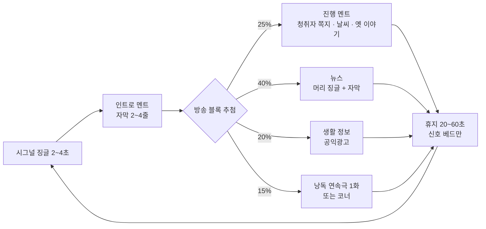
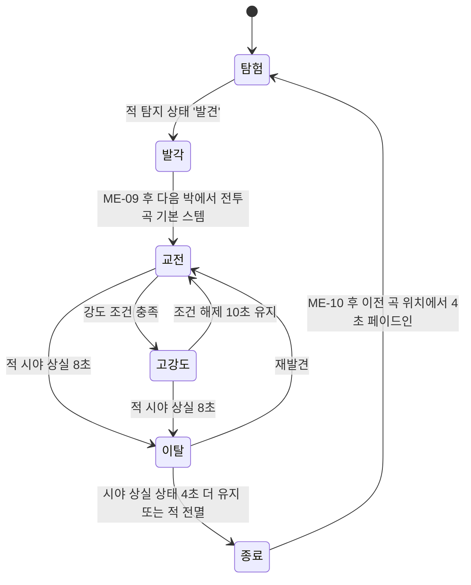

# SD-17. 사운드

> **서울 폴아웃 상세 기획서 세트** | 문서 ID: SD-17 | 버전: v1.2 | 작성일: 2026-10-12
> **범위**: 사운드 방향(오리지널 음악 원칙), BGM 큐 목록(볼트·권역 R01~R11·정착지·던전·전투·메인 스토리·엔딩 E1~E5·타이틀), 라디오(방송국·음악 채널 없는 텍스트 방송 구현·징글·멘트·플레이어 반응 뉴스. 수록곡은 제작 안 함), 모바일 오디오, 효과음 목록과 우선순위, 음성 없는 대화의 청각 피드백, 믹싱·공간감·심리스 BGM 전환 규칙, 제작 방식·일정·파일 규격 / 다루지 않는 것: 라디오 UI 화면 구성과 조작(→ SD-12), 퀘스트 진행 조건 자체(→ SD-03a·03b, SD-04a~d), 호감도·판도 수치(→ SD-06·SD-08), 무기·크리처 수치와 ID(→ SD-13·SD-14), 카르마 수치와 칭호(→ SD-10)
> **관련 문서**: [SC-00 컨셉](00_concept.md)(v1.1), [SD-01 게임 개요](01_game-overview.md), [SD-03a 메인 스토리 1부](03a_main-story-part1.md), [SD-03b 메인 스토리 2부](03b_main-story-part2.md), [SD-04a](04a_side-quests-south.md)·[SD-04b](04b_side-quests-west-river.md)·[SD-04c](04c_side-quests-north-east-center.md) 사이드 퀘스트, [SD-04d 세력 퀘스트 라인](04d_faction-questlines.md), [SD-05 비표시·반복·인카운터](05_misc-quests-encounters.md), [SD-06 세력](06_factions.md), [SD-07a 주요 인물](07a_characters-major.md), [SD-07b NPC 디렉터리](07b_npc-directory.md), [SD-08 월드·권역](08_world-regions.md), [SD-09a~f 장소 카탈로그](09a_locations-r01-r02.md), [SD-10 캐릭터 시스템](10_character-system.md), [SD-11 전투 시스템](11_combat-system.md), [SD-12 탐험·UI](12_exploration-ui.md), [SD-13 아이템](13_items.md), [SD-14 크리처·적](14_creatures-enemies.md), [SD-16 아트 디렉션](16_art-direction.md), [SD-18 용어·명명](18_naming-terms.md), 원작 [RD-25 아트·오디오·연출](../reverse-design/25_art-audio-presentation.md), [RD-27 쯔꾸르 이식 시사점](../reverse-design/27_adaptation-notes.md), [RD-17 탐험·상호작용](../reverse-design/17_exploration-interaction.md), 조사 [SR-03 인프라·군사](research/SR-03_seoul-infrastructure.md), [SR-05 국가·사회](research/SR-05_korea-state-society.md)

---

## 1. 개요

### 1.1 목적
- 서울 폴아웃의 "들리는 것" 전체를 정의한다. 작곡가·사운드 디자이너(외부 협업자 또는 도구 사용자)가 이 문서만 보고 큐(cue) 하나하나를 만들 수 있는 사양서 수준으로 쓴다.
- 원작 폴아웃 3의 소리 구조(앰비언트 탐험 음악 + 전환형 전투 음악 + 라디오)를 계승하고, 내용물은 모두 새로 만든다.

### 1.2 요약
| 항목 | 결정 |
|---|---|
| 음악 저작권 | **실존 곡 사용 0곡.** 원작 스코어·라디오 수록곡·실존 대중가요·실존 군가·국가(國歌)·실존 CM송은 음원·편곡·멜로디 인용 모두 쓰지 않는다. 모든 음악은 오리지널이다 |
| 시대 표지 | 1950~70년대 한국 레트로(트로트, 뽕짝 리듬, 엔카풍 꺾기, 그룹사운드, 통기타 포크)는 쓰지 않는다. 폴아웃 세계 공통의 '세기 중반 미국풍' 음악 어휘 위에 스코어와 징글을 짓고, **2077년 한국의 생활(아파트 분양, 학원, 배급, 징병, 배달 로봇)**은 방송 문안과 생활음으로 낸다 |
| BGM | 큐 135개(루프 111 + 원샷 24). 장소 250곳 이상을 장소 유형별 곡군으로 덮는다(3.2절). 메인 장면곡은 프롤로그·1~7막·엔딩·에필로그로 막별 배치, 6막 '사대문 안'과 7막 관제 본부에 전용곡 |
| 결말 음악 | 결말은 콘솔 앞 행동으로 정해진다(바이블 §5.5). 행동 직후 장면곡 ME-E1~E5가 결말 방송(BGM-E00 5판)과 같은 조성·템포로 이어진다 |
| BGS(환경음) | 루프 68개. 원작의 고독감은 BGS가 만든다 |
| 라디오 | 방송국 4곳(남산 방송, 공보방송, 용산 기지 방송, 관제망 비상 안내) + 국지 신호 6종. **음악 채널 없음(바이블 K11)**: 텍스트 방송(멘트·뉴스·선전·연설·낭독) + 징글 16·신호 베드 5·감정 스팅어 15(4.7절). 라디오 수록곡·가상 가수·보컬은 만들지 않는다 |
| 라디오의 v0.4 역할 | 호감도 수치를 숨기는 대신 **라디오가 기울기를 알린다.** 메인 퀘스트·행적(누구를 도왔나, 무엇을 누구에게 넘겼나)·판도(거점 탈환, 깃발 교체)·관계·카르마 뉴스 5종, 문안 약 280편(4.8절) |
| 음성 | 없다. 라디오 진행자의 말은 **텍스트 자막 + 시그널 징글 + 신호 베드(잡음) + 감정 스팅어**로 전한다 |
| 모바일 | PC와 같은 음원을 쓴다. 무음 스위치·백그라운드 전환·이어폰 분리 규칙과 모바일 용량은 7.8절 |
| 효과음 | 567파일(변형 포함). 우선순위 P1(단계 T~1 필수) 334 |
| 동료 | 동료 시스템이 없으므로 동료 테마·동료 사운드는 두지 않는다. 진돗개·파수-3은 NPC 소리 세트, 세력 지원 병력은 호출음과 세력 모티프 스템으로 처리 |
| 시그니처 사운드 | **관제망 4음 차임**. 관제망이 말하는 모든 순간(안내 방송, 로봇 기상, 차단벽 작동, 최종 콘솔)에 같은 4음이 들린다. 주제 '끝나지 않은 명령'을 소리 하나로 묶는다 |

### 1.3 문서 내 ID 규칙 (SD-17 소관)
| 대상 | 형식 | 예 |
|---|---|---|
| 루프 BGM | `BGM-<분류><번호>`. 메인 장면곡은 `BGM-M<막><순번>` | BGM-X01A, BGM-M604A |
| 원샷 음악(징글·장면곡) | `ME-<번호>`, 결말 행동곡 `ME-E1~E5` | ME-03, ME-E4 |
| 환경음 루프 | `BGS-<분류><번호>` | BGS-W02 |
| 효과음 | `SE-<분류>-<번호>` | SE-WPN-012 |
| 라디오 방송국 | `ST-<번호>` | ST-01 |
| 라디오 징글·신호 베드 | `RJ-<방송국 번호>-<번호>`, 신호 베드는 `RJ-<방송국 번호>-B`. (`RS-` 수록곡 ID는 v1.2에서 폐지, 결번) | RJ-01-01 |
| 라디오 텍스트 블록 | `RT-<방송국><번호>` | RT-01-052 |
| 라이트모티프 | `LM-<번호>` | LM-01 |

- 다른 문서 소관의 ID(퀘스트, 장소, 크리처, 무기)는 그 문서의 ID를 쓰고, 아직 없는 것은 `(SD-xx에서 ID 부여)`라고 쓴다.

---

## 2. 사운드 방향

### 2.1 원칙
| # | 원칙 | 내용 |
|---|---|---|
| S1 | 스코어와 라디오 방송 | 음악은 **스코어**(세계 밖에서 흐르는 분위기 음악) 한 층뿐이다. 원작은 라디오를 켜면 라디오 음악이 스코어를 대신했지만(RD-25 §3.4), 서울판 라디오는 **음악 채널이 없는 텍스트 방송**이다(바이블 K11). 라디오를 켜도 스코어는 계속 흐르고, 방송 블록(징글·자막)이 나오는 동안만 스코어를 낮춘다(7.3절) |
| S2 | 앰비언트가 기본 | 탐험 시간 대부분은 멜로디가 약한 앰비언트와 BGS가 채운다. 곡과 곡 사이에 **침묵 구간**(BGS만 흐름)을 둔다. 멜로디는 정착지·메인 장면·엔딩에 아낀다 |
| S3 | 오리지널만 | 2.2절. 비상업 팬게임이라도 원곡을 쓰지 않는다. "분위기만 닮은" 곡도 특정 곡을 떠올리게 하는 멜로디·리프·가사 인용이 있으면 반려한다 |
| S4 | 2077년 한국의 소리 | 한국성은 국악기나 옛 가요가 아니라 **2077년 도시의 생활음**에서 낸다: 지하철 안내 차임, 민방위 사이렌, 아파트 관리사무소 방송, 배달 로봇 도착음, 편의점 자동문 차임, 진공관 단말기의 예열음. 모두 오리지널로 만든다(실존 지하철 차임·실존 사이렌 녹음 사용 금지) |
| S5 | 폴아웃 기술 규칙의 음색 | 레트로 퓨처는 음색으로 들어온다: 진공관 신스(테레민 계열), 릴 테이프의 늘어짐, 소형 원자로의 저음 험(hum), 릴레이 딸깍음, 브라운관 고주파음 |
| S6 | 명령의 소리 | 주제 '끝나지 않은 명령'을 라이트모티프와 시그니처 사운드로 구조화한다(2.4절). 플레이어는 관제망 차임을 듣기만 해도 "명령이 깨어 있다"를 안다 |
| S7 | 음성 없음 | 대사·진행 멘트·연설은 모두 텍스트다. 소리는 텍스트를 **꾸미되 대신하지 않는다**(6장). 노래(보컬)는 만들지 않는다(2.5절) |
| S8 | 탑다운 2D에 맞춘 공간감 | 3D 공간 음향 대신 **타일 거리 감쇠 + 좌우 팬 + 실내외 차폐** 3요소로 공간을 만든다(7장) |

### 2.2 오리지널 곡 원칙과 금지 목록
| 구분 | 허용 | 금지 |
|---|---|---|
| 스코어 | 원작의 **구조**(카테고리, 전환 방식, 장면 전용곡 배치) 계승 | 이논 주르 스코어의 음원·편곡·멜로디 인용. "Main Title 같은 곡" 식의 사운드얼라이크 의뢰 |
| 라디오 징글 | 1~6초 시그널·머리 징글과 스팅어. 세기 중반 방송 징글의 **장르 어휘**(비브라폰, 약음기 트럼펫, 브라스 팡파르, 글로켄슈필) | 실존 방송 시그널·CM송 인용, 원작 GNR·엔클레이브 라디오 징글 모사. 라디오 수록곡(곡 단위 음악)은 만들지 않는다(K11) |
| 한국적 요소 | 2077년 한국의 생활 소재(방송 문안), 서울 지명(방송 문안) | 트로트·뽕짝 2박 리듬, 꺾기 창법을 흉내 내는 선율 장식, 엔카풍 단조 5음계 중심 선율, 1960~70년대 그룹사운드 퍼즈 기타, 통기타 포크, 1970년대 관제 건전가요 양식, 국악기를 '한국 표지'로 쓰는 것 |
| 국가 상징 | 가상 의전 팡파르 징글(공보방송), 비상정부 장면 스코어 | 애국가·실존 군가·실존 국민가요·실존 방송 시그널 인용 |
| 실명 | 지명·공공 공간 실명(한강, 남산, 여의도 등) | 실존 가수·작곡가·악단·음반사 이름, 실존 기업 CM송 |
| 효과음 | 직접 녹음, 합성, 라이선스가 확인된 효과음 라이브러리(게임 배포 허용 조건) | 원작 게임 파일에서 추출한 소리, 영화·방송 효과음 무단 사용, 실존 지하철·방송사 시그널 녹음 |

- **판정 절차**: 납품 큐마다 작곡자는 "참고한 장르·악기" 메모를 남긴다. 기획 검수에서 특정 곡이 떠오른다는 의견이 2명 이상이면 선율을 고친다(8.3절).

### 2.3 악기 팔레트
| 계열 | 음색 | 쓰는 곳 | 의미 |
|---|---|---|---|
| 앰비언트 현 | 저음 현 패드, 비브라토 없는 지속음, 하모닉스 | 탐험 전반 | 고독, 폐허의 넓이 |
| 프리페어드 피아노·단음 피아노 | 현 위에 금속을 올린 피아노, 멀리서 치는 단음 | 관악(R01), 세진 타워, 한유리 박사 관련 | 남겨진 사람의 기록 |
| 폐허 금속 타악 | 철근·철판·가드레일·드럼통 타격 샘플 | 전투, 마포 산업 지대, 지하철 | 무너진 도시 그 자체 |
| 진공관 신스 | 테레민 계열 사인파, 진공관 오실레이터 펄스(클럭) | 관제망, 세진전자 | 폴아웃 기술, 기계의 의지 |
| 첼레스타·오르골 | 맑은 종소리 계열 | 볼트 S-07, 어머니 윤정인, E3·E4 | 집, 잃어버린 안전 |
| 브라스(저음 중심) | 호른·트롬본·튜바, 스네어 | 비상정부, 계엄군, 공보방송 | 국가, 질서, 위압 |
| 리드 오르간 | 하모니움 계열 | 각성회 | 기계 신앙 |
| 목관·하프·마림바 | 클라리넷, 하프 아르페지오, 물방울 마림바 | 선유도(R04), 동부 습지(R08), 노들섬 | 물, 살아 있는 땅 |
| 테이프·라디오 텍스처 | 잡음, 와우·플러터, 릴 감기는 소리 | 남산 방송, 여의도 벙커, 회상 | 200년 묵은 기록 |
| 합창 패드 | 가사 없는 모음 합창 샘플(최소 사용) | 엔딩, 북한산 | 사람들, 끝 |

- **국악기**: 쓰지 않는다. 설화·민속 배제 원칙(바이블 §2 원칙 4)과 같은 맥락이며, 국악기를 '한국 표시'로 쓰면 2077년 도시의 정체성이 흐려진다.

### 2.4 라이트모티프
| ID | 이름 | 형태 | 등장 | 변주 규칙 |
|---|---|---|---|---|
| LM-01 | 관제망 차임 | **4음 하강-상승 차임**(진공관 벨 음색, 약 1.6초). 시그니처 사운드 | 관제망 안내 방송, 로봇 기상, 차단벽, 관리자 콘솔, 엔딩 | 정상(장조 마침) / 고장(4번째 음이 반음 낮게 끌림) / 계엄(브라스 겹침) / 시민(첼레스타 겹침) / 종전(마지막 음 없이 끊김) |
| LM-02 | 집 | 첼레스타 6음, 3/4박 | 볼트 S-07, 윤정인, 하도윤, E3·E4, 볼트 귀환 | 프롤로그는 밝게, MQ-401 볼모 장면은 단조, 엔딩은 원형 |
| LM-03 | 명령 | 스네어 3타 + 저음 브라스 2음 | 비상정부, 계엄군, 공보방송, 남궁혁 | E1에서 최대 편성. E4에서 스네어만 남았다가 사라짐 |
| LM-04 | 강 | 하프·마림바 상행 5음 | 2막 한강 횡단(MQ-201~204), 노들섬, 선유도 | 다리 위에서는 현 지속음과 겹침 |
| LM-05 | 기지 | 군대 나팔풍 5음(트럼펫 약음기) | 연합단, 용산 요새, 용산 기지 방송 시그널(RJ-03-01)이 원형 | 원칙파 장면은 반음계로 비틈 |
| LM-06 | 끝나지 않은 행군 | 원거리 큰북 + 저음 현 오스티나토 | 북한산, 중국군 잔존병, 멍쉐밍 상위 | MQ-303 평화 해결 시 큰북이 멈추고 현만 남음 |
| LM-07 | 송신탑 | 남산 방송 시그널 징글 RJ-01-01의 6음 선율(비브라폰) | 남산 방송 시그널, MQ-205 남산의 목소리, MQ-702 종전 방송, 엔딩 크레딧 | 라디오(디에제틱)와 스코어(비디에제틱)를 잇는 유일한 선율 |

- LM-01은 2077년 세진전자가 설계한 '관제망 안내 신호'라는 게임 속 설정을 갖는다. 실존 공공 차임(지하철·관공서·방송 시보)과 음정·리듬이 겹치지 않게 짓는다(검수 항목).
- LM-07은 일부러 라디오 시그널에서 가져온다. 마지막 '종전' 방송이 남산 방송으로 나가는 장면(바이블 §5.4 MQ-702)에서 플레이어가 수십 시간 들은 남산 방송 시그널 4초가 스코어로 펼쳐져 흐른다.

### 2.5 보컬과 라디오 수록곡 (제작 안 함, v1.2)
- 바이블 §2 원칙 7과 RD-27 P3의 '음성 없음'은 대사 보이스를 뜻한다. v1.1까지는 라디오 수록곡 28곡을 연주곡으로 만들고 보컬은 선택 과제로 두었으나, **바이블 K11(2026-10-12 사용자 결정 "라디오 곡 … 필요없어")에 따라 라디오 수록곡·가상 가수·보컬 판·가사 카드를 모두 만들지 않는다.** 게임 전체에 노래하는 목소리는 없다.
- 남는 음악은 스코어(BGM·ME)와 라디오 징글·스팅어(4.7절)뿐이다.

---

## 3. BGM 큐 목록

### 3.1 공통 규칙
| 항목 | 규칙 |
|---|---|
| 루프 유형 | **L1 완전 루프**: 도입부(1회) + 루프 몸통. 루프 시작점은 파일 메타데이터로 지정(8.4절) / **L2 순환+침묵**: 곡이 끝나면 30~90초(무작위) 침묵(BGS만) 뒤 같은 곡군의 다른 곡 / **L3 레이어 루프**: 길이가 같은 스템 2~4개를 동시에 재생하고 강도에 따라 스템 볼륨만 바꾼다 / **O 원샷**: 한 번 재생 후 지정 큐로 넘어가거나 침묵 |
| 길이 표기 | 루프 몸통 길이(도입부 제외). ME는 전체 길이 |
| 템포·박자 | 루프 몸통은 마디 단위로 끝난다. 크로스페이드 전환을 위해 L1·L2 곡은 마지막 2마디에 강한 어택을 두지 않는다 |
| 조성 기준 | 탐험 곡군은 권역 안에서 같은 으뜸음을 공유한다(A/B 전환 시 충돌 방지). 전투 곡은 해당 권역 탐험 곡과 같은 으뜸음 또는 5도 관계로 맞춘다 |
| 다이내믹 | 탐험 앰비언트는 피크를 낮게(7.2절 -18 LUFS 목표, 다이내믹 폭 8LU 이하). 정착지·장면곡은 폭을 넓게 써도 된다 |
| 곡군 | 권역 탐험은 A·B 2곡이 곡군이다. L2 규칙으로 A → 침묵 → B → 침묵 → A 순환. 첫 진입 시에는 A부터 |

### 3.2 장소 볼륨에 따른 수량 추정 (v0.3)
- 바이블 v0.3 §5.7은 지도 표시 장소 250곳 이상(정착지 15+, 볼트 S-01~S-12, 지하철역 40+, 랜드마크 60+)을 요구한다. 장소마다 곡을 붙이지 않고 **장소 유형별 곡군 + 권역 탐험 곡 + 장소 유형별 BGS** 3층으로 덮는다. 고유 곡은 메인 무대와 대형 정착지에만 준다.

| 장소 유형 | 수량(바이블) | BGM 처리 | BGM 큐 | BGS 처리 | BGS 루프 |
|---|---|---|---|---|---|
| 야외 권역 R01~R11 + 한강 HR | 권역 11 + 강 | 권역 곡군. 장소가 많은 6권역은 3곡, 나머지 2곡. 한강 2곡 | 30 | 바람·물·도시·자연 | 20 |
| 정착지 | 15+ | 대형 6곳 고유, 나머지는 소규모 공용 3판(판자촌·아파트 요새·물가 마을), 파괴 공용 1 | 10 | 대형 고유 6 + 소규모 공용 3 | 9 |
| 세력 거점 | 약 8 | 거점별 고유(청계산 벙커는 4막 장면곡) | 7 | 거점별 | 6 |
| 서울 볼트 | S-01~S-12 | S-07은 프롤로그 곡군. 나머지는 실험 성격별 3판 | 3 | 볼트 공용 3(정상·고장·붕괴) | 3 |
| 지하철역·지하 공간 UG | 40+ | 일반 역 / 대형 환승역 2판. 메인 진입로(1호선)는 6막 장면곡 | 2 | 터널·승강장·대합실·침수 구간 | 4 |
| 랜드마크 | 60+ | 전용 곡 없음. 권역 곡 + 발견 ME-04. 실내가 있으면 던전 유형 곡 | 0 | 대형 랜드마크 고유 소리 | 8 |
| 일반 던전·건물 | 나머지 약 110 | 던전 유형 곡(대피소, 군사, 연구, 세진, 침수, 동굴, 폐건물, 소굴, 학원가, 병원, 정부 벙커) | 11 | 실내 유형별 | 10 |
| 도심 지상(6막) | R05 | 6막 전용 3곡 + 6막 이전 2곡 | 5(장면곡 포함) | 관제망 도심 | 3 |
| 공통 | — | — | — | 비 3, 관제망 거리 2 | 5 |
| **합계** | **250+** | | **68** | | **68** |

- 장소 하나가 평균 3~4개 큐(권역 곡 + 유형 곡 + BGS)를 받는다. 신규 장소가 늘어도 큐는 늘리지 않고 SD-09a~f의 장소 표에 `BGM 곡군 / BGS` 두 열만 채운다(10장).

### 3.3 타이틀·시스템 음악
| ID | 제목(가제) | 길이 | 편성 / 분위기 | 사용처 | 루프 |
|---|---|---|---|---|---|
| BGM-T01 | 명령은 끝나지 않는다 | 2:10 | 테이프 잡음 → 첼레스타 LM-02 → 저음 현 → LM-01 고장 변주로 마침 / 차갑고 정돈된, 끝에 균열 | 타이틀, 불러오기 | L1 |
| ME-01 | 인트로: 세이프빌에서 만나요 | 1:50 | 분양 CM 징글(RJ-16-01) 선율을 낡은 스피커 음색의 짧은 행진풍 경음악으로 펼침(가사·보컬 없음) → 후반 30초 저음 현 드론 / 밝은 분양 광고 음악과 폐허의 대비 | 인트로 슬라이드(텍스트 내레이션) | O → BGM-V01 |
| ME-02 | 레벨업 | 0:04 | 비브라폰 상행 + 진공관 벨 / 성취 | 레벨 상승 | O |
| ME-03 | 퀘스트 완료 | 0:04 | 현 화음 + 첼레스타 / 마무리 | 퀘스트 완료 | O |
| ME-04 | 장소 발견 | 0:03 | 하프 3음 + 바람 / 발견 | 지도 마커 최초 발견(랜드마크 포함) | O |
| ME-05 | 사망 | 0:07 | LM-01이 테이프 늘어짐으로 꺼짐 / 끝 | 주인공 사망 | O |
| ME-06 | 퀘스트 실패 | 0:04 | 저음 현 단조 2화음 / 상실 | 퀘스트 실패 | O |
| ME-07 | 판도 변화 | 0:04 | 해당 세력 모티프 1마디(8판) / 깃발이 바뀜 | 플레이어가 보는 앞에서 정착지·거점의 깃발이 교체될 때(서울의 판도, 바이블 §6.2), 결말 슬라이드의 세력 항목 | O |

- 호감도 단계 변화에는 음악 알림을 붙이지 않는다. 바이블 §5.8 원칙 3(세계가 먼저 알려 준다)에 따라 단계 변화는 라디오 뉴스·NPC 반응으로 먼저 전하고(4.8절), 숫자 표시 옵션을 켠 경우에만 SE-UI 알림음을 낸다.
- ME-07 8판: 비상정부(LM-03), 연합단(LM-05), 원칙파(LM-05 반음계), 지하시장(진공관 오르간), 각성회(리드 오르간 + LM-01), 중국군 잔존병(LM-06), 새벽인력(밴조 2음, 비꼬는 음형), 정착지 연합(LM-02 목관).

### 3.4 프롤로그: 볼트 S-07
| ID | 제목(가제) | 길이 | 편성 / 분위기 | 사용처 | 루프 |
|---|---|---|---|---|---|
| BGM-V01 | 첫 등록 | 1:30 | 오르골 LM-02 + 진공관 단말기 클럭 / 따뜻하지만 기계적 | MQ-P1 출생신고(캐릭터 생성) | L1 |
| ME-08 | 열 살 생일 | 0:40 | 소편성 스윙(피아노·베이스·브러시) / 명랑, 작은 공동체 | MQ-P2 생일, 핍-보이 수여 | O → V02 |
| BGM-V02 | 적성 평가 사회 | 3:00 | 피아노 단음, 현 피치카토, 초침 타악 / 정돈, 미세한 압박 | 볼트 일상(MQ-P2~P3) | L1 |
| BGM-V03 | 시험 시간 | 2:20 | 초침 가속, 저음 현 오스티나토, 피아노 클러스터 / 숨 막힘 | MQ-P3 적성 평가 | L1 |
| BGM-V04 | 개방의 날 | 2:30 | 사이렌 텍스처, 스네어 LM-03, 금속 타악 / 혼란, 배신 | MQ-P4. 스템 3: `대치`(설득 경로) / `은신`(은신·하도윤 경로) / `교전`(전투 경로) | L3 |
| ME-11 | 처음 본 서울 | 1:20 | 현 상행, LM-02 원형, 끝에 바람만 / 해방과 상실(원작 'Exit the Vault' 대응) | MQ-P4 끝, 관악산 비탈에서 서울을 처음 내려다볼 때 | O → X01A |
| BGM-V05 | 볼모의 볼트 | 3:00 | LM-02 단조(첼레스타가 한 음씩 빠짐), 브라스 지속음 / 상한 고향 | MQ-401 귀향(점령된 S-07) | L1 |

- 볼트 일상에서 라디오를 켜면 국지 신호 ST-11(볼트 S-07 구내방송, 4.1절)의 차임과 공지 자막이 BGM-V02 위에 나온다(음악은 BGM-V02 그대로).

### 3.5 탐험: 권역 R01~R11 + 한강
| ID | 권역 | 제목(가제) | 길이 | 편성 / 분위기 |
|---|---|---|---|---|
| BGM-X01A·B·C | R01 관악 | 산 아래 첫걸음 / 계단의 도시 / 산의 그림자 | 3:20 / 3:10 / 3:00 | 단음 피아노·현 패드·바람 / 클라리넷 장음·하프 / 저음 현·원거리 개 짖음 같은 목관 — 막막함과 작은 희망 |
| BGM-X02A·B·C | R02 여의도·영등포 | 무너진 돔 / 증권가의 유리 / 공장 골목 | 3:40 / 3:30 / 3:10 | 저음 브라스 지속음·금속 하모닉스 / 유리잔 음색·프리페어드 피아노 / 철공소 리듬 타악 — 국가의 잔해, 차가움 |
| BGM-X03A·B·C | R03 마포·상암 | 쓰레기 산 / 탱크의 그늘 / 방송 단지 | 3:30 / 3:20 / 3:10 | 드럼통 타악·저음 드론 / 원자로 험·첼로 피치카토 / 라디오 잡음·비브라폰 — 산업, 썩음, 에너지의 기척 |
| BGM-X04A·B | R04 서강·선유도 | 물의 섬 / 정수장의 수조 | 3:00 / 3:10 | 마림바·하프·현(장조 경향) / 목관 합주 — 가장 부드러운 권역 |
| BGM-X05A·B | R05 도심(6막 이전) | 성곽 안 / 세종대로 | 3:40 / 3:30 | 진공관 클럭·LM-01 파편 / 브라스 저음·원거리 스네어 — 감시받는 공허 |
| BGM-X06A·B·C | R06 용산·남산 | 기지의 그림자 / 남산 바람 / 철길 아래 | 3:20 / 3:10 / 3:00 | 약음기 트럼펫 LM-05 파편 / 바람·라디오 잡음·비브라폰 / 저음 현·철로 금속 — 경계, 신호 |
| BGM-X07A·B·C | R07 강남 | 세이프빌의 밤 / 수직 도시 / 학원가 | 3:40 / 3:30 / 3:10 | 진공관 신스·분양 CM 징글 왜곡 파편 / 금속 공명·저음 펄스 / 메트로놈·피아노 연습곡풍 — 부의 폐허, 광고의 유령 |
| BGM-X08A·B | R08 동부 | 강변 습지 / 장터 가는 길 | 3:00 / 3:00 | 클라리넷·하프 / 어쿠스틱 기타·베이스 클라리넷 — 습함, 길 |
| BGM-X09A·B·C | R09 북부 산악 | 북쪽의 능선 / 짐승의 길 / 국경 쪽 | 3:40 / 3:20 / 3:30 | 원거리 큰북 LM-06·합창 패드(극소) / 낮은 플루트·나무 타악 / 저음 드론·무전 잡음 — 깊은 산, 옛 전쟁 |
| BGM-X10A·B | R10 서부 평야 | 활주로 / 항구 쪽 바람 | 3:50 / 3:30 | 가이거 리듬 타악·드론 / 바람·테이프 늘어짐 — 가장 황량 |
| BGM-X11A·B | R11 청계산 | 벙커의 산 / 경계 구역 | 3:20 / 3:10 | 저음 브라스 LM-03 파편 / 원거리 스네어·진공관 펄스 — 질서의 위협 |
| BGM-XHR1·2 | 한강 HR | 강을 건너다 / 다리와 섬 | 2:50 / 3:00 | 하프·마림바 LM-04·현 지속음 / 철골 공명·LM-04 변주 — 넓은 물, 노출 |

- 루프는 모두 L2(곡군 순환 + 침묵). R05 X05A·B는 6막 이전에 도심에 들어간 경우(순서 파괴)에만 쓰고, MQ-605가 열리면 6막 전용곡(3.9절)이 대신한다.
- **MQ-501 계엄 선포 이후**: 전 권역 탐험 곡 위에 BGS-K01(관제망 스피커 험)과 순찰 로봇 BGS가 깔린다. 곡 자체는 바꾸지 않는다.
- **에필로그(MQ-E1)**: 탐험 곡은 그대로다. 결말의 차이는 ST-04와 BGS(3.10절, 4.6절)로 전한다.

### 3.6 정착지·세력 거점
| ID | 장소 | 제목(가제) | 길이 | 편성 / 분위기 |
|---|---|---|---|---|
| BGM-S01 | 봉천 계단마을 | 계단마을 | 2:40 | 어쿠스틱 기타·클라리넷·나무 타악 / 가난하지만 다정한 첫 마을(MQ-101) |
| BGM-S02 | 탱크마을 | 기름 탱크 안 | 2:50 | 금속 잔향·베이스·브러시 / 둥근 철벽 안의 생활 |
| BGM-S03 | 노들섬 | 다리 위 장사꾼 | 2:40 | 하프 LM-04·발현악기·탬버린 / 흥정, 통행세(MQ-201) |
| BGM-S04 | 선유도 | 물을 지키는 사람들 | 3:00 | 목관 합주·마림바 / 질서 있는 평화 |
| BGM-S05 | 뚝섬 장터 | 장날 | 2:30 | 스윙 소편성 / 시끌벅적 |
| BGM-S06 | 세이프빌 | 분양 완료 | 2:50 | 라운지 비브라폰·분양 CM 징글 느린 변주 / 겉은 우아, 속은 폐쇄(MQ-204) |
| BGM-S07 | 지하시장 | 지하상가의 상인들 | 3:00 | 진공관 오르간·업라이트 베이스·형광등 험 / 오래 산 사람들의 무심함 |
| BGM-S08 | 용산 요새 | 기지를 지켜라 | 2:40 | 약음기 트럼펫 LM-05·스네어 / 규율, 의례 |
| BGM-S09 | 남산 방송국 | 스튜디오의 밤 | 2:30 | 라디오 잡음·피아노·LM-07 파편 / 고립된 목소리 |
| BGM-S10 | 각성회 거점 | 잠든 수호자 | 3:00 | 리드 오르간·LM-01 느린 변주 / 경건, 섬뜩함 |
| BGM-S11 | 무너진 정착지(공용) | 남은 것 | 2:30 | 단음 피아노·바람 / 상실 |
| BGM-S12 | 소규모 정착지 A(판자촌) | 고철 담장 | 2:30 | 기타·하모니카 없이 휘파람 음색 신스 / 버팀 |
| BGM-S13 | 소규모 정착지 B(아파트 요새) | 몇 동 몇 호 | 2:40 | 피아노·현 4중주 / 경계심 많은 이웃 |
| BGM-S14 | 소규모 정착지 C(물가 마을) | 물가 | 2:30 | 하프·클라리넷 / 느림 |
| BGM-S15 | 새벽인력 사무소·인력시장 | 오늘의 인력 | 2:40 | 밴조·업라이트 베이스, 경쾌한데 불길 / 장부와 사슬 |
| BGM-S16 | 원칙파 거점 | 회수 | 2:40 | LM-05 반음계 변주·금속 타악 / 고집 |
| BGM-S17 | 중국군 잔존병 지하 기지(비적대 시) | 대기 명령 | 3:00 | LM-06 느린 변주·저음 현 / 기다림, 피로 |

- 모두 L1. 정착지·거점 반경(7.4절 BGM 구역) 안에서 탐험 곡보다 우선한다. 파괴·점령되면(SD-04a~d·SD-09a~f 결과 변수) BGM-S11로 바꾼다.
- 소규모 정착지 A·B·C 중 어느 판을 쓸지는 SD-09a~f 장소 표의 `BGM 곡군` 열에서 지정한다.

### 3.7 던전 유형
| ID | 유형 | 제목(가제) | 길이 | 편성 / 분위기 | 대표 장소 |
|---|---|---|---|---|---|
| BGM-D01A | 지하철 일반 역·선로 | 막차 없는 선로 | 3:30 | 터널 잔향 타악·저음 드론 / 끝없는 어둠 | 지하철역 40+ |
| BGM-D01B | 대형 환승역·지하상가 연결 | 환승 통로 | 3:20 | 형광등 험·피아노 단음·멀리 울리는 금속 / 넓고 텅 빔 | 환승역 |
| BGM-D02 | 시민 대피소 | 0.825㎡ | 3:20 | 현 하모닉스·끊어진 오르골 / 비극의 현장 | 대피소 지정 지하 |
| BGM-D03 | 군사 시설 | 경계 근무 | 3:10 | 원거리 스네어·저음 금관·무전 잡음 / 위협 | 기지·포대 |
| BGM-D04 | 원자력·연구 시설 | 노심 | 3:40 | 원자로 험·가이거 리듬·테레민 / 금지 구역 | 공릉 연구로, 당인리 |
| BGM-D05 | 세진 로봇 시설 | 조립 라인 | 3:20 | 진공관 펄스·5/4 기계 리듬 / 기계의 의지 | 세진 시설 |
| BGM-D06 | 침수 지하 | 물속의 길 | 3:30 | 물 떨어짐 리듬·잔향 큰 피아노 / 질식 | 신월 빗물터널 |
| BGM-D07A·B·C | 서울 볼트(S-07 외) | 다른 실험: 통제 / 붕괴 / 기괴 | 3:20 각 | LM-02의 낯선 변주 + 진공관 클럭. A 정돈된 압박, B 잔해와 경보, C 음정 비틀림 | S-01~S-12(실험 성격은 SD-09a~f) |
| BGM-D08 | 산악 동굴·터널 | 굴 | 3:10 | 낮은 플루트·바위 타악 / 야생 | 북한산·관악산 |
| BGM-D09 | 폐건물·아파트 | 빈 집들 | 3:00 | 피아노 단음·테이프 잡음 / 사람이 살던 흔적 | 아파트 단지 |
| BGM-D10 | 정부 벙커 | 지하 정부 | 3:30 | 저음 브라스 LM-03·타자기 리듬 / 관료적 공포 | 여의도 지하 벙커, 청계산 벙커 |
| BGM-D11 | 변종·야생 구울 소굴 | 굶주림 | 3:00 | 저음 드론·불규칙 금속 / 공포 | 소굴 |
| BGM-D12 | 학원가·학교 | 모의고사 | 3:00 | 초침·피아노 연습곡 파편(V03과 형제곡) / 시험지의 유령 | 학원 건물, 학교 |
| BGM-D13 | 병원·의료 시설 | 병동 | 3:10 | 심박 같은 저음 펄스·하모닉스 / 차가운 연민 | 병원 |

- 모두 L2(던전 안에서 침묵 구간 20~60초). 메인 전용 던전 구간은 3.9절 장면곡이 대신한다.

### 3.8 전투 단계
| ID | 제목(가제) | 길이 | 편성 / 분위기 | 사용처 | 루프 |
|---|---|---|---|---|---|
| ME-09 | 발각 | 0:01.5 | 현 스포르찬도 + 금속 타격 / 경고 | 적이 '발견' 상태로 전환(SD-11 탐지 단계) | O |
| BGM-C01 | 맞붙다 | 1:40 | 금속 타악·저음 현 오스티나토·브라스 스탭 / 거침 | 인간형 적(약탈자, 새벽인력, 철벽경호, 자율방범대, 원칙파). 연합단 상대 시 LM-05 변형 스템 | L3 |
| BGM-C02 | 물어뜯다 | 1:30 | 불규칙 타악·현 글리산도 / 본능적 위협 | 크리처, 야생 구울 | L3 |
| BGM-C03 | 거대한 것 | 2:00 | 대형 북·저음 금관 / 압도 | 강적(미군 생물병기, 대형 변종, 변이 반달가슴곰 등. 등급은 SD-14) | L3 |
| BGM-C04 | 계엄 | 1:50 | 스네어 행진 LM-03·브라스 전체 / 국가 폭력 | 계엄군 | L3 |
| BGM-C05 | 관제망 | 1:50 | 진공관 펄스 가속·LM-01 계엄 변주 / 차갑고 정확 | 관제망 로봇·포탑, 세진 보안 로봇 | L3 |
| BGM-C06 | 명령에 갇힌 병사들 | 1:50 | 큰북 LM-06·저음 현 / 비장, 연민 | 중국군 잔존병 | L3 |
| BGM-C07 | 결전 | 2:30 | 전 편성 + 보스 라이트모티프 / 클라이맥스 | 메인 보스전 공용(육지환 대령, 관제 본부 방어체 등. 지정은 SD-03a·03b, SD-14) | L3 |
| ME-10 | 정적 | 0:02.5 | 현 화음이 풀리며 사라짐 / 해소 | 전투 종료 | O |

- 스템: `기본`(타악+저음) / `고강도`(브라스·현 상성부). C07은 `최종`(합창 패드 + LM 선율) 추가. 전환 조건은 7.5절.
- 세력 지원 병력을 호출한 전투(호감도 '신뢰' 이상, 바이블 §6.2)는 같은 전투곡에 해당 세력 모티프 스템을 얹는다(ME-07과 같은 8모티프를 1:40 루프로 납품, 전투곡과 같은 템포 120BPM·같은 으뜸음 D).

### 3.9 메인 스토리 장면 (막별)
- ID는 `BGM-M<막><순번>`. 장면곡은 스크립트 장면의 시작 이벤트에서 재생하고, 끝나면 해당 권역·던전 곡으로 6초 크로스페이드한다. 막은 '진행 단계'일 뿐 지역 잠금이 아니므로(바이블 §5.3), 장면곡은 **퀘스트 단계 + 장소**가 모두 맞을 때만 재생한다.
- 1회차 필수 경로만 밟아도 막마다 장면곡 2곡 이상을 듣게 배치했다.

| 막 | ID | 제목(가제) | 길이 | 편성 / 분위기 | 사용처 | 루프 |
|---|---|---|---|---|---|---|
| 1막 미등록자 | BGM-M101 | 2077년 10월 23일 | 3:00 | 테이프 잡음·타자기 리듬·LM-01 고장 변주 / 기록 속 그날 | MQ-104 여의도 지하 벙커 기록 구간 | L1 |
| | BGM-M102 | 해독 | 2:00 | 진공관 클럭·피아노 아르페지오, LM-01 4음이 하나씩 드러남 / 수수께끼가 풀림 | MQ-102 코드 해독 장면(MQ-103·104·105 어느 경로로 끝나든 재생) | L1 |
| | BGM-M103 | 장부 | 2:30 | 밴조 음형 느리게·저음 현 / 은밀, 불쾌 | MQ-105 새벽인력 사무소, 황두칠의 장부 | L1 |
| | BGM-M104 | 첫 번째 추적자 | 2:20 | 스네어 LM-03·현 트레몰로. 스템 `대치`/`은신`/`교전` / 처음 마주한 국가 | MQ-106 육지환 수색대 대면 | L3 |
| 2막 강 | BGM-M201 | 나룻배 | 2:40 | 하프 LM-04·노 젓는 리듬 타악 / 노출된 고요 | MQ-202 양화 나루 횡단 | L1 |
| | BGM-M202 | 물 아래 터널 | 3:00 | 물 떨어짐 리듬·금속 신음. 스템 `기본`/`침수 가속` / 시간 압박 | MQ-203 하저 터널 | L3 |
| | BGM-M203 | 남산의 목소리 | 2:20 | 피아노·라디오 잡음·LM-07 첫 제시 / 첫 공적 선택 | MQ-205 송미래 면담과 '방송할지 숨길지' 선택 | L1 |
| | BGM-M204 | 요새의 문 | 1:30 | LM-05 전체·스네어 의례 리듬 / 의례, 시험 | MQ-206 용산 요새, 다니엘 서 | L1 |
| | BGM-M205 | 손을 내미는 자들 | 3:00 | 공통 현 골격 위에 LM-03·LM-05·리드 오르간·진공관 오르간·LM-02 스템 / 서울의 세력들이 다가옴 | MQ-207 세력 접근 이벤트(전령·쪽지·매복 대화)가 벌어지는 장면. 그 세력 스템만 올린다. 고르는 화면이 아니므로 곡은 결정 없이 장면이 끝나면 페이드 | L3 |
| 3막 세 개의 열쇠 | BGM-M301 | 노심을 깨우다 | 3:00 | 원자로 험·가이거 리듬. 스템 `기본`/`경보` / 금지된 힘 | MQ-301 당인리 내부 | L3 |
| | ME-12 | 전원 투입 | 1:10 | 원자로 험 상승 → **LM-01 첫 완전 연주** → 저음 브라스 / 경이와 불안 | MQ-301 재가동 순간. 서울 전역 가로등·관제망 스피커 점등과 동기화 | O |
| | BGM-M302 | 깨어나는 탑 | 2:40 | 진공관 펄스·상승하는 현. 스템 `기본`/`각성` / 수직 상승 | MQ-302 세진전자 타워 상층 | L3 |
| | BGM-M303 | 한유리의 기록 | 2:30 | 단음 피아노·첼로·LM-01 장조 선율 / 남겨진 양심 | MQ-302 프로토콜 발견, MQ-304 기록 8건 완료 | L1 |
| | ME-13 | 기록 한 장 | 0:06 | M303 첫 소절 피아노 / 단서 | MQ-304 기록 1건 획득마다 | O |
| | BGM-M304 | 전쟁은 끝났다 | 2:00 | 큰북 LM-06이 멈추고 저음 현 → 하프 / 해소, 연민 | MQ-303 평화 해결 | L1 |
| 4막 개방의 대가 | BGM-M401 | 권한대행 | 2:40 | 저음 브라스 LM-03·레코드 잡음·진공관 건반 / 위엄, 부패 | MQ-402 청계산 벙커, 남궁혁 대면 | L1 |
| | BGM-M402 | 무너지는 벙커 | 2:00 | 금속 타악·경보·현 트레몰로. 스템 `기본`/`붕괴` / 탈출 | MQ-402 사보타주 경로, MQ-401 강습 경로 탈출 구간 | L3 |
| | BGM-M403 | 어머니 | 2:30 | LM-02 첼레스타 독주 → 현. 결말별 마침 4판(화해·이별·상실·외면) / 볼트의 문 앞에서 | MQ-403 윤정인의 결말 장면 | L1 |
| 5막 서울 회의 | ME-14 | 계엄 선포 | 1:00 | 사이렌(SE-NET) → LM-01 계엄 변주 → LM-03 최대 / 거리로 나온 명령 | MQ-501 시작 | O |
| | BGM-M501 | 서울 회의 | 3:20 | 현 4중주 골격 + 참석 세력 모티프 스템(최대 8) / 불안한 탁자 | MQ-502 노들섬 세력 회의(호감도에 따라 참석 세력 스템만 켬) | L3 |
| | BGM-M502 | 세력 위기 | 2:30 | 공통 타악·저음 + 해당 세력 모티프 스템 / 각자의 위기 | MQ-503~506 공용 | L3 |
| | BGM-M503 | 정착지를 지켜라 | 2:30 | C04 계엄과 같은 템포, LM-02 목관이 맞섬 / 버팀 | MQ-507 계엄군 총공세 방어전 | L3 |
| | ME-15 | 집결 | 0:20 | 집결지에 나타난 세력들의 모티프를 겹친 화음(세력 스템 8 + 단독 판 1) / 결속, 또는 혼자 | MQ-508 도심 진입 날 집결지 도착. 나타난 세력의 스템만 켠다(고르는 화면 없음, 바이블 §5.8) | O |
| 6막 사대문 안 | BGM-M601 | 1호선 | 3:20 | D01A 확장, 진공관 펄스가 점점 가까워짐 / 미로, 접근 | MQ-601 | L2 |
| | BGM-M602 | 침투 터널 | 3:00 | LM-06 평화 변주·바위 타악 / 옛 적이 판 길 | MQ-602 | L1 |
| | ME-16 | 성벽이 열린다 | 0:40 | LM-01 관리자 변주 → 저음 브라스·돌 굴림 / 권한의 무게 | MQ-603 차단벽 개방 | O |
| | BGM-M603 | 강하 | 2:00 | 버티버드 로터 리듬 타악·브라스 / 낙하 | MQ-604 공중 강하 | L3 |
| | BGM-M604A | 사대문 안: 궁궐 터 | 3:40 | 저음 현 지속·하프 간헐·LM-01 원거리 / 오래된 중심의 정적 | MQ-605 이후 R05 경복궁·광화문 일대 | L2 |
| | BGM-M604B | 사대문 안: 광장과 거리 | 3:30 | 진공관 클럭·브라스 저음·테이프 잡음 / 깨어난 행정의 공허 | MQ-605 이후 시청·명동·세종대로 일대 | L2 |
| | BGM-M604C | 사대문 안: 시장 터 | 3:20 | 금속 타악 느리게·클라리넷 / 사람이 많던 곳 | MQ-605 이후 남대문시장 일대 | L2 |
| | ME-17 | 출입 권한 | 0:05 | LM-01 1음씩(1·2·3번째 권한에 따라 1~3음) / 진척 | MQ-605 관제 본부 출입 권한 1개 확보마다 | O |
| 7막 종전 | BGM-M701 | 관제 본부 | 3:30 | 진공관 펄스(60BPM 심장 박동)·LM-01 반복 변주. 스템 `단독`/`공동 작전`(협력 세력 모티프) / 거대한 기계 내부 | MQ-701 관제 본부 상층 | L3 |
| | BGM-M702 | 진공관실 | 3:20 | 진공관 험 합창 같은 드론·LM-01 역행 / 도시의 뇌 | MQ-701 하층 중앙 컴퓨터 구역 | L1 |
| | BGM-M703 | 관리자 콘솔 | 1:30 | 극저음 드론 + LM-01의 4번째 음이 울리지 않는 반복. 스템 `정적` / `대치`(곁에 선 세력이 막거나 재촉할 때, 그 세력 모티프) / 결정의 무게 | MQ-702 콘솔 앞. 결정 메뉴는 없고 행동을 기다린다. 대치가 전투가 되면 C07 `최종` | L3 |
| | ME-E1 | 손을 올리다 | 0:30 | LM-01 계엄 변주가 4음째까지 완결 → LM-03 스네어 | E1 행동: 기본 프로토콜 그대로 인증 판에 손을 올림(또는 비상정부가 올리게 둠) | O → E00(E1판) |
| | ME-E2 | 열쇠를 건네다 | 0:30 | LM-01 정상 변주 → LM-05 트럼펫이 이어받음 | E2 행동: 지휘 열쇠를 다니엘 서에게 건넴 | O → E00(E2판) |
| | ME-E3 | 테이프를 꽂다 | 0:35 | 릴 테이프 감김(SE) → LM-01 시민 변주 → LM-02 | E3 행동: 시민 보호 프로토콜 테이프 삽입 후 인증 | O → E00(E3판) |
| | ME-E4 | 코어를 부수다 / 선을 끊다 | 0:30 (2판) | 판1 진공관 파열음 연쇄, 판2 원자로 험 하강 → 둘 다 LM-01 종전 변주(마지막 음 없음) → 침묵 2초 | E4 행동: 중앙 진공관 코어 파괴 또는 당인리 전원선 절단 | O → E00(E4판) |
| | ME-E5 | 등록을 고정하다 | 0:30 | 테레민이 LM-01을 한 옥타브 위에서 반복, 저음 오르간 | E5 행동: 지휘 열쇠를 넘기지 않고 관리자 등록을 자기에게 고정 | O → E00(E5판) |

- **6막 전용곡 M604A·B·C**는 도심 지상 탐사(바이블 §5.4 MQ-605)의 주 무대 음악이다. 관제망이 깨어 있으므로 세 곡 모두 `관제망 레이어` 스템(LM-01 정상 변주 + 펄스 강화)을 둔다. 관리자 권한을 3개 모으면 레이어 볼륨을 한 단계 올린다.
- **7막 전용곡 M701·M702·M703**은 한 흐름이다. 같은 으뜸음(C)과 같은 60BPM 펄스를 공유해, 층을 내려갈수록 편성만 줄어든다.
- **콘솔 행동 → 결말 방송 이음**: 결말은 콘솔 앞의 행동으로 정해진다(바이블 §5.5). 행동이 일어난 프레임에 M703을 2마디 안에서 끊고(마디 경계 대기 최대 2초, 7.5절) 해당 ME-E1~E5를 재생한다. 각 ME-E는 **E00 해당 판의 첫 화음과 같은 조성·템포(60BPM)로 끝나도록** 작곡해, 장면 음악과 라디오 송출 음악이 끊김 없이 이어진다. 행동 직후의 화면(로봇 정지, 경보, 차단벽 개방 등) 연출은 ME-E 길이 안에서 끝난다.

### 3.10 엔딩·에필로그
| ID | 제목(가제) | 길이 | 편성 / 분위기 | 사용처 | 루프 |
|---|---|---|---|---|---|
| BGM-E00 | 종전 방송 | 1:00 (5판) | 라디오 잡음 → LM-07이 라디오 음색에서 관현악으로. 판별 화성: E1 LM-01 계엄 차임이 끼어듦 / E2 트럼펫 / E3 첼레스타 / E4 반주 없이 피아노만 / E5 테레민 / 서울 전역에 닿는 한 목소리 | ME-E1~E5 직후 남산 방송 송출. 자막은 결말 방송 문안(4.8.5절) | O → 각 엔딩곡 |
| BGM-E01 | E1 계엄 | 2:30 | LM-03 최대·LM-01 계엄 변주 / 완벽한 질서의 공포 | E1 | L1 |
| BGM-E02 | E2 이양 | 2:30 | LM-05 트럼펫·현·절제된 스네어 / 총으로 지킨 질서 | E2 | L1 |
| BGM-E03 | E3 시민 등록 | 2:40 | LM-01 시민 변주 + LM-02 + 현 전체 / 모두가 시민 | E3 | L1 |
| BGM-E04 | E4 종전 | 2:40 | LM-01 종전 변주(마지막 음 없이 끊김) → 침묵 2초 → 피아노·바람·LM-02 / 멈춤, 맨손의 시작 | E4 | L1 |
| BGM-E05 | E5 군림 | 2:30 | 테레민 독주가 LM-01을 장악·저음 오르간 / 고독한 왕좌 | E5 | L1 |
| BGM-E06 | 서울의 나중 | 3:00 | 피아노·현 골격, 3판(선: 첼레스타 / 중립: 클라리넷 / 악: 저음 브라스) / 후일담 | 결말 슬라이드(ES-, SD-03b): 카르마·세력별 호감도·사이드 결과 | L1 |
| BGM-E07 | 송신탑(관현악) | 4:30 | LM-07(남산 방송 시그널 선율) 관현악 전개, 끝에 LM-01 정상 변주 1회 / 수미상관 | 엔딩 크레딧 | O |
| BGM-EP1 | 그 후 | 2:40 | LM-02와 LM-07을 엮은 소편성(피아노·클라리넷·기타) / 이어지는 삶 | MQ-E1 후일담 장면(정착지 귀환 장면 등) | L1 |

- **결말 슬라이드 재생 시간**: 장당 15초(SD-03b 정본), 재생 상한 24장이면 약 6분이다. BGM-E01~E06은 6분 동안 끊김 없이 이어지도록 루프점을 두고 만든다(RECON_SPEC N-78).
- 세력별 결말 슬라이드(바이블 §5.5)는 BGM-E06 3판 위에 해당 세력 모티프를 1마디 얹는 방식으로 처리한다(슬라이드 시작 시 ME-07 해당 판 재생). 세력마다 곡을 따로 만들지 않는다.
- E3·E4 뒤의 침묵 2초는 마스터에서 지우지 않는다(검수 항목).

### 3.11 BGM 집계
| 분류 | 루프 | 원샷 | 합계 | 주 단계(8.5절) |
|---|---|---|---|---|
| 타이틀·시스템 | 1 | 7 | 8 | T~0 |
| 프롤로그(볼트) | 5 | 2 | 7 | 0 |
| 탐험(R01~R11, HR) | 30 | 0 | 30 | 1~4 |
| 정착지·세력 거점 | 17 | 0 | 17 | 1~3 |
| 던전 유형 | 16 | 0 | 16 | 1~4 |
| 전투 | 7 | 2 | 9 | T~2 |
| 메인 장면(1~7막) | 28 | 11 | 39 | 1~2 |
| 엔딩·에필로그 | 7 | 2 | 9 | 2 |
| **합계** | **111** | **24** | **135** | |

- 추가 스템(전투 세력 모티프 8, 장면곡 상황 스템, 6막 관제망 레이어 3, ME-07·ME-15 세력 판)은 큐 수에 넣지 않았다. 스템·판 포함 납품 파일은 약 230개다.
- 총 재생 길이(루프 몸통 기준) 약 5시간 30분. 원작 스코어(약 40트랙, 60~70분)의 5배 가량이지만, 메인 볼륨이 원작의 두 배 이상이고 장소가 250곳을 넘으므로 탐험·던전 곡군을 줄이면 반복감이 원작보다 커진다. 단계별로 나눠 만든다(8.5절).

---

## 4. 라디오

> 이 장은 방송 콘텐츠와 소리 구현을 다룬다. 라디오 화면(핍-보이 라디오 탭, 자막 위치, 다이얼 조작)은 [SD-12](12_exploration-ui.md), 방송국이 열리고 닫히는 퀘스트 조건의 최종 확정은 [SD-03a](03a_main-story-part1.md)·[SD-03b](03b_main-story-part2.md)·[SD-04a~d](04d_faction-questlines.md), 반응 뉴스의 원인이 되는 호감도·판도 이벤트의 정의는 [SD-06](06_factions.md)·[SD-08](08_world-regions.md)이 맡는다. 아래 조건은 사운드 쪽 제안이다.
> **v0.4 역할**: 바이블 §5.8 원칙 3에 따라 라디오는 **기울기를 플레이어에게 알려 주는 주요 수단**이다. 호감도 수치는 숨기고, 주인공이 누구를 도왔는지·무엇을 누구에게 넘겼는지·판도가 어떻게 바뀌었는지를 뉴스로 들려준다(4.8절).

### 4.1 방송국 일람
| ID | 방송국 | 운영·진행 | 송출지 | 콘텐츠 | 원작 대응 |
|---|---|---|---|---|---|
| ST-01 | **남산 방송** | 진행자 **송미래** | 남산 송신탑 아래 방송실(R06) | 진행 멘트, 뉴스, 생활 정보, 낭독 연속극, 사이드 연동 코너(음악 없음, 징글만) | 갤럭시 뉴스 라디오 |
| ST-02 | **공보방송** | 비상정부. **권한대행 남궁혁** 연설 | 청계산 벙커(R11) 송신기 + 계엄군 중계 | 권한대행 연설 10편 + '오늘의 표어' + 공고 + 의전 팡파르 징글(음악 없음) | 엔클레이브 라디오 |
| ST-03 | **용산 기지 방송** (신규 제안) | 연합단. 2077년 기지 방송 녹음 테이프를 연합단 통신병이 의례처럼 튼다 | 용산 요새(R06) | 녹음된 옛 DJ 멘트 + 연합단 '기지 수칙' 낭독 + 기상나팔 징글(음악 없음) | (신규) 원작의 볼트 101 PA·엔클레이브 라디오의 '녹음 반복' 성격을 섞음 |
| ST-04 | **관제망 비상 안내** (신규 제안) | 수도 관제망 자동 송출. 진행자 없음 | 관제 본부(R05) → 관제망 스피커·방송망 | LM-01 차임 + 경보음 + 공문체 안내 자막. 음악 없음 | (신규) 아메리카 인민공화국 라디오의 '200년째 반복' 성격 + 서울판 주제 |

- **국지 신호**(범위 안에서만 수신, 원작 햄 라디오·조난 신호 대응)

| ID | 신호 | 송출지 | 내용 | 게임 기능 |
|---|---|---|---|---|
| ST-11 | 볼트 S-07 구내방송 | 볼트 S-07 내부 | 구내 차임 징글 + 생활 수칙 + 시험 일정 공지 자막 | 프롤로그 라디오 튜토리얼. MQ-401 재방문 시 비상정부 공지로 바뀜 |
| ST-12 | 북한산 난수 신호 | 북한산 지하(R09) | 숫자 읽기 대신 **숫자 자막 + 모스 부호 비프**. 200년째 같은 대기 명령 | MQ-303 진입 단서. 신호 세기로 출처 추적. 평화 해결 뒤 "임무 종료" 부호로 바뀜 |
| ST-13 | 각성회 기도 신호 | 각성회 거점(SD-09a~f) | 리드 오르간 단음 드론(신호 베드 RJ-13-B) + LM-01 느린 차임 + 류정의 '기도문' 자막 | 각성회 세력 퀘스트 라인(FQ-, SD-04d에서 ID 부여) 유도 |
| ST-14 | 조난 신호(공용 템플릿) | 랜덤·고정 위치 | 비프 3회 + 짧은 자막("살려 주세요, ○○역 2번 출구") | 비표시 퀘스트·인카운터 시작(SD-05에서 ID 부여) |
| ST-15 | 새벽인력 '일자리 안내' | 새벽인력 거점 주변 | 친절한 공고문 자막(실은 인신매매) + 주인공 현상금 공고 | 블랙 유머, 추적자 경고 |
| ST-16 | 세이프빌 분양 안내 | 강남 세이프빌 단지(R07) | 2077년 분양 홍보 녹음 반복: 분양 CM 징글(RJ-16-01) + 분양 조건 자막 | 환경 풍자. 세이프빌 정착지 입구 유도 |

### 4.2 수신 범위와 열림·닫힘 (제안)
| 방송국 | 처음 상태 | 확장·변화 | 종료 |
|---|---|---|---|
| ST-01 남산 방송 | 약한 신호: R06, R02 북쪽 강변, 노들섬에서만 깨끗하게 수신. 그 밖은 잡음 섞임(7.6절 신호 품질) | **MQ-205 남산의 목소리 완료 시 전역**(`RADIO_PUBLIC`, SD-03a 정본)(송미래가 송신탑 출력을 올림. 조건 확정은 SD-03a). 순서 파괴로 MQ-205 전에 남산에 가도 같은 이벤트로 처리 | 송미래 사망 시 자동 송출(징글·반복 공지)만 남음(4.4.6절) |
| ST-02 공보방송 | 볼트 탈출 직후부터 **전역**. 볼트 밖에서 처음 잡히는 방송 | 막별 연설 교체(4.5절) | MQ-402에서 벙커 송신기가 파괴되면 종료. E3·E4 뒤 종료. E1 뒤에는 '정통 정부 방송'으로 계속 |
| ST-03 용산 기지 방송 | 처음부터 R06 전역과 R02·R07 북부 | 연합단 호감도·판도에 따라 범위 확대(연합단 판도 권역마다 중계) | 용산 요새가 함락되면 종료. E2 뒤 전역 |
| ST-04 관제망 비상 안내 | 지하철역·도심(R05)에서만 비상 배터리로 2077년 녹음 반복(약한 신호) | **MQ-301 당인리 재가동 시 전역**. MQ-501 계엄 선포부터 계엄 단계 공지 | E4 뒤 반송파만 1주기 → 영구 무음. 그 밖의 결말은 결말별 공지로 계속(4.6.2절) |
| ST-11~16 | 해당 장소 반경(타일 기준 반경은 SD-12) | 퀘스트에 따라 내용 교체 | 출처를 끄거나 파괴하면 종료 |

### 4.3 음성 없는 방송의 구현
- 라디오는 **텍스트 블록 + 짧은 음원(징글·스팅어·신호 베드)**의 재생 목록이다. **음악 채널은 없다**(바이블 K11). 말소리도 없다. 진행자의 존재감은 ① 자막 문체 ② 시그널·머리 징글 ③ **감정 스팅어**(1~2초) ④ **신호 베드**(방송국마다 다른 반송파·테이프 잡음, 음악 아님)로 만든다.

| 요소 | 규칙 |
|---|---|
| 블록 순서 | 징글 → 인트로 멘트 → (추첨: 뉴스 40 / 진행 멘트 25 / 생활 정보 20 / 연속극·코너 15%) → 휴지(신호 베드만 20~60초) → 징글. 반응 뉴스(4.8절)가 대기 중이면 다음 추첨은 무조건 뉴스 |
| 자막 줄 | 한 줄 최대 28자(한글 기준). 줄 표시 시간 = `1.2초 + 글자 수 × 0.09초`. 줄 사이 0.3초. 모바일 글자 크기 규칙은 SD-12 §17 |
| 자막 위치 | 탐험 HUD 하단 라디오 자막 줄(1줄씩 교체, 위치·서체는 SD-12). 핍-보이 라디오 탭에는 최근 블록 20개를 **방송 기록**으로 남긴다 |
| 화자 표시 | 줄 앞에 화자 아이콘(송미래 / 남궁혁 / 옛 DJ / 관제망 문장(紋章)). 이름 대신 아이콘이 '목소리'다 |
| 신호 베드 | 방송국마다 8~20초 루프 1종(RJ-xx-B). 라디오가 켜져 있는 동안 늘 깔리며 볼륨은 징글보다 -12dB. 음악이 아니라 '켜져 있음'을 알리는 잡음이다 |
| 감정 스팅어 | 멘트 줄 끝에 태그로 붙인다: `[웃음]` 브러시 스네어 + 피아노 장식음 / `[놀람]` 비브라폰 글리산도 / `[한숨]` 하강 클라리넷 / `[슬픔]` 저음 현 1화음 / `[긴급]` 전신음 3회. 방송국별 음색 세트 |
| 스코어와의 관계 | 라디오를 켜도 BGM은 계속 흐른다. 징글·멘트 블록 동안만 SCORE -6dB(7.3절) |
| 전투 중 | 자막과 징글·스팅어를 내지 않고 방송 기록에만 쌓는다. 신호 베드는 -6dB로 유지 |
| 대화 중 | 라디오 -9dB 덕킹, 자막 일시 정지. 대화가 끝나면 이어서 표시 |
| 방송 지속 | 라디오를 끈 동안에도 방송 시간은 흐른다(블록 위치는 게임 시각 기준으로 계산). 다시 켜면 진행 중인 블록의 다음 줄부터 보인다 |
| 반복 억제 | 같은 진행 멘트는 최근 10블록 안에서 다시 고르지 않는다. 같은 생활 정보는 게임 시간 24시간 안에 다시 내보내지 않는다 |

### 4.4 ST-01 남산 방송
#### 4.4.1 진행자와 시그널
- **송미래**: 남산 송신탑 아래 옛 방송실에서 혼자 방송을 이어 가는 진행자(바이블 §11 고정 인물. 인물 설정은 SD-07a). 2277년 서울에서 '사실 확인'을 고집하는 유일한 매체다. 말투는 존댓말에 가끔 반말이 섞이고, 농담은 건조하다. 원작 쓰리독의 과장된 들뜸과 달리 **차분한 냉소 + 끈질긴 다정함**으로 차별화한다.
- **방송 문구**: "여기는 남산 방송, 송미래입니다. 이 신호가 닿는 데까지가 오늘의 서울이에요." / 맺음말 "꺼지지 마세요, 서울."
- **시그널 징글**: RJ-01-01(LM-07 원형 6음)을 비브라폰과 약음기 트럼펫으로 4초. 맺음 징글 RJ-01-02. 신호 베드 RJ-01-B(테이프 히스 + 송신탑 험).

#### 4.4.2 진행 멘트 예시
| 블록 | 자막 예 |
|---|---|
| 인트로 | "안녕하세요, 남산 방송입니다. 오늘도 송신탑은 서 있고, 저도 서 있어요. 둘 다 좀 기울긴 했지만." |
| 옛 이야기 | "2077년엔 매주 오후 두 시에 대피 훈련이 있었대요. 그걸 데이트 핑계로 썼다나. 부럽다." |
| 청취자 쪽지 | "봉천에서 쪽지가 왔어요. '서해 건너간 할아버지 이름을 아는 분 계세요?' 200년 전 동원령 얘기예요. 아는 분은… 없겠죠." `[한숨]` |
| 끊김 사과 | "신호가 튀는 건 기계 탓이 아니라 200년 탓이에요. 양해 부탁드려요." |
| 날씨 | "오늘 날씨: 맑음. 한강 쪽 방사능 조금. 여의도 쪽 총알 많음. 우산은 소용없어요." `[웃음]` |
| 시간 알림 | "지금 시각은… 남산 방송 시계로는 저녁이에요. 여러분 시계는 아마 멈췄을 거고." |
| MQ-205 이후 | "이제 관악산에서도, 도봉산에서도 들린대요. 다들 반가워요. 이 신호는 이제 서울 전체 거예요." `[놀람]` |

#### 4.4.3 생활 정보(공익광고) 목록
| ID | 주제 | 자막 요지 |
|---|---|---|
| RT-01-201 | 지하시장 사람들도 이웃이다 | "구울이요? 영등포 지하상가 가 보세요. 거기 사람들, 우리보다 장사 정직해요" |
| RT-01-202 | '일자리' 제안 조심 | "새벽인력이 일자리 준다고 하면 뛰세요. 그 사람들 장부엔 여러분 이름이 '물건' 칸에 있어요" |
| RT-01-203 | 로봇 앞에서 뛰지 마세요 | "관제망 로봇은 뛰는 사람을 '도주자'로 분류합니다. 천천히, 손은 보이게" (MQ-301 이후 추가) |
| RT-01-204 | 빗물·강물 마시지 마세요 | "목마르면 선유도 물 사세요. 캡 아끼다 라드 모아요" |
| RT-01-205 | 곰에게 먹이 주지 마세요 | "관악산 반달곰한테 통조림 던지지 마세요. 걔 이제 통조림 따는 법 알아요" |
| RT-01-206 | 라드어웨이 사용법 | "라드어웨이는 마시는 게 아니라… 아니, 마시는 거 맞아요. 근데 한 번에 다 마시지 마세요" |
| RT-01-207 | 변종을 피하는 법 | "지하철 깊은 데서 큰 그림자 보이면 노래 부르지 말고 뒤로 가세요" |

#### 4.4.4 낭독 연속극 「탐정 고대호의 원자력 사건부」
- 송미래가 방송실에서 찾은 2070년대 라디오 연속극 대본을 낭독한다(자막). 4화, 화당 자막 10~14줄. 화 시작과 끝에 전용 징글 RJ-01-05(탐정물풍 3초)만 쓰고, 낭독 중에는 신호 베드만 깐다.
- 화 제목: ① 사라진 원자력 자동차 ② 학원가의 진공관 도둑 ③ 세이프빌 17동의 비밀 ④ 배달 로봇은 두 번 벨을 누른다.
- 주인공 고대호는 2077년 한국 대중문화 속 허구 인물이다. 줄거리는 SD-04a~d·SD-07a와 겹치지 않는 독립 소품으로 둔다.

#### 4.4.4a 사이드 연동 코너 3종 (SD-04c 요청, 04c N-16)
| ID | 코너 | 열림 조건 | 자막 요지·구성 |
|---|---|---|---|
| RT-01-301~310 | 주간 코너 「서울 생존 수첩」 | SQ-N11 〈서울 생존 수첩〉 진행 중부터(`SQH_N11_BOOK`). 게임 내 7일마다 1회 | 송미래가 주민이 보낸 생존 요령을 한 조씩 읽는다. 1조 "물부터 확인하세요." 소책자가 발행되면 끝에 '등사판 4쇄' 멘트. 머리 징글 RJ-01-06 |
| RT-01-311~313 | 대기 구역 300명 낭독 | SQ-N25 〈서울역 지하 3층〉의 명단을 송미래에게 넘겼을 때(`SQH_N25_LIST`) | 서울역 대기 구역 300명의 이름을 사흘에 걸쳐 3회로 나눠 낭독한다(자막 스크롤). 음악 없이 한 회 끝에 보신각 종(SE-ENV-BELL) 1타 |
| RT-01-321~326 | 유품 이야기 | SQ-N22 〈북쪽으로 간 사람들〉을 남산 방송 낭독 경로로 끝냈을 때(진솔 협력) | 주인 잃은 유품 하나와 그 사연을 읽는다. 6편. 머리 징글 RJ-01-07 |

- 세 코너는 4.8 뉴스 대기열보다 우선순위가 낮다(4.8.8). 같은 날 메인 퀘스트 뉴스가 있으면 다음 날로 밀린다.

#### 4.4.5 카르마 호칭
- 퀘스트 뉴스 앞에서 송미래는 주인공을 카르마 구간별 호칭으로 부른다(원작 쓰리독의 칭호 호명 계승). 구간 경계값은 원작 기준을 가정하고 최종은 SD-10을 따른다.

| 카르마 구간(가정) | 호칭 | 호칭 줄 예 |
|---|---|---|
| 매우 선 (+750 이상) | 관악산에서 내려온 우리 편 | "우리 편 소식부터 할게요. 관악산에서 내려온 그 사람이요." |
| 선 (+250~+749) | 착한 볼트 아이 | "착한 볼트 아이가 또 일을 냈어요. 좋은 쪽으로요." |
| 중립 (-249~+249) | 점프슈트 입은 수수께끼 | "점프슈트 입은 수수께끼 씨, 이번엔 어느 쪽이에요?" |
| 악 (-250~-749) | 볼트에서 온 골칫거리 | "볼트에서 온 골칫거리 소식입니다. 문 잠그세요." |
| 매우 악 (-750 이하) | 관악산의 재앙 | "관악산의 재앙이 지나갔대요. 지나간 자리엔… 네, 뉴스 계속할게요." `[한숨]` |

#### 4.4.6 송미래 사망 시
- 방송은 자동 송출만 남는다. 시그널 징글 RJ-01-01이 10분마다 1회 울리고, 그 사이에는 신호 베드와 미리 녹음된 생활 정보 7편(RT-01-201~207)의 자막만 돌아간다. 뉴스·호칭·코너는 멈춘다. 자막 1회: "(진행자 없음. 자동 송출 중)". 원작 쓰리독 사망 뒤 '진행자 없는 라디오'의 상실감을 '목소리가 빠진 반복'으로 옮긴다.
- MQ-702 종전 방송은 송미래가 없으면 **관제망 방송망으로만** 송출된다(BGM-E00 음악은 같고 자막 화자 아이콘과 문안만 바뀜, SD-03b와 연동).

#### 4.4.7 MQ-205: 공개와 익명
- MQ-205에서 주인공이 송미래에게 무엇을 말하고 무엇을 건네는지에 따라(대화와 행동의 결과이며 '공개/익명' 메뉴는 없다) 남산 방송이 주인공을 다루는 방식이 둘로 갈린다. 플래그 `RADIO_PUBLIC`(SD-03a에서 변수명 확정).

| 상태 | 방송 방식 | 효과 |
|---|---|---|
| 공개 | 실명 대신 카르마 호칭(4.4.5절)으로 부르고 행적을 구체적으로 보도. 장소·세력 이름을 밝힌다 | 기울기가 빠르고 분명하게 들린다. 적대 세력이 방송으로 행적을 알게 된다(바이블 §5.8 원칙 7 '양다리'의 소문 경로. 연동 수치는 SD-06) |
| 익명 | 호칭 대신 "관악에서 온 손님", "이름 모를 청취자"로 부르고, 장소를 흐린다("강 건너 어딘가") | 정보는 덜 구체적이지만 소문 경로가 약해진다. 공보방송의 수배 공고는 그대로 |
| MQ-205 이전 | 송미래가 주인공을 모름. 소문 수준의 짧은 뉴스만(4.8.2절) | — |

### 4.5 ST-02 공보방송
- **성격**: 비상정부의 '정통 대한민국' 방송. 의전 팡파르 징글(RJ-02-02) 뒤에 권한대행 남궁혁의 긴 담화가 이어진다. 원작 이든 대통령의 노변담화형 연설 구조를 계승하되, 남궁혁은 **2077년 그날을 기억하는 구울 장관**이라 연설이 회상과 행정 공문 사이를 오간다.
- **방송 문구**: "여기는 공보방송입니다. 대한민국 비상정부가 국민 여러분께 알립니다."
- **시그널**: RJ-02-01(LM-03, 스네어 3타 + 저음 브라스 2음) 3초. 신호 베드 RJ-02-B(깨끗한 반송파, 공보방송은 잡음이 적다).
- **'오늘의 표어'**(연설 사이 1줄 자막, 모두 가상 문구): "등록된 시민은 안전합니다." / "의심스러우면 신고하십시오. 신고는 충성입니다." / "질서는 아침밥보다 먼저입니다." / "대한민국은 한 번도 무너진 적이 없습니다."

| 연설 | 제목 | 요지 | 방송 시기(제안) |
|---|---|---|---|
| 1 | 그날 오전 | 2077-10-23 오전, 장관으로서 본 경보와 대피 행렬. "저는 그날 지하로 내려갔고, 아직 올라가지 않았습니다." | 처음부터 |
| 2 | 정통의 계승 | 비상정부만이 대한민국의 법적 연속이라는 주장 | 처음부터 |
| 3 | 등록하십시오 | 비상 주민 분류 지침의 '재시행' 안내, 등록소 개설 예고 | 처음부터 |
| 4 | 관리자 인도 공고 | 볼트 S-07 출신 '국가 자산'의 인도 요구와 현상금. 주인공의 생김새를 공문체로 묘사 | MQ-P4 이후 ~ 4막. 비상정부 호감도가 '우호' 이상이 되면 "자진 귀순 환영"으로 문안 교체 |
| 5 | 질서를 깨는 자들 | 연합단, 약탈자, 새벽인력, 지하시장을 한 목록에 넣어 '적성 분자'로 규정 | 1막 MQ-104·MQ-106 이후 |
| 6 | 아파트 한 채의 꿈 | 재건 뒤 등록 시민에게 세이프빌 분양권을 주겠다는 약속. 비상정부가 주인공에게 '손을 내미는' 방식이 이 연설이다 | 2막 MQ-207 |
| 7 | 전원이 돌아왔습니다 | 당인리 재가동을 정부의 성과로 선전. "가로등이 켜진 것을 보셨습니까" | 3막 MQ-301 재가동 시(누가 켰든) |
| 8 | 볼트 S-07 시민 여러분께 | 볼트 S-07의 '보호 조치'(실은 볼모) 공지. 어머니 윤정인의 이름을 협조자로 언급 | 4막 MQ-401 |
| 9 | 계엄을 선포합니다 | 비상계엄 선포, 관제망 로봇의 '치안 협조' 안내, 통행 금지 | 5막 MQ-501 |
| 10 | 최후 담화 | 도심을 앞둔 결의. 비상정부가 집결지에 나타났으면 독려, 아니면 주인공을 '국가 반역자'로 규정 | 6막 진입 시 |

- 연설 1편은 자막 12~20줄. 줄 사이 간격을 남산 방송보다 0.3초 길게 해 느리고 무거운 말투를 표현한다.

### 4.6 ST-03 용산 기지 방송 · ST-04 관제망 비상 안내
#### 4.6.1 용산 기지 방송
- **구조**: 2077년 주한미군 기지 라디오의 자동 송출 테이프(옛 DJ의 녹음 멘트와 기상나팔)를 연합단이 200년 동안 보존해 틀어 왔다. 연합단 통신병 **에이미 노**(신규, SD-07a·07b에서 ID 부여)가 테이프 사이에 '기지 수칙'을 낭독한다.
- **옛 DJ**: **서니 델가도 하사**(신규, 2077년 기지 방송 진행자, 녹음으로만 존재). 영어 원문 한 줄 + 한국어 자막 한 줄을 함께 띄운다. 예: "Good evening, Yongsan. Keep your boots dry and your radios on." / "좋은 저녁입니다, 용산. 군화는 마르게, 라디오는 켜 두세요."
- **기지 수칙 낭독**(연합단 교리 '기지를 지켜라'의 의례): "제1조. 기지를 지켜라. 제2조. 명령이 올 때까지 기지를 지켜라. 제3조. 명령이 오지 않아도…" — 끝맺지 못하는 3조가 연합단의 200년을 요약한다.
- 시그널: RJ-03-01(LM-05, 약음기 트럼펫 5음). 테이프 늘어짐 효과를 기본으로 건다(7.6절).
- **기울기 반응**: 에이미 노의 낭독 끝에 연합단이 주인공을 부르는 말이 단계별로 바뀐다(중립 "바깥 사람" → 우호 "방문자" → 신뢰 "명예 기지원" → 동맹 "기지의 일원" / 경계 "감시 대상" → 적대 "기지 침입자"). 숫자 대신 호칭이 관계를 알려 준다.

#### 4.6.2 관제망 비상 안내
- **구조**: 음악 없음. LM-01 차임 → 공문체 자막 3~6줄 → 반송파 잡음 20~40초 → 반복. 화자 아이콘은 관제망 문장.

| 단계 | 시기 | 자막 예(공문체, 가상 문구) |
|---|---|---|
| 0 휴면 | MQ-301 이전, 지하철·도심 일부 | "[국가비상대비 통보] 2077. 10. 23. 09:47 / 1. 경계경보 발령. 전 시민은 가까운 대피소로 이동할 것. / 2. 승강기 사용 금지." (LM-01 고장 변주) |
| 1 기상 | MQ-301 재가동 ~ MQ-501 이전 | "[수도 관제망] 전원 복구 확인. 대기 해제. / 비상 주민 분류 지침에 따라 등록 확인을 재개함. / 미등록자는 가까운 등록소에 출두할 것." |
| 2 계엄 | MQ-501 계엄 선포 ~ MQ-702 | "[수도 관제망] 계엄 단계 3. 도심 출입 통제. / 이동 중인 미등록자는 정지할 것. 정지하지 않으면 도주자로 분류함." (LM-01 계엄 변주) |
| E1 | 엔딩 뒤 | "[대한민국 비상정부·수도 관제망] 등록 시민 외 통행 금지. 오늘도 안전한 하루 되십시오." |
| E2 | 엔딩 뒤 | "[연합 관제 사령부] 기지는 지켜지고 있습니다. 통행증을 휴대하십시오." |
| E3 | 엔딩 뒤 | "[수도 관제망] 시민 등록 완료 인원: ○○○명. 모든 시민은 보호 대상입니다." (LM-01 시민 변주) |
| E4 | 엔딩 뒤 | 1회만: "[수도 관제망] 종전 확인. 모든 명령을 종료함." → LM-01 종전 변주 → 반송파 → 이후 영구 무음 |
| E5 | 엔딩 뒤 | "[수도 관제망 관리자 포고] 관리자의 이름으로 알림. 서울은 관리되고 있음." (주인공 이름 삽입) |

### 4.7 라디오 징글·스팅어·신호 베드 (수록곡 대체)
> **v1.2 범위 조정(바이블 K11)**: 라디오 수록곡 28곡(2070년대 한국 가요 14 + 주한미군 방송 미국풍 8 + 공보방송 관현악 6), 가상 가수·악단 14팀, 보컬 판, 가사 카드는 **제작하지 않는다**. ID `RS-`는 결번으로 두고 재사용하지 않는다. 라디오의 소리는 아래 짧은 음원뿐이다.

| ID | 방송국 | 용도 | 길이 | 편성 |
|---|---|---|---|---|
| RJ-01-01 | ST-01 남산 방송 | 시그널(LM-07 원형) | 4초 | 비브라폰 + 약음기 트럼펫 |
| RJ-01-02 | ST-01 | 맺음("꺼지지 마세요, 서울.") | 2초 | 비브라폰 2음 |
| RJ-01-03 | ST-01 | 뉴스 머리 | 2초 | 비브라폰 3음 + 전신음 |
| RJ-01-04 | ST-01 | 생활 정보 머리 | 1.5초 | 글로켄슈필 |
| RJ-01-05 | ST-01 | 낭독 연속극 머리·꼬리 | 3초 | 탐정물풍 클라리넷 + 브러시 |
| RJ-01-06 | ST-01 | 코너 「서울 생존 수첩」 머리 | 2초 | 비브라폰 솔로 |
| RJ-01-07 | ST-01 | 코너 '유품 이야기' 머리 | 2초 | 피아노 단음 |
| RJ-02-01 | ST-02 공보방송 | 시그널(LM-03) | 3초 | 스네어 3타 + 저음 브라스 |
| RJ-02-02 | ST-02 | 의전 팡파르(연설 직전) | 6초 | 브라스 + 팀파니 |
| RJ-02-03 | ST-02 | 정시 시보 | 2초 | 브라스 단음 + 스네어 |
| RJ-02-04 | ST-02 | '오늘의 표어' 머리 | 1초 | 튜블러 벨 |
| RJ-03-01 | ST-03 용산 기지 방송 | 시그널(LM-05 기상나팔) | 4초 | 약음기 트럼펫 |
| RJ-03-02 | ST-03 | 기지 수칙 머리 | 2초 | 스네어 롤 |
| RJ-11-01 | ST-11 볼트 S-07 구내방송 | 구내 차임 | 2초 | 첼레스타 |
| RJ-11-02 | ST-11 | 시험 일정 공지 머리 | 1.5초 | 첼레스타 + 벨 |
| RJ-16-01 | ST-16 세이프빌 분양 안내 | 분양 CM 징글("우리 집은 안전해요" 선율, 가사 없음) | 5초 | 글로켄슈필 + 현 |
| RJ-01-B / 02-B / 03-B / 04-B / 13-B | ST-01·02·03·04·13 | **신호 베드**(음악 아님): 남산 테이프 히스 + 송신탑 험 / 공보 깨끗한 반송파 / 용산 테이프 와우 / 관제망 반송파 / 각성회 리드 오르간 단음 드론 | 루프 8~20초 | 잡음·드론 |
| ST-<국>-SG1~5 | ST-01·02·03 | 감정 스팅어 5종(`[웃음]` `[놀람]` `[한숨]` `[슬픔]` `[긴급]`) × 3국 | 1~2초 | 방송국별 음색 세트 |

- 합계: 징글 16 + 신호 베드 5 + 스팅어 15 = **36파일**. ST-04(LM-01 차임·경보)와 ST-12·14(모스 비프·비프 3회)·ST-15(공고 알림음)는 SE-NET·SE-ENV 공용 음원을 쓴다.
- 세계 안의 '2077년 노래'는 멘트·기록물·간판·소품 문안으로만 언급하고 들려주지 않는다(예: 송미래가 "그 시절엔 대피 훈련 노래도 있었대요"라고 말할 뿐 곡은 나오지 않는다).

### 4.8 플레이어 행동 반응 뉴스
#### 4.8.1 원칙과 뉴스 종류
- 라디오는 숫자 팝업 대신 세계가 주인공의 행동을 **알아챘다는 신호**다(바이블 §5.8 원칙 3, §6.2 표시 원칙). 뉴스는 수치를 말하지 않는다. "연합단 호감도 +10" 대신 "용산 사람들이 요즘 당신 얘기를 좋게 한대요"라고 말한다.
- 뉴스는 다섯 종류다. 원인 이벤트는 SD-03a·03b(퀘스트), SD-06(행적·호감도), SD-08(판도)이 발생시키고, 사운드 쪽은 **문안 템플릿·대기열 규칙·감정 스팅어**를 제공한다.

| 종류 | 원인 이벤트 | 방송국 | 문안 수(제안) |
|---|---|---|---|
| ① 메인 퀘스트 뉴스 | 메인 퀘스트 단계·경로·결과 | ST-01, ST-02 | 약 60 |
| ② 행적 뉴스 | 누구를 도왔는가 / 무엇을 누구에게 넘겼는가 / 누구를 죽이고 살렸는가 | ST-01, ST-02, ST-03 | 약 90 |
| ③ 판도 뉴스 | 거점 탈환·방어, 정착지 깃발 교체, 검문소 설치·철거 | ST-01, ST-02, ST-03 | 약 50 |
| ④ 관계 뉴스 | 세력 호감도 단계 변화(숫자 없이 태도로) | ST-01, ST-02, ST-03 | 약 50 |
| ⑤ 카르마 뉴스 | 카르마 구간과 카르마 사건 | ST-01 | 30 |

- 문안은 **슬롯 템플릿**으로 만든다: `{호칭}` `{세력}` `{장소}` `{물건}` `{인물}`. 예: "{호칭}이 {장소}에서 {물건}을 {세력}에 넘겼대요." 슬롯 값의 표기는 SD-18 용어집을 따른다. 익명 상태(4.4.7절)에서는 `{호칭}`이 "관악에서 온 손님", `{장소}`가 권역 수준으로 흐려진다.

#### 4.8.2 막별 메인 퀘스트 뉴스
- 형식: 퀘스트 상태가 바뀌면 뉴스가 대기열에 들어가 다음 추첨에서 우선 방송된다. 3회 방송 뒤 일반 순환으로 내려간다. 경로·결과별 판을 둔다. 자막은 요지이며 최종 문안은 SD-03a·03b 확정 뒤 맞춘다.

| 막 | MQ | 남산 방송(ST-01) 요지 | 공보방송(ST-02) |
|---|---|---|---|
| 프롤로그 | MQ-P4 | "관악산에서 볼트 문이 열렸대요. 200년 만에요. 계엄군이 누굴 찾는다는데… 들리는 대로 알려 드릴게요." 탈출 방식별 꼬리 1줄(전투: "총소리가 났대요" / 은신: "아무도 못 봤대요" / 설득: "계엄군이 빈손으로 내려왔대요") | 연설 4 시작 |
| 1막 | MQ-101 | "봉천에 점프슈트 입은 사람이 나타났대요. 현상금 붙은 사람 치곤 인사성이 밝다나." | "국가 자산을 보호하는 시민에게 포상합니다." |
| | MQ-102~105 | 경로별: 지하시장 "마 기사님이 200년 묵은 기계를 다시 들여다보신대요" / 여의도 "국회 돔 밑 벙커 문이 열렸대요" / 새벽인력 "황두칠 사무소 장부가 한 권 없어졌대요. 잘됐네요" | 여의도 경로 시 "국가 시설 무단 침입" 공고 |
| | MQ-106 | 싸움: "육지환 대령 수색대가 관악에서 물러났대요." / 숨음: "수색대가 허탕을 쳤대요." / 협상: "수색대랑 볼트 아이가 이야기를 나눴대요. 무슨 얘긴지는 몰라요." | 연설 5 시작 |
| 2막 | MQ-201~204 | 경로별: 노들섬 "통행세 협상이 끝났대요(또는: 노들섬에 총성)" / 양화 나루 "선유도 배가 낯선 손님을 태웠대요" / 하저 터널 "물에 잠긴 터널을 걸어서 건넌 사람이 있대요. 저라면 안 해요" / 잠실 "세이프빌 철문이 잠깐 열렸대요" | — |
| | MQ-205 | 공개: "여러분, 소개할게요. 관악산 볼트에서 온 사람이에요. 오늘부터 이 사람 소식은 여기서 들으세요." / 익명: "오늘 방송실에 손님이 다녀갔어요. 누군지는 비밀이에요." | 공개 시 "남산 불법 방송의 선동을 믿지 마십시오" |
| | MQ-206 | "용산 요새 문이 바깥 사람한테 열렸대요. 연합단이요. 그 연합단이요." `[놀람]` | — |
| | MQ-207 | "요즘 다들 그 사람한테 줄을 서요. 비상정부, 연합단, 각성회, 지하시장, 정착지 대표들까지. 누구 부탁을 먼저 들어줄지는 그 사람 맘이고요." | 연설 6 |
| 3막 | MQ-301 | 재가동: "창밖 보세요. 가로등이 켜졌어요. 좋은 소식인지는… 저도 아직 몰라요." + 협력자 꼬리(연합단 기술진 / 탱크마을 / 계엄군 / 혼자) / 봉인: "당인리가 다시 잠들었대요." | 재가동: 연설 7 / 봉인: "당인리의 반역 행위를 규탄합니다" |
| | MQ-302 | "세진 타워 꼭대기에서 불빛이 깜빡였대요. 로봇들이 줄지어 내려오는 걸 봤다는 제보도요." | — |
| | MQ-303 | 평화: "북한산의 이상한 신호가 바뀌었대요. 200년 동안 같은 숫자만 보내던 신호가 '임무 종료'라고요." / 전투: "북한산 지하에서 큰 싸움이 있었대요. 그 병사들, 200년 동안 기다린 게 이거였을까요." `[슬픔]` / 연합단 공격: "연합단이 북한산에 들어갔대요. 돌아온 사람 수를 세는 중이래요." | 평화: "적성 잔당과의 내통" 규탄 |
| | MQ-304 | 기록 4건·8건 때: "누가 한유리 박사 기록을 모은대요. 2077년에 로봇을 만든 사람이요. 그 사람이 남긴 말이 궁금하네요." | — |
| 4막 | MQ-401 | 점령 소식: "관악산 볼트가 계엄군에 점령됐대요. 거기 주민들, 볼모예요. 이건 농담 안 할게요." / 해결 경로별(잠입·협상·강습·세력 동원) 1줄 | 연설 8 |
| | MQ-402 | 협력: "그 사람이 청계산에 들어갔다 나왔대요. 계엄군이랑 같이요." / 사보타주: "청계산에서 땅이 울렸대요. 공보방송이 조용해요. 오늘은 그 정적을 들어 보세요." / 협상: "청계산이 사흘째 조용해요. 협상 중이래요." | 협력: 주인공을 '귀순한 국가 자산'으로 칭송 / 사보타주: 방송 종료(송신기 파괴 시) |
| | MQ-403 | 윤정인 결말별 1줄(문안은 SD-03b. 송미래는 사적인 일이라 짧게 말한다: "볼트 오버시어 소식은… 오늘은 여기까지만 할게요.") | 협조자 윤정인 언급(결말에 따라) |
| 5막 | MQ-501 | "로봇이 거리로 나왔어요. 뛰지 마세요. 손 보이게 하세요. 이건 생활 정보가 아니라 진짜예요." `[긴급]` | 연설 9 |
| | MQ-502 | 회의 결과를 '누가 왔고 누가 안 왔는지, 그 사람이 회의장에서 무엇을 꺼냈는지'로 보도(참석 세력 슬롯 최대 8) | 비상정부 불참 시 "불법 회합" 규정 |
| | MQ-503~507 | 위기별 결과 2판씩(예: MQ-504 "새벽인력 인력시장이 불탔대요" / "새벽인력이 시장을 지켰대요") | MQ-507 계엄군 총공세 결과 선전 |
| | MQ-508 | 집결 날: "오늘 아침 지하철 입구에 {세력 목록}이 모였대요." / 단독: "다들 안 왔대요. 그 사람 혼자 갔대요." | 연설 10 |
| 6막 | MQ-601~604 | 진입로별 1줄(1호선 / 침투 터널 / 성벽 차단벽이 열림 / 버티버드 강하) | 차단벽 개방 시 "관리자 권한 불법 사용" |
| | MQ-605 | 출입 권한 1·2·3개마다: "사대문 안에서 문이 하나 더 열렸대요." | — |
| 7막 | MQ-701 | 송미래가 방송을 멈추고 대기: "지금은 뉴스 안 할게요. 신호만 켜 둘게요. 다들 무사하길." | — |
| | MQ-702 | 결말 방송(4.8.7절) | 결말별(4.2절 종료 조건) |
| 에필로그 | MQ-E1 | 결말별 후일담 뉴스 순환(결말당 8편) | E1·E2·E5 결말별 공지 |

#### 4.8.3 행적 뉴스: 누구를 도왔고 무엇을 넘겼는가
- 바이블 §5.8 원칙 2의 '행동이 선택이다'를 방송으로 되돌려 준다. SD-06이 정의하는 **행적 이벤트**(도움, 인도, 살해·구출, 거래·기부)가 발생하면 1건당 뉴스 1편이 대기열에 들어간다. 같은 세력·같은 종류는 게임 시간 24시간에 1편으로 묶는다.
- 공보방송은 비상정부에 이로운 행적만 칭송하고 나머지는 '반역'으로 규정한다. 용산 기지 방송은 연합단 관련 행적만 다룬다.

| 행적 | 남산 방송 템플릿 | 공보방송 / 용산 기지 방송 반응 |
|---|---|---|
| 세력의 부탁을 들어줌 | "{호칭}이 {세력} 부탁을 또 들어줬대요. {장소}에서요. 요즘 {세력} 사람들 표정이 좋아요." | 비상정부: "협조하는 시민에게 감사드립니다" / 적대 세력이면: "{세력}에 협력하는 행위는 국가에 대한 도전입니다" |
| 원자로 제어실 열쇠를 누구 손에 둠(MQ-301) | "당인리 열쇠가 {세력} 손에 있대요. 이제 서울 불은 {세력}이 켜고 끄는 거예요." | 비상정부가 받음: 연설 7 확대판 / 다른 세력: "국가 기반 시설 탈취" / 연합단이 받음: 에이미 노 "기지에 전력이 들어옵니다" |
| 프로토콜 테이프를 들고 나옴·맡김(MQ-302) | 들고 나옴: "세진 타워에서 뭔가 들고 나온 사람이 있대요. 다들 그게 뭔지 궁금해해요." / 맡김: "그 테이프, {세력}이 보관한대요." | 비상정부: "국가 기밀 문서의 반환을 요구합니다" |
| 한유리의 기록을 넘김 | "{세력}이 한유리 박사 기록을 읽고 있대요." | — |
| 관리자 코드 정보를 넘김 | "볼트 아이의 비밀이 {세력}한테 넘어갔다는 소문이 있어요. 소문이길 바라요." `[한숨]` | 비상정부가 받음: "국가 자산 회수 진척" |
| 물자·의약품·물을 기부 | "{장소}에 물탱크가 들어왔대요. 보낸 사람은 말 안 해도 알죠?" | 정착지 대상: — |
| 포로·인력을 풀어 줌 / 넘김 | 풀어 줌: "새벽인력 장부에서 이름 열두 개가 지워졌대요." / 넘김: "새벽인력이 이번 주 '입고'가 좋았대요. 누가 넘겼는지… 네." `[한숨]` | 새벽인력 공고(ST-15) 문안 교체 |
| 세력 지도자 살해 | "{인물}이 죽었대요. {세력} 사람들이 누굴 찾고 있어요. 다들 알죠, 누군지." | 비상정부 인물: "국가 원수급 인사에 대한 테러" / 연합단 인물: 에이미 노가 3일간 수칙 낭독 대신 묵념 자막 |
| 세력 인물 구출 | "{인물}이 살아 돌아왔대요. {세력}에서 잔치한대요." | 해당 세력 방송이 있으면 감사 |
| 세력 장비를 입고 행동(변장) | "{세력} 옷 입은 사람이 {장소}에서 이상한 짓을 했대요. 진짜 {세력}이었는지는 모르겠어요." | 해당 세력이 오인 피해를 받으면 규탄 |
| 양다리 노출(적대 세력 둘을 번갈아 도움) | "{세력A}랑 {세력B}가 같은 사람 칭찬을 한대요. 둘 다 그 사실을 오늘 이 방송으로 알게 됐겠네요." | 공보방송: "이중 행위자 경고" |

- **소문 경로**: 공개 상태(4.4.7절)에서 남산 방송이 보도한 행적은 적대 세력이 '알게 된 것'으로 처리하는 것을 제안한다(호감도 연동 트리거. 수치와 채택 여부는 SD-06). 사운드 쪽은 해당 뉴스에 `[긴급]` 대신 `[놀람]` 스팅어를 붙여 "이게 퍼졌다"는 느낌을 준다.

#### 4.8.4 판도 뉴스: 거점과 깃발
- SD-06·SD-08의 판도 이벤트(권역·정착지의 우세 세력 변화)가 일어나면 방송한다. 주인공이 관여한 판도 변화는 행적 뉴스와 합쳐 한 편으로 만든다(주인공 이름 슬롯 포함).

| 판도 이벤트 | 남산 방송 템플릿 | 공보방송 | 용산 기지 방송 |
|---|---|---|---|
| 거점 탈환(세력 A가 B의 거점을 빼앗음) | "{장소}가 {세력A} 손에 들어갔대요. {세력B} 사람들은 {방향}으로 물러났대요." | 비상정부가 얻음: "국토 수복" / 잃음: "일시적 전술 후퇴" | 연합단이 얻음: "기지 경계선이 넓어졌습니다" |
| 거점 방어 성공 | "{장소}가 버텼대요. {호칭} 덕이라는 얘기가 있어요." | 해당 시 "계엄군의 승리" | 해당 시 수칙 낭독 + LM-05 |
| 정착지 깃발 교체 | "{정착지}에 걸린 깃발이 바뀌었대요. 이제 {세력} 깃발이에요. 거기 장사하시는 분들, 가격표 확인하세요." | 비상정부 깃발: "{정착지} 주민 여러분의 등록을 환영합니다" | 연합단 깃발: "{정착지}에 순찰이 배치됩니다" |
| 정착지 자치 회복(깃발 내림) | "{정착지}가 다시 자기 깃발을 걸었대요. 누구 편도 아니래요." `[웃음]` | "무정부 상태 우려" | — |
| 검문소 설치·철거 | "{장소} 다리에 검문소가 생겼대요(없어졌대요). 돌아가세요(이제 지나가도 돼요)." | 설치 시 통행 안내 | 설치 시 통행증 안내 |
| 권역 우세 세력 변화 | "요즘 {권역}은 {세력} 세상이래요." | 비상정부 우세 권역 목록 낭독(주 1회) | 연합단 우세 권역 목록 낭독(주 1회) |

- 판도 뉴스는 **ME-07(판도 변화)과 짝**을 이룬다. 플레이어가 그 장소에 있으면 ME-07, 멀리 있으면 라디오 뉴스로 알게 된다.

#### 4.8.5 관계 뉴스: 세력 호감도 단계 변화
- 호감도 단계가 바뀌면(경계값을 넘으면) 해당 세력에 대해 1편을 방송한다. 같은 세력의 관계 뉴스는 단계가 다시 바뀌기 전까지 반복하지 않는다. 숫자·단계 이름(우호·신뢰 등)은 자막에 쓰지 않고 **그 세력 사람들의 행동**으로 말한다.
- 호감도 대상은 SD-06 §2.2 기준 10개다. 바이블 8세력 × 변화 방향 5종(적대 진입, 경계 진입, 우호 진입, 신뢰 진입, 동맹 진입) = 40편 + 예외 집단 2개(난지 고철단 NJ: 동맹 없음 4편, 큰돌 무리 KD: 5편) 9편 = 49편, 여기에 공보방송·용산 기지 방송 반응 10편. 아래 표는 방향별 대표 문안이고, 경계·적대 칸은 두 방향이 같은 결의 문장을 나눠 쓴다. NJ·KD 문안은 SD-06 §4.3(세력별 세계의 반응표) 어조를 따른다.

| 세력 | 우호 진입 | 신뢰 진입 | 동맹 진입 | 경계·적대 진입 |
|---|---|---|---|---|
| 비상정부 | "계엄군 검문소가 그 사람한테는 그냥 손짓만 한대요." | "육지환 대령이 그 사람 이름을 외웠대요. 좋은 뜻인지는 몰라요." | "공보방송이 그 사람을 '협력 시민'이라고 불렀어요. 저도 들었어요." `[한숨]` | "계엄군 수배 전단에 얼굴이 새로 그려졌대요. 더 닮았대요." |
| 연합단 | "용산 순찰대가 그 사람한테 경례를 했대요." | "연합단이 그 사람한테 무전 주파수를 알려 줬대요. 부르면 온대요." | "다니엘 서 단장이 그 사람을 기지 안까지 데려갔대요. 바깥 사람은 처음이래요." `[놀람]` | "용산 다리 초소가 그 사람 오면 문을 닫는대요." |
| 원칙파 | "원칙파가 그 사람 물건은 안 빼앗는대요." | "원칙파가 회수품 일부를 그 사람한테 판대요." | "원칙파가 '바깥 사람'한테 자리를 내줬대요. 그 사람들이요." | "원칙파가 그 사람 장비를 '회수 대상'으로 올렸대요." |
| 지하시장 | "지하시장 상인들이 그 사람한테 덤을 준대요." | "마 기사님이 그 사람한테 뒷방을 내줬대요." | "지하시장이 그 사람을 '단골'이라고 불러요. 거기서 제일 높은 칭호예요." | "영등포 계단 입구에서 그 사람 오면 셔터를 내린대요." |
| 각성회 | "각성회가 그 사람을 위해 기도한대요. 저는 좀 무섭네요." | "류정 안내자가 그 사람한테 '깨어날 이름'을 붙였대요." | "각성회가 그 사람을 '등록된 자의 맏이'라고 불러요." `[한숨]` | "각성회 기도 신호에 그 사람 이름이 '잠을 깨우는 자'로 나왔대요. 좋은 뜻 아니래요." |
| 중국군 잔존병 | "북한산 신호에 숫자 대신 짧은 인사가 섞였대요." | "북한산 병사들이 그 사람한테 길을 가르쳐 줬대요." | "멍쉐밍 상위가 그 사람 앞에서 계급장을 뗐대요." | "북한산 신호가 다시 '적 접근'을 반복한대요." |
| 새벽인력 | "새벽인력이 그 사람 현상금을 내렸대요. 무섭네요, 그게 더." | "황두칠이 그 사람한테 '동업' 얘기를 했대요." | "새벽인력 일자리 방송에 그 사람 이름이 '추천인'으로 나와요." `[한숨]` | "새벽인력 현상금이 두 배가 됐대요." |
| 정착지 연합 | "봉천이랑 탱크마을에서 그 사람 몫으로 밥을 남겨 둔대요." | "노들섬 다리에서 그 사람은 통행세를 안 받는대요." | "정착지 대표들이 그 사람을 회의에 부르겠대요. 다들 이름 부르는 게 어색하대요." `[웃음]` | "정착지 경비들이 그 사람 오면 총을 꺼낸대요." |
| 난지 고철단 | "난지도 쓰레기 산에서 그 사람한테는 흰 깃발 없이도 말을 건대요." | "쇠갈퀴가 그 사람한테 고철 저울을 맡겼대요. 눈금은 안 속였대요." | — (동맹 없음) | "쓰레기 산 망루에서 그 사람 오면 철근부터 든대요. '고철감 왔다'래요." |
| 큰돌 무리 | "도심 지하에서 큰 발자국이 그 사람 앞에서 멈췄대요. 쳐다보기만 하고 갔대요." | "큰돌이 그 사람 손에 흙 손바닥 도장을 찍어 줬대요. 아직 안 말랐대요." | "그 사람이 부르면 큰돌 무리가 땅을 울리며 온대요. 무서운데, 좀 든든하네요." `[웃음]` | "지하 굴의 큰 그림자들이 그 사람 냄새만 나도 숨는대요. 원래 숨던 사람들인데." |

- 공보방송은 비상정부 단계 변화에만 직접 반응한다(우호: 연설 4 문안이 "자진 귀순 환영"으로 / 신뢰: "협력 시민" 호칭 / 동맹: 권한대행이 연설에서 직접 언급 / 경계·적대: 현상금 상향 공고). 연합단이 '동맹'이 되면 공보방송은 주인공을 "용산 무장 집단의 하수인"으로 부른다.
- 용산 기지 방송은 연합단 단계 변화에 호칭으로 반응한다(4.6.1절).

#### 4.8.6 카르마 뉴스
- 카르마 사건 발생 시, 다른 반응 뉴스가 없으면 현재 카르마 구간에 맞는 일반 뉴스 1편이 대기열에 들어간다. 구간당 6편, 무작위(아래는 구간당 2편 예시).

| 구간 | 뉴스 예 |
|---|---|
| 매우 선 | "뚝섬 장터 사람들이 우리 편한테 감사 인사를 보내 달래요. 직접 하세요, 저 우체부 아니에요." / "누가 지하철역에 갇힌 애들을 데리고 나왔대요. 이름은 안 남겼대요. 다 알면서." |
| 선 | "선유도 물 상인들이 그러는데, 요즘 길에서 약탈자 보기가 힘들대요. 누구 덕인지 대충 알 것 같아요." / "착한 볼트 아이가 새벽인력 장부 한 권을 태웠대요." |
| 중립 | "그 사람, 오늘은 누구 편이었을까요. 내일 알려 드릴게요." / "점프슈트 입은 수수께끼 씨가 노들섬에서 장사를 했대요. 흥정 잘한다던데요." |
| 악 | "탱크마을에서 물건이 없어졌대요. 범인 인상착의가… 네, 그 사람이요." / "볼트에서 온 골칫거리가 지나간 길로는 다니지 마세요." |
| 매우 악 | "철벽경호가 그 사람한테 현상금을 걸었대요. 근데 철벽경호도 겁먹었다는 소문이에요." / "오늘 뉴스는 쉬어 갈게요. 너무 나빠서요." `[한숨]` |

#### 4.8.7 결말 방송 E1~E5 (MQ-702)
- 콘솔 앞 행동 → ME-E1~E5(행동 직후 장면 음악) → BGM-E00 해당 판(종전 방송) → 결말 슬라이드(BGM-E01~E05 → E06) 순으로 끊김 없이 잇는다(3.9절). 결말 방송 자막은 BGM-E00이 흐르는 1:00 안에 8~12줄로 끝낸다.

| 결말 | 송출 화자 | 자막 요지 |
|---|---|---|
| E1 | 송미래(방송실에 계엄군), 중간에 관제망 차임이 끼어듦 | "여기는 남산 방송… 지금부터 읽는 건 제 말이 아니에요." → 계엄 공지 낭독 → 마지막 줄만 자기 말: "꺼지지 마세요, 서울." |
| E2 | 송미래 | "용산에서 연락이 왔어요. 로봇들이 이제 연합단 명령을 듣는대요. 기지가 서울만큼 커졌네요." |
| E3 | 송미래 | "등록 안내예요. 이번 건 진짜 좋은 소식이에요. 이름이 없는 분들도 오세요. 다들 시민이래요." `[웃음]` |
| E4 | 송미래(징글 없이) | "방금 로봇들이 다 멈췄어요. 가로등도요. 200년 만에… 전쟁이 끝났대요. 오늘은 그냥, 다들 밖에 나와 보세요." |
| E5 | 관제망 방송망이 남산 방송 주파수를 덮어씀 → 끝에 송미래 1줄 | "[관리자 포고] …" → "…남산 방송입니다. 아직, 들리시나요." |

#### 4.8.8 대기열 우선순위와 빈도
| 순위 | 뉴스 | 규칙 |
|---|---|---|
| 1 | 메인 퀘스트 뉴스 | 대기 즉시 다음 블록에서 방송. 3회 방송 후 일반 순환 |
| 2 | 판도 뉴스(주인공 관여) | 2회 방송 |
| 3 | 행적 뉴스 | 2회. 같은 세력·같은 종류는 24시간에 1편 |
| 4 | 관계 뉴스 | 1회 + 일반 순환 편입. 단계가 다시 바뀌면 교체 |
| 5 | 판도 뉴스(주인공 무관) | 1회 |
| 6 | 카르마 뉴스 | 대기열이 비었을 때만 |
- 한 블록에 뉴스는 최대 2편이다. 대기열이 6편을 넘으면 순위가 낮은 것부터 '방송 기록'에만 남기고 버린다.
- 사운드 제작물은 **문안과 무관하게 고정**이다(뉴스 머리 징글 RJ-01-03, 감정 스팅어 5종). 뉴스 문안이 늘어도 음원은 늘지 않는다.

---

## 5. 효과음

### 5.1 우선순위와 변형 규칙
| 등급 | 정의 | 대상 단계(8.5절) |
|---|---|---|
| P1 | 없으면 게임이 성립하지 않음. 전투 피드백, UI, 발소리, 대화 블립, 1막 크리처 | 단계 T~1 |
| P2 | 2막·3막 콘텐츠, 강적·로봇 확장, 메인 장면 전용 | 단계 2 |
| P3 | 정착지 생활음, 세부 재질, 사이드 전용 | 단계 3~4 |

- **변형**: 자주 나는 소리(발사, 발소리, 피격)는 2~4개 변형을 무작위로 고르고, 재생 시 피치 ±4%, 볼륨 ±1.5dB 무작위를 더한다. 같은 변형을 연속으로 고르지 않는다.
- **사람 목소리 효과음 없음**: 음성 없음 원칙에 따라 사람의 신음·비명·기합·웅성거림(월라)도 녹음하지 않는다. 사람의 피격·사망은 타격음·장비 소리·쓰러짐 소리로 표현한다. 동물·크리처·변종의 비언어 울음은 효과음으로 만든다(변종은 가공한 저음 포효, 말은 텍스트).

### 5.2 수량 총괄
| 분류 | ID | 내용 | 파일 수 | P1 |
|---|---|---|---|---|
| 무기 | SE-WPN | 공격 자세 계열별 발사·재장전·장착, 공용, 폭발, 투사체 | 112 | 70 |
| 피격·재질 | SE-HIT | 대상별 피격, 재질별 탄착, 근접 타격, 사망 연출 | 41 | 30 |
| 발소리 | SE-FS | 지면 10종 걷기·달리기, 파워 아머, 착지 | 64 | 40 |
| UI·핍-보이 | SE-UI | 메뉴, 아이템 사용, 착용, 알림, 라디오 조작, 상태 경고, 세력 지원 호출 | 54 | 50 |
| 대화 피드백 | SE-TXT | 화자 유형별 블립, 대화창, 화술 판정(6장) | 19 | 19 |
| 환경 원샷 | SE-ENV | 천둥, 붕괴, 스파크, 가이거 계수기 5단계, 생활 기기, 보신각 종·등사판 | 26 | 12 |
| 크리처 | SE-CR | 17종 세트 + 백구 | 127 | 45 |
| 로봇 | SE-RB | 로봇 6종 + 파수-3 고유 | 32 | 10 |
| 관제망 | SE-NET | 기상 시퀀스, LM-01 5변주, 분류 판정음, 차단벽, 사이렌 4패턴 | 25 | 12 |
| 문 | SE-DR | 문 종류별 열고 닫기, 볼트 문, 방폭문 | 15 | 10 |
| 자물쇠 | SE-LK | 자물쇠 따기 | 5 | 5 |
| 터미널·해킹 | SE-TM | 진공관 단말기 전원, 타자, 해킹 미니게임 | 17 | 17 |
| 컨테이너 | SE-CT | 상자·사물함·냉장고·금고·택배 보관함 등 | 8 | 8 |
| 소품·생활 | SE-PR | 자판기, 스위치, 수도꼭지, 침대, 작업대, 정착지 생활음 | 22 | 6 |
| **효과음 합계** | | | **567** | **334** |
| 환경음 루프 | BGS | 장소 유형별(3.2절): 야외·정착지·거점·볼트·지하·랜드마크·실내·도심·공통 | 68 | 30 |

### 5.3 무기 (SE-WPN)
- 무기 개별 ID와 목록은 SD-13. 사운드는 RD-27 §7.2의 **공격 자세 계열** 단위로 만들고, 같은 계열 안에서는 '음색 등급'(소구경/대구경 등)으로 나눈다. SD-13은 무기마다 `계열 + 음색 등급`을 지정한다.

| 계열 | 음색 등급 | 발사 | 재장전 | 장착 | 비고 |
|---|---|---|---|---|---|
| 권총(실탄) | 소구경 / 대구경 | 2×3 | 2 | 1 | 9 |
| 소총(실탄) | 반자동 / 자동(연사 루프) / 저격 | 3×3 | 3 | 1 | 13 |
| 산탄총 | 펌프 / 중절 | 2×3 | 3(장전·펌프·중절) | 1 | 10 |
| 에너지 무기 | 레이저 권총·소총 / 플라스마 권총·소총 | 4×3 | 2(전지 교체) | 1 | 15. 진공관 충전음을 발사 앞 30ms에 넣는다 |
| 중화기 | 미니건(회전 시작·연사 루프·감속) / 화염방사(점화·루프·끝) / 미사일 / 대형 투척 | 4+3+2+2 | 3 | 1 | 15 |
| 한손 근접 | 베기 / 찌르기 | 3+2 | — | 1 | 6 |
| 양손 근접 | 크게 휘두르기 | 3 | — | 1 | 4 |
| 비무장 | 주먹 / 파워 피스트 | 3+2 | — | — | 5 |
| 투척·설치 | 핀 뽑기, 던짐, 튕김 2, 지뢰 설치, 지뢰 경고 비프 | 6 | — | — | 6 |
| 공용 | 빈 탄창, 걸림, 내구도 0 고장, 탄피 낙하(콘크리트·금속·흙 각 2), 치명타 강조 2, 은신 기습 강조 1 | — | — | — | 12 |
| 폭발 | 소형·중형·대형·초대형 각 2, 원거리 여운 2 | — | — | — | 10 |
| 투사체 | 총알 스침 3, 레이저 탄착 2, 플라스마 탄착 2 | — | — | — | 7 |

### 5.4 피격·재질 (SE-HIT)
| 구분 | 항목 | 수 |
|---|---|---|
| 대상 피격 | 살(사람·동물) 4, 로봇 금속 4, 파워 아머 3 | 11 |
| 재질 탄착 | 콘크리트, 금속, 나무, 흙, 유리, 물 각 3 | 18 |
| 근접 타격 | 살 3, 금속 3 | 6 |
| 사망 연출 | 재 분해 1, 점액 분해 1, 폭산 2 | 4 |
| 상태 | 사지 부위 손상 발생 1, 주인공 HP 25% 이하 심박 루프 1 | 2 |

### 5.5 발소리 (SE-FS)
| 지면 | 대표 장소 | 걷기 | 달리기 |
|---|---|---|---|
| 콘크리트·아스팔트 | 도로, 아파트 단지 | 4 | 4 |
| 흙 | 관악산 비탈, 공터 | 4 | 4 |
| 잔해·자갈 | 무너진 건물 주변 | 4 | 4 |
| 금속판 | 볼트 바닥, 다리 철판, 탱크마을 | 4 | 4 |
| 목재 판자 | 노들섬 가설 통로, 계단마을 | 4 | — |
| 타일 | 지하상가, 역사, 학원 | 4 | — |
| 얕은 물 | 침수 지하, 강변 | 4 | — |
| 풀·습지 | 동부 습지, 선유도 | 4 | — |
| 유리 파편 | 강남 고층 1층, 상가 | 4 | — |
| 실내 바닥재 | 아파트 실내, 사무실 | 4 | — |
| 파워 아머 | 지면 공통 | 4 + 서보 2 | — |
| 공통 | 착지·회피 구르기 | 2 | — |

- 달리기 전용 파일이 없는 지면은 걷기 파일을 +3dB, 간격 단축으로 쓴다. 은신 이동은 걷기 파일 -10dB.
- 지면 판정은 타일셋의 지형 태그(SD-16 타일 규격과 공동 정의)로 한다.

### 5.6 UI·핍-보이 (SE-UI)
| 묶음 | 항목 |
|---|---|
| 핍-보이 | 열기, 닫기(기계식 덮개 + 브라운관 켜짐), 탭 전환, 커서, 결정, 취소, 불가 |
| 아이템 | 스팀팩 주사, 음식, 음료(번개사이다·뉴카-콜라 병따개 공용), 약물, 라드어웨이 / 줍기(일반·무기·탄약), 캡 줍기, 거래 완료 |
| 장비 | 의복 착용, 아머 착용, 파워 아머 탑승, 파워 아머 하차 |
| 진행 알림 | 퀘스트 갱신, 노트·홀로테이프 획득, 홀로테이프 재생 시작, 퍽 선택, 카르마 증가, 카르마 감소, 지도 마커 설정, 빠른 이동, 저장, 불러오기, 휴식·수면, 수리, 작업대 제작 |
| 라디오 | 다이얼 스윕, 방송 전환 딸깍, 수신 잡음 루프 3단계(7.6절) |
| 상태 경고 | 방사능 누적 경고 2단계, 사지 부위 손상 알림, 과적, 탄약 부족, 은신 표시 3단계(숨음·주의·위험) |
| 세력·동행 | 세력 지원 병력 호출(무전 호출음), 지원 병력 도착(신호탄 + 해당 세력 모티프 2음), 일시 동행 NPC 합류·이탈 알림, 호감도 단계 변화(숫자 표시 옵션을 켠 경우에만 재생, 상승·하락 2음) |

### 5.7 환경 (BGS + SE-ENV)
- BGS 68루프는 3.2절 장소 유형 추정과 같은 묶음이다. SD-09a~f 장소 표의 `BGS` 열에 아래 ID를 지정한다. 한 장소에 BGS는 최대 2층(기본 + 국지)까지 겹친다.

| ID 범위 | 묶음(수) | 루프 목록 | P1 |
|---|---|---|---|
| BGS-W01~06 | 바람(6) | 고지대 강풍, 평지 약풍, 빌딩 사이 휘파람, 실내 틈바람, 산 능선, 방사능 구역 지속 저음 | 4 |
| BGS-R01~07 | 한강·물(7) | 한강 본류(강변), 다리 위(물소리 + 철골 바람), 다리 아래 물결, 섬 물가, 습지, 하수·빗물터널 흐름, 지하 물 떨어짐 | 3 |
| BGS-U01~07 | 도시·자연(7) | 폐허 도시 낮(금속 삐걱·간판), 폐허 도시 밤(변이 곤충), 아파트 단지, 강남 고층, 공항 평야, 산림(까치·까마귀·직박구리), 들판 밤벌레 | 4 |
| BGS-S01~09 | 정착지(9) | 봉천 계단마을(망치·닭), 탱크 내부 잔향, 노들섬 장터(수레·저울·캡), 선유도 수차·펌프, 뚝섬 장터, 세이프빌(공조기·순찰 로봇), 소규모 판자촌, 소규모 아파트 요새, 소규모 물가 마을 | 3 |
| BGS-F01~06 | 세력 거점(6) | 지하시장(환풍기·발걸음), 용산 요새(발전기·금속 작업), 각성회(오르간 잔향), 새벽인력 인력시장(사슬·장부 넘김), 원칙파 거점(용접), 중국군 잔존병 기지(무전 잡음·물방울) | 2 |
| BGS-V01~03 | 볼트(3) | 볼트 공조·형광등(정상), 고장 볼트(깜빡이는 형광등·경보 잔향), 붕괴 볼트(물 새는 소리·금속 신음) | 1 |
| BGS-M01~04 | 지하철·지하(4) | 터널 공명, 승강장 잔향, 환승 대합실·지하상가 형광등 험, 침수 구간 | 3 |
| BGS-L01~08 | 대형 랜드마크(8) | 국회 돔 아래 바람, 남산 송신탑 철골, 한강 대교 철골 공명, 쓰레기 산 파리떼·가스, 초고층 타워 유리 바람, 궁궐 터 정적(바람·마른 나무), 시장 터 잔해, 당인리 지상 공원 아래 원자로 진동 | 2 |
| BGS-I01~10 | 실내 유형(10) | 볼트 경보(MQ-P4), 원자로 험, 세진 공장 기계 리듬, 정부 벙커 공조, 관제 본부 진공관 웅웅(60BPM 박동), 동굴 물방울, 폐건물 정적, 학원 교실(멈춘 시계·종이), 병원(냉각기·물방울), 군사 시설(발전기·무전) | 5 |
| BGS-C01~03 | 도심 관제망(3) | 도심 차단벽 험, 관제망 스피커 반복 차임 원거리, 깨어난 경비 로봇 순찰 원거리 | 0 |
| BGS-N01~03, K01~02 | 공통(5) | 약한 비, 강한 비, 실내 지붕 빗소리 / 관제망 스피커 험(MQ-301 이후 전 권역), 순찰 로봇 원거리(MQ-501 이후와 E1·E2·E5 뒤 월드) | 3 |

- 비(BGS-N): SD-08 §16.4 날씨에 '폭우'가 있으므로 BGS-N 3루프를 유지한다(U-05 해소, RECON_SPEC N-65).

| SE-ENV 주요 항목 | 내용 |
|---|---|
| 가이거 계수기 | 5단계 클릭 루프(SE-ENV-GEI-1~5). 방사능 수치 구간(SD-12·SD-10의 rad/초 기준)에 맞춰 단계 전환, 전환은 0.5초 크로스페이드. BGM과 별개로 SE 버스에서 울린다 |
| 지하철 | 관제망 무인 점검 열차 원거리 통과(MQ-301 이후 지하철 던전에서 무작위), 망가진 역사 안내 차임(오리지널 4음, LM-01과 다른 음형) |
| 2077 생활 기기 | 번개24 편의점 자동문 차임(망가져 음이 늘어짐), 배달 로봇 도착 알림음, 아파트 관리사무소 방송 시작음, 번개사이다 자판기 캔 낙하 |
| 도시 | 원거리 건물 붕괴 2, 간판 낙하, 전선 스파크 2, 유리 깨짐 2, 새 날갯짓 |
| 사이드 연동 | 보신각 종(SE-ENV-BELL, 근거리·원거리 2변형. SQ-N06 〈종루의 종〉, 남산 방송 300명 낭독 끝), 등사판 인쇄(SE-ENV-MIMEO, 롤러 왕복 루프 1. SQ-N11 소책자 발행 컷)(SD-04c 부록 C) |

### 5.8 크리처 (SE-CR)
- 크리처 ID와 이름 확정은 SD-14. 아래는 바이블 §7 목록 기준의 사운드 세트다. 세트 기본 구성: 경계(발견) 1, 공격 2, 피격 1, 사망 1, 이동·특수 2 = 7.

| 세트 | 대상(바이블 §7) | 소리 설계 핵심 | P |
|---|---|---|---|
| CR-S01 | 변이 바퀴벌레 | 딱딱한 다리 긁힘, 날개 떨림 | P1 |
| CR-S02 | 변이 하루살이·러브버그 | 낮은 날갯짓 윙윙(도플러), 산 뿜기 | P1 |
| CR-S03 | 변이 시궁쥐 | 찍찍 대신 낮은 쉭쉭, 땅 파기 | P1 |
| CR-S04 | 변이 들개 무리 | 으르렁, 짖음 원거리·근거리 분리(무리 경계용) | P1 |
| CR-S05 | 변이 반달가슴곰 | 저음 포효, 무거운 발 | P2 |
| CR-S06 | 변이 외래 거북 | 등딱지 마찰, 물 튀김, 턱 닫힘 | P2 |
| CR-S07 | 변이 참게 | 집게 딸깍(금속성), 모래 긁힘 | P2 |
| CR-S08 | 변이 왕지네 | 다리 수십 개 쓸림 루프 | P2 |
| CR-S09 | 변이 장수말벌 | 고음 날갯짓, 독침 | P2 |
| CR-S10 | 변이 붉은불개미 | 떼 이동 사각거림, 화염 뿜기 | P2 |
| CR-S11 | 두 머리 한우 | 겹친 두 울음(비공격, 경계·피격·사망만) | P1 |
| CR-S12 | 변이 멧돼지 | 꿀꿀거림 저음화, 돌진 발굽 | P2 |
| CR-S13 | 변이 수달·뉴트리아 | 물 들어감, 날카로운 울음 | P3 |
| CR-S14 | 미군 생물병기 | 파충류 쉿소리 + 금속 이식물 덜컥, 땅 울림 | P2 |
| CR-S15 | 변종(일반) | 가공 저음 포효(말소리 아님), 무거운 걸음 | P1 |
| CR-S16 | 변종(대형) | CR-S15 저음 확장, 땅 울림 | P2 |
| CR-S17 | 야생 구울 | 쉰 숨 같은 마찰음(목소리 아님), 달려듦 | P1 |
| CR-DOG | 진돗개(백구 등 NPC 개, 바이블 §7) | 짖음 2, 으르렁, 낑낑, 헥헥, 공격 물기, 꼬리 치기(무해 상호작용), 피격 — 8 | P1 |

### 5.9 로봇과 관제망 기상음 (SE-RB, SE-NET)
| 로봇 세트 | 대상 | 고유 소리 |
|---|---|---|
| RB-S01 | 세진 가정용 로봇 | 바퀴 구동 루프, 친절한 2음 알림, 고장 스파크 |
| RB-S02 | 세진 보안 로봇 | 다리 유압, 경고 비프, 스캔음 |
| RB-S03 | 관제망 경비 로봇 | 무거운 보행, 진공관 험, 관제망 기상 시퀀스 사용 |
| RB-S04 | 관제망 대형 전투 로봇 | 땅 울림 보행, 유압 대형, 기상 시퀀스(대형) |
| RB-S05 | 포탑 | 회전 서보, 조준 고정 비프 |
| RB-S06 | 배달 로봇 | 프로펠러 또는 바퀴(SD-14 형태 결정에 따름), 도착 알림음(SE-ENV와 공용) |
| RB-N01 | 파수-3(이름 있는 NPC, 일부 퀘스트 일시 동행) | RB-S02 기반 + 고유 응답음 2(긍정·부정). 대사 블립은 로봇 블립(6.2절) |

- **관제망 기상 시퀀스**(SE-NET 조합, 약 4초): 진공관 예열 상승 험 1.2초 → 릴레이 딸깍 연쇄 0.4초 → **LM-01 차임**(상황 변주) 1.6초 → 스캔 비프 2회 → **분류 판정음**.
- **분류 판정음**은 게임플레이 신호다. 로봇이 대상을 어떻게 분류했는지 소리로 알린다.

| 판정음 | 소리 | 뜻 | 접점 |
|---|---|---|---|
| 등록자 | 상승 2음, 부드러움 | 공격하지 않음 | SD-11·SD-14 로봇 적대 규칙 |
| 미등록자 | 하강 3음 + 짧은 경고 | 정지 명령 → 불응 시 공격 | 일시 동행 NPC·세력 지원 병력 대상 판정도 같은 소리 |
| 도주자 | 미등록자 + 사이렌 짧게 | 즉시 공격 | RT-01-203 생활 정보와 연결 |
| **관리자 인식** | LM-01 정상 변주 + 낮은 화음 | 주인공을 등록 관리자로 인식. 명령 대기 | 메인 장치. 비상정부 장악 상태 등 조건은 SD-03a·03b |

| SE-NET 기타 | 항목 |
|---|---|
| LM-01 5변주 | 정상, 고장, 계엄, 시민, 종전 |
| 시설 | 차단벽 올림·내림, 포탑 기동, 가로등 스피커 점등 연쇄(ME-12와 동기), 관제망 방송 시작·끝, 휴면 복귀(전원 꺼짐) |
| 민방위 사이렌 | 4패턴: 경계(긴 상승·하강 반복), 공습(짧은 파동), 화생방(단속음), 해제(긴 평탄음). 게임 속 2077년 경보 체계로 오리지널 파형을 합성한다. 실존 사이렌 녹음과 실존 경보 패턴 수치를 그대로 쓰지 않는다 |

### 5.10 문·자물쇠·터미널·컨테이너 (SE-DR, SE-LK, SE-TM, SE-CT)
| 분류 | 항목 |
|---|---|
| 문 | 나무문 열기·닫기, 철문 열기·닫기, 아파트 방화문 열기·닫기, 셔터 올림, 고장 승강기 문, 역사 스크린도어, 잠김 덜컥, 실내 전환 공용, **볼트 S-07 톱니문 개방 시퀀스**(경보 → 유압 → 굴림 → 쿵, 약 8초)·닫힘, 대피소 방폭문 |
| 자물쇠 | 핀 넣기, 핀 회전 루프, 드라이버 긴장 떨림, 핀 부러짐, 열림 |
| 터미널 | 전원(진공관 예열 + 브라운관 고주파), 끄기, 키 입력 3변형, 줄 출력, 스크롤, 메뉴 선택, 해킹 단어 선택, 오답, 정확도 표시, 괄호 보너스, 잠금 경고, 잠김, 해킹 성공, 홀로테이프 삽입, 로봇 원격 명령 실행 |
| 컨테이너 | 나무 상자, 철제 사물함, 냉장고, 금고, 택배 보관함, 쓰레기통, 구급함, 시체 뒤지기 |

---

## 6. 음성 없는 대화의 청각 피드백

### 6.1 원칙
- 대사는 텍스트와 얼굴 그래픽으로 전한다(RD-27 P3). 소리는 **누가 말하는지**와 **대화의 리듬**만 알려 주고, 감정은 얼굴 그래픽과 문장이 맡는다.
- 쯔꾸르식 '글자 출력음(블립)'을 쓴다. 단, 귀가 피로하지 않게 빈도와 볼륨을 낮게 잡고 끌 수 있게 한다.

### 6.2 화자 유형별 블립
| ID | 화자 유형 | 음색 | 피치 기준 |
|---|---|---|---|
| SE-TXT-01 | 일반 인간(남) | 부드러운 나무 클릭 | 중저 |
| SE-TXT-02 | 일반 인간(여) | 같은 계열 | 중고 |
| SE-TXT-03 | 아이(볼트 프롤로그 등) | 같은 계열 | 고 |
| SE-TXT-04 | 구울 | 마른 종이 마찰 클릭 | 저, 피치 흔들림 ±6% |
| SE-TXT-05 | 변종 | 둔탁한 북 클릭 | 최저 |
| SE-TXT-06 | 로봇(세진 가정용·파수-3) | 사각파 비프 | 고정 피치 |
| SE-TXT-07 | 로봇(보안·군용) | 저역 펄스 비프 | 고정 피치 |
| SE-TXT-08 | 관제망 | 진공관 벨 단음(LM-01 음색) | 고정 |
| SE-TXT-09 | 무전(계엄군·연합단·중국군 잔존병) | 무전 잡음 클릭 + 대역 제한 | 무전 시작·끝에 스켈치 1회 |
| SE-TXT-10 | 터미널 출력 | 타자 리본 클릭 | — |
| SE-TXT-11 | 홀로테이프 텍스트 | 테이프 히스 위 클릭 | 재생 중 BGS로 테이프 히스 루프 |

- 화자 유형은 NPC 데이터의 `voice_type` 필드로 지정한다(SD-07a·07b 인물 표에 열 추가 요청). 주요 인물은 같은 유형 안에서 피치 오프셋(±2반음)으로 구분한다. 예: 남궁혁은 SE-TXT-04 −2반음, 송미래는 대면 대화 시 SE-TXT-02 기본.

### 6.3 출력 규칙
| 항목 | 규칙 |
|---|---|
| 빈도 | 3글자마다 1회(공백·문장부호 제외). 같은 블립이 80ms 안에 겹치면 생략 |
| 쉼 | `.` `?` `!` 뒤 250ms, `,` 뒤 120ms, `…` 뒤 400ms 동안 출력·블립을 멈춘다 |
| 볼륨 | SE 버스 기준 -14dB. 피치 무작위 ±3% |
| 빨리 넘기기 | 결정 키로 문장 즉시 완성 시 블립 없음 |
| 옵션 | 블립 켬/끔, 출력 속도 3단계(느림 30·보통 45·빠름 70자/초) |
| 개(진돗개 NPC) | 텍스트 대신 행동 묘사 자막 + CR-DOG 짖음·낑낑 |

### 6.4 대화 UI 소리
| ID | 상황 | 소리 |
|---|---|---|
| SE-TXT-12·13 | 대화창 열기·닫기 | 종이 넘김 + 진공관 '틱' / 반대 |
| SE-TXT-14 | 선택지 커서 이동 | 짧은 클릭 |
| SE-TXT-15 | 선택지 결정 | 2음 상승 |
| SE-TXT-16 | 화술 판정 성공 | 3음 상승 + 종소리 |
| SE-TXT-17 | 화술 판정 실패 | 2음 하강, 둔탁 |
| SE-TXT-18 | 능력치·퍽 특수 선택지 결정 | 해당 선택지 태그 색과 같은 계열의 벨 |
| SE-TXT-19 | 대화 중 아이템·캡 주고받기 | SE-UI 거래 소리 공용 + 짧은 알림 |

---

## 7. 믹싱·공간감·BGM 전환

### 7.1 버스 구조
| 버스 | 담는 것 | 옵션 슬라이더 | Godot 4 구현(기본값) |
|---|---|---|---|
| SCORE | BGM 루프·스템 | 음악 | `Music` 버스. 스템 최대 4개 동기 재생(AudioStreamSynchronized), 곡 전환은 AudioStreamInteractive 또는 재생기 2개 크로스페이드 |
| RADIO | 라디오 징글·신호 베드·스팅어 | 라디오 | `Radio` 버스 + 대역 통과·디스토션 효과(7.6절) |
| JINGLE | ME | 음악 | `Music` 버스 하위 `Jingle` |
| AMB | BGS | 환경음 | `Ambience` 버스, 재생기 2개로 2층 겹침 |
| WORLD | 무기·피격·발소리·크리처·로봇·문 등 위치가 있는 소리 | 효과음 | `SFX` 버스, AudioStreamPlayer2D(거리 감쇠·팬 내장, 7.7절 곡선으로 설정) |
| UI | SE-UI, SE-TXT | 효과음 | `UI` 버스, AudioStreamPlayer(위치 없음) |

### 7.2 볼륨 기준
| 대상 | 파일 기준(마스터) | 게임 내 기본 게인 |
|---|---|---|
| 탐험·던전 BGM | -18 LUFS 통합, 트루 피크 -1dBTP, 다이내믹 폭 8LU 이하 | 0dB |
| 정착지·장면 BGM | -16 LUFS 통합, -1dBTP | 0dB |
| 전투 BGM | -15 LUFS(스템 합산 기준) | 0dB |
| 라디오 징글·스팅어 / 신호 베드 | 징글 -18 LUFS 단기 최대 / 베드 -30 LUFS 통합 | -2dB(라디오 필터 후) |
| ME | -16 LUFS 단기 최대 | 0dB, 재생 중 SCORE -10dB |
| BGS | -26 LUFS 통합 | 0dB |
| SE | 피크 -3dBFS 정규화 | 분류별: 총성·폭발 0dB / 피격 -3 / 근접 -4 / 크리처 -4 / 문·터미널 -8 / 발소리 -16 / UI -12 / 블립 -14 |

### 7.3 덕킹
| 상황 | SCORE | RADIO | AMB | WORLD |
|---|---|---|---|---|
| 대화창 열림 | -6dB | -9dB | -3dB | -6dB |
| 핍-보이 열림(시간 정지) | 0 | 0 | -6dB | 정지 |
| ME 재생 | -10dB | -10dB | 0 | 0 |
| 대형 폭발 | -4dB 1.5초 | -4dB 1.5초 | -6dB 1.5초 | — |
| 라디오 방송 블록 중(징글·자막) | -6dB | — | 0 | 0 |
- 덕킹 진입 0.2초, 복귀 0.8초.

### 7.4 BGM 구역과 권역 경계 전환 (심리스 월드)
- **구역 종류**: 권역 구역(R01~R11·HR, SD-08 좌표의 권역 경계 다각형을 그대로 쓴다), 정착지·거점 구역(중심 좌표 + 반경 12~20타일, SD-09a~f 장소 표에서 지정), 장면 구역(퀘스트 스크립트가 켜고 끔). 실내는 맵마다 BGM을 지정한다(문 전환이므로 구역 판정 없음).
- **우선순위**: 장면곡 > 전투곡 > 정착지·거점 > 실내 던전 > 권역 탐험 > 침묵. 라디오는 음악 채널이 없으므로 BGM을 대신하지 않는다(4.3절).

| 규칙 | 값 |
|---|---|
| 경계 완충 띠 | 권역 경계 양쪽 6타일. 띠 안에서는 이전 권역 곡을 유지 |
| 전환 확정 | 새 구역 안에 3초 머무르면 전환 |
| 크로스페이드 | 권역 ↔ 권역 6초 / 정착지 진입 4초 / 정착지 이탈 6초 / 실내 문 전환 1초 페이드아웃 + 새 곡 즉시 |
| 같은 곡군 | 같은 권역 곡군 안에서는 다시 시작하지 않는다 |
| 침묵 중 진입 | L2 침묵 구간에 새 구역에 들어가면 10초 뒤 새 곡 시작 |
| 위치 기억 | 120초 안에 같은 구역으로 돌아오면 이전 곡의 재생 위치부터 재개 |
| 한강 다리 | 다리 위는 HR 구역. 다리 양끝 10타일은 완충 띠 |

### 7.5 전투 진입과 이탈

| 항목 | 규칙 |
|---|---|
| 곡 선택 | 교전 중인 적 가운데 위협 분류가 가장 높은 적의 분류로 고른다(C07 > C03 > C05 > C04 > C06 > C01 > C02). 분류는 SD-14 크리처·적 표의 `전투곡` 열 |
| 진입 | 탐험 곡 1.5초 페이드아웃, 전투곡은 1박 대기 후 시작 |
| 고강도 조건 | 다음 중 하나: 교전 중인 적 4체 이상 / 주인공 HP 50% 이하 / 강적 등급 적 포함 / 세력 지원 병력 호출 중. 스템 전환은 2마디 페이드 |
| 지원 병력 | 호출한 세력의 모티프 스템을 고강도와 별개로 켠다(3.8절) |
| 라디오 켬 | 라디오를 켜도 전투곡은 정상 재생한다. 전투 중 방송 블록은 자막·징글 없이 기록에만 쌓이고 신호 베드만 -6dB로 남는다(4.3절) |
| 장면 중 전투 | 장면곡이 L3이면 해당 장면곡의 전투 스템을 쓰고 전투곡으로 바꾸지 않는다 |
| 마디 경계 | 장면곡·전투곡의 강제 전환(콘솔 행동 ME-E 등)은 다음 마디 경계까지 최대 2초 대기 |

### 7.6 라디오 음색과 신호 품질
| 항목 | 규칙 |
|---|---|
| 기본 처리 | 대역 통과 180Hz~5.5kHz, 약한 포화, 스테레오 폭 30%. 2070년대 녹음이 200년 지난 소리 |
| 신호 품질 3단계 | 깨끗 / 잡음(잡음 -18dB 혼합, 30초에 1회 0.3초 끊김) / 약함(잡음 -10dB, 끊김 30%, 자막도 일부 글자가 `▒`로 깨짐). 송출지 거리와 수신 범위(4.2절)로 판정, 지하 실내에서는 한 단계 낮춤 |
| 용산 기지 방송 | 테이프 와우·플러터 상시(피치 흔들림 ±0.3%) |
| 관제망 비상 안내 | 처리 없음(관제망 자체 방송망이라 깨끗하다). 차임만 진공관 벨 음색 |
| 월드 속 라디오 | 정착지 가판대·책상 위 라디오 소품은 해당 방송의 징글·신호 베드를 위치 소리로 재생(반경 6타일, WORLD 버스, 라디오 필터 + 실내 잔향)하고, 3타일 안에 들어가면 자막 띠를 띄운다 |

### 7.7 거리 감쇠·팬·차폐 (탑다운 2D)
| 분류 | 가청 반경(타일) | 비고 |
|---|---|---|
| 총성(실탄) | 24 | 에너지 무기 18 |
| 폭발 | 32 | 대형 이상은 화면 흔들림과 동기 |
| 크리처 경계음 | 14 | 들개 무리 짖음 20 |
| 로봇 기상 시퀀스 | 16 | 관제망 차임 부분만 20 |
| 근접 타격·피격 | 10 | |
| 발소리 | 6 | 파워 아머 10, 은신 3 |
| 문·터미널·컨테이너 | 8 | |
| BGS 국지 음원(모닥불, 발전기) | 8~12 | 장소 표에서 지정 |

- **감쇠 곡선**: 반경의 25%까지 0dB, 이후 반경 끝 -40dB까지 dB 선형 감소, 반경 밖은 재생하지 않는다.
- **팬**: `pan = clamp((음원 x − 카메라 중심 x) / 화면 반폭, −1, 1) × 0.7`. 위아래 위치는 팬에 쓰지 않는다.
- **차폐**: 외부와 실내는 문 전환으로 분리되므로 외부 소리는 실내에서 들리지 않는다. 대신 실내 맵마다 '바깥 새어 듦' BGS(권역 바람을 -12dB, 저역 통과 800Hz)를 둘 수 있다. 같은 맵 안의 벽 차폐는 1차 범위에서 하지 않는다.
- **동시 발음**: 전체 32(모바일 24, 7.8절). 같은 SE 3개 제한. 넘치면 우선순위(주인공 소리 > 주인공을 향한 공격 > 폭발 > 크리처 경계 > 기타 > 발소리) 낮은 것부터 끊는다.

### 7.8 모바일 오디오 (v1.2, 바이블 K10)
| 항목 | 규칙 |
|---|---|
| 무음 스위치(iOS) | 기본 오디오 세션은 '앰비언트'(Godot 4 프로젝트 설정 Audio > General > iOS Session Category = Ambient). 무음 스위치를 켜면 게임 소리가 꺼지고, 다른 앱 음악과 섞여 재생된다. 옵션 '무음 모드에서도 소리 재생'을 켜면 '재생'(Playback) 카테고리로 바꾼다 |
| 무음·진동 모드(Android) | 미디어 볼륨 스트림을 쓴다. 기기 무음 모드는 OS 동작을 따르고, 게임이 따로 판정하지 않는다 |
| 다른 앱 음악 | 옵션 '내 음악 듣기'를 켜면 SCORE·JINGLE 버스를 끄고 AMB·WORLD·UI·RADIO만 낸다. 기본값은 끔 |
| 백그라운드 전환 | 앱이 백그라운드로 가면(Godot `NOTIFICATION_APPLICATION_PAUSED`) 즉시 마스터 버스 음소거 + 게임 일시 정지 + 자동 저장(SD-12 §13). 복귀 시 일시 정지 메뉴에서 0.5초 페이드인. 백그라운드 재생은 하지 않는다 |
| 전화·알람 끼어들기 | OS가 오디오 포커스를 가져가면 백그라운드 전환과 같게 처리한다 |
| 이어폰·블루투스 분리 | 출력 장치가 바뀌면 게임을 일시 정지한다(가능한 범위에서. 분리 감지가 안 되는 기기는 생략) |
| 블루투스 지연 | 옵션 '오디오 지연 보정'(0~250ms)으로 전투 효과음·자막 블립의 시각 동기를 맞춘다. 기본 0 |
| 동시 발음 | 모바일 24(PC 32). 넘치면 7.7절 우선순위로 끊는다 |
| 상주 메모리 | 오디오 상주 64MB 이하. BGM·BGS는 스트리밍, SE는 권역 단위로 미리 불러오고 청크 이동 시 교체 |
| 배포 용량 | 모바일은 BGM·BGS를 q3(약 112kbps)로 다시 인코딩한다(8.4절 용량 표) |

---

## 8. 제작 방식·일정·파일 규격

### 8.1 제작 방식
| 대상 | 기본 방식 | 대안 |
|---|---|---|
| 라이트모티프·메인 장면곡·엔딩·타이틀 | 외부 작곡 협업(1인 또는 소수). 작곡자 1인이 LM-01~07을 모두 맡는다 | 자체 DAW 제작 |
| 탐험·던전·정착지 BGM | 자체 DAW 제작 + 게임 배포가 허용된 샘플 라이브러리 | 외부 협업, 생성형 도구 보조(8.2절) |
| 라디오 징글·스팅어 | 라이트모티프 작곡자가 LM 작업과 묶어 만든다(LM-03·05·07에서 파생). 수록곡은 만들지 않는다(2.5절) | 자체 제작 |
| 효과음 | 직접 녹음(폐자재 타격, 문, 기계) + 합성(진공관·에너지 무기·관제망) + CC0 등 배포 허용 라이브러리 | — |
| BGS | 직접 녹음한 도시·자연 환경음 가공 + 합성 | 배포 허용 라이브러리 |

- **큐 의뢰서 양식**(큐마다 1장): ID, 제목(가제), 사용처, 길이·루프 유형, 템포·박자·으뜸음, 편성, 분위기 키워드 3개, 들어가야 할 LM과 변주, 스템 구성, 금지 사항(2.2절), 납품 형식(8.4절), 참고는 장르·악기 이름으로만 적고 특정 곡명을 쓰지 않는다.

### 8.2 생성형 음악·음성 도구 사용 조건
- 약관이 게임 배포(비상업 포함)와 출력물 사용을 명시적으로 허용하는 도구만 쓴다.
- 프롬프트에 실존 아티스트명·곡명·가사·게임명을 넣지 않는다. 실존 가수의 음색을 모사하는 보컬 생성은 금지한다.
- 출력물은 그대로 쓰지 않고 사람이 편곡·믹스·루프 편집을 한다. 사용 도구, 날짜, 프롬프트를 큐 의뢰서에 기록한다.
- 8.3절 유사도 검수를 똑같이 통과해야 한다.

### 8.3 검수 항목
| 항목 | 기준 |
|---|---|
| 유사도 | 2인 이상이 듣고 특정 곡이 떠오르면 선율 수정. 라디오 징글은 실존 방송 시그널·CM송과도 비교 청취 |
| 금지 양식 | 2.2절 목록(트로트 리듬·꺾기, 엔카풍 음계, 1960~70년대 양식, 국악기 표지, 실존 시보·사이렌) 위반 없음 |
| 루프 | 루프 지점에서 클릭·위상 튐 없음. 3회 연속 재생 청취 |
| 라우드니스 | 7.2절 기준 ±1LU |
| 라이트모티프 | LM 음정·리듬이 LM 악보(작곡자 1차 납품물)와 일치 |
| 침묵 | E3·E4의 침묵 2초, L2 침묵 구간 설정 유지 |
| 스템 | 스템 합산이 단일 믹스와 같은 라우드니스, 길이 샘플 단위 일치 |

### 8.4 파일 규격
| 항목 | 규격 |
|---|---|
| 마스터 | WAV 48kHz / 24bit, 스템 별도 |
| 배포 BGM·라디오 징글 | OGG Vorbis 48kHz 스테레오, 품질 q5(약 160kbps). 탐험 앰비언트는 q4. 모바일 빌드는 BGM·BGS q3 |
| 배포 BGS | OGG Vorbis 48kHz 스테레오 q4, 루프 60~90초 |
| 배포 SE | OGG Vorbis 48kHz 모노 q4(위치가 없는 UI는 스테레오 허용), 0.05~4초, 앞 무음 5ms 이하 |
| 루프 지점 | 원본에는 Vorbis 주석 `LOOPSTART`·`LOOPLENGTH`(샘플 단위)를 남긴다. Godot 4 가져오기 설정(`loop`, `loop_offset` 초 단위)으로 옮기는 변환 스크립트를 쓴다(`.import` 파일이 텍스트라 일괄 생성 가능) |
| 파일명 | 소문자·밑줄. `bgm_x01a.ogg`, `bgm_m604a_net.ogg`(레이어), `bgm_c01_high.ogg`(스템), `me_e4_2.ogg`(판), `se_wpn_012_b.ogg`(변형), `bgs_r02.ogg`, `rj_01_01.ogg`(라디오 징글), `rj_01_b.ogg`(신호 베드), `rj_01_sg2.ogg`(스팅어) |
| 폴더 | `audio/bgm`, `audio/me`, `audio/bgs`, `audio/se/<분류>`, `audio/radio/<방송국>` |
| 용량 추정 | PC: BGM·스템 약 230파일 600MB, 라디오 징글·베드·스팅어 36파일 약 3MB, BGS 약 70MB, SE 약 20MB. 합계 **약 695MB**(v1.1의 780MB에서 수록곡 몫 약 87MB 감소, 상한 1GB, U-10). 모바일: BGM 약 420MB + BGS 약 50MB + SE 20MB + 라디오 3MB = **약 495MB**. 모바일 배포 방식(본체·추가 데이터 분리)은 [SD-19](19_dev-roadmap.md) |

### 8.5 일정 메모 (단계별 범위)
- 단계 구분은 RD-27 §11의 단계 T~4를 서울판에 맞춘 것이다(최종 로드맵은 [SD-19 개발 로드맵](19_dev-roadmap.md)이 정본이다).

| 단계 | 범위 | 사운드 납품 | 큐 수(대략) |
|---|---|---|---|
| T 기술 시험판 | 심리스 구역 + 실시간 전투 | 권역 곡 2(X01A·B), 전투 C01·C02 스템, 권총·근접 SE, 발소리 4지면, 거리 감쇠·크로스페이드 구현 검증 | BGM 4 / SE 60 |
| 0 프롤로그 | 볼트 S-07 | T01, V01~V05(V05는 4막용이나 같은 세션에 제작), ME-01~11 중 시스템·프롤로그, LM-01·02 확정, ST-11 징글(RJ-11), UI·블립 전체 | BGM 13 / 징글 2 / SE 120 |
| 1 1~2막 | R01·R02·HR·R06 중심, 정착지·거점 일부 | 권역 곡(R01·R02·R03·R04·R06·R07·HR), S01~S09, D01·D02·D09, M101~M205, ST-01·ST-02·ST-03·ST-16의 징글·신호 베드·스팅어 전체, 1막 크리처·로봇 | BGM 45 / 라디오 음원 29 / SE 180 |
| 2 3~7막·엔딩 | 메인 완주 | M301~M703, ME-E1~E5, E00~E07, 남은 전투곡, R05·R09·R11 곡, D04·D05·D07·D10, ST-04·ST-13 신호 베드, 관제망 SE 전체 | BGM 50 / 라디오 음원 5 / SE 120 |
| 3 사이드·세력 퀘스트 | 정착지·거점 | S10~S17, D03·D06·D08·D11~D13, 판도·행적 뉴스 템플릿 전체 | BGM 15 / SE 50 |
| 4 월드 채우기 | 남은 권역, 랜드마크 | R08·R10 곡, BGS 랜드마크, 남은 SE·변형 | BGM 8 / SE 34 / BGS 잔여 |

- **작업량 추정**(1인 기준 인일): 앰비언트 루프 1곡 1.5일, 장면곡·전투곡(스템 포함) 2일, ME 0.5일, 라디오 징글 0.25일·신호 베드 0.2일·스팅어 0.1일, SE 20파일/일, BGS 3루프/일. 합계 약 BGM 190 + 라디오 8 + SE 30 + BGS 25 = **약 255인일**(v1.1의 305인일에서 라디오 수록곡 몫 약 52인일 감소). 그래픽(Claude 전담)과 달리 사운드는 외부 인력·도구에 기대므로, 단계 1까지의 약 90인일을 먼저 확보한다.

---

## 9. 원작 대응 (RD-25 대비)

| 원작 요소(RD-25) | 처리 | 서울판 |
|---|---|---|
| 이논 주르 앰비언트 스코어, 카테고리(베이스·탐험·전투·던전·공공·특수) | 구조 계승, 음원 교체 | 큐 135개. 탐험·던전·정착지·전투·장면·엔딩 카테고리를 그대로 두고 장소 유형별 곡군으로 확장(3.2절) |
| 특수곡 Main Title / Exit the Vault / Death / Success | 계승 | BGM-T01 / ME-11 처음 본 서울 / ME-05 / ME-02 |
| 'Tension'(리버티 프라임 진군) | 변형 | BGM-M701 공동 작전 스템과 ME-15 집결. 거대 로봇 대신 '함께 온 세력들'의 모티프가 겹친다 |
| 'Project Purity activation' | 변형 | ME-12 전원 투입(MQ-301), ME-E1~E5 콘솔 행동 |
| 'Tranquility Lane' 등 이질 공간 전용곡 | 변형 | 서울 볼트 실험 3판(D07A·B·C) |
| 볼트 101 PA 시스템 연주곡 | 변형 | ST-11 볼트 S-07 구내방송(차임 징글 + 공지 자막, 음악 없음) |
| GNR(쓰리독, 1940년대 곡 20곡, 뉴스, 칭호 호명, 라디오극) | 구조 계승, 음악 삭제 | ST-01 남산 방송(송미래, 텍스트 방송 + 징글, 카르마 호칭, 낭독 연속극). 공개/익명 분기(MQ-205) 신설 |
| 엔클레이브 라디오(이든 연설, 애국 행진곡, 아이봇 중계) | 구조 계승 | ST-02 공보방송(남궁혁 연설 10편, 의전 팡파르 징글, 계엄군 중계) |
| 아가사의 방송국 | 삭제 | 클래식 연주 채널은 두지 않는다. 대신 ST-03 용산 기지 방송(녹음 멘트·기상나팔)과 ST-04 관제망 비상 안내 신설 |
| 아메리카 인민공화국 라디오(200년 반복 선전) | 변형 | ST-12 북한산 난수 신호(선전 대신 대기 명령, '명령에 갇힌 병사' 원칙), ST-04 휴면 단계 |
| 쓰리독 사망 시 음악만 | 변형 | 진행자 없는 자동 송출(징글·반복 공지, 4.4.6절) |
| 라디오 음악 채널 | 삭제(바이블 K11) | 라디오는 텍스트 방송. 음악은 스코어만 |
| 퀘스트·카르마 뉴스 | 계승·확장 | 행적·판도·관계 뉴스 신설(4.8절). 호감도 수치를 숨기는 v0.4 원칙의 주 피드백 수단 |
| 성우진·내레이션 | 삭제 | 음성 없음. 자막 + 징글·신호 베드 + 감정 스팅어(4.3절), 대화 블립(6장) |
| 동료(도그밋 등) 소리 | 삭제 | 동료 시스템 없음. 진돗개·파수-3은 NPC 소리 세트로만 |
| 실존 라이선스 곡 | 삭제 | 전부 오리지널(2.2절, RD-25 §10.3 IP 메모 반영) |

---

## 10. 제작 메모 (엔진: 범용 2D, Godot 4 기준)

| 항목 | 내용 |
|---|---|
| 엔진 요구 | 다중 음악 채널(SCORE 스템 최대 4 + RADIO), BGS 2층, 위치 SE의 거리 감쇠·팬, 크로스페이드, 마디 경계 전환, 루프 지점. 엔진은 범용 2D 엔진, 기본값 Godot 4.x(바이블 K9)이며 위 기능은 모두 엔진 기본 기능(오디오 버스, AudioStreamPlayer2D, AudioStreamSynchronized·Interactive, 가져오기 루프 설정)으로 되므로 플러그인 없이 구현한다. 기술 시험판(단계 T)에서는 모바일 실기의 출력 지연·동시 발음 수·상주 메모리(7.8절)를 확인한다 |
| 데이터 열 추가 요청 | SD-08 권역 다각형에 `bgm_group`, SD-09a~f 장소 표에 `BGM 곡군`·`BGS`·`BGM 반경`, SD-07a·07b 인물 표에 `voice_type`(6.2절), SD-13 무기 표에 `사운드 계열·음색 등급`(5.3절), SD-14 적 표에 `소리 세트`·`전투곡`(5.8절, 7.5절), SD-06 이벤트 표에 `뉴스 템플릿 ID`(4.8절) |
| 라디오 구현 | 방송국별 텍스트 블록 목록 + 게임 시각 기준 블록 위치 계산 + 뉴스 대기열(4.8.8절) + 슬롯 템플릿 치환 + 징글·신호 베드 재생. 음악 재생 목록은 없다. 자막 표시는 SD-12 HUD |
| 심리스 월드와의 관계 | 청크 스트리밍과 별개로 '현재 BGM 구역'을 플레이어 좌표로 판정한다(7.4절). 청크 경계에서 소리가 끊기지 않게 위치 SE는 청크 언로드 0.5초 전에 페이드 |
| 실시간 전투와의 관계 | 탐지 단계(SD-11) 이벤트를 전투 음악 상태 기계(7.5절)에 그대로 넘긴다. 치명타·은신 기습 강조음, 처치 히트스톱과 SE 동기 |
| 제작량 | BGM 135큐(스템·판 포함 약 230파일), 라디오 징글·신호 베드·스팅어 36파일(수록곡 없음), SE 567, BGS 68. 약 255인일(8.5절) |
| 그래픽과의 연동 | 화자 아이콘(라디오 4종), 판도 깃발 교체 연출(ME-07), 관제망 가로등 점등 연출(ME-12)은 SD-16 에셋 목록에 넣는다 |

---

## 11. 미결 사항

| # | 항목 | 선택지 / 권장 | 관련 | 현재 결정 |
|---|---|---|---|---|
| U-01 | 라디오 곡 보컬 | 1차 연주곡 + 가사 카드, 보컬은 협업 가수 확보 시 추가(권장) / 처음부터 보컬 | 2.5절, 리드 확인 | **종결(v1.2)**: 라디오 수록곡·보컬 모두 제작 안 함(바이블 K11, RECON_SPEC H-06의 '라디오 보컬' 항목 종결) |
| U-02 | 국악기 전면 배제 | 배제(권장) / 특정 장면 예외 | 2.3절 | 해소: RECON_SPEC §5.26(배제 승인) |
| U-03 | 사람 목소리 효과음(신음·비명·월라) 배제 | 배제(권장, 음성 없음 원칙) / 비언어 숨소리만 허용 | 5.1절 | 해소: RECON_SPEC §5.26(배제 승인) |
| U-04 | 가상 가수·악단 이름의 실존 중복 | 최종 검색 확인 후 확정 | 4.7절 | **종결(v1.2)**: 가상 가수·악단을 삭제해 대상이 없다. 실존 인물 확인 자체도 하지 않는다(바이블 K11, H-01 종결) |
| U-05 | 날씨(비) 시스템 | 있으면 BGS-N 사용 / 없으면 3루프 삭제 | SD-08·SD-16 | 해소: RECON_SPEC §4.2 N-65(폭우 날씨가 있어 BGS-N 유지) |
| U-06 | 엔진별 오디오 구현 | 단계 T에서 다중 채널·거리 감쇠 플러그인 검증 | 10장, RD-27 §8.3 | **해소(v1.2)**: 범용 2D 엔진(Godot 4 기준, 바이블 K9). 엔진 기본 기능으로 구현하고 단계 T에서 모바일 실기 성능만 확인 |
| U-07 | 방송 보도를 '소문 경로'로 쓰는 호감도 연동 | 채택 여부와 계수 | 4.8.3절, SD-06 | 해소: RECON_SPEC §5.26(채택. 방송 보도 = 소문 경로, 계수는 SD-06 §6.3) |
| U-08 | MQ-205 `RADIO_PUBLIC` 변수와 남산 방송 전역 송출 조건 | MQ-205 완료 시 전역(제안) | 4.2절, 4.4.7절, SD-03a | 해소: RECON_SPEC §5.26(SD-03a 정본: MQ-205 완료 시 전역) |
| U-09 | 전투 중 라디오 우선 기본값 | 라디오 우선(권장, 원작과 같음) / 전투 음악 우선 | 7.5절 | 해소 뒤 무효(v1.2): 라디오에 음악이 없으므로 전투곡은 항상 재생 |
| U-10 | 오디오 총용량 상한 | 1GB(제안) | 8.4절 | 해소: RECON_SPEC §5.26(1GB 승인) |
| U-11 | 판도·행적 이벤트 목록과 뉴스 템플릿 연결 | SD-06·SD-08 이벤트 표 확정 후 문안 작성 | 4.8.3~4.8.4절 | 미결: SD-06 이벤트 표 확정 뒤 문안 작성(RECON_SPEC §5.26) |
| U-12 | 결말 슬라이드 1장 표시 시간과 BGM-E06 길이 | 장당 15초(SD-03b 정본) | SD-03b | 해소: RECON_SPEC §4.2 N-78(장당 15초, BGM-E 6분 루프 가능 길이) |
| U-13 | iOS 무음 스위치 기본값 | 앰비언트(무음 스위치 존중, 권장) / 재생(무음 무시) | 7.8절 | 미결: 리드 확인 |
| U-14 | 모바일 오디오 음질 | BGM·BGS q3 별도 인코딩(권장) / PC와 같은 q4~5 | 7.8절, 8.4절 | 미결: 단계 T 실기 청취 후 결정 |

---

## 부록 A. 신규 고유명사

| 명칭 | 분류 | 한 줄 설명 | 처음 나온 절 |
|---|---|---|---|
| 관제망 차임(관제망 안내 신호) | 사운드 장치(게임 속 설정) | 2077년 세진전자가 설계한 4음 안내 신호. LM-01 | 2.4 |
| 용산 기지 방송 | 라디오 방송국 | 연합단이 2077년 주한미군 기지 방송 테이프를 이어 트는 방송(ST-03) | 4.1 |
| 관제망 비상 안내 | 라디오 방송국 | 수도 관제망의 자동 공문 방송(ST-04) | 4.1 |
| 볼트 S-07 구내방송 | 국지 신호 | 볼트 안 디에제틱 방송(ST-11) | 4.1 |
| 북한산 난수 신호 | 국지 신호 | 중국군 잔존병의 200년 대기 명령 신호(ST-12) | 4.1 |
| 각성회 기도 신호 | 국지 신호 | 각성회 오르간 방송(ST-13) | 4.1 |
| 새벽인력 '일자리 안내' | 국지 신호 | 새벽인력의 위장 모집 방송(ST-15) | 4.1 |
| 세이프빌 분양 안내 | 국지 신호 | 2077년 분양 홍보 녹음 반복(ST-16) | 4.1 |
| 에이미 노 | 인물 | 연합단 통신병, 용산 기지 방송 낭독자(SD-07a·07b에서 ID 부여) | 4.6.1 |
| 서니 델가도 하사 | 인물(녹음으로만 존재) | 2077년 용산 기지 방송 진행자 | 4.6.1 |
| 고대호 | 허구 인물(극중극) | 2070년대 라디오 연속극 「탐정 고대호의 원자력 사건부」의 주인공 | 4.4.4 |
| 탐정 고대호의 원자력 사건부 | 작품(극중극) | 남산 방송 낭독 연속극 4화 | 4.4.4 |
| (삭제) 가상 가수·악단 14팀, 라디오 수록곡 28곡 제목 | — | v1.1까지 4.7절에 있던 고유명사. 바이블 K11에 따라 v1.2에서 삭제했다. SD-07b X-146의 '오태원 악단'도 더는 쓰이지 않는다 | (4.7) |
| 공보방송 '오늘의 표어' 4종 | 선전 문구 | 비상정부 가상 표어 | 4.5 |
| 관리자 인식음 | 사운드 장치 | 관제망 로봇이 주인공을 등록 관리자로 인식할 때의 판정음 | 5.9 |

## 부록 B. 참고 문서
- 바이블 [SC-00](00_concept.md) v1.1: §2 원칙 5·7·8, §10 K9~K11, §4.2 권역, §5.3~5.5 막 구조와 엔딩, §5.7 볼륨, §5.8 선택의 원칙, §6.2 호감도·판도, §7 크리처, §11 고정 명칭
- 원작 [RD-25](../reverse-design/25_art-audio-presentation.md) §3 음악, §4 라디오, §6 연출, §10 쯔꾸르 이식 메모(IP 리스크)
- 원작 [RD-27](../reverse-design/27_adaptation-notes.md) §2 확정 제작 전제, §7 실시간 전투, §8 심리스 월드, §10 사운드 계획, §11 단계
- 원작 [RD-17](../reverse-design/17_exploration-interaction.md) §10 라디오 수신 규칙
- 조사 [SR-03](research/SR-03_seoul-infrastructure.md) §7.3 방송 송신 시설(남산), [SR-05](research/SR-05_korea-state-society.md) §1 민방위 경보·공문 개조식
- 정합: RECON_SPEC(세트 정정 기준표) §1 G-10·G-14·G-46, §4.2 N-65·N-76·N-78, §5.26

## 버전 이력

| 버전 | 날짜 | 내용 |
|---|---|---|
| v1.0 | 2026-10-12 | 초판 |
| v1.1 | 2026-10-12 | 세트 정합 반영(RECON_SPEC) |
| v1.2 | 2026-10-12 | 엔진(범용 2D, Godot 4 권장)·모바일 지원·범위 조정(K9~K11) 반영: 라디오 수록곡 28곡·가상 가수·보컬·가사 카드 삭제, 라디오를 텍스트 방송 + 징글 16·신호 베드 5·스팅어 15로 재정리(2.5·4.1~4.7절), LM-05·07 원형을 시그널 징글로, 버스 구조를 Godot 4 기준으로(7.1절), 모바일 오디오(7.8절), 용량 약 695MB(모바일 약 495MB)·작업량 약 255인일로 재계산(8.4·8.5절), U-01·04 종결, U-06 해소, U-13·14 신설 |
