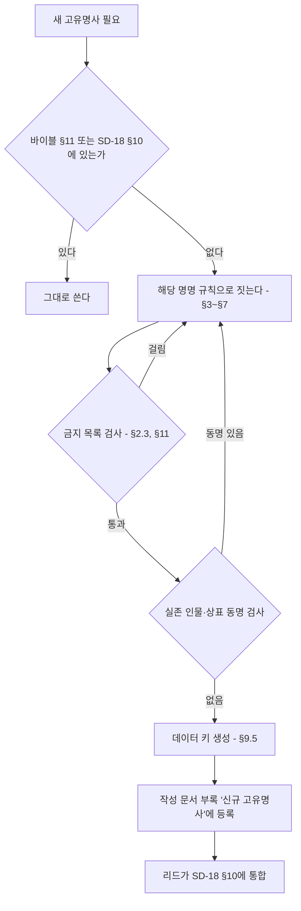

# SD-18. 용어·명명 규칙

> **서울 폴아웃 상세 기획서 세트** | 문서 ID: SD-18 | 버전: v1.0 | 작성일: 2026-10-12
> **범위**: 실명·가상화 표기 원칙, 인명·지명·기업·제품·세력 직함·아이템·퍽·퀘스트의 명명 규칙, 게임 내 텍스트 문체(시스템·퀘스트 로그·터미널·방송·세력별 말투), 한국어 조사·숫자·외래어 처리, 데이터 키용 로마자 규칙, 통합 용어집, 민감 표현 가이드
> **관련 문서**: [SC-00 컨셉 v0.3](00_concept.md), [SD-02 세계관·연표](02_world-and-lore.md), [SD-03a 메인 스토리 1](03a_main-story-part1.md), [SD-03b 메인 스토리 2](03b_main-story-part2.md), [SD-06 세력](06_factions.md), [SD-07a 주요 인물](07a_characters-major.md), [SD-07b NPC 디렉터리](07b_npc-directory.md), [SD-08 월드·권역](08_world-regions.md), [SD-09a~f 장소 카탈로그](09a_locations-r01-r02.md), [SD-10 캐릭터 시스템](10_character-system.md), [SD-12 탐험·UI](12_exploration-ui.md), [SD-13 아이템](13_items.md), [SD-14 크리처·적](14_creatures-enemies.md), [SD-16 아트 디렉션](16_art-direction.md), [SD-17 사운드](17_sound.md), [RD-26 용어집](../reverse-design/26_glossary.md), [RD-27 이식 메모](../reverse-design/27_adaptation-notes.md), [SR-02 서울 지리](research/SR-02_seoul-geography.md), [SR-05 국가·사회](research/SR-05_korea-state-society.md)

---

## 1. 개요

### 1.1 목적
- 세트 전체(SD-01~17)와 게임 내 텍스트가 **같은 이름을 같은 글자로** 쓰게 한다.
- 새 이름을 지을 때 따를 **규칙(형식·어휘·금지 목록)**을 준다. 이 문서는 개별 이름을 확정하지 않는다. 개별 이름은 주관 문서(SD-06 세력, SD-07a·07b 인물, SD-09a~f 장소, SD-13 아이템, SD-14 크리처)가 이 규칙으로 짓는다.
- 대사·방송·터미널을 쓰는 사람이 **문체를 고를 기준표**를 준다. 음성이 없는 게임(P3)이라 문체가 캐릭터의 목소리다.
- 데이터 작업자가 파일명·데이터 키를 **로마자로 기계적으로 만들** 수 있게 한다.

### 1.2 우선순위
| 순위 | 기준 | 적용 |
|---|---|---|
| 1 | 바이블 [SC-00 §11](00_concept.md) 고정 명칭 | 글자 그대로 쓴다. 바꾸려면 SC-00을 먼저 고친다 |
| 2 | 이 문서(SD-18)의 규칙과 통합 용어집(§10) | 세트 공통. 개별 문서와 충돌하면 이 문서가 이긴다 |
| 3 | 원작 용어 [RD-26](../reverse-design/26_glossary.md) | 원작에서 계승한 용어의 표기. 한글 패치 표기 우선 |
| 4 | 국립국어원 어문 규범 | 맞춤법, 띄어쓰기, 외래어 표기법, 국어의 로마자 표기법(2000) |

### 1.3 핵심 결정 요약
| # | 결정 | 근거 절 |
|---|---|---|
| N1 | 지명·공공 공간·지하철 노선 번호와 역명·정부 부처의 일반 명칭은 실명. 인물·기업·브랜드·부대·무기 제식명·아파트 브랜드·언론사·학교·병원·종교 단체는 가상 | §2 |
| N2 | 중국 인명과 부대 대호는 **중국어 원음**(외래어 표기법), 계급·직책은 **한국 한자음**(천웨이 상위 방식) | §3.8 |
| N3 | 2277년 지도 마커는 **황무지 통칭**을 쓰고, 2077년 공식 명칭은 진입 시 부제와 표지판에 쓴다 | §4.3 |
| N4 | 모델 번호는 회사 접두 2자 + 분류 문자 + 제식 연도 2자리 체계. 화면에는 **애칭이 먼저**, 형식 번호는 터미널·명판에만 | §5.6 |
| N5 | 원작 계승 퍽은 RD-14 음차 표기 유지, 서울판 신규 퍽은 한국어 명사구 | §7.2 |
| N6 | 인터넷·휴대전화·반도체 시대의 어휘와 초성체·밈은 게임 텍스트에 쓰지 않는다 | §8.10 |
| N7 | 변수 뒤 조사는 자동 선택 토큰 `{변수|조사}`로만 쓴다. 숫자·로마자로 끝나는 이름도 읽는 소리로 판정한다 | §9.1 |
| N8 | 데이터 키는 국어의 로마자 표기법(음운 변화 반영) 소문자 스네이크 표기 + 분류 접두어. 외래어·원작 용어는 영문 원어 철자 | §9.5 |
| N9 | RD-26의 '불구(Crippled)'는 서울판에서 **'부위 손상'**으로 바꾼다(장애 비하어 회피) | §11.4 |
| N10 | 바이블 고정 인명 중 실존 유명인과 성명이 같은 것 2건(강태오, 천웨이)은 리드 검토 대상으로 올린다 | §3.11, §14 |

### 1.4 용어 등록 절차

- 각 문서는 새 이름을 부록 '신규 고유명사' 표에 적는다(공통 브리프 §7). 리드는 세트 통합 때 그 표를 이 문서 §10에 옮긴다.
- 같은 대상에 이름이 둘 생기면 **먼저 확정된 주관 문서의 이름**을 쓰고, 다른 이름은 별칭(대사 전용)으로 내린다.

---

## 2. 표기 원칙

### 2.1 실명 사용 범위
실제 서울을 무대로 하는 게임이므로 **공간은 실명**, **사람과 회사는 가상**이 기본이다.

| 범주 | 실명 사용 | 예 | 조건 |
|---|---|---|---|
| 행정구역 | 쓴다 | 서울특별시, 관악구, 봉천동, 영등포구 | 2077년 공문·주소에 쓴다. 2077년 신설 행정구역은 만들지 않는다 |
| 자연 지명 | 쓴다 | 한강, 관악산, 북한산, 청계산, 남산, 중랑천, 밤섬, 노들섬, 선유도 | 지형은 실제 위치·방위를 따른다(SD-08) |
| 공공 공간 | 쓴다 | 광화문광장, 경복궁, 한양도성, 서울광장, 국립서울현충원, 하늘공원 | 외형·위치만 쓴다. 내부 구조는 가상 |
| 공공 기반 시설(일반명) | 쓴다 | 당인리 발전소, 마포 석유비축기지, 선유도 정수장, 신월 빗물터널, 공릉동 연구용 원자로 | 2077년 용도는 바이블의 가상 설정을 따른다(예: 당인리 지하 원자력 발전소) |
| 다리·터널·도로 | 쓴다 | 한강대교, 양화대교, 남산1호터널, 세종대로, 올림픽대로 | 2077년 이후 새로 지은 다리는 가상 이름(SD-08) |
| 지하철 | 쓴다 | 1~9호선 노선 번호, 실제 역명(신림역, 여의나루역, 종로3가역) | 2026년 현재 존재하는 역만 실명. 2027~2077년 신설역은 가상 역명 |
| 정부 부처·헌법 기관의 일반 명칭 | 쓴다 | 국회, 행정안전부, 국방부, 서울특별시청 | 바이블이 '행정안전부 장관'을 쓴다. 기관 이름만 쓰고 **실존 재임자와 연결하지 않는다**. 2077년 전시 신설 기구는 가상(§5.7) |
| 국가 상징 | 쓴다 | 대한민국, 태극기, 애국가(제목만) | 가사·국가 상징물을 조롱하는 연출 금지 |
| 역사 인물(1945년 이전) | 지명·동상으로만 | 세종대왕 동상, 이순신 동상, 세종대로 | 등장인물 이름이나 캐릭터로 쓰지 않는다 |
| 한국전쟁(1950~1953)과 정전 | 쓴다 | 한국전쟁, 정전협정, 휴전선 | 바이블 §3.2가 현실과 같게 둔다. 개별 전투·학살 사건명은 쓰지 않는다(§11.6) |

### 2.2 가상화 범위
| 범주 | 처리 | 가상화 방식 | 주관 문서 |
|---|---|---|---|
| 인물 | 전부 가상 | §3 명명 규칙. 실존 생존 인물과 같은 성명 금지 | SD-07a·07b |
| 기업·그룹 | 전부 가상 | 바이블 재벌 4곳(태성그룹, 세진전자, 한결건설, 청솔식품) + §5.6 규칙으로 만든 소기업 | SD-02, SD-13 |
| 상표·제품 | 전부 가상 | §5 작명법 | SD-13 |
| 아파트 브랜드·단지명 | 전부 가상 | '세이프빌 + 지명 + 수식어' 또는 가상 소형 브랜드(§5.4) | SD-09a~f |
| 부대·군 시설 | 전부 가상 | 2077 국군은 '지역 + 기능 + 단위', 미군은 영어 코드명, 중국군은 대호(§6.3) | SD-06 |
| 무기 제식명 | 전부 가상 | 회사 접두 형식 번호 + 애칭(§5.2). 원작 무기 일반명(10mm 권총, 돌격소총)은 계승 | SD-13 |
| 언론사·방송사 | 가상 | 국민방송(비상정부), 남산 방송(바이블). 2077년 민간 방송은 '지역 + 방송' | SD-17 |
| 학교·학원·병원 | 가상 | '지역 + 기능'(예: 관악 국립대학, 신촌 대학병원, 대치 학원가) | SD-09a~f |
| 종교 단체·종교 시설 | 가상 | 각성회(바이블). 폐허 교회·사찰은 '○○동 교회', '○○사' 같은 무명 일반 시설로 | SD-06, SD-09a~f |
| 민간 랜드마크 건물 | 가상 | 기능만 남긴다(예: 초고층 타워 → 세진전자 타워) | SD-09a~f |
| 교통 운영 기관 | 가상 | 2077년 지하철 운영 주체는 가상 기관명(§5.7) | SD-08 |
| 신분 번호·전화번호·주소 번지 | 가상 형식 | 실제로 유효한 형식을 흉내 내지 않는다(§2.5) | SD-02 |

### 2.3 사용 금지 실명 범주
아래 이름은 게임 텍스트, 그래픽(간판·로고·포스터), 데이터 키, 파일명 어디에도 쓰지 않는다. 예시는 대표 사례이며 목록에 없어도 같은 범주면 금지다.

| # | 범주 | 구체 예시 | 대체 |
|---|---|---|---|
| X1 | 실존 생존 인물 | 전·현직 대통령과 정치인, 재벌 총수 일가, 연예인, 운동선수, 방송인 | §3 규칙으로 지은 가상 인물 |
| X2 | 1945년 이후 사망한 공인 | 역대 대통령, 기업 창업주 | 언급하지 않는다. 2077년 가상 인물로 |
| X3 | 재벌·대기업 그룹 | 삼성, 현대, LG, SK, 롯데, 한화, 두산, 포스코, GS, CJ, 신세계, 한진, 효성, HD현대, 대우 | 태성그룹·세진전자·한결건설·청솔식품 |
| X4 | 공기업·공공 운영사 | 한국전력(한전), 한국수력원자력, 코레일, 서울교통공사, 한국토지주택공사(LH), 한국가스공사 | §5.7 가상 기관 |
| X5 | 방산 기업·연구소 | 현대로템, 한화에어로스페이스, 한국항공우주산업(KAI), LIG넥스원, 국방과학연구소(ADD) | 태성그룹 방산 부문, 가상 연구소 |
| X6 | 실제 무기 제식명·애칭 | K1, K2, K201, K3, K5, K7, K9, K21, K239, KF-21, FA-50, 흑표, 비호, 천무, 현무, 천궁, 신궁, 해궁, 보라매, 수리온, 레드백, 미군 M 계열 제식명 | §5.2 가상 형식 번호 + 바람 애칭 |
| X7 | 실제 부대·사령부 | 수도방위사령부, 특수전사령부, 제707특수임무단, 수도군단, 공수특전여단, 국군정보사령부, 미8군, 미2사단, 한미연합사령부(정식 명칭) | §6.3 가상 부대 |
| X8 | 실제 군 시설 고유명 | 캠프 험프리스, 캠프 케이시, 오산 공군기지, B-1·B-2 같은 실제 지휘 시설 호칭 | '평택 미군 기지', '용산 한미 연합 기지'(가상 공식 명칭) |
| X9 | 실제 계획·훈련 명칭 | 충무계획, 을지연습, 을지 자유의 방패, 독수리 훈련 | 비상 주민 분류 지침(바이블), '수도 비상 대비 연습'(가상) |
| X10 | 아파트 브랜드·유명 단지 | 래미안, 자이, 힐스테이트, 푸르지오, e편한세상, 롯데캐슬, 아이파크, 더샵, SK뷰, 아크로, 디에이치, 은마아파트, 타워팰리스 | 세이프빌 + 지명 + 수식어 |
| X11 | 편의점·유통 | CU, GS25, 세븐일레븐, 이마트24, 미니스톱, 이마트, 홈플러스, 다이소, 쿠팡 | 번개24, §5.6 가상 소매점 |
| X12 | 음료·식품 상표 | 칠성사이다, 박카스, 바나나맛우유, 신라면, 초코파이, 새우깡, 참이슬, 처음처럼, 맥심 | 번개사이다, 청솔 제품 |
| X13 | 자동차·가전 제품명 | 쏘나타, 그랜저, 아반떼, 포니, 티코, 봉고, 포터, 코란도, 갤로퍼, 갤럭시, 비스포크, 트롬 | 태성 차량 애칭, 세진 가전 애칭 |
| X14 | 민간 랜드마크·상업 시설 | 63빌딩, 롯데월드타워, 롯데월드, 코엑스, IFC몰, 타임스퀘어, 스타필드, 더현대, 에버랜드, N서울타워(상표명) | 세진전자 타워, '여의도 금빛 빌딩' 같은 기능형 이름, 남산 송신탑 |
| X15 | 언론·방송사 | KBS, MBC, SBS, YTN, JTBC, 연합뉴스, 주요 일간지 제호 | 국민방송, 남산 방송, '여의도 공영방송'(2077) |
| X16 | 학교·학원 | 실제 대학교 이름, 'SKY' 같은 서열 약칭, 실제 학원·인강 브랜드 | 관악 국립대학, 대치 학원가의 가상 학원 |
| X17 | 병원 | 서울대병원, 세브란스, 서울아산병원, 삼성서울병원, 서울성모병원 | 신촌 대학병원, 한강 중앙병원 |
| X18 | 종교 단체·교회·사찰 고유명 | 실제 교단명, 대형 교회명, 신흥 종교 단체명, 실제 사찰명 | 각성회, 무명 '○○동 교회' |
| X19 | 정당·정치 단체 | 현존·과거 정당명과 약칭, 정당 상징색 조합 로고 | 쓰지 않는다. 2077년 정치는 비상 체제라 정당이 화면에 나오지 않는다 |
| X20 | 1945년 이후 실제 사건 고유명 | 실제 재난·참사, 실제 계엄 선포 사건, 실제 시위 사건 이름 | 쓰지 않는다(§11.3, §11.6) |
| X21 | 북한 정권 관련 실명 | 국호, 지도자 이름, 조직명 | '북방 병합지'(바이블) |
| X22 | 원작 미국 고유 인물·장소 | 브라더후드 오브 스틸, 엔클레이브, 라이언, 이든, 메가톤, 리벳시티 등 | 서울판 대응 세력·장소. 원작 기업 일부는 '수입·면허 원천'으로만 언급(§2.4) |

### 2.4 원작 용어 표기
- **기준**: [RD-26 용어집](../reverse-design/26_glossary.md)의 한글 패치 표기를 쓴다. 이형 표기는 쓰지 않는다.

| 쓴다 | 쓰지 않는다 |
|---|---|
| 핍-보이 | 핍보이, 피프보이 |
| 볼트-텍 | 볼트텍, 볼트 텍 |
| 뉴카-콜라 | 누카콜라, 누카-콜라, 뉴카콜라 |
| 오버시어 | 감독관, 관리인 |
| 야생 구울 | 페럴 구울, 들구울 |
| 수도 황무지 | 캐피털 웨이스트랜드 |
| 라드-X, 라드어웨이, 스팀팩 | 라드엑스, 래드어웨이, 스팀팩스 |
| 버티버드 | 버티 버드 |
| 파워 아머 | 파워아머, 동력 갑옷 |

- **원작 기업의 서울판 지위**

| 원작 기업 | 서울판 처리 | 화면 노출 |
|---|---|---|
| 볼트-텍 | 서울 볼트 설계 면허 원천. 한결건설이 면허 시공 | 볼트 문 명판 '볼트-텍 면허', 핍-보이 |
| 웨스트 텍 | 파워 아머 프레임 원천. 태성그룹이 면허 정비 | 파워 아머 명판 |
| 뉴카-콜라 사 | 수입 음료. 번개사이다와 경쟁 | 수입 자판기, 병 |
| 로브코 인더스트리, 제너럴 아토믹스 인터내셔널 | 세진전자·태성그룹이 국산화하기 전의 수입 원천 기술로 터미널 기록에만 | 터미널 텍스트 1~2회 언급까지 |
| 그 밖의 원작 기업 | 쓰지 않는다 | — |

- **원작 고유명사 금지**: 원작 미국 인물·장소·세력 이름은 서울판에 나오지 않는다(바이블 K3). 원작을 아는 플레이어를 위한 암시는 아이템 설명 한 줄 수준까지만 허용한다(예: 수입 핍-보이 설명의 '미국 본사').
- **기획서 내부 병기**: SD 문서에서 원작 용어가 처음 나올 때 `한국어(English)`로 병기한다. 게임 텍스트에는 영문을 병기하지 않는다.

### 2.5 가상 신분·연락 정보 형식
실제로 유효한 개인 정보 형식을 흉내 내면 실존인 정보와 겹칠 수 있다. 아래 가상 형식만 쓴다.

| 정보 | 2077년 형식 | 예 | 금지 |
|---|---|---|---|
| 주민등록 번호 | `등록 국-연도4-일련5-등급` | `관악 2051-04417-3등급` | 실제 주민등록번호 형식(생년월일 6자리-7자리) |
| 볼트 등록 번호 | `S07-출생연도-일련3` | `S07-2258-014` | — |
| 전화번호 | 교환국 이름 + 국번 2자리 + 번호 4자리 | `관악국 47-1077` | 02-, 010- 등 실제 형식 |
| 주소 | 실제 구·동 이름 + 가상 번지(1000번대 이상) | `관악구 봉천동 1077번지` | 실제 도로명주소 + 실제 건물 번호 조합 |
| 군번 | `연도2-일련6` | `71-204417` | 실제 군번 형식 |
| 차량 번호 | 지역명 + 원자력 차량 구분 '원' + 4자리 | `서울 원 4417` | 실제 번호판 형식 |

---

## 3. 명명 규칙: 인명

### 3.1 공통 규칙
| 항목 | 규칙 |
|---|---|
| 기본 형식 | 한국 인명은 **성 1자(복성 2자) + 이름 2자**를 기본으로 한다. 외자 이름(이름 1자)은 2277년 황무지 출신에 많이 쓴다(§3.4) |
| 성씨 분포 | 현실 분포를 따른다. 김·이·박·최·정이 이름 있는 NPC의 약 45%를 넘지 않게 하고, 나머지는 강·조·윤·장·임·한·오·서·신·권·황·안·송·류·전·홍·고·문·양·손·배·백·허·남·심·노·하·곽·성·차·주·우·구·민·진·나·지·엄·채·원·천·방·공·현·함·변·염·여·추·도·소·석·선·설·마·길·연·위·표·명·기·반·왕·금·옥·육·인·맹·제·모·탁·국·어·은·편·용·예·경·봉·사·부·황보·남궁·제갈·선우·독고·사공·서문 등에서 고른다 |
| 같은 이름 금지 | 주요 인물(C-001~)끼리는 **성명 완전 일치 금지**, 이름(성 제외) 일치도 피한다. 일반 NPC(N-)는 같은 권역 안에서 성명 일치 금지 |
| 바이블 인물과의 충돌 | 바이블 §11 인물의 **이름 2자**(정인, 도윤, 혁, 태오, 영식, 미래, 유리, 만석, 인하, 경자, 두칠, 세라)는 일반 NPC에게 주지 않는다. 플레이어가 혼동한다 |
| 실존 인물 동명 검사 | 포털 인물 검색에서 동명 실존 유명인(정치인·기업인·연예인·운동선수·방송인)이 **첫 화면에 나오면** 바꾼다. 흔한 이름의 무명 동명이인은 문제 삼지 않는다 |
| 원작 인물 회피 | 원작 폴아웃 3 인물 이름의 음차를 그대로 쓰지 않는다(§3.5 회피 목록) |
| 의미 검사 | 이름 글자가 비속어·혐오어·실존 기업명·브랜드와 같은 소리가 되면 바꾼다(예: 성+이름이 실제 상표처럼 읽히는 경우) |
| 성별 표지 | 2077년 이후 이름은 성별 중립 이름 비율이 높다(세대별 풀 §3.2). 이름만으로 성별이 드러나지 않아도 된다. 대사·초상으로 구분한다 |
| 데이터 키 | `npc_` 또는 `chr_` 접두 + 로마자 성명(§9.5). 예: `chr_yun_jeongin`, `npc_r01_kim_seoa` |

### 3.2 2077년 세대 (구울, 기록 속 인물, 2077년 사망자)
2077년에 살던 사람의 이름은 **출생 연대의 이름 유행**을 따른다. 2026년까지는 현실 경향(일반 지식), 2027년 이후는 서울판 설정이다.

| 출생 연대 | 2077년 나이 | 경향 | 남성형 예 | 여성형 예 | 중립 예 |
|---|---|---|---|---|---|
| 1995~2010 | 67~82세 | 현실 경향. 받침 있는 한자 이름 | 지훈, 현우, 민수, 성민, 동현, 준호, 영식 | 지영, 수진, 은지, 혜진, 민지, 유리 | 지원, 수빈, 현 |
| 2010~2025 | 52~67세 | 현실 경향. 부드러운 'ㅇ·ㅎ' 이름, 2음절 | 민준, 서준, 도윤, 하준, 예준, 시우, 주원, 태오 | 서연, 서윤, 하윤, 지우, 하은, 수아, 지유 | 지호, 은우, 하율 |
| 2025~2045 | 32~52세 | 현실 경향의 연장. 받침 줄이기, 영어권에서도 부르기 쉬운 이름 증가 | 이준, 은우, 선우, 이안, 유준, 도하, 로운 | 이서, 서아, 지안, 아린, 하린, 채아, 시아 | 이현, 해온, 윤슬 |
| 2045~2065 | 12~32세 | 설정: 자원 전쟁기. ① 고유어 이름 유행(가온, 나래, 다온, 한별, 새봄) ② 미군 주둔으로 영어 이름과 소리가 같은 이름(이안, 레오, 노아, 리아, 엘라) ③ 전시 국가 표어에서 딴 이름 소수(안민, 보국, 태평) | 가온, 한별, 이안, 레오, 안민, 강토 | 나래, 다온, 리아, 엘라, 새봄, 미래 | 해솔, 온유, 시온 |
| 2065~2077 | 0~12세 | 설정: 중미 전쟁기. 위 경향 유지 + '원자력 시대' 어감의 밝은 이름(빛나, 한빛 제외 — 실제 원전 명칭과 겹침) | 다빈, 하람, 준 | 빛나, 하랑, 보미 | 온, 결 |

- **구울은 2077년 이름을 그대로 쓴다.** 200년이 지나도 이름과 2077년 직함을 바꾸지 않는다. 마영식(2077년 세진전자 하청 기술자), 남궁혁(2077년 행정안전부 장관)이 기준 사례다.
- 구울의 자기소개는 **2077년 소속 + 이름**이 기본이다(예: "세진전자 협력사 3팀 마영식입니다." 식). 200년 전 명함을 지금도 내미는 습관이 구울 사회의 블랙 유머다.
- 이름을 잊은 구울은 **입고 있던 옷의 명찰·사원증 이름**을 쓴다. 그래서 같은 명찰 이름을 쓰는 구울이 둘 있을 수 있다(사이드 퀘스트 소재).
- 박춘삼처럼 예스러운 이름은 2077년 노년층(1990년대 이전 출생)의 개성 이름으로 설명한다. 지하시장 구울 가운데 2077년 노년층은 전체의 20% 이하로 둔다.
- 2077년 사망자(터미널·홀로테이프 속 인물)도 같은 표를 쓴다. 한유리 박사(수석 기술자)는 1995~2025년 출생대 이름이다.

### 3.3 볼트 S-07 출신 (200년 고립 사회의 명명 관습)
S-07은 '재건 행정 요원 양성 볼트'이고 시험 성적이 거주·배급·결혼 허가를 정한다(바이블 §3.4). 이름도 **행정 절차의 산물**로 설계한다.

| 관습 | 내용 | 효과 |
|---|---|---|
| ① 등록 성명 표준 목록 | 2077년 입주자 명부의 이름 약 600개가 '등록 성명 표준 목록'이 되었다. 신생아 이름은 이 목록 안에서 고른다. 목록 밖 이름은 오버시어 승인이 필요하다 | 200년 뒤에도 S-07 이름은 2010~2060년대 이름(도윤, 정인, 서아, 가온)에 머문다. 바깥 사람에게 '옛날 이름'으로 들린다 |
| ② 성 계승 규정 | 출생 신고서의 '등록 보호자' 성을 따른다. 등록 보호자는 부모 중 **적성 등급이 높은 쪽**이다 | 형제자매의 성이 다를 수 있다. 성이 곧 가정 안 성적표다 |
| ③ 등록 번호 | `S07-출생연도-일련3` (예: `S07-2258-014`). 공식 문서와 단말기는 번호를 먼저, 이름을 뒤에 쓴다 | 관제망이 주인공을 '등록 번호'로 부르는 장면과 이어진다(MQ-P1, MQ-702) |
| ④ 계승명 | 사망자의 이름을 같은 해 출생아가 물려받는 풍습이 있다(등록 번호는 새로 받는다) | 볼트 묘지·기록 단말에 같은 이름이 세대마다 나온다. 하도윤이 '7대 하도윤'일 수 있다(SD-07a에서 확정) |
| ⑤ 호칭 | 공식: **성명 + 직급**(하도윤 연수생, 윤정인 오버시어). 동기끼리: 이름. 아이들: 이름 + 아/야. 어른이 아이를 부를 때: 성명 전체 | 존댓말 체계가 엄격한 직급 사회 |
| ⑥ 성적 별명 | 아이들 사이에는 시험에서 나온 별명이 붙는다(만점, 재시험, 오답노트, 커트라인) | 볼트 아이들 대사의 개성 |

- **볼트 직급**: 2077년 공무원 직급을 그대로 쓴다. 연수생(10~18세) → 주무관 → 사무관 → 서기관 → 부이사관 → 오버시어. 부서는 행정과, 배급과, 교무과, 보안과, 설비과, 의무과다. 세부는 SD-06·SD-07a에서 맞춘다.
- **주인공 이름 입력(MQ-P1 출생신고)**: 성 칸과 이름 칸을 따로 둔다. 성 칸 기본값은 '윤'(어머니 윤정인)이고 바꿀 수 있다. 출생 신고서 양식 아래에 작은 글씨로 "등록 성명 표준 목록 외 이름은 오버시어 승인 필요"가 찍혀 있고, 플레이어가 무엇을 넣든 승인 도장이 찍힌다(주인공이 처음부터 예외라는 복선). 입력 규칙은 §9.1.4.
- 볼트 주민의 대사에서 **'바깥'은 2077년 교과서 속 서울**이다. 실제 지명을 2077년 공식 명칭으로 말한다(봉천동, 마포 석유비축기지). 황무지 통칭(§4.2)을 처음 듣고 되묻는 대사를 둔다.

### 3.4 2277년 황무지 출신
| 유형 | 형식 | 예 | 쓰는 집단 | 비율(이름 있는 NPC 기준) |
|---|---|---|---|---|
| 정규 성명 | 성 + 이름 2자 | 조만석, 백인하, 민경자, 송미래 | 정착지 주민, 상인, 지도자 | 55% |
| 성 + 외자 | 성 + 이름 1자 | 류정, 진솔, 하담, 고윤 | 정착지 젊은 세대, 떠돌이 | 15% |
| 별명 단독 | 별명 1~3자 | 독사, 큰돌, 깡통, 너구리 | 약탈자, 새벽인력, 떠돌이, 변종 | 20% |
| 직업명 + 성/별명 | 직업 + 성 또는 별명 | 물장수 고씨, 땜장이 막내, 의원 할매 | 상인, 기술자, 의료인 | 10% |

- **예스러운 이름의 근거**: 황무지 부모는 **기원 작명**(생존·풍요를 비는 뜻이 그대로 드러나는 이름: 만석, 두칠, 복남, 수복)과 **유물 작명**(폐허의 명패·묘비·문서에서 읽은 이름: 경자, 미래, 세라)을 한다. 바이블의 조만석·민경자·황두칠은 이 두 갈래로 설명한다. 단, 1950~70년대 풍속을 연상시키는 이름은 이름 있는 NPC의 10% 이하로 둔다(사용자 지시 3).
- **별명 형성 규칙**

| 원천 | 예 | 금지 |
|---|---|---|
| 몸·외모 | 큰돌, 짝눈, 곰손, 장대 | 장애를 가리키는 말(절름발이, 애꾸 등. §11.4) |
| 직업·역할 | 땜장이, 물장수, 고철상, 뱃사공 | — |
| 동물(실제 생물) | 독사, 너구리, 살쾡이, 수달 | 설화 동물·요괴(용, 도깨비, 구미호 등. 사용자 지시 2) |
| 물건 | 깡통, 병뚜껑, 쇠파이프, 렌치 | 실제 상표 |
| 2077년 유물어(뜻이 바뀐 말) | 택배, 분양, 학원, 관리비, 24시 | 실존 기업명 |
| 출신지 | 봉천이, 노들 아재, 마포 누님 | 지역 비하 뉘앙스 |

- **2077년 유물어 이름**은 황무지 사람들이 원래 뜻을 모르고 쓰는 말이다(예: 약탈자 '분양'은 "땅을 나눠 준다"는 뜻으로 알고 있다). 대사로 뜻을 오해하는 장면을 만들 수 있다.
- **적 일반 라벨**(이름 없는 적)은 '세력 + 역할'로 쓴다(§7.4).

### 3.5 연합단 (한미 혼혈 계보)
용산 한미 연합 기지 생존자의 후손이다. 200년 동안 한국계·미국계 가계가 섞였다.

| 형식 | 예 | 비율 | 의미 |
|---|---|---|---|
| 영어 이름 + 한국 성 | 다니엘 서, 제이슨 임, 그레이스 한 | 55% | 가장 흔한 형식. 기지의 공용어가 영어였던 흔적 |
| 한국 이름 + 영어 성 | 민지 카터, 도현 레예스, 하은 브룩스 | 25% | 미군 계보 가문 |
| 한국 성명 | 오세진, 장하람 | 15% | 2077년 한국군 계보 |
| 영어 성명 | 마이클 헤이스 | 5% | 소수. 계보 순수성을 내세우는 원칙파에 많다 |

- **영어 이름 한글 표기**: 한국에서 굳은 통용 표기가 있으면 통용 표기, 없으면 외래어 표기법을 따른다. 바이블 '다니엘'은 통용 표기 사례다.

| 원어 | 표기 | 원어 | 표기 |
|---|---|---|---|
| Daniel | 다니엘 | Grace | 그레이스 |
| Jason | 제이슨 | Hannah | 한나 |
| Michael | 마이클 | Rachel | 레이철 |
| Samuel | 사무엘 | Claire | 클레어 |
| Joseph | 조셉 | Julia | 줄리아 |
| David | 데이비드 | Rebecca | 레베카 |
| Andrew | 앤드루 | Sophia | 소피아 |
| Thomas | 토마스 | Emily | 에밀리 |
| Matthew | 매슈 | Olivia | 올리비아 |
| Eric | 에릭 | Chloe | 클로이 |

| 영어 성 | 표기 | 영어 성 | 표기 |
|---|---|---|---|
| Carter | 카터 | Reyes | 레예스 |
| Hayes | 헤이스 | O'Connor | 오코너 |
| Brooks | 브룩스 | Foster | 포스터 |
| Walker | 워커 | Grant | 그랜트 |
| Miller | 밀러 | Bennett | 베넷 |

- **회피 목록**: 원작 폴아웃 3 주요 인물의 이름(사라, 오윈, 아서, 제임스, 캐서린, 아마타, 버치, 조나스, 매디슨, 모이라, 루카스, 헤럴드, 앨리스터, 로이, 율로지, 노바, 콜린, 이안, 루시, 밴스, 엘리엇, 크로스, 리)과 실제 기업·상표가 된 성(맥도널드, 포드, 델, 휴렛, 패커드, 보잉, 록히드)은 쓰지 않는다. 연합단이 브라더후드의 리스킨으로 보이지 않게 하려는 규칙이다.
  - '이안'은 2045~2065년 한국 이름 풀(§3.2)에 있지만 연합단 영어 이름으로는 쓰지 않는다.
- **의례 호명**: 연합단 의식에서는 '이름 + 성 + 조상 소속'으로 부른다(예: "제이슨 임, 기지 통신대의 후손"). 조상 소속은 2077년 기지의 가상 부대 단위(§6.3)다. 세부 의례는 SD-06.

### 3.6 비상정부 (관직명 + 성명)
| 항목 | 규칙 | 예 |
|---|---|---|
| 직함 체계 | 2077년 정부 직제를 그대로 쓴다. 원래 자리의 주인이 죽어 **대행·직무대리·서리**가 붙은 직함이 대부분이다 | 권한대행 남궁혁, 국방부 장관 직무대리, 서울특별시장 서리 |
| 소개·방송 어순 | **직함 + 성명** | "권한대행 남궁혁" |
| 서술 어순 | **성명 + 직함** | "강태오 대령은" |
| 호칭 | **성 + 직함 + 님** | 남궁 권한대행님, 강 대령님 |
| 벙커 출생 세대 이름 | 3음절 정규 이름 + **돌림자**(가문 안 같은 세대가 한 글자를 공유) 유지. 엘리트 가문의 표지다 | 남궁혁의 증손 세대가 '○현' 돌림이면 남궁서현, 남궁도현 |
| 본관 | 언급하지 않는다(실존 문중 연상 회피) | — |
| 계엄군 병사 | 계급 + 성(호칭), 군번(§2.5) | 김 하사, 이 상병 |
| 적 라벨 | 계엄군 + 병과 | 계엄군 보병, 계엄군 파워 아머병, 계엄군 버티버드 사수 |

- 비상정부 구울(남궁혁 등)과 벙커 출생 인간 사이에는 **2077년 직제를 아는 자와 문서로만 아는 자**의 차이가 있다. 벙커 출생자는 직함을 과하게 정확히 부르고, 구울은 줄여 부른다(대사 개성 규칙).

### 3.7 그 밖의 세력·집단
| 집단 | 이름 형식 | 예 | 비고 |
|---|---|---|---|
| 새벽인력 | 간부는 정규 성명 + 인력사무소 직함, 현장 요원은 별명. 붙잡힌 사람은 **장부 번호** | 황두칠 소장, 추심원 독사, '127번' | 장부 번호로 부르는 것이 이 세력의 비인간성 표지다 |
| 철벽경호 | 정규 성명 + 경호 업체 직함, 작전 중에는 호출 부호(영어 음차 짧은 단어) | 진세라 요원, 호출 부호 '레이븐' 같은 형식 | 호출 부호는 원작 탈론 컴퍼니 인물명과 겹치지 않게 |
| 자율방범대 | 정규 성명 + 방범대 직함 | ○○○ 대장, ○○○ 조장 | 동네 어른 느낌 |
| 지하시장 | 구울 규칙(§3.2) + 상인회 직함 | 마영식 기사님, ○○○ 회장님 | — |
| 각성회 | 본명 + 직분. 입회 때 스스로 매기는 **신앙 번호**를 덧붙인다 | 류정 안내자, '대기 0412' | 종교 직분 실명(목사·장로·스님 등) 금지(§11.2) |
| 약탈자 | 별명 단독 | 쇠파이프, 미친개, 막내 | 두목은 별명 + 두목 |
| 변종 | 스스로 지은 **사물 이름 1~2자** | 큰돌, 철근, 망치, 바위 | 평화적인 변종일수록 이름이 길고 구체적이다(SD-14) |
| 로봇 | 모델 애칭 + 세대 번호, 개체는 주인이 붙인 이름 | 파수-3, 살림-2 '복실이' | §5.3 |
| 개 | 한국 흔한 개 이름 | 백구, 황구, 누렁이, 바둑이 | 봉천 계단마을 진돗개 백구(바이블) |

### 3.8 중국군 잔존병 (중국 이름 표기 규칙)
#### 3.8.1 표기 방식 비교
| 안 | 방식 | 예(陳偉 上尉) | 장점 | 단점 |
|---|---|---|---|---|
| A | 이름·계급 모두 한국 한자음 | 진위 상위 | 한자 지식 있는 독자에게 뜻이 보인다 | 현행 외래어 표기법(1911년 이후 중국 인명은 원음)과 다르다. 한국인 이름처럼 들려 '외국 군대'의 감각이 흐려진다 |
| B | 이름·계급 모두 중국어 원음 | 천웨이 상웨이 | 원어에 가장 가깝다 | 계급을 플레이어가 알아듣지 못한다 |
| **C (권장)** | **이름·부대 대호는 중국어 원음, 계급·직책·부대 단위는 한국 한자음** | **천웨이 상위** | 바이블 표기와 같다. 원작 '징웨이 장군'(RD-08a)과 같은 방식. 이름은 외국인으로, 계급은 뜻이 통하게 읽힌다 | 한자음과 원음이 한 이름에 섞인다(관행상 문제없다) |

- **결정: C안.** 바이블의 '천웨이 상위'를 표준으로 삼는다.

#### 3.8.2 인명 표기 세칙
- 표기는 **외래어 표기법 중국어 표기 세칙**(한어 병음 대조표)을 따른다. 성조는 표기하지 않는다.
- 이름 데이터 키는 **한어 병음, 성조 없이, 성_이름** 순서다(예: `chr_chen_wei`).
- 화면에 한자를 쓰지 않는다(도트 폰트 제약과 가독성). 기획서에는 한자를 괄호로 병기해 같은 이름의 다른 한자를 구분한다(예: 천웨이(陳偉)).

| 병음 | 표기 | 병음 | 표기 | 병음 | 표기 |
|---|---|---|---|---|---|
| Chen | 천 | Zhang | 장 | Wang | 왕 |
| Li | 리 | Liu | 류 | Zhao | 자오 |
| Huang | 황 | Zhou | 저우 | Wu | 우 |
| Xu | 쉬 | Sun | 쑨 | Ma | 마 |
| Zhu | 주 | Hu | 후 | Guo | 궈 |
| Gao | 가오 | Luo | 뤄 | Lin | 린 |
| Wei | 웨이 | Jun | 쥔 | Hao | 하오 |
| Ming | 밍 | Qiang | 창 | Lei | 레이 |
| Feng | 펑 | Tao | 타오 | Jian | 젠 |
| Xiang | 샹 | Yong | 융 | Ping | 핑 |
| Hui | 후이 | Yan | 옌 | Xin | 신 |

- **계급(한국 한자음)**: 2077년 중국군의 계급 명칭은 현실 중국군 계급 한자를 한국 한자음으로 읽는다.

| 구분 | 계급(위에서 아래로) | 한국군 대응(참고) |
|---|---|---|
| 장성 | 상장, 중장, 소장 | 대장, 중장, 소장 |
| 영관 | 대교, 상교, 중교, 소교 | 준장급, 대령, 중령, 소령 |
| 위관 | 상위, 중위, 소위 | 대위, 중위, 소위 |
| 부사관 | 군사장, 상사, 중사, 하사 | 원사, 상사, 중사, 하사 |
| 병 | 상등병, 열병 | 상병, 이병 |

- 한국군과 이름이 같은 계급(중위, 소위, 상사 등)이 있으므로, 중국군 인물은 항상 **이름 + 계급**으로 함께 쓴다. 계급만 단독으로 부르지 않는다.
- **부대 대호**: 2077년 침투 부대는 가상 대호(代號) + 한국 한자음 단위로 쓴다(예: '○○ 침투대'. 대호는 중국어 원음 2음절). 실제 중국군 부대 번호·명칭은 쓰지 않는다. 확정은 SD-06.
- **중국어 발화 표시**: 잔존병 장교는 침투 교육으로 한국어를 한다. 한국어를 못 하는 병사의 말은 꺾쇠 안에 번역문으로 쓴다: `[중국어] 진지를 지켜라!` 플레이어가 뜻을 모르는 장면이면 `[중국어로 짧게 명령한다]`처럼 서술한다. 중국어 병음이나 한자를 대사창에 쓰지 않는다.
- 중국 인명의 동명 검사는 §3.1과 같다. 중국어권 실존 고위 군인·정치인과 같은 이름이면 바꾼다.

### 3.9 각성회
- 구성원은 본명을 버리지 않는다. 입회 의식에서 스스로 **신앙 번호**(대기 번호)를 매긴다. 관제망에 '등록'되기를 기다리는 사람이라는 뜻이다(바이블 §6.1).
- 호칭은 **본명 + 직분**(류정 안내자) 또는 **직분 + 번호**(대기 0412)다. 직분 이름은 관제망·행정 용어에서 가져온다.

| 직분(예시, SD-06 확정) | 뜻 | 원천 어휘 |
|---|---|---|
| 대기자 | 입회한 신자 | 관제망 '대기 상태' |
| 응답자 | 의례를 맡는 신자 | 관제망 '응답' |
| 안내자 | 공동체를 이끄는 사람(바이블: 류정) | 안내 방송 |
| 송신자 | 각성회 전체의 대표 | 방송 송신 |

### 3.10 인명 짓기 체크리스트
1. 소속 집단의 형식 표(§3.2~3.9)를 따랐는가.
2. 출생 연대의 이름 풀과 맞는가(구울, 볼트, 황무지).
3. 바이블 인물 이름 2자와 겹치지 않는가.
4. 실존 유명인 동명 검사를 했는가.
5. 원작 인물 이름, 실제 상표, 설화 존재 이름이 아닌가.
6. 조사 처리 판정이 쉬운가(로마자·숫자로 끝나는 이름은 §9.1 규칙을 확인).
7. 데이터 키를 만들었는가(§9.5).

### 3.11 바이블 고정 인명 검사 결과
| 인명 | 검사 결과 | 처리 |
|---|---|---|
| 강태오(계엄사령관) | 같은 성명의 실존 배우(1994년생)가 있다 | 바이블 고정 명칭이라 이 문서는 바꾸지 않는다. 리드 검토 요청(§14 U1). 대안 후보: 강태헌, 강도오, 강태주 |
| 천웨이(중국군 상위) | 같은 발음의 중국 실존 군 고위 인사(군 의학자, 陳薇)가 있다 | 한자를 陳偉로 고정하고 기획서에 병기한다. 리드 검토 요청(§14 U2). 대안 후보: 천젠, 천하오 |
| 그 밖의 §11 인물 | 포털 첫 화면 수준의 실존 유명 동명인을 확인하지 못했다 | 그대로 쓴다. SD-07a 작성 때 한 번 더 검사한다 |

---
