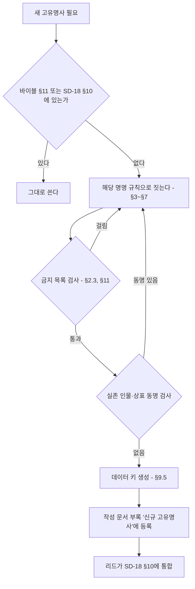

# SD-18. 용어·명명 규칙

> **서울 폴아웃 상세 기획서 세트** | 문서 ID: SD-18 | 버전: v1.0 | 작성일: 2026-10-12
> **범위**: 실명·가상화 표기 원칙, 인명·지명·기업·제품·세력 직함·아이템·퍽·퀘스트의 명명 규칙, 게임 내 텍스트 문체(시스템·퀘스트 로그·터미널·방송·세력별 말투), 한국어 조사·숫자·외래어 처리, 데이터 키용 로마자 규칙, 통합 용어집, 민감 표현 가이드
> **관련 문서**: [SC-00 컨셉 v0.3](00_concept.md), [SD-02 세계관·연표](02_world-and-lore.md), [SD-03a 메인 스토리 1](03a_main-story-part1.md), [SD-03b 메인 스토리 2](03b_main-story-part2.md), [SD-06 세력](06_factions.md), [SD-07a 주요 인물](07a_characters-major.md), [SD-07b NPC 디렉터리](07b_npc-directory.md), [SD-08 월드·권역](08_world-regions.md), [SD-09a~f 장소 카탈로그](09a_locations-r01-r02.md), [SD-10 캐릭터 시스템](10_character-system.md), [SD-12 탐험·UI](12_exploration-ui.md), [SD-13 아이템](13_items.md), [SD-14 크리처·적](14_creatures-enemies.md), [SD-16 아트 디렉션](16_art-direction.md), [SD-17 사운드](17_sound.md), [RD-26 용어집](../reverse-design/26_glossary.md), [RD-27 이식 메모](../reverse-design/27_adaptation-notes.md), [SR-02 서울 지리](research/SR-02_seoul-geography.md), [SR-05 국가·사회](research/SR-05_korea-state-society.md)

---

## 1. 개요

### 1.1 목적
- 세트 전체(SD-01~17)와 게임 내 텍스트가 **같은 이름을 같은 글자로** 쓰게 한다.
- 새 이름을 지을 때 따를 **규칙(형식·어휘·금지 목록)**을 준다. 이 문서는 개별 이름을 확정하지 않는다. 개별 이름은 주관 문서(SD-06 세력, SD-07a·07b 인물, SD-09a~f 장소, SD-13 아이템, SD-14 크리처)가 이 규칙으로 짓는다.
- 대사·방송·터미널을 쓰는 사람이 **문체를 고를 기준표**를 준다. 음성이 없는 게임(P3)이라 문체가 캐릭터의 목소리다.
- 데이터 작업자가 파일명·데이터 키를 **로마자로 기계적으로 만들** 수 있게 한다.

### 1.2 우선순위
| 순위 | 기준 | 적용 |
|---|---|---|
| 1 | 바이블 [SC-00 §11](00_concept.md) 고정 명칭 | 글자 그대로 쓴다. 바꾸려면 SC-00을 먼저 고친다 |
| 2 | 이 문서(SD-18)의 규칙과 통합 용어집(§10) | 세트 공통. 개별 문서와 충돌하면 이 문서가 이긴다 |
| 3 | 원작 용어 [RD-26](../reverse-design/26_glossary.md) | 원작에서 계승한 용어의 표기. 한글 패치 표기 우선 |
| 4 | 국립국어원 어문 규범 | 맞춤법, 띄어쓰기, 외래어 표기법, 국어의 로마자 표기법(2000) |

### 1.3 핵심 결정 요약
| # | 결정 | 근거 절 |
|---|---|---|
| N1 | 지명·공공 공간·지하철 노선 번호와 역명·정부 부처의 일반 명칭은 실명. 인물·기업·브랜드·부대·무기 제식명·아파트 브랜드·언론사·학교·병원·종교 단체는 가상 | §2 |
| N2 | 중국 인명과 부대 대호는 **중국어 원음**(외래어 표기법), 계급·직책은 **한국 한자음**(천웨이 상위 방식) | §3.8 |
| N3 | 2277년 지도 마커는 **황무지 통칭**을 쓰고, 2077년 공식 명칭은 진입 시 부제와 표지판에 쓴다 | §4.3 |
| N4 | 모델 번호는 회사 접두 2자 + 분류 문자 + 제식 연도 2자리 체계. 화면에는 **애칭이 먼저**, 형식 번호는 터미널·명판에만 | §5.6 |
| N5 | 원작 계승 퍽은 RD-14 음차 표기 유지, 서울판 신규 퍽은 한국어 명사구 | §7.2 |
| N6 | 인터넷·휴대전화·반도체 시대의 어휘와 초성체·밈은 게임 텍스트에 쓰지 않는다 | §8.10 |
| N7 | 변수 뒤 조사는 자동 선택 토큰 `{변수|조사}`로만 쓴다. 숫자·로마자로 끝나는 이름도 읽는 소리로 판정한다 | §9.1 |
| N8 | 데이터 키는 국어의 로마자 표기법(음운 변화 반영) 소문자 스네이크 표기 + 분류 접두어. 외래어·원작 용어는 영문 원어 철자 | §9.5 |
| N9 | RD-26의 '불구(Crippled)'는 서울판에서 **'부위 손상'**으로 바꾼다(장애 비하어 회피) | §11.4 |
| N10 | 바이블 고정 인명 중 실존 유명인과 성명이 같은 것 2건(강태오, 천웨이)은 리드 검토 대상으로 올린다 | §3.11, §14 |

### 1.4 용어 등록 절차

- 각 문서는 새 이름을 부록 '신규 고유명사' 표에 적는다(공통 브리프 §7). 리드는 세트 통합 때 그 표를 이 문서 §10에 옮긴다.
- 같은 대상에 이름이 둘 생기면 **먼저 확정된 주관 문서의 이름**을 쓰고, 다른 이름은 별칭(대사 전용)으로 내린다.

---

## 2. 표기 원칙

### 2.1 실명 사용 범위
실제 서울을 무대로 하는 게임이므로 **공간은 실명**, **사람과 회사는 가상**이 기본이다.

| 범주 | 실명 사용 | 예 | 조건 |
|---|---|---|---|
| 행정구역 | 쓴다 | 서울특별시, 관악구, 봉천동, 영등포구 | 2077년 공문·주소에 쓴다. 2077년 신설 행정구역은 만들지 않는다 |
| 자연 지명 | 쓴다 | 한강, 관악산, 북한산, 청계산, 남산, 중랑천, 밤섬, 노들섬, 선유도 | 지형은 실제 위치·방위를 따른다(SD-08) |
| 공공 공간 | 쓴다 | 광화문광장, 경복궁, 한양도성, 서울광장, 국립서울현충원, 하늘공원 | 외형·위치만 쓴다. 내부 구조는 가상 |
| 공공 기반 시설(일반명) | 쓴다 | 당인리 발전소, 마포 석유비축기지, 선유도 정수장, 신월 빗물터널, 공릉동 연구용 원자로 | 2077년 용도는 바이블의 가상 설정을 따른다(예: 당인리 지하 원자력 발전소) |
| 다리·터널·도로 | 쓴다 | 한강대교, 양화대교, 남산1호터널, 세종대로, 올림픽대로 | 2077년 이후 새로 지은 다리는 가상 이름(SD-08) |
| 지하철 | 쓴다 | 1~9호선 노선 번호, 실제 역명(신림역, 여의나루역, 종로3가역) | 2026년 현재 존재하는 역만 실명. 2027~2077년 신설역은 가상 역명 |
| 정부 부처·헌법 기관의 일반 명칭 | 쓴다 | 국회, 행정안전부, 국방부, 서울특별시청 | 바이블이 '행정안전부 장관'을 쓴다. 기관 이름만 쓰고 **실존 재임자와 연결하지 않는다**. 2077년 전시 신설 기구는 가상(§5.7) |
| 국가 상징 | 쓴다 | 대한민국, 태극기, 애국가(제목만) | 가사·국가 상징물을 조롱하는 연출 금지 |
| 역사 인물(1945년 이전) | 지명·동상으로만 | 세종대왕 동상, 이순신 동상, 세종대로 | 등장인물 이름이나 캐릭터로 쓰지 않는다 |
| 한국전쟁(1950~1953)과 정전 | 쓴다 | 한국전쟁, 정전협정, 휴전선 | 바이블 §3.2가 현실과 같게 둔다. 개별 전투·학살 사건명은 쓰지 않는다(§11.6) |

### 2.2 가상화 범위
| 범주 | 처리 | 가상화 방식 | 주관 문서 |
|---|---|---|---|
| 인물 | 전부 가상 | §3 명명 규칙. 실존 생존 인물과 같은 성명 금지 | SD-07a·07b |
| 기업·그룹 | 전부 가상 | 바이블 재벌 4곳(태성그룹, 세진전자, 한결건설, 청솔식품) + §5.6 규칙으로 만든 소기업 | SD-02, SD-13 |
| 상표·제품 | 전부 가상 | §5 작명법 | SD-13 |
| 아파트 브랜드·단지명 | 전부 가상 | '세이프빌 + 지명 + 수식어' 또는 가상 소형 브랜드(§5.4) | SD-09a~f |
| 부대·군 시설 | 전부 가상 | 2077 국군은 '지역 + 기능 + 단위', 미군은 영어 코드명, 중국군은 대호(§6.3) | SD-06 |
| 무기 제식명 | 전부 가상 | 회사 접두 형식 번호 + 애칭(§5.2). 원작 무기 일반명(10mm 권총, 돌격소총)은 계승 | SD-13 |
| 언론사·방송사 | 가상 | 국민방송(비상정부), 남산 방송(바이블). 2077년 민간 방송은 '지역 + 방송' | SD-17 |
| 학교·학원·병원 | 가상 | '지역 + 기능'(예: 관악 국립대학, 신촌 대학병원, 대치 학원가) | SD-09a~f |
| 종교 단체·종교 시설 | 가상 | 각성회(바이블). 폐허 교회·사찰은 '○○동 교회', '○○사' 같은 무명 일반 시설로 | SD-06, SD-09a~f |
| 민간 랜드마크 건물 | 가상 | 기능만 남긴다(예: 초고층 타워 → 세진전자 타워) | SD-09a~f |
| 교통 운영 기관 | 가상 | 2077년 지하철 운영 주체는 가상 기관명(§5.7) | SD-08 |
| 신분 번호·전화번호·주소 번지 | 가상 형식 | 실제로 유효한 형식을 흉내 내지 않는다(§2.5) | SD-02 |

### 2.3 사용 금지 실명 범주
아래 이름은 게임 텍스트, 그래픽(간판·로고·포스터), 데이터 키, 파일명 어디에도 쓰지 않는다. 예시는 대표 사례이며 목록에 없어도 같은 범주면 금지다.

| # | 범주 | 구체 예시 | 대체 |
|---|---|---|---|
| X1 | 실존 생존 인물 | 전·현직 대통령과 정치인, 재벌 총수 일가, 연예인, 운동선수, 방송인 | §3 규칙으로 지은 가상 인물 |
| X2 | 1945년 이후 사망한 공인 | 역대 대통령, 기업 창업주 | 언급하지 않는다. 2077년 가상 인물로 |
| X3 | 재벌·대기업 그룹 | 삼성, 현대, LG, SK, 롯데, 한화, 두산, 포스코, GS, CJ, 신세계, 한진, 효성, HD현대, 대우 | 태성그룹·세진전자·한결건설·청솔식품 |
| X4 | 공기업·공공 운영사 | 한국전력(한전), 한국수력원자력, 코레일, 서울교통공사, 한국토지주택공사(LH), 한국가스공사 | §5.7 가상 기관 |
| X5 | 방산 기업·연구소 | 현대로템, 한화에어로스페이스, 한국항공우주산업(KAI), LIG넥스원, 국방과학연구소(ADD) | 태성그룹 방산 부문, 가상 연구소 |
| X6 | 실제 무기 제식명·애칭 | K1, K2, K201, K3, K5, K7, K9, K21, K239, KF-21, FA-50, 흑표, 비호, 천무, 현무, 천궁, 신궁, 해궁, 보라매, 수리온, 레드백, 미군 M 계열 제식명 | §5.2 가상 형식 번호 + 바람 애칭 |
| X7 | 실제 부대·사령부 | 수도방위사령부, 특수전사령부, 제707특수임무단, 수도군단, 공수특전여단, 국군정보사령부, 미8군, 미2사단, 한미연합사령부(정식 명칭) | §6.3 가상 부대 |
| X8 | 실제 군 시설 고유명 | 캠프 험프리스, 캠프 케이시, 오산 공군기지, B-1·B-2 같은 실제 지휘 시설 호칭 | '평택 미군 기지', '용산 한미 연합 기지'(가상 공식 명칭) |
| X9 | 실제 계획·훈련 명칭 | 충무계획, 을지연습, 을지 자유의 방패, 독수리 훈련 | 비상 주민 분류 지침(바이블), '수도 비상 대비 연습'(가상) |
| X10 | 아파트 브랜드·유명 단지 | 래미안, 자이, 힐스테이트, 푸르지오, e편한세상, 롯데캐슬, 아이파크, 더샵, SK뷰, 아크로, 디에이치, 은마아파트, 타워팰리스 | 세이프빌 + 지명 + 수식어 |
| X11 | 편의점·유통 | CU, GS25, 세븐일레븐, 이마트24, 미니스톱, 이마트, 홈플러스, 다이소, 쿠팡 | 번개24, §5.6 가상 소매점 |
| X12 | 음료·식품 상표 | 칠성사이다, 박카스, 바나나맛우유, 신라면, 초코파이, 새우깡, 참이슬, 처음처럼, 맥심 | 번개사이다, 청솔 제품 |
| X13 | 자동차·가전 제품명 | 쏘나타, 그랜저, 아반떼, 포니, 티코, 봉고, 포터, 코란도, 갤로퍼, 갤럭시, 비스포크, 트롬 | 태성 차량 애칭, 세진 가전 애칭 |
| X14 | 민간 랜드마크·상업 시설 | 63빌딩, 롯데월드타워, 롯데월드, 코엑스, IFC몰, 타임스퀘어, 스타필드, 더현대, 에버랜드, N서울타워(상표명) | 세진전자 타워, '여의도 금빛 빌딩' 같은 기능형 이름, 남산 송신탑 |
| X15 | 언론·방송사 | KBS, MBC, SBS, YTN, JTBC, 연합뉴스, 주요 일간지 제호 | 국민방송, 남산 방송, '여의도 공영방송'(2077) |
| X16 | 학교·학원 | 실제 대학교 이름, 'SKY' 같은 서열 약칭, 실제 학원·인강 브랜드 | 관악 국립대학, 대치 학원가의 가상 학원 |
| X17 | 병원 | 서울대병원, 세브란스, 서울아산병원, 삼성서울병원, 서울성모병원 | 신촌 대학병원, 한강 중앙병원 |
| X18 | 종교 단체·교회·사찰 고유명 | 실제 교단명, 대형 교회명, 신흥 종교 단체명, 실제 사찰명 | 각성회, 무명 '○○동 교회' |
| X19 | 정당·정치 단체 | 현존·과거 정당명과 약칭, 정당 상징색 조합 로고 | 쓰지 않는다. 2077년 정치는 비상 체제라 정당이 화면에 나오지 않는다 |
| X20 | 1945년 이후 실제 사건 고유명 | 실제 재난·참사, 실제 계엄 선포 사건, 실제 시위 사건 이름 | 쓰지 않는다(§11.3, §11.6) |
| X21 | 북한 정권 관련 실명 | 국호, 지도자 이름, 조직명 | '북방 병합지'(바이블) |
| X22 | 원작 미국 고유 인물·장소 | 브라더후드 오브 스틸, 엔클레이브, 라이언, 이든, 메가톤, 리벳시티 등 | 서울판 대응 세력·장소. 원작 기업 일부는 '수입·면허 원천'으로만 언급(§2.4) |

### 2.4 원작 용어 표기
- **기준**: [RD-26 용어집](../reverse-design/26_glossary.md)의 한글 패치 표기를 쓴다. 이형 표기는 쓰지 않는다.

| 쓴다 | 쓰지 않는다 |
|---|---|
| 핍-보이 | 핍보이, 피프보이 |
| 볼트-텍 | 볼트텍, 볼트 텍 |
| 뉴카-콜라 | 누카콜라, 누카-콜라, 뉴카콜라 |
| 오버시어 | 감독관, 관리인 |
| 야생 구울 | 페럴 구울, 들구울 |
| 수도 황무지 | 캐피털 웨이스트랜드 |
| 라드-X, 라드어웨이, 스팀팩 | 라드엑스, 래드어웨이, 스팀팩스 |
| 버티버드 | 버티 버드 |
| 파워 아머 | 파워아머, 동력 갑옷 |

- **원작 기업의 서울판 지위**

| 원작 기업 | 서울판 처리 | 화면 노출 |
|---|---|---|
| 볼트-텍 | 서울 볼트 설계 면허 원천. 한결건설이 면허 시공 | 볼트 문 명판 '볼트-텍 면허', 핍-보이 |
| 웨스트 텍 | 파워 아머 프레임 원천. 태성그룹이 면허 정비 | 파워 아머 명판 |
| 뉴카-콜라 사 | 수입 음료. 번개사이다와 경쟁 | 수입 자판기, 병 |
| 로브코 인더스트리, 제너럴 아토믹스 인터내셔널 | 세진전자·태성그룹이 국산화하기 전의 수입 원천 기술로 터미널 기록에만 | 터미널 텍스트 1~2회 언급까지 |
| 그 밖의 원작 기업 | 쓰지 않는다 | — |

- **원작 고유명사 금지**: 원작 미국 인물·장소·세력 이름은 서울판에 나오지 않는다(바이블 K3). 원작을 아는 플레이어를 위한 암시는 아이템 설명 한 줄 수준까지만 허용한다(예: 수입 핍-보이 설명의 '미국 본사').
- **기획서 내부 병기**: SD 문서에서 원작 용어가 처음 나올 때 `한국어(English)`로 병기한다. 게임 텍스트에는 영문을 병기하지 않는다.

### 2.5 가상 신분·연락 정보 형식
실제로 유효한 개인 정보 형식을 흉내 내면 실존인 정보와 겹칠 수 있다. 아래 가상 형식만 쓴다.

| 정보 | 2077년 형식 | 예 | 금지 |
|---|---|---|---|
| 주민등록 번호 | `등록 국-연도4-일련5-등급` | `관악 2051-04417-3등급` | 실제 주민등록번호 형식(생년월일 6자리-7자리) |
| 볼트 등록 번호 | `S07-출생연도-일련3` | `S07-2258-014` | — |
| 전화번호 | 교환국 이름 + 국번 2자리 + 번호 4자리 | `관악국 47-1077` | 02-, 010- 등 실제 형식 |
| 주소 | 실제 구·동 이름 + 가상 번지(1000번대 이상) | `관악구 봉천동 1077번지` | 실제 도로명주소 + 실제 건물 번호 조합 |
| 군번 | `연도2-일련6` | `71-204417` | 실제 군번 형식 |
| 차량 번호 | 지역명 + 원자력 차량 구분 '원' + 4자리 | `서울 원 4417` | 실제 번호판 형식 |

---
