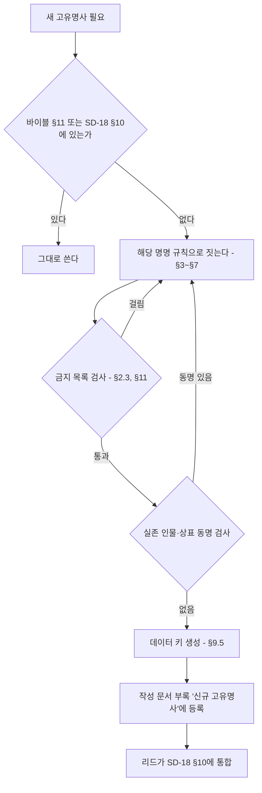

# SD-18. 용어·명명 규칙

> **서울 폴아웃 상세 기획서 세트** | 문서 ID: SD-18 | 버전: v1.0 | 작성일: 2026-10-12
> **범위**: 실명·가상화 표기 원칙, 인명·지명·기업·제품·세력 직함·아이템·퍽·퀘스트의 명명 규칙, 게임 내 텍스트 문체(시스템·퀘스트 로그·터미널·방송·세력별 말투), 한국어 조사·숫자·외래어 처리, 데이터 키용 로마자 규칙, 통합 용어집, 민감 표현 가이드
> **관련 문서**: [SC-00 컨셉 v0.4](00_concept.md), [SD-02 세계관·연표](02_world-and-lore.md), [SD-03a 메인 스토리 1](03a_main-story-part1.md), [SD-03b 메인 스토리 2](03b_main-story-part2.md), [SD-06 세력](06_factions.md), [SD-07a 주요 인물](07a_characters-major.md), [SD-07b NPC 디렉터리](07b_npc-directory.md), [SD-08 월드·권역](08_world-regions.md), [SD-09a~f 장소 카탈로그](09a_locations-r01-r02.md), [SD-10 캐릭터 시스템](10_character-system.md), [SD-12 탐험·UI](12_exploration-ui.md), [SD-13 아이템](13_items.md), [SD-14 크리처·적](14_creatures-enemies.md), [SD-16 아트 디렉션](16_art-direction.md), [SD-17 사운드](17_sound.md), [RD-26 용어집](../reverse-design/26_glossary.md), [RD-27 이식 메모](../reverse-design/27_adaptation-notes.md), [SR-02 서울 지리](research/SR-02_seoul-geography.md), [SR-05 국가·사회](research/SR-05_korea-state-society.md)

---

## 1. 개요

### 1.1 목적
- 세트 전체(SD-01~17)와 게임 내 텍스트가 **같은 이름을 같은 글자로** 쓰게 한다.
- 새 이름을 지을 때 따를 **규칙(형식·어휘·금지 목록)**을 준다. 이 문서는 개별 이름을 확정하지 않는다. 개별 이름은 주관 문서(SD-06 세력, SD-07a·07b 인물, SD-09a~f 장소, SD-13 아이템, SD-14 크리처)가 이 규칙으로 짓는다.
- 대사·방송·터미널을 쓰는 사람이 **문체를 고를 기준표**를 준다. 음성이 없는 게임(P3)이라 문체가 캐릭터의 목소리다.
- 데이터 작업자가 파일명·데이터 키를 **로마자로 기계적으로 만들** 수 있게 한다.

### 1.2 우선순위
| 순위 | 기준 | 적용 |
|---|---|---|
| 1 | 바이블 [SC-00 §11](00_concept.md) 고정 명칭 | 글자 그대로 쓴다. 바꾸려면 SC-00을 먼저 고친다 |
| 2 | 이 문서(SD-18)의 규칙과 통합 용어집(§10) | 세트 공통. 개별 문서와 충돌하면 이 문서가 이긴다 |
| 3 | 원작 용어 [RD-26](../reverse-design/26_glossary.md) | 원작에서 계승한 용어의 표기. 한글 패치 표기 우선 |
| 4 | 국립국어원 어문 규범 | 맞춤법, 띄어쓰기, 외래어 표기법, 국어의 로마자 표기법(2000) |

### 1.3 핵심 결정 요약
| # | 결정 | 근거 절 |
|---|---|---|
| N1 | 지명·공공 공간·지하철 노선 번호와 역명·정부 부처의 일반 명칭은 실명. 인물·기업·브랜드·부대·무기 제식명·아파트 브랜드·언론사·학교·병원·종교 단체는 가상 | §2 |
| N2 | 중국 인명과 부대 대호는 **중국어 원음**(외래어 표기법), 계급·직책은 **한국 한자음**(천웨이 상위 방식) | §3.8 |
| N3 | 2277년 지도 마커는 **황무지 통칭**을 쓰고, 2077년 공식 명칭은 진입 시 부제와 표지판에 쓴다 | §4.3 |
| N4 | 모델 번호는 회사 접두 2자 + 분류 문자 + 제식 연도 2자리 체계. 화면에는 **애칭이 먼저**, 형식 번호는 터미널·명판에만 | §5.6 |
| N5 | 원작 계승 퍽은 RD-14 음차 표기 유지, 서울판 신규 퍽은 한국어 명사구 | §7.2 |
| N6 | 인터넷·휴대전화·반도체 시대의 어휘와 초성체·밈은 게임 텍스트에 쓰지 않는다 | §8.10 |
| N7 | 변수 뒤 조사는 자동 선택 토큰 `{변수\|조사}`로만 쓴다. 숫자·로마자로 끝나는 이름도 읽는 소리로 판정한다 | §9.1 |
| N8 | 데이터 키는 국어의 로마자 표기법(음운 변화 반영) 소문자 스네이크 표기 + 분류 접두어. 외래어·원작 용어는 영문 원어 철자 | §9.5 |
| N9 | RD-26의 '불구(Crippled)'는 서울판에서 **'부위 손상'**으로 바꾼다(장애 비하어 회피) | §11.4 |
| N10 | 바이블 고정 인명 중 실존 유명인과 성명이 같은 것 2건(강태오, 천웨이)은 리드 검토 대상으로 올린다 | §3.11, §14 |
| N11 | 진영을 고르게 하는 문구(가입·수락·'A 또는 B를 선택하라')를 시스템·퀘스트 로그·퀘스트 제목에 쓰지 않는다. 목표는 사실·상태로 쓴다(바이블 v0.4 §5.8) | §8.2, §8.3 |
| N12 | 호감도·판도는 숫자 대신 호칭·인사말·핍-보이 기록 한 줄·세계 반응으로 서술한다. 숫자는 옵션 | §8.8 |
| N13 | 동료 시스템 용어는 쓰지 않는다. v0.2 동료 후보 7명은 '이름 있는 NPC'다 | §10 |
| N14 | 이름 있는 NPC 500명 이상은 출신·세력별 분포표, 권역별 창립 가문 성씨, 이름 풀 P1~P12, 중복 회피 규칙 D1~D7로 짓는다 | §3.12 |

### 1.4 용어 등록 절차


- 각 문서는 새 이름을 부록 '신규 고유명사' 표에 적는다(공통 브리프 §7). 리드는 세트 통합 때 그 표를 이 문서 §10에 옮긴다.
- 같은 대상에 이름이 둘 생기면 **먼저 확정된 주관 문서의 이름**을 쓰고, 다른 이름은 별칭(대사 전용)으로 내린다.

---

## 2. 표기 원칙

### 2.1 실명 사용 범위
실제 서울을 무대로 하는 게임이므로 **공간은 실명**, **사람과 회사는 가상**이 기본이다.

| 범주 | 실명 사용 | 예 | 조건 |
|---|---|---|---|
| 행정구역 | 쓴다 | 서울특별시, 관악구, 봉천동, 영등포구 | 2077년 공문·주소에 쓴다. 2077년 신설 행정구역은 만들지 않는다 |
| 자연 지명 | 쓴다 | 한강, 관악산, 북한산, 청계산, 남산, 중랑천, 밤섬, 노들섬, 선유도 | 지형은 실제 위치·방위를 따른다(SD-08) |
| 공공 공간 | 쓴다 | 광화문광장, 경복궁, 한양도성, 서울광장, 국립서울현충원, 하늘공원 | 외형·위치만 쓴다. 내부 구조는 가상 |
| 공공 기반 시설(일반명) | 쓴다 | 당인리 발전소, 마포 석유비축기지, 선유도 정수장, 신월 빗물터널, 공릉동 연구용 원자로 | 2077년 용도는 바이블의 가상 설정을 따른다(예: 당인리 지하 원자력 발전소) |
| 다리·터널·도로 | 쓴다 | 한강대교, 양화대교, 남산1호터널, 세종대로, 올림픽대로 | 2077년 이후 새로 지은 다리는 가상 이름(SD-08) |
| 지하철 | 쓴다 | 1~9호선 노선 번호, 실제 역명(신림역, 여의나루역, 종로3가역) | 2026년 현재 존재하는 역만 실명. 2027~2077년 신설역은 가상 역명 |
| 정부 부처·헌법 기관의 일반 명칭 | 쓴다 | 국회, 행정안전부, 국방부, 서울특별시청 | 바이블이 '행정안전부 장관'을 쓴다. 기관 이름만 쓰고 **실존 재임자와 연결하지 않는다**. 2077년 전시 신설 기구는 가상(§5.7) |
| 국가 상징 | 쓴다 | 대한민국, 태극기, 애국가(제목만) | 가사·국가 상징물을 조롱하는 연출 금지 |
| 역사 인물(1945년 이전) | 지명·동상으로만 | 세종대왕 동상, 이순신 동상, 세종대로 | 등장인물 이름이나 캐릭터로 쓰지 않는다 |
| 한국전쟁(1950~1953)과 정전 | 쓴다 | 한국전쟁, 정전협정, 휴전선 | 바이블 §3.2가 현실과 같게 둔다. 개별 전투·학살 사건명은 쓰지 않는다(§11.6) |

### 2.2 가상화 범위
| 범주 | 처리 | 가상화 방식 | 주관 문서 |
|---|---|---|---|
| 인물 | 전부 가상 | §3 명명 규칙. 실존 생존 인물과 같은 성명 금지 | SD-07a·07b |
| 기업·그룹 | 전부 가상 | 바이블 재벌 4곳(태성그룹, 세진전자, 한결건설, 청솔식품) + §5.6 규칙으로 만든 소기업 | SD-02, SD-13 |
| 상표·제품 | 전부 가상 | §5 작명법 | SD-13 |
| 아파트 브랜드·단지명 | 전부 가상 | '세이프빌 + 지명 + 수식어' 또는 가상 소형 브랜드(§5.4) | SD-09a~f |
| 부대·군 시설 | 전부 가상 | 2077 국군은 '지역 + 기능 + 단위', 미군은 영어 코드명, 중국군은 대호(§6.3) | SD-06 |
| 무기 제식명 | 전부 가상 | 회사 접두 형식 번호 + 애칭(§5.2). 원작 무기 일반명(10mm 권총, 돌격소총)은 계승 | SD-13 |
| 언론사·방송사 | 가상 | 국민방송(비상정부), 남산 방송(바이블). 2077년 민간 방송은 '지역 + 방송' | SD-17 |
| 학교·학원·병원 | 가상 | '지역 + 기능'(예: 관악 국립대학, 신촌 대학병원, 대치 학원가) | SD-09a~f |
| 종교 단체·종교 시설 | 가상 | 각성회(바이블). 폐허 교회·사찰은 '○○동 교회', '○○사' 같은 무명 일반 시설로 | SD-06, SD-09a~f |
| 민간 랜드마크 건물 | 가상 | 기능만 남긴다(예: 초고층 타워 → 세진전자 타워) | SD-09a~f |
| 교통 운영 기관 | 가상 | 2077년 지하철 운영 주체는 가상 기관명(§5.7) | SD-08 |
| 신분 번호·전화번호·주소 번지 | 가상 형식 | 실제로 유효한 형식을 흉내 내지 않는다(§2.5) | SD-02 |

### 2.3 사용 금지 실명 범주
아래 이름은 게임 텍스트, 그래픽(간판·로고·포스터), 데이터 키, 파일명 어디에도 쓰지 않는다. 예시는 대표 사례이며 목록에 없어도 같은 범주면 금지다.

| # | 범주 | 구체 예시 | 대체 |
|---|---|---|---|
| X1 | 실존 생존 인물 | 전·현직 대통령과 정치인, 재벌 총수 일가, 연예인, 운동선수, 방송인 | §3 규칙으로 지은 가상 인물 |
| X2 | 1945년 이후 사망한 공인 | 역대 대통령, 기업 창업주 | 언급하지 않는다. 2077년 가상 인물로 |
| X3 | 재벌·대기업 그룹 | 삼성, 현대, LG, SK, 롯데, 한화, 두산, 포스코, GS, CJ, 신세계, 한진, 효성, HD현대, 대우 | 태성그룹·세진전자·한결건설·청솔식품 |
| X4 | 공기업·공공 운영사 | 한국전력(한전), 한국수력원자력, 코레일, 서울교통공사, 한국토지주택공사(LH), 한국가스공사 | §5.7 가상 기관 |
| X5 | 방산 기업·연구소 | 현대로템, 한화에어로스페이스, 한국항공우주산업(KAI), LIG넥스원, 국방과학연구소(ADD) | 태성그룹 방산 부문, 가상 연구소 |
| X6 | 실제 무기 제식명·애칭 | K1, K2, K201, K3, K5, K7, K9, K21, K239, KF-21, FA-50, 흑표, 비호, 천무, 현무, 천궁, 신궁, 해궁, 보라매, 수리온, 레드백, 미군 M 계열 제식명 | §5.2 가상 형식 번호 + 바람 애칭 |
| X7 | 실제 부대·사령부 | 수도방위사령부, 특수전사령부, 제707특수임무단, 수도군단, 공수특전여단, 국군정보사령부, 미8군, 미2사단, 한미연합사령부(정식 명칭) | §6.3 가상 부대 |
| X8 | 실제 군 시설 고유명 | 캠프 험프리스, 캠프 케이시, 오산 공군기지, B-1·B-2 같은 실제 지휘 시설 호칭 | '평택 미군 기지', '용산 한미 연합 기지'(가상 공식 명칭) |
| X9 | 실제 계획·훈련 명칭 | 충무계획, 을지연습, 을지 자유의 방패, 독수리 훈련 | 비상 주민 분류 지침(바이블), '수도 비상 대비 연습'(가상) |
| X10 | 아파트 브랜드·유명 단지 | 래미안, 자이, 힐스테이트, 푸르지오, e편한세상, 롯데캐슬, 아이파크, 더샵, SK뷰, 아크로, 디에이치, 은마아파트, 타워팰리스 | 세이프빌 + 지명 + 수식어 |
| X11 | 편의점·유통 | CU, GS25, 세븐일레븐, 이마트24, 미니스톱, 이마트, 홈플러스, 다이소, 쿠팡 | 번개24, §5.6 가상 소매점 |
| X12 | 음료·식품 상표 | 칠성사이다, 박카스, 바나나맛우유, 신라면, 초코파이, 새우깡, 참이슬, 처음처럼, 맥심 | 번개사이다, 청솔 제품 |
| X13 | 자동차·가전 제품명 | 쏘나타, 그랜저, 아반떼, 포니, 티코, 봉고, 포터, 코란도, 갤로퍼, 갤럭시, 비스포크, 트롬 | 태성 차량 애칭, 세진 가전 애칭 |
| X14 | 민간 랜드마크·상업 시설 | 63빌딩, 롯데월드타워, 롯데월드, 코엑스, IFC몰, 타임스퀘어, 스타필드, 더현대, 에버랜드, N서울타워(상표명) | 세진전자 타워, '여의도 금빛 빌딩' 같은 기능형 이름, 남산 송신탑 |
| X15 | 언론·방송사 | KBS, MBC, SBS, YTN, JTBC, 연합뉴스, 주요 일간지 제호 | 국민방송, 남산 방송, '여의도 공영방송'(2077) |
| X16 | 학교·학원 | 실제 대학교 이름, 'SKY' 같은 서열 약칭, 실제 학원·인강 브랜드 | 관악 국립대학, 대치 학원가의 가상 학원 |
| X17 | 병원 | 서울대병원, 세브란스, 서울아산병원, 삼성서울병원, 서울성모병원 | 신촌 대학병원, 한강 중앙병원 |
| X18 | 종교 단체·교회·사찰 고유명 | 실제 교단명, 대형 교회명, 신흥 종교 단체명, 실제 사찰명 | 각성회, 무명 '○○동 교회' |
| X19 | 정당·정치 단체 | 현존·과거 정당명과 약칭, 정당 상징색 조합 로고 | 쓰지 않는다. 2077년 정치는 비상 체제라 정당이 화면에 나오지 않는다 |
| X20 | 1945년 이후 실제 사건 고유명 | 실제 재난·참사, 실제 계엄 선포 사건, 실제 시위 사건 이름 | 쓰지 않는다(§11.3, §11.6) |
| X21 | 북한 정권 관련 실명 | 국호, 지도자 이름, 조직명 | '북방 병합지'(바이블) |
| X22 | 원작 미국 고유 인물·장소 | 브라더후드 오브 스틸, 엔클레이브, 라이언, 이든, 메가톤, 리벳시티 등 | 서울판 대응 세력·장소. 원작 기업 일부는 '수입·면허 원천'으로만 언급(§2.4) |

### 2.4 원작 용어 표기
- **기준**: [RD-26 용어집](../reverse-design/26_glossary.md)의 한글 패치 표기를 쓴다. 이형 표기는 쓰지 않는다.

| 쓴다 | 쓰지 않는다 |
|---|---|
| 핍-보이 | 핍보이, 피프보이 |
| 볼트-텍 | 볼트텍, 볼트 텍 |
| 뉴카-콜라 | 누카콜라, 누카-콜라, 뉴카콜라 |
| 오버시어 | 감독관, 관리인 |
| 야생 구울 | 페럴 구울, 들구울 |
| 수도 황무지 | 캐피털 웨이스트랜드 |
| 라드-X, 라드어웨이, 스팀팩 | 라드엑스, 래드어웨이, 스팀팩스 |
| 버티버드 | 버티 버드 |
| 파워 아머 | 파워아머, 동력 갑옷 |

- **원작 기업의 서울판 지위**

| 원작 기업 | 서울판 처리 | 화면 노출 |
|---|---|---|
| 볼트-텍 | 서울 볼트 설계 면허 원천. 한결건설이 면허 시공 | 볼트 문 명판 '볼트-텍 면허', 핍-보이 |
| 웨스트 텍 | 파워 아머 프레임 원천. 태성그룹이 면허 정비 | 파워 아머 명판 |
| 뉴카-콜라 사 | 수입 음료. 번개사이다와 경쟁 | 수입 자판기, 병 |
| 로브코 인더스트리, 제너럴 아토믹스 인터내셔널 | 세진전자·태성그룹이 국산화하기 전의 수입 원천 기술로 터미널 기록에만 | 터미널 텍스트 1~2회 언급까지 |
| 그 밖의 원작 기업 | 쓰지 않는다 | — |

- **원작 고유명사 금지**: 원작 미국 인물·장소·세력 이름은 서울판에 나오지 않는다(바이블 K3). 원작을 아는 플레이어를 위한 암시는 아이템 설명 한 줄 수준까지만 허용한다(예: 수입 핍-보이 설명의 '미국 본사').
- **기획서 내부 병기**: SD 문서에서 원작 용어가 처음 나올 때 `한국어(English)`로 병기한다. 게임 텍스트에는 영문을 병기하지 않는다.

### 2.5 가상 신분·연락 정보 형식
실제로 유효한 개인 정보 형식을 흉내 내면 실존인 정보와 겹칠 수 있다. 아래 가상 형식만 쓴다.

| 정보 | 2077년 형식 | 예 | 금지 |
|---|---|---|---|
| 주민등록 번호 | `등록 국-연도4-일련5-등급` | `관악 2051-04417-3등급` | 실제 주민등록번호 형식(생년월일 6자리-7자리) |
| 볼트 등록 번호 | `S07-출생연도-일련3` | `S07-2258-014` | — |
| 전화번호 | 교환국 이름 + 국번 2자리 + 번호 4자리 | `관악국 47-1077` | 02-, 010- 등 실제 형식 |
| 주소 | 실제 구·동 이름 + 가상 번지(1000번대 이상) | `관악구 봉천동 1077번지` | 실제 도로명주소 + 실제 건물 번호 조합 |
| 군번 | `연도2-일련6` | `71-204417` | 실제 군번 형식 |
| 차량 번호 | 지역명 + 원자력 차량 구분 '원' + 4자리 | `서울 원 4417` | 실제 번호판 형식 |

---

## 3. 명명 규칙: 인명

### 3.1 공통 규칙
| 항목 | 규칙 |
|---|---|
| 기본 형식 | 한국 인명은 **성 1자(복성 2자) + 이름 2자**를 기본으로 한다. 외자 이름(이름 1자)은 2277년 황무지 출신에 많이 쓴다(§3.4) |
| 성씨 분포 | 현실 분포를 따른다. 김·이·박·최·정이 이름 있는 NPC의 약 45%를 넘지 않게 하고, 나머지는 강·조·윤·장·임·한·오·서·신·권·황·안·송·류·전·홍·고·문·양·손·배·백·허·남·심·노·하·곽·성·차·주·우·구·민·진·나·지·엄·채·원·천·방·공·현·함·변·염·여·추·도·소·석·선·설·마·길·연·위·표·명·기·반·왕·금·옥·육·인·맹·제·모·탁·국·어·은·편·용·예·경·봉·사·부·황보·남궁·제갈·선우·독고·사공·서문 등에서 고른다 |
| 같은 이름 금지 | 주요 인물(C-001~)끼리는 **성명 완전 일치 금지**, 이름(성 제외) 일치도 피한다. 일반 NPC(N-)는 같은 권역 안에서 성명 일치 금지 |
| 바이블 인물과의 충돌 | 바이블 §11 인물의 **이름 2자**(정인, 도윤, 혁, 태오, 영식, 미래, 유리, 만석, 인하, 경자, 두칠, 세라, 춘삼)는 일반 NPC에게 주지 않는다. 플레이어가 혼동한다 |
| 실존 인물 동명 검사 | 포털 인물 검색에서 동명 실존 유명인(정치인·기업인·연예인·운동선수·방송인)이 **첫 화면에 나오면** 바꾼다. 흔한 이름의 무명 동명이인은 문제 삼지 않는다 |
| 원작 인물 회피 | 원작 폴아웃 3 인물 이름의 음차를 그대로 쓰지 않는다(§3.5 회피 목록) |
| 의미 검사 | 이름 글자가 비속어·혐오어·실존 기업명·브랜드와 같은 소리가 되면 바꾼다(예: 성+이름이 실제 상표처럼 읽히는 경우) |
| 성별 표지 | 2077년 이후 이름은 성별 중립 이름 비율이 높다(세대별 풀 §3.2). 이름만으로 성별이 드러나지 않아도 된다. 대사·초상으로 구분한다 |
| 데이터 키 | `npc_` 또는 `chr_` 접두 + 로마자 성명(§9.5). 예: `chr_yun_jeongin`, `npc_r01_kim_seoa` |

### 3.2 2077년 세대 (구울, 기록 속 인물, 2077년 사망자)
2077년에 살던 사람의 이름은 **출생 연대의 이름 유행**을 따른다. 2026년까지는 현실 경향(일반 지식), 2027년 이후는 서울판 설정이다.

| 출생 연대 | 2077년 나이 | 경향 | 남성형 예 | 여성형 예 | 중립 예 |
|---|---|---|---|---|---|
| 1995~2010 | 67~82세 | 현실 경향. 받침 있는 한자 이름 | 지훈, 현우, 민수, 성민, 동현, 준호, 영식 | 지영, 수진, 은지, 혜진, 민지, 유리 | 지원, 수빈, 현 |
| 2010~2025 | 52~67세 | 현실 경향. 부드러운 'ㅇ·ㅎ' 이름, 2음절 | 민준, 서준, 도윤, 하준, 예준, 시우, 주원, 태오 | 서연, 서윤, 하윤, 지우, 하은, 수아, 지유 | 지호, 은우, 하율 |
| 2025~2045 | 32~52세 | 현실 경향의 연장. 받침 줄이기, 영어권에서도 부르기 쉬운 이름 증가 | 이준, 은우, 선우, 이안, 유준, 도하, 로운 | 이서, 서아, 지안, 아린, 하린, 채아, 시아 | 이현, 해온, 윤슬 |
| 2045~2065 | 12~32세 | 설정: 자원 전쟁기. ① 고유어 이름 유행(가온, 나래, 다온, 한별, 새봄) ② 미군 주둔으로 영어 이름과 소리가 같은 이름(이안, 레오, 노아, 리아, 엘라) ③ 전시 국가 표어에서 딴 이름 소수(안민, 보국, 태평) | 가온, 한별, 이안, 레오, 안민, 강토 | 나래, 다온, 리아, 엘라, 새봄, 미래 | 해솔, 온유, 시온 |
| 2065~2077 | 0~12세 | 설정: 중미 전쟁기. 위 경향 유지 + '원자력 시대' 어감의 밝은 이름(빛나, 하랑 등. '한빛'은 실제 원전 명칭과 겹쳐 쓰지 않는다) | 다빈, 하람, 준 | 빛나, 하랑, 보미 | 온, 결 |

- **구울은 2077년 이름을 그대로 쓴다.** 200년이 지나도 이름과 2077년 직함을 바꾸지 않는다. 마영식(2077년 세진전자 하청 기술자), 남궁혁(2077년 행정안전부 장관)이 기준 사례다.
- 구울의 자기소개는 **2077년 소속 + 이름**이 기본이다(예: "세진전자 협력사 3팀 마영식입니다." 식). 200년 전 명함을 지금도 내미는 습관이 구울 사회의 블랙 유머다.
- 이름을 잊은 구울은 **입고 있던 옷의 명찰·사원증 이름**을 쓴다. 그래서 같은 명찰 이름을 쓰는 구울이 둘 있을 수 있다(사이드 퀘스트 소재).
- 박춘삼처럼 예스러운 이름은 2077년 노년층(1990년대 이전 출생)의 개성 이름으로 설명한다. 지하시장 구울 가운데 2077년 노년층은 전체의 20% 이하로 둔다.
- 2077년 사망자(터미널·홀로테이프 속 인물)도 같은 표를 쓴다. 한유리 박사(수석 기술자)는 1995~2025년 출생대 이름이다.

### 3.3 볼트 S-07 출신 (200년 고립 사회의 명명 관습)
S-07은 '재건 행정 요원 양성 볼트'이고 시험 성적이 거주·배급·결혼 허가를 정한다(바이블 §3.4). 이름도 **행정 절차의 산물**로 설계한다.

| 관습 | 내용 | 효과 |
|---|---|---|
| ① 등록 성명 표준 목록 | 2077년 입주자 명부의 이름 약 600개가 '등록 성명 표준 목록'이 되었다. 신생아 이름은 이 목록 안에서 고른다. 목록 밖 이름은 오버시어 승인이 필요하다 | 200년 뒤에도 S-07 이름은 2010~2060년대 이름(도윤, 정인, 서아, 가온)에 머문다. 바깥 사람에게 '옛날 이름'으로 들린다 |
| ② 성 계승 규정 | 출생 신고서의 '등록 보호자' 성을 따른다. 등록 보호자는 부모 중 **적성 등급이 높은 쪽**이다 | 형제자매의 성이 다를 수 있다. 성이 곧 가정 안 성적표다 |
| ③ 등록 번호 | `S07-출생연도-일련3` (예: `S07-2258-014`). 공식 문서와 단말기는 번호를 먼저, 이름을 뒤에 쓴다 | 관제망이 주인공을 '등록 번호'로 부르는 장면과 이어진다(MQ-P1, MQ-702) |
| ④ 계승명 | 사망자의 이름을 같은 해 출생아가 물려받는 풍습이 있다(등록 번호는 새로 받는다) | 볼트 묘지·기록 단말에 같은 이름이 세대마다 나온다. 하도윤이 '7대 하도윤'일 수 있다(SD-07a에서 확정) |
| ⑤ 호칭 | 공식: **성명 + 직급**(하도윤 연수생, 윤정인 오버시어). 동기끼리: 이름. 아이들: 이름 + 아/야. 어른이 아이를 부를 때: 성명 전체 | 존댓말 체계가 엄격한 직급 사회 |
| ⑥ 성적 별명 | 아이들 사이에는 시험에서 나온 별명이 붙는다(만점, 재시험, 오답노트, 커트라인) | 볼트 아이들 대사의 개성 |

- **볼트 직급**: 2077년 공무원 직급을 그대로 쓴다. 연수생(10~18세) → 주무관 → 사무관 → 서기관 → 부이사관 → 오버시어. 부서는 행정과, 배급과, 교무과, 보안과, 설비과, 의무과다. 세부는 SD-06·SD-07a에서 맞춘다.
- **주인공 이름 입력(MQ-P1 출생신고)**: 성 칸과 이름 칸을 따로 둔다. 성 칸 기본값은 '윤'(어머니 윤정인)이고 바꿀 수 있다. 출생 신고서 양식 아래에 작은 글씨로 "등록 성명 표준 목록 외 이름은 오버시어 승인 필요"가 찍혀 있고, 플레이어가 무엇을 넣든 승인 도장이 찍힌다(주인공이 처음부터 예외라는 복선). 입력 규칙은 §9.1.4.
- 볼트 주민의 대사에서 **'바깥'은 2077년 교과서 속 서울**이다. 실제 지명을 2077년 공식 명칭으로 말한다(봉천동, 마포 석유비축기지). 황무지 통칭(§4.2)을 처음 듣고 되묻는 대사를 둔다.

### 3.4 2277년 황무지 출신
| 유형 | 형식 | 예 | 쓰는 집단 | 비율(이름 있는 NPC 기준) |
|---|---|---|---|---|
| 정규 성명 | 성 + 이름 2자 | 조만석, 백인하, 민경자, 송미래 | 정착지 주민, 상인, 지도자 | 55% |
| 성 + 외자 | 성 + 이름 1자 | 류정, 진솔, 하담, 고윤 | 정착지 젊은 세대, 떠돌이 | 15% |
| 별명 단독 | 별명 1~3자 | 독사, 큰돌, 깡통, 너구리 | 약탈자, 새벽인력, 떠돌이, 변종 | 20% |
| 직업명 + 성/별명 | 직업 + 성 또는 별명 | 물장수 고씨, 땜장이 막내, 의원 할매 | 상인, 기술자, 의료인 | 10% |

- **예스러운 이름의 근거**: 황무지 부모는 **기원 작명**(생존·풍요를 비는 뜻이 그대로 드러나는 이름: 만석, 두칠, 복남, 수복)과 **유물 작명**(폐허의 명패·묘비·문서에서 읽은 이름: 경자, 미래, 세라)을 한다. 바이블의 조만석·민경자·황두칠은 이 두 갈래로 설명한다. 단, 1950~70년대 풍속을 연상시키는 이름은 이름 있는 NPC의 10% 이하로 둔다(사용자 지시 3).
- **별명 형성 규칙**

| 원천 | 예 | 금지 |
|---|---|---|
| 몸·외모 | 큰돌, 짝눈, 곰손, 장대 | 장애를 가리키는 말(절름발이, 애꾸 등. §11.4) |
| 직업·역할 | 땜장이, 물장수, 고철상, 뱃사공 | — |
| 동물(실제 생물) | 독사, 너구리, 살쾡이, 수달 | 설화 동물·요괴(용, 도깨비, 구미호 등. 사용자 지시 2) |
| 물건 | 깡통, 병뚜껑, 쇠파이프, 렌치 | 실제 상표 |
| 2077년 유물어(뜻이 바뀐 말) | 택배, 분양, 학원, 관리비, 24시 | 실존 기업명 |
| 출신지 | 봉천이, 노들 아재, 마포 누님 | 지역 비하 뉘앙스 |

- **2077년 유물어 이름**은 황무지 사람들이 원래 뜻을 모르고 쓰는 말이다(예: 약탈자 '분양'은 "땅을 나눠 준다"는 뜻으로 알고 있다). 대사로 뜻을 오해하는 장면을 만들 수 있다.
- **적 일반 라벨**(이름 없는 적)은 '세력 + 역할'로 쓴다(§7.4).

### 3.5 연합단 (한미 혼혈 계보)
용산 한미 연합 기지 생존자의 후손이다. 200년 동안 한국계·미국계 가계가 섞였다.

| 형식 | 예 | 비율 | 의미 |
|---|---|---|---|
| 영어 이름 + 한국 성 | 다니엘 서, 제이슨 임, 그레이스 한 | 55% | 가장 흔한 형식. 기지의 공용어가 영어였던 흔적 |
| 한국 이름 + 영어 성 | 민지 카터, 도현 레예스, 하은 브룩스 | 25% | 미군 계보 가문 |
| 한국 성명 | 오세진, 장하람 | 15% | 2077년 한국군 계보 |
| 영어 성명 | 마이클 헤이스 | 5% | 소수. 계보 순수성을 내세우는 원칙파에 많다 |

- **영어 이름 한글 표기**: 한국에서 굳은 통용 표기가 있으면 통용 표기, 없으면 외래어 표기법을 따른다. 바이블 '다니엘'은 통용 표기 사례다.

| 원어 | 표기 | 원어 | 표기 |
|---|---|---|---|
| Daniel | 다니엘 | Grace | 그레이스 |
| Jason | 제이슨 | Hannah | 한나 |
| Michael | 마이클 | Rachel | 레이철 |
| Samuel | 사무엘 | Claire | 클레어 |
| Joseph | 조셉 | Julia | 줄리아 |
| David | 데이비드 | Rebecca | 레베카 |
| Andrew | 앤드루 | Sophia | 소피아 |
| Thomas | 토마스 | Emily | 에밀리 |
| Matthew | 매슈 | Olivia | 올리비아 |
| Eric | 에릭 | Chloe | 클로이 |

| 영어 성 | 표기 | 영어 성 | 표기 |
|---|---|---|---|
| Carter | 카터 | Reyes | 레예스 |
| Hayes | 헤이스 | O'Connor | 오코너 |
| Brooks | 브룩스 | Foster | 포스터 |
| Walker | 워커 | Grant | 그랜트 |
| Miller | 밀러 | Bennett | 베넷 |

- **회피 목록**: 원작 폴아웃 3 주요 인물의 이름(사라, 오윈, 아서, 제임스, 캐서린, 아마타, 버치, 조나스, 매디슨, 모이라, 루카스, 헤럴드, 앨리스터, 로이, 율로지, 노바, 콜린, 이안, 루시, 밴스, 엘리엇, 크로스, 리)과 실제 기업·상표가 된 성(맥도널드, 포드, 델, 휴렛, 패커드, 보잉, 록히드)은 쓰지 않는다. 연합단이 브라더후드의 리스킨으로 보이지 않게 하려는 규칙이다.
  - '이안'은 2045~2065년 한국 이름 풀(§3.2)에 있지만 연합단 영어 이름으로는 쓰지 않는다.
- **의례 호명**: 연합단 의식에서는 '이름 + 성 + 조상 소속'으로 부른다(예: "제이슨 임, 기지 통신대의 후손"). 조상 소속은 2077년 기지의 가상 부대 단위(§6.3)다. 세부 의례는 SD-06.

### 3.6 비상정부 (관직명 + 성명)
| 항목 | 규칙 | 예 |
|---|---|---|
| 직함 체계 | 2077년 정부 직제를 그대로 쓴다. 원래 자리의 주인이 죽어 **대행·직무대리·서리**가 붙은 직함이 대부분이다 | 권한대행 남궁혁, 국방부 장관 직무대리, 서울특별시장 서리 |
| 소개·방송 어순 | **직함 + 성명** | "권한대행 남궁혁" |
| 서술 어순 | **성명 + 직함** | "강태오 대령은" |
| 호칭 | **성 + 직함 + 님** | 남궁 권한대행님, 강 대령님 |
| 벙커 출생 세대 이름 | 3음절 정규 이름 + **돌림자**(가문 안 같은 세대가 한 글자를 공유) 유지. 엘리트 가문의 표지다 | 남궁혁의 증손 세대가 '○현' 돌림이면 남궁서현, 남궁도현 |
| 본관 | 언급하지 않는다(실존 문중 연상 회피) | — |
| 계엄군 병사 | 계급 + 성(호칭), 군번(§2.5) | 김 하사, 이 상병 |
| 적 라벨 | 계엄군 + 병과 | 계엄군 보병, 계엄군 파워 아머병, 계엄군 버티버드 사수 |

- 비상정부 구울(남궁혁 등)과 벙커 출생 인간 사이에는 **2077년 직제를 아는 자와 문서로만 아는 자**의 차이가 있다. 벙커 출생자는 직함을 과하게 정확히 부르고, 구울은 줄여 부른다(대사 개성 규칙).

### 3.7 그 밖의 세력·집단
| 집단 | 이름 형식 | 예 | 비고 |
|---|---|---|---|
| 새벽인력 | 간부는 정규 성명 + 인력사무소 직함, 현장 요원은 별명. 붙잡힌 사람은 **장부 번호** | 황두칠 소장, 추심원 독사, '127번' | 장부 번호로 부르는 것이 이 세력의 비인간성 표지다 |
| 철벽경호 | 정규 성명 + 경호 업체 직함, 작전 중에는 호출 부호(영어 음차 짧은 단어) | 진세라 요원, 호출 부호 '레이븐' 같은 형식 | 호출 부호는 원작 탈론 컴퍼니 인물명과 겹치지 않게 |
| 자율방범대 | 정규 성명 + 방범대 직함 | ○○○ 대장, ○○○ 조장 | 동네 어른 느낌 |
| 지하시장 | 구울 규칙(§3.2) + 상인회 직함 | 마영식 기사님, ○○○ 회장님 | — |
| 각성회 | 본명 + 직분. 입회 때 스스로 매기는 **신앙 번호**를 덧붙인다 | 류정 안내자, '대기 0412' | 종교 직분 실명(목사·장로·스님 등) 금지(§11.2) |
| 약탈자 | 별명 단독 | 쇠파이프, 미친개, 막내 | 두목은 별명 + 두목 |
| 변종 | 스스로 지은 **사물 이름 1~2자** | 큰돌, 철근, 망치, 바위 | 평화적인 변종일수록 이름이 길고 구체적이다(SD-14) |
| 로봇 | 모델 애칭 + 세대 번호, 개체는 주인이 붙인 이름 | 파수-3, 살림-2 '복실이' | §5.3 |
| 개 | 한국 흔한 개 이름 | 백구, 황구, 누렁이, 바둑이 | 봉천 계단마을 진돗개 백구(바이블) |

### 3.8 중국군 잔존병 (중국 이름 표기 규칙)
#### 3.8.1 표기 방식 비교
| 안 | 방식 | 예(陳偉 上尉) | 장점 | 단점 |
|---|---|---|---|---|
| A | 이름·계급 모두 한국 한자음 | 진위 상위 | 한자 지식 있는 독자에게 뜻이 보인다 | 현행 외래어 표기법(1911년 이후 중국 인명은 원음)과 다르다. 한국인 이름처럼 들려 '외국 군대'의 감각이 흐려진다 |
| B | 이름·계급 모두 중국어 원음 | 천웨이 상웨이 | 원어에 가장 가깝다 | 계급을 플레이어가 알아듣지 못한다 |
| **C (권장)** | **이름·부대 대호는 중국어 원음, 계급·직책·부대 단위는 한국 한자음** | **천웨이 상위** | 바이블 표기와 같다. 원작 '징웨이 장군'(RD-08a)과 같은 방식. 이름은 외국인으로, 계급은 뜻이 통하게 읽힌다 | 한자음과 원음이 한 이름에 섞인다(관행상 문제없다) |

- **결정: C안.** 바이블의 '천웨이 상위'를 표준으로 삼는다.

#### 3.8.2 인명 표기 세칙
- 표기는 **외래어 표기법 중국어 표기 세칙**(한어 병음 대조표)을 따른다. 성조는 표기하지 않는다.
- 이름 데이터 키는 **한어 병음, 성조 없이, 성_이름** 순서다(예: `chr_chen_wei`).
- 화면에 한자를 쓰지 않는다(도트 폰트 제약과 가독성). 기획서에는 한자를 괄호로 병기해 같은 이름의 다른 한자를 구분한다(예: 천웨이(陳偉)).

| 병음 | 표기 | 병음 | 표기 | 병음 | 표기 |
|---|---|---|---|---|---|
| Chen | 천 | Zhang | 장 | Wang | 왕 |
| Li | 리 | Liu | 류 | Zhao | 자오 |
| Huang | 황 | Zhou | 저우 | Wu | 우 |
| Xu | 쉬 | Sun | 쑨 | Ma | 마 |
| Zhu | 주 | Hu | 후 | Guo | 궈 |
| Gao | 가오 | Luo | 뤄 | Lin | 린 |
| Wei | 웨이 | Jun | 쥔 | Hao | 하오 |
| Ming | 밍 | Qiang | 창 | Lei | 레이 |
| Feng | 펑 | Tao | 타오 | Jian | 젠 |
| Xiang | 샹 | Yong | 융 | Ping | 핑 |
| Hui | 후이 | Yan | 옌 | Xin | 신 |

- **계급(한국 한자음)**: 2077년 중국군의 계급 명칭은 현실 중국군 계급 한자를 한국 한자음으로 읽는다.

| 구분 | 계급(위에서 아래로) | 한국군 대응(참고) |
|---|---|---|
| 장성 | 상장, 중장, 소장 | 대장, 중장, 소장 |
| 영관 | 대교, 상교, 중교, 소교 | 준장급, 대령, 중령, 소령 |
| 위관 | 상위, 중위, 소위 | 대위, 중위, 소위 |
| 부사관 | 군사장, 상사, 중사, 하사 | 원사, 상사, 중사, 하사 |
| 병 | 상등병, 열병 | 상병, 이병 |

- 한국군과 이름이 같은 계급(중위, 소위, 상사 등)이 있으므로, 중국군 인물은 항상 **이름 + 계급**으로 함께 쓴다. 계급만 단독으로 부르지 않는다.
- **부대 대호**: 2077년 침투 부대는 가상 대호(代號) + 한국 한자음 단위로 쓴다(예: '○○ 침투대'. 대호는 중국어 원음 2음절). 실제 중국군 부대 번호·명칭은 쓰지 않는다. 확정은 SD-06.
- **중국어 발화 표시**: 잔존병 장교는 침투 교육으로 한국어를 한다. 한국어를 못 하는 병사의 말은 꺾쇠 안에 번역문으로 쓴다: `[중국어] 진지를 지켜라!` 플레이어가 뜻을 모르는 장면이면 `[중국어로 짧게 명령한다]`처럼 서술한다. 중국어 병음이나 한자를 대사창에 쓰지 않는다.
- 중국 인명의 동명 검사는 §3.1과 같다. 중국어권 실존 고위 군인·정치인과 같은 이름이면 바꾼다.

### 3.9 각성회
- 구성원은 본명을 버리지 않는다. 입회 의식에서 스스로 **신앙 번호**(대기 번호)를 매긴다. 관제망에 '등록'되기를 기다리는 사람이라는 뜻이다(바이블 §6.1).
- 호칭은 **본명 + 직분**(류정 안내자) 또는 **직분 + 번호**(대기 0412)다. 직분 이름은 관제망·행정 용어에서 가져온다.

| 직분(예시, SD-06 확정) | 뜻 | 원천 어휘 |
|---|---|---|
| 대기자 | 입회한 신자 | 관제망 '대기 상태' |
| 응답자 | 의례를 맡는 신자 | 관제망 '응답' |
| 안내자 | 공동체를 이끄는 사람(바이블: 류정) | 안내 방송 |
| 송신자 | 각성회 전체의 대표 | 방송 송신 |

### 3.10 인명 짓기 체크리스트
1. 소속 집단의 형식 표(§3.2~3.9)를 따랐는가.
2. 출생 연대의 이름 풀과 맞는가(구울, 볼트, 황무지).
3. 바이블 인물 이름 2자와 겹치지 않는가.
4. 실존 유명인 동명 검사를 했는가.
5. 원작 인물 이름, 실제 상표, 설화 존재 이름이 아닌가.
6. 조사 처리 판정이 쉬운가(로마자·숫자로 끝나는 이름은 §9.1 규칙을 확인).
7. 데이터 키를 만들었는가(§9.5).

### 3.11 바이블 고정 인명 검사 결과
| 인명 | 검사 결과 | 처리 |
|---|---|---|
| 강태오(계엄사령관) | 같은 성명의 실존 배우(1994년생)가 있다 | 바이블 고정 명칭이라 이 문서는 바꾸지 않는다. 리드 검토 요청(§14 U1). 대안 후보: 강태헌, 강도오, 강태주 |
| 천웨이(중국군 상위) | 같은 발음의 중국 실존 군 고위 인사(군 의학자, 陳薇)가 있다 | 한자를 陳偉로 고정하고 기획서에 병기한다. 리드 검토 요청(§14 U2). 대안 후보: 천젠, 천하오 |
| 그 밖의 §11 인물 | 포털 첫 화면 수준의 실존 유명 동명인을 확인하지 못했다 | 그대로 쓴다. SD-07a 작성 때 한 번 더 검사한다 |

### 3.12 대량 작명 규칙 (이름 있는 NPC 500명 이상)
바이블(v0.3 이후)은 이름 있는 상호작용 NPC 500명 이상을 목표로 한다(§5.7). 여러 문서(SD-04a~d, SD-07b, SD-09a~f)가 동시에 이름을 지으므로 **분포·중복·풀**을 아래처럼 고정한다.

#### 3.12.1 시대·출신별 형식 분포
| 출신 | 정규 성명 | 성 + 외자 | 별명 단독 | 직업명 + 성/별명 | 2077년 이름(구울) | 영어 포함 | 사용 이름 풀 |
|---|---|---|---|---|---|---|---|
| 볼트 S-07 | 100% | — | (아이들 별명은 대사에서만) | — | — | — | P1 |
| 비상정부 벙커 출생 | 95% | 5% | — | — | — | — | P2 |
| 비상정부 구울(2077년 인물) | — | — | — | — | 100% | — | P6 |
| 계엄군 병사 | 90% | 10% | — | — | — | — | P3 |
| 연합단·원칙파 | 15% | — | — | — | — | 85% | P4 |
| 지하시장 구울 | — | — | 10% | — | 90% | — | P6 |
| 정착지 주민 | 60% | 15% | 10% | 15% | — | — | P5, P5r |
| 새벽인력 | 30%(간부) | — | 70% | — | — | — | P5, P8 |
| 철벽경호 | 100% + 호출 부호 | — | — | — | — | 호출 부호 | P3, P9 |
| 자율방범대 | 80% | 10% | — | 10% | — | — | P5, P5r |
| 각성회 | 100% + 신앙 번호 | — | — | — | — | — | P7 |
| 중국군 잔존병 | 100%(중국 이름) | — | — | — | — | — | P10 |
| 약탈자 | — | — | 100% | — | — | — | P11 |
| 변종 | — | — | 100% | — | — | — | P12 |
| 지하철 정착민 | 50% | 20% | 30%(역명 별명) | — | — | — | P5, §3.12.3 |

#### 3.12.2 권역별 성씨·이름 경향 (제안, SD-07b·SD-09a~f 확정)
정착지마다 **창립 가문 성씨 2~3개**를 두어 같은 성이 한 정착지에 몰리게 한다. 현실 마을의 '집성촌' 감각을 주고, 플레이어가 성만 보고 출신을 짐작하게 한다. 창립 가문 성씨는 그 정착지 이름 있는 NPC의 25~35%를 차지한다.

| 권역 | 창립 가문 성씨(가중) | 이름 경향 | 비고 |
|---|---|---|---|
| R01 관악(봉천 계단마을) | 조, 오, 남 | 정규 성명 위주, 기원 작명 소수 | 이장 조만석(바이블) |
| R01 관악(볼트 S-07) | 윤, 하, 김, 장, 서 등 24개로 한정 | P1만 | 2077년 입주 가문 24개. 성씨 수가 적은 것이 고립의 표지 |
| R02 여의도·영등포 | (지하시장) 성씨 제한 없음 | 구울 2077년 이름 70%, 지상 정착민 30% | 새벽인력 사무소 주변은 별명 비율 높음 |
| R03 마포·상암(탱크마을) | 민, 석, 탁 | 정규 성명 + 직업명(정유공, 탱크지기) | 대표 민경자(바이블) |
| R04 서강·선유도 | 고, 변, 양 | 물 상인 조합 직함 + 성명 | 직업명(물장수, 여과공) 비율 높음 |
| HR 한강·노들섬 | 백, 염, 하 | 선주 가문 성명, 뱃사람 별명 | 조합장 백인하(바이블) |
| R05 도심 | — | 상주 NPC가 거의 없다. 구울·각성회·변종 | 각성회 신앙 번호 노출 높음 |
| R06 용산·남산 | (연합단) 서, 임, 한 + 영어 성 | P4 | 남산 방송 주변은 일반 정착민 |
| R07 강남(세이프빌) | 성씨 제한 없음 | 2077년 입주민 후손. 2045~2065 이름 풀(P5 중 고유어 이름) 비율 높음, 별명 거의 없음 | '단지 사람'의 체면 문화 |
| R08 동부(뚝섬 장터) | 성씨 제한 없음 | 떠돌이 상인, 캐러밴. 직업명 비율 높음 | 여러 권역 출신이 섞인다 |
| R09 북부 산악 | 산악 정착민: 진, 엄, 채 | 중국 이름(잔존병), 별명 비율 높은 산악민 | 같은 화면의 한국·중국 이름이 첫 글자로 혼동되지 않게(§3.12.4) |
| R10 서부 평야 | 성씨 제한 없음 | 별명·외자 50% 이상 | 고위험 지역의 거친 이름 |
| R11 청계산 | (비상정부) 남궁, 선우, 황보 + 권, 신, 한 | P2 | 복성 비율을 다른 권역보다 높게(10~15%) 둔다 |
| UG 지하철망 | 성씨 제한 없음 | 역명 별명(§3.12.3) | — |

#### 3.12.3 지하철 정착민 이름
- 지하철역에 사는 사람은 **역 이름을 성처럼 쓴다**: '신림 지수', '사당 아재', '여의나루 할머니'. 같은 역 사람끼리는 이름만 부른다.
- 데이터 키는 역 로마자 + 이름(`npc_ug_sillim_jisu`).
- 역 이름 별명은 실제 역명만 쓴다. 가상 신설역(2027~2077)은 SD-08이 이름을 확정한 뒤에 쓴다.

#### 3.12.4 중복 회피 규칙
| # | 규칙 | 검사 방법 |
|---|---|---|
| D1 | 이름 있는 NPC의 **성명은 게임 전체에서 유일**하다 | 이름 레지스트리 중복 검사 |
| D2 | 같은 이름(성 제외 2자)은 게임 전체 **3회까지**, 같은 권역 **1회까지** | 레지스트리 집계 |
| D3 | 별명은 게임 전체에서 유일하다(이름 없는 적 라벨 제외) | 레지스트리 |
| D4 | 같은 장소(같은 실내 맵 또는 같은 정착지)에 **초성이 같은 2자 이름**을 함께 두지 않는다(도윤·도연, 서윤·서연, 지호·지후) | 장소 단위 검사 |
| D5 | 같은 장소에 **같은 성 + 비슷한 이름**을 두지 않는다(백인하·백인화) | 장소 단위 검사 |
| D6 | 바이블 인물의 이름 2자는 예약어다(§3.1). 세력명·장소명·브랜드명과 같은 이름(노들, 한결, 세진, 태성, 청솔, 번개, 새벽)도 쓰지 않는다 | 예약어 목록 |
| D7 | 같은 퀘스트에 나오는 NPC 이름은 **첫 글자가 서로 달라야** 한다(퀘스트 로그 가독성) | 퀘스트 단위 검사 |
| D8 | 플레이어가 입력한 이름과 같은 NPC 이름이 있어도 막지 않는다. 대신 그 NPC 대사에 "이름이 같네" 한 줄을 넣지 않는다(입력 이름은 예측할 수 없다) | — |

- **이름 레지스트리**: 세트 공통 표 `names_registry.csv`를 둔다. 열: `key`, `한국어`, `분류(chr/npc/nick)`, `세력 F-`, `권역 R`, `장소 L-`, `등록 문서`, `상태(제안/확정)`. 각 문서는 부록 '신규 고유명사'와 함께 이 표에 행을 추가하고, 리드가 D1~D7을 스크립트로 검사한다.

#### 3.12.5 이름 풀
아래 풀은 **이름(성 제외)** 위주다. 성은 §3.1·§3.12.2 분포로 따로 붙이고, 조합 결과를 §3.1 동명 검사에 넣는다. 바이블 인물 이름 2자는 풀에서 뺐다.

**P1. 볼트 S-07 (등록 성명 표준 목록 발췌, 40)**
서준, 하준, 시우, 주원, 지호, 은우, 선우, 유준, 로운, 도하, 가온, 한별, 안민, 하람, 이준, 지안, 서아, 하윤, 수아, 지유, 아린, 하린, 채아, 시아, 이서, 나래, 다온, 새봄, 해솔, 온유, 윤슬, 하율, 지원, 수빈, 서율, 예린, 소율, 태린, 연우, 승아
- S-07 성씨 24개: 윤, 하, 김, 이, 박, 최, 정, 강, 조, 장, 임, 한, 오, 서, 신, 권, 황, 안, 송, 전, 홍, 유, 고, 문

**P2. 비상정부 벙커 출생 (돌림자 가문, 40)**
서현, 도현, 지현, 승현, 재현, 태현, 수현, 윤서, 은서, 채서, 하서, 연서, 민재, 준재, 시재, 우재, 연재, 은재, 규원, 태원, 승원, 해원, 준영, 시영, 다영, 가영, 서영, 민혁, 준혁, 태준, 지훈, 성훈, 예훈, 유진, 소진, 혜진, 다인, 서인, 가인, 예인
- 같은 가문 같은 세대는 돌림자 하나를 공유한다(위 풀의 둘째 글자 현·서·재·원·영·훈·진·인이 돌림자 후보).

**P3. 계엄군·철벽경호 일반 (40)**
민호, 성진, 동욱, 재민, 상훈, 진우, 현석, 태민, 준기, 영훈, 대현, 우석, 기현, 정우, 경민, 승우, 용준, 석진, 형준, 인호, 창민, 동훈, 세훈, 진혁, 태윤, 다은, 수경, 지혜, 민경, 소연, 혜린, 보람, 하늘, 은비, 슬기, 예지, 가람, 한솔, 나은, 소희

**P4. 연합단·원칙파 (영어 이름 40 + 성 26)**
- 남성형: 마이클, 사무엘, 조셉, 데이비드, 앤드루, 토마스, 매슈, 에릭, 케빈, 브라이언, 벤자민, 애런, 아담, 케일럽, 에반, 가브리엘, 헨리, 잭, 오스틴, 윌리엄
- 여성형: 그레이스, 한나, 레이철, 클레어, 줄리아, 레베카, 소피아, 에밀리, 올리비아, 클로이, 에이미, 케이트, 메건, 앨리스, 에바, 루스, 나오미, 엘리자베스, 헤일리, 애나
- 한국 성: 서, 임, 한, 김, 이, 박, 최, 정, 강, 윤, 장, 오, 신, 문, 안, 유
- 영어 성: 카터, 헤이스, 브룩스, 워커, 밀러, 레예스, 오코너, 포스터, 그랜트, 베넷
- 원칙파는 영어 성 비율을 연합단의 두 배로 둔다(계보 순수성 표지).

**P5. 2277년 정착지 주민 (정규 이름 40 + 외자 20)**
- 정규: 시헌, 도겸, 태경, 우빈, 하진, 재윤, 은호, 시원, 동하, 건희, 지율, 서하, 다현, 예나, 소이, 유나, 채린, 은솔, 지후, 하경, 민결, 강윤, 태하, 주하, 윤재, 라희, 담희, 서담, 보경, 해인, 나연, 은채, 수안, 지담, 해든, 로아, 아윤, 무진, 겨레, 단우
- 외자: 솔, 담, 결, 윤, 현, 별, 강, 온, 빈, 율, 찬, 린, 휘, 진, 산, 들, 슬, 겸, 건, 훈
- '이든'(원작 이든 대통령), '한결'(재벌명), '미르'(설화 동물)는 쓰지 않는다.

**P5r. 기원·유물 작명 (예스러운 이름, 20. 이름 있는 NPC의 10% 이하)**
복남, 수복, 만복, 길수, 금동, 덕수, 순복, 봉수, 달수, 상구, 복례, 금순, 옥분, 귀순, 연자, 영자, 말순, 봉선, 삼월, 오월
- **남아선호를 담은 이름(말자, 끝순, 후남, 딸막 등)은 쓰지 않는다**(§11.5). 위 풀의 '말순'도 '말(끝)'의 뜻으로 쓰지 않고, 대사에서 이름 풀이를 하지 않는다.

**P6. 2077년 이름 (지하시장·비상정부 구울, 홀로테이프 속 인물, 40)**
지훈, 현우, 민수, 성민, 동현, 준호, 재석, 상민, 진영, 승민, 정훈, 성호, 상현, 우진, 건우, 준서, 예준, 태호, 경민, 영준, 은지, 수진, 혜진, 민지, 지영, 소영, 보람, 은영, 희정, 지은, 유진, 예진, 수연, 민영, 민서, 서윤, 하은, 지민, 다은, 수빈

**P7. 각성회 (본명 30 + 신앙 번호 형식)**
새온, 다솜, 하늘, 누리, 단비, 은별, 아라, 고요, 이슬, 보라, 한울, 노을, 별하, 온새, 가람, 슬아, 예솔, 해담, 라온, 마루, 바다, 여울, 초롱, 다래, 들찬, 꽃님, 새론, 소담, 한빛나, 늘봄
- 신앙 번호: `대기 0001`~`대기 9999`. 번호 앞 두 자리는 입회 연도 끝 두 자리(2277년 입회 → `대기 77xx`)다. 같은 번호를 두 사람이 쓰지 않는다.
- '시온', '샬롬' 같은 실제 종교 어휘에서 온 이름은 쓰지 않는다(§11.2).

**P8. 새벽인력 별명 (40)**
일당, 십장, 견적, 수수료, 이자, 연체, 독촉, 차압, 담보, 인감, 도장, 출근부, 장부, 빨간펜, 계산기, 철사, 사슬, 족쇄, 갈고리, 오함마, 털보, 왕눈이, 뺀질이, 곰, 갈치, 미꾸라지, 빵모자, 다섯시, 반장, 확인증, 영수증, 대출, 연대보증, 선불, 잔금, 위약금, 명세서, 소개비, 사인펜, 공구리
- 별명 대부분이 인력사무소·채권 추심 용어다. 사람을 '거래 대상'으로 보는 세력 성격을 이름에서 드러낸다.

**P9. 철벽경호 호출 부호 (40)**
레이븐, 코브라, 바이퍼, 스톤, 아이언, 블레이드, 섀도, 고스트, 헤일, 스톰, 울프, 베어, 호크, 이글, 아울, 재칼, 하운드, 스파크, 앵커, 브릭, 대거, 랜스, 실버, 코퍼, 플린트, 미스트, 해머, 피스톤, 너클, 버클, 스파이크, 와이어, 레버, 캐슬, 타워, 게이트, 리버, 마블, 엠버, 슬레이트
- 원작 고유명과 겹치는 말(폭스, 볼트, 크로우, 리버 프라임 등)은 뺐다. '리버'는 원작 '야생 구울 리버(Reaver)'와 소리가 같으므로 화면에 함께 나오는 장면을 만들지 않는다.

**P10. 중국군 잔존병 (성 20 + 이름 40)**
- 성: 장, 왕, 리, 류, 자오, 황, 저우, 우, 쉬, 쑨, 마, 주, 후, 궈, 가오, 뤄, 린, 허, 정, 량
- 이름: 쥔, 하오, 밍, 창, 레이, 펑, 타오, 젠, 샹, 융, 핑, 후이, 옌, 신, 보, 강, 빈, 청, 둥, 판, 성, 위, 즈창, 젠궈, 하이펑, 원타오, 샤오밍, 융강, 쉐펑, 위안, 궈창, 융성, 하이빈, 칭윈, 젠핑, 리쥔, 원빈, 즈하오, 진타오, 자밍
- '천(陳)'은 지휘관 천웨이 한 사람에게만 쓴다(같은 성 혼동 방지). '웨이'는 이름으로 쓰지 않는다.
- 이름 1자와 2자를 섞어 '장 쥔', '저우 하이펑'처럼 쓴다. 표기는 성과 이름을 붙여 쓴다(장쥔, 저우하이펑). 바이블 '천웨이'와 같은 방식이다.

**P11. 약탈자 별명 (40)**
쇠파이프, 미친개, 막내, 해골, 송곳, 망치, 빠루, 도끼, 칼날, 깡통, 가시, 타이어, 고무장갑, 드럼통, 구더기, 들쥐, 살쾡이, 너구리, 멧돼지, 독수리, 까마귀, 지네, 말벌, 불개미, 휘발유, 화염병, 사이렌, 경보, 비상구, 소화기, 철조망, 바리케이드, 맨홀, 하수구, 배수관, 전봇대, 신호등, 볼트너트, 용접봉, 체인
- 약탈자 패거리는 **같은 원천의 별명**을 공유한다(예: 하수구 패거리는 맨홀·배수관·하수구, 도로 패거리는 신호등·전봇대·사이렌). 패거리 정체성이 이름으로 보인다.

**P12. 변종 (사물 이름 30)**
철근, 망치, 바위, 벽돌, 기둥, 덤프, 크레인, 삽, 곡괭이, 쇠뭉치, 통나무, 드럼, 금고, 자판기, 맷돌, 철판, 블록, 레일, 침목, 볼링공, 소화전, 우체통, 가로등, 표지판, 맨홀뚜껑, 시멘트, 철골, 굴착기, 배관, 보일러
- '큰돌'(바이블)은 예약어다. 적대 변종은 이름 없이 라벨만 쓰고(§7.4), 이름은 대화 가능한 변종에게만 준다.

---

## 4. 명명 규칙: 지명·장소

### 4.1 2077년 공식 명칭 표기
2077년 명칭은 터미널·공문·표지판·홀로테이프·볼트 교과서에 쓴다.

| 항목 | 형식 | 예 |
|---|---|---|
| 주소 | 서울특별시 + 구 + 동 + 가상 번지(§2.5) | 서울특별시 관악구 봉천동 1077번지 |
| 공공 시설 | 지명 + 시설 일반명 | 마포 석유비축기지, 선유도 정수장, 신월 빗물터널 |
| 2077년 신설 시설 | 지명 + 2077년 기능어 | 당인리 지하 원자력 발전소, 용산 한미 연합 기지, 여의도 비상 집결지 |
| 민간 건물 | 가상 기업명 + 시설 일반명, 또는 지명 + 외형 | 세진전자 타워, 여의도 금빛 빌딩 |
| 아파트 단지 | 세이프빌 + 동 이름 + 수식어 + 차수 | 세이프빌 대치 센트럴 2차 |
| 지하철역 | 노선 + 역명 + '역' | 2호선 신림역, 5호선 여의나루역 |
| 대피소 | 시설명 + '비상 대피소' + 등급 | 신림역 비상 대피소(3등급) |
| 군 시설 | 지명 + 기능 + 단위(§6.3) | 관악 방공 진지, 한강 도하 경비대 막사 |
| 기밀 시설 | 공식 명칭을 쓰지 않는다. 터미널에는 '○○ 시설'로만 | 청계 시설(청계산 벙커) |

### 4.2 2277년 황무지 변형 규칙
황무지 사람들은 2077년 공식 명칭을 문서로 배우지 않았다. 입으로 전해진 이름이 **짧아지고, 눈에 보이는 것으로 바뀌고, 쓰임새를 따라간다**.

| 코드 | 변형 유형 | 규칙 | 예 |
|---|---|---|---|
| V1 | 원형 유지 | 산·강·섬·하천·동네 이름은 거의 그대로 남는다 | 관악산, 한강, 노들섬, 선유도, 밤섬, 여의도, 명동 |
| V2 | 지명 + 구조물 + 마을 | 동네 이름에 그곳의 눈에 띄는 구조물을 붙인다 | 봉천 계단마을, 노들 다리 |
| V3 | 구조물 + 마을/터 | 지명이 잊히고 구조물만 남는다 | 탱크마을, 대학터, 동물원 터 |
| V4 | 축약 | 긴 공식 명칭을 2~3음절로 줄인다. 현실의 줄임말 관습을 잇는다 | 고속터미널 → 고터, 시청 앞 광장 → 광장 |
| V5 | 상호의 일반명사화 | 2077년 브랜드·상호가 장소 이름이 된다 | 세이프빌, 번개24 사거리 |
| V6 | 쓰임새·위험 묘사 | 그 장소에서 무엇을 하는지, 무엇이 위험한지로 부른다 | 쓰레기산(난지도), 물굴(빗물터널), 비석밭(현충원), 부품골목(전자상가) |
| V7 | 역명 유지 | 지하철역은 역명판이 남아 있어 이름이 그대로 산다 | 신림역, 사당역, 종로3가역 |
| V8 | 세력·사건 이름 | 지배 세력이나 사건이 장소 이름을 덮는다 | 용산 요새, 지하시장, 새벽인력 사무소 |
| V9 | 외형 별칭 | 멀리서 보이는 모양으로 부른다 | 돔(국회), 바늘탑(세진전자 타워), 그릇(경기장), 고리선(2호선) |
| V10 | 옛 이름 부활 | 쓰임새가 옛날로 돌아가면 옛 지명이 되살아난다 | 양화 나루(배가 다시 다닌다), 사대문 안(성벽 안 도심) |

- **한 장소 한 지도 이름**: 지도 마커는 이름 하나만 쓴다. 다른 이름은 대사·터미널에서만 쓴다.
- 변형 이름이 **실제 다른 장소의 공식 이름과 같으면** 쓰지 않는다(예: '광장'이 여러 곳이면 '시청 광장'처럼 지명을 붙인다).
- 세력마다 같은 장소를 다르게 부를 수 있다: 비상정부는 2077년 공식 명칭, 연합단은 영어 음차 약칭(§8.7), 황무지 주민은 통칭.

### 4.3 지도 마커 표기 원칙
| 상황 | 지도 마커 | 진입 시 부제(장소 이름 표시) | 표지판·터미널 |
|---|---|---|---|
| 황무지 통칭이 있는 곳 | 통칭 | 2077년 공식 명칭 | 2077년 공식 명칭 |
| 통칭이 없는 곳 | 실제 지명 또는 2077년 명칭 | 없음 | 2077년 공식 명칭 |
| 지하철역 | 역명 + '역' | 노선 번호 | 역명판(한글 + 영문 병기 그래픽) |
| 바이블 고정 명칭 | 고정 명칭 그대로 | 2077년 공식 명칭 | — |

- 예: 지도 마커 '탱크마을' → 진입 부제 '마포 석유비축기지' → 입구 표지판 '마포 석유비축기지 관계자 외 출입금지'.
- 볼트 출신 주인공은 2077년 명칭을 안다는 설정이다. 처음 발견할 때 핍-보이 기록에 "교과서의 ○○이 이곳이다" 식 한 줄을 남긴다(SD-12).

### 4.4 장소 유형별 작명 공식 (장소 250곳 이상 대비)
| 유형 | 지도 마커 공식 | 예 | 데이터 키 접두 |
|---|---|---|---|
| 정착지 | 지명(V1) + 구조물(V2·V3) + 마을/장터/섬 | 봉천 계단마을, 뚝섬 장터 | `loc_` |
| 작은 정착지·농장 | 지명 + 생산물 + 밭/터/집 | 양재 버섯밭, 망원 염전(제안) | `loc_` |
| 지하철역 | 실제 역명 + 역 | 사당역, 여의나루역 | `loc_ug_` |
| 지하철 구간·차량기지 | 노선 + 구간 이름 / 지명 + 차량기지 | 5호선 하저 터널, 창동 차량기지 | `loc_ug_` |
| 볼트 | 서울 볼트 S-nn | 볼트 S-03 | `loc_vault_s03` |
| 아파트 단지 | 2077년: 세이프빌 + 동 + 수식어 / 2277년: 동 + 단지 + 특징 | 세이프빌 반포 리버 3차 → 반포 물막이 단지(제안) | `loc_` |
| 학교·학원 | 지명 + 학교 종류 / 학원가 | 신림 고등학교 터, 대치 학원가 | `loc_` |
| 병원 | 지명 + 대학병원/중앙병원/의원 | 신촌 대학병원, 한강 중앙병원 | `loc_` |
| 관공서 | 지명 + 구청/주민센터/경찰서 + (지하 비상 지휘소) | 마포 구청 지하 비상 지휘소 | `loc_` |
| 군 시설 | 지명 + 기능 + 진지/막사/보급창 | 관악 방공 진지, 수색 보급창(제안) | `loc_` |
| 공장·산업 | 가상 기업 + 지명 + 공장/물류센터 | 태성중공업 구로 공장, 번개24 가양 물류센터(제안) | `loc_` |
| 시장·상가 | 실제 시장 일반명 | 남대문시장, 노량진 어시장 | `loc_` |
| 편의점·작은 상점 | 번개24 + 동 + 점 / 업종 + 고유명 | 번개24 신대방점, 다솜 약국 | `loc_` |
| 공원·산·하천 | 실제 이름(V1) 또는 V6 | 서울숲, 양재천, 쓰레기산 | `loc_` |
| 다리 | 실제 다리 이름(V1) 또는 V2 | 양화대교, 노들 다리 | `loc_hr_` |
| 한강 섬·나루 | V1·V10 | 밤섬, 양화 나루 | `loc_hr_` |
| 약탈자 거점 | 패거리 이름 + 소굴/본거지, 또는 장소 + 점거 형태 | 하수구 패거리 소굴, 점거된 주유 충전소 | `loc_` |
| 동굴·자연 던전 | 지명 + 바위굴/계곡 | 북한산 바위굴, 도봉 계곡 | `loc_` |
| 랜드마크(무인) | V9 외형 별칭 또는 실제 공공 명칭 | 돔, 바늘탑, 경복궁 | `loc_` |
| 2077년 사고 현장 | 지명 + 상황 묘사 | 신대방 추락 버티버드, 올림픽대로 정체 구간 | `loc_` |

### 4.5 장소 이름 예시 (권역별, 고정·제안 혼합)
'상태'가 **고정**이면 바이블 명칭, **제안**이면 SD-09a~f가 확정한다.

| 권역 | 실제 근거 | 2077년 공식 명칭 | 2277년 지도 마커 | 유형 | 상태 |
|---|---|---|---|---|---|
| R01 | 관악산 | 관악산 | 관악산 | V1 | 고정 |
| R01 | 관악산 기슭 | 서울 볼트 S-07(관악) | 볼트 S-07 | — | 고정 |
| R01 | 봉천동 언덕 | 봉천동 | 봉천 계단마을 | V2 | 고정 |
| R01 | 서울대학교 | 관악 국립대학 | 대학터 | V3 | 제안 |
| R01 | 국립서울현충원 | 국립서울현충원 | 비석밭 | V6 | 제안 |
| R01 | 노량진수산시장 | 노량진 수산시장 | 노량진 어시장 | V1 | 제안 |
| R01 | 신림역·사당역 | 2호선 신림역·사당역 | 신림역, 사당역 | V7 | 제안 |
| R02 | 여의도 | 여의도 | 여의도 | V1 | 고정 |
| R02 | 국회의사당 | 국회의사당 | 무너진 국회 (통칭 '돔') | V9 | 제안 |
| R02 | 여의도 지하 벙커 | 여의도 비상 집결지 | 여의도 지하 벙커 | — | 고정 |
| R02 | 영등포 지하상가 | 영등포 지하상가 | 영등포 지하상가 (사회 이름은 지하시장) | V8 | 고정 |
| R02 | 63빌딩 | 여의도 금빛 빌딩 | 금탑 | V9 | 제안 |
| R02 | 새벽인력 사무소 | 새벽인력 영등포 사무소 | 새벽인력 사무소 | V8 | 제안 |
| R03 | 마포 석유비축기지 | 마포 석유비축기지 | 탱크마을 | V3 | 고정 |
| R03 | 당인리 발전소 | 당인리 지하 원자력 발전소 | 당인리 지하 원자력 발전소 (통칭 '당인리') | — | 고정 |
| R03 | 하늘공원(난지도) | 하늘공원 | 쓰레기산 | V6 | 제안 |
| R03 | 상암 방송 단지 | 상암 방송 단지 | 안테나 숲 | V9 | 제안 |
| R03 | 서울월드컵경기장 | 상암 경기장 | 그릇 | V9 | 제안 |
| R03 | 양화나루 터 | 양화 한강공원 | 양화 나루 | V10 | 고정(MQ-202) |
| R04 | 선유도 | 선유도 정수장 | 선유도 | V1 | 고정 |
| R04 | 합정역 | 2·6호선 합정역 | 합정역 | V7 | 제안 |
| HR | 노들섬 | 노들섬 | 노들섬 | V1 | 고정 |
| HR | 한강대교 | 한강대교 | 노들 다리 | V2 | 제안 |
| HR | 밤섬 | 밤섬 | 밤섬 | V1 | 제안 |
| UG | 5호선 여의나루~마포 강 밑 구간 | 5호선 하저 구간 | 하저 터널 | V4 | 고정(MQ-203) |
| UG | 2호선 | 2호선 순환선 | 고리선 | V9 | 제안 |
| R05 | 한양도성 안 도심 | 종로구·중구 | 사대문 안 (지역 이름. 지도 권역 이름은 도심 밀폐 구역) | V10 | 고정(6막) |
| R05 | 광화문 지하 | 수도 관제망 중앙 관제 본부 | 관제 본부 | — | 고정 |
| R05 | 광화문광장 | 광화문광장 | 광화문광장 | V1 | 제안 |
| R05 | 남대문시장 | 남대문시장 | 남대문시장 | V1 | 제안 |
| R05 | 한양도성 | 한양도성 | 성벽 | V4 | 제안 |
| R05 | 청계천 | 청계천 | 청계 수로 | V6 | 제안 |
| R06 | 용산 기지 | 용산 한미 연합 기지 | 용산 요새 | V8 | 고정 |
| R06 | 남산 송신탑 | 남산 송신탑 | 남산 방송 | V8 | 고정 |
| R06 | 전쟁기념관 | 전쟁기념관 | 고철 전시장 | V6 | 제안 |
| R06 | 용산전자상가 | 용산 전자상가 | 부품골목 | V6 | 제안 |
| R06 | 국립중앙박물관 | 국립중앙박물관 | 박물관 | V4 | 제안 |
| R07 | 초고층 타워 | 세진전자 타워 | 세진전자 타워 (통칭 '바늘탑') | V9 | 고정 |
| R07 | 강남 아파트 대단지 | 세이프빌 대치 센트럴 외 | 세이프빌 | V5 | 고정 |
| R07 | 대치동 학원가 | 대치 학원가 | 시험지 골목 | V6 | 제안 |
| R07 | 고속터미널 | 서울 고속버스터미널 | 고터 | V4 | 제안 |
| R07 | 잠실종합운동장 | 잠실 종합운동장 | 잠실 경기장 | V1 | 제안 |
| R07 | 석촌호수 | 석촌호수 | 석촌호수 | V1 | 제안 |
| R08 | 뚝섬 | 뚝섬 한강공원 | 뚝섬 장터 | V2 | 고정 |
| R08 | 서울숲 | 서울숲 | 서울숲 | V1 | 제안 |
| R08 | 서울어린이대공원 | 서울어린이대공원 | 동물원 터 | V3 | 제안 |
| R09 | 북한산 | 북한산 | 북한산 | V1 | 고정 |
| R09 | 공릉동 연구용 원자로 | 공릉 연구로 | 공릉 원자로 | V4 | 제안 |
| R09 | 창동 차량기지 | 창동 차량기지 | 창동 차량기지 | V1 | 제안 |
| R09 | 중국군 침투 터널 | (기록 없음) | 침투 터널 | V8 | 고정(MQ-602) |
| R10 | 김포공항 | 김포 국제공항 | 활주로 벌판 | V6 | 제안 |
| R10 | 신월 빗물터널 | 신월 빗물 저류 배수 터널 | 물굴 | V6 | 제안 |
| R11 | 청계산 심층 벙커 | 청계 시설(기밀) | 청계산 벙커 | — | 고정 |

### 4.6 지명 띄어쓰기·표기 세칙
| 규칙 | 예 |
|---|---|
| 지명 + 보통명사는 띄운다 | 봉천 계단마을, 뚝섬 장터, 노들 다리, 양화 나루 |
| 굳은 합성어·바이블 고정 표기는 붙인다 | 탱크마을, 노들섬, 지하시장, 세이프빌 |
| 실제 지명은 공식 표기(붙여 씀) | 광화문광장, 남산1호터널, 종로3가역 |
| 시설 일반명이 길면 첫 출현 뒤 줄인다 | 당인리 지하 원자력 발전소 → 당인리 |
| 방위 표현 | 강북·강남·강 건너. '북쪽 병합지'가 아니라 **북방 병합지**(고정) |
| 지도 마커 길이 | 한글 10자 이하. 넘으면 통칭을 쓴다(당인리 지하 원자력 발전소 12자 → 마커는 고정 명칭 유지, 미니맵 툴팁은 '당인리') |

---

## 5. 명명 규칙: 기업·제품

### 5.1 공통 원칙
- 재벌 4곳은 **그룹명이 곧 생활 브랜드**다(SR-05 §4.7: 같은 로고가 아파트·콜라·로봇·대피소에 붙는 풍경). 제품명은 **회사명 + 애칭** 또는 **패밀리 브랜드 + 일반명**으로 짓는다.
- 제품 애칭은 회사마다 **어휘 원천을 하나로 고정**한다. 플레이어가 이름만 보고 제조사를 안다.
- 실제 제품명·제식명(§2.3 X6·X12·X13)과 같은 애칭은 쓰지 않는다. 새 애칭은 등록 전에 실제 국산 무기·차량·가전 이름 목록과 대조한다.

| 회사 | 계열사 이름 공식 | 애칭 어휘 원천 | 화면 표기 예 | 형식 번호 접두 |
|---|---|---|---|---|
| 태성그룹 | 태성 + 업종(중공업, 원자력, 모터스, 정밀, 방산) | 무기: **바람 이름**(높새, 하늬, 마파람, 된바람, 삭풍, 돌개, 회오리) / 차량: **순우리말 동작·풍경어**(너울, 미리내, 두레, 나들이) | 태성 '높새' 돌격소총, 태성 '너울' 원자력 승용차 | TS |
| 세진전자 | 세진 + 업종(전자, 정밀, 시스템, 서비스) | 로봇: **기능을 뜻하는 2자 명사 + 세대 번호**(파수-3, 살림-2) / 터미널: 'SJ-T' 형식 번호만 | 세진 파수-3 경비 로봇, 세진 SJ-T77 단말기 | SJ |
| 한결건설 | 한결 + 업종(건설, 개발, 설비) | 아파트: **세이프빌** + 지명 + 영어 수식어 / 대피 설비: 일반명 | 세이프빌 대치 센트럴, 한결 방폭문 | HG |
| 청솔식품 | 청솔 + 업종(식품, 유통, 음료) | 음료: **번개** 접두 / 식품: **청솔** 접두 / 편의점 자체 상품: **번개24** 접두 | 번개사이다, 청솔 즉석밥, 번개24 삼각김밥 | CS |

### 5.2 태성그룹: 무기·차량·원자로
- **무기 화면 이름**: 원작 계승 무기는 원작 일반명(10mm 권총, 돌격소총, 사냥용 소총, 레이저 소총)을 쓴다. 서울판 신규 국산 무기는 `태성 '애칭' + 일반명`이다. 인벤토리에는 '높새 돌격소총'처럼 회사명을 뺀 짧은 이름을 쓴다.
- **바람 애칭 배정 원칙**(제안, SD-13 확정)

| 애칭 | 뜻 | 배정 계열 |
|---|---|---|
| 높새 | 늦봄 북동풍 | 돌격소총 |
| 하늬 | 서풍 | 권총 |
| 마파람 | 남풍 | 기관단총 |
| 된바람 | 북풍(센 바람) | 산탄총 |
| 삭풍 | 겨울 북풍 | 저격소총 |
| 돌개 | 회오리바람 | 화염방사기 |
| 회오리 | 회오리바람 | 미사일 발사기 |
| 샛바람 | 동풍 | 에너지 권총 |

- **차량**: 원자력 승용차·버스·트럭은 폐차 오브젝트·터미널·광고에만 나온다(운전 시스템 없음). 애칭은 순우리말 2~3자.
- **원자로**: 애칭 없이 형식 번호만 쓴다(`TSR-60 도시형 소형 원자로`). 실제 원자로 노형 이름은 쓰지 않는다.
- **파워 아머**: 원작 형식 번호(T-45, T-51 계열)를 그대로 쓰고, 태성 면허 정비분은 명판에 '태성중공업 면허 정비'를 붙인다. 서울판 독자 형식은 만들지 않는다(바이블 C8). 명칭 세부는 SD-13.

### 5.3 세진전자: 로봇·터미널
- **로봇 이름 공식**: `기능 명사 2자` + `-` + `세대 번호(1~9)`. 개체 이름이 있으면 작은따옴표로 뒤에 붙인다(`살림-2 '복실이'`).
- 원작 로봇 대응 애칭(제안, SD-14 확정)

| 원작 대응 | 세진 애칭 | 역할 | 비고 |
|---|---|---|---|
| 프로텍트론 | 파수-3 | 경비·안내 | 바이블 고정(개체 NPC 파수-3) |
| 미스터 핸디 | 살림-2 | 가사 | |
| 미스터 거스티 | 돌격-6 | 군용 | |
| 센트리 봇 | 방벽-9 | 중무장 경비 | '철벽'은 세력명(철벽경호)이라 쓰지 않는다 |
| 아이봇 | 살핌-1 | 비행 감시·방송 | 관제망 방송 중계 |
| 로보브레인 | 두뇌-4 | 연구·지휘 | |
| (신규) | 배송-7 | 배달 | 2077년 택배 문화 |
| (신규) | 돌봄-4 | 요양·간호 | 고령 사회 |
| (신규) | 과외-3 | 학습 보조 | 학원가 풍자 |
| (신규) | 순찰-5 | 경찰 치안 | 관제망 연동 |

- 관제망 소속 로봇은 애칭 앞에 '관제'를 붙인다(`관제 파수-3`). 같은 기종이라도 관제망에 묶인 개체는 계엄 프로토콜을 따른다는 표지다.
- **터미널**: 머리글은 `세진전자(주) 진공관 단말기 SJ-T77 / 세진 단말 연결 규약 7.7판` 형식이다(원작 로브코 머리글 대응). 문체는 §8.4.

### 5.4 한결건설: 세이프빌
- **단지명 공식**: `세이프빌` + `동 이름` + `영어 수식어 1개` + (`차수`). 수식어 풀: 센트럴, 리버, 퍼스트, 파크, 힐즈, 포레, 스카이, 프라임, 레이크, 시티.
- 실제 단지 이름과 같은 조합이 되면 바꾼다(§2.3 X10).
- 볼트 시공 표기: 볼트 문 명판 `볼트-텍 면허 / 한결건설 시공 / 서울 볼트 S-07`.
- 대피 설비 제품은 '한결' + 일반명(한결 방폭문, 한결 공기 정화기). 형식 번호 `HG-` + 2자리(볼트 문 `HG-07`).
- 2077년 광고 문구는 분양 광고 문체(§8.5)를 쓴다.

### 5.5 청솔식품: 번개 계열
| 접두 | 범위 | 예(제안, SD-13 확정) | 원작 대응 |
|---|---|---|---|
| 번개 | 탄산·음료 | 번개사이다(고정), 번개사이다 섬광(빛나는 한정판), 번개 보리차 | 뉴카-콜라, 뉴카-콜라 퀀텀 |
| 청솔 | 가공식품 | 청솔 즉석밥, 청솔 통조림 김치, 청솔 라면 | 슈가 밤스 등 전쟁 전 식품 |
| 번개24 | 편의점 자체 상품 | 번개24 삼각김밥, 번개24 도시락 | — |

- '번개'는 청솔 전용이다. 다른 회사·무기·세력·인물 이름에 쓰지 않는다.
- 수입 뉴카-콜라와 번개사이다가 같은 자판기에 나란히 있는 풍경을 쓸 수 있다. 캡 화폐가 어느 병뚜껑인지는 SD-15가 정한다(§14 U6).

### 5.6 모델 번호 체계 (통합)
`[회사 2자]-[분류 1자][제식 연도 2자리]` + 필요하면 개량 접미(a, b, c).

| 회사 | 분류 문자 | 의미 | 예 |
|---|---|---|---|
| TS 태성 | P / S / R / M / H / E / F / V / A | 권총 / 기관단총 / 소총 / 저격 / 중화기 / 에너지 / 화염 / 차량 / 탄약 | `TS-R61` 높새 돌격소총(2061년 제식), `TS-E74b` 샛바람 에너지 권총 |
| TSR 태성 원자로 | (숫자만) | 출력 등급 | `TSR-60` |
| SJ 세진 | G / H / M / D / C / T | 경비 / 가사 / 군용 / 배달 / 돌봄 / 터미널 | `SJ-G70` (화면 이름: 파수-3), `SJ-T77` |
| HG 한결 | (숫자만) | 볼트 문·방폭 설비 | `HG-07` |
| CS 청솔 | V / B | 자판기 / 병·캔 규격 | `CS-V24` 번개 자판기 |

- 연도 2자리는 2000년대 뒤 두 자리다(61 = 2061년). 2077년 이후 형식 번호는 없다(생산 중단).
- 화면에는 **애칭이 먼저**다. 형식 번호는 아이템 설명 끝, 명판 그래픽, 터미널에만 쓴다.
- 실제 무기 형식(K-, M-, QBZ- 등) 접두는 쓰지 않는다. 중국군 장비는 원작 표기(중국제 돌격소총 등)를 쓴다.

### 5.7 2077년 공공 기관·제도 이름 (가상 신설)
| 대상 | 명칭 공식 | 예 | 상태 |
|---|---|---|---|
| 전시 기구 | 국가 + 비상 + 기능 + 위원회/본부 | 국가비상대비위원회, 수도 계엄사령부 | 제안(SD-02) |
| 주민 제도 | 바이블 고정 | 비상 주민 분류 지침, 충성 등급, 적성 분자, 미등록자 | 고정(충성 등급 단계명은 SD-02) |
| 지하철 운영 | 수도 + 철도 + 공단 | 수도철도공단 | 제안(SD-08) |
| 방송 | 바이블 고정 + 2077년 민간 | 국민방송(비상정부), 여의도 공영방송(2077) | 국민방송 고정 |
| 교육 | 전국 + 시험 이름 | 전국 대피 적성 시험(볼트 입주 시험) | 제안(SD-02) |
| 훈련 | 지명 + 비상 대비 연습 | 수도 비상 대비 연습 | 제안 |

- **충성 등급 단계명**: 한국 시험 등급 문화를 따라 '1등급~5등급'처럼 숫자 등급으로 짓는 것을 권한다. 확정은 SD-02.

---

## 6. 세력 계급·직함 체계 (원칙)
세부 계급표는 SD-06이 확정한다. 이 절은 **직함을 만드는 원천 어휘와 어순**만 정한다.

### 6.1 세력별 직함 원칙
| 세력 | 직함 언어·원천 | 어순·호칭 | 확정 예(바이블) | 금지 |
|---|---|---|---|---|
| 비상정부 | 2077년 정부 직제(장관·실장·국장·과장·주무관) + 대행·직무대리·서리 | 소개: 직함+성명 / 호칭: 성+직함+님 | 권한대행 남궁혁 | 실존 재임자 연상 |
| 계엄군 | 2077년 국군 계급(이병~대장) | 성명+계급 / 성+계급 | 강태오 대령(계엄사령관) | 실제 부대명 |
| 연합단 | **계급·직함은 한국어**(단장, 기사 등), **의례·구호·호출은 영어 음차** | 성명+직함 / 직함 단독 호칭 | 다니엘 서 단장, 제이슨 임 기사 | 원작 BoS 계급 음차(엘더, 팔라딘, 나이트, 센티널, 이니시에이트, 서기) |
| 원칙파 | 연합단과 같은 직함, 영어 직함 비율 높음 | 연합단과 같다 | — | 원작 아웃캐스트 계급 |
| 새벽인력 | 2077년 인력사무소·채권 추심 직제(소장, 실장, 반장, 추심원) | 성명+직함 / 별명 | 황두칠 소장, 추심원 독사 | 실존 업체명 |
| 철벽경호 | 경호 업체 직제(대표, 본부장, 팀장, 요원) | 성명+직함 / 호출 부호 | 진세라(용병) | 원작 탈론 컴퍼니 인물명 |
| 자율방범대 | 동네 방범대 직제(대장, 조장, 대원) | 성명+직함 | — | — |
| 지하시장 | 2077년 상가 번영회(회장, 총무) + 직업 호칭(사장님, 기사님) | 성+호칭 | 마영식(기술자) | — |
| 각성회 | 관제망·행정 용어 직분(§3.9) | 성명+직분 / 직분+신앙 번호 | 류정 안내자 | 실제 종교 직분 |
| 중국군 잔존병 | 중국군 계급 한국 한자음(§3.8) | 성명+계급 | 천웨이 상위 | 실제 중국군 부대 |
| 정착지 | 2077년 생활 조직에서 온 직함: 이장(마을), 조합장(조합), 대표(입주자 대표 회의) | 성명+직함 | 조만석 이장, 백인하 조합장, 민경자 대표 | — |
| 볼트 S-07 | 2077년 공무원 직급 + 오버시어(§3.3) | 성명+직급 | 윤정인 오버시어 | — |
| 약탈자 | 별명 + 두목/형님/막내 | 별명 단독 | — | 실존 폭력 조직 이름 |

### 6.2 세력 약호 (FQ ID용) — **SD-06 확정 대기**
- **작명 원칙**: ① 로마자 대문자 2자 ② 세력 이름 첫 두 음절의 로마자 첫 글자(국어의 로마자 표기법) ③ 다른 약호나 RD 세트의 DLC 태그([OA] [TP] [BS] [PL] [MZ])와 겹치면 둘째 단어 또는 셋째 음절 첫 글자로 바꾼다 ④ 한번 정하면 바꾸지 않는다.

| 세력 | 로마자 | 제안 약호 | 근거 |
|---|---|---|---|
| 비상정부 | Bisang Jeongbu | **BJ** | 원칙대로면 BS(Bi-Sang)이나 [BS] 브로큰 스틸 태그와 겹쳐 둘째 단어 첫 글자로 |
| 연합단 | Yeonhapdan | **YH** | 공통 브리프 예시와 같다 |
| 원칙파 | Wonchikpa | **WC** | |
| 지하시장 | Jiha Sijang | **JH** | |
| 각성회 | Gakseonghoe | **GS** | |
| 중국군 잔존병 | Junggukgun Janjonbyeong | **JG** | |
| 새벽인력 | Saebyeok Illyeok | **SB** | |
| 정착지 연합 | Jeongchakji Yeonhap | **JC** | JH(지하시장)와 겹치지 않게 둘째 음절 |

- 사용 예: `FQ-YH-01`, `FQ-JC-03`. 확정 전에는 문서에 `FQ-<연합단>-01`처럼 쓰지 말고 제안 약호에 `(SD-06 확정 대기)`를 붙인다.

### 6.3 가상 부대 명명
| 군 | 공식 | 예(제안) |
|---|---|---|
| 2077년 국군 | 지역 + 기능 + 단위(번호 없음) | 관악 방공대대, 한강 도하경비단, 수도 로봇경비여단 |
| 2077년 주한 미군 | 'Task Force' 대신 '임무단' + 영어 코드명 음차 | 아이언게이트 임무단, 연합 기지 통신대 |
| 2077년 중국군 침투대 | 중국어 원음 대호 2음절 + 한국 한자음 단위 | ○○ 침투대(대호는 SD-06) |
| 계엄군(2277) | 2077년 편제 이름을 이어받은 '수도' 계열 | 수도 계엄 1대대 |

- 국군 부대에 번호를 붙이지 않는 이유: 실제 부대 번호와 겹칠 위험이 크다. 꼭 필요하면 1~9 한 자리만 쓴다.

---

## 7. 아이템·퍽·퀘스트 이름의 문체

### 7.1 아이템
| 종류 | 이름 공식 | 예 | 금지 |
|---|---|---|---|
| 원작 계승 아이템 | RD-26 표기 | 스팀팩, 라드어웨이, 멘타츠, 머리핀, 핵분열 배터리 | 이형 표기 |
| 서울판 일반 아이템 | 한국어 보통명사(필요하면 수식어 1개) | 배급 통조림, 방독면 정화통, 진공관, 고무 호스 | 영어 음차 남발 |
| 브랜드 제품 | 브랜드 + 일반명(§5) | 번개사이다, 청솔 즉석밥, 높새 돌격소총 | 실제 상표 |
| 유니크 아이템 | `인물·장소 + 의 + 일반명` 또는 `별칭형 고유명` | 천웨이의 장교도, 마영식의 납땜인두, '막내' 산탄총 | 실존 인물·작품 이름 |
| 홀로테이프·문서 | 「제목」 형식으로 설명창에, 인벤토리에는 괄호 없이 | 한유리의 기록 3, 비상 주민 분류 지침 사본 | — |
| 열쇠·출입증 | 장소 + 열쇠/출입증/인증 카드 | 당인리 제어실 열쇠, 관제 본부 출입 권한 | — |
| 세력 복장 | 세력 + 복장 종류 | 계엄군 전투복, 연합단 정비복, 각성회 대기복 | — |

- **길이**: 인벤토리 표시 이름은 한글 12자 이하(공백 포함). 넘으면 회사명·수식어를 뺀다. UI 실측 뒤 SD-12가 상한을 확정한다.
- **상태 표시**: 이름 뒤 괄호(`높새 돌격소총 (손상)`). 내구도 단계명은 SD-11·13.
- **수량 단위**: 일반 '개', 탄약 '발', 음료 '병', 통조림 '캔', 약품 '개', 캡 '캡'. 아이템 획득 알림은 `스팀팩 ×2` 형식으로 단위를 생략한다.

### 7.2 퍽
| 구분 | 표기 원칙 | 예 |
|---|---|---|
| 원작 계승 퍽 | RD-14·RD-26의 **음차 표기 유지**(원작 정체성, 원작 팬 인지) | 블러디 메스, 스위프트 러너, 인텐스 트레이닝 |
| 서울판 신규 퍽 | **한국어 명사구 2~7자.** 한국 사회의 관용어·직업어·시험 용어를 비튼다 | 야간 자율 학습(제안), 분리수거 달인(제안), 새벽 배송(제안), 관리비 체납(제안) |
| 퀘스트 퍽 | 퀘스트 결과를 기록하는 이름. 퀘스트 핵심 사물·인물에서 딴다 | 당인리 근무 경력(제안), 침투 터널의 길잡이(제안) |

- 신규 퍽 이름 금지: 실제 재난·참사 연상어(§11.6), 실존 상표·학원명, 영어 음차(원작 퍽과 구별하기 위해).
- 원작 '블랙 위도 / 레이디 킬러'처럼 성별에 묶인 퍽은 SD-10이 서울판 처리 방식을 정한다(§11.5).
- 퍽 설명 문체는 원작처럼 짧은 2인칭 서술이다("당신은 ~한다. ~가 +5 오른다").

### 7.3 퀘스트
| 종류 | 이름 문체 | 길이 | 예 |
|---|---|---|---|
| 막 이름 | 「」로 묶은 명사 | 1~6자 | 「S-07」, 「미등록자」, 「강」, 「세 개의 열쇠」, 「개방의 대가」, 「서울 회의」, 「사대문 안」, 「종전」 |
| 메인 퀘스트 | 2077년 행정·군사 용어를 비튼 명사, 장소명, 짧은 명사구 | 2~10자 | 출생신고, 적성 평가, 당인리, 손을 내미는 자들, 함께 가는 사람들, 종전 |
| 사이드 퀘스트 | 대사 인용·관용어·속담 비틀기 허용. 느낌표·물음표는 제목당 1개까지 | 2~12자 | (예: 물 반 컵의 값, 분양은 끝났습니다 — 제안) |
| 세력 퀘스트(FQ) | 세력 어휘를 쓴 명사구 | 2~10자 | (연합단: 기지 바깥 순찰, 각성회: 대기 번호 — 제안) |
| 반복 퀘스트(RQ) | 의뢰 내용 + '의뢰' | 4~10자 | 고철 수거 의뢰, 물 운반 의뢰 |
| 비표시 퀘스트(UQ) | 내부 이름만(화면 노출 없음) | — | `uq_bongcheon_dog_feeding` |

- **진영 선택을 담은 제목 금지**: '연합단이냐 비상정부냐', '편을 골라라', '선택의 시간' 같은 제목을 쓰지 않는다(바이블 §5.8). 제목은 장소·사물·사건·사람으로 짓는다.
- 실존 영화·드라마·노래·책 제목, 실제 광고 문구를 그대로 쓰지 않는다. 일반 관용어·속담은 쓸 수 있다.
- 영어 제목은 쓰지 않는다. 연합단 세력 퀘스트만 영어 음차 단어 1개를 허용한다(예: '기지 클리어').
- 퀘스트명을 본문·대사에서 인용할 때는 〈〉로 묶는다(예: 〈종전〉).

### 7.4 적·크리처 라벨
| 대상 | 라벨 공식 | 예 |
|---|---|---|
| 변이 생물 | '변이' + 실제 생물명(바이블 §7) | 변이 바퀴벌레, 변이 멧돼지, 변이 반달가슴곰 |
| 크기·등급 변형 | 접두 1개: 새끼, 큰, 늙은, 우두머리, 빛나는 | 큰 변이 들개, 우두머리 변이 멧돼지 |
| 인간 적 | 세력 + 역할 | 약탈자 저격수, 계엄군 보병, 새벽인력 추심원 |
| 로봇 | (관제) + 애칭-세대 | 관제 파수-3, 방벽-9 |
| 구울 | 야생 구울 + 2077년 옷차림 접미(선택) | 야생 구울, 야생 구울(경비원 복장) |
| 변종 | 변종 + 역할 | 변종, 변종 돌격병, 변종 우두머리 |
| 생물병기 | SD-14 확정. 설화 동물 이름 금지 | — |

- '빛나는'은 원작 글로잉 원(Glowing one) 계열에 쓴다. 바이블 표에 없는 원작 크리처 음차(데스클로, 야오과이 등)는 서울판 화면에 쓰지 않는다.

---

## 8. 게임 내 텍스트 문체
음성이 없으므로(P3) 문체가 곧 목소리다. 매체와 화자마다 종결 어미·어휘·문장 길이를 고정한다.

### 8.1 문체 총괄
| 매체·화자 | 종결 | 어휘 | 문장 길이(한 화면) | 절 |
|---|---|---|---|---|
| 시스템 알림 | 명사형 | 중립 행정어 | 1줄, 20자 이하 | §8.2 |
| 확인창·오류 | 합쇼체 | 중립 | 1~2줄 | §8.2 |
| 퀘스트 로그 목표 | '-다' 서술(사실·상태) | 고유명사 + 구체 사물 | 1줄, 30자 이하 | §8.3 |
| 퀘스트 일지 | '-다' 서술, 주어 생략 또는 '당신' | 서사체 | 2~4문장 | §8.3 |
| 핍-보이 세력 기록·판도 | '-다' 서술 | 관찰 묘사 | 1줄 | §8.8 |
| 터미널(2077년 공문) | 개조식 '-함/-임/-할 것' | 2077년 행정·기업어 | 화면당 8~12줄 | §8.4 |
| 터미널(개인 기록) | 해요체·반말 일기 | 2077년 생활어 | 자유 | §8.4 |
| 국민방송 | 합쇼체 | 관제 선전어 | 대사창 3줄 단위 | §8.5 |
| 남산 방송 | 해요체 + 반말 섞임 | 황무지 구어 | 대사창 3줄 단위 | §8.6 |
| NPC 대사 | 세력·나이·관계별(§8.7, §8.9) | 세력 어휘 | 대사창 3줄 단위 | §8.7 |
| 아이템·퍽 설명 | '-다' 서술, 퍽은 '당신' 2인칭 | 원작풍 건조한 유머 | 2~3문장 | §7 |
| 결말 슬라이드 | '-다' 과거 서술 | 연대기체 | 슬라이드당 3~5문장 | SD-03b |

### 8.2 시스템 문구
- **알림은 명사형**, **묻는 창은 합쇼체**, **세계 안 상호작용 표시는 명사형 + 괄호 조건**이다.

| 상황 | 표준 문구 | 비고 |
|---|---|---|
| 퀘스트 시작 | `새 퀘스트: 산 아래 마을` | 퀘스트명에 〈〉를 붙이지 않는다(알림 안) |
| 퀘스트 갱신 | `퀘스트 갱신: 산 아래 마을` | |
| 퀘스트 완료 | `퀘스트 완료: 산 아래 마을` | |
| 다른 경로로 해결 | `퀘스트 갱신: 노들섬 — 다른 길로 강을 건넜다` | 바이블 §5.3 목표 기반 진행 |
| 아이템 획득 / 잃음 | `스팀팩 ×2` / `캡 −120` | 획득은 단어 없이, 잃음은 마이너스 |
| 경험치 | `XP +50` | |
| 레벨 업 | `레벨 5` | 퍽 선택 창 제목: `퍽을 하나 고른다` |
| 카르마 | `카르마 상승` / `카르마 하락` | 원작처럼 아이콘·효과음 동반 |
| 호감도 | **팝업 없음**(기본값). 핍-보이 세력 기록 문장이 바뀔 때만 `기록 갱신: 연합단` | 방향(오름·내림)을 알림에 쓰지 않는다. 문장으로 읽게 한다. 옵션 '수치 표시'를 켜면 `연합단 +5` |
| 서울의 판도 | **팝업 없음**. 지도 색이 바뀌고 `지도 갱신: 마포 일대` | 변화의 이유는 방송·대화로 전한다 |
| 잠긴 문 | `잠김 (자물쇠 따기 50)` | |
| 터미널 잠김 | `보안 단말 (과학 75)` | |
| 화술 판정 선택지 | `[화술 60] 이미 끝난 전쟁입니다.` → 결과 `[성공]` / `[실패]` | 원작 방식 |
| 저장 | `저장하시겠습니까?` / `저장했습니다.` | |
| 불가 | `지금은 빠른 이동을 할 수 없습니다. 근처에 적이 있습니다.` | 이유를 함께 쓴다 |
| 무게 초과 | `과적 — 이동이 느려진다` | |
| 사망 | `당신은 죽었다.` | 원작 관행 |

- **금지 문구(바이블 §5.8)**

| 금지 | 이유 | 대체 |
|---|---|---|
| `연합단에 가입하시겠습니까?` | 진영 결정 질문 | 연합단 의뢰를 해내면 세계가 반응한다. 묻지 않는다 |
| `세력을 선택하십시오: 연합단 / 비상정부` | 진영 선택 화면 | 없음 |
| `이 제안을 수락하시겠습니까? (예/아니요)` | 진영 결정 질문 | 대화는 개별 사안만 다룬다(바이블 §5.8-5) |
| `연합단 호감도 +10!` | 숫자 팝업 | 핍-보이 기록 문장, NPC 반응 |
| `엔딩을 선택하십시오` | 결말 메뉴 | 콘솔 앞 행동(바이블 §5.5) |
| `동료가 합류했습니다` | 동료 시스템 없음 | `○○○이(가) 잠시 함께 간다` (일시 동행 NPC) |

### 8.3 퀘스트 로그
#### 8.3.1 구성
| 요소 | 규칙 |
|---|---|
| 제목 | §7.3 |
| 일지 | '-다'체 과거·현재 서술. 주어는 생략하고, 필요하면 **'당신'**으로 쓴다(시스템 서술의 2인칭. 바이블 §6.2 예시와 같다). 2~4문장. 새 사실이 생길 때마다 단락을 덧붙인다 |
| 목표 | 한 줄 30자 이하. 활성 목표는 4줄까지. **명령형이 아니라 사실·상태 서술** |
| 목표 마커 | 지도 마커 이름(§4.3) |

#### 8.3.2 목표 문장 규칙
- 목표는 **'무엇이 어디에 있고 지금 어떤 상태인가'**를 쓴다. '어디로 가라', '누구를 고르라'를 쓰지 않는다(바이블 §5.3-2, §5.8).
- 목표 문장 3유형

| 유형 | 형식 | 예 |
|---|---|---|
| 사실형 | 사람·사물·장소에 대한 사실 | 관리자 코드를 읽을 줄 아는 사람이 영등포 지하에 있다 |
| 상태형 | 지금 누가 무엇을 쥐고 있는가 | 당인리 제어실 열쇠는 아직 당신 손에 있다 |
| 열린 가능성형 | 길이 여럿임을 사실로 | 한강을 건너는 길은 하나가 아니다 |

- **바꿔 쓰기 예**

| 쓰지 않는다 | 쓴다 |
|---|---|
| 여의도 지하 벙커로 가라 | 2077년 비상 집결지 기록이 여의도 지하에 남아 있다 |
| 연합단 또는 비상정부를 선택하라 | (목표로 쓰지 않는다) 연합단과 계엄군이 모두 당인리를 노린다 |
| 열쇠를 다니엘 서에게 줄지 결정하라 | 당인리 제어실 열쇠는 아직 당신 손에 있다 |
| 협력 세력을 정하라 | 도심 진입 날, 집결지에 누가 올지는 아직 모른다 |
| 천웨이 상위를 설득하거나 처치하라 | 천웨이 상위는 아직 2077년의 명령을 따르고 있다 |
| 통행세 100캡을 내라 | 백인하는 노들 다리 통행세로 100캡을 받는다 |

- 목표가 이뤄지면 줄을 지우지 않고 **상태를 바꿔 다시 쓴다**(예: "당인리 제어실 열쇠는 이제 다니엘 서에게 있다"). 플레이어가 한 일이 로그에 사실로 남는다.
- 조건 수치(필요 캡·스킬)는 목표 줄에 쓰지 않는다. 대화·상호작용 표시(§8.2)에 쓴다.

#### 8.3.3 일지 예
> 봉천 계단마을의 이장 조만석은 핍-보이에 뜬 숫자를 오래 들여다봤다. 읽을 수 있는 사람은 영등포 지하상가의 구울 기술자뿐이라고 했다. 같은 날 저녁, 새벽인력이 당신 이름이 적힌 장부를 들고 마을 입구에 나타났다.

### 8.4 터미널 (2077년 공문체)
- **공문**: 문서 번호, 수신, 제목, 개조식 본문, 날짜(`2077. 10. 23.`), 발신 직함. 종결은 '-함/-임/-할 것/-바람'.
- **기업 사내 문서**: '-바랍니다', '-드립니다' 공지체. 직급 호칭(○○ 책임님, ○○ 선임님).
- **개인 기록**: 해요체·반말 일기. 2077년 생활어(학원, 분양, 청약, 배급표, 동원 소집)가 섞인다.
- **볼트 S-07 단말**: 2077년 공문체가 200년 동안 이어져 2277년 날짜로 쓰인다(`2277. 3. 2.`). 이것이 볼트의 시간 정지 표지다.

```
세진전자(주) 진공관 단말기 SJ-T77
세진 단말 연결 규약 7.7판
==============================
문서번호 : 관제-2077-1023-04
수    신 : 관악구 비상 대피소 관리 책임자
제    목 : 비상 주민 분류 지침 제3조 적용 통보

1. 2077. 10. 23. 09:41부 경계 단계를 공습 단계로 격상함.
2. 미등록자는 대피소 입소 대상에서 제외함.
3. 충성 등급 미표시 신분증 소지자는 별도 대기선에 정렬할 것.
4. 세부 지시는 국민방송을 통해 하달함.

수도 계엄사령부 민간 통제과장
```

### 8.5 국민방송 (관제 선전체)
- 비상정부의 방송. 2077년 관제 방송의 말투를 200년 뒤에도 그대로 쓴다.
- **문체**: 합쇼체. 1인칭 복수 '우리 정부', 청자 '국민 여러분'. 같은 구호를 방송마다 반복한다.
- **풍자 장치**: 폭력을 행정 완곡어로 덮는다('정리', '분류', '보호 조치', '인도'). 2077년 광고가 뉴스 사이에 그대로 끼어 있다.
- **금지**: 실제 계엄 포고문·대통령 담화의 문장 인용, 실제 정당·정치 구호, 특정 민족 멸칭(§11.1). 적국은 '대륙 침략군', '적성 세력'까지만 쓴다.

> 국민 여러분, 여기는 국민방송입니다. 권한대행께서 오늘도 정통 대한민국의 재건을 약속하셨습니다.
> 볼트 S-07에서 이탈한 등록 관리자는 국가의 보호 조치 대상입니다. 발견하신 분은 가까운 계엄군 초소에 인도해 주십시오.
> 등록은 시민의 의무입니다. 등록되지 않은 이웃을 보면 신고하십시오. 질서가 곧 생존입니다.

### 8.6 남산 방송 (진행자 구어체)
- 진행자 송미래. 원작 쓰리독(GNR)의 역할을 잇되 말투는 서울 황무지 구어다.
- **문체**: 해요체 기본, 흥분하면 반말이 섞인다. 청자 '서울 여러분'. 고정 코너: 방사능 예보, 다리 소식(통행세·검문), 사람 찾기, 판도 소식.
- **주인공 보도**: 이름 대신 '볼트에서 나온 그 사람'으로 부르다가(MQ-205 뒤) 이름으로 부른다. 카르마·판도에 따라 보도 톤이 바뀐다(SD-17).

> 서울 여러분, 남산 방송 송미래예요. 오늘 방사능 예보: 마포 쪽 바람 조심.
> 소식 하나. 볼트에서 나온 그 사람이 노들 다리 통행세를 안 내고 건넜대요. 백 조합장님 표정이 궁금하네.
> 그리고 당인리 불이 다시 켜졌다는 말이 돌아요. 그 열쇠, 지금 누구 손에 있을까요?

### 8.7 세력별 말투
| 세력·집단 | 종결·높임 | 어휘 특징 | 대사 예 |
|---|---|---|---|
| 비상정부 관료 | 합쇼체, 문어체 | 2077년 행정어, 법조문 인용, '국가' 주어 | "관리자님의 신병은 국가가 책임집니다. 서류는 이미 준비돼 있습니다." |
| 계엄군 병사 | 다나까체('-습니다', '-입니까', '-지 말 것') | 군대 보고어, 계급 호칭 | "정지! 등록 번호를 대십시오. 불응 시 사격합니다." |
| 연합단 | 상관에게 하십시오체, 같은 계급끼리 반말. 군사 영어를 한글 음차로 섞는다(카피, 클리어, 라저, 오버) | '기지', '경계', '후손' | "북쪽 담 클리어. 기지를 지켜라, 이상." |
| 원칙파 | 연합단 말투 + 바깥 사람에게 하대(반말) | '회수', '순수', '오염' | "그 장비는 네 것이 아니다. 회수한다." |
| 약탈자 | 반말, 짧은 위협, 비속어(§8.11) | 은어, 물건 이름 | "가진 거 다 내려놔. 캡도, 신발도." |
| 새벽인력 | **공손한 존댓말로 협박**한다(인력사무소·추심 말투) | 장부, 일당, 계약, 고객님, 번호 | "고객님, 장부에 이름이 올라가셨어요. 오늘 일당은 저희가 정합니다." |
| 지하시장 구울 | 해요체, 2077년 상인·직장인 말투 그대로 | 사장님, 손님, '그때'(=2077년), 냉소 유머 | "손님, 그 부품은 그때도 단종이었어요. 이백 년 됐죠." |
| 중국군 잔존병 | 교범식 한국어: 정확하고 딱딱한 합쇼체·하라체 | 군사 용어, 2077년 날짜, 명령 | "본관은 임무를 해제받지 못했다. 해제 명령서를 보이시오." |
| 각성회 | 안내 방송체(합쇼체, 부드러운 권유) | 대기, 등록, 응답, 인증, 송신 | "대기하십시오. 응답은 반드시 옵니다. 당신도 등록될 것입니다." |
| 볼트 S-07 주민 | 직급 존댓말 엄격, 아이들끼리 반말 | 시험·행정어(등급, 배점, 오답, 재시험, 배정) | "이번 평가도 1순위래. 너는 배점이 다른 거 아냐?" |
| 정착지 주민 | 해요체·반말(나이 따라) | 생활어, 물·캡·다리·날씨 | "물값이 또 올랐어요. 선유도 배가 늦는대요." |
| 철벽경호 | 사무적 존댓말 | 계약, 의뢰인, 표적, 수수료 | "개인적인 감정은 없습니다. 의뢰가 들어왔을 뿐이에요." |
| 자율방범대 | 반말 섞인 훈계조 | 동네, 질서, 순찰 | "이 동네에서 그런 짓 하면 안 되지. 따라와." |
| 세진 로봇 | 2077년 고객 응대 합쇼체 | 고객님, 안전을 위해, 이용해 주셔서 | "고객님, 안전을 위해 정지해 주십시오. 이용해 주셔서 감사합니다." |
| 관제망 경비 로봇 | 계엄 공문체 | 미등록자, 분류, 적성 분자 | "미등록자 확인. 정지하십시오. 불응 시 적성 분자로 분류합니다." |
| 변종 | 짧은 문장, 반말, 단어 반복 없이 단순 | 사물 이름, 크다/작다 | "작은 사람. 큰돌은 싸우기 싫다." |

- 지역 방언: 서울 황무지 기본은 표준어다. 다른 지방 출신 인물(캐러밴 등)에게 방언을 쓸 수 있지만 희화화·무지 표현과 묶지 않는다(§11.1). 북방 병합지 출신 인물에게 현실 북한 말투를 흉내 내지 않는다.

### 8.8 호감도·판도의 서술 규칙
호감도는 내부 수치다. 플레이어는 **호칭, 인사말, 핍-보이 세력 기록 한 줄, 세계의 반응**으로 읽는다(바이블 §6.2 표시 원칙).

#### 8.8.1 작성 규칙
1. 단계마다 **호칭 1개 + 인사말 2~3개 + 세력 기록 문장 1개**를 만든다. 같은 단계 인사말은 무작위로 돈다.
2. 단계가 오를수록 **호칭이 가까워지고**(바깥 사람 → 이름 → 세력 안의 호칭), 인사말이 **짧고 사적**이 된다. 숫자·'호감도'라는 말은 대사·기록에 쓰지 않는다.
3. 적대 단계 인사말은 전투 개시 외침(바크)이다. 경계 단계는 경고와 감시, 중립은 무관심, 우호는 거래·부탁, 신뢰는 내부 정보·지원, 동맹은 소속감이다.
4. 세력 기록 문장은 **세력이 당신에게 하는 행동**을 관찰로 쓴다("연합단 순찰대가 당신에게 경례한다"). 감정 형용사(좋아한다, 싫어한다)를 쓰지 않는다.
5. 단계 변화 직후 첫 만남에는 **변화를 알아챈 인사**를 한 번 넣는다(예: 경계 → 우호 "요즘 소문 좋던데요.").
6. 주인공 호칭은 주인공 이름 변수(§9.1)와 세력 고유 호칭을 섞는다. 성별에 따라 바뀌는 호칭(형·누나 등)은 쓰지 않는다(§8.9).

#### 8.8.2 세력별 호칭·인사말 표 (예시, SD-06이 전체 확정)
| 세력 | 적대 | 경계 | 중립 | 우호 | 신뢰 | 동맹 |
|---|---|---|---|---|---|---|
| 비상정부 | 호칭 '적성 분자' / "적성 분자 확인. 사격 개시." | '등록 관리자' / "관리자님, 이 구역은 통제 구역입니다." | '관리자' / "용무가 있으시면 초소에 신고하십시오." | '관리자님' / "관리자님, 국가는 협조를 잊지 않습니다." | '{성} 관리자님' / "권한대행께서 안부를 물으셨습니다." | '관리자 각하' / "정통 대한민국은 당신의 것입니다, 각하." |
| 연합단 | '침입자' / "침입자다! 담을 지켜!" | '바깥 사람' / "기지 근처에서 서성이지 마라." | '볼트 출신' / "용건 있으면 정문으로 와." | '{이름}' / "{이름}, 북쪽 소식 들었어." | '{이름} 기사' 예우 / "기사님 오셨다. 카피." | '형제' 대신 '기지의 후손'(성별 중립) / "기지의 후손이 돌아왔다." |
| 원칙파 | '오염원' / "오염원 제거." | '바깥 것' / "가까이 오지 마라." | '바깥 사람' / "볼일 없으면 가." | '{이름}' / "회수품을 가져왔나." | '{이름} 회수관' / "너라면 장비를 맡길 수 있다." | '원칙의 동지' / "원칙을 지킨 건 너 하나다." |
| 지하시장 | '맨살이 놈' / "저놈 막아! 셔터 내려!" | '손님' (차갑게) / "손님, 구경만 하세요." | '손님' / "어서 오세요. 그때 물건 아직 있어요." | '단골' / "단골 오셨네. 오늘은 좀 빼 드릴게." | '{이름} 씨' / "{이름} 씨한테만 하는 얘긴데요." | '우리 사람' / "우리 사람 왔다. 회장님이 찾으셨어." |
| 각성회 | '불응자' / "불응자는 분류됩니다." | '미등록자' / "아직 대기하지 않은 분이군요." | '방문자' / "대기하십시오. 응답은 옵니다." | '대기자' 예우 / "당신의 번호가 가까워지고 있습니다." | '응답자' 예우 / "당신은 응답을 들은 분입니다." | '인증된 분' / "인증된 분이 오셨습니다. 모두 대기를 멈추십시오." |
| 중국군 잔존병 | '적 병사' / "[중국어] 적이다! 사격!" | '민간인' / "본 진지에 접근하지 마시오." | '관리자' / "용건을 말하시오." | '{이름}' / "{이름}, 북쪽 길은 안전하다." | '{이름} 동지' 대신 '{이름} 연락관' / "연락관이 왔다. 상위께 보고하라." | '전우' / "전우여, 명령서는 이제 당신이 쓴다." |
| 새벽인력 | '물건' / "잡아! 장부에 있는 놈이다!" | '127번' 같은 장부 번호 / "번호님, 조용히 가시죠." | '고객님' / "고객님, 일감 찾으세요?" | '사장님' / "사장님, 좋은 인력 들어왔습니다." | '{이름} 사장님' / "소장님이 직접 뵙자고 하십니다." | '동업자' / "동업자 오셨다. 장부 펴." |
| 정착지 연합 | '현상금 붙은 놈' / "저 사람 들이지 마!" | '외지 사람' / "물건 사고 바로 가요." | '볼트에서 온 사람' / "물 한 잔 하고 가요." | '{이름}' / "{이름}, 또 와 줬네." | '{이름} 씨' + 마을 소식 / "이장님이 회의에 와 달래요." | '우리 동네 사람' / "어디 가든 여기가 집이에요." |

- 지하시장 적대 호칭 '맨살이'는 구울이 비구울을 부르는 **가상 차별어**다(§11.4 세계관 속 차별어 규칙).
- 중국군 잔존병의 동맹 호칭 '전우', 연합단의 '기지의 후손'처럼 **성별 중립 호칭**을 쓴다.

#### 8.8.3 핍-보이 세력 기록 한 줄 (단계 공통 틀)
| 단계 | 틀 | 예(연합단) |
|---|---|---|
| 적대 | [세력]은 당신을 보면 쏜다. [구체적 결과] | 연합단은 당신을 보면 쏜다. 용산 요새 정문은 닫혔다. |
| 경계 | [세력]이 당신을 지켜본다. [제한] | 연합단 순찰대가 당신 뒤를 따라붙는다. |
| 중립 | [세력]은 당신을 [일반 호칭]으로 대한다 | 연합단은 당신을 '볼트 출신'이라고 부른다. |
| 우호 | [세력]이 당신에게 [작은 호의] | 연합단 보급관이 값을 깎아 준다. |
| 신뢰 | [세력]이 당신에게 [내부 자원]을 연다 | 연합단 순찰대가 당신에게 경례한다. 부르면 분대가 온다. |
| 동맹 | [세력]은 당신을 [소속 호칭]으로 부른다 | 연합단은 당신을 '기지의 후손'이라고 부른다. |

#### 8.8.4 서울의 판도 서술
- 판도는 지도 색과 함께 **권역 한 줄 서술**로 보여 준다: `마포 일대: 탱크마을 깃발이 늘었다. 계엄군 검문소가 사라졌다.`
- 판도 문장은 세계에서 보이는 것(깃발, 검문소, 순찰대, 상점, 방송)만 쓴다. '○○ 세력 영향력 60%' 같은 수치를 쓰지 않는다.
- 남산 방송·국민방송은 같은 판도 변화를 서로 반대로 보도한다(예: 국민방송 "마포 질서 회복", 남산 방송 "마포에서 계엄군이 빠졌대요").

### 8.9 반말·존댓말·2인칭 원칙
| 항목 | 규칙 |
|---|---|
| 주인공 대화 선택지 | **해요체 기본.** 거친 선택지(위협·조롱, 주로 악 카르마)는 반말, 공식 자리(비상정부, 서울 회의)는 합쇼체 선택지를 섞는다 |
| NPC → 주인공 | 화자 나이·세력·호감도로 정한다. 기본: 나이 많은 정착지 주민 반말 또는 해요체, 같은 또래 반말, 관료·로봇 합쇼체. 호감도가 오르면 존댓말 화자는 '-요'를 유지한 채 호칭이 가까워지고(§8.8), 반말 화자는 더 짧아진다 |
| 2인칭 | NPC 대사에서 **'당신'은 적대·거리감·선전·종교 화자**에게만 쓴다. 그 밖에는 호칭이나 이름으로 부르거나 생략한다. 시스템 서술(로그·기록·퍽 설명)은 '당신'을 쓴다 |
| 성별 | 주인공 성별에 따라 달라지는 호칭(형·오빠·누나·언니, 아가씨·총각)은 쓰지 않는다. 꼭 필요하면 성별 분기 대사로 따로 쓴다. 기본 호칭은 이름·직함·'볼트 출신' 같은 중립어 |
| 볼트 출신 주인공의 말투 | 첫 선택지들은 볼트식 공손체(직급 존댓말)로 시작하고, 1막 이후 선택지 폭이 넓어진다 |

### 8.10 시대 착오 어휘 금지 (2077년 기술 규칙, C7)
폴아웃 세계에는 휴대전화·인터넷·평면 디스플레이·반도체가 없다. 2077년과 2277년 텍스트에 아래 말을 쓰지 않는다.

| 금지 | 대체 |
|---|---|
| 휴대폰, 스마트폰, 폰, 앱, 와이파이 | 핍-보이(볼트), 유선 전화, 무전기, 단말기 |
| 인터넷, 온라인, 웹, 클라우드, 서버(인터넷 뜻) | 관제망, 사내 단말망, 전산실, 기록 테이프 |
| 문자 메시지, 카톡, DM, 이메일 | 전보, 쪽지, 사내 전달문, 호출 방송, 홀로테이프 |
| SNS, 유튜브, 인플루언서, 댓글, 좋아요 | 방송, 소문, 전단, 벽보 |
| LCD, LED 화면, 터치스크린, 평면 TV | 브라운관, 진공관 단말, 표시등, 계기판 |
| 반도체, 칩, 마이크로칩, 디지털 | 진공관, 회로 기판, 핵분열 배터리, 계전기 |
| 드론 | 비행 로봇, 살핌-1 |
| 전기차, 리튬 배터리 | 원자력 차량, 핵분열 배터리, 핵융합 전지 |
| QR코드, 바코드 | 일련번호 각인, 천공 카드 |
| 초성체(ㅋㅋ, ㅇㅇ, ㄹㅇ), 이모티콘, 인터넷 밈·유행어(갓생, 킹받다, 현타, 존맛탱, MZ) | 쓰지 않는다 |

- 2026년 이전부터 쓰인 일반 줄임말(고터, 학원가, 편의점)은 쓸 수 있다.
- 전쟁 전 서울 사람들의 유행어는 2077년 설정 안에서 새로 만든다(시험·분양·배급·원자력 어휘. 예: '등급 컷', '청약 운'). 등록은 SD-02.

### 8.11 욕설·비속어 수위
| 등급 | 범위 | 예 | 사용 |
|---|---|---|---|
| L0 | 없음 | — | 시스템 문구, 볼트 어른, 로봇, 국민방송 |
| L1 | 가벼운 욕 | 젠장, 제기랄, 빌어먹을, 망할 | 누구나 |
| L2 | 중간 | 개자식, 미친놈, 꺼져, 닥쳐, 염병 | 약탈자, 새벽인력 현장 요원, 화난 정착민, 악 카르마 선택지 |
| L3 | 강한 욕 | 'ㅆ'으로 시작하는 욕 계열, 성기 비속어 계열 | 약탈자·일부 적 바크에만. **옵션 '거친 표현 순화'를 켜면 L2로 바뀐다** |

- 한 대사창에 L2 이상 욕은 1개까지. 퀘스트 중요 대사(메인 퀘스트 핵심 정보)에는 L2 이상을 쓰지 않는다.
- 비속어를 초성·기호로 가리지 않는다(`ㅅㅂ`, `#$%`). 쓰거나, 순화 옵션으로 바꾼다.
- **어떤 등급에서도 금지**: 장애·질병 비하어, 인종·민족·국적 멸칭, 지역 비하어, 성별 혐오어, 성소수자 비하어, 패륜 욕(부모를 성적으로 모욕하는 욕). 목록은 §11.7.

---

## 9. 한국어 처리 규칙

### 9.1 변수 뒤 조사 자동 선택
#### 9.1.1 토큰 문법
- 대사·로그에 변수가 들어가면 조사를 직접 쓰지 않고 **`{변수|조사}`** 토큰을 쓴다. 조사 자리에는 짝 중 어느 쪽을 써도 된다(`{P_GIVEN|은}` = `{P_GIVEN|는}`).
- 변수 없이 고정 이름 뒤에 쓰는 조사는 작가가 직접 맞춘다(토큰 불필요).

| 짝 | 받침 있음 | 받침 없음 | ㄹ받침 | 토큰 예 | 출력 예 |
|---|---|---|---|---|---|
| 은/는 | 은 | 는 | 은 | `{ITEM\|은}` | 스팀팩은 / 라드어웨이는 |
| 이/가 | 이 | 가 | 이 | `{NPC\|이}` | 조만석이 / 파수-3이 |
| 을/를 | 을 | 를 | 을 | `{LOC\|을}` | 노들섬을 / 선유도를 |
| 과/와 | 과 | 와 | 과 | `{NPC\|과}` | 백인하와 |
| 으로/로 | 으로 | 로 | **로** | `{LOC\|으로}` | 신림역으로 / 관악산으로 / 볼트 S-07로 |
| 이나/나 | 이나 | 나 | 이나 | `{ITEM\|이나}` | 캡이나 |
| 이랑/랑 | 이랑 | 랑 | 이랑 | `{P_GIVEN\|이랑}` | |
| 아/야(호격) | 아 | 야 | 아 | `{P_GIVEN\|아}` | 서준아 / 하윤아 |
| 이에요/예요 | 이에요 | 예요 | 이에요 | `{NPC\|이에요}` | 마영식이에요 |
| 이다/다 | 이다 | 다 | 이다 | `{ITEM\|이다}` | 열쇠다 / 열쇠이다 → **받침 없으면 '다'** |
| 이라고/라고, 이라는/라는, 이야/야, 이든/든, 이며/며, 이었/였 | 이~ | ~ | 이~ | `{P_FULL\|이라고}` | |

- 호격 `아/야` 뒤에 친근 접사 '이'를 붙인 형태("도윤이가")는 **플레이어 이름 변수에 쓰지 않는다.** 고정 이름 NPC에게만 쓴다.

#### 9.1.2 받침 판정
| 마지막 글자 | 판정 방법 |
|---|---|
| 한글 완성형(가~힣) | `(코드 − 0xAC00) % 28` → 0이면 받침 없음, 8이면 ㄹ받침, 그 밖은 받침 있음 |
| 아라비아 숫자 | **읽는 소리**로 판정한다. 끝자리가 0이 아니면 그 숫자: 1 일(ㄹ), 2 이(없음), 3 삼(있음), 4 사(없음), 5 오(없음), 6 육(있음), 7 칠(ㄹ), 8 팔(ㄹ), 9 구(없음). 끝이 0이면 끝의 0 개수로: 1개 십(있음), 2개 백(있음), 3개 천(있음), 4~7개 만(있음), 8개 억(있음). 숫자 0 하나는 영(있음) |
| 로마자 | 알파벳 이름의 소리로: L 엘(ㄹ), R 알(ㄹ), M 엠(있음), N 엔(있음), 나머지 받침 없음 |
| 문장 부호·따옴표·닫는 괄호·공백 | 건너뛰고 앞 글자로 판정한다(`살림-2 '복실이'` → '이') |
| 그 밖의 문자 | 받침 없음으로 처리하고 검수 로그에 남긴다 |

- 예: 볼트 S-07 → '7'(칠, ㄹ) → "S-07로", "S-07은" / 파수-3 → '3'(삼) → "파수-3으로" / 120캡 → 캡(받침) / 캡 120 → '120'(십) → "120을" / S.P.E.C.I.A.L. → 'L'(엘) → "S.P.E.C.I.A.L.로".

#### 9.1.3 의사 코드
```
function josa(word, pair):            # pair 예: ("은","는"), ("으로","로")
    ch = last_meaningful_char(word)    # 문장 부호·따옴표·괄호·공백 건너뛰기
    if is_hangul_syllable(ch):
        jong = (code(ch) - 0xAC00) % 28
        has = jong != 0 ; is_rieul = (jong == 8)
    elif is_digit(ch):
        (has, is_rieul) = digit_reading(word)   # 9.1.2 표
    elif is_latin(ch):
        has = upper(ch) in "LMNR" ; is_rieul = upper(ch) in "LR"
    else:
        has = false ; is_rieul = false ; log_warning(word)
    if pair == ("으로","로") and is_rieul: return word + "로"
    return word + (pair[0] if has else pair[1])
```
- 쯔꾸르 MZ를 쓰면 대사 제어 문자 플러그인으로, 범용 엔진이면 문자열 렌더 함수에서 처리한다(RD-27 §8.3 엔진 결정과 무관하게 같은 토큰 문법을 쓴다).

#### 9.1.4 주인공 이름 입력 규칙 (MQ-P1 출생신고)
| 항목 | 규칙 |
|---|---|
| 칸 | 성(1~2자), 이름(1~4자) |
| 글자 | 한글 완성형 중 **KS X 1001 2,350자**(도트 폰트가 확실히 갖출 범위). 숫자·로마자·기호·공백 불가 |
| 기본값 | 성 '윤', 이름 무작위(P1 풀) |
| 금칙 | §11.7 금지 표현과 같은 문자열은 거부하고 "등록할 수 없는 이름입니다."를 띄운다 |
| 변수 | `P_SURNAME`(성), `P_GIVEN`(이름), `P_FULL`(성+이름 붙여 씀), `P_REGNO`(등록 번호 `S07-2258-xxx`) |
| 호칭 사용 | 친한 NPC는 `P_GIVEN`, 공식 화자는 `P_FULL` 또는 `{P_SURNAME} 관리자`, 관제망·국민방송은 `P_REGNO`를 쓴다 |

#### 9.1.5 수량과 단위 명사
| 대상 | 단위 | 예 |
|---|---|---|
| 일반 아이템 | 개 | 머리핀 5개 |
| 탄약 | 발 | 10mm 탄 24발 |
| 음료·약병 | 병 | 번개사이다 2병 |
| 통조림 | 캔 | 통조림 3캔 |
| 화폐 | 캡 | 120캡 |
| 사람 | 명 | 3명 |
| 동물 | 마리 | 변이 들개 4마리 |
| 로봇·차량 | 대 | 파수-3 2대 |
- 아라비아 숫자 뒤 단위 명사는 붙여 쓴다(한글 맞춤법 제43항 단서): `120캡`, `3개`.

### 9.2 숫자·연도·시간·단위 표기
| 항목 | 화면 텍스트 | 대사 | 터미널(2077년 공문) |
|---|---|---|---|
| 연도 | 2077년 | 2077년, '이백 년 전' | `2077. 10. 23.` |
| 날짜 | 10월 23일 | 시월 이십삼일(감정 강조 때만 한글) | `2077. 10. 23.` |
| 시간 | 14:00 | 오후 두 시 | `14:00`, `09:41부` |
| 전후 연도(2277년 황무지 구어) | — | '전후 200년', '그날(=대전쟁)' | — |
| 큰 수 | 12,000 (쉼표) | 만 이천, 1만 2천 | 12,000 |
| 화폐 | 120캡 | 백이십 캡 / 120캡 | — |
| 백분율 | 25% | 이십오 퍼센트 | 25% |
| 길이·무게(설정 텍스트) | m, km, kg | 미터, 킬로 | m, km, t |
| 게임 수치 | 무게는 단위 없이 숫자(원작 수치 체계), 방사능 '라드' | — | — |
| 능력치 | 힘 7, 화술 60 | — | — |
| 서수 | 1차, 2막, 제3조 | 첫째, 두 번째 | 제1조, 1., 가. |

- 화면 수치는 아라비아 숫자, 대사의 감정 표현만 한글 수사를 쓴다.
- 2077년 이후 서울에서도 **미터법**이다(현실 한국 관행). 원작의 파운드 단위 무게는 단위 없는 게임 수치로 쓴다(SD-10·13과 맞춘다).

### 9.3 외래어 표기
| 순위 | 기준 | 예 |
|---|---|---|
| 1 | 원작 용어: RD-26 한글 패치 표기 | 핍-보이, 뉴카-콜라, 오버시어 |
| 2 | 바이블 고정 표기 | 세이프빌, 다니엘 서 |
| 3 | 국립국어원 외래어 표기법 | 로봇, 터미널, 프로토콜, 버티버드 |
| 4 | 한국 통용 표기가 굳은 말(인명·일상어) | 다니엘, 사무엘, 토마스 |

- 된소리 표기 금지(뻐스 → 버스, 까페 → 카페). 단, 중국어 표기 세칙의 ㅆ·ㅉ(쑨, 쩡)은 표기법대로 쓴다.
- 장음 표기 금지(세이이프빌 ×).
- 화면 텍스트의 로마자는 **약어**(HP, AP, XP, DR, S.P.E.C.I.A.L., V.A.T.S.), **형식 번호**(S-07, SJ-T77, TS-R61), **표지판 그래픽 영문 병기**에만 쓴다. 연합단의 영어도 대사에서는 한글 음차다.

### 9.4 문장 부호
| 부호 | 쓰임 | 예 |
|---|---|---|
| 〈 〉 | 퀘스트명을 본문·대사에서 인용 | 〈종전〉 |
| 「 」 | 막 이름, 문서·홀로테이프 제목 | 「서울 회의」, 「한유리의 기록 3」 |
| ' ' | 별칭, 개체 이름, 강조 | 살림-2 '복실이', '기지의 후손' |
| … | 말줄임(한 글자). 마침표 세 개(...)를 쓰지 않는다 | 그날 이후로… |
| × | 수량 | 스팀팩 ×2 |
| — | 알림의 부연 | 퀘스트 갱신: ○○ — 다른 길로 강을 건넜다 |
| [ ] | 판정 조건, 언어 표시 | [화술 60], [중국어] |
- 도트 폰트에 위 부호의 글리프가 있어야 한다(SD-16 폰트 선정 조건).

### 9.5 데이터 키·파일명 로마자 규칙
#### 9.5.1 형식
- 키는 **소문자 영문·숫자·밑줄**만 쓴다. 정규식 `^[a-z][a-z0-9_]{1,47}$`(48자 이하).
- `[분류 접두]_[본체]`. 본체의 단어 경계(한국어 띄어쓰기 자리, 언어가 바뀌는 자리)에 밑줄을 넣는다.

| 접두 | 대상 | 예 |
|---|---|---|
| `chr_` | 주요 인물(C-) | `chr_yun_jeongin` |
| `npc_` | 일반 NPC(N-) | `npc_r01_jo_seoa` |
| `nick_` | 별명만 있는 NPC | `nick_doksa` |
| `fac_` | 세력(F-) | `fac_yeonhapdan` |
| `reg_` | 권역 | `reg_r01_gwanak` |
| `loc_` | 장소(L-) | `loc_r01_bongcheon_gyedan_maeul` |
| `mq_`, `sq_`, `fq_`, `uq_`, `rq_`, `re_` | 퀘스트·인카운터(ID 소문자) | `mq_101`, `sq_s01`, `fq_yh_01`, `re_001` |
| `wpn_`, `arm_`, `csm_`, `msc_` | 무기·방어구·소모품·잡화 | `wpn_nopsae_assault_rifle` |
| `pk_` | 퍽 | `pk_bloody_mess` |
| `cr_` | 크리처·적 | `cr_byeoni_metdwaeji` |
| `brd_` | 브랜드·제품 라인 | `brd_beongae_cider` |
| `trm_` | 시스템·세계관 용어 | `trm_gwanjemang` |
| `act_` | 막(프롤로그·1~7막·에필로그) | `act_3_se_gaeui_yeolsoe` |
| `radio_` | 라디오 방송국 | `radio_namsan_bangsong` |
| `ending_`, `es_` | 결말·결말 슬라이드 | `ending_e3`, `es_01` |
| `dlg_`, `ui_`, `log_` | 대사·UI·퀘스트 로그 문자열 | `dlg_chr_jo_manseok_mq101_010` |

#### 9.5.2 본체 변환 규칙
| 원천 | 규칙 | 예 |
|---|---|---|
| 한국어(고유어·한자어) | **국어의 로마자 표기법(2000)**. 한 단어 안의 자음 동화·구개음화·거센소리화는 반영, 된소리화는 반영하지 않는다 | 등록 → deungnok, 관리자 → gwallija, 분류 → bullyu, 국민 → gungmin, 중국군 → junggukgun |
| 인명 | 성과 이름 사이 밑줄, 이름 음절은 붙여 쓴다. 이름 안 음운 변화는 반영하지 않는다(인명 표기 관행) | 윤정인 → yun_jeongin, 남궁혁 → namgung_hyeok, 박춘삼 → bak_chunsam, 류정 → ryu_jeong |
| 행정구역·역명의 단위(동·리·가·구·역) | 붙임표 없이 붙이고, 단위 앞 동화는 반영하지 않는다 | 봉천동 → bongcheondong, 당인리 → danginri, 종로3가 → jongno3ga |
| 외래어 | 원어 철자 | 세이프빌 → safeville, 타워 → tower, 벙커 → bunker, 사이다 → cider, 프로토콜 → protocol |
| 원작 용어 | 영문 원명을 소문자 스네이크로 | 핍-보이 → pipboy, 볼트-텍 → vault_tec, 라드-X → rad_x |
| 중국 인명 | 한어 병음(성조 없음), 성_이름 | 천웨이 → chen_wei, 저우하이펑 → zhou_haipeng |
| 영어 인명 | 원어 철자 | 다니엘 서 → daniel_seo, 민지 카터 → minji_carter |
| 형식 번호·코드 | 붙임표 제거, 소문자 | S-07 → s07, 파수-3 → pasu3, TS-R61 → tsr61 |

- **로마자 표기법 요약**: 모음 ㅏa ㅓeo ㅗo ㅜu ㅡeu ㅣi ㅐae ㅔe ㅚoe ㅟwi ㅑya ㅕyeo ㅛyo ㅠyu ㅒyae ㅖye ㅘwa ㅙwae ㅝwo ㅞwe ㅢui / 자음 ㄱg·k ㄲkk ㅋk ㄷd·t ㄸtt ㅌt ㅂb·p ㅃpp ㅍp ㅈj ㅉjj ㅊch ㅅs ㅆss ㅎh ㄴn ㅁm ㅇng ㄹr·l(받침·ㄹㄹ은 l, ll). 받침 ㄱ·ㄷ·ㅂ은 k·t·p, 모음 앞 첫소리는 g·d·b.
- 같은 본체가 두 분류에 생기면 접두로 구분한다(브랜드 `brd_safeville` / 정착지 `loc_r07_safeville`).
- 키는 한번 정하면 **바꾸지 않는다**. 표시 이름이 바뀌어도 키는 그대로 둔다(세이브 데이터 호환).

#### 9.5.3 파일명
`[에셋 종류]_[키]_[변형]_[번호 2자리].[확장자]`
- 예: `face_chr_yun_jeongin_angry_01.png`, `map_loc_r03_tank_maeul_ext_01.json`, `bgm_loc_r06_namsan_bangsong_01.ogg`, `sign_brd_beongae24_01.png`.
- 에셋 종류 접두(face, sprite, tile, map, sign, icon, bgm, se)는 SD-16·SD-17과 맞춘다.

---

## 10. 통합 용어집
- **열 설명**: 한국어(게임·기획서 표기) / 영문 키(개발 내부용, §9.5) / 분류 / 정의 / 출처 문서.
- 분류 순서: 무대 → 핵심 장치·제도 → 진행·시스템(v0.3~0.4) → 막 → 볼트 → 재벌·브랜드 → 세력 → 정착지·장소 → 인물 → 방송·화폐 → 원작 계승 용어 → 캐릭터 시스템 → 전투·탐험 시스템 → 크리처 → ID 체계.
- 출처 약어: SC = [SC-00](00_concept.md), RD-26 = [원작 용어집](../reverse-design/26_glossary.md), RD-14 = [원작 캐릭터 시스템](../reverse-design/14_character-system.md), SD-18 = 이 문서.

| 한국어 | 영문 키 | 분류 | 정의 | 출처 |
|---|---|---|---|---|
| 서울 수도 황무지 | `trm_seoul_sudo_hwangmuji` | 무대 | 2277년 서울 전역의 정식 무대 이름. 약칭 수도 황무지 | SC §11 |
| 수도 황무지 | `trm_sudo_hwangmuji` | 무대 | 약칭. 원작 Capital Wasteland의 한글 패치 표기와 같다 | SC §1, RD-26 §7 |
| 황무지 | `trm_wasteland` | 무대 | 대전쟁 뒤의 폐허 세계 일반 | RD-26 §7 |
| 도심 밀폐 구역 | `reg_r05_dosim_milpye_guyeok` | 무대 | 한양도성 안 도심(R05). 잔해·성곽·차단벽으로 막혀 지하철 등으로만 출입 | SC §4.1, §11 |
| 사대문 안 | `trm_sadaemun_an` | 무대(통칭) | 황무지 사람들이 도심 밀폐 구역을 부르는 말. 6막 이름 | SC §5.4, SD-18 §4.5 |
| 북방 병합지 | `trm_bukbang_byeonghapji` | 무대 | 2060년대 중국에 병합된 한반도 북쪽. 현실 북한 정권으로 그리지 않는다 | SC §3.2, §11 |
| 권역 | `reg_r01_gwanak`~`reg_r11_cheonggyesan`, `reg_ug_jihacheol`, `reg_hr_hangang` | 무대 | R01 관악, R02 여의도·영등포, R03 마포·상암, R04 서강·선유도, R05 도심, R06 용산·남산, R07 강남, R08 동부, R09 북부 산악, R10 서부 평야, R11 청계산, UG 지하, HR 한강 | SC §4.2, 브리프 §6 |
| 대전쟁 | `trm_great_war` | 세계관 | 2077-10-23 약 2시간의 전 세계 핵 교전 | RD-26 §7, SC §3.1 |
| 자원 전쟁 | `trm_resource_wars` | 세계관 | 2052년 시작된 자원 쟁탈 전쟁 | RD-26 §7 |
| 중미 전쟁 | `trm_sino_american_war` | 세계관 | 2066~2077 미국·중국 전쟁. 한반도는 미군 전진기지 | RD-26 §7, SC §3.2 |
| 전쟁 전 | `trm_prewar` | 세계관 | 대전쟁 이전 시대. 아이템 접두(전쟁 전 지폐) | RD-26 §7 |
| 수도 관제망 | `trm_sudo_gwanjemang` | 핵심 장치 | 세진전자가 2070년대에 깐 서울 전시 치안 체계. 경비 로봇·포탑·차단벽·대피소 문·방송망을 지휘. 약칭 관제망 | SC §5.2, §11 |
| 관제망 | `trm_gwanjemang` | 핵심 장치 | 수도 관제망의 약칭 | SC §11 |
| 관제 본부 | `loc_r05_gwanje_bonbu` | 핵심 장치·장소 | 광화문 지하의 관제망 중앙 진공관 컴퓨터 시설. 최종 던전 | SC §5.2, §11 |
| 등록 관리자 | `trm_deungnok_gwallija` | 핵심 장치 | 관제망 명령 권한을 여는 생체 인증 대상. 2277년에는 주인공 | SC §5.2, §11 |
| 관리자 코드 | `trm_gwallija_code` | 핵심 장치 | 주인공 핍-보이에 뜬 정체불명의 코드. 1막 목표 | SC §5.4 |
| 비상 주민 분류 지침 | `trm_bisang_jumin_bullyu_jichim` | 제도 | 2075년 시행된 주민 분류 제도이자 관제망 기본 프로토콜. 별칭 계엄 프로토콜 | SC §3.3, §11 |
| 계엄 프로토콜 | `trm_gyeeom_protocol` | 핵심 장치 | 비상 주민 분류 지침의 관제망 운용 이름. E1 결말 이름 | SC §11, §5.5 |
| 시민 보호 프로토콜 | `trm_simin_boho_protocol` | 핵심 장치 | 한유리 박사가 남긴 대안 프로토콜(테이프). E3 조건 | SC §5.2, §11 |
| 충성 등급 | `trm_chungseong_deunggeup` | 제도 | 2077년 주민등록증에 찍힌 등급. 단계명은 SD-02 | SC §3.3 |
| 적성 분자 | `trm_jeokseong_bunja` | 제도 | 지침상 미등록자·국경 이탈자·반전 시위자 분류 | SC §3.3 |
| 미등록자 | `trm_mideungnokja` | 제도 | 등록되지 않은 사람. 볼트 밖 거의 모든 서울 사람. 1막 이름 | SC §3.3, §5.4 |
| 호감도 | `trm_hogamdo` | 시스템 | 세력별 주인공에 대한 태도(-100~+100, 내부 값). 화면에는 숫자 대신 서술 | SC §6.2, SD-18 §8.8 |
| 적대 | `trm_hogamdo_jeokdae` | 호감도 단계 | -100~-60. 보면 공격, 영역 출입 불가 | SC §6.2 |
| 경계 | `trm_hogamdo_gyeonggye` | 호감도 단계 | -59~-20. 대화는 하나 거래·퀘스트 제한, 감시 | SC §6.2 |
| 중립 | `trm_hogamdo_jungnip` | 호감도 단계 | -19~+19. 기본 상태 | SC §6.2 |
| 우호 | `trm_hogamdo_uho` | 호감도 단계 | +20~+49. 할인, 세력 퀘스트 라인, 안전 가옥 | SC §6.2 |
| 신뢰 | `trm_hogamdo_silloe` | 호감도 단계 | +50~+79. 세력 장비·계급, 지원 병력 호출, 협력자 후보 | SC §6.2 |
| 동맹 | `trm_hogamdo_dongmaeng` | 호감도 단계 | +80~+100. 세력 고유 보상, 7막 관제 본부 동행 | SC §6.2 |
| 서울의 판도 | `trm_seoul_pando` | 시스템 | 권역·정착지마다 어느 세력의 영향력이 큰지를 나타내는 값. 깃발·검문소·순찰·상점·인카운터로 드러나고 핍-보이 지도에 표시 | SC §6.2, SD-18 §8.8.4 |
| 기울기 | `trm_giulgi` | 설계 원칙 | 플레이어의 누적 행동(부탁 수행, 물건 인도, 살해·구조, 거래, 방송)이 호감도·판도·결말 조건을 한쪽으로 기울이는 것. 진영을 메뉴·양자택일로 고르지 않는다 | SC §5.8 |
| 정착지 연합 | `fac_jeongchakji_yeonhap` | 호감도 대상 | 봉천 계단마을·탱크마을·노들섬·선유도·뚝섬 장터·세이프빌 등 정착지별 호감도의 합산 단위 | SC §6.2 |
| 지원 병력 호출 | `trm_jiwon_byeongnyeok_hochul` | 시스템 | 호감도 '신뢰' 이상 세력의 병력을 일시 호출하는 기능 | SC §6.2 |
| 일시 동행 NPC | `trm_ilsi_donghaeng_npc` | 시스템 | 특정 퀘스트 동안만 함께 움직이는 NPC. 끝나면 돌아간다 | SC §6.2, K7 |
| 이름 있는 NPC | `trm_ireum_inneun_npc` | 시스템 | 이름과 대화가 있는 상호작용 NPC. 500명 이상 목표. v0.2 동료 후보 7명 포함 | SC §5.7, §11 |
| 동료 | (사용 안 함) | 삭제 | 서울판에는 동료 시스템이 없다(K7). 화면·기획서에 '동료'를 시스템 용어로 쓰지 않는다 | SC §10 K7 |
| 서울 회의 | `trm_seoul_hoeui` | 사건 | 5막 노들섬에서 열리는 세력 회의. 5막 이름 | SC §5.4 |
| 경로 퀘스트 | `trm_gyeongno_quest` | 시스템 | 한 막의 목표에 이르는 여러 퀘스트 중 하나. 하나만 해도 막이 진행된다 | SC §5.3 |
| 프롤로그 「S-07」 | `act_p_s07` | 막 | 볼트에서 자라고 탈출한다(MQ-P1~P4) | SC §5.4 |
| 1막 「미등록자」 | `act_1_mideungnokja` | 막 | 관리자 코드의 정체, 현상금 추적(MQ-101~106) | SC §5.4 |
| 2막 「강」 | `act_2_gang` | 막 | 한강 횡단과 세력 접촉(MQ-201~207) | SC §5.4 |
| 3막 「세 개의 열쇠」 | `act_3_se_gaeui_yeolsoe` | 막 | 전원·프로토콜·길 중 둘 이상 확보(MQ-301~304) | SC §5.4 |
| 4막 「개방의 대가」 | `act_4_gaebangui_daega` | 막 | 볼트 S-07과 청계산(MQ-401~403) | SC §5.4 |
| 5막 「서울 회의」 | `act_5_seoul_hoeui` | 막 | 계엄 선포와 서울 회의, 세력 위기(MQ-501~508) | SC §5.4 |
| 6막 「사대문 안」 | `act_6_sadaemun_an` | 막 | 도심 진입과 탐사(MQ-601~605) | SC §5.4 |
| 7막 「종전」 | `act_7_jongjeon` | 막 | 관제 본부와 콘솔 앞의 행동(MQ-701~702) | SC §5.4 |
| 에필로그 | `act_e_epilogue` | 막 | 그 후의 서울, 계속 플레이(MQ-E1) | SC §5.4 |
| 종전 | `mq_702` | 메인 퀘스트 | 마지막 퀘스트. 결말이 남산 방송으로 방송된다 | SC §5.1, §5.4 |
| 서울 볼트 S-01~S-12 | `loc_vault_s01`~`loc_vault_s12` | 볼트 | 한결건설이 볼트-텍 면허로 지은 서울 계열 볼트. 정사 번호 1~122는 쓰지 않는다 | SC §3.4, §11 |
| 볼트 S-07(관악) | `loc_vault_s07` | 볼트 | 주인공의 볼트. 재건 행정 요원 양성 볼트, 적성 평가 사회 | SC §3.4, §11 |
| 볼트 | `trm_vault` | 원작 계승 | 핵 대피소 | RD-26 §7 |
| 오버시어 | `trm_overseer` | 원작 계승 | 볼트 책임자. S-07은 윤정인 | RD-26 §7, SC §11 |
| 생활기록부 | `trm_saenghwal_girokbu` | 볼트 | S-07에서 S.P.E.C.I.A.L. 배분을 담는 문서 틀(MQ-P2) | SC §5.4 |
| 적성 평가 | `trm_jeokseong_pyeongga` | 볼트 | S-07의 진로 시험. 태그 스킬 결정(MQ-P3). 원작 G.O.A.T. 대응 | SC §5.4, RD-26 §3 |
| 등록 번호 | `trm_deungnok_beonho` | 볼트 | `S07-출생연도-일련3` 형식의 볼트 주민 번호 | SD-18 §3.3 |
| 등록 성명 표준 목록 | `trm_deungnok_seongmyeong_pyojun_mongnok` | 볼트 | S-07 신생아 이름을 고르는 목록(2077년 입주자 명부 기반) | SD-18 §3.3 |
| 태성그룹 | `brd_taeseong_group` | 재벌 | 원자력·에너지·중공업·군수. 소형 원자로, 원자력 차량, 무기, 파워 아머 면허 정비 | SC §3.3, §11 |
| 세진전자 | `brd_sejin_jeonja` | 재벌 | 로봇·진공관 터미널·수도 관제망 설계 시공 | SC §3.3, §11 |
| 한결건설 | `brd_hangyeol_geonseol` | 재벌 | 대피 시설·건설. 서울 볼트 시공, 아파트 브랜드 세이프빌 | SC §3.3, §11 |
| 세이프빌(브랜드) | `brd_safeville` | 브랜드 | 한결건설 아파트 브랜드 | SC §11 |
| 청솔식품 | `brd_cheongsol_sikpum` | 재벌 | 음료·식품·편의점 | SC §3.3, §11 |
| 번개사이다 | `brd_beongae_cider` | 브랜드 | 청솔식품 탄산음료. 수입 뉴카-콜라와 경쟁 | SC §11 |
| 번개24 | `brd_beongae24` | 브랜드 | 청솔식품 편의점 체인 | SC §11 |
| 볼트-텍 | `brd_vault_tec` | 원작 계승 | 볼트 설계 면허 원천(미국) | RD-26 §7, SC §11 |
| 웨스트 텍 | `brd_west_tek` | 원작 계승 | 파워 아머 프레임 원천(미국) | RD-26 §7, SC §3.3 |
| 뉴카-콜라 | `brd_nuka_cola` | 원작 계승 | 수입 탄산음료 | RD-26 §6, SC §11 |
| 비상정부 | `fac_bisang_jeongbu` | 세력 | 청계산 심층 벙커의 국가 지도부·재벌 후예. '정통 대한민국'을 자처. 수장 권한대행 남궁혁. 원작 엔클레이브 대응 | SC §6.1, §11 |
| 계엄군 | `fac_gyeeomgun` | 세력(하위) | 비상정부의 지상군. 면허 생산 파워 아머, 버티버드 | SC §6.1, §11 |
| 연합단 | `fac_yeonhapdan` | 세력 | 용산 한미 연합 기지 생존자 후손의 기술 군사 집단. '기지를 지켜라'. 원작 BoS 대응 | SC §6.1, §11 |
| 원칙파 | `fac_wonchikpa` | 세력 | 연합단 분파. 기술 회수만 고집. 원작 아웃캐스트 대응 | SC §6.1, §11 |
| 약탈자 | `fac_yaktalja` | 세력 | 폐허의 무장 집단. 기본 적대. 원작 레이더 대응 | SC §6.1, §11 |
| 새벽인력 | `fac_saebyeok_illyeok` | 세력 | 인력사무소 장부를 쓰는 인신매매단. 원작 노예 사냥꾼 대응 | SC §6.1, §11 |
| 철벽경호 | `fac_cheolbyeok_gyeongho` | 세력 | 선한 카르마 주인공을 노리는 용병 회사. 원작 탈론 컴퍼니 대응 | SC §6.1, §11 |
| 자율방범대 | `fac_jayul_bangbeomdae` | 세력 | 악한 카르마 주인공을 노리는 자경단. 원작 감시자 대응 | SC §6.1, §11 |
| 중국군 잔존병 | `fac_junggukgun_janjonbyeong` | 세력 | 2077년 침투 특수부대의 구울 생존자. 북한산 지하. '명령에 갇힌 병사' | SC §6.1, §11 |
| 변종 | `fac_byeonjong` | 세력·크리처 | 미군 생물 연구 시료와 방사능으로 생긴 거대 변이 인간. 원작 슈퍼 뮤턴트 대응 | SC §6.1, §7 |
| 지하시장 | `fac_jiha_sijang` | 세력 | 영등포 지하상가의 구울 사회. 원작 언더월드 대응 | SC §6.1, §11 |
| 각성회 | `fac_gakseonghoe` | 세력 | 잠든 관제망을 수호자로 믿는 신앙 공동체. 원작 원자의 자손 대응. 실제 교단 풍자 아님 | SC §6.1, §11 |
| 봉천 계단마을 | `loc_r01_bongcheon_gyedan_maeul` | 정착지 | 관악 봉천동 언덕의 첫 정착지. 이장 조만석 | SC §4.3, §11 |
| 탱크마을 | `loc_r03_tank_maeul` | 정착지 | 마포 석유비축기지 탱크 안 정착지. 대표 민경자 | SC §4.3, §11 |
| 노들섬 | `loc_hr_nodeulseom` | 정착지 | 한강대교 위 교역 도시. 선주 조합장 백인하. 서울 회의 장소 | SC §4.3, §11 |
| 선유도 | `loc_r04_seonyudo` | 정착지 | 옛 정수장 섬의 물 농사 정착지. 물 상인 조합이 캡을 보증 | SC §4.3, §11 |
| 뚝섬 장터 | `loc_r08_ttukseom_jangteo` | 정착지 | 동부 강변의 장터 | SC §11 |
| 세이프빌(정착지) | `loc_r07_safeville` | 정착지 | 강남 아파트 요새 | SC §6.1, §11 |
| 여의도 지하 벙커 | `loc_r02_yeouido_jiha_bunker` | 장소 | 2077년 비상 집결지 기록이 남은 벙커(MQ-104) | SC §4.3, §11 |
| 영등포 지하상가 | `loc_r02_yeongdeungpo_jihasangga` | 장소 | 지하시장 사회가 있는 지하상가 | SC §4.3, §11 |
| 용산 요새 | `loc_r06_yongsan_yosae` | 장소 | 연합단 본거지(옛 용산 한미 연합 기지) | SC §11 |
| 남산 방송 | `loc_r06_namsan_bangsong` | 장소 | 남산 송신탑의 방송국. 방송 이름은 `radio_namsan_bangsong` | SC §11 |
| 세진전자 타워 | `loc_r07_sejin_jeonja_tower` | 장소 | 강남 초고층 수직 던전. 시민 보호 프로토콜(MQ-302) | SC §4.3, §11 |
| 청계산 벙커 | `loc_r11_cheonggyesan_bunker` | 장소 | 비상정부 심층 벙커(MQ-402) | SC §11 |
| 북한산 | `loc_r09_bukhansan` | 장소 | 중국군 잔존병 거점 산악(MQ-303) | SC §11 |
| 당인리 지하 원자력 발전소 | `loc_r03_danginri_jiha_wonjaryeok_baljeonso` | 장소 | 관제망 전원. 2060년대 소형 원자로로 바뀐 가상 시설(MQ-301) | SC §4.3, §11 |
| 양화 나루 | `loc_hr_yanghwa_naru` | 장소 | 선유도 물 상인 조합의 배가 뜨는 나루(MQ-202) | SC §5.4 |
| 하저 터널 | `loc_ug_hajeo_tunnel` | 장소 | 침수된 5호선 강 밑 구간(MQ-203) | SC §5.4 |
| 침투 터널 | `loc_r09_chimtu_tunnel` | 장소 | 중국군 잔존병이 2077년에 판 도심 침투로(MQ-602) | SC §5.4 |
| 윤정인 | `chr_yun_jeongin` | 핵심 인물 | S-07 오버시어, 주인공의 어머니 | SC §11 |
| 하도윤 | `chr_ha_doyun` | 핵심 인물 | S-07 친구. 탈출 방법 중 하나 | SC §11 |
| 남궁혁 | `chr_namgung_hyeok` | 핵심 인물 | 비상정부 권한대행, 2077년 행정안전부 장관, 구울 | SC §11 |
| 강태오 | `chr_gang_taeo` | 주요 인물 | 대령, 계엄사령관(비상정부 지상군 지휘관). 동명 검사 §3.11 | SC §11 |
| 다니엘 서 | `chr_daniel_seo` | 주요 인물 | 연합단 단장 | SC §11 |
| 마영식 | `chr_ma_yeongsik` | 주요 인물 | 지하시장 구울 기술자, 2077년 세진전자 하청 기술자 | SC §11 |
| 천웨이 | `chr_chen_wei` | 주요 인물 | 상위, 중국군 잔존병 지휘관, 구울. 한자 陳偉. 동명 검사 §3.11 | SC §11 |
| 송미래 | `chr_song_mirae` | 주요 인물 | 남산 방송 진행자 | SC §11 |
| 한유리 | `chr_han_yuri` | 주요 인물 | 박사, 세진전자 수석 기술자, 관제망 설계자(2077년 사망) | SC §11 |
| 조만석 | `chr_jo_manseok` | 주요 인물 | 봉천 계단마을 이장 | SC §11 |
| 백인하 | `chr_baek_inha` | 주요 인물 | 노들섬 선주 조합장 | SC §11 |
| 민경자 | `chr_min_gyeongja` | 주요 인물 | 탱크마을 대표 | SC §11 |
| 황두칠 | `chr_hwang_duchil` | 주요 인물 | 새벽인력 소장 | SC §11 |
| 류정 | `chr_ryu_jeong` | 주요 인물 | 각성회 안내자 | SC §11 |
| 백구 | `chr_baekgu` | 이름 있는 NPC | 봉천 계단마을의 진돗개 | SC §7, §11 |
| 큰돌 | `chr_keundol` | 이름 있는 NPC | 평화적인 변종 | SC §11 |
| 제이슨 임 | `chr_jason_im` | 이름 있는 NPC | 연합단 기사 | SC §11 |
| 박춘삼 | `chr_bak_chunsam` | 이름 있는 NPC | 지하시장의 계약 구울 경호원 | SC §11 |
| 파수-3 | `chr_pasu3` | 이름 있는 NPC | 세진전자 경비 로봇 개체 | SC §11 |
| 진세라 | `chr_jin_sera` | 이름 있는 NPC | 철벽경호 용병 | SC §11 |
| 독사 | `chr_doksa` | 이름 있는 NPC | 새벽인력 추심원 | SC §11 |
| 남산 방송(라디오) | `radio_namsan_bangsong` | 라디오 | 송미래의 방송. 원작 GNR 역할 | SC §11 |
| 국민방송 | `radio_gungmin_bangsong` | 라디오 | 비상정부 방송, 권한대행 연설 | SC §11 |
| 캡 | `trm_caps` | 화폐 | 병뚜껑 화폐. 선유도 물 상인 조합이 물과 교환을 보증 | SC §11, RD-26 §6 |
| 핍-보이 | `trm_pipboy` | 원작 계승 | 볼트 주민 손목 단말. 이형 표기 금지 | RD-26 §5, SC §11 |
| 스팀팩 | `csm_stimpak` | 원작 계승 | 체력 회복 주사 | RD-26 §6 |
| 라드어웨이 | `csm_radaway` | 원작 계승 | 방사능 제거 약품 | RD-26 §6 |
| 라드-X | `csm_rad_x` | 원작 계승 | 방사능 저항 약품 | RD-26 §6 |
| 메드-X, 버프아웃, 멘타츠, 사이코, 제트 | `csm_med_x`, `csm_buffout`, `csm_mentats`, `csm_psycho`, `csm_jet` | 원작 계승 | 원작 약물. 서울판 계승 여부는 SD-13 | RD-26 §6 |
| 구울 | `cr_ghoul` | 원작 계승 | 방사능으로 변한 장수 인간. 2077년 이름 유지 | RD-26 §7, SC §11 |
| 야생 구울 | `cr_feral_ghoul` | 원작 계승 | 이성을 잃은 구울 | RD-26 §7, SC §11 |
| 파워 아머 | `arm_power_armor` | 원작 계승 | 웨스트 텍 프레임. 한국은 면허 생산·정비 | RD-26 §6, SC §3.3 |
| 버티버드 | `trm_vertibird` | 원작 계승 | 비상정부 수직 이착륙기(MQ-604) | RD-26 §7, SC §11 |
| 홀로테이프 | `msc_holotape` | 원작 계승 | 기록 매체 | RD-26 §5 |
| 터미널 | `trm_terminal` | 원작 계승 | 진공관 단말기. 서울판은 세진 SJ-T 계열 | RD-26 §5 |
| 머리핀 | `msc_bobby_pin` | 원작 계승 | 자물쇠 따기 소모품 | RD-26 §5 |
| 핵분열 배터리 | `msc_fission_battery` | 원작 계승 | 소형 동력원 | RD-26 §6 |
| S.P.E.C.I.A.L. | `trm_special` | 캐릭터 시스템 | 7대 기본 능력치. S-07에서는 생활기록부로 배분 | RD-26 §3, SC §11 |
| 힘 | `trm_strength` | 능력치(ST) | 근력·소지 한도·근접 피해 | RD-26 §3 |
| 인지력 | `trm_perception` | 능력치(PE) | 감지·명중 | RD-26 §3 |
| 지구력 | `trm_endurance` | 능력치(EN) | 체력·저항 | RD-26 §3 |
| 카리스마 | `trm_charisma` | 능력치(CH) | 화술·물물교환 | RD-26 §3 |
| 지능 | `trm_intelligence` | 능력치(IN) | 스킬 포인트·과학·의학 | RD-26 §3 |
| 민첩성 | `trm_agility` | 능력치(AG) | 행동력·소형 화기·은신 | RD-26 §3 |
| 행운 | `trm_luck` | 능력치(LK) | 치명타·전 스킬 소폭 | RD-26 §3 |
| 스킬 | `trm_skill` | 캐릭터 시스템 | 13개 숙련치 | RD-26 §3 |
| 물물교환 | `trm_barter` | 스킬 | 거래 가격 | RD-26 §3 |
| 중화기 | `trm_big_guns` | 스킬 | 중화기 명중·피해 | RD-26 §3 |
| 에너지 무기 | `trm_energy_weapons` | 스킬 | 에너지 무기 명중·피해 | RD-26 §3 |
| 폭발물 | `trm_explosives` | 스킬 | 수류탄·지뢰 | RD-26 §3 |
| 자물쇠 따기 | `trm_lockpick` | 스킬 | 잠긴 문·상자 | RD-26 §3 |
| 의학 | `trm_medicine` | 스킬 | 치료 효율 | RD-26 §3 |
| 근접 무기 | `trm_melee_weapons` | 스킬 | 근접 무기 | RD-26 §3 |
| 수리 | `trm_repair` | 스킬 | 장비 수리 | RD-26 §3 |
| 과학 | `trm_science` | 스킬 | 터미널 해킹 | RD-26 §3 |
| 소형 화기 | `trm_small_guns` | 스킬 | 권총·소총·산탄총 | RD-26 §3 |
| 은신 | `trm_sneak` | 스킬 | 들키지 않기·기습 | RD-26 §3 |
| 화술 | `trm_speech` | 스킬 | 설득. 화술 판정 | RD-26 §3 |
| 비무장 | `trm_unarmed` | 스킬 | 맨손·격투 무기 | RD-26 §3 |
| 태그 스킬 | `trm_tag_skill` | 캐릭터 시스템 | 시작 보너스 스킬 3개. 적성 평가로 정한다 | RD-26 §3, SC §5.4 |
| 퍽 | `trm_perk` | 캐릭터 시스템 | 레벨업 특성. 원작 계승 퍽은 음차, 서울판 퍽은 한국어(§7.2) | RD-26 §3, SD-18 §7.2 |
| 퀘스트 퍽 | `trm_quest_perk` | 캐릭터 시스템 | 퀘스트 결과로 받는 퍽 | RD-26 §3 |
| 카르마 | `trm_karma` | 캐릭터 시스템 | 주인공의 선악 수치. 호감도와 별개 | RD-26 §3, SC §6.2 |
| 카르마 칭호 | `trm_karma_title` | 캐릭터 시스템 | 레벨 × 카르마 칭호. 서울판 칭호는 SD-10 | RD-14 §7.2 |
| 경험치(XP) | `trm_xp` | 캐릭터 시스템 | 레벨업 수치 | RD-26 §3 |
| 레벨 | `trm_level` | 캐릭터 시스템 | 성장 단계 | RD-26 §3 |
| 체력(HP) | `trm_hp` | 캐릭터 시스템 | 생명력 | RD-26 §3 |
| 행동력(AP) | `trm_ap` | 캐릭터 시스템 | 실시간 전투에서의 용도는 SD-11 | RD-26 §3, RD-27 §14.2 |
| 소지 한도 / 과적 | `trm_carry_weight`, `trm_encumbered` | 캐릭터 시스템 | 들 수 있는 무게, 넘었을 때 상태 | RD-26 §3 |
| 피해 저항(DR) | `trm_dr` | 전투 | 피해 감소 % | RD-26 §4 |
| 방사능 / 라드 | `trm_radiation`, `trm_rad` | 전투·생존 | 피폭과 단위 | RD-26 §4 |
| 방사능 저항 | `trm_rad_resistance` | 전투·생존 | 피폭 감소 | RD-26 §4 |
| 치명타 | `trm_critical_hit` | 전투 | 추가 피해 공격 | RD-26 §4 |
| 기습 공격 | `trm_sneak_attack` | 전투 | 은신 중 공격 | RD-26 §4 |
| 부위 손상 | `trm_limb_damage` | 전투 | 머리·몸통·팔·다리의 손상 상태. **RD-26 '불구'를 바꾼 서울판 표기** | SD-18 §11.4 |
| 중독 / 금단 증상 | `trm_addiction`, `trm_withdrawal` | 생존 | 약물 부작용 | RD-26 §4 |
| V.A.T.S. | `trm_vats` | 원작 계승 | 볼트-텍 보조 조준 시스템. 1차 범위 제외, 축약형은 선택 과제 | RD-26 §4, RD-27 §14.1 |
| 화술 판정 | `trm_speech_check` | 탐험 | 대화 선택지의 스킬 판정 | RD-26 §5 |
| 해킹 | `trm_hacking` | 탐험 | 터미널 단어 맞히기 미니게임. 한국어 단어 규칙은 SD-12 | RD-26 §5 |
| 빠른 이동 | `trm_fast_travel` | 탐험 | 발견 장소 사이 이동 | RD-26 §5 |
| 지도 마커 | `trm_map_marker` | 탐험 | 지도 위 장소 표시. 황무지 통칭 우선(§4.3) | RD-26 §5, SD-18 §4.3 |
| 작업대 / 설계도 | `trm_workbench`, `trm_schematics` | 제작 | 제작 무기 제작 | RD-26 §5 |
| 암살대 | `trm_hit_squad` | 시스템 | 카르마·호감도에 따라 파견되는 추적자(철벽경호·자율방범대, 적대 세력) | RD-26 §4, SC §6.2 |
| 결말 | `trm_ending` | 결말 | E1~E5. 콘솔 앞 행동으로 정해진다 | SC §5.5 |
| 결말 슬라이드 | `trm_ending_slide` | 결말 | 결말 + 카르마 + 세력별 호감도 + 판도 + 사이드 결과의 조합 슬라이드(ES-) | SC §5.5 |
| 계엄 프로토콜 가동 | `ending_e1` | 결말 | E1 | SC §5.5 |
| 연합단에 지휘권 이양 | `ending_e2` | 결말 | E2 | SC §5.5 |
| 시민 등록 | `ending_e3` | 결말 | E3(새 주민등록) | SC §5.5 |
| 관제망 영구 정지 | `ending_e4` | 결말 | E4(종전 선언) | SC §5.5 |
| 관리자 군림 | `ending_e5` | 결말 | E5 | SC §5.5 |
| 변이 바퀴벌레 | `cr_byeoni_bakwibeolle` | 크리처 | 원작 방사능바퀴 대응 | SC §7 |
| 변이 하루살이·러브버그 | `cr_byeoni_harusari`, `cr_byeoni_lovebug` | 크리처 | 원작 블로트플라이 대응 | SC §7 |
| 변이 시궁쥐 | `cr_byeoni_sigungjwi` | 크리처 | 원작 땅두더지 대응 | SC §7 |
| 변이 들개 | `cr_byeoni_deulgae` | 크리처 | 무리 생활 | SC §7 |
| 변이 반달가슴곰 | `cr_byeoni_bandalgaseumgom` | 크리처 | 원작 야오과이 대응 | SC §7 |
| 변이 외래 거북·참게 | `cr_byeoni_oerae_geobuk`, `cr_byeoni_chamge` | 크리처 | 원작 마이얼럭 대응 | SC §7 |
| 변이 왕지네·장수말벌 | `cr_byeoni_wangjine`, `cr_byeoni_jangsumalbeol` | 크리처 | 원작 방사능전갈 대응 | SC §7 |
| 변이 붉은불개미 | `cr_byeoni_bulgeunbulgaemi` | 크리처 | 원작 화염개미 대응 | SC §7 |
| 두 머리 한우 | `cr_du_meori_hanu` | 크리처 | 원작 브라민 대응 가축 | SC §7 |
| 변이 멧돼지 | `cr_byeoni_metdwaeji` | 크리처 | 서울판 신규 | SC §7 |
| 변이 수달·뉴트리아 | `cr_byeoni_sudal`, `cr_byeoni_nutria` | 크리처 | 한강 생태 | SC §7 |
| 진돗개 | `cr_jindotgae` | 크리처(NPC 개) | 실제 한국 토종견. 백구 등 | SC §7 |
| 세진 로봇 | `cr_sejin_robot` | 크리처 | 가정용·보안·군용 로봇. 애칭 체계 §5.3 | SC §7, SD-18 §5.3 |
| 관제망 경비 로봇 | `cr_gwanje_robot` | 크리처 | 관제망에 묶인 로봇. 계엄 프로토콜 집행 | SC §7 |
| 메인 퀘스트 ID | `mq_p1`~`mq_p4`, `mq_101`~, `mq_e1` | ID | MQ-P1~P4, MQ-<막><순번>(MQ-101), MQ-E1 | SC §5.4, 브리프 §6 |
| 사이드 퀘스트 ID | `sq_s01`~, `sq_w01`~, `sq_n01`~ | ID | SQ-S(남부) / SQ-W(서부·한강) / SQ-N(북부·동부·도심) | 브리프 §6 |
| 세력 퀘스트 ID | `fq_yh_01` 등 | ID | FQ-<세력 약호>-nn. 약호는 SD-06 확정(제안 §6.2) | 브리프 §6 |
| 비표시·반복·인카운터 ID | `uq_01`, `rq_01`, `re_001` | ID | UQ-01~ / RQ-01~ / RE-001~ | 브리프 §6 |
| 세력 ID | `fac_` + 키(F-01~은 SD-06) | ID | F-01~ | 브리프 §6 |
| 인물 ID | `chr_` / `npc_` | ID | 주요 인물 C-001~, 일반 NPC N-<권역>-001(N-R01-001) | 브리프 §6 |
| 장소 ID | `loc_` | ID | L-R01-01, 지하 L-UG-01, 한강 L-HR-01 | 브리프 §6 |
| 아이템·퍽·크리처 ID | `wpn_` `arm_` `csm_` `msc_` `pk_` `cr_` | ID | W-001~ / A-001~ / I-001~ / M-001~ / PK-001~ / CR-001~ | 브리프 §6 |
| 결말 ID | `ending_e1`~`e5`, `es_01`~ | ID | E1~E5 / ES-01~ | 브리프 §6 |

---

## 11. 민감 표현 가이드
기준: 풍자의 대상은 **권력·선전·제도·기업**이다. 실존 집단(국가·민족·종교·지역·장애·성별)을 웃음거리로 삼지 않는다.

### 11.1 국가·민족
| 대상 | 원칙 | 허용 | 금지 |
|---|---|---|---|
| 중국·중국인 | 반중 선전은 2077년 '시대의 광기'로 풍자한다. 잔존병은 '명령에 갇힌 병사'로 존엄하게 그린다 | 선전 포스터의 과장된 적 묘사(선전 자체가 풍자 대상임이 드러나게), 잔존병의 군인다운 말투(§8.7) | 멸칭, 고정관념 말투('~해', '~있다 해' 식), 음식·위생·외모 조롱, 잔존병을 웃음거리로 쓰는 연출 |
| 미국·미군 | 동맹국이자 2077년 주둔군. 연합단은 한미 혼혈 계보로 존중한다 | 2077년 주둔군 문화, 13개 별 성조기 | 혼혈 비하어(§11.7), 기지촌을 성적으로 소비하는 묘사 |
| 북방 병합지 | 현실 북한 정권으로 그리지 않는다 | '북방 병합지', '국경 너머' | 북한 국호·지도자·조직명, 북한 말투 흉내 |
| 일본 | 1945년 이전 역사는 현실과 같지만 게임 소재로 쓰지 않는다 | — | 식민지 시기 역사 비극을 퀘스트·농담 소재로 쓰기 |
| 이주민·외국인 노동자 | 2077년 산업 사회의 구성원으로 자연스럽게 둔다 | 다양한 출신의 NPC | 새벽인력 인신매매 피해자를 특정 국적·민족으로 몰기 |
| 지방·지역 | 서울 밖 지역은 소문으로 나온다 | 지역 출신 인물의 방언 | 지역 비하어, 지역감정 농담(§11.7) |

### 11.2 종교
- **각성회는 기술 숭배**다(관제망 신앙). 의례·직분·경전 어휘를 **관제망·행정·방송 용어**에서만 가져온다(§3.9, §8.7).
- 금지 어휘(각성회와 모든 가상 신앙 집단): 목사, 장로, 집사, 권사, 전도사, 신부, 수녀, 스님, 교주, 성도, 할렐루야, 아멘, 나무아미타불, 시온, 샬롬, 성경, 불경, 십자가 의례, 예배·미사·법회라는 말.
- 폐허 교회·사찰은 **배경 시설**로만 쓴다(붉은 네온 십자가가 있는 상가 건물 등). 특정 교단·교회를 연상시키는 이름, 종교 상징물 훼손 개그, 성직자 희화화를 하지 않는다.
- 실제 신흥 종교·사이비 사건을 연상시키는 설정(교주 숭배 구조의 특정 패턴, 실제 사건 장소)을 피한다.

### 11.3 정치
- 실제 정당·정치인·정치 구호·선거·시위 사건을 연상시키는 이름과 문구를 쓰지 않는다(§2.3 X1·X19·X20).
- **계엄 묘사**: 바이블의 계엄군·계엄 프로토콜은 2077년 가상 제도다. 1945년 이후 실제 계엄 사건의 장면(특정 기관 진입 장면), 포고문 문장, 담화 표현을 재현하지 않는다. 계엄 선포(MQ-501)의 문구는 2077년 행정 용어로 새로 쓴다.
- 지역 갈등, 세대 갈등, 젠더 갈등의 현실 밈·멸칭을 쓰지 않는다(§11.7).
- 2077년 대통령·국회의원 등 고위 정치인은 이름을 주지 않거나 가상 이름만 쓴다. 실존 정치인의 외모·말버릇을 흉내 내지 않는다.

### 11.4 장애·질병
- **용어 변경**: RD-26의 '부위 / 불구(Crippled)'를 서울판에서 **'부위 손상'**으로 쓴다. UI 예: `왼쪽 다리 손상`, `머리 손상`. '불구', '병신', '절름발이'는 어떤 화면에도 쓰지 않는다.
- 구울·변종·피폭 묘사에서 실제 장애를 비유로 쓰지 않는다. 낮은 지능 대화 선택지(원작 계승)는 단순하고 엉뚱하게 쓰되, 말 더듬기 표기·발음 뭉개기로 지적장애를 흉내 내지 않는다.
- **세계관 속 차별어**는 가상 차별어로만 만든다: 비구울이 구울을 '송장', 구울이 비구울을 '맨살이'라고 부른다. 실제 장애·질병 비하어를 세계관 차별어로 빌려 오지 않는다.
- 정신 질환 명칭(조현병 등)을 욕이나 '미친 적'의 라벨로 쓰지 않는다. '미친개' 같은 약탈자 별명은 동물 비유로 쓴다.

### 11.5 성별
- 주인공 성별은 대사에서 중립으로 처리한다(§8.9).
- 직업 앞에 성별을 붙이지 않는다(여경, 여의사, 여기자 ×). 여성 NPC도 지도자·기술자·전투원·악당 비율을 남성과 비슷하게 둔다(바이블 인물: 윤정인, 한유리, 송미래, 백인하, 민경자, 진세라).
- 성적 대상화 연출, 성폭력 소재를 쓰지 않는다. **새벽인력의 인신매매는 노동 착취로만** 그리고 성 착취를 암시하지 않는다.
- 남아선호 작명(말자, 끝순, 후남 등)을 쓰지 않는다(§3.12.5 P5r).
- 원작 '블랙 위도 / 레이디 킬러'처럼 성별에 묶인 퍽은 SD-10이 계승 여부와 이름을 정한다. 계승한다면 이성·동성 구분 없는 '대화 상대 호감' 효과로 바꾸는 것을 권한다.
- 성소수자를 조롱하는 표현을 쓰지 않는다.

### 11.6 그 밖의 민감 소재
| 소재 | 원칙 |
|---|---|
| 실제 재난·참사 | 이름·장소·장면 모두 소재로 쓰지 않는다. 다리 붕괴, 백화점 붕괴, 여객선 침몰, 지하철 화재, 군중 밀집 사고 같은 실제 참사를 연상시키는 퀘스트·퍽·아이템 이름을 금지한다. 2077년 대전쟁의 파괴는 가상 사건이다 |
| 한국전쟁 | '정전'과 '끝나지 않은 전쟁'의 개념만 쓴다. 개별 학살·전투 사건명은 쓰지 않는다 |
| 아동 | 볼트 아이들은 원작처럼 공격 대상에서 제외한다. 아동 학대 묘사를 하지 않는다 |
| 자살·자결 | 원작 징웨이의 자결 해법을 옮기지 않는다. 천웨이 상위의 평화 해법(MQ-303)은 투항·임무 해제·해산 명령으로 끝낸다(SD-03a 접점) |
| 약물 | 원작 약물(제트, 사이코 등)만 쓴다. 실제 마약 이름·은어를 쓰지 않는다 |
| 실제 범죄 조직 | 실제 조직폭력배·범죄 단체 이름을 쓰지 않는다 |

### 11.7 금지 표현 통합 목록
아래는 대사·이름·아이템·퀘스트·입력 금칙어 검사에 쓰는 **범주 목록**이다. 실제 금칙어 파일(`banned_terms.txt`)은 범주별 단어를 모아 제작 단계에서 만든다.

| 범주 | 예(일부) | 대체 |
|---|---|---|
| 장애 비하 | 병신, 불구, 절름발이, 벙어리, 귀머거리, 장님, 애자, 정박아 | 부위 손상, 다리를 다친, 말을 못 하는 |
| 질병 비하 | 정신병자, 문둥이 | 쓰지 않는다 |
| 인종·민족·국적 멸칭 | 중국인·일본인·미국인·흑인·혼혈인을 낮잡는 말 전부 | 국적 그대로, 또는 '대륙 침략군'(선전 문맥만) |
| 혼혈 비하 | 혼혈을 낮잡는 옛말 전부 | 한미 혼혈 계보, 연합단 가계 |
| 지역 비하 | 지역 출신을 낮잡는 말 전부 | 쓰지 않는다 |
| 성별 혐오 | 성별을 묶어 낮잡는 인터넷 멸칭 전부 | 쓰지 않는다 |
| 세대 비하 | 노인·청소년을 벌레·폐기물에 빗댄 말 전부 | 쓰지 않는다 |
| 성소수자 비하 | 전부 | 쓰지 않는다 |
| 패륜 욕 | 부모를 성적으로 모욕하는 욕 | L2 욕으로 바꾼다 |
| 실존 명칭 | §2.3 X1~X22 | §2.3 대체 |
| 원작 고유명 | 브라더후드, 엔클레이브, 원작 인물명 | 서울판 대응 명칭 |
| 시대 착오 어휘 | §8.10 | §8.10 대체 |
| 설화·요괴 | 도깨비, 구미호, 귀신, 처녀귀신, 저승사자, 용, 해태, 불가사리(설화 괴물 뜻) | 실제 생물 이름(사용자 지시 2) |

---

## 12. 원작 대응 (RD-26 대비)
| RD-26 항목 | 서울판 처리 | 구분 |
|---|---|---|
| §1-1 원어 병기 | 기획서 안에서만 원작 용어 첫 출현에 병기. 게임 텍스트에는 병기하지 않는다 | 계승(범위 축소) |
| §1-2 한글 패치 표기 우선 | 그대로 따른다(§2.4) | 계승 |
| §1-3 번역과 음차 구분 | 원작 계승어는 RD-26 그대로. 서울판 신규어는 한국어가 기본이고 음차는 연합단 의례·철벽경호 호출 부호·브랜드 영어 수식어로 한정 | 변형 |
| §1-4 DLC 태그 | 서울판은 DLC 없음. 태그 문자열([BS] 등)은 세력 약호와 겹치지 않게 피하는 데만 쓴다(§6.2) | 삭제 |
| §1-5 수치 단위(캡, XP, AP, HP, DR, 라드) | 그대로. 길이·무게 설정 텍스트는 미터법 | 계승 |
| §3 퍽 음차 | 원작 계승 퍽만 음차. 서울판 퍽은 한국어(§7.2) | 변형 |
| §3 카르마 칭호 | 원작 번역안 대신 서울판 칭호를 SD-10이 새로 짓는다(원작 칭호에 '캐피톨' 등 미국 지명이 들어 있다) | 변형 |
| §3 G.O.A.T. | 적성 평가 | 대체 |
| §4 부위 / 불구 | 부위 손상(§11.4) | 변경 |
| §4 암살대 | 계승. 파견 주체는 철벽경호·자율방범대·적대 세력 | 계승 |
| §4 동료 / 추종자 | **삭제**(K7). 일시 동행 NPC, 지원 병력 호출로 대체 | 삭제 |
| §5 핍-보이, 홀로테이프, 터미널, 해킹, 머리핀, 빠른 이동 | 그대로. 터미널 머리글은 세진전자(§5.3) | 계승 |
| §6 아이템 표기 | 원작 계승 아이템은 그대로. 국산 무기는 태성 애칭 체계(§5.2) | 계승 + 추가 |
| §7 세계관 용어 | 대전쟁·자원 전쟁·중미 전쟁·볼트·볼트-텍·오버시어·구울·파워 아머·버티버드·뉴카-콜라 계승. FEV·G.E.C.K.·정화 계획·정화기는 쓰지 않는다 | 계승 + 삭제 |
| §8 팩션 | 원작 팩션 이름 전부 사용 금지. 서울판 대응 세력(§10) | 대체 |
| §9 인물 | 사용 금지. 원작 인물 이름 회피 규칙(§3.5) | 삭제 |
| §10 장소 | 사용 금지. 실제 서울 지명 + 변형 규칙(§4) | 대체 |
| §11 크리처 | 원작 크리처 이름은 대응 설명에만. 화면에는 '변이 + 실제 생물'(§7.4). 구울·야생 구울·로봇 계열 개념만 계승 | 대체 |
| §12 퀘스트 | 원작 퀘스트명 사용 금지. 서울판 퀘스트 문체(§7.3) | 대체 |
| §14 통합 표기 규칙(어순·동음 구분) | 계급 어순 규칙은 서울판 세력별 어순(§6.1)으로 대체. 동음 구분 원칙은 중복 회피 규칙(§3.12.4)으로 확장 | 변형 |
| (신규) | 조사 자동 처리, 로마자 데이터 키, 시대 착오 어휘, 호감도·판도 서술, 민감 표현 | 추가 |

---

## 13. 쯔꾸르 제작 메모
| 항목 | 메모 |
|---|---|
| 폰트 | 도트 한글 폰트는 KS X 1001 완성형 2,350자 + §9.4 문장 부호 + ×·—·…를 갖춰야 한다. 주인공 이름 입력을 같은 범위로 막아 깨진 글자를 없앤다. 한자·중국어 글리프는 쓰지 않는다 |
| 조사 토큰 | `{변수\|조사}` 처리기를 대사 렌더 단계에 하나 둔다(§9.1.3). 쯔꾸르 MZ면 메시지 제어 문자 플러그인, 범용 엔진이면 문자열 함수. 단위 테스트 입력: 한글 받침 3종(없음·ㄹ·그 밖), 숫자 0~10·20·100·1000·10000, 로마자 L·M·N·R·S, 따옴표 끝 이름 |
| 문자열 키 | `dlg_[화자 키]_[퀘스트 ID]_[3자리 순번]`, `log_[퀘스트 ID]_[목표 번호]`, `ui_[화면]_[항목]` |
| 용어 일괄 관리 | §10 표를 `glossary.csv`로 뽑아 대사 원고 검수에 쓴다. 금칙어(`banned_terms.txt`)·이형 표기(핍보이 등)·시대 착오 어휘를 원고에서 찾는 검사 스크립트를 둔다 |
| 이름 레지스트리 | `names_registry.csv`(§3.12.4) 중복 검사 D1~D7 자동화 |
| 대사창 | 3줄 단위로 쓴다. 한 줄 글자 수는 해상도·폰트 결정 뒤 SD-12가 확정한다(기본 창 폭 기준 약 26~30자 가정) |
| 그래픽 텍스트 | 간판·표지판은 2~4자 한글(SR-05 §6.4). 실제 상표 글자 금지(§2.3). 지하철 역명판은 한글 + 로마자 병기, 노선 번호는 실명 |
| 제작량 | 이름 있는 NPC 500+ → 이름 풀(§3.12.5) 약 480개 + 성씨 분포로 조합 생성 후 수작업 검수. 호감도 인사말 8세력 × 6단계 × 2~3개 = 약 120줄. 세력 기록 문장 48줄. 판도 문장 권역 13 × 세력별 2~3줄 |
| 심리스 월드 | 지도 마커 이름(§4.3)은 좌표 데이터(SD-08)와 같은 표에서 관리한다. 진입 부제는 실내 전환 때와 외부 권역 경계를 넘을 때 띄운다 |

---

## 14. 미결 사항
| # | 항목 | 내용 | 결정 주체 |
|---|---|---|---|
| U1 | 강태오 이름 | 실존 배우와 성명이 같다. 유지 또는 변경(후보: 강태헌, 강도오, 강태주) | 리드(바이블 §11) |
| U2 | 천웨이 이름 | 중국 실존 군 고위 인사와 발음이 같다. 한자 陳偉 고정으로 유지하거나 변경(후보: 천젠, 천하오) | 리드(바이블 §11) |
| U3 | 국민방송 명칭 | 실제 정부 채널 이름에 '국민방송'이 들어 있다. 공공 기관 성격이라 유지 가능하나, 화면 정식 명칭을 '비상정부 국민방송'으로 할지, 약칭 로고를 어떻게 할지 | 리드, SD-17 |
| U4 | 세력 약호(FQ) | §6.2 제안안(BJ, YH, WC, JH, GS, JG, SB, JC) | SD-06 |
| U5 | 충성 등급 단계명 | 숫자 등급(1~5등급) 권장 | SD-02 |
| U6 | 캡의 원천 | 번개사이다 병뚜껑인지, 뉴카-콜라인지, 혼용인지 | SD-15 |
| U7 | 연합단·원칙파 계급표 | 한국어 직함 목록(단장, 기사 외)과 영어 음차 의례어 목록 | SD-06 |
| U8 | 서울판 카르마 칭호 | 레벨 × 3열 칭호를 한국어로 새로 짓는다 | SD-10 |
| U9 | 성별 퍽 | 블랙 위도 / 레이디 킬러 계승 여부 | SD-10 |
| U10 | 대사창 줄당 글자 수, 인벤토리 이름 상한 | 해상도·폰트 결정 뒤 확정 | SD-12, SD-16 |
| U11 | 2077년 신설 지하철역·다리 이름 | 가상 역명 목록 | SD-08 |
| U12 | 해킹 미니게임 단어 규칙 | 한국어 단어 길이(음절 수)와 일치 판정 방식 | SD-12 |
| U13 | 지도 마커 통칭 제안(§4.5 '제안' 행) | 각 장소 문서에서 채택 여부 결정 | SD-09a~f |
| U14 | 2077년 유행어 목록 | 시험·분양·배급·원자력 어휘로 20~30개 | SD-02 |

---

## 부록 A. 신규 고유명사
이 문서가 새로 만든 고유명사다. '예시'는 명명 규칙을 보여 주는 견본이며 주관 문서가 채택해야 확정된다.

| 명칭 | 분류 | 한 줄 설명 | 처음 나온 절 |
|---|---|---|---|
| 등록 성명 표준 목록 | 볼트 제도 | S-07 신생아 이름을 고르는 2077년 입주자 이름 목록 | §3.3 |
| 계승명 | 볼트 관습 | 사망자 이름을 같은 해 출생아가 물려받는 풍습 | §3.3 |
| 성적 별명(만점, 재시험, 오답노트, 커트라인) | 볼트 관습 | S-07 아이들 사이의 시험 별명 | §3.3 |
| 기원 작명 / 유물 작명 | 황무지 관습 | 생존 기원 이름 / 폐허 문서에서 읽은 이름 | §3.4 |
| 신앙 번호(대기 0412 등) | 각성회 관습 | 입회 때 스스로 매기는 번호 | §3.9 |
| 대기자·응답자·송신자 | 각성회 직분(예시) | 관제망 용어에서 온 직분 | §3.9 |
| 맨살이 / 송장 | 세계관 속 차별어 | 구울이 비구울을, 비구울이 구울을 부르는 가상 차별어 | §8.8.2, §11.4 |
| 기지의 후손 | 연합단 호칭(예시) | 동맹 단계 성별 중립 호칭 | §8.8.2 |
| 사대문 안(통칭) | 지명 통칭 | 도심 밀폐 구역의 황무지 통칭(6막 이름과 같다) | §4.2 |
| 노들 다리, 고리선, 고터, 쓰레기산, 물굴, 비석밭, 대학터, 금탑, 바늘탑, 돔, 그릇, 안테나 숲, 부품골목, 고철 전시장, 시험지 골목, 동물원 터, 활주로 벌판, 청계 수로, 성벽, 공릉 원자로, 노량진 어시장 | 지명 통칭(제안) | 2277년 황무지식 지도 마커 후보 | §4.5 |
| 여의도 금빛 빌딩 | 2077년 건물(제안) | 63빌딩 가상화 이름 | §2.3, §4.5 |
| 관악 국립대학, 신촌 대학병원, 한강 중앙병원, 여의도 공영방송 | 2077년 기관(제안) | 실제 기관 가상화 이름 | §2.2 |
| 용산 한미 연합 기지 | 2077년 시설 | 용산 요새의 2077년 공식 명칭 | §4.1 |
| 여의도 비상 집결지 | 2077년 시설 | 여의도 지하 벙커의 2077년 공식 명칭 | §4.1 |
| 청계 시설 | 2077년 시설 | 청계산 벙커의 터미널상 호칭 | §4.1 |
| 수도 관제망 중앙 관제 본부 | 2077년 시설 | 관제 본부의 2077년 공식 명칭 | §4.5 |
| 반포 물막이 단지, 양재 버섯밭, 망원 염전, 수색 보급창, 태성중공업 구로 공장, 번개24 가양 물류센터, 번개24 신대방점, 다솜 약국, 하수구 패거리 소굴, 신대방 추락 버티버드 | 장소(예시) | 장소 유형별 작명 견본 | §4.4 |
| 태성 '높새'·'하늬'·'마파람'·'된바람'·'삭풍'·'돌개'·'회오리'·'샛바람' | 무기 애칭(예시) | 태성 무기 바람 애칭 체계 | §5.2 |
| 태성 '너울' | 차량 애칭(예시) | 원자력 승용차 | §5.1 |
| TSR-60 | 원자로(예시) | 태성 도시형 소형 원자로 형식 | §5.2 |
| 살림-2, 돌격-6, 방벽-9, 살핌-1, 두뇌-4, 배송-7, 돌봄-4, 과외-3, 순찰-5 | 로봇 애칭(예시) | 세진 로봇 애칭 체계 | §5.3 |
| SJ-T77 / 세진 단말 연결 규약 | 터미널 | 세진 진공관 단말기와 머리글 | §5.3 |
| 세이프빌 대치 센트럴 | 아파트 단지(예시) | 세이프빌 단지명 견본 | §4.1, §5.4 |
| 한결 방폭문, HG-07 | 제품(예시) | 한결 대피 설비 | §5.4 |
| 번개사이다 섬광, 번개 보리차, 청솔 즉석밥, 청솔 통조림 김치, 청솔 라면, 번개24 삼각김밥, 번개24 도시락, 번개 자판기 CS-V24 | 제품(예시) | 청솔 제품 견본 | §5.5, §5.6 |
| 국가비상대비위원회, 수도 계엄사령부, 수도철도공단, 전국 대피 적성 시험, 수도 비상 대비 연습 | 2077년 기구·제도(제안) | 가상 공공 기관·제도 | §5.7 |
| 관악 방공대대, 한강 도하경비단, 수도 로봇경비여단, 아이언게이트 임무단, 연합 기지 통신대, 수도 계엄 1대대 | 부대(예시) | 가상 부대 견본 | §6.3 |
| 관악 방공 진지, 마포 구청 지하 비상 지휘소 | 장소(예시) | 군·관공서 시설 견본 | §4.1, §4.4 |
| 야간 자율 학습, 분리수거 달인, 새벽 배송, 관리비 체납, 당인리 근무 경력, 침투 터널의 길잡이 | 퍽 이름(예시) | 서울판 퍽 문체 견본 | §7.2 |
| 천웨이의 장교도, 마영식의 납땜인두 | 유니크 아이템(예시) | 유니크 명명 견본 | §7.1 |
| 연합단 정비복, 각성회 대기복 | 복장(예시) | 세력 복장 견본 | §7.1 |
| 물 반 컵의 값, 분양은 끝났습니다, 기지 바깥 순찰, 대기 번호, 기지 클리어 | 퀘스트 이름(예시) | 퀘스트 문체 견본 | §7.3 |
| 창립 가문 성씨(봉천: 조·오·남, 탱크마을: 민·석·탁, 선유도: 고·변·양, 노들섬: 백·염·하, 북부 산악: 진·엄·채, S-07: 24개 성) | 인명 분포(제안) | 정착지별 집성 성씨 | §3.12.2 |
| 이름 풀 P1~P12 | 인명 풀 | 출신·세력별 이름 견본 약 480개 | §3.12.5 |
| 호출 부호 P9(레이븐 외) | 철벽경호 | 작전 호출 부호 견본 | §3.12.5 |

## 부록 B. 참고 문서
- [SC-00 컨셉 기획서 v0.4](00_concept.md) — §3.3 재벌, §5.3~5.8 막 구조·선택 원칙, §6.2 호감도·판도, §11 고정 명칭
- [RD-26 용어집](../reverse-design/26_glossary.md) — 원작 표기 기준
- [RD-14 캐릭터 시스템](../reverse-design/14_character-system.md) — 퍽 음차, 카르마 칭호
- [RD-08a 오퍼레이션: 앵커리지](../reverse-design/08a_dlc-operation-anchorage.md) — 중국 인명 표기 선례(징웨이 장군)
- [RD-27 이식 메모](../reverse-design/27_adaptation-notes.md) — 음성 없음, 폰트, 엔진 결정
- [SR-02 서울 지리](research/SR-02_seoul-geography.md) — 지명·랜드마크·지하철·가상화 권고(§5.9)
- [SR-05 국가·사회](research/SR-05_korea-state-society.md) — 재벌 구조(§4.7), 방산 실명(§2.6), 한국어 표기 관습(§6), 종교(§5.4)
- 국립국어원 어문 규범: 한글 맞춤법, 외래어 표기법(중국어 표기 세칙 포함), 국어의 로마자 표기법(2000) `(일반 지식)`
