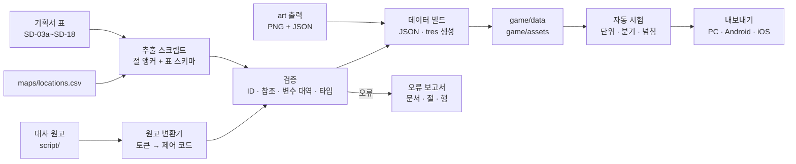
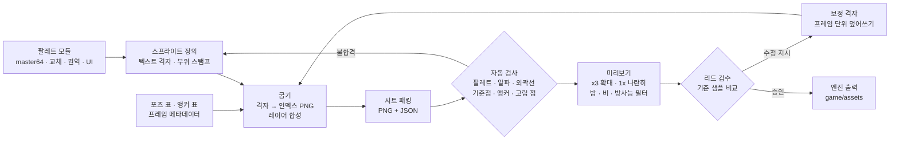
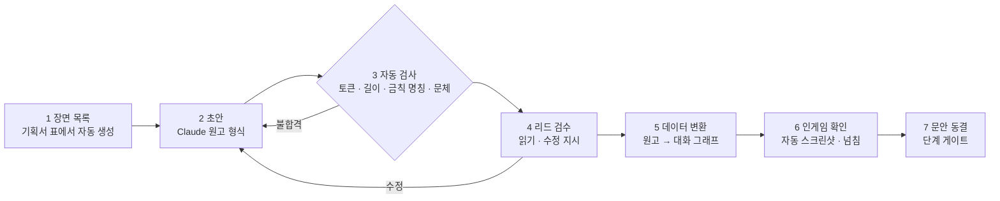

# SD-19. 개발 로드맵

> **서울 폴아웃 상세 기획서 세트** | 문서 ID: SD-19 | 버전: v1.0 | 작성일: 2026-10-12
> **범위**: 세트의 **개발 로드맵 정본**. 2026-10-12 사용자 결정(Godot 4, PC·Android·iOS, 라디오 수록곡 없음, 크리처 컨셉 아트 없음, 그래픽 Claude 전담, 사운드는 BGM·효과음만) 반영. 로드맵 원칙, 추정 모델(1인 + Claude), 단계 S·T·0~7과 P1의 목표·범위·완료 기준·게이트·기간, 기술(Godot 4)·아트·사운드·콘텐츠 로드맵, QA(분기 자동 검증·기기 매트릭스·성능 예산), 마일스톤·Gantt, 남은 결정, 리스크, 다음 4주 계획. **다루지 않는 것**: 각 콘텐츠·시스템의 설계 수치와 문안(각 정본 문서), 그래픽 규격(SD-16), 큐별 음악 사양(SD-17).
> **관련 문서**: [SC-00 컨셉](00_concept.md), [SD-01 게임 개요](01_game-overview.md), [SD-03a 메인 1부](03a_main-story-part1.md), [SD-03b 메인 2부](03b_main-story-part2.md), [SD-04a](04a_side-quests-south.md)·[04b](04b_side-quests-west-river.md)·[04c](04c_side-quests-north-east-center.md) 사이드, [SD-04d 세력 퀘스트](04d_faction-questlines.md), [SD-05 기타 퀘스트·인카운터](05_misc-quests-encounters.md), [SD-06 세력](06_factions.md), [SD-07b NPC](07b_npc-directory.md), [SD-08 월드·권역](08_world-regions.md), [SD-09a~f 장소](09a_locations-r01-r02.md), [SD-10 캐릭터](10_character-system.md), [SD-11 전투](11_combat-system.md), [SD-12 탐험·UI](12_exploration-ui.md), [SD-13 아이템](13_items.md), [SD-14 크리처](14_creatures-enemies.md), [SD-15 경제](15_economy.md), [SD-16 아트](16_art-direction.md), [SD-17 사운드](17_sound.md), [SD-18 용어](18_naming-terms.md)
> **근거 자료**: 원작 [RD-27 이식 시사점](../reverse-design/27_adaptation-notes.md) §8·§9·§11·§13, 지도 [maps/locations.csv](maps/locations.csv)

---

## 목차

0. 한 장 요약
1. 문서 개요
2. 로드맵 원칙
3. 추정 모델: 1인 + Claude 체제
4. 단계 총괄: 표·흐름도·Gantt·마일스톤·공개 단위
5. 단계 상세 (S · T · 0 · 1 · 2 · P1 · 3 · 4 · 5 · 6 · 7)
6. 기술 로드맵 (Godot 4)
7. 아트 제작 로드맵
8. 사운드 로드맵
9. 콘텐츠 로드맵
10. QA·검수
11. 결정 게이트와 남은 결정
12. 리스크 관리
13. 다음 4주 실행 계획
14. 원작 대응
15. 쯔꾸르 제작 메모 (Godot 전환 메모)
16. 미결 사항
- 부록 A. 신규 고유명사 / 부록 B. 참고 문서 / 버전 이력

---

## 0. 한 장 요약

| 질문 | 답 |
|---|---|
| 지금 어디인가 | **단계 S(스타일 기준 샘플) 마무리, W1**(2026-10-12가 든 주를 W1로 센다). 기준 샘플 14종 1차와 마무리 산출물(비교 시트, 자동 검수 v0 위반 0, 시트 패킹 v0, 한 줄 재현 빌드, 1× 판독 시험지)이 나왔고 **게이트 G-S(리드 승인·1× 판독 시험) 대기**다. 기록은 `art/STAGE_S.md` |
| 엔진·플랫폼 | **Godot 4.x**(범용 2D 엔진, MIT, 로열티 없음). **PC(윈도 우선)·Android·iOS** 모두 플레이 가능하게 만든다. 웹 내보내기는 선택 |
| 단계 | **S** 스타일 기준 샘플 → **T** 기술 시험판 → **0** 버티컬 슬라이스 → **1** 1막 → **2** 2막(1차 공개 후보) → **P1** 1차 공개 준비 → **3** 3~4막 → **4** 5~7막·결말(메인 완주판) → **5** 사이드·세력 → **6** 월드 채우기 → **7** 선택 과제·마감 |
| 기간(기준안) | **약 147주**(범위 118~196주). 리드 1인 주 40시간 + Claude 기준. 리드가 주 20시간이면 약 1.9배 |
| 주요 마일스톤 | M-S 기준 샘플 승인 **W3** / M-T Godot 기술 확정 **W9** / M-0 버티컬 슬라이스 **W21** / M-P1 1차 공개(프롤로그~2막) **W64** / M-4 메인 완주판 **W100** / M-7 1.0 **W147** |
| 일정의 병목 | Claude의 제작 속도가 아니라 **리드의 검수·결정·플레이 테스트 시간**이다. 추정은 '리드 시간 단가'로 계산한다(§3) |
| 품질 | 그림 수준은 고정(P5). 모자라면 **범위를 줄인다**. 기준 샘플 승인(G-S) 전에는 대량 제작을 하지 않는다 |
| 데이터 | 기획서 표 → 추출 스크립트 → 데이터 파일(CSV·JSON) → Godot 리소스. **손으로 엔진에 수치를 넣지 않는다** |
| 다음 4주 | W1~W3 기준 샘플 14종 제작·검수·승인(G-S), 병행으로 Godot 버전 고정·Android 빌드 체인·iOS 빌드 환경 확인·사운드 협업 의뢰, W4 기술 시험판 착수(§13) |
| 종결된 결정 | H-01(실존 인물 동명 확인 안 함), H-04(엔진: Godot 4 기본), H-06 일부(라디오 수록곡·보컬 없음, 크리처 컨셉 아트 단계 없음) |
| 남은 큰 결정 | 정식 제목, 폰트·IP 라이선스(H-03), 1차 제작·공개 범위와 표현 수위(H-06), 4·5막 시간 제한(H-07), 배포 경로·iOS 빌드 환경·모바일 화면비 등 이 문서가 새로 제안하는 H-09~H-15(§11) |

---

## 1. 문서 개요

### 1.1 목적
- 기획서 세트(SC-00, SD-01~18)를 **실제로 만들어 내는 순서와 기준**을 정한다. 무엇을 어떤 순서로, 어떤 완료 기준으로, 어떤 결정을 거쳐 만드는지를 단계별로 적는다.
- 2026-10-12 사용자 결정(엔진·플랫폼·사운드 범위·그래픽 제작 방식)을 로드맵에 반영하고, 그 결정이 다른 문서에 남긴 정합 과제를 한곳에 모은다(§1.4).
- 1인 개발자(리드)와 Claude가 함께 만드는 체제를 전제로, 기간을 **근거 있는 범위**로 추정한다(§3). 추정은 단계 S·0의 실측으로 고친다.

### 1.2 정본 관계와 단계 번호
| 대상 | 정본 | 비고 |
|---|---|---|
| 단계 정의·순서·완료 기준·결정 게이트·기간 | **SD-19(이 문서)** | SD-01 §11.5는 이 문서의 요약으로 줄어든다(SD-01 담당이 반영) |
| 단계별 그래픽 우선순위 | SD-19 §7.4 | SD-16 §12.2 표는 이 문서의 단계 번호를 따른다. SD-16 §12.2의 '5 월드 채우기'는 이 문서의 단계 5·6으로 나뉜다 |
| 단계별 사운드 범위 | SD-19 §8.2 | SD-17 §8.5의 단계 번호(T, 0, 1=1~2막, 2=3~7막, 3=사이드, 4=월드)를 이 문서 번호로 바꿔 읽는다. 대응: SD-17 '1' → 단계 1·2, '2' → 단계 3·4, '3' → 단계 5, '4' → 단계 6 |
| 전투 구현 순서 | SD-19 §6.18 | SD-11 §14.6의 순서를 그대로 단계에 배치했다 |
| 기준 샘플 14종의 내용 | SD-16 §12.3 | 이 문서는 단계 S에서 **무엇을 어디까지 승인하는지**만 정한다(§7.1) |
| 각 콘텐츠의 수량 | 각 정본 문서(SD-03a~09f) | 이 문서는 수량을 단계에 배분만 한다(§9) |

- 단계 번호는 세트 공통 번호(T, 0~7)를 유지하고, 그 앞에 **단계 S**를, 단계 2 뒤에 **단계 P1(1차 공개 준비)**을 끼운다. 기존 문서가 쓰는 'T'와 '0~7'의 뜻은 바뀌지 않는다.

### 1.3 2026-10-12 사용자 결정 (이 문서의 전제)
| # | 결정 | 로드맵에 주는 영향 |
|---|---|---|
| U1 | 엔진은 **범용 2D 엔진, 기본값 Godot 4.x** | 단계 T의 게이트가 '엔진 선택'에서 **'Godot 기술 확정·성능 예산 확정'**으로 바뀐다. 쯔꾸르 MZ 전제는 데이터 규격으로만 남는다(§15) |
| U2 | **PC와 모바일(Android·iOS)** 모두 플레이 가능 | 터치 조작, 화면비·안전 영역, 모바일 성능 예산, 기기 매트릭스, iOS 빌드 환경(macOS)과 배포 경로가 단계 T부터 들어온다 |
| U3 | 실존 인물 동명 확인을 하지 않는다 | H-01 종결. 포털 확인 작업을 일정에서 뺀다 |
| U4 | 라디오 수록곡을 만들지 않는다(텍스트 방송·징글) | SD-17 RS-K·U·N 28곡 삭제, 징글·멘트 베드 약 20개만. H-06 '라디오 보컬' 종결 |
| U5 | 크리처 원화(컨셉 아트) 단계 없음 | SD-14 규격대로 스프라이트를 바로 만들고, 실루엣·원형 보존 70% 검사를 스프라이트 단계에서 한다 |
| U6 | 그래픽은 모두 Claude, 품질 타협 없음 | 코드·텍스트 기반 도트 파이프라인과 팔레트 검사 자동화(§7.2). 분량은 범위로 조절 |
| U7 | 사운드는 BGM·효과음만(음성 없음), 외부 협업 또는 도구 | 외부 납품 트랙으로 따로 일정을 잡고 한 단계 앞서 의뢰(§8.3) |
| U8 | 스타일 기준 샘플 작업을 지금 시작(리드 직접, `/home/user/003/art/`) | 현재 위치 = 단계 S 진행 중, W1 |

### 1.4 이 결정들이 다른 문서에 남기는 정합 과제
이 문서는 다른 문서를 고치지 않는다(다른 에이전트가 엔진·모바일 결정을 반영 중이다). 각 담당이 반영할 항목이다.

| # | 문서 | 현재 | 맞출 내용 |
|---|---|---|---|
| A1 | SD-01 §2.1·§11.5·§11.6 | 엔진 미결, PC 우선, T 게이트 'H-04 엔진 결정' | Godot 4, PC·Android·iOS, §11.5는 SD-19 요약 + 링크, H-01·H-04 종결 |
| A2 | SD-11 §14.1·§14.2 | MZ 기능 대비표, '플러그인 충돌' 항목 | 측정 항목을 Godot 기준 9항목으로(§5.2) |
| A3 | SD-16 §3.3 | 비표준 화면 = 정수 배율 + 레터박스 | 모바일 20:9에서 가로 20~25%가 검게 남는다. 세로 360 고정 + 가로 확장 제안(H-11, §6.4) |
| A4 | SD-16 §15, SD-17 §10, SD-03a §12, SD-13 §11.2 등 | MZ 플러그인·공통 이벤트 전제 | 데이터 규격 유지, 구현 표현은 Godot(§15) |
| A5 | SD-17 §4.7·§8.5·§11 U-01 | 라디오 수록곡 28곡, 305인일 | 수록곡 삭제, 약 255인일(§8.1) |
| A6 | SD-03a·03b·바이블 §11 | 메인 퀘스트 '41개' | ID 열거와 막별 내역(4+6+7+4+3+8+5+2+1)의 합은 **40**. 근거 확인(§16 U-01) |
| A7 | SD-12 §13 | 저장: F5/F9 빠른 저장 | 모바일 백그라운드 전환 시 자동 저장, 빠른 저장은 메뉴 버튼(§6.10) |
| A8 | SD-11 §2.3, SD-12 §13.8 | 조작 3방식 | 네 번째 방식 '터치' 정의(§6.13 초안) |

### 1.5 표기
- **W n**: 상대 주차. W1 = 2026-10-12가 든 주. 날짜는 일정의 근거가 아니라 참고다.
- **주**: 리드 실작업 **40시간**을 1주로 본다(§3.1). 리드 가용 시간이 다르면 기간을 비례로 늘린다.
- **리드 시간(h)**: 리드가 검수·결정·플레이 테스트에 쓰는 시간. Claude의 제작 시간은 따로 센다(§3.3).
- **인일**: 외부 사운드 작업 1인의 하루(SD-17 §8.5와 같은 단위).
- **G-x**: 결정 게이트(§11.1). **M-x**: 마일스톤(§4.4). **H-xx**: 사람이 정할 항목(SD-01 §11.6, RECON_SPEC §6). **R-xx**: 이 문서의 리스크 ID(§12).
- 수량 뒤의 `누적`은 그 단계까지의 합계, 표시가 없으면 그 단계에서 새로 만드는 양이다.

---

## 2. 로드맵 원칙

### 2.1 단계 게이트
- 단계마다 **완료 기준**(측정 가능한 체크리스트)과 **결정 게이트**를 둔다. 게이트를 통과하기 전에는 다음 단계의 **대량 제작**을 시작하지 않는다. 다음 단계의 설계·시안·도구 준비는 해도 된다.
- 게이트 판정은 세 가지다.

| 판정 | 뜻 | 다음 행동 |
|---|---|---|
| 통과 | 완료 기준 전부 충족 | 다음 단계 착수. 판정 기록을 남긴다 |
| 조건부 통과 | 완료 기준의 90% 이상 충족, 남은 항목이 다음 단계 진행을 막지 않는다 | 남은 항목을 다음 단계 첫 4주 안의 작업으로 등록하고 착수 |
| 반려 | 핵심 기준(★ 표시) 하나라도 미충족 | 원인별 재작업. 반려가 두 번이면 범위 축소안(§2.5)을 함께 검토한다 |

- 게이트마다 **추정 보정**을 한다. 그 단계에서 실측한 처리량(그래픽 칸당 시간, 대사 줄당 검수 시간, 장면당 구현 시간)으로 남은 단계의 기간을 다시 계산하고 §4 표를 갱신한다.

### 2.2 수직 통합 (버티컬 슬라이스 우선)
- 한 단계가 맡은 콘텐츠는 **그래픽·사운드·텍스트·시스템·QA까지 공개 품질로 끝낸다.** 시스템을 먼저 전부 만들고 콘텐츠를 나중에 채우는 수평 방식을 쓰지 않는다. 품질 기준을 실제 화면으로 검증해야 대량 재작업을 막고, 1인 체제에서는 끝난 덩어리 하나가 반쯤 된 시스템 수십 개보다 위험을 더 줄이며, 공개 단위(§2.5)로 끊을 수 있기 때문이다.
- 예외 둘: **전역 기본 지형**(1,230청크)은 단계 1에서 SD-08 벡터로 한 번에 자동 굽기(심리스가 끝까지 이어지는지 일찍 확인). **엔진 코어**(스트리밍·전투·저장·대화 실행기)는 T·0에서 뒤 단계가 쓸 수준까지 만든다.
- 단계 안의 순서: 시스템 최소 구현 → 메인 경로 1개 끝까지 → 나머지 경로 → 권역 사이드·비표시 → 폴리시 → QA.

### 2.3 데이터 주도 개발
- **기획서 표가 데이터의 원천이다.** 정본 문서의 표(퀘스트 단계·변수·호감도 값·아이템·적·장소·NPC 외형 코드)를 추출 스크립트로 데이터 파일로 바꾸고, Godot는 데이터 파일만 읽는다(§6.12).
- 규칙: ① 엔진 편집기에서 수치를 손으로 입력하지 않는다. ② 데이터 파일을 고치면 원천(기획서 또는 이관 뒤의 데이터 원본)을 함께 고친다. ③ 모든 ID는 SD-18의 데이터 키 규칙과 세트 ID 체계를 그대로 쓴다. ④ 다른 문서의 ID를 참조하면 빌드 때 존재를 검사한다.
- **정본 이관**: 단계 0까지는 기획서가 수치의 정본이고 데이터 파일은 생성물이다. 단계 0의 게이트(G-0)에서 **수치·문안 정본을 데이터 원본(`data_src/`)으로 옮길지** 정한다(H-12 제안). 옮기면 기획서는 '설계 의도'의 정본이 되고, 수치 표는 데이터 원본에서 다시 생성한다.
- 규칙 계산(피해식, 판정, 호감도 연동, 판도 틱, 매매가)은 **엔진 노드와 분리된 순수 스크립트**로 짜서 헤드리스로 시험한다(§6.1).

### 2.4 품질 기준 (P5)
- 그림 수준은 고정이다. 분량이 모자라면 그림을 단순화하지 않고 **콘텐츠 범위를 줄인다**(바이블 §2 원칙 8, SD-16 §1.1). 기준은 **단계 S에서 승인한 기준 샘플**이고, 이후 모든 에셋을 기준 샘플과 나란히 놓고 검수한다(SD-16 §13.5-14).
- 자동 검수(팔레트·알파·외곽선·기준점·앵커·고립 점)를 통과하지 못한 에셋은 리드 검수로 넘기지 않는다. 대사도 같아서, 문체·길이·조사 토큰·금칙 명칭 검사(§9.3)를 통과한 원고만 리드가 읽는다. 리드 시간을 아끼는 가장 큰 장치다.

### 2.5 범위 관리: 공개 단위 분할과 줄이는 순서
- 설계량이 바이블 목표의 1.5~3배다(SD-01 R5). 그래서 처음부터 **공개 단위**로 나눈다.

| 공개 단위 | 포함 | 단계 | 성격 |
|---|---|---|---|
| 공개 0 | 버티컬 슬라이스(프롤로그 + MQ-101) | 0 | 비공개 시연. 지인·외부 테스터 대상 |
| **공개 1** | 프롤로그~2막 + 1·2막 권역(R01·R02·R04·R06·HR) 완성. 사이드 30·세력 25·비표시 44·반복 32·인카운터 75 | 0~2, P1 | **1차 공개 후보**(H-06·U-07 제안). 나머지 권역은 공개 경계 처리(H-13) |
| 공개 2 | 메인 완주판(3~7막·결말·에필로그) + R05 도심 사이드 | 3·4 | 공개 1 위에 덧붙인다 |
| 공개 3 (1.0) | 사이드·세력·월드 채우기·선택 과제 전부 | 5~7 | 완전판 |

- **범위를 줄이는 순서**(일정이 2단계 연속으로 예비를 넘기면 위에서부터 적용한다). 메인 진행과 결말 구조는 줄이지 않는다.

| 순위 | 줄이는 대상 | 절감 | 근거 |
|---|---|---|---|
| 1 | 선택 과제(V.A.T.S. 축약형, 하드코어) 보류 | 단계 7의 약 40% | P8, SD-11 D11-07·D11-10 |
| 2 | C등급 장소 89곳 중 실내 없는 곳을 '지도 표식 + 소품'으로 축소 | 실내 맵 약 40장 | SD-16 §6.6 등급 예산 |
| 3 | 반복 퀘스트 55 → 35(세력별 출구 1개씩 남김) | 대사 약 400줄, 이벤트 약 40 | SD-05 §4.3 |
| 4 | 랜덤 인카운터 중 반복형 변형 축소(157 → 120, 고유 25는 유지) | 스폰 표 정리 | SD-05 §5.1 |
| 5 | 거처 테마 6 → 3 | 실내 3장 + 소품 | H-06 기존 항목 |
| 6 | 비표시 압축 훅(UQ-62~124) 중 장소 앵커가 없는 것 보류 | 약 20편 | SD-05 §3.16 |
| 7 | 결말 슬라이드 판본 축소(같은 구도 상태 변형만) | 그림 약 30장 | SD-16 §13.6 |
| 8 | 크리처 변형·지역 변종 33 → 15 | 스프라이트 변형 | SD-14 §11.8 |

- 범위를 줄여도 **ID는 지우지 않는다**. 보류 상태(`deferred`)로 데이터에 남겨 문서 간 참조가 깨지지 않게 한다.

### 2.6 역할 분담
| 주체 | 맡는 일 | 맡지 않는 일 |
|---|---|---|
| **리드(1인)** | 결정(게이트·H 항목), 그래픽·대사·장면 검수, 플레이 테스트, 외부 사운드 협업 관리, 기기 테스트 실행, 공개 | 대량 그래픽 원화, 대량 코드 작성, 초안 대사 |
| **Claude** | 코드(Godot·파이프라인·검수 도구), 데이터 변환, 그래픽 전부(텍스트 격자 원화 → 시트), 대사·문안 초안, 자동 검수 보고서, 문서 정합 | 최종 승인, 실기기 조작, 외부 계약 |
| **외부 협업 또는 도구** | BGM·효과음·환경음(SD-17 §8.1), 징글·멘트 베드 | 그래픽(전부 Claude) |
| **외부 테스터(지인)** | 단계 0·2·4 게이트의 처음 하는 사람 테스트, 기기 다양성 확보 | — |

### 2.7 원칙이 충돌할 때
- 우선순위: ① 메인 진행 불막힘(바이블 §5.3-4)과 저장 안정성 ② 품질 기준(P5, 일정이 밀리면 범위를 줄인다) ③ 공개 단위의 완결성(공개 1 권역은 사이드·비표시까지) ④ 데이터 주도 원칙은 일정 때문에 깨지 않는다(손 입력 수치는 나중에 정합 오류가 된다).

---

## 3. 추정 모델: 1인 + Claude 체제

### 3.1 체제 가정
| 항목 | 가정 | 바뀌면 |
|---|---|---|
| 리드 가용 시간 | 주 40시간(전업) | 주 30시간이면 기간 ×1.33, 주 20시간이면 ×1.9 안팎(결정·검수 고정 비용 때문에 2배보다 조금 적다) |
| Claude 작업 | 리드가 지시·검수할 수 있는 만큼 생산한다. 제작 속도는 병목이 아니다 | 세션 수가 줄면 그래픽 선행 제작(§4.3 아트 선행)이 줄어 단계 사이 대기가 생긴다 |
| 외부 사운드 | 주 1.5~2.5인일을 꾸준히 납품하는 협업자 1명 또는 도구 사용자 | 납품이 끊기면 사운드는 임시음으로 진행하고 게이트에서 대체 판정(§8.3) |
| 병목 | **리드의 검수·결정·플레이 테스트 시간** | — |

### 3.2 리드 시간 단가 (자동 검수를 통과한 결과물 기준)
| 작업 | 단가 | 메모 |
|---|---|---|
| 대사 검수·수정 지시 | 100줄/시간 | 원고 형식(§9.3)과 자동 검사 통과분 |
| 메인 장면 플레이 확인 | 장면당 0.4시간 | 분기별 1회 |
| 사이드·세력 장면 확인 | 장면당 0.25시간 | — |
| 비표시·반복·인카운터 이벤트 확인 | 이벤트당 0.1시간 | — |
| 퀘스트 완주 테스트 | 메인 분기 1회 1~1.5시간, 사이드 1편 1.5시간, 세력 1편 1시간, 비표시 0.3시간 | 분기 자동 검증(§10.2)이 경로 수를 줄인다 |
| 타일 검수 | 100칸당 0.5시간 | — |
| 외부 프리팹·방 프리팹 | 1종 0.5시간 | 상태 3단계 포함 |
| 인물 레이어 1벌(675칸) | 2시간 | 포즈 표 공유분 |
| 머리 3슬롯·무기 외형 1종 | 0.3시간 | — |
| 크리처·로봇 고유 1종 / 변형 1종 | 1.5시간 / 0.3시간 | — |
| 고유 초상화 1명(6표정) / 모듈 조립 10명 | 1시간 / 0.5시간 | — |
| 아이콘 100개 | 1시간 | — |
| 픽처 1장 / 키 아트 1장 / 결말 슬라이드 상태 변형 1장 | 1시간 / 3시간 / 0.5시간 | — |
| 장소 조립 검수 | S 6시간(대형 던전 10~20) / A 2 / B 0.75 / C 0.25 | 장소 등급은 SD-09 |
| 실내 맵 1장 | 0.5시간 | 방 프리팹 조립분은 0.3~0.4 |
| 외부 청크 정밀 패스 | 청크당 0.05~0.1시간 | 자동 굽기 뒤 손보정 확인 |
| 시스템 기능 1건 검토·결정 | 6~8시간 | 시연·결정·수정 지시 1~2회 |
| 사운드 큐 검수 | BGM 1큐 0.5시간, 효과음 50개 1시간, 환경음 1루프 0.2시간 | SD-17 §8.3 |

### 3.3 Claude 제작 처리량 (참고값, 단계 S에서 실측해 고친다)
| 대상 | 처리량(주당) | 비고 |
|---|---|---|
| 타일 원화 | 400~600칸 | 오토타일 블록 단위, 변형 4장 포함 |
| 인물 레이어(파츠 리그) | 1~2벌 | 스탬프 40~70장 + 굽기 + 보정 10~20% |
| 머리·무기 앵커 컷 | 머리 장비 8~12종 / 무기 6~10종 | — |
| 크리처 고유 | 소형 3~4종 / 중형 2~3종 / 대형 1~2종 | 컨셉 아트 단계 없음(U5) |
| 초상화 | 고유 4~6명(6표정) / 모듈 부위 80장 | — |
| 아이콘 | 100~150개 | — |
| 픽처 | 3~5장(키 아트 1장) | — |
| 대사 초안 | 제한 없음(검수가 병목) | 원고 형식 준수 |
| 코드 | 시스템 1~3건 | 리드 결정 대기가 병목 |

### 3.4 기간 산정식
- `단계 기간(주) = 리드 시간 합계 ÷ 40 × (1 + QA 0.15) × 예비 계수`
- 예비 계수: 일반 1.2 / 새 시스템이 많은 단계(T·0) 1.5 / 기술 위험이 큰 단계(3·4·7) 1.3.
- 단계 S·P1은 그 자체가 검수·QA라서 QA 가산을 하지 않는다.
- 범위(최소~최대)는 ① 리드 가용 시간 편차(주 35~45시간) ② 실측 처리량 편차(±25%) ③ 기술 문제를 반영한다.

### 3.5 단계별 리드 시간 합계와 기간
| 단계 | 리드 시간(h) | 주요 내역 | 계수 | 기준안(주) | 범위(주) |
|---|---|---|---|---|---|
| S | 약 80 | 샘플 검수 2~3회, 규격 결정 | 1.2(QA 없음) | **3** | 2~4 |
| T | 약 130 | 시스템 12건, 기기 시험 | 1.15 × 1.5 | **6** | 5~8 |
| 0 | 약 270 | 시스템 16건, 장면 40, 맵 16 | 1.15 × 1.5 | **12** | 10~16 |
| 1 | 약 530 | 대사 55h, 이벤트 78h, 테스트 46h, 장소 70h, 실내 42h, 시스템 90h, 그래픽 약 100h | 1.15 × 1.2 | **18** | 15~24 |
| 2 | 약 630 | 대사 83h, 이벤트 119h, 테스트 70h, 장소 120h, 실내 46h, 시스템 66h, 그래픽·사운드 약 125h | 1.15 × 1.2 | **22** | 18~28 |
| P1 | 약 100 | 공개 판정 QA, 기기 테스트, 배포 준비 | 1.2(QA 없음) | **3** | 2~4 |
| 3 | 약 430 | 테스트 45h, S급 던전 4곳 70h, 크리처·로봇 39h, 시스템 48h | 1.15 × 1.3 | **16** | 12~22 |
| 4 | 약 530 | 장면 58h, 결말 테스트 90h, 장소 73h, 픽처 41h, 시스템 70h | 1.15 × 1.3 | **20** | 16~26 |
| 5 | 약 720 | 대사 93h, 장면 205h, 테스트 103h, 장소 140h, 실내 60h | 1.15 × 1.2 | **25** | 20~32 |
| 6 | 약 335 | 장소 57h, 밀도 조정 50h, 이벤트·수집품 | 1.15 × 1.2 | **12** | 10~18 |
| 7 | 약 250 | 선택 과제, 회귀, 최적화 | 1.15 × 1.3 | **10** | 8~14 |
| **합계** | **약 4,000** | | | **147** | **118~196** |

- 계산 예(단계 1): 530 ÷ 40 = 13.25주 × 1.15 × 1.2 = 18.3주 → 18주.
- 단계 0이 12주인 이유: 시스템 16건(대화·퀘스트·변수·캐릭터 생성·서류 UI·S.P.E.C.I.A.L.·화술 판정·은신·카르마·호감도·수배도·핍-보이 3탭·저장·한글 폰트·터치 HUD·데이터 파이프라인)을 처음 만든다. 콘텐츠 양은 적지만 새 시스템 예비 계수 1.5를 적용했다.

---

## 4. 단계 총괄

### 4.1 단계 표
| 단계 | 이름 | 목표 한 줄 | 기준안 주차 | 기간(범위) | 결정 게이트 |
|---|---|---|---|---|---|
| **S** | 스타일 기준 샘플 | 모든 그래픽의 품질 기준과 제작 파이프라인을 확정한다 | W1~W3 | 3주(2~4) | **G-S** 기준 샘플 승인 |
| **T** | 기술 시험판 | Godot 4로 심리스·실시간 전투·페이퍼돌·모바일이 예산 안에서 도는지 증명한다 | W4~W9 | 6주(5~8) | **G-T** Godot 기술 확정·성능 예산 확정 |
| **0** | 버티컬 슬라이스 | 프롤로그 + MQ-101을 공개 품질로 끝내 핵심 경험 셋을 검증한다 | W10~W21 | 12주(10~16) | **G-0** 슬라이스 승인, 1차 범위(H-06), 폰트 라이선스(H-03 일부), 정본 이관(H-12) |
| **1** | 1막 | R01·R02 권역을 메인·사이드·비표시까지 완성한다 | W22~W39 | 18주(15~24) | **G-1** 1막 완료 |
| **2** | 2막 | 한강 횡단·세력 접근·판도를 완성한다. 1차 공개 후보 | W40~W61 | 22주(18~28) | **G-2** 1차 공개 판정 |
| **P1** | 1차 공개 준비 | 공개 1을 3플랫폼으로 배포할 수 있게 한다 | W62~W64 | 3주(2~4) | **M-P1** 1차 공개 |
| **3** | 3~4막 | 세 개의 열쇠와 귀향·청계산을 완성한다 | W65~W80 | 16주(12~22) | **G-3** 4막 시간 제한 1차(H-07) |
| **4** | 5~7막·결말 | 메인 완주와 결말 5갈래·결말 슬라이드를 완성한다 | W81~W100 | 20주(16~26) | **G-4** 메인 완주판 승인, H-07 확정 |
| **5** | 사이드·세력 | 남은 사이드 39·세력 44·거처를 완성한다 | W101~W125 | 25주(20~32) | **G-5** |
| **6** | 월드 채우기 | 장소 425곳·비표시·반복·인카운터·수집품을 채운다 | W126~W137 | 12주(10~18) | **G-6** 콘텐츠 동결 |
| **7** | 선택 과제·마감 | 선택 과제·접근성·전체 회귀·1.0 공개 | W138~W147 | 10주(8~14) | **G-7** 1.0 공개 |

### 4.2 단계 흐름도


### 4.3 Gantt (기준안)
- 막대 한 칸 = 1주, 축의 `W` = 상대 주차. Mermaid gantt는 날짜 축만 그리므로 **1일을 1주로 바꿔 그렸다**(축 숫자가 곧 주차다).
- **사운드(외부)** 구간은 의뢰부터 납품까지다. 각 단계 사운드를 한 단계 앞서 의뢰한다(§8.3).
- **아트 선행**: 각 단계의 마지막 약 25% 동안 Claude가 다음 단계의 타일셋·크리처를 선행 제작한다. 검수 시간은 다음 단계에 넣었으므로 막대로 따로 그리지 않았다.

```mermaid
gantt
  title 서울 폴아웃 개발 로드맵 기준안 (1칸 = 1주, 축 W = 상대 주차)
  dateFormat x
  axisFormat W%-j
  tickInterval 1week
  todayMarker off
  section 준비
  S 스타일 기준 샘플 W1~W3        :active, s, 252504000000, 3d
  T 기술 시험판 W4~W9             :t, after s, 6d
  0 버티컬 슬라이스 W10~W21       :v, after t, 12d
  section 공개 1
  1 1막 W22~W39                   :a1, after v, 18d
  2 2막 W40~W61                   :a2, after a1, 22d
  P1 1차 공개 준비 W62~W64        :p1, after a2, 3d
  section 공개 2
  3 3~4막 W65~W80                 :a3, after p1, 16d
  4 5~7막 결말 W81~W100           :a4, after a3, 20d
  section 1.0
  5 사이드 세력 W101~W125          :a5, after a4, 25d
  6 월드 채우기 W126~W137         :a6, after a5, 12d
  7 선택 과제 마감 W138~W147       :a7, after a6, 10d
  section 사운드 외부
  T 음원 W2~W9                    :o0, 252590400000, 8d
  0 음원 W6~W21                   :o1, 252936000000, 16d
  1 음원 W16~W39                  :o2, 253800000000, 24d
  2 음원 W34~W61                  :o3, 255355200000, 28d
  3 음원 W58~W80                  :o4, 257428800000, 23d
  4 음원 W74~W100                 :o5, 258811200000, 27d
  5 음원 W95~W125                 :o6, 260625600000, 31d
  6 음원 W120~W137                :o7, 262785600000, 18d
  section 마일스톤
  M-S 기준 샘플 승인              :milestone, m0, after s, 0d
  M-T Godot 기술 확정              :milestone, m1, after t, 0d
  M-0 버티컬 슬라이스              :milestone, m2, after v, 0d
  M-P1 1차 공개                   :milestone, m3, after p1, 0d
  M-4 메인 완주판                  :milestone, m4, after a4, 0d
  M-7 1.0                          :milestone, m5, after a7, 0d
```



### 4.4 마일스톤 표
| ID | 마일스톤 | 기준안 | 범위 | 산출 빌드 |
|---|---|---|---|---|
| M-S | 기준 샘플 승인 | W3 | W2~W4 | 기준 샘플 시트, 도구 v0 |
| M-T | Godot 기술 확정 | W9 | W7~W12 | 시험판 3플랫폼 빌드 + 측정 보고서 |
| M-0 | 버티컬 슬라이스 | W21 | W17~W28 | **공개 0**(비공개 시연판) |
| M-1 | 1막 완성 | W39 | W32~W52 | 내부 알파 |
| M-2 | 1차 공개 후보 | W61 | W50~W80 | 공개 1 후보 |
| M-P1 | **1차 공개** | W64 | W52~W84 | **공개 1** |
| M-3 | 4막 완성 | W80 | W64~W106 | 내부 베타 |
| M-4 | **메인 완주판** | W100 | W80~W132 | **공개 2 후보** |
| M-5 | 사이드·세력 완성 | W125 | W100~W164 | 내부 베타 2 |
| M-6 | 콘텐츠 동결 | W137 | W110~W182 | 릴리스 후보 |
| M-7 | **1.0** | W147 | W118~W196 | **공개 3** |

- 범위는 각 단계 범위의 최소·최대 누적이다. 실제로는 앞 단계의 실측으로 뒤 단계를 다시 계산하므로, 게이트마다 이 표를 갱신한다.

### 4.5 공개 단위별 내용 요약
| 항목 | 공개 0 (W21) | 공개 1 (W64) | 공개 2 (W100) | 공개 3 = 1.0 (W147) |
|---|---|---|---|---|
| 메인 퀘스트 | 5 | 17 | 40 | 40 |
| 사이드 | 0 | 30 | 36 | 75 |
| 세력 퀘스트 | 0 | 25 | 25 | 69 |
| 비표시 / 반복 / 인카운터 | 0 / 0 / 0 | 44 / 32 / 75 | 51 / 32 / 110 | 124 / 55 / 157 |
| 장소 | 4 | 166 | 238 | 425 |
| 대화 NPC | 25 | 322 | 452 | 735 |
| 권역 | R01 일부 | R01·R02·R04·R06·HR 완성, R07·R08 일부 | + R03·R07·R09·R11 메인 경로, R05 완성 | 전부 |
| 플레이 시간(추정) | 1~1.5시간 | 15~25시간 | 35~50시간 | 100~140시간 |

---

## 5. 단계 상세

각 단계는 같은 틀로 적는다: 목표 → 범위 → 산출물 → 완료 기준(★ = 핵심 기준, 하나라도 미충족이면 반려) → 결정 게이트 → 의존 관계 → 리스크 → 규모 추정 → 기간 추정.

### 5.1 단계 S: 스타일 기준 샘플 (W1~W3, 진행 중)

**목표**: 모든 그래픽의 품질 기준(P5)을 실물로 확정하고, Claude 제작 파이프라인이 그 품질을 반복해서 낼 수 있음을 증명한다.

**범위**
| 구분 | 내용 |
|---|---|
| 기준 샘플 | SD-16 §12.3의 14종. 단계 S의 승인 범위는 '스타일을 결정하는 최소분'이고, 나머지 확장분은 단계 T·0에서 같은 기준으로 채운다(§7.1 표) |
| 제작 도구 v0 | 팔레트 모듈, 텍스트 격자 → 인덱스 PNG, 시트 패킹 + JSON, 팔레트 준수 검사, 자동 검수 6항목, ×3 미리보기·1× 나란히 보기·상황 필터 미리보기(§7.3) |
| 규격 동결 | 64색 마스터 팔레트, 포즈 표 형식과 프레임 메타데이터 필드(SD-16 §5.4), 시트 배열·JSON 스키마(SD-16 §13.3), 파일 명명 규칙(SD-16 §13.4) |
| 사운드 | 제작 없음. 사운드 협업 경로 확보와 단계 T 범위 의뢰(§13) |
| 기술 준비(병행) | Godot 안정판 고정, 저장소 골격, Android 빌드 체인, iOS 빌드 환경 확인, 데이터 파이프라인 설계 메모 |

**산출물**: `/home/user/003/art/` 아래 기준 샘플 원본(텍스트 격자)과 출력(PNG + JSON), 기준 샘플 비교 시트 1장(14종을 한 화면에), 제작 도구 v0, 규격 동결 메모(팔레트·포즈 표·시트·명명), 실측 처리량 기록표(종류별 Claude 제작 시간·리드 검수 시간), 승인 기록(G-S).

**완료 기준**
- [ ] ★ 14종 각각의 'S 승인 범위'(§7.1) 제작 완료, 리드 승인
- [ ] ★ 자동 검수 6항목(허용 팔레트 밖 색 0, 알파 0·255만, 이중 외곽선 0, 발 기준점 `(32, 60)` 고정, 앵커 이탈 0, 레이어 프레임 수 일치) 위반 0
- [ ] ★ 1× 판독 시험: 리드 + 외부 1인이 640×360 실제 크기 화면에서 몸통 4계열을 구분(정답률 100%), 크리처 3종을 원형 종으로 식별(100%)
- [ ] 상황 필터 3종(밤·비·방사능)을 건 미리보기에서 인물·적·바닥 경계가 판독됨
- [ ] 팔레트 64색 동결. 이후 팔레트를 바꾸면 전 에셋 재검사가 필요하다는 비용을 승인 기록에 적는다
- [ ] 포즈 표 v1 동결: 머리 앵커(x, y, 상태), 주 손·보조 손, 무기 각도 단계, 히트박스 필드 포함
- [ ] 파츠 리그 굽기에서 손보정 비율 실측(목표 20% 이하)
- [ ] 텍스트 격자 → PNG → 시트 → JSON 전 과정을 스크립트 한 줄로 재현(같은 입력 = 같은 출력, 바이트 단위)
- [ ] 실측 처리량 기록표 작성(§3.3 참고값을 실측으로 교체)

**결정 게이트 G-S**: 기준 샘플 승인. 판정자 리드. 통과하면 단계 T가 승인된 샘플을 엔진에 올리고, 단계 0의 대량 제작이 열린다. 조건부 통과 시 미승인 샘플은 단계 T 첫 2주 안에 재승인한다(단, ★ 1× 판독 시험은 조건부 불가).

**의존 관계**: 선행 없음(현재 단계). 후행: T(팔레트·몸·몸통 2계열·권총·근접·바퀴·계엄군), 0(14종 전부).

**리스크**: R-01, R-03(§12).

**규모 추정**: 타일 약 550칸(S-07 약 250 + 관악산·봉천 약 300), 인물 프레임 약 1,000칸(몸 2벌 × 3모션 계열 23프레임 × 5방향 + 몸통 4계열 같은 범위 + 아동 일부), 머리 컷 105(7종 × 15), 무기 스탬프 80, 크리처 3종 × 약 9프레임 × 5방향, NPC 조합 19명(대기·걷기), 초상화 2명 × 6표정 + 2명 기본 + 모듈 10명, UI 시안 8화면, 이펙트 5, 픽처 2(키 아트 1), 간판 9점 + 글자 150자.

**기간 추정**: 3주(범위 2~4). 근거: 리드 시간 약 80시간(샘플 14종 × 검수 2~3회 × 평균 1.5시간 + 도구 검토 10시간 + 규격 결정 10시간) ÷ 40 × 1.2. 2주 안에 끝나는 조건은 1차 검수에서 반려가 3종 이하일 때다.

---

### 5.2 단계 T: 기술 시험판 (W4~W9)

**목표**: Godot 4로 서울판의 기술 핵심(심리스 청크 스트리밍, 맵 위 실시간 전투, 페이퍼돌 합성, 모바일 조작·성능)이 성능 예산 안에서 동작함을 3플랫폼 실기기에서 증명하고, 엔진 구조를 확정한다.

**범위**
| 구분 | 내용 |
|---|---|
| 월드 | 관악산 비탈 3×3청크(120×120타일) 외부 심리스 구역 + 실내 1곳(S-07 정문 일부) + 문 전환. 지형은 SD-08 변환식과 벡터 자료로 자동 굽기 |
| 전투 | 권총(A 계열)·한손 근접(E 계열), 투사체 풀 128, 원형 충돌, 엄폐 타일, AP(질주·회피·집중 사격), 피해식, 부위 판정 |
| 적 | 변이 바퀴벌레(큰바퀴), 계엄군 보병 1(인간형 + 몸통 T06·PF-01) |
| AI | 상태 머신(대기·의심·수색·교전·놓침·도주), 탐지 게이지, 공격 토큰, 경로 탐색(격자 A*), 활성 반경 갱신 주기 |
| 페이퍼돌 | 주인공 몸 + 몸통 2계열 + 머리 3슬롯 + 무기 2, 장비 교체 즉시 반영, 팔레트 교체 셰이더 |
| 입력 | 키보드+마우스, 게임패드, **터치(가상 스틱 2 + 상황 버튼)** 시안 |
| 화면 | 640×360 뷰포트, 정수 배율, 픽셀 스냅, 모바일 화면비·안전 영역 처리 시안 2종(레터박스 / 가로 확장) |
| 저장 | 청크 변경 기록 + 세계 상태 저장·불러오기 왕복 |
| 텍스트 | 한글 도트 폰트 12px 렌더, `\J[...]` 조사 처리 함수와 단위 시험 |
| 데이터 | 파이프라인 v0: SD-13 무기 2행·SD-14 적 2행·SD-10 S.P.E.C.I.A.L. 표를 기획서에서 추출해 게임이 읽음 |
| 빌드 | Windows, Android(arm64), iOS 실기기 실행. 벤치 씬 자동 측정 |
| 사운드 | 권역 곡 2(BGM-X01A·B), 전투 C01·C02 스템, 권총·근접 SE, 발소리 4지면, 거리 감쇠·크로스페이드 검증 |

**산출물**: 시험판 빌드 3종(Windows·Android·iOS), 벤치 씬과 자동 측정 스크립트, **측정 보고서**(아래 9항목 + 기기별 수치), Godot 프로젝트 골격 v1(§6.3 구조), 엔진 무관 코어 모듈 v0(피해식·판정·AI 규칙), 기술 결정 기록(렌더러·언어·화면비·페이퍼돌 방식).

**완료 기준 (측정 9항목: SD-11 §14.2의 6항목을 Godot 기준으로 고치고 모바일 3항목을 더함)**
| # | 측정 | 합격 기준(PC 기준 기기) | 합격 기준(모바일 중급 기기) | 불합격 시 1차 대응 |
|---|---|---|---|---|
| 1 ★ | 화면 안 24명 + 투사체 128 + 폭발 4 | 60fps 유지, 최저 50 | 60fps 목표, 최저 45 | 드로 콜 묶기, 투사체 렌더 단일 노드화 |
| 2 ★ | AI 40명(근경 16 + 중경 24) 상태 갱신 | 3ms/프레임 이하 | 4ms 이하 | 갱신 주기 늘리기 → 핫패스를 GDExtension(C++)으로 |
| 3 | 경로 탐색 64×64타일 구역 1건 | 0.5ms 이하 | 1ms 이하 | 흐름장(flow field)으로 무리 이동 대체 |
| 4 ★ | 페이퍼돌 6슬롯 × 24명 | 합성·갱신 2ms 이하 | 3ms 이하 | NPC는 빌드 때 미리 굽기(§6.7) |
| 5 ★ | 청크 경계 교전 추격 | 끊김 0.1초 이하(프레임 스파이크 8ms 이하) | 같음 | 사전 로드 반경 확대, 스레드 로드 |
| 6 | 시스템 통합 시험(구 '플러그인 충돌') | 스트리밍·전투·페이퍼돌·저장이 한 씬에서 1시간 연속 실행, 오류 0 | 30분 연속 | 결함 수정 |
| 7 ★ | 3플랫폼 실기기 실행 | Windows 실행 | Android·iOS 실기기에서 시험 구역 완주 | 빌드 체인 수정 / iOS 환경 확보(H-10) |
| 8 | 터치 조작 | — | 시험 구역 전투를 터치로 완료. 난이도 표준에서 PC 대비 사망률 1.5배 이하 | 조준 보정·자동 조준 원뿔 조정 |
| 9 | 발열·메모리 | RAM 1.5GB 이하 | 30분 연속 뒤 45fps 이상, RAM 1GB 이하 | 저전력 모드(30fps) 기본값 검토 |

- [ ] 위 9항목 측정 보고서 작성. ★ 5항목 합격
- [ ] 저장·불러오기 왕복 뒤 세계 상태 차이 0(자동 비교)
- [ ] 한글 12px·10px·16px 폰트가 정수 배율에서 흐림 없이 렌더. 조사 함수 단위 시험 100% 통과(SD-12 §14.1 판정 표 전 행)
- [ ] 데이터 파이프라인 v0이 기획서 표 3종을 추출해 게임에 반영(손 입력 0)
- [ ] 화면비 시안 2종 비교 화면을 리드가 판정(H-11)

**결정 게이트 G-T: Godot 기술 확정**
| 결정 | 기본안 | 다른 선택 |
|---|---|---|
| 엔진 | Godot 4.x(T 착수 때 고정한 마이너 버전, 이후 패치만 올림) | ★ 2항목 이상 불합격이고 대응 사다리(§6.2)로도 못 풀면 엔진 재검토. 이 경우 단계 0 착수를 미룬다 |
| 렌더러 | Compatibility(OpenGL ES 3 계열. 저사양 Android·웹까지 같은 경로) | Mobile 렌더러(성능이 확실히 나을 때) |
| 언어 | GDScript + 필요 시 GDExtension(C++) | C#은 모바일·웹 지원 범위를 T에서 확인한 뒤에만 |
| 페이퍼돌 | 주인공 = 실행 중 레이어 겹치기, NPC = 빌드 때 굽기 | 전원 실행 중 합성 캐시 |
| 모바일 화면비 | 세로 360 고정 + 가로 확장(H-11 제안) | 레터박스 유지(SD-16 §3.3 현행) |
| 성능 예산 | §10.4 표 확정 | — |

**의존 관계**: 선행 G-S(팔레트, 몸·몸통 2계열, 권총·근접, 바퀴, 계엄군 1). iOS 실기기 시험은 macOS·Xcode와 개발자 계정이 있어야 한다(H-10). 사운드 T 납품(의뢰 W2).

**리스크**: R-04, R-05, R-06, R-07(§12).

**규모 추정**: 외부 청크 9, 실내 1, 적 2종, 무기 2, 장비 레이어 5, 시스템 12건(스트리밍·타일맵 변환·페이퍼돌·투사체·AI·경로·입력 3방식·화면 규칙·저장·폰트·데이터 v0·빌드), 대사 없음(시험 문장 20줄), BGM 4·SE 60·BGS 2.

**기간 추정**: 6주(범위 5~8). 근거: 리드 시간 약 130시간(시스템 12건 × 8시간 + 기기 시험 20시간 + 에셋·음원 검수 14시간) ÷ 40 × 1.15 × 1.5(기술 예비). Android 빌드 체인과 iOS 환경을 단계 S 중에 미리 확인하면(§13) 5주까지 줄어든다.

---

### 5.3 단계 0: 버티컬 슬라이스 (W10~W21)

**목표**: 프롤로그(MQ-P1~P4)와 MQ-101을 공개 품질로 끝내, 서울판의 핵심 경험 셋을 검증한다(SD-03b §9.2). ① 서류로 하는 캐릭터 생성 ② 실시간 맵 전투·은신·화술의 첫 감각 ③ '고르지 않고 기운다'의 첫 체감(봉천 마을이 주인공을 부르는 말이 행동으로 바뀌는 것). 동시에 이후 모든 단계가 쓸 시스템 골격과 데이터 파이프라인 v1을 완성한다.

**범위**
| 구분 | 포함 | 제외 |
|---|---|---|
| 퀘스트 | MQ-P1~P4, MQ-101(추적조 해법 5가지 전부), MQ-102 발동까지 | MQ-103 이후 |
| 장소 | L-R01-01 볼트 S-07(S), L-R01-02 S-07 비상 탈출구(A), L-R01-03 관악산 전망바위(B), L-R01-09 봉천 계단마을(S) | 그 밖의 장소 |
| 맵 | S-07 실내 12장, 관악산 비탈 외부 청크 1, 봉천 계단마을 외부 1 + 실내 2(이장실, 약국), 합계 16장 | — |
| 인물 | 윤정인(3판), 하도윤(4판), 차명수, 도경철, 방금례, 신혜령, 나채윤, 지우, 육지환, 윤석진, 조만석, 하숙자, 독사, 백구, 봉천 주민 6 등 약 25명 | — |
| 적 | 변이 바퀴, 변이 들개, 볼트 보안요원, 계엄군 보병·파워 아머(지나치기용, 대기·걷기만), 새벽인력 추적조 | — |
| 시스템 | 대화 실행기, 퀘스트·변수 저장소, 서류 UI 5종(출생신고서·생활기록부·적성 평가 카드·결과지·출구 점검표), S.P.E.C.I.A.L.·태그 스킬(적성 평가 10문항), 실시간 전투(권총·근접·BB총), 은신 시야 판정, 화술 확률 판정과 `[화술 45%]` 표시, 카르마, 호감도 첫 변화(봉천 개별값)와 세력 탭 한 줄, 수배도 1단계, 등록 카드 단계 0~3, 핍-보이 3탭, 저장 전 종류(SD-12 §13.1), 한글 폰트·조사·줄바꿈, 터치 HUD, 데이터 파이프라인 v1 | 판도 지도, 생포 이벤트, 관제망 G1 이후 |
| 그래픽 | 기준 샘플 14종 전부를 확장 범위까지(§7.1), 타일셋 4종 완성 | — |
| 사운드 | BGM-T01, V01~V05, ME 시스템·프롤로그분, LM-01·LM-02 확정, 구내방송(ST-11) 징글, UI·대화 블립 전체, SE 약 120 | 권역 곡(R01 탐험 곡은 T의 X01A·B로 대체) |

**산출물**: **공개 0 빌드**(Windows·Android·iOS), 데이터 파이프라인 v1(§6.12 1차 표 목록 전부), 대사 원고 약 1,050줄(원고 형식 §9.3), 실측 처리량 보고서 2차(장면당 구현 시간·대사 줄당 검수 시간), 외부 테스터 보고서, 추정 재보정표(§3.5 갱신).

**완료 기준**
- [ ] ★ 처음 하는 사람 3명 이상이 출생신고서~출구 점검표를 설명 없이 끝낸다(완료율 100%, 막힌 지점 기록)
- [ ] ★ 탈출 4가지(전투·은신·설득·하도윤의 도움)가 모두 끝까지 간다(3플랫폼 각각)
- [ ] ★ MQ-101 추적조 해법 5가지 각각에서 봉천 주민의 호칭·가격·게시판이 다르게 보인다(자동 스크린샷 비교로 5종 모두 서로 다름)
- [ ] ★ 볼트 문 개방의 흰 빛과 관악산 비탈의 첫 서울이 기준 샘플 대비 화풍 검수 통과(P5)
- [ ] 결함 A급(진행 불가·저장 손상·크래시) 0, B급(기능 오류) 5 이하
- [ ] 모바일 터치만으로 슬라이스 완주 1회 이상(Android·iOS 각각)
- [ ] 성능 예산(§10.4) 준수: S-07 식당 장면(NPC 15명 이상)에서 PC 60fps·모바일 중급 55fps 이상
- [ ] 슬라이스의 모든 수치·대사가 데이터 파이프라인으로 생성됨(손 입력 0, 빌드 검사 보고서)
- [ ] 조사 토큰 자동 검사 오류 0, 대화창 넘침 0(자동 스크린샷 검사)
- [ ] 플레이 시간 실측(SD-01 U-04): 프롤로그 + MQ-101 첫 플레이 평균값 기록

**결정 게이트 G-0**
| 결정 | 내용 |
|---|---|
| 슬라이스 승인 | ★ 4항목 통과. 반려 시 단계 1 착수 보류 |
| H-06 1차 범위 | V.A.T.S. 축약형·하드코어 채택 여부, 거처 테마 6/3, 고유 장비 47종 배분, 표현 수위 순화 옵션의 1차 포함 여부, **1차 공개 범위(프롤로그~2막 제안)** |
| H-03 일부 | 한글 폰트 판본별 라이선스 파일 확인(갈무리·Neo둥근모). 볼트 보이 새 도트 사용 여부(퍽 그림 대량 제작 전) |
| H-12 정본 이관 | 수치·문안 정본을 데이터 원본으로 옮길지 |
| H-13 공개 경계 | 공개 1에서 미완 권역을 어떻게 막을지 |
| 추정 재보정 | 실측 처리량으로 단계 1~7 기간 갱신 |

**의존 관계**: 선행 G-T. 그래픽: 기준 샘플 확장분(단계 T 후반 아트 선행). 사운드: 0 음원(의뢰 W6). 외부 테스터 3명 확보(W18까지).

**리스크**: R-08, R-09, R-10, R-11(§12).

**규모 추정**: 장면 약 40, 대사 약 900줄 + 바크·게시판·서류 문안 약 150줄, 맵 16장, 장소 4, NPC 약 25(고유 초상화 4명 + 나이판 5판), 적 5종, 타일 누적 약 1,400칸, 인물 레이어 완성 7벌(몸 2·아동 1·몸통 4), 픽처 16장, 아이콘 60, UI 약 16화면, BGM 13·SE 120·BGS 3.

**기간 추정**: 12주(범위 10~16). 근거: 리드 시간 약 270시간 = 시스템 16건 × 8시간(128) + 장면 40 × 0.4(16) + 퀘스트 분기 테스트 15회(15) + 대사 1,050줄(10.5) + 그래픽 검수(인물 7벌 14, 초상화 9, 픽처 20, 타일·맵·장소 22, 기타 12) + UI 15 + 사운드 9 → ÷ 40 × 1.15 × 1.5.

---

### 5.4 단계 1: 1막 「미등록자」 (W22~W39)

**목표**: 시작 권역 R01 관악·R02 여의도·영등포를 메인·사이드·세력·비표시·반복·인카운터까지 **공개 품질로 완성**한다. 1막 3경로와 추적·현상금 체계를 끝내고, 전역 기본 지형을 깔아 심리스 서울을 끝까지 걸을 수 있게 한다.

**범위**
| 구분 | 내용 | 수량 |
|---|---|---|
| 메인 | MQ-102~106(경로 103/104/105, 106 첫 번째 추적자) | 5 |
| 사이드 | R01 SQ-S01~S07, R02 SQ-S08~S13 | 13 |
| 세력 | FQ-SB-01~02, FQ-JH-01~03, FQ-GS-01~02, FQ-JC-01(SD-04d §2.9의 1막 열) | 8 |
| 비표시 | R01 11 + R02 9(SD-05 §3.16 구역 분포) | 20 |
| 반복 | RQ-03·06·08·15·19·22·30·43·46·47 | 10 |
| 인카운터 | 적대 10, 상인·행상 5, 사건 5, 추적대 10(RE-081~095 중 1막 출현분) | 30 |
| 장소 | R01·R02 전역 57(단계 0의 4곳 제외) + 1막 권역 지하철역·지하 6 | 63 |
| 맵 | 메인 신규 실내 14, 장소 실내 약 70, 외부 청크 정밀 201(R01 118 + R02 83), **전역 기본 지형 1,230청크 자동 굽기** | 실내 약 84 |
| NPC | R01·R02의 나머지(단계 0의 25명 제외) | 113 |
| 시스템 | 수배도 전 단계·추적대 빈도(SD-05 §6.4), 생포 이벤트(SD-03a §6.7), 상점·매매가(SD-15), 정비·제작, 미니게임(해킹·자물쇠), 인카운터 스폰과 72시간 리스폰, 빠른 이동, 거처, 공격 자세 8계열 전부, 폭발물·함정, 방사능 구역 Z1~Z5, 일시 동행 NPC, 정보 전파 기초, 핍-보이 지도·퀘스트 로그·인물 수첩, 라디오 탭(텍스트 방송: 구내방송·공보방송), 막 전환 판정(V_ACT 1→2) | 약 16건 |

- 그래픽·사운드 범위는 §7.4·§8.2 표의 이 단계 열을 따른다.

**산출물**: 1막 완성 빌드(내부 알파, 3플랫폼), 전역 기본 지형 데이터(1,230청크), 대사 약 5,500줄, R01·R02 지도 원화와 판도 레이어 틀, 분기 자동 검증 보고서 v1.

**완료 기준**
- [ ] ★ 1막 3경로(MQ-103·104·105) 각각으로 K_CODE를 얻고 MQ-106까지 완주(3플랫폼)
- [ ] ★ 현상금·생포 이벤트 동작: 생포 → 연행 → 소지 캡 30% 압수 → 탈출 경로가 모든 수배도 단계에서 진행 불막힘(분기 자동 검증 + 수동 3회)
- [ ] ★ 사이드 13편 전 해법 완주, 세력 8편·비표시 20편 완주, 분기 자동 검증 막힘 0
- [ ] 반복 10편 각 3회 연속 수행, 보상·주기 정상
- [ ] 인카운터 30종 스폰 확인(스폰 로그), 추적대 빈도 시뮬레이션 1,000회 분포가 SD-05 §6.4 표와 ±10% 안
- [ ] 장소 63곳 전부 배치·진입 가능, 지도 표식 일치(locations.csv 대조 자동 검사)
- [ ] NPC 138명(단계 0 포함) 전원 대화 가능, 한 정착지 안 같은 외형 0(외형 코드 자동 검사)
- [ ] 전역 1,230청크 걸어서 이동 가능(자동 경로 검사: 권역 경계·한강 횡단로까지), 공개 경계 처리(H-13) 시안 동작
- [ ] 1막 경제: 수입 곡선이 SD-15 1막 목표 ±20% 안(자동 플레이 기록)
- [ ] 대사 검수 완료, 조사·길이·금칙 명칭 자동 검사 오류 0
- [ ] 결함 A급 0, B급 10 이하. 성능 예산 유지(영등포 지하시장 밀집 장면 기준)

**결정 게이트 G-1**: 1막 완료 판정. 함께 정하는 것: 1막 실측으로 단계 2 기간 재계산, 사운드 납품 상태 점검(지연 시 임시음 정책), 공개 1 경계 처리 확정(H-13).

**의존 관계**: 선행 G-0. 그래픽 선행: 단계 0 후반에 TS-O01·O02·I02 착수. 사운드: 1 음원(의뢰 W16). 데이터: SD-04a·SD-05·SD-07b·SD-09a·SD-15 표 추출.

**리스크**: R-12, R-13, R-14, R-02(§12).

**규모 추정**: §7.4(에셋)·§9.1~9.2(콘텐츠·맵·이벤트·대사) 표의 이 단계 열.

**기간 추정**: 18주(범위 15~24). 근거: §3.5(리드 시간 약 530시간).

---

### 5.5 단계 2: 2막 「강」 (W40~W61) — 1차 공개 후보

**목표**: 한강 횡단 4경로와 세력들의 접근(MQ-207), 호감도·판도·정보 전파·라디오 뉴스로 '고르지 않고 기운다'를 본격 가동하고, 2막 권역(HR·R04·R06)과 2막 경로 권역(R07·R08 일부)을 완성한다. 단계가 끝나면 공개 1 후보다.

**범위**
| 구분 | 내용 | 수량 |
|---|---|---|
| 메인 | MQ-201~204(횡단 4경로), 205 남산의 목소리, 206 용산 요새, 207 손을 내미는 자들 | 7 |
| 사이드 | HR SQ-W14~W18, R04 SQ-W08~W13, R06 SQ-N07~N12 | 17 |
| 세력 | FQ-BJ-01~03, FQ-YH-01~04, FQ-JC-02~06, FQ-KD-01~02, FQ-GS-03, FQ-SB-03~04 | 17 |
| 비표시 | HR 8, R04 5, R06 11 | 24 |
| 반복 | RQ-01·02·04·05·07·09·10·11·13·14·24·25·28·41 + 속죄 의뢰 RQ-31~40 중 8종(1·2막 세력분) | 22 |
| 인카운터 | 세력 순찰 10(RE-061~070), 세력 교전 10(RE-071~080), 판도 연동 8(RE-096~103), 날씨·밤 8(RE-120~127), 적대 4, 상인 5 | 45 |
| 장소 | HR 31, R04 20, R06 30, 2막 지하(하저 터널 L-UG-09 등) 8, R07 MQ-204 경로 6(세이프빌 L-R07-04 등), R08 MQ-204 북단 4(뚝섬 장터 L-R08-01 등) | 99 |
| 맵 | 메인 신규 실내 13, 장소 실내 약 80, 외부 청크 정밀 166 | 실내 약 93 |
| NPC | HR 49 + R04 42 + R06 73 + R07·R08 경로 20 | 184 |
| 시스템 | 판도 시뮬레이션(판도 구역 54 + 거점 24, 7일 감쇠), 호감도 연동 전체(SD-06 §3.6 계수), 정보 전파(공개도 0~3, 지연·소문 경로), 라디오 뉴스 대기열(ST-01 남산·ST-03 용산, MQ-205 공개/익명), 서술형 세력 탭 + 판도 지도 레이어, 한강 횡단(다리 층 ID·수영·배와 나루), 세력 순찰·교전 인카운터, 변장(세력 복장), 지원 병력 호출(신뢰 2·동맹 4), 계급 증표 지급, 속죄 의뢰, 공개 빌드 패키징 | 약 12건 |

- 그래픽·사운드 범위는 §7.4·§8.2 표의 이 단계 열을 따른다.

**산출물**: 공개 1 후보 빌드(3플랫폼), 판도·호감도 시뮬레이터 보고서(가상 플레이 1,000회의 판도 분포), 라디오 뉴스 문안(행적·판도·관계·카르마 뉴스 중 1·2막분 약 120편), 외부 테스터 보고서.

**완료 기준**
- [ ] ★ 횡단 4경로 각각으로 S_CROSSED, MQ-205 공개·익명 두 판, MQ-206, MQ-207의 세력 접근 5종(비상정부·연합단·각성회·지하시장·정착지 연합)이 각각 동작(3플랫폼)
- [ ] ★ 판도 지도 반영: 판도 사건(SD-03a §4.5, SD-04d)이 판도 구역 단계(공백·경합·우세·지배)를 바꾸고 깃발·검문소·인카운터 표가 바뀐다(자동 검사 54구역)
- [ ] ★ 호감도 연동: 세력 퀘스트·메인 결과의 직접값 → 연동값 계산이 SD-06 계수와 일치(단위 시험 전 조합), 숫자 팝업 없이 세계의 반응(호칭·가격·순찰·방송·깃발)으로 표시
- [ ] 사이드 17·세력 17·비표시 24 완주, 반복 22 각 3회, 인카운터 45 스폰 확인, 분기 자동 검증 막힘 0
- [ ] 정보 전파: 공개도별 전파 지연이 SD-06 §6 규칙과 일치(시뮬레이션), 양다리 충돌 지점 중 2막 해당분 결과 기록 정상
- [ ] 장소 99·NPC 184 배치·대화 가능, 다리 위·아래 층 가림과 소리 처리 정상
- [ ] 지원 병력 호출: 신뢰 2명·동맹 4명, 재사용 대기 24/12시간(SD-11 §15 #2)
- [ ] **1차 공개 판정 기준**: 결함 A급 0, B급 10 이하 / 외부 테스터 5명 이상 중 80% 이상이 프롤로그~2막 완주 / 3플랫폼 기기 매트릭스(§10.3) 중급 이상 전 기기 통과 / 평균 플레이 시간 기록

**결정 게이트 G-2: 1차 공개 판정**
| 결정 | 내용 |
|---|---|
| 공개 여부 | 위 공개 판정 기준 통과 시 P1로 |
| 배포 경로 | H-09: PC·Android·iOS 각각의 배포 방식(§11.3) |
| 정식 제목 | U-02 / H-03의 'Fallout' 표기 여부(공개 전 필수) |
| 표현 수위 기본값 | SD-11 D11-09의 3단계 옵션 중 공개 기본값(현행 '표준') 확인 |

**의존 관계**: 선행 G-1. 판도·호감도 데이터: SD-06 §3·§5·§6, SD-08 §15 판도 구역. 사운드: 2 음원(의뢰 W34).

**리스크**: R-15, R-16, R-12, R-13(§12).

**규모 추정**: §7.4(에셋)·§9.1~9.2(콘텐츠·맵·이벤트·대사) 표의 이 단계 열.

**기간 추정**: 22주(범위 18~28). 근거: §3.5(리드 시간 약 630시간).

---

### 5.6 단계 P1: 1차 공개 준비 (W62~W64)

**목표**: 공개 1을 3플랫폼으로 안전하게 배포하고, 이후 공개 2·3을 같은 경로로 덧붙일 수 있는 체계를 만든다.

**범위·산출물**
- 공개 빌드: Windows 묶음, Android(H-09 경로, 기본 APK 직접 배포), iOS(H-09·H-10 경로), 선택: 웹.
- 공개 경계(H-13) 최종 확인: 경계 밖으로 나가는 다리·터널·지하철이 모두 막히고, 막힌 이유가 세계 안에서 설명된다.
- 저장 호환: 공개 1 저장을 공개 2·3이 읽는다(형식 버전 + 변환 함수, §6.10). 패치 체계: 버전 번호(공개 단위.단계.수정), 변경 기록, 핫픽스 절차.
- 결함 신고 양식(버전·기기·저장 파일 첨부, 개인정보 수집 없음), 비상업 팬 프로젝트 표기·권리 표기 화면(SD-01 §14)·외부 사운드·폰트 크레딧.
- 공개 QA: 기기 매트릭스 전 기기 완주, 새 저장·이어하기·강제 종료 복구 시험.

**완료 기준**
- [ ] ★ 3플랫폼 배포판 각각이 깨끗한 기기에서 설치·실행·완주(기기 매트릭스 하급 1대 포함)
- [ ] ★ 강제 종료(앱 전환 뒤 시스템 종료 포함) 뒤 자동 저장에서 이어하기 성공 10회 중 10회
- [ ] ★ 권리 표기·크레딧·폰트 라이선스 파일 포함
- [ ] 공개 경계에서 진행 불막힘(경계 밖 목표가 없음을 자동 검사)

**결정 게이트**: M-P1 1차 공개. 공개 뒤 2주 동안 결함 대응을 단계 3과 병행한다(단계 3 첫 2주의 리드 시간 20%를 예약).

**기간 추정**: 3주(범위 2~4). 근거: 리드 시간 약 100시간(공개 QA 50, 배포 준비 30, 문서·크레딧 20) ÷ 40 × 1.2.

---

### 5.7 단계 3: 3~4막 「세 개의 열쇠」·「개방의 대가」 (W65~W80)

**목표**: 관제망의 세 열쇠(전원·프로토콜·길)를 협력자 조합과 인도처(HO) 기록까지 완성하고, 귀향(점령된 S-07)·청계산·어머니의 결말을 완성한다. 파워 아머·에너지 무기·로봇 계열·관제망 각성 단계(G0~G3)가 이 단계에서 들어온다.

**범위**
| 구분 | 내용 | 수량 |
|---|---|---|
| 메인 | MQ-301 당인리, 302 세진전자 타워, 303 끝나지 않은 명령, 304 한유리의 기록(8건), 401 귀향, 402 청계산, 403 어머니 | 7 |
| 사이드·세력·비표시·반복 | 없음(3막 이후 세력 퀘스트는 단계 5. 메인 진행은 세력 퀘스트 없이도 막히지 않는다. 시험은 디버그 변수 설정으로 세력 상태를 만든다) | 0 |
| 인카운터 | 관제망 로봇 G0~G3 10(RE-138~147), 막 진행 반응 3·4막분 5 | 15 |
| 장소 | R03 6(당인리 L-R03-01, 탱크마을 L-R03-03 등), R07 5(세진전자 타워 L-R07-01 등), R09 5(북한산 굴진 기지 L-R09-01 등), R11 4(청계산 벙커 L-R11-01 등), 지하 4 | 24 |
| 맵 | 메인 신규 실내 28(3막 19: 당인리 6·세진 타워 15 중 신규·북한산 5 / 4막 9: 벙커), S-07 점령판 6(소품 레이어 재사용), 장소 실내 약 20, 외부 청크 정밀 307(R03 70, R07 108, R11 69, R09 메인 경로 60) | 실내 약 48 |
| NPC | 3·4막 주요 인물과 거점 인물(민경자·멍쉐밍·남궁혁 등) | 약 60 |
| 시스템 | 파워 아머(리그 교체·훈련 퍽), 에너지 무기, 로봇 계열 AI(관제망 표지·분류 판정), 관제망 각성 단계 G0~G3, 3막 현장 협력자 판정(먼저 켜진 무리 기록), HO 인도 공통 처리 전체, 4막 10일 시간 경과와 핍-보이 로그, 수직 던전 층 이동(세진 타워 B2~101층) | 8건 |

- 그래픽·사운드 범위는 §7.4·§8.2 표의 이 단계 열을 따른다.

**완료 기준**
- [ ] ★ 열쇠 3 × 협력자 조합(MQ-301: 연합단 기술진·탱크마을·비상정부·단독 / MQ-302: 각성회·세이프빌 주민·원칙파·단독 / MQ-303: 증명·전투·연합단 공격) 전 조합 완주, 인도처 HO 기록이 이후 판도·호감도에 정확히 반영(분기 자동 검증)
- [ ] ★ MQ-304 기록 8건 수집으로 E3 조건 일부 대체 플래그 정상
- [ ] ★ 4막 10일 규칙: 401·402 순서 자유, 10일 경과 시 403이 결과로 닫힘(진행 불막힘), 어머니 결말 4가지 이상 각각 도달
- [ ] 세진 타워 15장 수직 던전: 은신·우회로로 Lv5 순서 파괴(SD-03a §6.2 O-03) 성공 1회 이상
- [ ] 파워 아머 착용 시 페이퍼돌이 PA 리그로 교체, 성능 예산 유지
- [ ] 관제망 G0~G3 전이와 로봇 페이지 전환 정상, 관제망 색 코드(대기 앰버·계엄 적·시민 보호 청록·정지 소등) 발광 레이어 교체 정상
- [ ] 결함 A급 0, B급 10 이하

**결정 게이트 G-3**: H-07 4막 시간 제한 1차 테스트(10일 값으로 외부 테스터 3명, 10일 안 완료율·체감 기록 → 조정안). 단계 4 착수 판정.

**의존 관계**: 선행 M-P1(공개 결함 대응 병행). 데이터: SD-03a §10, SD-03b §1~§5, SD-14 로봇·생물병기, SD-13 파워 아머·에너지 무기. 사운드: 3 음원(의뢰 W58).

**리스크**: R-17, R-15, R-04(§12).

**규모 추정**: §7.4(에셋)·§9.1~9.2(콘텐츠·맵·이벤트·대사) 표의 이 단계 열.

**기간 추정**: 16주(범위 12~22). 근거: §3.5(리드 시간 약 430시간, 세진 타워 검수 20시간·당인리·청계산 각 10시간 포함, 기술 예비 1.3).

---

### 5.8 단계 4: 5~7막·결말 「서울 회의」·「사대문 안」·「종전」 (W81~W100) — 메인 완주판

**목표**: 계엄 선포·서울 회의·세력 위기·도심 진입·관제 본부·콘솔 앞 행동·결말 슬라이드·에필로그까지 메인을 끝낸다. 대규모 교전(40명 3층 처리)과 도심 밀폐 구역 R05를 완성한다.

**범위**
| 구분 | 내용 | 수량 |
|---|---|---|
| 메인 | MQ-501~508, 601~605, 701~702, MQ-E1(후일담 14 포함) | 16 |
| 사이드 | R05 도심 SQ-N01~N06(6막 전용 N05·N06 포함, MQ-605와 함께) | 6 |
| 비표시 | R05 7 | 7 |
| 인카운터 | 막 진행 반응 5~7막분 6, 에필로그 결말별 10(RE-148~157), 추적대 4 | 20 |
| 장소 | R05 도심 36(관제 본부 L-R05-03 포함), 6막 진입 경로 지하(1호선·서울역 지하 교차역 L-UG-34 등) 12 | 48 |
| 맵 | 메인 신규 실내 29(5막 8·6막 12·7막 7·에필로그 2), 장소 실내 약 40, 외부 청크 정밀 30(R05 전부) | 실내 약 69 |
| NPC | R05 49, 지하 15, 회의 참석자 등 6 | 70 |
| 시스템 | 대규모 교전 3층 처리(근경·중경·원경), 관제망 편대와 G4·G5, 서울 회의 판정, 집결 판정(MQ-508), 도심 진입점 8곳과 6막 경로 4종(공중 강하 포함), 콘솔 공통 처리(오브젝트 6종·곁의 반응·30초 타이머), 결말 슬라이드 조합 재생(상한 24장), 에필로그 결말별 월드 상태, 5막 시간 경과(3/5/7일), 표현 수위 3단계 옵션(D11-09) | 10건 |

- 그래픽·사운드 범위는 §7.4·§8.2 표의 이 단계 열을 따른다.

**완료 기준**
- [ ] ★ 메인 40편 전부 완주 가능, 1회차 필수 22편 경로로 결말 도달(3플랫폼)
- [ ] ★ 결말 E1~E5 × 주요 변형 16 전부 도달, 각 결말 직후 ME-E 재생과 '종전' 방송 판 일치
- [ ] ★ 결말 슬라이드 조합 검증: 상태 프로필 전 조합(§10.2)에서 재생 목록이 24장 이하, 그림·문안 누락 0(자동)
- [ ] ★ 대규모 교전: 활성 40명 + 투사체 128 장면에서 성능 예산 유지(PC 60/50, 모바일 중급 45 이상), 원경 추상 전투 결과가 판도에 반영
- [ ] 서울 회의: 참석·발언·합의 판정이 호감도·행적에 따라 달라짐(프로필 6종 자동 비교), '편을 고르는 투표' 없음 확인
- [ ] 6막 진입 4경로 각각 완주, 출입 권한 3개(V_PERMIT = 3) 판정
- [ ] 콘솔 앞: 곁의 세력의 재촉·막음 반응, 길게 누르기 중 피격 취소, 막음 전투 동작
- [ ] 에필로그: 결말별 월드 상태와 후일담 14 진행
- [ ] R05 사이드 6·비표시 7 완주, 장소 48 배치
- [ ] 결함 A급 0, B급 15 이하. 메인 완주 외부 테스터 3명 이상

**결정 게이트 G-4: 메인 완주판**
| 결정 | 내용 |
|---|---|
| 메인 완주판 승인 | 공개 2 후보. 공개 여부와 시기(바로 공개 / 단계 5 뒤 묶어 공개) |
| H-07 확정 | 4막 10일, 5막 3/5/7일 값 확정 |
| 단계 5 범위 | 실측으로 사이드·세력 범위 재확인. 일정이 예비를 넘었으면 §2.5 범위 축소 적용 |

**의존 관계**: 선행 G-3. 데이터: SD-03b 전부, SD-06 §9.9(결말 조건), SD-12 §7.9(콘솔), SD-11 §8.5~8.6. 사운드: 4 음원(의뢰 W74).

**리스크**: R-18, R-04, R-15(§12).

**규모 추정**: §7.4(에셋)·§9.1~9.2(콘텐츠·맵·이벤트·대사) 표의 이 단계 열.

**기간 추정**: 20주(범위 16~26). 근거: §3.5(리드 시간 약 530시간, 결말·후일담 테스트 90시간 포함, 기술 예비 1.3).

---

### 5.9 단계 5: 사이드·세력 (W101~W125)

**목표**: 남은 권역의 사이드 퀘스트와 3막 이후 세력 퀘스트, 거처, 사이드 결말 슬라이드를 완성한다. 세력 라인 끝의 '동맹 문턱'과 양다리 충돌 지점 14곳이 메인 결말과 맞물리는지 검증한다.

**범위**
| 구분 | 내용 | 수량 |
|---|---|---|
| 사이드 | R03 SQ-W01~W07, R10 SQ-W19~W23, R07 SQ-S14~S20, R11 SQ-S21~S25, R08 SQ-N13~N17, R09 SQ-N18~N22, 지하 SQ-N23~N27 | 39 |
| 세력 | FQ-BJ-04~08, FQ-YH-05~08, FQ-WP-01~06, FQ-SB-05~06, FQ-JG-01~07, FQ-JH-04~07, FQ-GS-04~07, FQ-JC-07~10, FQ-NJ-01~05, FQ-KD-03~05 | 44 |
| 거처 | 6곳(H-06에서 3곳으로 줄이면 3) | 6 |
| 결말 슬라이드 | ES-33~48(사이드 16종 × 평균 2판본) | 약 32장 |
| 장소 | 사이드·세력이 쓰는 장소: R03·R07·R08·R09·R10·R11·지하의 A·B 등급 중심 | 80 |
| 맵 | 장소 실내 약 150, 외부 청크 정밀 401(R09 나머지 232, R08 나머지 169) | 실내 약 150 |
| NPC | 사이드·세력 인물 | 180 |
| 시스템 | 거처, 판도·행적 뉴스 템플릿 전체, 속죄 의뢰 나머지 | 2건 |

- 그래픽·사운드 범위는 §7.4·§8.2 표의 이 단계 열을 따른다.

**완료 기준**
- [ ] ★ 사이드 39·세력 44 전 해법 완주, 분기 자동 검증 막힘 0
- [ ] ★ 세력 라인 끝 호감도가 SD-04d §1.3의 동맹 문턱 근처에 닿음(라인별 자동 검산, 시작값별)
- [ ] ★ 양다리 충돌 지점 14곳(SD-04d §14) 각각에서 실제로 넘긴 쪽이 결과를 가져가고 다른 쪽이 정보 전파 시점에 반응
- [ ] 세력 퀘스트 결과가 5막 위기 퀘스트(MQ-503~507)·6막 경로(MQ-601·602)의 연결 고리로 동작(SD-04d §2.9의 점선 7개)
- [ ] 사이드 결말 슬라이드가 메인 결말 슬라이드 재생 목록에 상한 안에서 들어감
- [ ] 거처 6(또는 3) 획득·기능 정상
- [ ] 결함 A급 0, B급 15 이하

**결정 게이트 G-5**: 사이드·세력 완료 판정, 단계 6 범위 재확인, 공개 2를 아직 안 했다면 이 시점에 메인 완주판 + 사이드·세력 묶음 공개 여부.

**의존 관계**: 선행 G-4. 데이터: SD-04a~d, SD-06 §13·§14, SD-15 §7(거처). 사운드: 5 음원(의뢰 W95).

**리스크**: R-13, R-02, R-19(§12).

**규모 추정**: §7.4(에셋)·§9.1~9.2(콘텐츠·맵·이벤트·대사) 표의 이 단계 열.

**기간 추정**: 25주(범위 20~32). 근거: §3.5(리드 시간 약 720시간). 이 단계는 콘텐츠 반복이 많아 단계 1·2에서 측정한 처리량을 그대로 쓸 수 있다. 실측이 기준보다 빠르면 가장 먼저 줄어드는 단계다.

---

### 5.10 단계 6: 월드 채우기 (W126~W137)

**목표**: 장소 425곳 전부와 비표시·반복·인카운터·수집품·기록물을 채워 탐험 밀도를 완성하고, 콘텐츠를 동결한다.

**범위**
| 구분 | 내용 | 수량 |
|---|---|---|
| 비표시 | 남은 구역: R03 11, R07 13, R08 14, R09 11, R10 11, R11 9, 지하 4 | 73 |
| 반복 | 남은 반복 + 속죄 의뢰 나머지 2종 | 23 |
| 인카운터 | 적대 16, 사건 15, 막 진행 반응 5, 특수·희귀 10(RE-128~137), 추적대 1 | 47 |
| 장소 | 남은 B·C 등급(전망 지점·자연·야영지·폐허 중심) | 107 |
| 수집품 | 흔들인형 CL-01~20 배치, 스킬북 13종 198권 배치(BK-<종>-<권역>-<nn>) | 218 배치 |
| 기록물 | LR-01~109 중 앞 단계에서 배치하지 않은 것 | 약 60 |
| 맵 | 장소 실내 약 70, 외부 청크 정밀 125(R10 전부) | 실내 약 70 |
| NPC | 남은 이름 있는 NPC | 103 |
| 월드 밀도 조정 | 권역별 조우 간격, 랜드마크 시야(남산 송신탑·세진전자 타워·북한산), 전망 지점 10곳 픽처 연결 | — |

- 그래픽·사운드 범위는 §7.4·§8.2 표의 이 단계 열을 따른다.

**완료 기준**
- [ ] ★ 장소 425곳 전부 배치, 지도 표식 425개, locations.csv와 좌표 일치(자동)
- [ ] ★ 모든 장소가 걸어서 도달 가능(자동 경로 검사, 수영·횡단로 포함)
- [ ] ★ 콘텐츠 동결: 퀘스트·장소·NPC·대사 추가 금지 선언. 이후 수정은 결함 수정만
- [ ] 수집품 218 배치 도달 가능, 수집 진행 표시 정상
- [ ] 인카운터 157종 전부 스폰 확인(스폰 로그), 고유 25종 1회성 보장
- [ ] 결함 A급 0, B급 20 이하

**결정 게이트 G-6: 콘텐츠 동결**. 단계 7 선택 과제 범위(H-06 잔여: V.A.T.S. 축약형·하드코어) 최종 결정.

**의존 관계**: 선행 G-5. 데이터: SD-05 §3·§4·§5, SD-09a~f 남은 장소, SD-10 §7(수집품), SD-02 §10(기록물).

**리스크**: R-12, R-20(§12).

**규모 추정**: §7.4(에셋)·§9.1~9.2(콘텐츠·맵·이벤트·대사) 표의 이 단계 열.

**기간 추정**: 12주(범위 10~18). 근거: §3.5(리드 시간 약 335시간, 월드 밀도 조정 50시간 포함).

---

### 5.11 단계 7: 선택 과제·마감 (W138~W147)

**목표**: 선택 과제를 결정 범위만큼 넣고, 접근성·순화 옵션·전체 회귀·최적화를 끝내 1.0을 공개한다.

**범위**
| 구분 | 내용 | 조건 |
|---|---|---|
| V.A.T.S. 축약형 | 시간 정지 → 부위 선택 → AP 예약 → 감속 실행(SD-11 §6). 그림 추가 없음(부위 사각형 메타데이터만) | H-06에서 채택 시 |
| 하드코어 모드 | SD-11 §11.9 | H-06에서 채택 시 |
| 접근성 | SD-12 §13.7 항목 전부, 터치 조작 접근성(버튼 크기·배치 편집) | 필수 |
| 표현 수위 | 순화·표준·원작 3단계 최종 검수 | 필수(단계 4에 구현) |
| 전체 회귀 | 메인 전 경로·결말 전부, 사이드·세력 전부, 저장 호환(공개 1·2 저장 → 1.0) | 필수 |
| 최적화 | 기기 매트릭스 하급 기기 기준 재측정·조정 | 필수 |
| 1.0 공개 | 공개 체크리스트(P1과 같음) | 필수 |

- 라디오 보컬은 범위에서 빠졌다(U4: 라디오 수록곡을 만들지 않는다).

**완료 기준**
- [ ] ★ 전체 회귀: 결함 A급 0, B급 10 이하
- [ ] ★ 공개 1·2 저장 파일이 1.0에서 열린다(변환 시험 각 10개)
- [ ] ★ 기기 매트릭스 전 기기에서 성능 예산 통과(하급 기기는 저전력 모드 기준)
- [ ] 채택한 선택 과제의 완료 기준(SD-11 §6 규칙) 충족

**결정 게이트 G-7**: 1.0 공개.

**기간 추정**: 10주(범위 8~14). 선택 과제를 둘 다 빼면 6~8주.

---

## 6. 기술 로드맵 (Godot 4)

### 6.1 엔진 의존 부분과 무관한 부분
엔진을 바꾸게 되더라도 버리는 것이 최소가 되도록 경계를 긋는다. **왼쪽 열은 Godot에 묶이지 않는다.**

| 영역 | 엔진 무관(원본·규칙) | Godot 의존(실행·표현) |
|---|---|---|
| 규칙 계산 | 피해식·명중·부위 판정·AP·탐지 게이지·호감도 연동·판도 틱·정보 전파·매매가·XP 곡선. 노드를 쓰지 않는 순수 스크립트 클래스(`RefCounted`)로 짜고 입력·출력은 사전(Dictionary)·배열만 쓴다 | 이 클래스를 부르는 노드, 시그널 연결 |
| 데이터 | 데이터 원본(CSV·JSON·YAML), 대사 원고, ID 체계, 변수 키 | `.tres` 변환물, 리소스 로더 |
| 그래픽 원본 | 텍스트 격자 원화, 팔레트 JSON, 포즈 표, 출력 PNG + JSON 메타데이터 | `SpriteFrames`·`TileSet` 리소스, 팔레트 셰이더 |
| 맵 | 청크 데이터(층별 타일 인덱스 배열 + 오브젝트·이벤트 배치 JSON), 장소 조립 정의 | `TileMapLayer` 장면, 충돌·가림 노드 |
| 텍스트 처리 | 조사 판정 함수, 줄바꿈 금칙, 제어 코드 해석기 | `RichTextLabel`, 폰트 리소스 |
| 오디오 | OGG 파일, 루프 지점 값, 큐 메타데이터 | 오디오 버스, 재생 노드 |
| 렌더·입력·플랫폼 | — | 뷰포트, 입력 맵, 터치, 내보내기, 저장 경로 |

- 규칙 계산 모듈은 **헤드리스 실행**(`godot --headless`)으로 단위 시험한다. 분기 자동 검증(§10.2)도 이 모듈을 그대로 쓴다.

### 6.2 엔진 전제: 버전·언어·렌더러
| 항목 | 결정(기본안)과 근거 |
|---|---|
| 엔진 | **Godot 4.x**(MIT, 로열티 없음). 2D 타일맵·픽셀 스냅·정수 스케일·PC·Android·iOS·웹 내보내기, 텍스트 장면 형식이 코드로 만드는 데이터에 유리(U1) |
| 버전 | 단계 T 착수 때의 최신 안정판 마이너 버전 고정, 패치만 올림. 마이너 업데이트는 게이트에서만 검토(R-06) |
| 언어 | **GDScript**(정적 타입). 병목이 확인된 곳(AI·경로·충돌)만 GDExtension(C++). C#은 4.x 초기 판본 기준 웹 내보내기 불가·모바일 실험 단계였으므로 T에서 현황을 확인하기 전에는 쓰지 않는다 |
| 렌더러 | **Compatibility**(OpenGL ES 3 계열) 기본. 저사양 Android·웹까지 한 경로. T에서 Mobile 렌더러와 비교해 확정 |
| 성능 대응 사다리 | ① 설정·알고리즘(갱신 주기·흐름장·풀링) ② 핫패스 GDExtension ③ 모바일 사양 하향(H-15) ④ 엔진 재검토(G-T에서 ★ 2항목 이상 불합격일 때만) |

### 6.3 프로젝트 구조
아트 원본은 리드가 이미 쓰는 `/home/user/003/art/`를 그대로 쓴다.

```
/home/user/003/
├─ docs/seoul-fallout/   기획서
├─ art/                  그래픽 원본·출력(§7.6)
├─ audio_src/            외부 납품 원본(WAV 48kHz/24bit), 큐 의뢰서
├─ script/               대사 원고(§9.3)
├─ data_src/             정본 이관 뒤의 데이터 원본(H-12)
├─ tools/                pipeline/(표 추출·검증·빌드), art/, map/(청크 굽기·장소 조립), qa/(분기 검증·봇·스크린샷·성능)
└─ game/                 Godot 프로젝트
   ├─ core/              엔진 무관 규칙 모듈: rules/ quest/ vars/ affinity/ territory/ economy/ text/
   ├─ systems/           world/ combat/ ai/ paperdoll/ dialogue/ save/ audio/ input/
   ├─ scenes/            world/ interiors/<L-ID>/ ui/ bench/
   ├─ data/  assets/     빌드 생성물(직접 고치지 않는다)
   └─ tests/             unit/ sim/ perf/
```

- `game/data/`·`game/assets/`는 빌드 스크립트가 덮어쓴다. 실내 맵은 장소 ID별 텍스트 장면이라 조립 도구가 생성·비교할 수 있다.

### 6.4 화면·픽셀 규칙
| 항목 | 설정 |
|---|---|
| 내부 해상도·스트레치 | 640×360, 뷰포트 방식 **정수 배율**(4.2 이후 정수 스케일 모드), 최근접 필터 |
| 픽셀 스냅 | 2D 변환·정점 스냅 켜기, 카메라 좌표 내부 픽셀 반올림(SD-16 §3.3) |
| 텍스처 가져오기 | 무손실, 밉맵 끔, 최근접. 팔레트 인덱스 텍스처 압축 금지 |
| PC 비표준 화면 | 최대 정수 배율 + 레터박스(SD-16 현행), 21:9는 H-11을 따른다 |
| **모바일 화면비** | 제안 **세로 360 고정, 가로 640~854 확장**(H-11). 20:9(2400×1080)는 ×3에서 가로 800으로 꽉 찬다. 레터박스면 가로 20%가 검다. 확장분은 좌우 시야 최대 3.3타일씩 |
| 안전 영역 | 노치·펀치홀·제스처 띠를 피해 HUD 배치(플랫폼 안전 영역 값), 월드는 안전 영역 밖까지 그린다 |
| 4:3 태블릿 | 가로 640 + 세로 확장(360~480) 또는 레터박스(H-11) |

### 6.5 심리스 청크 스트리밍
| 항목 | 설계 |
|---|---|
| 단위 | 청크 40×40타일(1,280px), 월드 53×43청크, 플레이 영역 1,230청크(SD-08 §3.3·§4.1) |
| 청크 파일 | `data/chunks/C-xx-yy.res`: 층별 타일 인덱스 배열(지면·지면 장식·벽·벽 윗면·그림자·가림), 충돌 격자(비트), 오브젝트·이벤트 배치 목록, 판도 슬롯, 앵커 소품. 1청크 약 20~40KB, 전체 약 30~50MB(압축 전) |
| 로드 | 활성 3×3(AI·물리·이벤트 동작), 사전 로드 5×5(타일·프리팹만, 이벤트 잠듦), 7×7 밖 해제(SD-08 §3.8). 스레드 로드 요청으로 읽고, 본 스레드에서는 노드 붙이기만 한다 |
| 노드 구성 | 청크마다 `TileMapLayer` 묶음 1개. 청크 진입 때 붙이고 해제 때 떼며, 해제 전 변경 기록을 저장 버퍼에 쓴다 |
| 끊김 예산 | 청크 붙이기 1회당 본 스레드 4ms 이하, 한 프레임에 1청크씩만 붙인다. 측정 항목 5(§5.2) |
| 전투 고정 | 교전 중인 개체는 청크 해제 뒤에도 전투 고정 목록에 남긴다. 놓침 60초 뒤 원래 청크로(SD-11 §14.4) |
| 도구 | `tools/map/bake_terrain`: SD-08 벡터(경계·도로·하천·등고선·방사능 구역)를 규칙 기반으로 청크 타일에 굽는다. `tools/map/assemble_location`: SD-09 장소 정의(좌표·규모·프리팹·앵커)를 청크에 배치한다. 결과는 청크별 미리보기 PNG로 남긴다 |

### 6.6 타일맵·오토타일
- 원본은 SD-16 §6.1 규격(32px, 쿼터 16px)을 유지하고, 변환 스크립트가 쯔꾸르식 A2 블록을 Godot 지형 세트용 **47칸 블롭 타일**('모서리와 변 맞춤')로 만든다. 지면 우선순위(SD-16 §6.4)는 층 순서로 표현한다.
- 무작위 변형 4장(15%)은 굽기 도구가 정해 청크 데이터에 저장한다(실행 중 무작위가 아니라 저장·재현이 같다). 수면 등 3프레임 타일은 타일 애니메이션, 톱니 문 같은 대형은 오브젝트.
- 가림: 높이 1타일 이상 물체의 윗부분은 '인물 위' 층, 인물이 뒤로 들어가면 디더 체커 50% 셰이더(SD-16 §6.5).

### 6.7 페이퍼돌 합성과 팔레트 셰이더
| 대상 | 방식 |
|---|---|
| **주인공** | 실행 중 레이어 겹치기: 최대 9장(SD-16 §5.1~5.2), 같은 프레임 번호로 동기 재생, 방향별 그리기 순서 표(SD-16 §5.3)를 데이터로. 장비 교체가 즉시 보여야 하므로(P9) |
| **NPC·적(인간형)** | **빌드 때 굽기**: SD-07b 외형 코드대로 합쳐 NPC별 시트 1장, 필요한 모션만. 화면 24명 × 9장 = 216장 그리기가 24장이 된다(측정 항목 4의 기본 대응) |
| 머리 3슬롯 / 무기 | 머리 앵커 합성 15컷(주인공 실행 중, NPC 빌드 때) / 손 앵커 합성(방향 5 × 각도 4)은 실행 중 |
| 팔레트 교체 | 스프라이트를 **팔레트 인덱스 텍스처**(R 채널)로 두고 셰이더가 팔레트 표 텍스처를 최근접 샘플링. 피부·머리색·세력 PF-01~12·낡음 3단계를 텍스처 추가 없이 바꾼다(판도·변장 즉시 반영) |
| 관제망 발광 / 파워 아머 | 로봇 눈·표시등 별도 발광 레이어의 색만 교체(SD-16 §7.4) / 몸을 PA 리그로 교체, 머리카락 숨김, 몸통 슬롯 봉인 |

- 메모리: 인물 레이어 1장(675칸 × 64×64)은 인덱스 텍스처로 약 2.8MB, 32비트 색이면 약 11MB라 모바일에 맞지 않는다. 셰이더가 특정 기기에서 문제를 일으키면 빌드 때 팔레트별 색 텍스처를 굽는다(용량 증가 감수).

### 6.8 실시간 전투: 투사체·충돌·AI·경로
| 구성 | 구현 | 근거 |
|---|---|---|
| 이동·충돌 | 원형 충돌체 + 타일 충돌 격자(자체 구현). 물리 엔진의 강체를 쓰지 않는다 | 결정적 판정, 저장 재현, 성능 |
| 투사체 | 풀 128, 공간 격자(4×4타일 버킷), 이번 프레임 이동 선분 대 원 판정(터널링 방지), 히트스캔은 선 판정 1회 | SD-11 §14.3 |
| 투사체 그리기 | 투사체 전부를 노드 하나에서 일괄 그리기(16방향 사전 회전 시트, SD-16 §3.5) | 드로 콜 절감 |
| 시선 판정 | 충돌 격자 위 브레젠험 선, 같은 관찰자-표적 쌍 0.2초 캐시 | SD-11 §14.3 |
| AI | 인지(0.1초)·상태(0.1초)·전술(0.5초)·행동(매 프레임) 4층, 활성 반경 32타일 밖 0.5초, 공격 토큰. 갱신을 여러 프레임에 나눠 돌린다(프레임당 AI 예산 3ms) | SD-11 §7.1, §14.4 |
| 경로 탐색 | 격자 A*(엔진 내장 격자 A* 클래스) + 프레임당 4건 제한 + 분대원 오프셋 추종. 무리는 흐름장 | SD-11 §8.5 |
| 대규모 교전 | 근경(16t, 완전 AI)·중경(16~32t, 0.5초 명중 굴림)·원경(분대 전력값 추상 전투) | SD-11 §8.5 |
| 타격감 | 히트스톱(결정타), 피격 번쩍임, 화면 흔들림(옵션), 모바일 진동(옵션) | SD-11 §12 |
| 데이터 | 무기·적·상수는 데이터 파일(SD-11 부록 B·C 필드). 코드에 수치를 박지 않는다 | SD-11 §14.2 |

### 6.9 대화·퀘스트·변수·호감도·판도
| 구성 | 구현 |
|---|---|
| 변수 | 문자열 키 사전(`V_ACT`, `AFF_YH`, `SQ_S01` 등, SD-18 데이터 키). 쯔꾸르 번호 대역은 **참조용 대조표**로만. 타입을 데이터에 선언, 미선언 키 쓰기는 빌드 오류. 변수·스위치 약 2,800 + 판도 약 120 + 행적 큐, 저장은 기본값과 다른 값만 |
| 퀘스트 | 단계(0 / 10 / 20~90 / 100 / 200 / 250, SD-04d §1.4) + 전이(조건식·효과). 조건식은 작은 식 언어(`V_ACT >= 2 and AFF_YH >= 50`), 빌드 때 구문 검사 |
| 대화 | 노드 그래프(화자·감정·문장·선택지·조건·효과·판정 태그). 원고(§9.3)에서 생성. `[화술 45%]`는 `\T[화술]`로 계산(SD-12 §14.1) |
| 공통 처리 | 막 전환 판정, 호감 변경(세력, N, 공개 여부), 인도(HO), 판도 줄다리기, 정보 전파, 슬라이드 재생 목록(SD-03a §12.2, SD-03b §11.2)을 스크립트 함수로 |
| 호감도 | 직접값 → 보정(카리스마·카르마·퍽) → 연동(SD-06 §3.6, 0 쪽 버림) → 단계·히스테리시스 → 세계 반응. 순수 모듈 + 단위 시험 |
| 판도 | 78단위(구역 54 + 거점 24), 사건 보정 7일마다 2씩 감쇠, 원경 전투 결과 반영. 게임 시간 틱, 플레이어가 없던 곳은 도착 때 결과 배치 |
| 정보 전파·라디오 | 공개도 0~3, 경로별 지연 큐, '알게 된 때' 연동 적용. 라디오는 텍스트 블록 재생 목록 + 뉴스 대기열 + 슬롯 치환(SD-17 §10), 수록곡 없음(U4) |

### 6.10 저장
| 항목 | 설계 |
|---|---|
| 형식 | 머리(형식 버전, 게임 버전, 슬롯 정보: 이름·레벨·막·장소·게임 날짜·플레이 시간·160×90 축소 그림) + 몸통(세계 상태, 청크 변경 기록, 동적 개체). 직렬화는 엔진의 이진 변환 또는 JSON(디버그 빌드) |
| 내용 | SD-12 §13.2 표 그대로(청크 변경 기록, 반경 2청크 동적 개체, 세계 상태) |
| 안전 | 임시 파일에 쓰고 검증 뒤 교체(원자적 저장), 자동 저장 3칸 순환(SD-12 §13.1), 검사합 |
| 모바일 | 앱이 백그라운드로 갈 때(일시 정지 알림) 즉시 자동 저장, 교전 중이면 '전투 직전 상태' 스냅숏 저장. 빠른 저장은 일시 정지 메뉴 버튼 |
| 호환 | 형식 버전마다 이전 판 → 다음 판 변환 함수. 공개 1 저장 → 1.0 저장 변환을 단계 7까지 유지 |
| 성능 | 자동 저장 본 스레드 정지 PC 100ms·모바일 200ms 이하(직렬화는 스레드에서) |
| 시험 | 저장 → 불러오기 → 저장의 두 결과가 바이트 단위로 같아야 한다(왕복 시험, 단계 T부터 매 빌드) |

### 6.11 한글 비트맵 폰트·조사·줄바꿈·입력
| 항목 | 설계 |
|---|---|
| 폰트 | 12px 갈무리 11, 10px 갈무리 9, 16px Neo둥근모 Pro(SD-16 §9.7). 안티앨리어싱·힌팅·하위 픽셀 위치 끔, 크기 정수 고정 |
| 글리프 | 모든 원고·데이터 문자열의 글자 집합 ⊂ 폰트 글리프 집합을 **빌드 검사**. 이름 입력이 완성형 전체를 허용하므로 11,172자 보유 여부를 T에서 확인. 간판 글자는 폰트가 아니라 스프라이트(SD-16 §11.2) |
| 조사 | 원고 `{변수\|조사}` → 변환 때 `\J[...]`(SD-12 §14.1 층위 구분). 실행 중 앞 글자 받침 판정, 판정 표 전 행 단위 시험 |
| 줄바꿈·길이 | 어절 단위 + 금칙 전처리(SD-12 §14.2), 창별 상한(§14.5)은 원고 검사와 스크린샷 넘침 검사로 두 번 |
| 이름 입력 | PC 입력기, 모바일 시스템 가상 키보드, 패드 자모 화면 자판(SD-12 §14.1) |

### 6.12 데이터 파이프라인: 기획서 표 → 데이터 파일 → Godot


| 단계 | 내용 |
|---|---|
| 추출 | 표마다 **표 스키마**(YAML: 문서·절 앵커·열 이름·타입·ID 패턴·필수 여부)를 두고, 마크다운 표를 행 단위로 읽는다. 표 형식이 문서마다 달라 스키마가 흡수한다 |
| 검증 | ID 중복, 다른 문서 ID 존재(L-ID는 locations.csv, NPC는 SD-07b, 아이템은 SD-13, 적은 SD-14), 변수 키 선언·대역, HO 코드 범위(0~21, 81~95, 96~99), 호감도 값 상한, 금칙 명칭(SD-18 실명 가상화 목록), 조사 토큰 문법 |
| 빌드 | 큰 표(대화·퀘스트·NPC·장소)는 JSON, 엔진 편집기가 다루는 것(타일셋·스프라이트 프레임·테마)은 `.tres` 텍스트 리소스로 생성 |
| 보고 | 오류는 '문서 · 절 · 행 · 열 · 기대값'으로 보고해 기획서를 바로 고칠 수 있게 한다. 정합 문제(문서 간 값 차이)는 별도 목록 |
| 이관(H-12) | G-0에서 이관하면 `data_src/`가 수치 정본. 기획서의 수치 표는 `data_src/`에서 다시 생성하는 '보기'가 된다 |

**단계별 추출 대상(1차)**: T = SD-10 S.P.E.C.I.A.L.·스킬, SD-11 부록 B 상수, SD-13 무기 2행, SD-14 적 2행 / 0 = SD-03a §4.7 변수표·§7·§8.1, SD-10 퍽(초반분)·카르마 칭호, SD-12 제어 코드, SD-13·14 프롤로그분, SD-07b R01 일부 외형 코드 / 1 = SD-03a §8, SD-04a R01·R02, SD-04d 1막 편, SD-05 R01·R02·추적대 빈도, SD-07b R01·R02, SD-09a, SD-15 상인·가격, SD-06 호감도 상수 / 2 = SD-03a §9, SD-04b·04c 해당분, SD-06 §3·§5·§6, SD-08 §8·§15, SD-09c·09f 해당분, SD-17 뉴스 템플릿 / 3~6 = 해당 범위 표 전부.

### 6.13 입력: 키보드·패드·터치
- 키보드+마우스, 게임패드, 고전 조작은 SD-11 §2.3 그대로다. **터치를 네 번째 조작 방식으로 더한다**(아래는 초안, SD-11·SD-12 담당이 확정).

- 이동: 왼쪽 아래 떠 있는 가상 스틱(끝까지 밀면 질주, AP 소모).
- 조준·공격: 오른쪽 가상 스틱. 기울이면 조준, 놓으면 사격, 기울인 채 유지하면 자동화기 연사. 끝까지 기울여 0.3초 유지하면 정조준. 조준 보정은 패드 값(반각 12°) 기본.
- 버튼: 집중 사격·파워 공격, 회피 구르기(또는 오른쪽 스틱 밖 빠른 쓸기), 웅크리기 토글, 재장전, 투척(누른 시간 = 거리), 무기 넣기·교체, 지원 병력 휠(길게 누름), 핍-보이(시간 정지).
- 상호작용은 대상 근처에 뜨는 상황 버튼(대화·줍기·문), 단축키 1~8은 왼쪽 위 펼침 휠.
- 대화·메뉴는 탭과 스크롤. 선택지 높이는 최소 48 내부 픽셀(×3 화면에서 약 7mm 이상).

- 버튼 배치 편집·크기 조절·왼손잡이 반전은 접근성 옵션으로 단계 7에서 완성한다(기본 배치는 단계 0).
- 터치에서 실시간 전투가 너무 어렵다면 **고전 조작의 자동 조준 원뿔(30°)을 터치 기본값으로** 쓰는 안을 G-T에서 비교한다(측정 항목 8).

### 6.14 모바일 빌드 (Android·iOS)
| 항목 | Android | iOS |
|---|---|---|
| 빌드 환경 | JDK + Android SDK + 서명 키(리눅스·윈도 가능) | **macOS + Xcode 필수**(H-10) |
| 아키텍처·렌더러 | arm64, Compatibility | arm64, Compatibility |
| 배포 | APK 직접 배포 기본, 스토어는 IP 판단 뒤(H-09) | 스토어·외부 시험 배포는 심사, 기기 등록 배포는 대수 제한. 웹 내보내기를 대체 경로로(H-09) |
| 공통 | 일시 정지 알림 → 자동 저장·오디오·프레임 정지, 복귀 시 일시 정지 메뉴. 설치 1.2GB 이하(모바일 오디오 저품질판). Android 뒤로 가기 = 일시 정지 메뉴, iOS 홈 표시줄 영역 회피 | |

- T에서 실기기 실행, 0부터 매 게이트 3플랫폼 빌드, P1에서 배포 경로 확정.

### 6.15 PC 빌드(·웹 선택)
- 1순위 Windows x86_64(설치 없이 실행하는 묶음, 저장은 사용자 데이터 폴더). 2순위 Linux(같은 내보내기), macOS는 서명·공증이 필요해 H-09에서 정한다. 휴대용 PC(1280×800, 패드)는 기기 매트릭스의 선택 항목.
- 웹은 Compatibility 렌더러만 되고 메모리·오디오 자동 재생 제약이 있다. iOS 대체 경로·체험판 용도로만 검토하고, 단계 T에서 시험 빌드 1회.

### 6.16 오디오 구현
- 버스: 마스터 > 음악(스템 최대 4) · 라디오 · 환경(BGS 2층) · 효과음 · UI(SD-17 §7.1). 거리 감쇠·팬(SD-17 §7.7), 위치 SE는 청크 해제 0.5초 전 페이드.
- 루프: SD-17 §8.4의 `LOOPSTART` 값을 OGG 가져오기 설정의 루프 시작점으로 데이터에서 주입한다. 레이어 루프(L3)는 같은 길이 스템 동시 재생 + 볼륨 조절, 마디 경계 전환은 4.3 이후의 동기·상호작용 스트림 기능을 T에서 검토.
- 라디오는 음악 없이 징글·멘트 베드·자막·감정 스팅어(U4). 대화 블립은 화자 유형별(SD-17 §6.2).

### 6.17 자동 테스트·검수 도구
| 처음 쓰는 단계 | 도구 |
|---|---|
| S | 그래픽 검사 묶음(§7.3) |
| T | 규칙 모듈 단위 시험(피해식·판정·호감도·판도·조사·줄바꿈·매매가), 저장 왕복 시험(바이트 비교), **벤치 씬**(측정 9항목 자동 실행, 기기별 평균·최저·1% 최저 fps·메모리·스파이크), 데이터 빌드 검사 v0, **디버그 콘솔**(변수 설정, 장소 ID 순간 이동, 청크·AI·탐지 표시, 시간 건너뛰기) |
| 0 | **분기 자동 검증기**(§10.2), 봇 플레이(헤드리스 퀘스트 완주, 경로별 시간·보상 기록), 스크린샷 비교(대화창 넘침, 봉천 반응 차이, 결말 슬라이드) |
| 1 | 스폰 로그 분석(인카운터 빈도 대 SD-05), 도달성 검사(장소·수집품·목표 좌표) |
| 2 | 판도·호감도 시뮬레이터(가상 플레이 1,000회 분포) |

### 6.18 시스템 × 단계 구현 표
| 시스템 | T | 0 | 1 | 2 | 3 | 4 | 5~7 |
|---|---|---|---|---|---|---|---|
| 청크 스트리밍 | 3×3 시험 | 실내 문 전환 | 전역 1,230청크 | 층 ID(다리) | 수직 던전 층 | 도심 밀폐 진입점 | — |
| 타일맵·오토타일 | 변환 시험 | 4종 | +10종 | +3 | +4 | +3 | +2 |
| 페이퍼돌 | 5레이어 | 6슬롯 전부, NPC 굽기 | NPC 몸 3벌 | 변장 | PA 리그 | — | — |
| 전투 | 권총·근접, AP | BB총, 은신 기습 | 8계열, 폭발물·함정 | 지원 병력 | PA·에너지 무기·로봇 | 대규모 교전 3층 | V.A.T.S. 축약형(선택) |
| AI | 상태 머신·경로 | 경비 순찰 | 무리·도주·항복 | 세력 간 교전 | 로봇 분류 판정 | 관제망 편대 | — |
| 대화·퀘스트·변수 | 시험 문장 | 실행기 v1 | 사이드·세력 | 정보 전파 | HO 전체 | 회의·콘솔 | — |
| 호감도·판도 | — | 봉천 개별값 | 정착지 개별값 | 연동·판도 전부 | 열쇠 인도 반영 | 집결·결말 조건 | 충돌 지점 14 |
| 저장 | 왕복 시험 | 전 종류 | 청크 기록 확대 | 판도 저장 | — | 결말 상태 | 판 변환 |
| 텍스트·폰트 | 12px·조사 | 전부 | — | 라디오 자막 | — | 슬라이드 문안 | 접근성 글자 크기 |
| 입력 | 3방식 + 터치 시안 | 터치 HUD | 미니게임 터치 | 호출 휠 | — | 콘솔 길게 누르기 | 배치 편집 |
| 데이터 파이프라인 | v0 | v1 + 이관 결정 | 표 확대 | 표 확대 | 표 확대 | 표 확대 | 동결 |
| 빌드 | 3플랫폼 시험 | 공개 0 | 내부 알파 | 공개 1 후보 | — | 공개 2 후보 | 1.0 |

---

## 7. 아트 제작 로드맵

### 7.1 기준 샘플 14종과 단계 S 승인 범위
SD-16 §12.3의 14종이 기준이다. 단계 S는 **스타일을 결정하는 최소분**을 승인하고, 확장분은 같은 기준으로 단계 T·0에서 만든다. 확장분은 새로 승인받지 않고 기준 샘플과의 비교 검수만 한다.

| # | 샘플 | **단계 S 승인 범위** | 확장분(단계) | S에서 검증하는 것 |
|---|---|---|---|---|
| 1 | 팔레트 시트 | 마스터 64 + 교체(S1~S6·SG1~2·H1~H8·PF-01~12) + 권역 보조 R01·R02 + UI(U0~7·A0~7) + 상황 필터 14 정의 **전부** | 권역 보조 R03~R11(각 단계) | 색 체계 동결 |
| 2 | 볼트 S-07 타일셋 | 톱니 문(8프레임), 격자 바닥, 볼트 청 벽 + 황 띠, 교실 책상 열, 적성 평가실 일부 약 120칸 | 나머지 약 130칸 → 전체 약 250(0) | 실내 3/4 시점, 오토타일 규칙 |
| 3 | 관악산 비탈·봉천 외부 | 화강암 사면, 계단 골목, 빌라 정면, 고철 장벽, 망루(앵커), 전망대(앵커) 약 300칸 | 봉천 나머지·관악 전환(0) | 외부 타일, 계단·층 규칙, 권역 색조 |
| 4 | 주인공 몸 남·여 | M1·F1 × 대기 4·걷기 6·권총 계열 13 = 23프레임 × 5방향. 10세 아동 대기·걷기 | 135프레임 전부(T 일부, 0 완성), 아동 사격 연습(0) | 파츠 리그, 포즈 표, 모션 품질 |
| 5 | 몸통 4계열 | T01 점프슈트, T02 경비 진압복, T03 황무지 평상복, T06 전투 아머(PF-01 계엄군) × 샘플 4와 같은 23프레임 | 135프레임 전부(0) | 실루엣 시험(1비트), 팔레트 교체 |
| 6 | 머리 3슬롯 | 머리카락 4종(모자 아래 포함), 경비 헬멧, 야구모자, 안경 × 15컷 | 머리카락 +4(0) | 머리 앵커 합성 |
| 7 | 무기 | A 권총, B 소총(사격장 공기총), E 경봉, G 비무장 × 손 앵커 20스탬프 | 계엄군 소총·BB총(0) | 손 앵커, 공격 자세 |
| 8 | 크리처 | 변이 바퀴벌레·시궁쥐(소형), 변이 들개(중형) × 대기·이동·공격 5방향 | 피격·사망·특수(T·0) | 원형 보존 70%, 변이 4축 2축 제한 |
| 9 | NPC | 외형 코드 조합 19명: S-07 주민 8, 경비 2, 계엄군 3, 봉천 주민 6(대기·걷기) | 육지환·조만석 N2 전용 파츠, 새벽인력 추적자 2, 백구, 생활 모션(0) | 외형 코드 조합, 빌드 굽기 |
| 10 | 초상화 | 고유: 윤정인·육지환 × 6표정, 하도윤·조만석 기본 1표정 / 모듈: 1차 부위 약 60장으로 10명 조립 | 하도윤·조만석 6표정, 나이판(윤정인 3판·하도윤 4판)(0) | 2단 체계, 표정 차분 |
| 11 | UI | HUD, 핍-보이 STAT, 지도(R01 부분 + 판도 레이어 틀), 세력 탭(정착지 연합 1건), 대화창, 출생신고 등록 단말(앰버), 생활기록부, 적성 평가 화면 8화면 **시안** | 실제 동작 화면(0), 터치 HUD(T·0) | UI 팔레트, 서술형 세력 탭, 12px 글자 판독 |
| 12 | 이펙트 | 권총 화염·탄환, 근접 궤적, 피격, 점액 사망, 볼트 문 개방 섬광 | 16방향 투사체 시트(T) | 이펙트 규칙, 가산 혼합 예외 |
| 13 | 픽처 | 출생 장면, **관악산 비탈에서 처음 내려다본 서울**(640×360 키 아트) | 프롤로그 나머지 4, 인트로 10(0) | 프로젝트의 대표 그림 |
| 14 | 간판 | 봉천 상가 간판 5, S-07 표어 화면 4, 간판 대(16×16) 글자 세트 초판 150자 | 글자 +250(0) | 한글 간판 규칙, 맞춤법, 실명 상표 없음 |

### 7.2 Claude 제작 파이프라인


- ① **팔레트 모듈**: 마스터·교체·권역·UI·필터와 인덱스 슬롯 번호(SD-16 §13.3). 단계 S에서 동결, 바꾸면 전 에셋 재검사.
- ② **스프라이트 정의**: 팔레트 인덱스 텍스트 격자(SD-16 §13.2). Claude가 직접 읽고 고치며 이력이 줄 단위로 남는다.
- ③ **굽기 → PNG**: 격자 → 인덱스 PNG, 인물은 부위 스탬프 × 포즈 표, 머리·손 앵커 합성. 회전·확대는 사전 처리(투사체 16방향).
- ④ **시트 패킹**: 행 = 방향 5, 열 = 모션 순서, JSON에 모션·틱·앵커·히트박스(SD-16 §13.3·§13.4).
- ⑤ **팔레트 준수·자동 검사**: SD-16 §13.5 자동 항목 + 명명 + 프레임 수. 불합격은 리드에게 가지 않는다.
- ⑥ **3배 미리보기**: ×3 PNG·GIF, **1× 실제 크기 나란히 보기**(기준 샘플 옆), 밤·비·방사능 필터. 1× 판독이 최종 기준.
- ⑦ **리뷰 루프**: 리드가 묶음 단위로 기준 샘플과 비교 → 수정은 프레임 단위 '보정 격자'로(PNG 손수정 금지) → ③부터 재실행 → 승인분을 `game/assets/`로.

### 7.3 파이프라인 도구
- 단계 S에서 만드는 것: `palette`(스와치·허용 집합), `grid2png`(격자 → 인덱스 PNG, 바이트 재현), `rig_bake`(스탬프 + 포즈 표 → 레이어 시트), `anchor_comp`(머리 컷·무기 스탬프 합성), `sheet_pack`(시트 + JSON), `check_palette`·`check_sprite`(자동 검사), `preview`(×3·1×·필터 3종), `silhouette`(1비트 실루엣 시험), `signage`(간판 조판), `npc_bake`(외형 코드 → NPC 시트, 단계 0 본격 사용).
- 단계 T 이후: `autotile47`(A2 블록 → 47칸 블롭), `bake_terrain`(SD-08 벡터 → 청크), `glyph_check`(글자 집합 대 폰트), `assemble_location`(장소 조립, 단계 0), `slide_variant`(결말 슬라이드 상태 변형, 단계 4).
- 위치는 `/home/user/003/art/tools/`(아트 폴더 안) 또는 `/home/user/003/tools/art/`. 단계 T 전에 하나로 정한다.

### 7.4 단계별 에셋 수량 표
수량은 그 단계에서 **새로 만드는 양**이다(괄호는 누적). 수량 정본은 SD-16 §12.1·SD-13 §11.1·SD-14 §14.1이고, 이 표는 단계 배분이다.

| 분류 | S | T | 0 | 1 | 2 | 3 | 4 | 5 | 6 | 합계 |
|---|---|---|---|---|---|---|---|---|---|---|
| 타일셋(종) | 2종 일부 | 변환 시험 | 4 | 10 (14) | 3 (17) | 4 (21) | 3 (24) | 확장 | 2 (26) | **26종** |
| 타일(칸) | 550 | 100 | 750 (1,400) | 2,300 (3,700) | 1,100 (4,800) | 1,300 (6,100) | 800 (6,900) | 300 (7,200) | 300 (7,500) | **약 7,500** |
| 외부 프리팹(종 × 상태 3) | — | — | 8 | 35 (43) | 25 (68) | 20 (88) | 15 (103) | 10 (113) | 7 (120) | **120** |
| 실내 방 프리팹 | — | — | 15 | 45 (60) | 25 (85) | 25 (110) | 20 (130) | 12 (142) | 8 (150) | **150** |
| 장소 앵커 소품 | 2 | — | 8 (10) | 60 (70) | 90 (160) | 50 (210) | 70 (280) | 130 (410) | 110 (520) | **약 520** |
| 판도 교체 세트 | — | — | — | 틀 | 40 | 8 (48) | 6 (54) | 6 (60) | — | **60** |
| 인간형 몸(벌) | M1·F1 일부 | — | M1·F1·K1 완성 | M2·F2·E1 | — | PA 리그 2 | — | — | — | **6 + PA 2** |
| 몸통 실루엣(T01~T15) | 4 일부 | 2 완성 | 2 완성 (4) | 5 (9) | — | 3 (12) | 2 (14) | 1 (15) | — | **15** |
| 몸통 외형 차분(BD) | — | — | — | 6 | 6 (12) | 6 (18) | 3 (21) | 3 (24) | — | **24** |
| 머리카락 | 4 | — | 4 (8) | 4 (12) | — | — | — | — | — | **12** |
| 머리 장비 | 2 | — | 2 (4) | 4 (8) | 4 (12) | 3 (15) | 2 (17) | 1 (18) | — | **18** |
| 눈 장비 | 1 | — | — | 2 (3) | 1 (4) | 2 (6) | — | 0~2 | — | **6~8** |
| 무기 외형 | 4 | — | 3 (7) | 11 (18) | 10 (28) | 12 (40) | 8 (48) | 5 (53) | — | **53** |
| 시그니처 소품 | — | — | 15 | 45 (60) | 50 (110) | 15 (125) | 20 (145) | 35 (180) | 20 (200) | **200** |
| 대화 NPC(외형 코드 굽기) | 19 시험 | — | 25 | 113 (138) | 184 (322) | 60 (382) | 70 (452) | 180 (632) | 103 (735) | **735** |
| N2 전용 파츠 | — | — | 6 | 10 (16) | 14 (30) | 12 (42) | 10 (52) | 8 (60) | — | **약 60** |
| 인간 적 세력 복장(벌) | 1 | 1 | 1 (3) | 5 (8) | 5 (13) | 4 (17) | 3 (20) | 2 (22) | — | **약 22** |
| 크리처 고유(비로봇) | 3 일부 | 1 완성 | 3 (4) | 4 (8) | 16 (24) | 11 (35) | 9 (44) | 7 (51) | — | **51** |
| 로봇 고유 | — | — | — | 3 | 4 (7) | 6 (13) | 2 (15) | — | — | **15** |
| 크리처·로봇 변형 | — | — | — | 15 | 30 (45) | 35 (80) | 25 (105) | 31 (136) | — | **약 136** |
| 크리처·로봇 프레임(칸) | 약 150 | 약 150 | 약 150 (450) | 1,300 (1,750) | 2,500 (4,250) | 2,300 (6,550) | 1,700 (8,250) | 950 (9,200) | — | **약 9,200** |
| 고유 초상화(명 × 6표정) | 2 + 기본 2 | — | 2 + 나이판 5 (4) | 8 (12) | 10 (22) | 8 (30) | 6 (36) | 4 (40) | — | **약 40명(240점 + 나이판)** |
| 모듈 초상화 부위(장) | 60 | — | 40 (100) | 60 (160) | 50 (210) | 20 (230) | — | 30 (260) | — | **약 260** |
| UI 화면 | 8 시안 | 터치 시안 | 16 | 8 (24) | 5 (29) | 3 (32) | 4 (36) | — | — | **1세트** |
| 아이콘(누적) | — | — | 60 | 260 | 480 | 650 | 800 | 950 | 1,000 | **약 1,000** |
| 세력 휘장(16·32·64) | — | — | 1 | 4 | 28 (33) | — | — | — | — | **33** |
| 이펙트(종) | 5 | 10 (15) | 10 (25) | 15 (40) | 10 (50) | 15 (65) | 10 (75) | 5 (80) | — | **약 80** |
| 픽처(640×360) | 2 | — | 14 (16) | 7 (23) | 7 (30) | 8 (38) | 82 (120) | 32 (152) | 6 (158) | **약 159** |
| 컷인·키 이미지 | 1 | — | 3 (4) | 2 (6) | 2 (8) | 6 (14) | 12 (26) | — | — | **26** |
| 간판·선전물(점) | 9 | — | 6 (15) | 40 (55) | 30 (85) | 25 (110) | 20 (130) | 15 (145) | 10 (155) | **약 150** |
| 간판 글자(자, 누적) | 150 | — | 400 | 850 | 1,100 | 1,200 | 1,250 | — | — | **약 1,250** |
| 관제 본부 콘솔 세트 | — | — | — | — | — | — | 7 + 방 5판 | — | — | **7** |

- 픽처 내역: 단계 0 = 인트로 10 + 프롤로그 4(S의 2장과 합쳐 프롤로그 6), 막 전환 8(1·2단계 각 1, 3단계 2, 4단계 4), 결말 72(4단계) + 사이드 결말 32(5단계), 로딩 배경 30(1·2·3·4·6단계 각 6).
- 크리처 배분은 SD-14 §14.1의 1차(약 14: 프롤로그~1막)·2차(약 30: 2~4막)·3차(약 22: 5~7막) 구분을 단계에 맞춘 것이다. 컨셉 아트 단계 없이 스프라이트로 바로 만든다(U5).
- 무기 외형 28(단계 2 누적)은 SD-13 §11.1의 '1차 범위(프롤로그~2막)' 목록(P01~P07·P09·R01~R05·S01~S04·M01~M04·T01~T04·U01·X01~X02)과 같다.
- 눈 장비는 SD-13(6)과 SD-16(8)의 값이 다르다. 제작은 SD-13의 6을 기준으로 하고 SD-16 수량표 갱신을 요청한다(§16 U-03).

### 7.5 스타일 표류 방지
- 승인된 14종을 `art/reference/`에 동결하고, 모든 검수 미리보기에 나란히 붙인다.
- 게이트마다 그 단계 결과물 무작위 20점을 기준 샘플과 비교하는 **표류 검사**. 차이의 원인(램프 사용 빈도·외곽선·디더)을 규칙으로 남긴다.
- `check_palette`가 분류별 램프 사용 비율을 집계해 기준 샘플 분포에서 벗어나면 경고한다.
- 검수 판단을 `art/STYLE_NOTES`에 누적하고, 제작 지시는 항상 '기준 샘플 + SD-16 해당 절 + STYLE_NOTES'를 함께 준다. 같은 종류 에셋은 한 묶음으로 몰아서 만든다.

### 7.6 산출 위치 `/home/user/003/art/` 구조(제안)
리드가 단계 S에서 쓰는 구조가 있으면 그쪽을 따른다. 제안: `palette/`(팔레트 JSON·스와치) · `reference/`(승인 기준 샘플, 동결) · `src/`(텍스트 격자: tiles·rig·head·weapon·creature·robot·portrait·ui·fx·picture·sign) · `rig/`(포즈 표·앵커 표) · `fix/`(보정 격자) · `out/`(PNG + JSON, SD-16 §13.4 접두어) · `preview/` · `reports/`(검사 보고서·실측 처리량) · `tools/` · `STYLE_NOTES`.

---

## 8. 사운드 로드맵

### 8.1 범위 변경 (U4·U7 반영)
| 항목 | SD-17 v1.1 | 이 문서(2026-10-12 결정 반영) |
|---|---|---|
| BGM | 큐 135(루프 111 + 원샷 24), 스템·판 포함 약 230파일 | **같음** |
| 효과음 | 567파일(P1 334) | **같음** |
| 환경음(BGS) | 68루프 | **같음**(효과음 계열로 묶어 관리) |
| 라디오 수록곡 | 한국 가요 14 + 미국풍 8 + 공보방송 관현악 6 = 28곡 | **삭제**. 라디오는 텍스트 방송 + 징글 + 멘트 베드 + 감정 스팅어 |
| 징글·멘트 베드 | 약 20(라디오 곡에 딸림) | **약 20 유지**(방송국 4 + 국지 신호 6의 시그널, 멘트 베드) |
| 음성 | 없음 | 없음 |
| 작업량 | 약 305인일(BGM 190 + 라디오 60 + SE 30 + BGS 25) | **약 255인일**(BGM 190 + 징글·베드 10 + SE 30 + BGS 25) |

### 8.2 단계별 수량
| 단계 | BGM 큐 | 효과음 | 환경음 | 징글·베드 | 인일 | 주요 큐 |
|---|---|---|---|---|---|---|
| T | 4 | 60 | 2 | — | 11 | BGM-X01A·B, C01·C02 스템, 권총·근접, 발소리 4지면 |
| 0 | 13 | 120 | 3 | 1 | 24 | T01, V01~V05, ME 시스템·프롤로그분, LM-01·02 확정, ST-11 구내방송, UI·블립 전체 |
| 1 | 22 | 90 | 12 | 4 | 44 | R01·R02 곡군, 봉천·지하시장·사당 환승촌, D01·D02, 1막 장면곡, 공보방송 징글 |
| 2 | 23 | 90 | 14 | 8 | 47 | HR·R04·R06·R07·R08 곡, 노들섬·선유도·용산·세이프빌, 2막 장면곡, 남산·용산 기지 방송 |
| 3 | 25 | 60 | 12 | 3 | 44.5 | 3~4막 장면곡, R03·R09·R11, 발전소·초고층·벙커·동굴, 관제망 SE 전체, ST-04 |
| 4 | 25 | 60 | 10 | 3 | 44.5 | 5~7막 장면곡, ME-E1~E5, BGM-E00 5판, 엔딩·에필로그, R05, 남은 전투곡 |
| 5 | 15 | 50 | 8 | 1 | 26 | 정착지 S10~S17, 던전 유형 나머지 |
| 6 | 8 | 37 | 7 | — | 14 | R08·R10, 랜드마크 BGS, 남은 변형 |
| **합계** | **135** | **567** | **68** | **20** | **255** | |

- 단가는 SD-17 §8.5(앰비언트 루프 1.5일, 장면곡·전투곡 2일, ME 0.5일, SE 20파일/일, BGS 3루프/일)에 징글·베드 0.5일을 더했다.

### 8.3 제작 방식과 확보 일정
- 방식은 SD-17 §8.1을 따르되 외부 협업 또는 도구 사용 전제다(H-14): 라이트모티프 LM-01~07·메인 장면곡·엔딩·타이틀은 작곡 협업 1인(LM 전체를 한 사람이), 탐험·던전·정착지는 협업자 또는 배포 허용 라이브러리 + 생성형 도구 보조(SD-17 §8.2 조건), 효과음·환경음은 녹음 가공 + 합성 + 배포 허용 라이브러리, 징글·멘트 베드는 협업자.
- **협업자 확정은 단계 S 중(W2~W3)**, 단계 T 범위 의뢰는 W2. LM-01·02 확정은 단계 0 안.
- **선행 의뢰 규칙**: 단계 n의 큐는 단계 n−1 중반에 큐 의뢰서(SD-17 §8.1 양식)를 보낸다. Gantt의 '사운드 외부' 막대(§4.3)가 이 규칙이다.
- **납품 지연 시**: 게이트에서 '임시음 허용 조건부 통과'가 가능하다. 단 공개 단위 판정에서는 임시음 0. 검수 기준은 SD-17 §8.3, 리드 시간은 §3.2 단가로 각 단계에 넣었다. 비용·계약은 이 문서 범위 밖이고, 비상업 원칙과 크레딧 표기만 정한다.

### 8.4 작업량과 처리 속도
- 합계 약 255인일을 W2~W137의 약 136주에 나누면 주 평균 약 1.9인일이다. 협업자 1인이 주 2~3일 일하면 맞는다.
- 단계 2(47인일 / 28주 의뢰 구간)와 단계 3·4(각 44.5인일)가 가장 빽빽하다. 이 구간에서 납품이 밀리면 탐험 곡군 일부를 '2곡 → 1곡 + 침묵 비율 증가'로 줄이는 안을 둔다(SD-17 §3.1 L2 규칙 안에서).

---

## 9. 콘텐츠 로드맵

### 9.1 퀘스트·장소·NPC 배분
| 단계 | 메인 | 사이드 | 세력 | 비표시 | 반복 | 인카운터 | 장소 | 대화 NPC |
|---|---|---|---|---|---|---|---|---|
| S·T | — | — | — | — | — | (시험 2) | — | — |
| 0 | 5 | — | — | — | — | — | 4 | 25 |
| 1 | 5 | 13 | 8 | 20 | 10 | 30 | 63 | 113 |
| 2 | 7 | 17 | 17 | 24 | 22 | 45 | 99 | 184 |
| 3 | 7 | — | — | — | — | 15 | 24 | 60 |
| 4 | 16 | 6 | — | 7 | — | 20 | 48 | 70 |
| 5 | — | 39 | 44 | — | — | — | 80 | 180 |
| 6 | — | — | — | 73 | 23 | 47 | 107 | 103 |
| **합계** | **40**(세트 표기 41) | **75** | **69** | **124** | **55** | **157** | **425** | **735** |
| 정본 | SD-03a·03b | SD-04a~c | SD-04d | SD-05 §3 | SD-05 §4 | SD-05 §5 | SD-08 §11, SD-09 | SD-07b |

- **배분 원칙**: ① 메인은 막 순서대로. ② 공개 1 권역(R01·R02·R04·R06·HR)은 그 막 단계에서 사이드·비표시까지 완성(수직 통합). ③ 3막 이후 세력 퀘스트는 단계 5에 모은다(메인은 세력 퀘스트 없이도 막히지 않으므로, 단계 3·4 시험은 디버그 변수로 세력 상태를 만든다). ④ R05 도심은 6막에서만 들어갈 수 있으므로 사이드·비표시를 단계 4에 함께 넣는다. ⑤ 월드 밀도(남은 비표시·반복·인카운터·B/C 장소)는 단계 6.
- **세력 퀘스트 배분**은 SD-04d §2.8~2.9의 권장 시작 막을 따랐다: 1막 열(SB-01~02, JH-01~03, GS-01~02, JC-01) → 단계 1, 2막 열(BJ-01~03, YH-01~04, JC-02~06, KD-01~02, GS-03)과 SB-03~04 → 단계 2, 나머지 44편 → 단계 5.
- **장소 등급별 분포**(locations.csv): 단계 0 = S 2·A 1·B 1. 공개 1까지 S 등급 15곳이 들어간다(R01 3, R02 3, R04 2, R06 2, HR 2, R07 세이프빌·고속터미널 등 경로분, R08 뚝섬 장터).

### 9.2 맵·이벤트·대사 규모
| 단계 | 실내 맵(장) | 외부 청크 정밀(개) | 이벤트(장면·트리거) | 대사(줄) |
|---|---|---|---|---|
| 0 | 16 | 2(+시험 9) | 약 40 | 약 1,050 |
| 1 | 약 84 | 201(+전역 기본 1,230) | 약 376 | 약 5,500 |
| 2 | 약 93 | 166 | 약 563 | 약 8,300 |
| 3 | 약 48 | 307 | 약 120 | 약 2,400 |
| 4 | 약 69 | 30 | 약 264 | 약 5,300 |
| 5 | 약 150 | 401 | 약 820 | 약 9,300 |
| 6 | 약 70 | 125 | 약 385 | 약 5,600 |
| **합계** | **약 530** | **1,230** | **약 2,570** | **약 37,000** |

- 대사 합계는 SD-01 §9.1 주석 5의 추정(약 35,000줄)보다 약 6% 많다. 바크·게시판·서류 문안·라디오 뉴스 문안(약 280편)을 단계별로 넣었기 때문이다. 단가: 메인은 SD-03b §9.1 막별 값, 사이드 편당 약 90줄, 세력 편당 약 70줄, 비표시 편당 약 40줄, 반복 편당 약 20줄, 인카운터 종당 약 15줄, 일반 NPC 1인당 약 15줄.
- 실내 맵 합계는 메인 신규 약 96장(SD-03b §9.1) + 장소 실내 약 430장(등급별 평균: S 4~6, A 2~3, B 1, C 0~0.5)이다. SD-09a~f의 장소별 실내 맵 수를 집계해 다시 맞춘다(§16 U-04).

### 9.3 대사 작성 단계와 검수


| 단계 | 내용 |
|---|---|
| 1 장면 목록 | 퀘스트 단계·해법 표, NPC 표, 인카운터 표에서 '대사가 필요한 장면' 목록을 자동으로 뽑는다(화자 ID, 조건, 들어갈 정보, 결과 변수) |
| 2 초안 | Claude가 원고 형식으로 쓴다. 화자는 C-/N- ID, 감정은 초상화 표정 키, 선택지는 판정 태그·조건·효과, 변수는 `{변수\|조사}` 토큰(SD-18) |
| 3 자동 검사 | 조사 토큰 문법, 창별 글자 수(SD-12 §14.5), 금칙 명칭(실제 기업·브랜드·부대명·무기 제식명, 바뀐 이름의 옛 표기: 강태오·천웨이·국민방송), 진영 결정 질문 금지 문형('어느 편에 서겠습니까', '제안을 수락' 등, 바이블 §5.8), 문체 규칙(SD-18), 다른 문서 ID 존재 |
| 4 리드 검수 | 100줄/시간 기준(§3.2). 인물 목소리·정보 누설 순서·고르지 않고 기운다 원칙 확인 |
| 5 변환 | 원고 → 대화 그래프 JSON, 토큰 → `\J[...]`·`\P`·`\N[id]` 제어 코드(SD-12 §14.1) |
| 6 인게임 확인 | 자동 스크린샷으로 넘침·줄바꿈 금칙·조사 결과 확인. 장면 플레이 확인은 §3.2 단가 |
| 7 동결 | 게이트에서 그 단계 문안 동결. 이후 수정은 변경 기록(문서·장면 ID·이유)을 남긴다 |

**원고 형식 예**
```
@scene MQ-101_S03  봉천 이장실  (L-R01-09)
@cond  V_ACT == 1 and MQ101_STAGE >= 20
C-010 [기본] 볼트에서 내려온 사람이 {P_NAME|이}라고?
C-010 [의심] 이 동네는 등록증 없는 사람한테 방 안 내줘. 그런데 넌 등록증이 있잖아.
> [화술 45%] 등록증은 버렸다고 둘러댄다      -> S03_LIE
> 사실대로 말한다                            -> S03_TRUTH
> (말없이 떠난다)                            -> END
```

### 9.4 기록물·라디오·결말 문안
- 기록물 LR-01~109: 해당 장소·퀘스트의 단계에서 약 49, 남은 약 60은 단계 6. 라디오 뉴스 약 280편: 1막분 단계 1, 2막분과 행적·판도·관계 틀 단계 2, 3~7막분 단계 3·4, 남은 템플릿 단계 5. 남궁혁 연설 10편은 단계 1~4에 막별로. 결말 슬라이드 문안 약 170줄은 단계 4, 사이드 ES-33~48은 단계 5. 로딩 힌트 약 180줄은 단계마다 그 범위분.

---

## 10. QA·검수

### 10.1 단계별 테스트 계획
| 단계 | 자동 시험 | 수동 시험 | 외부 테스터 |
|---|---|---|---|
| S | 그래픽 자동 검사, 바이트 재현 | 1× 판독 시험 | 1명(판독) |
| T | 단위(규칙·조사), 저장 왕복, 벤치 9항목 | 시험 구역 전투 3조작 | — |
| 0 | + 분기 검증·봇 플레이·스크린샷 비교·데이터 빌드 검사 | 탈출 4 × MQ-101 해법 5, 3플랫폼 | 3명 이상(처음 하는 사람) |
| 1 | + 스폰 로그·도달성·경제 기록 | 1막 3경로, 사이드 13 | 3명(1막 완주) |
| 2 | + 판도·호감도 시뮬레이터 | 횡단 4, 세력 접근 5 | **5명 이상(공개 판정)** |
| P1 | 전 자동 시험 | 깨끗한 기기 설치·완주, 강제 종료 복구 | 공개 1 사용자 신고 |
| 3 | 동일 | 열쇠 조합, 4막 10일 | 3명(H-07 시험) |
| 4 | + 결말 슬라이드 조합 검증 | 결말 5 × 변형 16, 대규모 교전 | 3명 이상(메인 완주) |
| 5 | 동일 | 사이드 39·세력 44, 충돌 지점 14 | 3명 |
| 6 | + 장소 425 도달성 | 월드 순회 | 3명(탐험) |
| 7 | 전체 회귀 | 전체 회귀 | 5명 이상 |

- 기기 범위는 §10.3 매트릭스의 시험 빈도를 따른다.
- **결함 등급**: A 진행 불가·저장 손상·크래시·데이터 손실 / B 기능 오류·잘못된 분기·수치 오류 / C 표시·문안·연출 결함 / D 개선 제안. 게이트 기준은 각 단계 완료 기준에 적었다(A는 항상 0).

### 10.2 퀘스트 분기 자동 검증 (변수 상태 시뮬레이션)
퀘스트·대화 데이터는 '단계 + 조건식 + 효과'라서 그래픽 없이 상태 공간을 탐색할 수 있다. 규칙 모듈(§6.1)을 그대로 쓴다.

| 요소 | 내용 |
|---|---|
| 상태 프로필 | 전역 변수를 대표값 묶음으로 만든다: 막(V_ACT 0~7) × 세력 호감도 구간(적대·경계·중립·우호·신뢰·동맹 중 세력별 대표 조합 약 40) × 카르마(악·중립·선) × 핵심 NPC 생사(SD-03a §6.3 대상 조합) × 주요 인도처(HO). 전수가 아니라 쌍별 조합(pairwise)으로 약 2,000~5,000 프로필 |
| 탐색 | 프로필마다 퀘스트의 선택 지점을 너비 우선으로 탐색. 판정(화술·스킬)은 성공·실패 양쪽을 모두 따라간다 |
| 검사 항목 | ① 도달할 수 없는 단계 0 ② 끝나지 않는 상태(막힘) 0 ③ **메인 진행 불막힘**: 모든 프로필에서 다음 막 전환(V_ACT 증가)에 이르는 경로가 있다(핵심 NPC 사망·세력 적대 포함, 최후 '단독' 경로) ④ 선언되지 않은 변수 쓰기 0, 다른 문서 대역 침범 0 ⑤ HO 코드 범위 ⑥ 호감도 값 범위(-100~+100)와 라인 끝 동맹 문턱 검산 ⑦ 같은 변수를 두 퀘스트가 서로 다른 뜻으로 쓰는 충돌 ⑧ 결말 E1~E5 각각에 도달하는 프로필이 존재 ⑨ 결말 슬라이드 재생 목록 24장 이하, 그림·문안 누락 0 ⑩ 진영 결정 질문 문형 0(대화 그래프 문장 검사) |
| 출력 | 퀘스트별 경로 수, 막힘 경로의 재현 절차(프로필 + 선택 순서), 커버리지(단계·전이 방문율 목표 100%) |
| 봇 플레이 | 상태 탐색이 찾은 대표 경로를 헤드리스 게임 규칙으로 실제 실행(이동 시간·전투 결과는 근사). 경로별 XP·캡 수입·게임 시간을 기록해 SD-10·SD-15 곡선과 비교 |
| 실행 시점 | 데이터 빌드마다(퀘스트 데이터가 바뀐 범위만), 게이트 전 전체 |

### 10.3 모바일·PC 기기 테스트 매트릭스
기기 이름 대신 등급과 사양 기준으로 정한다. 실제 기기는 등급마다 1대 이상 확보한다(외부 테스터 기기 포함).

| ID | 플랫폼 | 등급 | 사양 기준 | 화면 | 용도 | 시험 빈도 |
|---|---|---|---|---|---|---|
| D-A1 | Android | 하급 | 출시 4~5년, RAM 4GB, OpenGL ES 3.2 | 20:9, 720p급 | 최저 사양 판정(저전력 모드 30fps 기준) | 0·2·4·7 게이트 |
| D-A2 | Android | **중급(기준)** | 출시 2~3년, RAM 6~8GB | 20:9, 1080p급 | 성능 예산 기준 기기 | 매 게이트 |
| D-A3 | Android | 상급 | 최신 상급, 고주사율 | 19.5:9 | 고주사율·발열 | 0·2·4·7 |
| D-A4 | Android | 태블릿 | 10인치 | 16:10 | UI 배치·화면비 | 0·2·4·7 |
| D-I1 | iOS | 하급 | 지원 최저 OS를 도는 4~5년 된 기기, RAM 3~4GB | 16:9 또는 19.5:9 | 최저 사양 | 0·2·4·7 |
| D-I2 | iOS | **중급(기준)** | 출시 2~3년 | 19.5:9, 노치 | 성능 예산 기준 기기, 안전 영역 | 매 게이트 |
| D-I3 | iOS | 태블릿 | 4:3 | 4:3 | 화면비 극단 | 0·2·4·7 |
| D-P1 | PC | 저사양 | 내장 그래픽, RAM 8GB | 16:9 1080p | 최저 사양 | 0·2·4·7 |
| D-P2 | PC | **기준** | 보통 사양 | 16:9 1080p·1440p | 성능 예산 기준, 정수 배율 | 매 게이트 |
| D-P3 | PC | 와이드 | — | 21:9 | 레터박스·H-11 | 2·7 |
| D-P4 | 휴대용 PC(선택) | — | — | 16:10 1280×800 | 패드 조작 | 2·7 |

- 매 게이트 시험 항목: 벤치 9항목, 30분 연속 플레이 발열, 앱 전환·강제 종료 복구, 저장·불러오기, 입력 방식 전환(PC: 마우스 ↔ 패드), 안전 영역, 글자 판독(12px × 배율).

### 10.4 성능 예산
| 항목 | PC(D-P2 기준) | 모바일(D-A2·D-I2 기준) | 하급 기기(D-A1·D-I1·D-P1) |
|---|---|---|---|
| 프레임 | 60fps, 최저 50 | 60fps 목표, 최저 45 | 저전력 모드 30fps 고정, 최저 28 |
| 프레임 시간 배분(16.6ms) | AI 3 / 경로 2 / 투사체·충돌 1.5 / 페이퍼돌 1 / 스크립트 기타 3 / 렌더 제출 4 / 여유 2 | AI 4 / 경로 2 / 투사체 2 / 페이퍼돌 1.5 / 기타 3 / 렌더 4 | 33ms 안에서 같은 비율 |
| 화면 인원·투사체 | 24명 + 투사체 128 + 폭발 4 | 같음 | 대규모 교전 활성 인원 상한 40 → 30(H-15 제안) |
| 드로 콜 | 800 이하 | 300 이하 | 200 이하 |
| 청크 전환 | 끊김 0.1초 이하, 본 스레드 4ms/청크 | 같음 | 끊김 0.15초 이하 |
| 실내 문 전환 | 0.5초 이하(페이드 0.25 포함) | 1초 이하 | 1.5초 이하 |
| 첫 실행 → 타이틀 | 10초 이하 | 15초 이하 | 25초 이하 |
| 자동 저장 정지 | 100ms 이하 | 200ms 이하 | 300ms 이하 |
| RAM | 1.5GB 이하 | 1GB 이하 | 800MB 이하 |
| 텍스처 메모리 | 512MB 이하 | 256MB 이하 | 192MB 이하 |
| 설치 용량 | 2GB 이하 | 1.2GB 이하(모바일 오디오 저품질판) | 같음 |
| 발열·배터리 | — | 30분 연속 뒤 45fps 이상 / 1시간 배터리 20% 이하 | 30분 연속 뒤 28fps 이상 |

- 오디오 용량: SD-17 §8.4 추정 약 780MB에서 라디오 수록곡분(약 90MB)이 빠져 약 690MB다. 모바일판은 BGM을 낮은 품질로 다시 인코딩해 약 350MB를 목표로 한다.

---

## 11. 결정 게이트와 남은 결정

### 11.1 결정 게이트 목록
| 게이트 | 시점 | 판정 입력 | 통과 기준 | 함께 정하는 H 항목 |
|---|---|---|---|---|
| G-S | W3 | 기준 샘플 비교 시트, 자동 검사 보고서, 실측 처리량 | §5.1 ★ 3항목 | — |
| G-T | W9 | 측정 보고서(9항목), 3플랫폼 빌드 | §5.2 ★ 5항목 | H-10 iOS 환경, H-11 화면비, H-15 저사양 상한 |
| G-0 | W21 | 공개 0 빌드, 외부 테스터 보고서, 실측 보고 2차 | §5.3 ★ 4항목 | **H-06 1차 범위**, H-03(폰트·볼트 보이), H-12 정본 이관, H-13 공개 경계 |
| G-1 | W39 | 1막 빌드, 분기 검증 보고서 | §5.4 ★ 3항목 | H-13 확정 |
| G-2 | W61 | 공개 1 후보, 외부 테스터 5명 | §5.5 ★ + 공개 판정 기준 | **H-09 배포 경로, 정식 제목(U-02·H-03)**, 표현 수위 기본값 |
| M-P1 | W64 | 배포판 3종 | §5.6 ★ 3항목 | — |
| G-3 | W80 | 4막 빌드, 시간 제한 시험 | §5.7 ★ 3항목 | **H-07 1차** |
| G-4 | W100 | 메인 완주판 | §5.8 ★ 4항목 | **H-07 확정**, 공개 2 시기 |
| G-5 | W125 | 사이드·세력 빌드 | §5.9 ★ 3항목 | 공개 2 묶음 여부 |
| G-6 | W137 | 콘텐츠 동결 빌드 | §5.10 ★ 3항목 | H-06 잔여(V.A.T.S. 축약형·하드코어) |
| G-7 | W147 | 1.0 후보 | §5.11 ★ 3항목 | — |

### 11.2 H 항목 상태 (SD-01 §11.6, RECON_SPEC §6 기준)
| # | 항목 | 상태(2026-10-12) | 남은 일과 게이트 |
|---|---|---|---|
| H-01 | 실존 인물 동명 포털 확인 | **종결**: 확인하지 않는다(사용자 결정 U3). 작성자 지식 판정으로 바꾼 이름(육지환·멍쉐밍·공보방송 등)을 그대로 쓴다 | 없음. 대사 작성 일정에서 확인 작업을 뺐다 |
| H-02 | 세진전자 타워 101층 | 승인됨 | — |
| H-03 | IP·라이선스 | **미결** | 한글 폰트 판본별 라이선스 파일 확인(G-0), 볼트 보이 새 도트 사용 여부(G-0, 퍽 그림 대량 제작 전), 정식 제목의 'Fallout' 표기(G-2, 공개 전) |
| H-04 | 엔진 선택 | **종결**: 범용 2D 엔진, 기본값 Godot 4.x(사용자 결정 U1) | 단계 T의 게이트는 'Godot 기술 확정'(G-T) |
| H-05 | 문서 분량 초과 허용 | 미결(권고: 현재 분량 유지) | 즉시 |
| H-06 | 1차 제작 범위 | **일부 종결**: 라디오 수록곡·보컬 만들지 않음(U4), 크리처 컨셉 아트 단계 없음 — SD-14 수량(약 9,200칸)을 단계 1~5에 배분(U5, §7.4), 그래픽 Claude 전담·품질 타협 없음 재확인(U6) | **미결**: 1차 공개 범위(프롤로그~2막 제안), V.A.T.S. 축약형·하드코어 채택(G-6 최종), 거처 테마 6/3, 고유 장비 47종 배분, **표현 수위**(순화 옵션 범위와 공개 기본값). G-0 |
| H-07 | 4·5막 시간 제한 | 미결 | 4막 10일·5막 3/5/7일로 시작. G-3 1차, G-4 확정 |
| H-08 | 게임 시작일 2277-10-23 | 승인됨 | — |

### 11.3 이 문서가 새로 제안하는 결정 항목
번호 H-09~H-15는 제안 번호다. 리드가 RECON_SPEC §6에 편입할 때 확정한다.

| # | 항목 | 선택지 / 권고 | 결정 시점 |
|---|---|---|---|
| H-09 | **배포 경로** | PC: 무료 배포 페이지의 Windows 묶음. Android: APK 직접 배포(스토어는 IP 판단 뒤). iOS: ① 기기 등록 배포(대수 제한) ② 외부 시험 배포(심사) ③ 웹 대체 ④ 보류. 권고 ③ + ① | G-2 |
| H-10 | **iOS 빌드 환경** | macOS + Xcode 기기 확보(리드 소유 / 원격 맥 대여) + 개발자 계정. 없으면 iOS 실기기 시험을 미루고 G-T의 측정 항목 7을 조건부로 둔다 | G-T 이전(W3까지 확인) |
| H-11 | **모바일·와이드 화면비** | ① 세로 360 고정 + 가로 640~854 확장(권고) ② 레터박스 유지(SD-16 현행). 4:3 태블릿은 가로 640 + 세로 확장 또는 레터박스 | G-T |
| H-12 | **수치·문안 정본 이관** | ① G-0에서 데이터 원본(`data_src/`)으로 이관, 기획서 표는 생성 보기(권고) ② 계속 기획서가 정본(추출만) | G-0 |
| H-13 | **공개 1의 미완 권역 경계** | ① 세계 안의 이유로 막기(차단벽 오작동·방사능 폭풍 띠·통행 금지 다리)(권고) ② 기본 지형만으로 열어 둠 ③ 보이지 않는 벽. 바이블의 '월드 전부 개방'과 공개 단위의 충돌을 리드가 정한다 | G-0 시안, G-1 확정 |
| H-14 | **사운드 제작 주체** | ① 외부 작곡가 1인 + 효과음 라이브러리(권고) ② 리드의 도구 사용(SD-17 §8.2 조건) ③ 혼합 | W3(협업 의뢰 전) |
| H-15 | **하급 기기의 대규모 교전 상한** | 하급 기기에서 활성 인원 40 → 30, 시체 30 → 20(설계 변경 아님, 성능 옵션) | G-T 시안, G-4 확정 |

---

## 12. 리스크 관리

확률·영향은 상·중·하. 조기 경보 지표가 문턱을 넘으면 대응을 시작한다.

| ID | 리스크 | 확률 | 영향 | 대응 | 조기 경보 지표 |
|---|---|---|---|---|---|
| R-01 | 스타일 확정 지연 | 중 | 상 | 승인 범위를 최소분으로(§7.1), 막힌 샘플은 원인 기록 후 뒤로 | 샘플 1종 수정 3회 초과, W3 끝 미승인 4종 이상 |
| R-02 | **리드 검수 병목** | 상 | 상 | 자동 검사 강화, 묶음 검수, 범위 축소 순서(§2.5) | 검수 대기량 > 주 처리량 × 2 |
| R-03 | 그래픽 재현성 | 중 | 중 | 격자·보정 격자만 정본, PNG 손수정 금지, 바이트 재현 검사 | 재현 실패 1건 |
| R-04 | **모바일 성능 미달** | 중 | 상 | NPC 빌드 굽기, 인덱스 텍스처, AI 주기·흐름장, GDExtension, H-15 | D-A2 최저 45fps 미만 |
| R-05 | iOS 빌드 환경 부재 | 중 | 중 | H-10 조기 확인, 웹 대체, iOS 시험 조건부 | W3까지 macOS 미확보 |
| R-06 | Godot 판 변경·회귀 | 중 | 중 | 마이너 고정, 게이트에서만 검토, 엔진 무관 코어 | 패치 판 회귀 결함 |
| R-07 | 터치로 전투 재미 저하 | 중 | 상 | 조준 보정·자동 조준 원뿔, 측정 항목 8 | 터치 사망률 > PC × 1.5 |
| R-08 | 단계 0 시스템 과부하(16건) | 상 | 중 | 최소 구현 정의, T에서 4건 선행, 예비 1.5 | W15에 완료 8건 미만 |
| R-09 | 서류 UI·캐릭터 생성 사용성 | 중 | 중 | W16 외부 테스터 조기 시험 | 같은 지점 막힘 2회 |
| R-10 | 데이터 파이프라인 설계 실패 | 중 | 상 | 표 스키마, T에서 3표 검증, 행 단위 오류 보고 | 추출 오류 2주 방치 |
| R-11 | 폰트 글리프 누락·라이선스 | 하 | 중 | 글리프 빌드 검사, H-03, 대체 후보 | 누락 1자 |
| R-12 | **장소·실내 맵 조립량**(425곳·약 530장) | 상 | 상 | 프리팹 확대, 조립 도구, C등급 축소(§2.5) | 조립 실측 > 계획 × 1.3 |
| R-13 | **텍스트량**(약 37,000줄) | 상 | 중 | 원고 자동 검사, 묶음 검수, 템플릿화 | 검수 < 100줄/시간 |
| R-14 | 추적대·생포 피로 | 중 | 중 | 빈도 시뮬레이션, SD-05 §6.4 조정 | 테스터 '과다' 응답 30% |
| R-15 | 판도·호감도·HO 연쇄 버그 | 상 | 상 | 규칙 모듈 단위 시험, 시뮬레이터, 분기 검증 ④~⑦ | 시뮬레이터 분포가 설계와 어긋남 |
| R-16 | 한강 다리 층·가림 | 중 | 중 | 층 ID 규칙을 T에서 시안 | 층 판정 결함 3건 |
| R-17 | 수직 던전·보스 제작량 | 중 | 중 | 타워 층 묶음 재사용, 보스 고유 6만 새 실루엣 | 단계 3 중간 타워 50% 미만 |
| R-18 | 결말·슬라이드 조합 폭발 | 중 | 상 | `slide_variant`, 조합 자동 검증 | 조합 누락 1건 |
| R-19 | 세력 퀘스트·메인 결말 상호작용 | 중 | 상 | 단계 3·4 디버그 변수 시험, 충돌 지점 14 검증 | 단계 5 첫 4주 B급 10건 초과 |
| R-20 | 탐험 밀도 불균형 | 중 | 중 | 권역별 조우 간격 측정, 밀도 조정 50시간 | 3분 이상 빈 구간 |
| R-21 | IP 문제로 배포 중단 | 하~중 | 상 | 비상업, 원작 리소스 미사용, 스토어 회피(H-09), 제목 판단(H-03) | 권리자 연락, 배포처 삭제 통지 |
| R-22 | 사운드 납품 지연 | 중 | 중 | 한 단계 앞 의뢰, 임시음 조건부, 곡군 축소(§8.4) | 단계 중반 납품률 50% 미만 |
| R-23 | 저장 손상(모바일 강제 종료) | 중 | 상 | 원자적 저장, 3칸 순환, 왕복 시험, 일시 정지 알림 저장 | 복구 시험 실패 1건 |
| R-24 | 스타일 표류(수년·수천 장) | 중 | 상 | 기준 샘플 동결, 표류 검사, 램프 통계, STYLE_NOTES | 표류 검사 20점 중 3점 차이 |

---

## 13. 다음 4주 실행 계획 (W1~W4)

현재: 단계 S W1. 리드가 기준 샘플을 시작했다. 아래는 W4에 단계 T를 착수하기까지의 작업이다. 담당: 리드(L), Claude(C), 외부(O).

### 13.1 작업 목록
| 주 | # | 작업 | 담당 | 완료 판정 |
|---|---|---|---|---|
| W1 | 1 | 팔레트 모듈 확정(마스터 64·교체·UI·R01·R02 보조색·상황 필터 14 정의) | C·L | 리드 승인, 슬롯 번호 표 동결 |
| W1 | 2 | 제작 도구 v0: `grid2png`·`sheet_pack`·`check_palette`·`check_sprite`·`preview`(§7.3) | C | 같은 입력 = 같은 출력(바이트), 자동 검사 6항목 동작 |
| W1 | 3 | 샘플 #4 주인공 몸 M1·F1: 부위 스탬프 + 포즈 표 v0, 대기·걷기·권총 23프레임 × 5방향 | C | 자동 검사 통과, 리드 1차 검수 |
| W1 | 4 | 샘플 #2 S-07 타일 1차 약 120칸 | C | 자동 검사 통과 |
| W1 | 5 | 스타일 판단 메모(외곽선·광원·디더 적용, 1× 판독 기준) | L | 작성 |
| W1 | 6 | 실측 처리량 기록 시작(종류별 제작·검수 시간) | C·L | 매 작업 기록 |
| W2 | 7 | 샘플 #5 몸통 4계열(T01·T02·T03·T06/PF-01), 23프레임 범위 | C | 1비트 실루엣 시험 통과 |
| W2 | 8 | 샘플 #6 머리 3슬롯 7종 × 15컷 + `anchor_comp` | C | 앵커 이탈 0 |
| W2 | 9 | 샘플 #7 무기 4(권총·공기총·경봉·비무장) 손 앵커 20스탬프 | C | 합성 미리보기 |
| W2 | 10 | 샘플 #8 크리처 3(바퀴·쥐·들개) 대기·이동·공격 | C | 원형 보존 70% 검수 |
| W2 | 11 | 샘플 #3 관악산 비탈·봉천 외부 약 300칸(망루·전망대 앵커 포함) | C | 계단·층 규칙 검수 |
| W2 | 12 | 리드 2차 검수와 수정 지시 | L | — |
| W2 | 13 | Godot 안정판 선택·고정, 저장소 골격(§6.3), 내보내기 템플릿 설치 | C·L | 빈 프로젝트 Windows 실행 |
| W2 | 14 | 사운드 협업 확보(H-14 결정), 큐 의뢰서 양식, **단계 T 범위 의뢰 발송**(X01A·B, C01·C02 스템, SE 60, BGS 2) | L·O | 발송 완료 |
| W3 | 15 | 샘플 #9 NPC 조합 19명(`npc_bake` 시험), #10 초상화(윤정인·육지환 6표정, 하도윤·조만석 기본, 모듈 10명) | C | 자동 검사 통과 |
| W3 | 16 | 샘플 #11 UI 8화면 시안, #12 이펙트 5, #14 간판(봉천 5·표어 4·글자 150자) | C | 12px 판독, 맞춤법 |
| W3 | 17 | 샘플 #13 픽처 2(출생 장면, 처음 본 서울 키 아트) | C | 리드 검수 |
| W3 | 18 | Android 빌드 체인(JDK·SDK·키) + 빈 프로젝트 실기기 실행, iOS 환경 확인(H-10) | C·L | Android 실기기 실행, iOS 가능 여부 판정 |
| W3 | 19 | 데이터 파이프라인 설계 메모(표 스키마 형식, T의 3표, 오류 보고 형식) | C | 리드 확인 |
| W3 | 20 | 기준 샘플 비교 시트(14종 한 화면) + 1× 판독 시험(리드 + 외부 1명) | C·L | 정답률 100% |
| W3 | 21 | **G-S 승인 판정**, 규격 동결 메모(팔레트·포즈 표·시트·명명), 처리량 실측으로 §3.3 갱신 | L | 통과 또는 조건부 통과 |
| W4 | 22 | Godot 프로젝트 골격 v1: 640×360·정수 배율·픽셀 스냅·렌더러 비교 스위치·디버그 콘솔 틀 | C | 3배율 화면 흐림 0 |
| W4 | 23 | 팔레트 셰이더(인덱스 텍스처 + 팔레트 표) + 승인 샘플 가져오기 | C | 팔레트 교체 즉시 반영 |
| W4 | 24 | `autotile47`·`bake_terrain`: 관악산 비탈 3×3청크 자동 굽기 → 청크 데이터 | C | 걸어서 9청크 이동 |
| W4 | 25 | 주인공 이동(8방향 스냅·360° 조준·상하체 분리) + 거리 구동 재생·단계 렌더(SD-16 §3.6.5) + 페이퍼돌 동기 재생 + 키보드·패드 입력 | C | 장비 교체 즉시 반영, 디딤발 미끄러짐 0px(디버그 표시로 확인) |
| W4 | 26 | 벤치 씬 v0(더미 24명 + 투사체 128) PC·Android 첫 측정 | C·L | 기준선 수치 확보 |
| W4 | 27 | 터치 가상 스틱 2개 시안 | C | Android에서 이동·조준 동작 |

### 13.2 4주 Gantt (1칸 = 1일, D1 = W1 첫날)

```mermaid
gantt
  title 다음 4주 (1칸 = 1일, 축 D = W1 첫날부터 센 날)
  dateFormat x
  axisFormat D%-j
  tickInterval 1week
  todayMarker off
  section 아트 단계 S
  팔레트 모듈 샘플1               :active, a1, 252504000000, 3d
  제작 도구 v0                    :a2, 252504000000, 5d
  주인공 몸 샘플4                 :a3, 252763200000, 5d
  S-07 타일 샘플2                 :a4, 252936000000, 4d
  몸통 4계열 샘플5                :a5, 253108800000, 5d
  머리 3슬롯 샘플6                :a6, 253108800000, 4d
  무기 샘플7                      :a7, 253281600000, 4d
  크리처 샘플8                    :a8, 253281600000, 5d
  관악 봉천 외부 샘플3            :a9, 253195200000, 6d
  NPC 초상화 샘플9 10             :a10, 253713600000, 5d
  UI 이펙트 간판 샘플11 12 14     :a11, 253713600000, 5d
  픽처 샘플13                     :a12, 253540800000, 7d
  비교 시트와 1x 판독             :a13, 254059200000, 2d
  section 기술 준비
  Godot 고정 저장소 골격          :b1, 253108800000, 3d
  Android 빌드 체인 iOS 확인      :b2, 253713600000, 4d
  데이터 파이프라인 설계 메모     :b3, 253886400000, 4d
  section 사운드
  협업 확보 의뢰서                :c1, 253108800000, 5d
  section 단계 T 착수
  프로젝트 골격 v1 화면 규칙      :d1, 254318400000, 2d
  팔레트 셰이더 샘플 가져오기     :d2, 254318400000, 3d
  관악산 3x3 청크 굽기            :d3, 254404800000, 4d
  이동 조준 페이퍼돌              :d4, 254491200000, 4d
  벤치 v0 터치 시안               :d5, 254750400000, 2d
  section 판정
  리드 1차 검수                   :milestone, r1, 253108800000, 0d
  리드 2차 검수                   :milestone, r2, 253713600000, 0d
  T 범위 사운드 의뢰 발송         :milestone, r3, 253540800000, 0d
  G-S 승인                        :milestone, r4, 254232000000, 0d
```


### 13.3 G-S 승인 체크리스트 (W3 끝)
- [ ] 14종 S 승인 범위 전부 제작, 자동 검사 위반 0
- [ ] 1× 판독 시험 통과(몸통 4계열 구분, 크리처 3종 식별)
- [ ] 팔레트·포즈 표·시트 JSON·명명 규칙 동결 메모 서명
- [ ] 실측 처리량 기록표로 §3.3 참고값 갱신
- [ ] 단계 T에 넘길 에셋 목록 확정(팔레트, M1·F1, T01·T06, 권총·경봉, 바퀴, 계엄군 1)
- [ ] H-10(iOS 환경)·H-14(사운드 주체) 확인 결과 기록

---

## 14. 원작 대응

원작 게임에는 개발 로드맵이 없으므로, 역기획서의 이식 로드맵 초안 [RD-27 §11](../reverse-design/27_adaptation-notes.md)·리스크 §13에 대한 처리를 적는다.

| RD-27 항목 | 처리 | 이 문서 |
|---|---|---|
| §11 단계 T(엔진 결정) | 변형 | 엔진은 정해졌다(Godot 4). T는 'Godot 기술 확정·성능 예산 확정'. 앞에 단계 S 신설 |
| §11 단계 0~2(프롤로그, 1차 오픈, 메인 완주) | 계승·변형 | 서울판 7막 구조에 맞춰 0·1·2·3·4로 나누고 공개 1과 P1을 넣었다 |
| §11 단계 3·4(사이드, 월드 채우기) / 5(DLC) | 계승 / 삭제 | 단계 5·6 / 단계 7은 선택 과제·마감 |
| §9 그래픽 계획, §10 사운드 계획 | 구체화 / 변형 | 기준 샘플 승인 범위·단계별 수량·파이프라인(§7) / 라디오 수록곡 삭제(U4) |
| §13 리스크 | 계승·확장 | R-01~R-24(§12). '라디오 원곡' 리스크는 수록곡을 만들지 않아 해소 |

---

## 15. 쯔꾸르 제작 메모 (Godot 전환 메모)

세트의 '쯔꾸르 제작 메모'는 MZ + 플러그인을 전제로 썼다. 데이터 규격은 그대로 두고 구현 표현만 바꿔 읽는다. 에셋 규격(32px, 640×360, 8방향, 135프레임, 6슬롯, 64색)은 SD-16 그대로다.

| 세트 문서의 표현 | Godot 4에서 |
|---|---|
| 변수 V0001~V2050·스위치 S0001~S1400 대역(SD-03a §12.3) | 문자열 키 저장소. 번호는 참조용 대조표로만 |
| 공통 이벤트(막 전환·호감 변경·인도·판도·슬라이드) | 규칙 모듈 함수 + 실행 노드 |
| 맵 이벤트·이벤트 페이지(SD-14 §14.2) | 조건식으로 상태를 바꾸는 배치 개체 |
| 플러그인(픽셀 이동·액션 전투·심리스·페이퍼돌·장비 인스턴스) | 자체 시스템(§6.5~6.8) |
| 시트 A1~E·오토타일 쿼터 / `$` 단일 시트 | 원본 유지 → 변환 스크립트 / NPC 빌드 굽기 시트 |
| 편집 블록 4×4청크(MZ 맵 상한 때문) | 청크 파일. 편집 블록은 도구 작업 단위로만 |
| 제어 코드 `\J[...]`·`\P`·`\N[id]` | 대화 전처리기가 같은 코드를 해석 |
| Vorbis 루프 태그 | 가져오기 설정의 루프 시작점(데이터 주입) |
| 정수 확대 플러그인 / PC 전용 조작 | 엔진 기본 정수 스케일 / 터치 추가(§6.13)·모바일 수명 주기 저장(§6.10) |

---

## 16. 미결 사항

H 항목(§11.2·§11.3) 외에 이 문서가 남기는 정합·확인 항목이다.

| # | 항목 | 현재 결정 | 확정 주체 |
|---|---|---|---|
| U-01 | 메인 퀘스트 수 41 대 ID 열거 40 | ID 열거와 막별 내역(4+6+7+4+3+8+5+2+1) 합이 40이다 | **해소**: 세트 전체를 40으로 정정(바이블 §11, SD-01·03a·03b·README) |
| U-02 | SD-01 §11.5 축약 | SD-01 §11.5를 이 문서의 요약(단계 표 1개 + 링크)으로 줄인다. SD-16 §12.2·SD-17 §8.5는 단계 번호 대응(§1.2)을 적는다 | SD-01·16·17 담당 |
| U-03 | 눈 장비 외형 수 6 대 8 | SD-13 §11.1은 6, SD-16 §5.1·§12.1은 8. 제작은 6 기준, 2는 단계 5 예비 | SD-16 담당 |
| U-04 | 실내 맵 총수 | 이 문서 추정 약 530장. SD-09a~f의 장소별 실내 맵 수 집계로 다시 맞춘다 | SD-09 담당, G-0 |
| U-05 | 단계 기간의 실측 보정 | §3.3·§3.5는 참고값이다. G-S·G-0에서 실측으로 갱신하고 §4 표를 고친다 | 리드·Claude |
| U-06 | 터치 조작 정의 | §6.13은 초안이다. SD-11 §2.3·SD-12 §13.8에 네 번째 조작 방식으로 넣는다 | SD-11·12 담당, G-T |
| U-07 | 공개 1 플레이 시간 | 15~25시간 추정. 단계 0 실측(SD-01 U-04)으로 고친다 | G-0 |

---

## 부록 A. 신규 고유명사

이 문서는 게임 속 고유명사를 새로 만들지 않았다. 새로 정한 제작 용어·ID는 아래와 같다.

| 명칭 | 분류 | 한 줄 설명 | 처음 나온 절 |
|---|---|---|---|
| 단계 S | 로드맵 단계 | 스타일 기준 샘플 단계. 세트 공통 단계 T 앞에 둔다 | §1.2 |
| 단계 P1 | 로드맵 단계 | 1차 공개 준비 단계(단계 2와 3 사이) | §1.2 |
| 공개 0~3 | 공개 단위 | 비공개 시연 / 프롤로그~2막 / 메인 완주판 / 1.0 | §2.5 |
| G-S·G-T·G-0~G-7 | 결정 게이트 ID | 단계 끝의 판정 | §2.1, §11.1 |
| M-S·M-T·M-0~M-7·M-P1 | 마일스톤 ID | 일정상의 판정 시점 | §4.4 |
| H-09~H-15 | 결정 항목(제안 번호) | 배포 경로·iOS 환경·화면비·정본 이관·공개 경계·사운드 주체·저사양 상한 | §11.3 |
| R-01~R-24 | 리스크 ID | 이 문서의 리스크 목록(SD-01 R1~R10과 별개) | §12 |
| S 승인 범위 | 제작 용어 | 기준 샘플 중 단계 S에서 승인하는 최소분 | §7.1 |
| 표류 검사 | 검수 용어 | 게이트마다 무작위 20점을 기준 샘플과 비교 | §7.5 |
| STYLE_NOTES | 제작 문서 | 검수에서 나온 화풍 규칙 누적 파일 | §7.5 |
| 표 스키마 | 데이터 용어 | 기획서 표 추출 규격(문서·절·열·타입·ID 패턴) | §6.12 |
| 원고 형식 | 텍스트 용어 | 대사 초안 형식(`@scene`·`@cond`·화자 ID·선택지) | §9.3 |
| 상태 프로필 | 시험 용어 | 분기 자동 검증의 전역 변수 대표값 묶음 | §10.2 |

## 부록 B. 참고 문서
- 바이블: [SC-00 컨셉](00_concept.md) §2·§5.3~5.8·§9·§11(볼륨 실적)
- 개요: [SD-01](01_game-overview.md) §2.1·§9·§11(제작 관점, §11.5 기존 로드맵, §11.6 H 항목)
- 메인: [SD-03a](03a_main-story-part1.md) §3.1·§4·§12, [SD-03b](03b_main-story-part2.md) §9(볼륨·버티컬 슬라이스)·§11
- 퀘스트: [SD-04a](04a_side-quests-south.md)·[04b](04b_side-quests-west-river.md)·[04c](04c_side-quests-north-east-center.md) 총괄표, [SD-04d](04d_faction-questlines.md) §1.3·§2.8·§2.9·§14, [SD-05](05_misc-quests-encounters.md) §3.2·§3.16·§4.2·§5.1·§6.4
- 세력·인물·월드: [SD-06](06_factions.md) §3·§5·§6, [SD-07b](07b_npc-directory.md) §2.2·§2.3·§3, [SD-08](08_world-regions.md) §3·§4.1, [maps/locations.csv](maps/locations.csv)
- 시스템: [SD-11](11_combat-system.md) §1.3·§2.3·§7.1·§8.5·§14, [SD-12](12_exploration-ui.md) §13·§14, [SD-13](13_items.md) §11, [SD-14](14_creatures-enemies.md) §14
- 제작: [SD-16](16_art-direction.md) §1.3·§3·§5·§6·§7·§12·§13, [SD-17](17_sound.md) §1.2·§3.11·§5.2·§8, [SD-18](18_naming-terms.md)
- 원작 역기획서: [RD-27](../reverse-design/27_adaptation-notes.md) §8·§9·§10·§11·§13

## 버전 이력

| 버전 | 날짜 | 내용 |
|---|---|---|
| v1.0 | 2026-10-12 | 최초 작성. 세트의 개발 로드맵 정본. 2026-10-12 사용자 결정(Godot 4, PC·Android·iOS, 동명 확인 생략, 라디오 수록곡 없음, 크리처 컨셉 아트 없음, 그래픽 Claude 전담, BGM·효과음만) 반영. 단계 S·P1 신설, 추정 모델, 단계별 상세, 기술·아트·사운드·콘텐츠 로드맵, QA, 게이트·H 항목, 리스크, 다음 4주 계획 |
