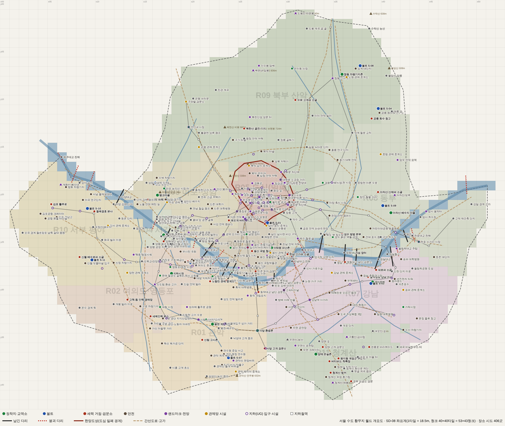

# 서울 폴아웃 기획서 세트

폴아웃 3의 시스템과 톤으로 **2277년의 서울**을 그리는 비상업 팬게임 기획서다. 그래픽은 쯔꾸르 RPG 스타일, 외부 심리스 오픈월드, 실시간 맵 전투로 만든다.

## 처음 읽는 순서

1. [SD-01 게임 개요](01_game-overview.md): 피치, 필러, 구조, 시스템·월드 요약, 볼륨, 로드맵, 결정 대기 항목, 문서 안내
2. [SC-00 컨셉 바이블](00_concept.md) v1.0: 확정 결정(K1~K8)과 고정 명칭의 정본
3. 목적별 문서: SD-01 §문서 안내의 읽는 순서를 따른다

## 구성

| 묶음 | 문서 |
|---|---|
| 바이블·개요 | [00 컨셉](00_concept.md), [01 게임 개요](01_game-overview.md) |
| 세계·이야기 | [02 세계관·연표](02_world-and-lore.md), [03a 메인 스토리 1부](03a_main-story-part1.md), [03b 메인 스토리 2부·엔딩](03b_main-story-part2.md) |
| 퀘스트 | [04a 남부 사이드](04a_side-quests-south.md), [04b 서부·한강 사이드](04b_side-quests-west-river.md), [04c 북부·동부·도심 사이드](04c_side-quests-north-east-center.md), [04d 세력 퀘스트 라인](04d_faction-questlines.md), [05 비표시·반복·인카운터](05_misc-quests-encounters.md) |
| 세력·인물 | [06 세력·호감도·판도](06_factions.md), [07a 주요 인물](07a_characters-major.md), [07b NPC 디렉터리](07b_npc-directory.md) |
| 월드·장소 | [08 월드·좌표계](08_world-regions.md), [09a 관악·여의도](09a_locations-r01-r02.md), [09b 마포·서강·서부](09b_locations-r03-r04-r10.md), [09c 도심·용산](09c_locations-r05-r06.md), [09d 강남·청계산](09d_locations-r07-r11.md), [09e 동부·북부](09e_locations-r08-r09.md), [09f 지하·한강](09f_locations-underground-river.md) |
| 시스템 | [10 캐릭터](10_character-system.md), [11 전투·상태](11_combat-system.md), [12 탐험·UI](12_exploration-ui.md), [13 아이템](13_items.md), [14 크리처·적](14_creatures-enemies.md), [15 경제](15_economy.md) |
| 제작 | [16 아트 디렉션](16_art-direction.md), [17 사운드](17_sound.md), [18 용어·명명](18_naming-terms.md) |
| 부속 | [maps/](maps/) 월드·도심·권역별 지도와 장소 좌표 CSV, [research/](research/) 조사 자료 SR-01~05 |

## 지도

## 볼륨 (v1.0)

메인 퀘스트 41 · 지도 표시 사이드 75 · 세력 퀘스트 69 · 비표시 124 · 반복 55 · 랜덤 인카운터 157 · 장소 425 · 대화 가능한 이름 있는 NPC 735 · 결말 5갈래(결말 슬라이드 48)

## 정본 우선순위

바이블(00) > 메인 스토리(03a·03b) > 세력(06) > 월드 좌표(08) > 장소(09a~f) > 그 밖의 문서

## 관련 자료

- 원작 폴아웃 3 역기획서 세트: [../reverse-design/](../reverse-design/00_README.md)

Fallout과 관련 명칭·설정은 Bethesda Softworks LLC(ZeniMax Media)의 상표이자 저작물이다. 이 문서 세트는 비상업 팬 프로젝트의 내부 기획 자료다.
